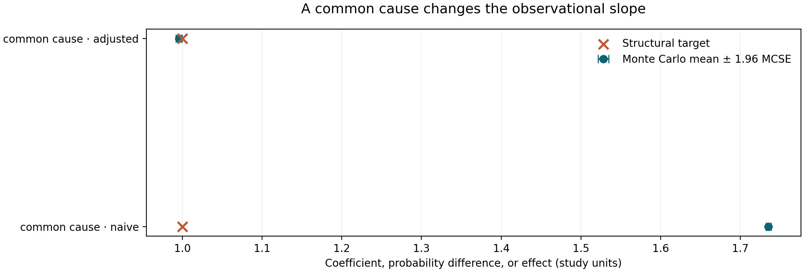
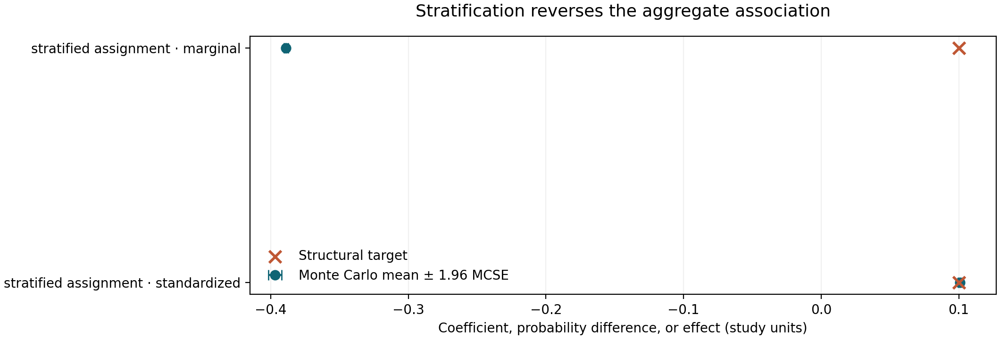
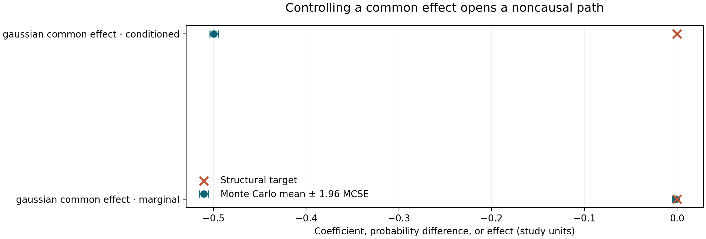
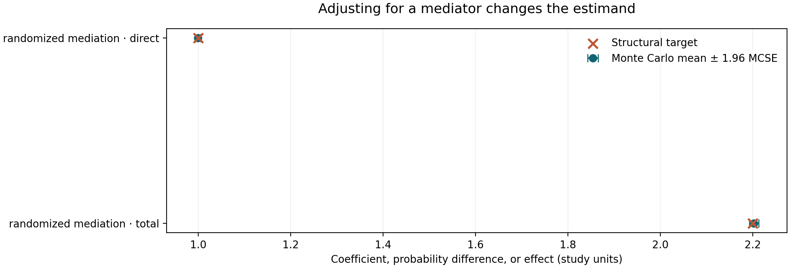
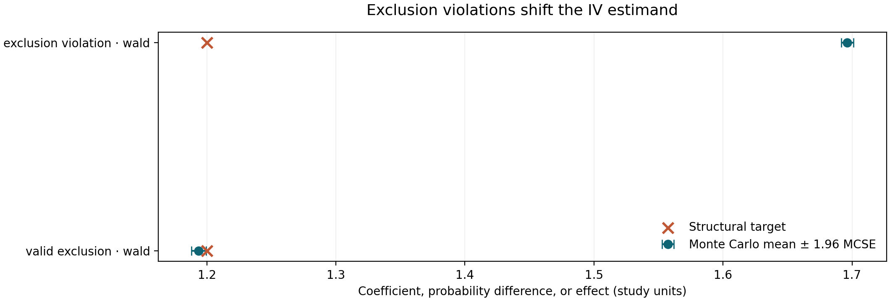

# A Correlation Is Not a Mechanism: Confounding, Collider Bias, and the Limits of Observational Evidence

*When a model predicts an outcome, it describes a relationship in the data. Whether changing its inputs would change the outcome is a different question. Nine reproducible experiments show why the distinction matters.*

A hospital finds that patients who received an intensive intervention had worse outcomes than patients who received routine care. A retailer discovers that customers who received discount vouchers spent more money. A public authority notices that neighbourhoods with higher policing intensity report more crime. An industrial team finds that equipment maintained more often fails more frequently.

Each association can be real. Each can also be misleading as evidence about what would happen if somebody deliberately changed treatment, voucher distribution, policing, or maintenance.

The basic difficulty is not that data scientists have chosen the wrong correlation coefficient. The problem is that observational data are generated by decisions, institutions, exposure patterns, measurement systems, and selection mechanisms. Those processes can create an association between two variables even when changing one would not change the other. Conversely, they can conceal or reverse a genuine causal effect.

A predictive model asks, in essence, which outcomes are likely among observations with certain features. A causal analysis asks what outcomes would occur if we intervened on a specific variable while the rest of the relevant system responded according to its structural mechanisms. Both questions involve probability distributions. They require different assumptions.

This article develops that distinction with nine deterministic, synthetic experiments. We move from ordinary confounding to Simpson's paradox, collider bias, mediation, instrumental variables, covariate adjustment, weak overlap, causal nonidentification, and the gap between prediction and intervention. The experiments are accompanied by open Python implementations, replicate-level CSV tables, a Jupyter notebook, and nine figures. Every numerical result cited below comes from the archived 300-replication simulations, not from a real clinical, commercial, or policy dataset.

The point is not that observational studies are useless. Often they are indispensable. The point is to separate what a dataset actually identifies from what the analyst hopes it identifies.

## 1. An observational difference is not automatically a treatment effect

Consider a binary treatment T and an outcome Y. For each unit, imagine two potential outcomes: Y(1), the outcome under treatment, and Y(0), the outcome without treatment. The population average treatment effect (ATE) is the average difference between those two potential outcomes.

We do not observe both outcomes for the same unit under the same conditions. That is the fundamental problem of causal inference. For a particular treated person, the untreated outcome remains counterfactual; for an untreated person, the treated outcome remains counterfactual.

The observed difference between the mean outcome of treated units and the mean outcome of untreated units is therefore not, by definition, the ATE. It compares different groups of units, with possibly different characteristics and different reasons for receiving treatment.

In a randomized experiment with adequate implementation, treatment assignment breaks the systematic link between treatment and baseline potential outcomes, at least in expectation. In an observational study, assignment may depend on clinical severity, customer intent, geography, organizational discretion, income, previous exposure, or unrecorded variables. An outcome difference can then combine the treatment effect with differences that were already present.

A useful conceptual decomposition is:

> Observed difference = causal contribution + differences in the groups being compared.

This expression is descriptive, not a universal additive identity independent of the estimand and model. In a linear structural model, however, an exact omitted-variable bias formula makes the idea precise.

Three conditions appear repeatedly in observational identification arguments:

- **Consistency:** the outcome observed under the treatment a unit actually received corresponds to the relevant potential outcome under that treatment. This demands an adequately specified intervention and consideration of treatment versions and interference.
- **Conditional exchangeability:** after conditioning on suitable pre-treatment variables, treated and untreated units are comparable in their potential outcomes.
- **Positivity:** among units in the target population and covariate strata, each treatment of interest has a nonzero assignment probability.

These are not properties that a regression routine verifies. A high model score does not establish exchangeability. A complete dataset does not establish consistency. Adding more rows does not restore treatment overlap where relevant strata were never treated.

Hernán and Robins develop the potential-outcome framework and its identification assumptions in *Causal Inference: What If* ([free book](https://miguelhernan.org/whatifbook)). Greenland, Pearl, and Robins explain how causal graphs expose the pathways that observational comparisons can inadvertently leave open in their 1999 paper, [“Causal Diagrams for Epidemiologic Research”](https://pubmed.ncbi.nlm.nih.gov/9888278/).

Both frameworks demand something that ordinary predictive modelling does not: an explicit account of the system that generates exposure and outcomes.

## 2. Confounding: the common cause that appears inside a coefficient

Our first experiment uses a linear system with one unobserved-or-observed common cause, U. The treatment T depends on U, and the outcome Y depends on both T and U:

T = 1.2 U + treatment noise

Y = 1.0 T + 1.5 U + outcome noise

All disturbances are independent standard Gaussian draws. The structural effect of changing T by one unit, holding the intervention mechanism fixed, is exactly 1.0. U is a common cause because it drives both treatment and outcome.

If an analyst regresses Y only on T, the resulting slope contains the causal coefficient and a contribution from U. For this particular system, the population slope is:

1.0 + (1.2 × 1.5) / (1.2² + 1) = approximately 1.738.

The excess above 1.0 is not a property of the intervention. It is the portion of the observational association that travels through the open backdoor path from T through U to Y.

In the simulation, 300 independent datasets of 1,000 observations produce a mean naive slope of 1.7353. When the correctly measured U is included in the regression, the mean treatment coefficient is 0.9958, close to the known structural effect of 1.0.

*Figure 1. The naive estimate combines treatment and common-cause association. Adjustment for the measured common cause recovers the target in this specified linear model. Points represent Monte Carlo means; whiskers show uncertainty in those means, not uncertainty for an individual observational dataset.*

The distinction between a variable being available and it being appropriate for adjustment matters. We deliberately observe U in this experiment so that the adjusted analysis can be compared with the naive analysis. In a real study, the relevant common cause may be unmeasured or poorly measured. A proxy might not block the path. Worse, a variable selected because it predicts Y might be a mediator or collider rather than a confounder.

A regression coefficient can be statistically precise and causally biased at the same time. If the sample grows and the confounding structure remains unchanged, the standard error shrinks around the wrong population quantity. More data can make the analyst more certain about the wrong answer.

This is why “control for all variables” is not a defensible general rule. A confounder is defined by its causal role, not by its p-value or predictive feature importance. Temporal ordering helps, but even a pre-treatment variable can be a collider in the relevant graph. The adjustment set must be justified by how the variables were generated.

For practitioners, the first audit question is therefore not whether the regression is linear, regularized, or flexible enough. It is: **why did the treated units receive treatment, and which of those reasons also influence the outcome?**

## 3. Simpson's paradox: when aggregation changes the sign

Simpson's paradox is often introduced as an arithmetic curiosity. In causal work it is a warning that marginal and conditional comparisons answer different questions, and that their disagreement can be driven by treatment allocation across strata.

Imagine two subpopulations. One has a baseline response probability of 10%; the other has a baseline response probability of 80%. Treatment increases response probability by ten percentage points in both groups. Within either subpopulation, its effect is positive.

Now suppose treatment is given predominantly in the low-baseline group. Among the high-baseline group, treatment is uncommon. Untreated observations then consist disproportionately of people from the high-baseline group, while treated observations are concentrated among people from the low-baseline group.

Under our exact assignment design, the treated population has an expected 15% representation from the high-baseline group, whereas the untreated population has 85%. The marginal expected response probabilities become:

- Treated: 0.15 × 0.90 + 0.85 × 0.20 = 0.305.
- Untreated: 0.85 × 0.80 + 0.15 × 0.10 = 0.695.

The marginal treated-minus-untreated difference is therefore −0.39, despite a true +0.10 treatment effect within each stratum. The sign reversal is not caused by a negative treatment effect. It is caused by the very different compositions of the two observed treatment groups.

Across 300 simulated datasets of 4,000 observations, the mean marginal difference is −0.3889. A standardized contrast that gives each stratum half of the target population weight has mean +0.1010. The simulation reproduces the exact reversal expected from the assignment mechanism.

*Figure 2. The aggregate treated-minus-untreated difference is negative because treatment groups have different baseline-risk compositions. Standardization restores the within-stratum contrast in this synthetic example.*

There are several traps in turning this demonstration into a causal rule.

First, stratification does not always resolve the right estimand. If the stratification variable is caused by treatment, the within-stratum comparison may condition on a mediator or a descendant. If it is a collider, the adjustment can create bias that was absent before stratification.

Second, group-specific comparisons are not automatically causal because they are internally consistent. Within a stratum there may still be unmeasured differences that drive treatment choice. Our simulated assignment is intentionally simple so that the theoretical contrast is known. Real assignment is rarely so transparent.

Third, the desired weighting of strata depends on the target population. A policy meant for the whole population may require population-standardized contrasts. A policy meant only for treated units may call for an effect among the treated. There is no universally correct “adjusted coefficient” independent of the question.

Simpson's paradox is therefore about more than aggregation. It forces us to distinguish **population composition**, **causal identification**, and **the target of the decision**. The paradox disappears as a conceptual puzzle once those three are made explicit, even though its numerical reversal can remain startling.

The practical check is straightforward: before celebrating a marginal association, examine who is in each group and whether the same pattern survives a scientifically justified comparison within relevant strata. Then ask whether the strata themselves belong in the adjustment set.

## 4. Collider bias: controlling a variable can manufacture an association

A confounder causes both treatment and outcome. A collider is a common effect of two variables. Its role is quite different.

Suppose T and U are initially independent. Both affect a variable C. If we select observations based on C or statistically condition on C, knowledge of T tells us something about U that was not true in the unconditioned population.

A simple intuition is a competitive admissions process. Imagine that admission can be obtained through a strong examination score or exceptional prior experience. Within the admitted group, a lower examination score is more likely to coincide with higher experience, because one strength can compensate for the other. The variables can become negatively associated *among admitted applicants* even if they were independent in the full applicant population.

In our Gaussian simulation:

C = T + U + noise

Y = U + outcome noise

There is deliberately no arrow from T to Y. Changing T does not change Y, so the causal effect is zero. T and U are independent before conditioning on C.

A regression of Y on T alone gives a mean slope of −0.0012 across 300 datasets, consistent with zero. But when the regression also includes C, the mean slope for T becomes −0.4994. The exact population coefficient under unit-variance collider noise is −0.5.

*Figure 3. Marginally independent causes acquire a negative conditional relationship when the analyst controls their shared effect. The structural effect of T on Y remains zero.*

This is not ordinary omitted-variable bias. The problem appears because we included a variable. The path T → C ← U → Y is blocked at C when we do not condition on C, but conditioning opens the path.

The mechanism arises in many settings:

- Hospital records contain only people admitted because of combinations of symptoms and risk factors.
- Employee performance analysis includes only workers who passed a selective hiring process.
- Customer analytics includes only users who responded to a campaign or completed a transaction.
- A sensor-validation dataset includes only periods that passed a quality gate influenced by multiple system states.

In each case, participation or selection can be a common effect. Restricting the analysis to selected observations is mathematically similar to conditioning on the selection variable. A relationship can appear, disappear, or change sign in the selected sample.

The collider example also explains why sophisticated feature-selection algorithms cannot determine valid adjustment sets. If C is highly predictive of Y, a model may insist on including it. For prediction that may be sensible. For estimating T's intervention effect, inclusion can be damaging.

The correct response is not to avoid conditioning altogether. It is to identify whether a proposed control blocks a noncausal backdoor path or opens one, and whether conditioning changes the population or estimand of interest. Graphical causal models provide a disciplined language for making that decision. Their value is not that every drawn arrow is certainly correct, but that uncertainty about arrows becomes visible and can be discussed.

## 5. Mediation: an adjusted effect may answer a different question

A treatment can influence an outcome through several pathways. Sometimes part of its effect operates through an intermediate variable, or mediator. If we control for that mediator, the treatment coefficient may no longer represent the total effect.

Consider a randomized intervention T that changes an intermediate quantity M:

M = 0.8 T + mediator noise

Y = 1.0 T + 1.5 M + outcome noise

The direct pathway from T to Y contributes 1.0 for a unit change in T. The pathway through M contributes 0.8 × 1.5 = 1.2. The total causal effect is 2.2.

If we regress Y on T without M, random assignment allows us to estimate the total effect. If we include M, the treatment coefficient becomes 1.0 in this additive structural system. Neither number is inherently wrong. They answer different questions.

Over 300 datasets, the mean estimated total effect is 2.2026. The mean coefficient conditional on M is 0.9990.

*Figure 4. Adjusting for the mediator removes the mediated component from the treatment coefficient in the stipulated linear model. The target shifts from a total effect of 2.2 to a controlled direct effect of 1.0.*

This is a particularly common source of confusion in organizational analytics. Suppose a training programme increases productivity partly because it improves staff confidence. If the objective is to estimate the programme's overall productivity impact, adjusting for confidence measured after training can remove part of the very effect being studied. Likewise, an intervention that reduces hospital complications by shortening a risky procedure should not automatically be evaluated by controlling away procedure duration if duration is on the causal pathway.

The mediation problem is more subtle outside this clean experiment. Randomization of T alone does not guarantee that mediator-outcome relationships are unconfounded. If an unmeasured variable affects both M and Y, regression adjustment can be biased. If treatment affects a mediator-outcome confounder, common mediation decompositions require additional care. Natural direct and indirect effects involve cross-world counterfactual statements and assumptions beyond those used for the total effect.

Our experiment intentionally avoids those complications. It illustrates the difference between a total and a controlled direct effect under a simple additive design. It does not claim that the regression coefficient identifies every possible mediation estimand in realistic observational data.

The practical rule is to define the effect before specifying the regression. Do we want the consequence of implementing the intervention with all its downstream pathways? Or do we want the consequence of changing treatment while holding a particular intermediate variable fixed? These are different policies, and their estimators should not be compared as though one were a universally superior adjustment.

## 6. Instrumental variables: a powerful idea with a fragile exclusion assumption

When treatment is confounded, an instrumental variable can sometimes supply variation in treatment that is independent of the unmeasured causes of the outcome.

An ideal instrument Z must influence treatment T, but it must not affect Y through pathways other than the treatment, and it must be appropriately independent of relevant latent causes. Additional assumptions may be required for a particular causal interpretation, especially with heterogeneous effects and noncompliance.

These conditions are substantive. They cannot be inferred merely because Z strongly predicts T.

Our experiment uses continuous Gaussian variables and an explicit linear structural model:

T = 0.8 Z + U + treatment noise

Y = 1.2 T + γ Z + 1.5 U + outcome noise

The coefficient 1.2 is the true intervention effect of T. The latent U confounds the observational T–Y relationship. Z is generated independently of U, making it a possible instrument.

When γ = 0, Z has no direct pathway to Y. The population Wald ratio—the association between Z and Y divided by the association between Z and T—equals 1.2. In the 300 simulated samples, its mean is 1.1937.

When γ = 0.4, the instrument directly affects Y as well. The exclusion restriction fails. The population Wald ratio becomes 1.2 + 0.4/0.8 = 1.7, despite the structural treatment effect remaining 1.2. The simulated mean is 1.6964.

*Figure 5. The same relevant instrument is valid in one structural system and invalid in another. A direct Z-to-Y path shifts the IV estimand without changing the treatment effect.*

A plausible instrument is not automatically a valid instrument. Consider distance to a service provider, encouragement messages, institutional assignment rules, or policy timing. Each may affect treatment uptake. Each may also alter outcomes through access, information, expectations, resources, or other channels not mediated by the treatment of interest.

It is tempting to test exclusion by adding more covariates or demonstrating a statistically significant first stage. Neither establishes the exclusion restriction. The assumption is often defended through design knowledge, institutional evidence, negative controls, falsification tests, or careful sensitivity analysis. Even then, its credibility remains an argument, not a machine-generated certificate.

There is also an estimand distinction. The well-known results of Angrist, Imbens, and Rubin show how, under specified assumptions, instrumental-variable methods with treatment noncompliance can identify a local average treatment effect for compliers rather than a generic ATE ([JASA, 1996](https://doi.org/10.1080/01621459.1996.10476902)). Our simulation is an additive, homogeneous-effect linear model and should not be casually presented as a general LATE demonstration.

The broader lesson is that a clever estimation method cannot compensate for an implausible causal design. A strong first stage improves precision relative to a weak instrument, all else equal, but it does not cure direct effects, hidden instrument-outcome confounding, or a badly specified intervention.

---
 
*Manuscript in progress: Sections 7–12, the conclusion, and the complete bibliography will follow. The results above are checked against the repository's scientific audit. Until those sections are complete, this article is not ready for publication.*
