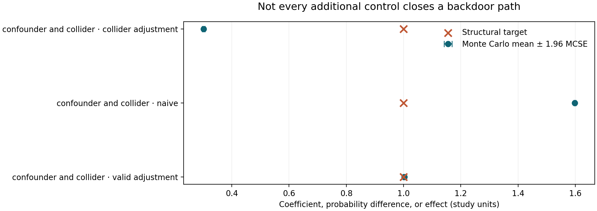
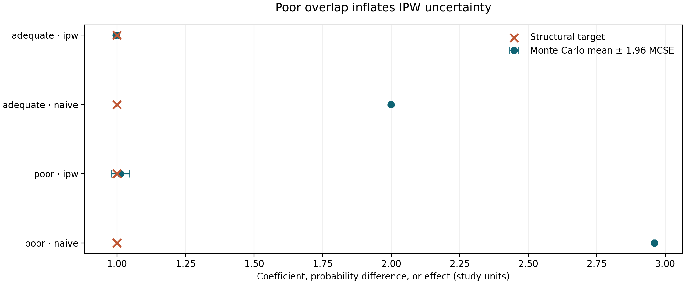
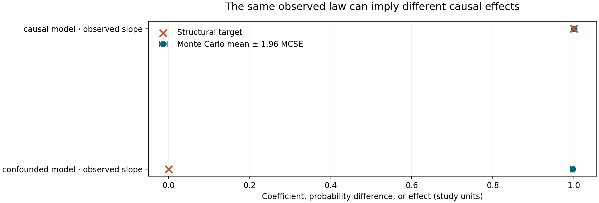
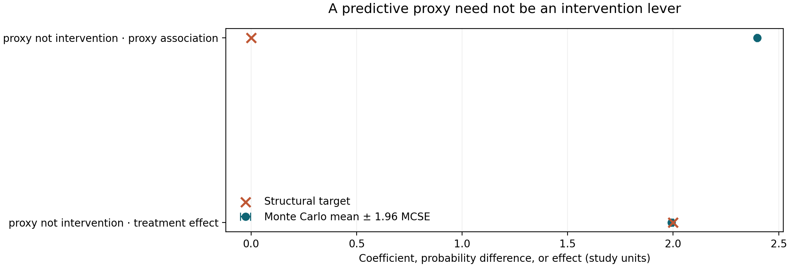

# A Correlation Is Not a Mechanism: Confounding, Collider Bias, and the Limits of Observational Evidence

*When a model predicts an outcome, it describes a relationship in the data. Whether changing its inputs would change the outcome is a different question. Nine reproducible experiments show why the distinction matters.*

A hospital finds that patients who received an intensive intervention had worse outcomes than patients who received routine care. A retailer discovers that customers who received discount vouchers spent more money. A public authority notices that neighbourhoods with higher policing intensity report more crime. An industrial team finds that equipment maintained more often fails more frequently.

Each association can be real. Each can also be misleading as evidence about what would happen if somebody deliberately changed treatment, voucher distribution, policing, or maintenance.

The basic difficulty is not that data scientists have chosen the wrong correlation coefficient. The problem is that observational data are generated by decisions, institutions, exposure patterns, measurement systems, and selection mechanisms. Those processes can create an association between two variables even when changing one would not change the other. Conversely, they can conceal or reverse a genuine causal effect.

A predictive model asks, in essence, which outcomes are likely among observations with certain features. A causal analysis asks what outcomes would occur if we intervened on a specific variable while the rest of the relevant system responded according to its structural mechanisms. Both questions involve probability distributions. They require different assumptions.

This article develops that distinction with nine deterministic, synthetic experiments. We move from ordinary confounding to Simpson's paradox, collider bias, mediation, instrumental variables, covariate adjustment, weak overlap, causal nonidentification, and the gap between prediction and intervention. The experiments are accompanied by open Python implementations, replicate-level CSV tables, a Jupyter notebook, and nine figures. Every numerical result cited below comes from the archived 300-replication simulations, not from a real clinical, commercial, or policy dataset.

The point is not that observational studies are useless. Often they are indispensable. The point is to separate what a dataset actually identifies from what the analyst hopes it identifies.

## 1. An observational difference is not automatically a treatment effect

Consider a binary treatment T and an outcome Y. For each unit, imagine two potential outcomes: Y(1), the outcome under treatment, and Y(0), the outcome without treatment. The population average treatment effect (ATE) is the average difference between those two potential outcomes.

We do not observe both outcomes for the same unit under the same conditions. That is the fundamental problem of causal inference. For a particular treated person, the untreated outcome remains counterfactual; for an untreated person, the treated outcome remains counterfactual.

The observed difference between the mean outcome of treated units and the mean outcome of untreated units is therefore not, by definition, the ATE. It compares different groups of units, with possibly different characteristics and different reasons for receiving treatment.

In a randomized experiment with adequate implementation, treatment assignment breaks the systematic link between treatment and baseline potential outcomes, at least in expectation. In an observational study, assignment may depend on clinical severity, customer intent, geography, organizational discretion, income, previous exposure, or unrecorded variables. An outcome difference can then combine the treatment effect with differences that were already present.

A useful conceptual decomposition is:

> Observed difference = causal contribution + differences in the groups being compared.

This expression is descriptive, not a universal additive identity independent of the estimand and model. In a linear structural model, however, an exact omitted-variable bias formula makes the idea precise.

Three conditions appear repeatedly in observational identification arguments:

- **Consistency:** the outcome observed under the treatment a unit actually received corresponds to the relevant potential outcome under that treatment. This demands an adequately specified intervention and consideration of treatment versions and interference.
- **Conditional exchangeability:** after conditioning on suitable pre-treatment variables, treated and untreated units are comparable in their potential outcomes.
- **Positivity:** among units in the target population and covariate strata, each treatment of interest has a nonzero assignment probability.

These are not properties that a regression routine verifies. A high model score does not establish exchangeability. A complete dataset does not establish consistency. Adding more rows does not restore treatment overlap where relevant strata were never treated.

Hernán and Robins develop the potential-outcome framework and its identification assumptions in *Causal Inference: What If* ([free book](https://miguelhernan.org/whatifbook)). Greenland, Pearl, and Robins explain how causal graphs expose the pathways that observational comparisons can inadvertently leave open in their 1999 paper, [“Causal Diagrams for Epidemiologic Research”](https://pubmed.ncbi.nlm.nih.gov/9888278/).

Both frameworks demand something that ordinary predictive modelling does not: an explicit account of the system that generates exposure and outcomes.

## 2. Confounding: the common cause that appears inside a coefficient

Our first experiment uses a linear system with one unobserved-or-observed common cause, U. The treatment T depends on U, and the outcome Y depends on both T and U:

T = 1.2 U + treatment noise

Y = 1.0 T + 1.5 U + outcome noise

All disturbances are independent standard Gaussian draws. The structural effect of changing T by one unit, holding the intervention mechanism fixed, is exactly 1.0. U is a common cause because it drives both treatment and outcome.

If an analyst regresses Y only on T, the resulting slope contains the causal coefficient and a contribution from U. For this particular system, the population slope is:

1.0 + (1.2 × 1.5) / (1.2² + 1) = approximately 1.738.

The excess above 1.0 is not a property of the intervention. It is the portion of the observational association that travels through the open backdoor path from T through U to Y.

In the simulation, 300 independent datasets of 1,000 observations produce a mean naive slope of 1.7353. When the correctly measured U is included in the regression, the mean treatment coefficient is 0.9958, close to the known structural effect of 1.0.

*Figure 1. The naive estimate combines treatment and common-cause association. Adjustment for the measured common cause recovers the target in this specified linear model. Points represent Monte Carlo means; whiskers show uncertainty in those means, not uncertainty for an individual observational dataset.*

The distinction between a variable being available and it being appropriate for adjustment matters. We deliberately observe U in this experiment so that the adjusted analysis can be compared with the naive analysis. In a real study, the relevant common cause may be unmeasured or poorly measured. A proxy might not block the path. Worse, a variable selected because it predicts Y might be a mediator or collider rather than a confounder.

A regression coefficient can be statistically precise and causally biased at the same time. If the sample grows and the confounding structure remains unchanged, the standard error shrinks around the wrong population quantity. More data can make the analyst more certain about the wrong answer.

This is why “control for all variables” is not a defensible general rule. A confounder is defined by its causal role, not by its p-value or predictive feature importance. Temporal ordering helps, but even a pre-treatment variable can be a collider in the relevant graph. The adjustment set must be justified by how the variables were generated.

For practitioners, the first audit question is therefore not whether the regression is linear, regularized, or flexible enough. It is: **why did the treated units receive treatment, and which of those reasons also influence the outcome?**

## 3. Simpson's paradox: when aggregation changes the sign

Simpson's paradox is often introduced as an arithmetic curiosity. In causal work it is a warning that marginal and conditional comparisons answer different questions, and that their disagreement can be driven by treatment allocation across strata.

Imagine two subpopulations. One has a baseline response probability of 10%; the other has a baseline response probability of 80%. Treatment increases response probability by ten percentage points in both groups. Within either subpopulation, its effect is positive.

Now suppose treatment is given predominantly in the low-baseline group. Among the high-baseline group, treatment is uncommon. Untreated observations then consist disproportionately of people from the high-baseline group, while treated observations are concentrated among people from the low-baseline group.

Under our exact assignment design, the treated population has an expected 15% representation from the high-baseline group, whereas the untreated population has 85%. The marginal expected response probabilities become:

- Treated: 0.15 × 0.90 + 0.85 × 0.20 = 0.305.
- Untreated: 0.85 × 0.80 + 0.15 × 0.10 = 0.695.

The marginal treated-minus-untreated difference is therefore −0.39, despite a true +0.10 treatment effect within each stratum. The sign reversal is not caused by a negative treatment effect. It is caused by the very different compositions of the two observed treatment groups.

Across 300 simulated datasets of 4,000 observations, the mean marginal difference is −0.3889. A standardized contrast that gives each stratum half of the target population weight has mean +0.1010. The simulation reproduces the exact reversal expected from the assignment mechanism.

*Figure 2. The aggregate treated-minus-untreated difference is negative because treatment groups have different baseline-risk compositions. Standardization restores the within-stratum contrast in this synthetic example.*

There are several traps in turning this demonstration into a causal rule.

First, stratification does not always resolve the right estimand. If the stratification variable is caused by treatment, the within-stratum comparison may condition on a mediator or a descendant. If it is a collider, the adjustment can create bias that was absent before stratification.

Second, group-specific comparisons are not automatically causal because they are internally consistent. Within a stratum there may still be unmeasured differences that drive treatment choice. Our simulated assignment is intentionally simple so that the theoretical contrast is known. Real assignment is rarely so transparent.

Third, the desired weighting of strata depends on the target population. A policy meant for the whole population may require population-standardized contrasts. A policy meant only for treated units may call for an effect among the treated. There is no universally correct “adjusted coefficient” independent of the question.

Simpson's paradox is therefore about more than aggregation. It forces us to distinguish **population composition**, **causal identification**, and **the target of the decision**. The paradox disappears as a conceptual puzzle once those three are made explicit, even though its numerical reversal can remain startling.

The practical check is straightforward: before celebrating a marginal association, examine who is in each group and whether the same pattern survives a scientifically justified comparison within relevant strata. Then ask whether the strata themselves belong in the adjustment set.

## 4. Collider bias: controlling a variable can manufacture an association

A confounder causes both treatment and outcome. A collider is a common effect of two variables. Its role is quite different.

Suppose T and U are initially independent. Both affect a variable C. If we select observations based on C or statistically condition on C, knowledge of T tells us something about U that was not true in the unconditioned population.

A simple intuition is a competitive admissions process. Imagine that admission can be obtained through a strong examination score or exceptional prior experience. Within the admitted group, a lower examination score is more likely to coincide with higher experience, because one strength can compensate for the other. The variables can become negatively associated *among admitted applicants* even if they were independent in the full applicant population.

In our Gaussian simulation:

C = T + U + noise

Y = U + outcome noise

There is deliberately no arrow from T to Y. Changing T does not change Y, so the causal effect is zero. T and U are independent before conditioning on C.

A regression of Y on T alone gives a mean slope of −0.0012 across 300 datasets, consistent with zero. But when the regression also includes C, the mean slope for T becomes −0.4994. The exact population coefficient under unit-variance collider noise is −0.5.

*Figure 3. Marginally independent causes acquire a negative conditional relationship when the analyst controls their shared effect. The structural effect of T on Y remains zero.*

This is not ordinary omitted-variable bias. The problem appears because we included a variable. The path T → C ← U → Y is blocked at C when we do not condition on C, but conditioning opens the path.

The mechanism arises in many settings:

- Hospital records contain only people admitted because of combinations of symptoms and risk factors.
- Employee performance analysis includes only workers who passed a selective hiring process.
- Customer analytics includes only users who responded to a campaign or completed a transaction.
- A sensor-validation dataset includes only periods that passed a quality gate influenced by multiple system states.

In each case, participation or selection can be a common effect. Restricting the analysis to selected observations is mathematically similar to conditioning on the selection variable. A relationship can appear, disappear, or change sign in the selected sample.

The collider example also explains why sophisticated feature-selection algorithms cannot determine valid adjustment sets. If C is highly predictive of Y, a model may insist on including it. For prediction that may be sensible. For estimating T's intervention effect, inclusion can be damaging.

The correct response is not to avoid conditioning altogether. It is to identify whether a proposed control blocks a noncausal backdoor path or opens one, and whether conditioning changes the population or estimand of interest. Graphical causal models provide a disciplined language for making that decision. Their value is not that every drawn arrow is certainly correct, but that uncertainty about arrows becomes visible and can be discussed.

## 5. Mediation: an adjusted effect may answer a different question

A treatment can influence an outcome through several pathways. Sometimes part of its effect operates through an intermediate variable, or mediator. If we control for that mediator, the treatment coefficient may no longer represent the total effect.

Consider a randomized intervention T that changes an intermediate quantity M:

M = 0.8 T + mediator noise

Y = 1.0 T + 1.5 M + outcome noise

The direct pathway from T to Y contributes 1.0 for a unit change in T. The pathway through M contributes 0.8 × 1.5 = 1.2. The total causal effect is 2.2.

If we regress Y on T without M, random assignment allows us to estimate the total effect. If we include M, the treatment coefficient becomes 1.0 in this additive structural system. Neither number is inherently wrong. They answer different questions.

Over 300 datasets, the mean estimated total effect is 2.2026. The mean coefficient conditional on M is 0.9990.

*Figure 4. Adjusting for the mediator removes the mediated component from the treatment coefficient in the stipulated linear model. The target shifts from a total effect of 2.2 to a controlled direct effect of 1.0.*

This is a particularly common source of confusion in organizational analytics. Suppose a training programme increases productivity partly because it improves staff confidence. If the objective is to estimate the programme's overall productivity impact, adjusting for confidence measured after training can remove part of the very effect being studied. Likewise, an intervention that reduces hospital complications by shortening a risky procedure should not automatically be evaluated by controlling away procedure duration if duration is on the causal pathway.

The mediation problem is more subtle outside this clean experiment. Randomization of T alone does not guarantee that mediator-outcome relationships are unconfounded. If an unmeasured variable affects both M and Y, regression adjustment can be biased. If treatment affects a mediator-outcome confounder, common mediation decompositions require additional care. Natural direct and indirect effects involve cross-world counterfactual statements and assumptions beyond those used for the total effect.

Our experiment intentionally avoids those complications. It illustrates the difference between a total and a controlled direct effect under a simple additive design. It does not claim that the regression coefficient identifies every possible mediation estimand in realistic observational data.

The practical rule is to define the effect before specifying the regression. Do we want the consequence of implementing the intervention with all its downstream pathways? Or do we want the consequence of changing treatment while holding a particular intermediate variable fixed? These are different policies, and their estimators should not be compared as though one were a universally superior adjustment.

## 6. Instrumental variables: a powerful idea with a fragile exclusion assumption

When treatment is confounded, an instrumental variable can sometimes supply variation in treatment that is independent of the unmeasured causes of the outcome.

An ideal instrument Z must influence treatment T, but it must not affect Y through pathways other than the treatment, and it must be appropriately independent of relevant latent causes. Additional assumptions may be required for a particular causal interpretation, especially with heterogeneous effects and noncompliance.

These conditions are substantive. They cannot be inferred merely because Z strongly predicts T.

Our experiment uses continuous Gaussian variables and an explicit linear structural model:

T = 0.8 Z + U + treatment noise

Y = 1.2 T + γ Z + 1.5 U + outcome noise

The coefficient 1.2 is the true intervention effect of T. The latent U confounds the observational T–Y relationship. Z is generated independently of U, making it a possible instrument.

When γ = 0, Z has no direct pathway to Y. The population Wald ratio—the association between Z and Y divided by the association between Z and T—equals 1.2. In the 300 simulated samples, its mean is 1.1937.

When γ = 0.4, the instrument directly affects Y as well. The exclusion restriction fails. The population Wald ratio becomes 1.2 + 0.4/0.8 = 1.7, despite the structural treatment effect remaining 1.2. The simulated mean is 1.6964.

*Figure 5. The same relevant instrument is valid in one structural system and invalid in another. A direct Z-to-Y path shifts the IV estimand without changing the treatment effect.*

A plausible instrument is not automatically a valid instrument. Consider distance to a service provider, encouragement messages, institutional assignment rules, or policy timing. Each may affect treatment uptake. Each may also alter outcomes through access, information, expectations, resources, or other channels not mediated by the treatment of interest.

It is tempting to test exclusion by adding more covariates or demonstrating a statistically significant first stage. Neither establishes the exclusion restriction. The assumption is often defended through design knowledge, institutional evidence, negative controls, falsification tests, or careful sensitivity analysis. Even then, its credibility remains an argument, not a machine-generated certificate.

There is also an estimand distinction. The well-known results of Angrist, Imbens, and Rubin show how, under specified assumptions, instrumental-variable methods with treatment noncompliance can identify a local average treatment effect for compliers rather than a generic ATE ([JASA, 1996](https://doi.org/10.1080/01621459.1996.10476902)). Our simulation is an additive, homogeneous-effect linear model and should not be casually presented as a general LATE demonstration.

The broader lesson is that a clever estimation method cannot compensate for an implausible causal design. A strong first stage improves precision relative to a weak instrument, all else equal, but it does not cure direct effects, hidden instrument-outcome confounding, or a badly specified intervention.

## 7. Backdoor adjustment: why a longer feature list is not necessarily better

The backdoor criterion formalizes an idea that is easy to state and difficult to apply: for a causal effect of T on Y, we should block the paths that create noncausal association between them without blocking causal paths or opening new noncausal ones.

The word “backdoor” describes a path into the treatment through its causes. For example, if prior illness severity influences both a treatment decision and the eventual health outcome, comparing treated with untreated patients leaves a path through severity. Conditioning on appropriately measured severity may block that path. Yet conditioning on a variable caused by the treatment can change the target effect, and conditioning on a common effect can open a path that would otherwise remain closed.

A causal diagram does not make the assumptions true. It helps make the assumptions explicit enough that they can be challenged. Does the proposed confounder exist before treatment? Is it actually measured? Might an apparently convenient control be downstream of selection? Could a latent common cause connect the treatment, the control, and the outcome?

Our sixth experiment combines a genuine confounder U with a collider C. The treatment T depends on U. An independent cause V affects the outcome and also contributes to C. The treatment also causes C. The outcome has a structural effect of T equal to 1.0.

There are three plausible analyses:

1. Regress the outcome on treatment alone.
2. Adjust for the genuine pre-treatment confounder U.
3. Adjust for U and also include the collider C.

The first leaves confounding untreated. The second blocks the common-cause path. The third includes the valid confounder but opens the path through the collider, T → C ← V → Y.

The 300-replication results make the trade-off visible. The naive mean slope is 1.5983, overstating the true effect by about 0.5983. Adjustment for U gives a mean of 1.0030. Adding C moves the mean to 0.3016. In the exact population model, the collider-induced bias conditional on U is −0.7.

*Figure 6. An adjustment set that includes the common cause recovers the intervention effect. A larger set that also includes the collider produces substantial negative bias.*

This example matters because common machine-learning practices encourage analysts to maximize predictive information. If an analyst is estimating a causal effect, that strategy can conflict with identification. A variable that improves outcome prediction may not belong in the causal adjustment set.

The problem survives algorithmic sophistication. Linear regression can condition on the wrong variable. So can generalized additive models, random forests, boosting, deep networks, and doubly robust estimators. Flexible models may reduce functional-form bias conditional on their selected inputs, but they cannot infer from the observed joint distribution alone whether conditioning is causally appropriate.

There is a second danger: adjustment itself can create a target-population mismatch. Suppose a treatment policy would be implemented for everyone, but an observational analysis has limited overlap after stratification. The adjusted estimator might effectively describe the subset with comparable treatment probabilities, not the population for which the policy decision is being made. An analyst who reports an ATE without discussing which population is represented may hide a substantial change in the scientific question.

### The right kind of parsimony

Parsimony in causal modelling is not merely a desire to use fewer variables. It is a desire to use variables for which a defensible structural role has been established. Sometimes valid adjustment requires many confounders. Sometimes the correct set is small. Sometimes no observed adjustment set exists.

The distinction is therefore between a model selected to predict Y well and a design selected to identify a causal effect. The first may be judged against held-out prediction outcomes. The second must also be judged against knowledge of exposure assignment, timing, variable roles, selection, and unmeasured mechanisms.

This is a central contribution of Pearl's graphical framework, especially the discussion of intervention calculus and identification in the second edition of *Causality* ([Cambridge University Press, 2009](https://doi.org/10.1017/cbo9780511803161)). A graph is not an alternative to scientific knowledge; it is a formal representation of assumptions about that knowledge.

## 8. Positivity and overlap: identification can become numerically fragile

Conditional exchangeability is not enough. If treatment assignment is nearly deterministic within a relevant subgroup, even an unbiased estimation strategy can become extremely unstable.

Suppose a programme is assigned with a probability of 75% to one baseline group and 25% to another. We can compare treated and untreated units in both groups, although some observations receive larger inverse-probability weights than others. Now consider assignment probabilities of 99% and 1%. Comparisons still exist in theory, but only a tiny fraction of observations receive the uncommon treatment within each group.

Inverse-probability weighting attempts to reconstruct a target population by giving greater weight to observations whose actual treatment assignment was unlikely under their covariates. If the propensity score e(X) is the probability of treatment given baseline X, a treated unit may receive weight 1/e(X), while an untreated unit receives 1/[1−e(X)] for the relevant Horvitz–Thompson contrast.

This can remove confounding under correct assumptions and correct propensity specification. But a few rare observations can dominate the estimate. Those rare observations become disproportionately influential because the estimator is asking them to represent many units for whom the same treatment was seldom observed.

Our seventh experiment uses a binary baseline covariate. The treatment effect is fixed at 1.0, and the outcome also depends on that covariate. In the adequate-overlap scenario the assignment probabilities are 0.25 and 0.75; in the poor-overlap scenario they are 0.01 and 0.99. Both scenarios use the true propensity score, known by construction.

A naive treated-minus-untreated contrast is confounded in both scenarios. Its mean is approximately 1.9994 with adequate overlap and 2.9597 with poor overlap, despite the true effect of 1.0. Inverse-probability weighting corrects most of that confounding in expectation: mean estimates are 0.9960 and 1.0129, respectively.

The important difference lies in dispersion. The sampling standard deviation of the IPW estimate rises from 0.0696 in the adequate-overlap setting to 0.2843 in the poor-overlap setting, more than four times as large. The Monte Carlo mean remains close to the target because we have 300 independent replicates, but a single poor-overlap dataset may yield a highly variable estimate.

*Figure 7. Correctly specified weighting recovers the causal effect on average but becomes much noisier under near-positivity violations. The plot shows Monte Carlo means; the substantially larger individual-estimate sampling SD is documented in the archived CSVs.*

We can quantify weight concentration using the Kish effective sample size:

ESS = (sum of weights)² / (sum of squared weights).

In the symmetric binary-covariate model, the large-sample ESS fraction for the inverse assignment weights is 0.75 when the uncommon treatment probability is 0.25. It falls to 0.0396 when that probability is 0.01. In other words, a nominal sample of thousands can contain information equivalent to a much smaller equally weighted sample for the weighted analysis.

The ESS here summarizes a particular weight distribution; it is not a universal measure of causal identification or the variance of every possible estimator. It is one diagnostic among several, including propensity histograms, extreme-weight percentages, covariate overlap, stabilized-weight distributions, influence measures, and precision of the estimand actually reported.

### Why weight clipping is not a free correction

Analysts often cap or truncate inverse-probability weights to reduce variance. That can be sensible as part of a declared estimation strategy, but it introduces a new trade-off: the clipped estimator generally no longer corresponds to the original inverse-probability identity. Bias may return because observations in rare assignment strata no longer receive enough weight to reconstruct the target population.

The appropriate response may be to redefine the estimand for an overlap population, change the study design, collect additional data in poorly represented strata, or state that the original population effect is too weakly identified for useful precision. Merely reporting a narrow interval after trimming observations or weights can conceal that the scientific target has changed.

Cole and Hernán discuss the construction and limitations of inverse-probability weights, including practical compromises such as truncation, in [American Journal of Epidemiology (2008)](https://doi.org/10.1093/aje/kwn164). Rosenbaum and Rubin's foundational propensity-score paper explains why balancing on the treatment-assignment probability is valuable under strongly ignorable assignment, but it never makes unmeasured confounding disappear ([Biometrika, 1983](https://doi.org/10.1093/biomet/70.1.41)).

The most important lesson from overlap is neither “use weights” nor “avoid weights.” It is that a proposed intervention must be supported by observed comparisons over the covariate range of the target population. Where those comparisons scarcely exist, mathematical correction can become more fragile than the headline sample size suggests.

## 9. Unmeasured confounding: when the data cannot distinguish two worlds

The first six experiments show how certain analytic choices can be biased. The eighth makes a deeper point: sometimes the observed data cannot determine the causal effect even with infinite sample size and a perfectly estimated observational distribution.

This is not a complaint about low statistical power. It is a failure of identification. There are multiple causal systems compatible with exactly the same observational distribution, and those systems imply different results from intervening on T.

Our experiment constructs two joint Gaussian models.

In Model A, treatment T is a standard Gaussian variable and the outcome is Y = T + independent Gaussian noise with variance four. The intervention effect of increasing T by one unit is exactly 1.0.

In Model B, a latent variable U influences both T and Y. Treatment is generated as 0.5 U plus independent noise with variance 0.75. The outcome is generated as 2 U plus independent noise with variance one. There is no causal arrow from T to Y, so changing T has no effect on Y.

The two observational systems have the same means and exactly the same covariance matrix:

- Var(T) = 1.
- Var(Y) = 5.
- Cov(T,Y) = 1.

For a bivariate Gaussian distribution, those moments specify the entire observational joint law. As a result, Models A and B cannot be distinguished by any analysis restricted to the observed pairs (T,Y), however large the sample and however complex the estimator.

The observational regression slope equals Cov(T,Y)/Var(T) = 1 in both systems.

The 300-replication mean slopes are 1.0008 in the causal model and 0.9970 in the confounded model. Yet the structural effects are 1.0 and 0.0, respectively.

*Figure 8. Both datasets support an observational slope close to one. Their intervention effects are different. The discrepancy is structural, not an estimation failure.*

This demonstration puts a hard limit on the slogan that sufficiently large datasets will reveal what causes what. A larger dataset allows us to estimate the observational law more accurately. It does not choose between observationally equivalent causal models.

Machine learning does not remove that limitation. A flexible learner can approximate the conditional expectation of Y given T and other observed features. If two causal models imply the same observed conditional distribution, they give the learner the same training target. Without a new assumption, randomized variation, an instrument, an informative intervention, or additional measurements, the causal ambiguity persists.

The practical implication is that confidence intervals are not a complete uncertainty statement for observational causal claims. They often quantify sampling uncertainty conditional on the identification assumptions. They need not represent uncertainty about whether those assumptions are true.

### Sensitivity analysis is not an admission of failure

If unmeasured confounding is plausible, analysts should characterize the sensitivity of their conclusions to reasonable alternatives. Sensitivity analysis can ask how strongly a latent variable would need to affect treatment and outcome to explain the observed estimate, or how effect estimates move under explicit bias parameters.

One example is the E-value proposed by VanderWeele and Ding, designed for specified risk-ratio contrasts and assumptions ([Annals of Internal Medicine, 2017](https://pubmed.ncbi.nlm.nih.gov/28693043/)). An E-value does not prove that confounding is absent. It expresses a threshold of association strength under the method's sensitivity framework.

Other approaches include partial identification, bounding models, negative-control designs, alternative measurement assumptions, or transparent grids over latent bias parameters. Each approach trades additional assumptions for an interpretable description of what the evidence can and cannot rule out.

A point estimate plus a conventional standard error answers one narrow question: how much the estimator might vary under a particular model and repeated sampling. A causal sensitivity analysis asks a different question: how much the conclusion depends on a causal assumption that the observed data cannot test directly.

The second question is often the more consequential one.

## 10. Prediction versus intervention: a feature can matter without being a lever

Prediction and causal inference overlap in tools but not in targets. A variable can be valuable for forecasting Y and useless—or even dangerous—as a policy lever.

Imagine that an underlying latent state U affects both a measurable proxy X and the outcome Y. The proxy records information about U, but X itself does not cause Y. If we alter the recorded proxy while leaving U unchanged, the outcome does not move. Nevertheless, X can have a large and stable regression coefficient because it contains information about the latent state.

Our ninth experiment generates exactly such a situation. A randomized treatment T has a true intervention effect of 2.0. An independent latent variable U affects Y with coefficient 3.0. The measured proxy X equals U plus measurement noise. There is no structural arrow from X to Y.

A regression of Y on treatment and proxy produces a mean treatment coefficient of 1.9914, close to the randomized causal effect. It also produces a mean proxy coefficient of 2.3979. If the analyst interprets that proxy coefficient as the effect of changing X, the conclusion is causally wrong: X's intervention effect is zero by design.

*Figure 9. The proxy's observational coefficient is strongly positive, although intervening on the proxy measurement itself does not change the outcome. The treatment coefficient, in contrast, corresponds to a randomized causal effect.*

This distinction is important for feature importance dashboards. Permutation importance, SHAP values, model coefficients, and local explanations help characterize how a model uses observed features under a chosen reference distribution. They do not automatically describe the consequences of manipulating those features.

There is a reason the distinction can be difficult to communicate. In everyday language, “X matters for predicting Y” and “X matters for Y” sound nearly identical. In mathematics, the first concerns a conditional observational distribution. The second, if interpreted causally, concerns a distribution under an intervention.

A predictive variable may also be a genuine cause. The point is not that important features never cause outcomes. It is that predictive importance is insufficient evidence to establish causality.

A related error occurs in counterfactual product demonstrations. A user moves a slider in a dashboard and sees the predicted outcome change. Unless the model includes a defensible intervention mechanism, the slider may display a change in the fitted function rather than an estimate of what the world would do if that variable were actively changed.

A salary prediction model might respond to a hypothetical change in education, but the prediction may combine education with selection, aptitude, family background, cohort effects, and occupational pathways. A healthcare risk model might respond to changing a laboratory value without modelling the treatment needed to change it or its downstream effects. A demand model may show that high prices correlate with higher sales in periods of exceptional demand. None of these model responses alone identifies the effect of implementing the proposed action.

Hernán, Hsu, and Healy offer a useful taxonomy of data-science tasks in [“A Second Chance to Get Causal Inference Right” (2019)](https://doi.org/10.1080/09332480.2019.1579578), emphasizing that prediction and causal inference require different kinds of scientific knowledge even where they use similar algorithms.

### Why this matters for optimization

A company can build an accurate predictor and then optimize its inputs as though those inputs were independent control variables. This is a recipe for failure when the model's high-scoring variables are proxies, colliders, post-treatment states, or outputs of an institutional selection process.

The optimization algorithm will happily exploit any pattern in the predictive model. It does not know whether the chosen inputs are manipulable. It does not know whether the conditional relationship remains stable after the decision changes the system. It does not know whether acting on the feature alters the data-generating mechanism that made the feature predictive.

The familiar warning about Goodhart's law is related but not identical. Here the danger can arise before strategic adaptation: the model may simply lack a causal interpretation. Even if nobody responds strategically, optimizing an associational surface may be optimizing a statistical artifact.

A responsible decision workflow therefore separates the forecast layer from the intervention layer. The forecast can estimate what is likely under the current regime. The intervention model must address what changes under the proposed action, including feedback, constraints, compliance, spillovers, and uncertainty.

## 11. A practical identification audit before model fitting

None of these experiments implies that an observational analysis must begin with a perfect causal graph. In most real applications, the graph will be uncertain and incomplete. The more realistic objective is to make the causal question, design assumptions, and important vulnerabilities explicit before selecting an estimator.

A useful audit has several stages.

### Stage 1 — State the decision and treatment precisely

“Does marketing work?” is too vague. Does the intervention mean sending a particular email, assigning a discount, showing a page, or changing the frequency of contact? When is the intervention applied? To whom? Can multiple treatment versions produce different effects? Could one unit's treatment affect another's outcome?

Similarly, “Does maintenance reduce failure?” can mean scheduled maintenance, emergency repair, component replacement, or a change in inspection policy. Those actions are not interchangeable.

The treatment definition should be concrete enough that another analyst could, in principle, describe how to implement it.

### Stage 2 — Define the outcome and target population

An intervention effect requires an outcome, a time horizon, and a population. A short-term behavioural effect may differ from a long-term financial or health effect. An average effect for current customers may differ from an effect for newly acquired customers or the whole market.

The target population matters because treatment effects can be heterogeneous. Even a well-identified effect in one population may not transport automatically to another with different baseline risks, response mechanisms, or treatment delivery.

### Stage 3 — Draw the plausible time-ordered mechanism

List causes of treatment and outcome, measurement variables, mediators, selection gates, and plausible latent variables. Identify which variables existed before treatment and which were recorded afterwards. A baseline factor may be a confounder. An outcome measured after treatment may be a mediator. Admission, participation, or survival may act as selection colliders.

A graphical representation helps the team agree on what adjustment is intended to accomplish. If colleagues disagree about causal arrows, that disagreement is valuable information, because the identification result may depend on the disputed structure.

### Stage 4 — Identify the estimand before choosing the estimator

Do we want a population ATE, effect among the treated, subgroup-specific effect, controlled direct effect, local effect among compliers, or a policy value under a dynamic intervention? These are different quantities.

No amount of estimator tuning will fix a mismatch between the requested decision and the estimand that the design identifies.

### Stage 5 — State the identification assumptions explicitly

For conventional adjustment, specify which measured variables make treatment exchangeable and why. For inverse probability weights, show propensity overlap and the impact of large weights. For instrumental variables, argue for relevance, independence, exclusion, and the treatment-effect interpretation. For mediation, state which pathways and direct-effect definitions are being identified.

If a key assumption is implausible, acknowledge that limitation. Consider bounding the effect, designing a new experiment, using negative controls, or changing the claim from causal to associational.

### Stage 6 — Separate assumption uncertainty from statistical uncertainty

A 95% confidence interval does not usually incorporate every uncertainty about the causal graph. A bootstrap can resample observed rows while preserving the same unidentified relationship. A flexible nuisance model can improve prediction while still conditioning on the wrong variables.

Report standard errors and confidence intervals where appropriate, but also make clear the assumptions under which they support a causal interpretation. Sensitivity analysis should vary consequential assumptions, not only model hyperparameters.

### Stage 7 — Check whether the proposed intervention changes the regime

A decision rule may alter treatment assignment, customer behaviour, clinical pathways, or the distribution of covariates. A model estimated under one regime may not describe the new regime after intervention. This is particularly important for dynamic systems with feedback.

For a deployment decision, the question is not simply whether an estimator is unbiased under the historical data-generating process. It is whether the assumed intervention model remains credible once the policy is implemented.

### Stage 8 — Predefine falsification and negative-control checks

Where possible, identify outcomes that should not respond to treatment, exposures that should not affect the outcome, or timing relationships that would contradict the proposed causal story. These tests do not prove identification, but failures can expose specific weaknesses.

The strongest observational studies often combine a clear causal design with several independent diagnostics that could have challenged the preferred interpretation.

### Stage 9 — Be honest about what remains unknowable

If plausible causal models agree on the observational distribution and disagree on the intervention effect, the dataset alone cannot choose between them. Stating that limitation is a scientific result. It is not an embarrassment that should be hidden behind confidence intervals or another model family.

The audit is more demanding than a generic preprocessing checklist because it asks questions outside the dataframe. Yet those questions are precisely what allow an observational analysis to support decisions rather than merely describe associations.

## 12. The nine experiments, as a connected argument

Read together, the nine studies make one cumulative point rather than nine isolated warnings.

Confounding demonstrates that an observed coefficient can contain both intervention effects and common-cause association. Simpson's paradox shows how treatment assignment and population composition can even reverse the observed sign. Collider bias shows that an attempt to improve a regression by conditioning on an additional feature can manufacture an association where there is no causal effect.

Mediation then reveals a different failure mode: a coefficient can be valid for one causal estimand and invalid for another. Instrumental variables show how alternative sources of assignment variation can identify effects, but only under substantive restrictions such as exclusion. The backdoor-adjustment experiment demonstrates that an adjustment set should be justified structurally, not chosen by adding every predictive variable.

Overlap adds a numerical dimension: even when a causal quantity is identified under stated assumptions and the propensity score is known, finite-sample estimates can be unstable because some treatment-covariate combinations are rare. Nonidentification goes further: the available observational distribution may not identify the desired effect at all. Finally, prediction versus intervention shows why the same problem reappears when data-driven models are used as optimization engines.

These failures cannot be ranked by a single model metric. A high R² can coexist with confounding. A small p-value can describe a collider artifact. A strong instrumental first stage can coexist with a violated exclusion restriction. A narrow model-based interval can ignore uncertainty about identification. A large sample can make an observational association precisely estimated without making it causal.

The task is therefore to choose the evidence that matches the question, not simply to choose the estimator with the most attractive numerical performance.

### What the synthetic figures can and cannot establish

Our figures are controlled demonstrations. Their structural equations are known; random seeds are fixed; treatment and outcome noise are generated independently where stated; and the causal targets are determined algebraically. That makes them useful for checking the logic of estimators and visualizing how selection or adjustment affects results.

It also limits their generalizability. Real-world exposure assignment can be nonlinear, time-varying, subject to interference, and affected by measurement errors. Some policies have continuous doses, multiple treatment versions, dynamic adherence, or competing outcomes. Treatment effects may vary across covariates, and latent confounders need not be Gaussian. The nine examples are deliberately small enough that we can independently verify the mechanisms.

For those reasons, the displayed numerical gaps should not be treated as empirical effect sizes. A −0.5 collider coefficient in the simulation is not an estimate of collider bias in a hospital registry. A fourfold increase in IPW sampling dispersion under our propensity settings is not a universal factor for other weighting problems. A 2.4 regression coefficient for a predictive proxy is a property of our synthetic equations, not a general measure of proxy importance.

The results support conditional statements: *if* the data-generating process has the specified structure, *then* the corresponding adjustment or estimation choice behaves as shown. That is the correct inferential status of a simulation.

The full code, nine source models, 300 replications per study, 18 data archives, nine figures, notebook, scientific audit and CI workflow are included in the companion directory. The archive test independently regenerates all CSV fields from the code and compares floating-point results to a tight numerical tolerance. A fresh-kernel notebook execution and figure generation are also checked in GitHub Actions.

Reproducibility is necessary to trust that the numerical demonstrations say what the code says. It does not turn the synthetic assumptions into empirical facts about the world.

## Conclusion: the causal question has to come first

The most damaging causal mistake is sometimes not a wrong formula but a correctly executed formula applied to the wrong question.

A regression can be correct as a prediction and wrong as a treatment-effect estimator. An adjustment can reduce confounding or create collider bias. A stratified estimate can reveal a reversal while still depending on unmeasured within-stratum differences. An instrumental variable can exploit useful assignment variation while silently violating exclusion. A weighted estimator can be unbiased in expectation and unusably unstable in finite samples. Two models can fit the same observational distribution perfectly yet imply incompatible intervention effects.

These are not reasons to abandon observational science. They are reasons to be explicit about the estimand, treatment mechanism, target population, adjustment set, identification assumptions, and uncertainty that the data cannot resolve.

The practical sequence should be simple to remember:

1. Specify the intervention and the decision.
2. Define the causal estimand and target population.
3. Describe plausible pathways that generated treatment and outcomes.
4. Identify which assumptions make the estimand recoverable.
5. Choose an estimator compatible with that design.
6. Test sensitivity to assumptions the observations cannot verify.
7. Communicate what the study supports—and what it does not.

Prediction is valuable. Association is informative. Neither is automatically a mechanism.

The best causal analysis is not the one that produces the most impressive coefficient. It is the one whose answer still makes sense when somebody asks: *what, precisely, would happen if we actually did this?*

## References and further reading

- Angrist, J. D., Imbens, G. W., & Rubin, D. B. (1996). [Identification of Causal Effects Using Instrumental Variables](https://doi.org/10.1080/01621459.1996.10476902). *Journal of the American Statistical Association*, 91(434), 444–455. Discusses treatment noncompliance, instrumental-variable assumptions, and the interpretation of local effects.
- Cole, S. R., & Hernán, M. A. (2008). [Constructing Inverse Probability Weights for Marginal Structural Models](https://doi.org/10.1093/aje/kwn164). *American Journal of Epidemiology*, 168(6), 656–664. Practical interpretation and limitations of inverse weighting.
- Greenland, S., Pearl, J., & Robins, J. M. (1999). [Causal Diagrams for Epidemiologic Research](https://pubmed.ncbi.nlm.nih.gov/9888278/). *Epidemiology*, 10(1), 37–48. Graphical reasoning about confounding and selection.
- Hernán, M. A., Hsu, J., & Healy, B. (2019). [A Second Chance to Get Causal Inference Right: A Classification of Data Science Tasks](https://doi.org/10.1080/09332480.2019.1579578). *Chance*. Distinguishes causal inference from predictive tasks.
- Hernán, M. A., & Robins, J. M. (2020). [Causal Inference: What If](https://miguelhernan.org/whatifbook). Chapman & Hall/CRC. Openly available textbook with identification, weighting, g-methods, and research-design discussions.
- Pearl, J. (2009). [Causality: Models, Reasoning, and Inference](https://doi.org/10.1017/cbo9780511803161), second edition. Cambridge University Press. Structural causal models, graphs, and intervention calculus.
- Rosenbaum, P. R., & Rubin, D. B. (1983). [The Central Role of the Propensity Score in Observational Studies for Causal Effects](https://doi.org/10.1093/biomet/70.1.41). *Biometrika*, 70(1), 41–55. Propensity-score balancing under stated assignment assumptions.
- VanderWeele, T. J., & Ding, P. (2017). [Sensitivity Analysis in Observational Research: Introducing the E-Value](https://pubmed.ncbi.nlm.nih.gov/28693043/). *Annals of Internal Medicine*, 167(4), 268–274. Sensitivity to unmeasured confounding for specified contrasts.

*Companion materials: [reproducibility guide](README.md), [analysis implementation](analysis.py), [executable notebook](a_correlation_is_not_a_mechanism.ipynb), [scientific audit](SCIENTIFIC_AUDIT.md), [research protocol](RESEARCH_PLAN.md), and the nine archived figures and eighteen machine-readable CSV tables.*
