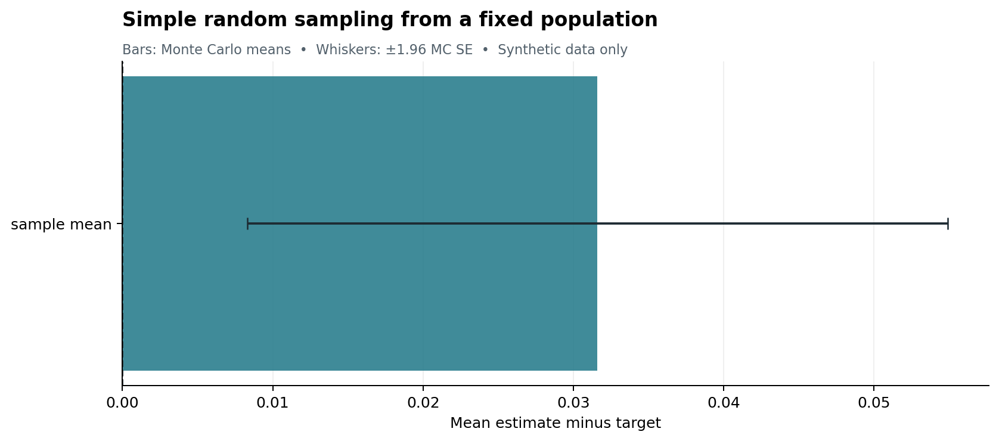
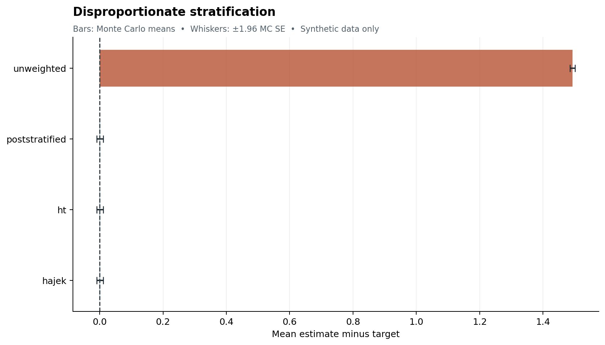
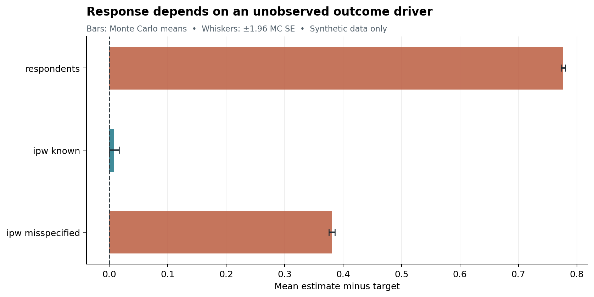
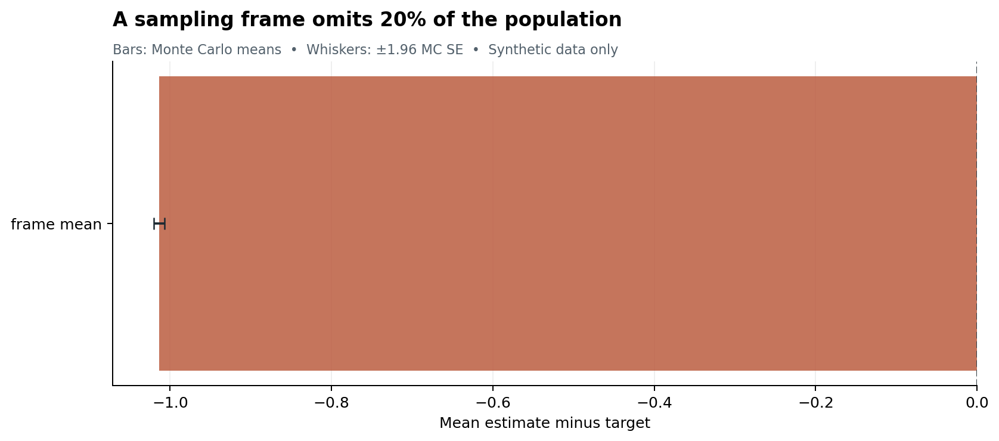
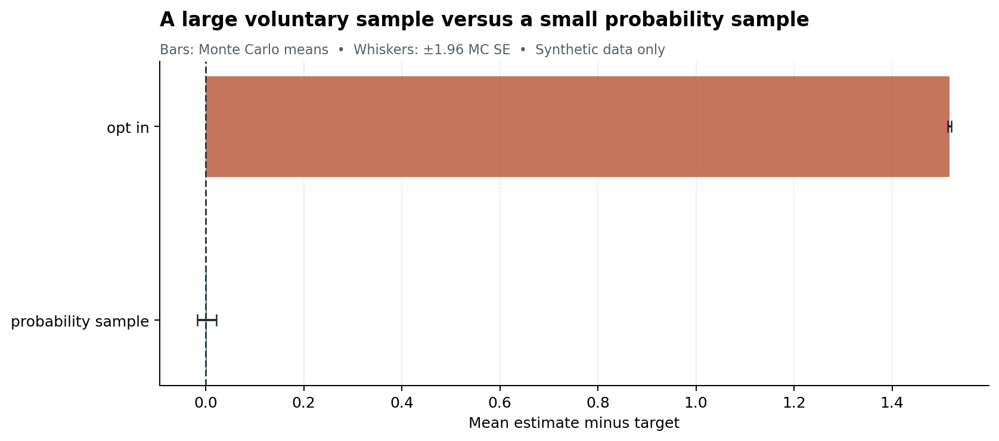
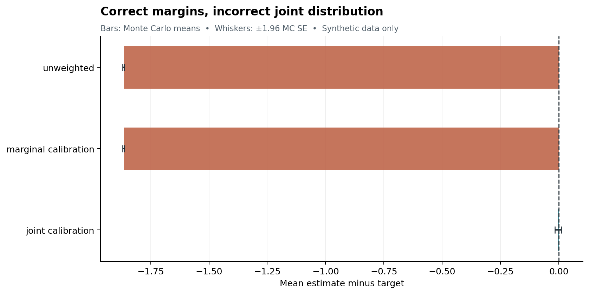
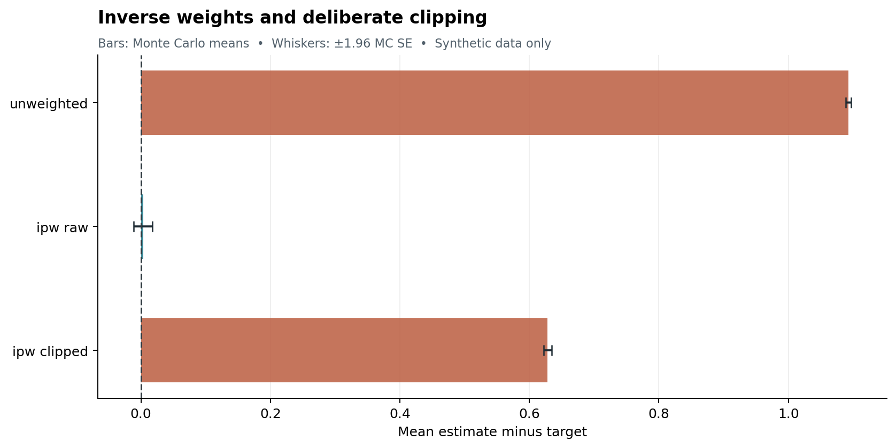
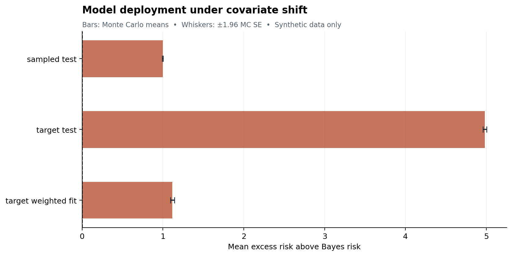
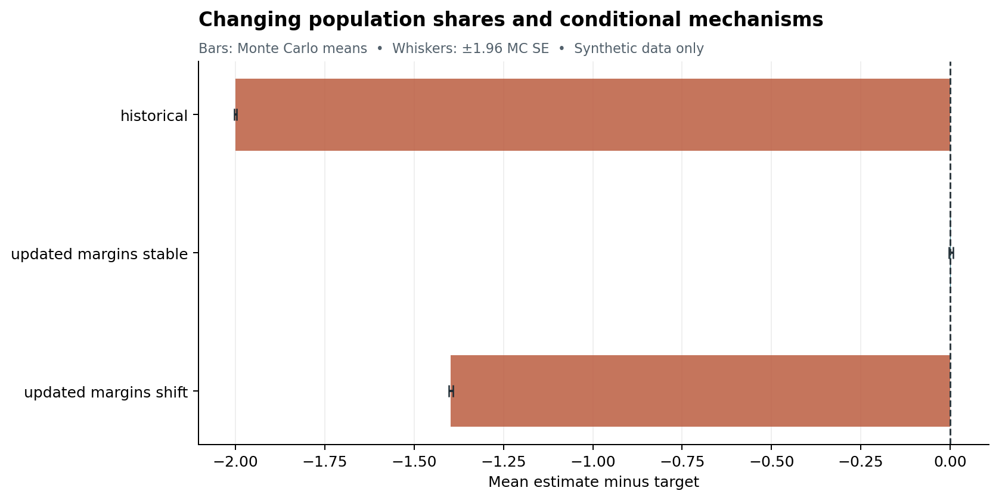

# A Dataset Is Not a Population: Selection, Coverage, Survey Weights, and the Limits of Representativeness

*Article #34 in the Medium-Blog long-form series*

## The million-row illusion

Imagine two analysts estimating the average cost of commuting in a metropolitan area. One has access to a commercial smartphone dataset containing a million trips. The other has a carefully designed probability sample of 1,500 residents. The commercial dataset appears overwhelming: high frequency, precise coordinates, and enough observations to divide the city into tiny geographical cells. The probability survey looks modest, expensive, and old-fashioned. Which one deserves more trust?

There is no answer from sample size alone. The smartphone data might exclude people who do not carry a compatible device, those who disable location services, residents who work from home, or those whose movements are not captured by the particular application. It may record many trips from the same person while offering almost no information about other people. Its observational unit might be a journey, while the policy question concerns residents. Its selection mechanism might overrepresent wealthier commuters, younger users, particular districts, and modes of transport. A million journeys do not automatically become a million independent residents, and neither number guarantees that the dataset represents the metropolitan population.

The smaller survey can also be wrong. Its address frame might exclude temporary residents. Some sampled households might refuse to respond. The survey weights might depend on inaccurate population margins, and the questions might measure reported rather than actual travel. Probability sampling is an advantage only when the frame, selection process, response mechanism, and analysis are aligned with a clearly defined target. The contrast is therefore not that surveys are good and digital data are bad. It is that **a dataset is produced by a process**, and inference must account for that process.

This matters across data science. A retailer sees millions of transactions but not the people who left without buying. A hospital trains on patients who were tested, then applies the model to patients who were never eligible for testing in the historical workflow. A platform analyzes ratings submitted by users who felt strongly enough to respond. A public agency estimates poverty from administrative records that were never designed as a population sample. An employer uses voluntary staff survey responses as if they described the entire workforce. In each case, more rows can create an impression of certainty while leaving a basic identification question unresolved: who could enter the data, who actually entered, and who is the target of the conclusion?

The problem is not merely that some observations are missing. Missingness is often defined relative to an already constructed dataset. Population selection begins earlier. Entire groups may be outside the frame, may have zero chance of entering the system, or may be measured with different instruments. Even a perfect model fitted to the observed rows cannot manufacture information about a group that was never observed without assumptions or external evidence. Conversely, when selection probabilities and relevant population totals really are known, weighting and calibration can produce defensible estimates from very unequal samples.

I use nine original synthetic experiments to separate those mechanisms. Each experiment has a deterministic Python implementation, 300 independent Monte Carlo repetitions, a replication-level CSV, a summary CSV, and an original figure. An executable notebook exercises all nine designs in isolated quick runs. The numerical values below are **conditional demonstrations** under specified data-generating mechanisms. They are not estimates of the bias in any actual survey, health dataset, retail system, or machine-learning benchmark. Their purpose is to reveal what particular assumptions buy, and what happens when those assumptions fail.

We need to distinguish at least four questions. What quantity do we want for the target population? What units and mechanisms generated the available records? What information is available about those units that were not observed? And what uncertainty remains after the selection and measurement process is accounted for? These questions come before the choice of estimator, predictive algorithm, or visualization. A sophisticated procedure can produce a stable answer to the wrong question.

## 1. The estimand comes before the spreadsheet

Suppose a finite target population contains N units. Each unit i has some fixed outcome yᵢ. The target mean is simply the sum of those outcomes divided by N. This looks uncontroversial, but it contains the most important decision in the entire analysis: what exactly counts as a unit in the population?

For housing affordability, should units be households, adults, dwellings, or rental contracts? For health monitoring, are we studying patients, patient-days, alerts, or clinical encounters? For labor-market outcomes, do we include inactive adults, people outside the tax system, and those working across borders? For a recommendation engine, are we measuring average loss per user, per session, per item, or per exposure? The answers need not coincide. Changing the unit changes the implicit weighting of people and experiences.

The finite-population perspective is useful because it separates the target values from the randomness of sampling. We may imagine all N outcomes as fixed for a particular population at a particular date, even though they are not all known to us. The estimator is random because the sampling design selects different subsets. A second perspective treats the population values themselves as generated by a statistical model. Both perspectives can be valuable, but their uncertainty statements answer different questions. A confidence interval justified by repeated sampling under a known design is not automatically a credible interval under a model, and neither should be mistaken for uncertainty about an unobserved selection process that has not been modeled.

Write Sᵢ = 1 if unit i enters the sample and Sᵢ = 0 otherwise. Its first-order inclusion probability is πᵢ = P(Sᵢ = 1) under the design. If every target unit has a strictly positive, known πᵢ, the Horvitz–Thompson estimator of the total sums yᵢ/πᵢ across included units. The intuition is direct: a unit included only one time in ten represents more population units than one included nine times in ten. Under the specified sampling design, the expected contribution of an individual unit is πᵢ × (yᵢ/πᵢ) = yᵢ. Summing over the population gives the finite-population total in expectation.

This elementary identity is powerful, but the words *known*, *positive*, and *under the design* carry most of its meaning. A propensity score fitted to participants in an opt-in panel is not automatically the panel's inclusion probability in the target population. A likelihood of receiving a test conditional on variables available only among tested patients is not automatically identified. A group with πᵢ = 0 never appears in the sample, so its unknown outcome cannot be recovered by division. And when the denominator is estimated rather than fixed, different estimators have different exact and approximate properties.

Horvitz–Thompson estimation, introduced in 1952, is particularly clear for totals. If N is known, dividing its estimated total by N gives a design-unbiased estimator of the finite-population mean. A frequently used alternative is the Hájek or ratio estimator, which divides the weighted outcome total by the sum of the weights. This normalization often improves stability, but the ratio estimator is not exactly design-unbiased in general. Confusing the two because they agree in one numerical example can obscure the assumptions behind an estimator.

The larger point is that a mathematical correction is conditional on information. When known design probabilities genuinely describe the population inclusion mechanism, weighting can restore an appropriate target. When they are guessed from a selected dataset, the correction is a model-dependent exercise that may add new error. Better software cannot remove that distinction.

## 2. Experiment one: an honest random sample can still fluctuate

Start with a deliberately simple population of 1,000 fixed synthetic outcomes, generated once from a normal distribution with mean near four and standard deviation 2.5. Select 120 units without replacement, each with equal inclusion probability. Calculate the sample mean. Repeat the sampling procedure 300 times against the same fixed population, using independent seeded streams.

There is no self-selection, nonresponse, or undercoverage. Every population unit can enter the sample and the sample mean is design-unbiased. This is our reference case, not because its answer will always be close to the truth, but because we know exactly what the sampling design justifies.

The fixed synthetic population mean is 3.92481. Across the 300 draws, the average sample mean is 3.95640, a realized mean error of +0.03160. The empirical standard deviation of the errors is 0.20586. The normal-approximation interval for the **Monte Carlo average error**, based on 1.96 standard errors, runs from +0.00830 to +0.05489. That interval happens not to contain zero, even though the estimator is design-unbiased. This is not a contradiction. A mathematical expectation is a property of the complete randomization distribution. Our 300 simulations are only one finite draw from that distribution; uncommon but legitimate fluctuations remain possible.

This observation deserves emphasis because simulation studies sometimes claim more than they show. A theorem about unbiasedness does not require every finite simulation average to be zero. Equally, one lucky simulation close to zero would not prove the theorem. We can establish the design expectation algebraically, then use the simulation to understand dispersion and the behavior of finite samples. If a published simulation average differs from its theoretical expectation, the correct response is to inspect the randomization, the finite population, the Monte Carlo uncertainty, and the code—not simply to adjust the figure until it looks reassuring.

Under simple random sampling without replacement, the design variance of the sample mean includes the finite-population correction. Using the conventional finite-population variance S² with denominator N − 1, the exact variance is (1 − n/N) × S²/n. Here n/N is 0.12. The correction reflects the fact that sampling a substantial fraction of a finite population removes some uncertainty; in a census, where n = N, sampling variance is zero. This expression is about selection variability from a fixed population. It does not correct measurement error, frame bias, or changes in the population after the sample was drawn.

The current experiment records point-estimation errors, not a separate survey-confidence-interval coverage study. The whiskers in Figure 1 are Monte Carlo intervals around the simulated *average error*. They are not the nominal intervals that an analyst would attach to a single survey estimate. Confusing these two intervals would be a substantive mistake. The first describes precision of the simulation summary as the number of repeated simulations grows; the second concerns uncertainty about a finite-population target under a sampling procedure.

The reference design gives us a baseline: an estimate can be uncertain without being systematically selected, and it can occasionally be far from its expectation without being fundamentally biased. We will now change the inclusion mechanism while keeping the target explicit. The resulting errors are different in kind. Increasing the sample size will not necessarily cure them.

## 3. Experiment two: when the sample has the wrong proportions

Consider a population with two strata. The first contains 800 units with outcomes centered near zero. The second contains 200 units with outcomes centered near five. The target population mean is therefore near one. Now sample 80 units from each stratum without replacement. The sample deliberately gives the small high-outcome stratum the same number of observations as the large low-outcome stratum.

There are good reasons to use disproportionate stratification. A rare group may be important enough to study separately, and collecting an equal number of observations can improve subgroup estimates. Stratified sampling is not inherently biased. The problem arises when analysts average observations as if the sample's 50:50 composition were the population's 80:20 composition.

The naive unweighted estimator has mean signed error +1.49336 across 300 repetitions. It nearly treats the two stratum means as equally influential, so it estimates a different composition from the intended target. The poststratified estimate, by contrast, has mean error +0.00087. It multiplies the sample mean in the first stratum by 0.8 and the sample mean in the second by 0.2, reflecting the known population shares.

The Horvitz–Thompson and Hájek versions agree numerically with poststratification in this particular design. The inclusion probabilities are 80/800 = 0.1 for first-stratum units and 80/200 = 0.4 for second-stratum units. Their inverse weights are ten and 2.5. Since sample counts within each stratum are fixed, the sum of weights is exactly 80 × 10 + 80 × 2.5 = 1,000, the known population size. Dividing by the known N and dividing by the sum of weights are therefore identical here. That equality is a special feature of the construction, not a general identity between ratio and total estimators.

We should also distinguish poststratification from an explanation of *why* two groups differ. Weighting tells us how to combine observed group outcomes for a target population, given their sizes. It does not explain what caused the outcomes to differ. If the high-outcome stratum contains older residents or wealthier households, correcting the composition does not establish that age or wealth caused the observed difference. The estimator is descriptive. Causal questions require different assumptions and designs.

What happens if the population counts themselves are uncertain? Then the weights inherit that uncertainty. If the administrative benchmark refers to a different date, geographical boundary, or definition of household, the analyst may calibrate perfectly to the wrong target. A poststratified estimate can be formally correct for one population and irrelevant to another. It is important to record not only the weight formula, but the provenance and definition of each population margin.

The practical lesson is that the sample composition is not the population composition. A good sampling design may deliberately oversample particular groups, but the analysis must return to the actual target. The power of design weights comes from known selection and population information, not from a desire to make a result look balanced.

## 4. Experiment three: response is another selection mechanism

Initial selection into a sample is only the first gate. Someone who was eligible and selected may decline to participate, fail to answer a question, or disappear from the measurement process. Nonresponse creates a second selection mechanism between the intended sample and the observed outcomes. Its impact depends not simply on the response rate but on how response is related to the outcome and available covariates.

In our synthetic experiment, each replication generates 2,500 observations with an observed predictor X, an unobserved outcome disturbance ε, and outcome Y = 2 + X + ε. Response probability depends on both X and ε through a logistic function. This is deliberately difficult: even after accounting for X, people with unusually high or low outcome disturbances do not have the same probability of responding. A weighting model using X alone omits a factor associated with Y.

We compare three quantities. The respondents-only mean ignores selection. The second estimator uses the **true synthetic response probability including ε** as an oracle benchmark. The third uses a deliberately misspecified propensity model depending only on X. The oracle is available to the simulation author because the entire data-generating process is known; it would not be available to an analyst observing only the respondents and X.

The respondents-only estimate has average signed error +0.77661. Weighting by the true response probabilities reduces that to +0.00818. Using the intentionally misspecified X-only response probabilities leaves error +0.38087. The numbers are conditional on the particular logistic parameters and sample size. They are not generic estimates of nonresponse bias in real surveys. The experiment isolates the simple proposition that a weighting model can look sophisticated and still fail when the response mechanism is missing an outcome-related determinant.

There is a subtle difference between knowing that response is related to Y and identifying its relation from the respondents. Suppose we observe X and Y for respondents but only X for nonrespondents. We can compare their X distributions and perhaps model the chance of response as a function of X. We cannot, without further assumptions, establish how the unobserved Y distribution differs within each X group. If response depends on latent ε after conditioning on X, the necessary conditional outcome information is absent. Two different distributions for nonrespondents can generate the same observed respondent data.

This is the boundary between correction and sensitivity analysis. Under a conditional exchangeability or missing-at-random assumption, response can be treated as independent of Y after conditioning on sufficiently rich observed variables. Inverse probability weighting, standardization, or imputation may then identify the chosen mean, provided probabilities are positive and estimated appropriately. If the assumption is doubtful, analysts can vary plausible departures and report how conclusions change. Those alternatives may be informative, but they are not identified from the observed data alone.

Sometimes auxiliary information helps. A short follow-up survey among initial nonrespondents, a randomized incentive experiment, an external register with outcome proxies, or validated population margins can constrain the possible bias. Such designs gather information missing from the first wave. They are substantively different from simply fitting a more flexible classifier to the same selected observations. A machine-learning response model cannot recover a latent outcome mechanism merely by having more parameters.

This experiment complements the earlier article on missing data. That article concerned missingness mechanisms and inference within a dataset. Here the perspective is the complete path from population to sampling frame, selected sample, respondents, and observed outcomes. The missingness question cannot be separated from who was eligible to enter the system in the first place. A sample can suffer both frame undercoverage and response bias; correcting one does not automatically correct the other.

## 5. Experiment four: the people who never had a chance

Undercoverage is stronger than unequal selection among eligible units. It occurs when some members of the target population are not in the sampling frame at all. Imagine a survey drawn only from registered landline numbers, a household study excluding people in collective accommodation, or a database containing only customers who made a transaction. For people outside the frame, the inclusion probability may be exactly zero. No amount of additional sampling from that same frame will reveal their outcomes.

Our finite synthetic population contains 800 frame-covered units with outcomes centered near zero and 200 excluded units with outcomes centered near five. Each repetition draws 200 units without replacement from the covered frame. The target is the mean across all 1,000 units, including the 200 that can never enter the sample. All probabilities and population outcomes are known to the simulation, but the hypothetical survey analyst has access only to the frame.

The mean estimate from the covered frame is −0.03183, while the full target mean is +0.98179. Across 300 repetitions, signed error averages −1.01362. The Monte Carlo standard error is small, approximately 0.00349, because the repeated simulation average is precisely locating a systematically wrong target. This is a vivid example of why a narrow interval around a biased estimator is not a guarantee of accuracy.

If we increased the frame sample from 200 to 400 or 700, the estimator would concentrate more tightly around the covered-frame mean. It would not converge to the full-population mean. The data would become more precise about the wrong estimand. A full census of the frame could eliminate frame sampling variance entirely, while retaining the gap to the missing population. This is a logical problem of support, not a numerical problem of insufficient rows.

The Horvitz–Thompson identity from the opening section also explains the failure. A population unit's expected weighted contribution is based on πᵢ × yᵢ/πᵢ. If πᵢ = 0, there is no observed contribution and division by πᵢ is undefined. Replacing zero by a tiny artificial number does not create information. It creates an unstable extrapolation disguised as a design weight. To estimate the excluded segment, we need an additional source that includes it, an externally justified model connecting it to observed units, or an explicit sensitivity range.

This distinction is especially important for administrative data. An unemployment dataset may record registered claimants rather than every unemployed person. A hospital registry may cover treated patients rather than everyone with the condition. A property database may record transactions rather than occupied dwellings. These are valuable datasets with legitimate target populations of their own. The mistake is silently changing the denominator from “recorded transactions” to “all homes” or from “patients tested” to “all patients.”

The first step in a responsible report is to write the population and frame definitions beside each other. If the mismatch is material, the report should name it. Sometimes the only honest answer is a bound or an estimate for the covered population, not a point estimate for the entire target. That is not a failure of statistics. It is an accurate statement about the information actually available.

## 6. Experiment five: a large voluntary sample can be confidently wrong

Self-selection is a common route from big data to misleading population conclusions. People decide whether to install an app, complete a survey, submit a review, join a panel, or remain active on a platform. Their decisions may depend on characteristics related to the outcome being studied. The resulting dataset can be enormous, internally consistent, and visibly patterned while still representing a selected subpopulation.

We create a fixed synthetic population of 5,000 units. An observed covariate X predicts the outcome through Y = 1 + 2X + noise. The probability of entering a voluntary panel increases sharply with X. Each repetition draws the opt-in participants using that selection mechanism and, independently, a simple random probability sample of only 150 people from the same finite population.

The experiment is not meant to prove that 150 observations always beat thousands. Its contrast is between a selection mechanism with an uncorrected directional bias and a smaller probability design whose inclusion mechanism is known. A voluntary dataset can be better if relevant selection information is collected and appropriately modeled, while a probability sample can suffer severe nonresponse or measurement error. Our construction deliberately isolates one mechanism.

The true synthetic population mean is 0.99792. The voluntary panel's average estimate is 2.51521, giving signed error +1.51730. The smaller probability sample's average estimate is 1.00012, with signed error +0.00220. The probability sample has more sampling dispersion, but its average is close to the target because every population member has a known chance to appear. The panel is precise about the population that volunteers; it is not automatically precise about the population of interest.

This is why reducing a standard error by increasing the number of selected records may be misleading. A conventional standard error measures variation under assumptions about the generating and sampling process. If the estimator has a persistent selection bias, more observations can shrink the reported standard error while leaving the bias untouched. A confidence interval can become narrower around a systematically wrong center. The statistic may be computed perfectly; the inferential claim is what fails.

There is a temptation to treat demographic adjustment as a universal repair. We might weight the panel to match age, sex, and region counts. That can help when the outcome-related selection is adequately captured by those characteristics and the required positivity conditions hold. But if participation depends on unmeasured attitudes, health conditions, commuting needs, or other factors related to the outcome within each demographic cell, demographic weighting alone is insufficient. Calibration constraints are information, not proof of exchangeability.

The practical solution is not necessarily to discard opt-in data. High-frequency voluntary data can reveal behavioral patterns, heterogeneity, and time dynamics that conventional surveys cannot observe cheaply. They can complement probability reference samples. They can also support predictive models for the participants actually represented. Problems arise when the analysis silently expands the target without defensible bridge assumptions. Good data science names the bridge and tests its sensitivity.

## 7. Experiment six: matching the margins does not match the population

Calibration adjusts weights so that weighted sample totals match known auxiliary population totals. The method is useful because an analyst may know reliable counts by age, geography, occupation, household size, or another variable even when the outcome is not observed for everyone. The classic framework of Deville and Särndal clarifies that calibration constraints apply to specified auxiliary totals. It does not say that matching a chosen set of margins makes every joint distribution or outcome relationship correct.

To expose the distinction, construct a population with two binary auxiliary variables. There are four joint cells. The target population has 400 units in cell (0,0), 100 in (0,1), 100 in (1,0), and 400 in (1,1). Each individual variable nevertheless has a 50:50 marginal split. Now sample 20, 80, 80, and 20 units from those cells respectively. The sample also has a 50:50 split for each variable—but the joint distribution is almost reversed.

The outcome depends strongly on whether the two variables agree. It is centered near three in the diagonal cells and near zero in the off-diagonal cells. The sample disproportionately represents the low-outcome off-diagonal cells. If a calibration routine is constrained only to match each variable's marginal 50:50 share, it sees no imbalance to correct. If the analyst also knows the four target joint-cell counts, joint poststratification can correct the composition.

The unweighted and marginally calibrated estimates are both 0.44857 on average. The full-population target is 2.31480. Their signed error is −1.86623. With the known four-cell composition, the joint-calibrated estimate averages 2.31198 and has signed error −0.00282. The result is conditional on having those external joint counts and observing enough sample records in every cell. There is no iterative raking algorithm in this experiment: the marginal constraints are already satisfied, so raking to those margins would be the identity.

The distinction grows with dimensionality. If we have ten binary auxiliary variables, there are potentially 1,024 joint cells. Exact poststratification may become sparse or impossible. Matching one-way marginal totals does not guarantee matching two-way interactions, let alone higher-order dependencies. Flexible outcome models, multilevel regression with poststratification, calibration with carefully chosen interactions, or external probability reference samples can help under their respective assumptions. They do not remove the need to understand support and model error.

The lesson is not that marginal calibration is useless. It often substantially improves estimation when the constrained variables explain selection and outcome differences sufficiently well. The lesson is more precise: **a set of balanced statistics is not proof that the entire population distribution has been recovered**. Balance must be interpreted relative to the estimand, variables and interactions that matter, and the information actually available about the target.

## 8. Experiment seven: the price of correcting rare inclusion

Inverse-probability weighting sounds almost mechanical. If a population unit has half the inclusion probability of another, give it twice the weight. Under known positive inclusion probabilities, Horvitz–Thompson totals have the design expectation we want. In practice, though, a few units may have very small inclusion probabilities and therefore very large weights. Those observations can dominate the estimate. We then face a real trade-off: using the correct weights may create substantial sampling variability, while altering them may change the estimand or introduce bias.

In our seventh experiment, each synthetic replication generates 3,500 target units with a predictor X and outcome Y = 1 + 1.7X + random noise. Inclusion follows a Poisson sampling design in which the probability increases sharply with X, ranging from a low baseline to a much higher rate. The probabilities are known because we designed the simulation. We compare the unweighted mean of selected observations, the inverse-probability-weighted Hájek mean, and a version that caps inverse weights at their observed 90th percentile.

The cap is deliberately arbitrary. It is not selected using an optimality theorem, a validated loss function, or an external decision criterion. Its purpose is to show what happens when an apparently reasonable stabilization rule reduces the influence of rare low-probability units, many of which have systematically lower outcomes. This design allows us to inspect the benefit and cost of a correction without hiding behind an opaque production dataset.

Across 300 repetitions, the unweighted estimate has signed error +1.09264. Raw inverse weighting reduces the average error to +0.00328, with an empirical error standard deviation of 0.12881. The clipped-weight estimator has signed error +0.62820. Its error standard deviation is lower, 0.05661, but that reduction in variability is purchased at a large bias cost. The corresponding RMSEs are approximately 1.09327, 0.12864, and 0.63073. Under this design and these three choices, raw weighting has the smallest RMSE by a substantial margin.

This does not mean that clipping is never appropriate. Under extreme weights, limited overlap, noisy propensity estimates, and a bounded decision loss, a carefully chosen stabilized estimator can sometimes improve finite-sample performance. The relevant comparison should be made against a target and a stated loss function. A cap could be selected through an independent validation strategy or sensitivity analysis. Analysts should show how estimates move across plausible caps and explain which population segments lose representation as weights are truncated.

The estimator in this experiment is a normalized ratio of weighted outcomes to weighted counts. It is a Hájek estimator, not an unnormalized Horvitz–Thompson total divided by known N. Near-zero average simulation error should not be described as a proof of exact finite-sample design-unbiasedness for the ratio. Ratio normalization makes the estimate less sensitive to the random weighted sample size, but its expectation is generally not identical to the finite-population target for arbitrary unequal-probability designs.

Weight concentration is often summarized using a descriptive effective-sample-size measure: the square of the sum of weights divided by the sum of squared weights. It equals the nominal number of observations when weights are equal and falls as the weights become concentrated. This diagnostic can help communicate why a nominally large sample may contain little information for some weighted targets. But it is not a universal design effect. It does not, by itself, account for stratification, clustering, outcome relationships, selection model error, or measurement uncertainty. Our archived experiment currently contains signed errors and aggregate summaries, not a separate per-replication weight-effective-size table. Therefore I do not invent an effective-sample-size number for these results.

There is also a distributional issue. If the response or inclusion probabilities were estimated from data rather than known, their uncertainty would affect the final estimator. An analysis that treats estimated weights as exact may understate uncertainty. The appropriate variance estimator can depend on the design, nuisance estimation, dependence, and calibration procedure. Bootstrap methods must reproduce the relevant sampling and fitting stages; resampling rows as if they were IID can be invalid when selection took place through clusters or stratified units. The problem is larger than whether a single standard-error formula has the right denominator.

The useful question about weighting is not simply whether weights were applied. It is whether the weights are justified by the inclusion mechanism or a clearly stated model, whether sufficient overlap remains, whether target margins are trustworthy, and how sensitive the estimate is to the largest weights. Weighting repairs a specified imbalance under specified assumptions. It does not turn unknown sample selection into known randomization by declaration.

## 9. Experiment eight: a good sampled-data test can be a poor deployment test

The same population logic applies to predictive models. A model can perform well on a randomly held-out subset of its training dataset while performing poorly on the population where it will be used. A random split can be technically honest and still answer the wrong deployment question. If both training and testing rows are sampled from the same selected population, the test estimates risk for that selected population. Deployment may involve a different distribution of covariates, different units, different recording mechanisms, or different conditional outcomes.

Let P_S denote the sampled population and P_T the target deployment population. For a fixed predictor f and loss L, target risk averages L(f(X),Y) over P_T, not over P_S. The two risks can differ even when the predictor was selected without peeking at test labels. What matters is the distribution of future examples against which the model will be judged. A test set does not become representative simply because it was held back from training.

Under *covariate shift*, the distribution of X changes while the conditional distribution of Y given X is assumed stable. In that setting, and provided the target has support wherever necessary, density-ratio importance weights proportional to p_T(X)/p_S(X) can translate certain expectations from source to target. This is not a free guarantee. The ratio must be known or estimated, the conditional-invariance assumption must be credible, and unstable weights can make the procedure noisy. The foundational work by Sugiyama, Krauledat, and Müller explains the importance-weighted validation principle under covariate shift.

Our eighth experiment isolates this mechanism with a purposely simple and misspecified model. Training covariates follow a normal distribution centered at −1, while target covariates are centered at +1, both with unit variance. In both populations, Y equals X plus independent Gaussian noise with standard deviation 0.5. Therefore the conditional outcome law Y|X is invariant. The Bayes predictor is X, with theoretical squared-error risk 0.25. But our deliberately restricted model class contains only *constant* predictions. The unweighted fitted constant is close to the source mean; it is not appropriate for a target centered two units higher.

We compare the unweighted constant on an independent source-population test, the same constant on an independent target-population test, and a constant fitted by weighting the training observations with the exact normal density ratio. For source N(−1,1) and target N(+1,1), that ratio is proportional to exp(2X). The weights are computable in the simulation because both distributions are specified. In real applications, one would need target covariate information and a defensible density-ratio estimate.

The sampled-test squared-error loss averages 1.24870. On the target population, the unweighted constant's loss averages 5.23071. The target-weighted constant reduces target loss to 1.36691. Subtracting the irreducible Bayes risk of 0.25 gives excess risks of +0.99870, +4.98071, and +1.11691. Figure 8 plots those excess risks, not biases in a finite-population mean. The target-weighted fit remains worse than the Bayes predictor because a constant cannot express the dependence on X and because the finite weighted training sample is variable.

The contrast is stark but entirely constructed. We intentionally chose a large shift in covariate means and a model class that cannot represent the true conditional mean. It would be inappropriate to tell a real organization that deployment error will rise by a particular multiple. The experiment shows *why* source validation and target validation can differ, and under what conditions importance weighting can improve the fit for the target population.

There are at least three boundaries to this correction. First, if the target contains X values absent from the sampled population, density-ratio estimation cannot create outcomes for those regions without extrapolation. Second, if Y|X changes, source outcomes no longer describe the target conditional law; covariate weights alone cannot recover it. Third, if target covariates are measured differently or generated by a different workflow, the ratio may compare incompatible variables. These are scientific assumptions about data generation, not options to be toggled in a software library.

In practical ML systems, the deployment unit can also change. A model trained with repeated observations from known hospitals may be deployed at a new hospital. A customer model trained on existing accounts may score new markets. A sensor model trained in well-instrumented homes may be used in homes with different layouts and devices. Such settings may involve hierarchical differences, latent effects, and selection into measurement. A random record-level split can hide the mismatch by placing related units in both training and test. Evaluation must follow the intended deployment population and unit, not only a familiar recipe for splitting rows.

The crucial distinction is that **validation and transportability are separate problems**. A carefully untouched test set answers a defensible question about its own data-generating process. Whether that answer transfers to deployment depends on additional evidence. The right deployment audit documents both the test-set construction and the relationship between its population and the target.

## 10. Experiment nine: weights cannot repair a changed conditional mechanism

Population composition is not static. Households move, customers age, employment patterns change, disease prevalence evolves, technologies alter who is observed, and policies change behavior. A survey weight calibrated to last year's population may become inaccurate this year. Updating auxiliary population totals can help when the change is compositional. But what if the relationship between those characteristics and the outcome also changes?

The ninth experiment separates these two mechanisms. In the historical period, 20% of the population belongs to group one, whose outcome mean is four; 80% belongs to group zero, whose outcome mean is zero. The historical target mean is therefore approximately 0.8. In the new target population, the proportion of group one rises to 70%. If the group-specific outcome means remain unchanged, the new target mean is 0.3 × 0 + 0.7 × 4 = 2.8. Updating the weights from 20% to 70% can recover that compositional change.

Now consider a second target scenario with the same 70% group-one composition, but suppose its conditional outcome mean rises from four to six. The target mean becomes 0.3 × 0 + 0.7 × 6 = 4.2. Applying new group shares to historical group means still produces about 2.8. The weights are correct for composition but the conditional information is outdated.

Across 300 historical synthetic samples, the unupdated historical estimate has mean signed error −1.99959 relative to the stable-mechanism target of 2.8. Reweighting historical group means to the new shares reduces that to +0.00234. Against the scenario in which group one's outcome mean also increases, the same updated-composition estimate has signed error −1.39766. No alternative weighting of the two old group means can identify the new conditional mean without further information or modeling assumptions.

This gives us a clean distinction between covariate or composition shift and concept or conditional shift. The first changes the distribution of observed characteristics in the target. The second changes the outcome relationship conditional on those characteristics. In real systems, both can occur together. Worse, what appears to be a change in the conditional relationship may result from changed measurement, label policy, or selection into observation. Diagnosing the mechanism requires more than comparing two histograms.

Consider forecasting demand for public transport. Population growth in a suburb may change how many residents fall into an established commuting category. Reweighting historical journeys to the new residential composition could be useful if category-specific travel patterns remain stable. But if remote working, fares, service frequency, or competing transport options change category-specific behavior, the old relationships may no longer hold. A model can correctly account for where people live and still predict the wrong number of journeys. Similar reasoning applies to healthcare, retail, and labor-market inference.

One practical response is repeated target measurement. Updated probability reference samples, representative audits, well-defined sentinel cohorts, and controlled follow-up can help distinguish composition from conditional changes. Another response is sensitivity analysis that varies assumed group-specific outcomes. A third is to restrict the claim: perhaps the historical model remains valid for a subset where its mechanism is plausibly stable. What is not defensible is treating a reweighted estimate as universally current merely because it matches recent auxiliary margins.

## 11. The common mathematical structure: selection, support, and invariance

These nine experiments appear to concern different statistical tools: random sampling, poststratification, nonresponse models, convenience panels, calibration, inverse weights, predictive risk, and temporal shift. They share a common structure. We want a functional of some target distribution or finite population, but we observe a dataset generated by a selection and measurement process. We need enough information or assumptions to connect the observed distribution to the target.

For descriptive inference, a probability design provides one such bridge. Known positive inclusion probabilities allow the Horvitz–Thompson estimator to recover finite-population totals in expectation. For nonresponse, the bridge may involve an assumption that response is conditionally independent of the unobserved outcome given measured covariates. For calibration, it involves known target margins and assumptions about how residual outcome variation relates to those margins. For predictive transport under covariate shift, it involves stable conditional outcomes and a density ratio between source and target covariates.

These assumptions are not interchangeable. A correct survey design does not imply a correct measurement process. Accurate population margins do not establish conditional exchangeability. An excellent propensity model on observed participants cannot identify the characteristics of people who had zero chance to appear. A well-calibrated predictive score on a selected test set does not establish the risk of deployment in a different population. The inferential bridge must match the quantity being estimated.

One useful diagnostic is *positivity*, or overlap. Informally, every target type for which we want to draw a conclusion must have an adequate chance of appearing in the data under the relevant mechanism. In finite-population probability sampling, this is stated through positive inclusion probabilities. In model-based adjustment, it often requires positive response or treatment probabilities conditional on covariates. In importance weighting, it requires target support to be covered by source support. The exact mathematical formulation differs across problems, but the underlying warning is similar: inference becomes fragile or impossible where the data supply no relevant observations.

Even when support is technically positive, practical overlap can be poor. A tiny inclusion probability generates a huge weight; a density ratio can be dominated by a handful of source observations; a fine poststratification cell can contain one respondent. The numerical estimator exists, but its variance may be unacceptable. It is therefore important to examine both identification and finite-sample stability. A theoretical formula that depends on an effectively unobserved tail can be less useful than a transparent sensitivity analysis.

An additional issue is measurement. We have treated the synthetic outcomes as correctly observed when selected. Real administrative and digital systems may use proxies whose meanings change over time. The recorded diagnosis may depend on testing policy; transaction data may omit cash sales; device activity may be affected by connection outages. Selection and measurement can interact. A group might be included but measured less accurately, creating bias even after perfect inclusion weighting. None of the nine experiments estimates that combined mechanism. The paper's conclusions should not be read as claiming that weights repair measurement error.

Finally, there is dependence. Repeated records from the same person, household, hospital, sensor, or geographical cluster are not independent units merely because they occupy separate rows. A sampling design can be probabilistic at the cluster level while observations are correlated within clusters. Valid uncertainty estimates must respect that structure. Our synthetic experiments use deliberately simple selection units, so their Monte Carlo behavior should not be imported into highly clustered real datasets without redesigning the experiment.

## 12. A provenance ledger before any model is fitted

The most useful operational response to population-selection problems is a short provenance ledger. It should be maintained alongside the dataset, not reconstructed from memory after an unexpected result. The ledger begins with a precise target statement: population, geographical boundary, time period, unit of analysis, outcome definition, and the intended descriptive or predictive claim.

Next, record the sampling frame. Which units could have appeared? Who was omitted by design, by infrastructure, by eligibility, or by measurement? If the data are convenience or administrative records, say so. A list of recorded events is not necessarily a list of eligible population units. The ledger should also identify repeated units and relationships among records. A million events may correspond to far fewer independent people.

Then describe the inclusion mechanism. Was a probability sample drawn? Were inclusion probabilities known, estimated, or assumed? Were some units deliberately oversampled? Did participation require app installation, survey response, treatment access, or membership in a system? Which parts of that process are observable? Where are the likely zero-probability groups? A missing sampling design cannot be reconstructed from a large row count alone.

The response and measurement stages need separate entries. Which selected units actually responded or generated a usable measurement? Are nonrespondent covariates available? Was outcome measurement standardized? Did definitions or instruments change? Were data excluded during cleaning, and do exclusions depend on the outcome? Data preprocessing can be another selection stage. A rule that drops rare or inconvenient cases may silently redefine the population.

For every external population margin, record its source, date, geographical scope, unit, and revision history. If weights are calibrated to a census or administrative benchmark, document exactly which totals are enforced. If only marginal counts are known, avoid implying that joint distributions are matched. If a benchmark is an estimate, account for its uncertainty where material.

Next, document the inferential assumptions. Why should inclusion or response be ignorable conditional on the available covariates? Why should the conditional outcome model transport to the target? Is there enough overlap to support weighting? Can the assumption be tested indirectly through a reference sample, a follow-up, or a held-out target cohort? Which assumptions are fundamentally untestable from the observed data? A good ledger separates assumptions backed by evidence from assumptions made for convenience.

The analysis plan should specify at least one sensitivity check. Estimate the target under alternative plausible margins, weighting caps, conditional response assumptions, or outcomes for an omitted segment. Show whether the substantive conclusion changes. If the answer depends sharply on a factor that cannot be observed, that sensitivity is a result worth reporting. Pretending that one selected point estimate is the only possible answer hides the most policy-relevant uncertainty.

Finally, write the scope of the claim beside the estimate. It may describe covered-frame residents, respondents with certain characteristics, active platform users, patients under an established testing protocol, or a target population under explicit transport assumptions. Precision without scope is not scientific clarity. A defensible narrow claim is better than an impressive generalization unsupported by the data.

## 13. What should be reported alongside a population estimate?

Publication often compresses an analysis into a point estimate, an interval, a chart, and perhaps a sentence about sample size. That is rarely enough when selection is central. Readers need to know who was represented and how uncertainty was constructed. I would expect a report to contain the population and unit definitions, frame coverage, source and target dates, selection design, response counts, weighting variables, major weight diagnostics, treatment of missing outcomes, and at least one sensitivity analysis.

For a probability sample, specify the known inclusion probabilities or the design from which they follow. Report stratification, clustering, and finite population corrections when relevant. If the estimator is a ratio, call it a ratio and do not claim exact design-unbiasedness by association with Horvitz–Thompson totals. If the weights are estimated or calibrated, document the nuisance models and benchmark totals. A confidence interval should be linked to a clear repeated-sampling, model-based, or bootstrap procedure, with its assumptions stated.

For a nonprobability sample, do not label a conventional IID standard error as complete population uncertainty. It may describe sampling variation under a hypothetical model but exclude selection bias. Explain how the target population information entered the estimate. If a reference probability sample was used, describe the connection and its uncertainty. If selection ignorability or outcome transport is assumed, say what would break that assumption. Where zero coverage remains, do not hide the problem inside very large weights or a precise regression output.

For predictive models, specify the distribution and unit on which risk was evaluated. Was testing random within the sampled population, chronological, grouped, geographical, or drawn from actual deployment? What changed between training and target? If target weighting was used, explain how density ratios were estimated and evaluated. Show the difference between source and target risk whenever target data allow it. A single test score is not a universal property of a fitted model; it depends on the population against which the model is tested.

The figures in this article deliberately show mean signed errors from repeated synthetic experiments. Their whiskers are **Monte Carlo** intervals around those means. They do not measure the uncertainty that an analyst would report for one real survey. Nor do they represent uncertainty about the real-world prevalence of selection mechanisms. We built the mechanisms. We did not sample actual organizations, patients, households, or platforms to estimate how common those failures are.

That distinction is particularly important for communication. If a figure shows bias +1.52 under a simulated voluntary selection rule, it does not mean an opt-in survey has a bias of 1.52 in some natural unit. The number depends on the chosen outcome scale and selection function. What generalizes is the logic: strong selection related to the outcome can produce a persistent gap, and large sample size alone does not identify the target mean. The numerical scale belongs to the experiment, not to an unspecified population.

## 14. What the nine experiments establish—and what they do not

The first experiment establishes a reference design in which equal-probability random sampling has a known mathematical expectation, while finite Monte Carlo replications can deviate from it. The second demonstrates that disproportionate sampling need not be biased when the analyst uses known population shares. The third shows how an outcome-dependent response mechanism defeats a propensity model that omits a relevant latent driver, even though an oracle with true probabilities can recover the target approximately.

The fourth draws the sharpest identification boundary: a frame containing none of a target subpopulation provides no direct observations about that subpopulation. The fifth shows that a large voluntary panel can be more biased than a much smaller probability sample. The sixth establishes that one-way marginal balance is not the same as joint population balance when outcomes depend on interactions.

The seventh adds finite-sample stability: raw weights can remove a large imbalance, but arbitrary capping may bring the bias back. The eighth moves from descriptive means to predictive risk, showing why evaluation against the sampled distribution need not describe deployment and how importance weighting can help under a stable conditional outcome mechanism. The ninth separates target composition changes from changes in the conditional outcome law. Updating shares corrects the first, not the second.

Taken together, these are controlled counterexamples to the idea that more data, better predictive algorithms, or a small standard error can substitute for a defensible target-population design. They are not a competition among statistical schools. Design-based survey inference, model-based prediction, Bayesian inference, calibration, causal identification, and modern machine learning all have useful roles. Each becomes unreliable when it makes claims outside the support of its observations and assumptions.

The experiments also have clear limitations. They are synthetic, with simple outcome laws and mostly independent units. They do not implement the full complexity of multistage sampling, network recruitment, informative clustering, nonresponse follow-up, data fusion, measurement error, or institutional changes in how records are generated. The SRS study does not yet assess nominal survey interval coverage. The weight-clipping study does not archive per-replication effective sample size. The covariate-shift study intentionally uses a constant predictor rather than a competitive flexible model. These omissions keep the mechanisms isolated but limit the empirical scope of the figures.

The references below establish foundational methods and known methodological concerns, not the exact numerical results of our simulations. Those results derive from the archived code and replication-level data. Reproducibility can verify that we obtained the numbers we report. It cannot, by itself, prove that a synthetic design represents a particular real-world population. That additional validity question requires domain evidence.

## 15. Conclusion: representativeness is a relationship, not a property of a file

We often describe datasets as if they carried intrinsic labels: representative, biased, rich, sparse, high-quality, or low-quality. Yet representativeness is a relationship between data generation and a specified target. A dataset can represent one population well and another poorly. It can be excellent for understanding the behavior of active platform users and uninformative about nonusers. It can measure historical transactions accurately while failing to reveal unmet demand. It can support a model at known sites while offering weak evidence about new sites. The answer depends on the question.

The mathematical discipline is straightforward even when the data are messy. Define the population and its units. Map the path from eligibility to observation. Identify known probabilities, external margins, and unsupported regions. State which assumptions let the observed data speak about unobserved units. Separate sampling variance from selection bias and measurement error. Evaluate predictions on a distribution resembling deployment. Update both composition and conditional mechanisms when the world changes.

One of the most expensive mistakes in applied data science is to invest months in a model before asking whether the dataset was capable of answering the intended question. The algorithm may improve, the confidence intervals may become narrower, and the dashboards may look cleaner, while the population mismatch remains. The result is not necessarily useless, but its interpretation has drifted away from the evidence.

The alternative is not methodological paralysis. It is proportional humility. Sometimes a probability design and well-documented weights support a strong population claim. Sometimes external benchmarks and sensitivity analyses support a qualified one. Sometimes the evidence supports only a statement about the observed frame. Naming that limit is part of doing the analysis correctly.

A million records may tell us a great deal. Before asking what they say, we must ask **who had the opportunity to become a record**.

## Reproducibility and data availability

All nine experiments and their outcomes are synthetic. The companion repository contains a deterministic Python simulation, 300 replication-level records per study for each method, summary tables, nine original PNG figures, a reproducible notebook builder, an executable notebook, tests, and an independent archive-consistency check. The fixed seed is 20261102. The published figures are generated from the archived replication CSVs, and the summary intervals quantify Monte Carlo uncertainty in simulation averages.

The complete companion and scientific audit are in the [Medium-Blog repository](https://github.com/DiogoRibeiro7/Medium-Blog/tree/article-34-a-dataset-is-not-a-population/a-dataset-is-not-a-population). The [scientific audit](SCIENTIFIC_AUDIT.md) describes numeric contracts, exact regeneration checks, realized simulation deviations, and interpretation limits. A quick notebook run uses temporary directories and cannot overwrite canonical files. All source code and data are intended for research education, not for inference about an actual surveyed population.

## References

1. Horvitz, D. G., and Thompson, D. J. (1952). [A Generalization of Sampling Without Replacement from a Finite Universe](https://doi.org/10.1080/01621459.1952.10483446). *Journal of the American Statistical Association*, 47(260), 663–685.
2. Kish, L. (1965). *Survey Sampling*. John Wiley & Sons.
3. Deville, J.-C., and Särndal, C.-E. (1992). [Calibration Estimators in Survey Sampling](https://doi.org/10.1080/01621459.1992.10475217). *Journal of the American Statistical Association*, 87(418), 376–382.
4. Bethlehem, J. (2010). [Selection Bias in Web Surveys](https://doi.org/10.1111/j.1751-5823.2010.00112.x). *International Statistical Review*, 78(2), 161–188.
5. Elliott, M. R., and Valliant, R. (2017). [Inference for Nonprobability Samples](https://doi.org/10.1214/16-STS598). *Statistical Science*, 32(2), 249–264.
6. Sugiyama, M., Krauledat, M., and Müller, K.-R. (2007). [Covariate Shift Adaptation by Importance Weighted Cross Validation](https://jmlr.org/papers/v8/sugiyama07a.html). *Journal of Machine Learning Research*, 8, 985–1005.

