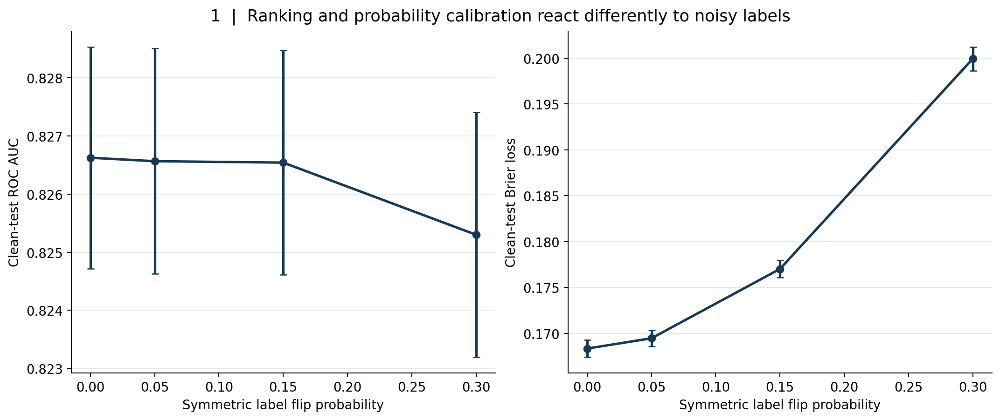
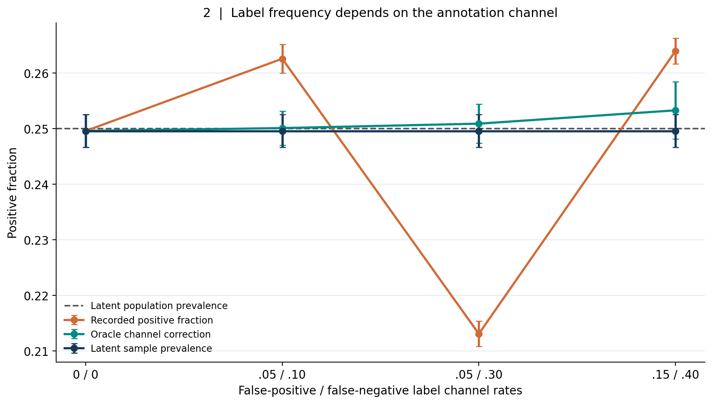
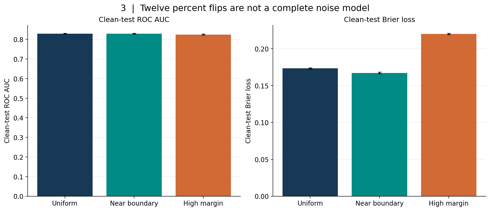
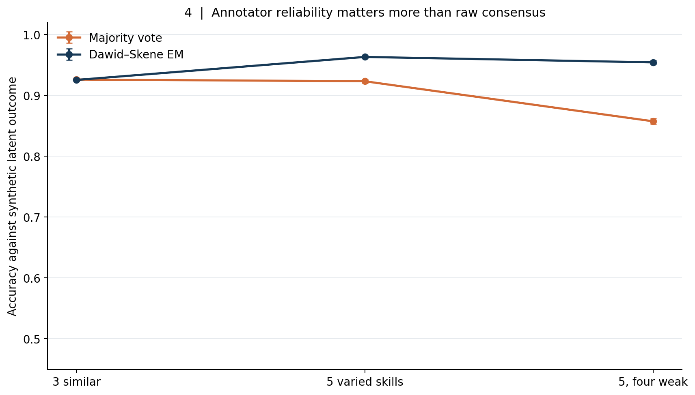
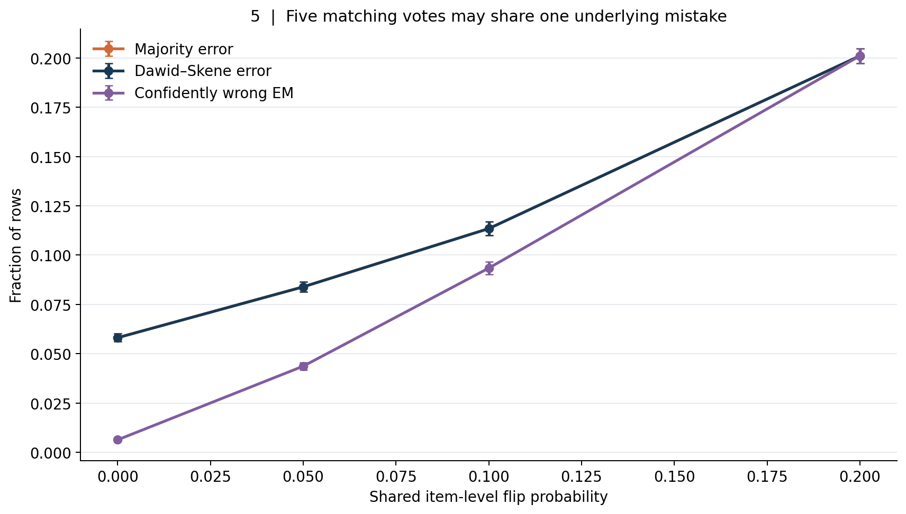
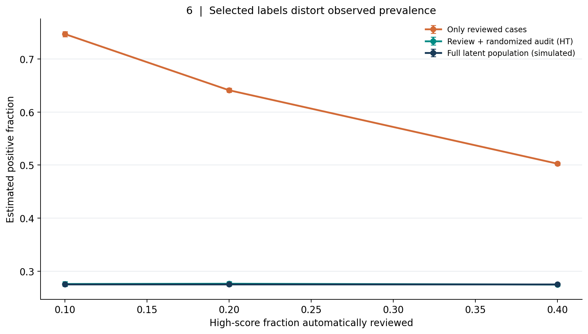
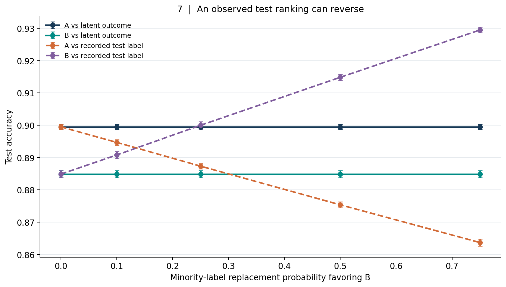
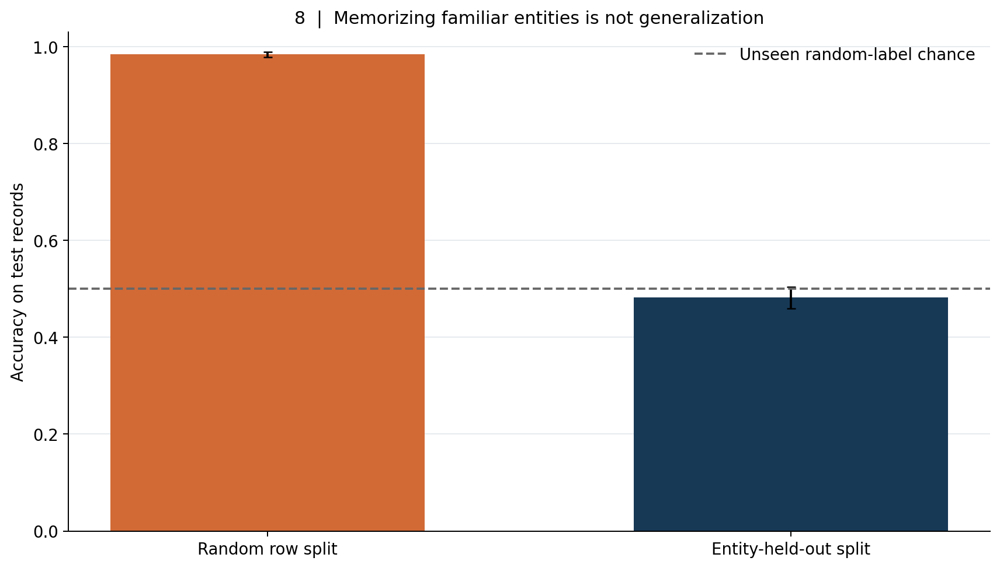
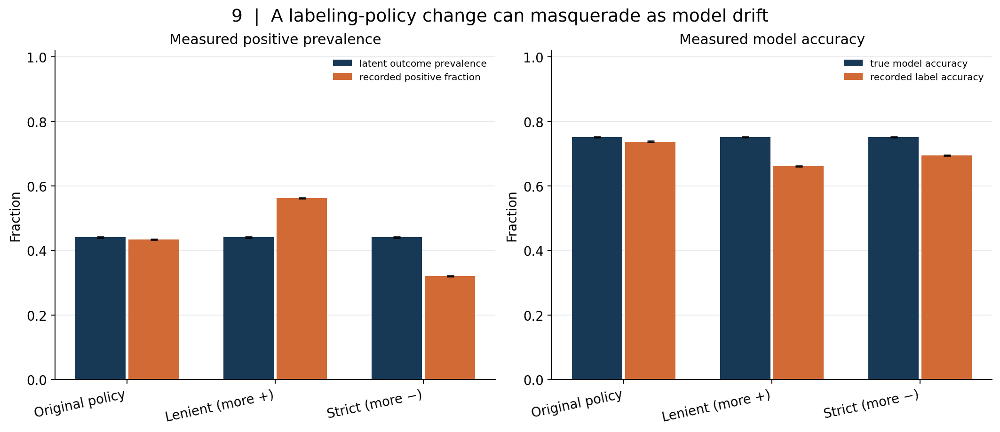

# A Label Is Not Ground Truth: Label Noise, Annotator Disagreement, Selective Labels, and the Illusion of Benchmark Accuracy

*A mathematical and operational guide to understanding what an observed label measures, why a convincing consensus can still be wrong, and how nine reproducible studies change the way we evaluate models.*

Imagine a hospital model trained to predict whether a patient has a condition. The database contains a tidy binary column called `diagnosis`: one for yes, zero for no. A product team calls it the ground truth. A researcher uses it as the outcome in a paper. A dashboard calculates model accuracy against it to four decimal places. The column looks definitive because it has only two possible values and no missing cells.

But where did that column come from? It may reflect a clinician's assessment, a diagnostic code entered for billing, a laboratory test with imperfect sensitivity, an adjudication committee, or a rule written years ago that combines some of these signals. Different hospitals may document the same case differently. A condition might be recorded only when a patient reaches a particular service. The act of ordering a test may depend on a clinician's earlier suspicion. An apparent negative may mean *no test was done*, not *a test proved absence*. If the model later influences which patients are examined, the labels used to evaluate the next model may partly reflect decisions made by the previous one.

The binary column is not meaningless. It can be a useful, highly predictive, and operationally necessary measurement. It is simply not identical to a perfectly observed underlying condition by virtue of being named `ground_truth`. A measurement has an origin, an observation process, a time stamp, a policy, a population, and an uncertainty structure. A label does too.

The same problem appears outside medicine. Fraud outcomes may be available only for transactions investigators examine. Content-moderation decisions depend on policy wording and reviewer interpretation. Loan defaults are observed after decisions about who received a loan. Human preference judgments depend on the prompt, the raters, and the comparison procedure. A visual benchmark can contain a surprisingly small set of incorrect reference labels. In each case, the word *accuracy* silently asks: **accuracy against which observation process, for which population, under which labeling policy?**

This article develops that question quantitatively. We will distinguish several ways labels become imperfect; derive what can and cannot be recovered under simplified noise models; implement an unsupervised annotator-aggregation model; expose the danger of shared mistakes; show how selective observation and biased test labels distort reported performance; and connect labeling policy changes to apparent model drift. Nine original figures come from seeded, executable simulations. They are not empirical estimates of errors in hospitals, fraud systems, moderators, or any public benchmark.

The practical conclusion is not that all labels are untrustworthy. It is that a label is **evidence generated by a procedure**. We can design, document, audit, and improve that procedure. We can also determine when the uncertainty remaining in it is large enough to change a scientific or business conclusion.

This is article **#32** in the long-form series. Its [reproducibility companion](README.md) contains the [analysis source](analysis.py), [executable notebook](a_label_is_not_ground_truth.ipynb), [notebook generator](notebook_builder.py), eighteen archival CSVs, nine publication figures, tests of numerical and statistical invariants, and a dedicated path-scoped CI workflow. All data are generated locally. The companion deliberately separates full archival runs from cheap smoke tests, and it never downloads a third-party dataset or infers anything about real people.

## 1. Five variables that should not all be called the label

Before fitting a model, write down the variables in the process that produces its target. For binary classification, start with an idealized latent outcome \(Y\in\{0,1\}\). This may be an underlying condition, an event that would occur under a specified intervention, or a carefully defined adjudicated state. The letter \(Y\) is mathematical notation, **not a claim that a uniquely correct answer is philosophically or clinically available**. In a subjective task, the target could instead be a distribution over legitimate judgments or a decision under a specified policy.

Now distinguish four further objects:

- **Recorded label** \(\widetilde Y\): the value entered in the dataset after measurement, interpretation, defaults, transformations, and policy rules.
- **Annotator vote** \(A_j\): a judgment from rater \(j\), possibly one of several inputs to the recorded label. A vote may be conditionally dependent on the other votes.
- **Observation or review indicator** \(R\): whether the outcome was investigated, tested, followed up, or entered at all. We may observe a label only when \(R=1\).
- **Model output** \(\widehat p(X)\) or \(\widehat Y\): a probability or decision based on features \(X\). It can influence \(R\), the annotators, or the eventual recorded value if a human uses a model suggestion.

These variables need different subscripts and different provenance. A data dictionary that defines all of them as simply `label` hides the mechanisms we need to evaluate. In symbols, the observed dataset can look like

\[
D_{\mathrm{obs}}=\{(X_i,R_i,R_i\widetilde Y_i):i=1,\ldots,n\},
\]

where \(R_i\widetilde Y_i\) is a shorthand for observing a value when \(R_i=1\), **not** an instruction to replace missing outcomes with zeros. If the stored table silently converts `not reviewed` into zero, the structural difference between a confirmed negative and an unobserved case disappears before any modeling begins.

The relevant accuracy target might be \(P(\widehat Y=Y)\), if a defensible latent reference outcome exists. What we usually calculate is \(P(\widehat Y=\widetilde Y\mid R=1)\). These are equal only under substantial assumptions about label correctness, selection, and the population on which the metric is computed. The distinction is not merely a matter of additional decimal places or confidence intervals.

### Four kinds of disagreement

There are at least four different questions behind a disagreement between a label and an apparently convincing prediction. The recorded outcome might contain a straightforward clerical error. Two competent annotators might interpret an ambiguous case differently because the annotation instructions are underspecified. A reviewer might make a systematic error on a subpopulation for which the available evidence is weak. Or both prediction and recorded label might be reasonable answers to *different target definitions*, such as current fraud suspicion versus subsequently confirmed fraud.

The remedy depends on which problem exists. A typo merits correction against an authoritative record. An ambiguity merits better guidelines and an uncertainty or abstention option. A subgroup-specific error merits stratified sampling and workflow review. A mismatch of estimands merits redefining the target. Simply training a larger classifier to mimic the recorded column addresses none of these automatically.

Even a perfect replication of past decisions can be undesirable when the past process was selective or discriminatory. Conversely, disagreement with an expert is not proof that a model is wrong: the expert has a measurement process and error structure too. The aim is to evaluate both sources of evidence against a well-defined decision problem, not to declare whichever source is currently convenient the oracle.

### Two error rates are not interchangeable

For a binary outcome, let

\[
\eta_0=P(\widetilde Y=1\mid Y=0),\qquad
\eta_1=P(\widetilde Y=0\mid Y=1).
\]

Here \(\eta_0\) is the labeler's false-positive rate and \(\eta_1\) its false-negative rate. We use the convention that a label is *flipped* relative to the latent outcome. Neither rate has to be equal to the other; both may depend on \(X\), time, rater identity, and review selection. In practice, they may be unknown or not identifiable from the available data.

A third quantity, the fraction of recorded labels that are wrong, is

\[
P(\widetilde Y\ne Y)=(1-\pi)\eta_0+\pi\eta_1,
\qquad \pi=P(Y=1).
\]

For example, a 30% false-negative rate does not imply that 30% of every dataset's labels are wrong. If the positive class is rare and the false-positive rate is very small, the overall wrong-label fraction can be much lower. Conversely, a small false-positive rate applied to a huge negative class can generate most of the apparent positives. Base rates matter for label quality just as they matter for classifier precision.

This decomposition also shows why reporting one generic percentage called *label noise* is often insufficient. Different combinations of prevalence and class-specific errors yield the same overall wrong-label fraction but can have very different effects on model fitting, calibration, false negatives, fairness audits, and deployment decisions.

## 2. Study one: symmetric errors leave one ordering intact while damaging probabilities

Begin with an artificial labeler that independently flips every true binary training label with probability \(\eta\), regardless of the features or its class. Suppose that \(p(x)=P(Y=1\mid X=x)\) is the genuine conditional probability of the latent outcome. Let \(q(x)=P(\widetilde Y=1\mid X=x)\) denote the conditional probability of the recorded label. By conditioning on \(Y\),

\[
\begin{aligned}
q(x)
&=P(\widetilde Y=1\mid Y=1,x)p(x)
+P(\widetilde Y=1\mid Y=0,x)[1-p(x)]\\
&=(1-\eta)p(x)+\eta[1-p(x)]\\
&=\eta+(1-2\eta)p(x).
\end{aligned}
\]

If \(0\le\eta<1/2\), then \(q(x)\) is a strictly increasing affine transformation of \(p(x)\). Thus, *in the population and with exact probabilities*, ordering examples by \(q\) gives the same ordering as by \(p\). The area under the ROC curve depends on the ordering of scores, so a score equal to \(q(x)\) can retain the latent-target AUC of \(p(x)\), absent ties. At \(\eta=1/2\), \(q(x)=1/2\) for everyone: the labels have no information about the latent ordering. Beyond that point the transformation reverses its ordering, although the familiar less-than-one-half assumption is the usual identifiable orientation.

Notice what this argument **does not** say. It does not guarantee that a finite-sample logistic regression will estimate \(q\) exactly. It does not guarantee equal AUC under regularization, misspecification, group shift, or a different feature-dependent corruption process. And it says nothing about the quality of *probability estimates* for \(Y\). Even with a perfect fit to noisy labels, \(q(x)\ne p(x)\) except in special cases. Values near zero get pushed upward, values near one get pulled downward, and the whole probability scale is compressed toward one half.

This is an important example of why we should evaluate ranking and calibration separately. ROC AUC tells us how well a score orders positives above negatives; it does not tell us whether a reported 0.80 means an 80% event rate. The Brier score, defined for binary outcomes as

\[
\operatorname{Brier}(\widehat p,Y)
=\frac{1}{n}\sum_{i=1}^n(\widehat p_i-Y_i)^2,
\]

is sensitive to probability error. Its interpretation likewise depends on which \(Y\) is used. Brier against noisy recorded labels measures a different prediction problem from Brier against clean latent outcomes. More elaborate metrics do not repair a defective reference target simply because their formulas are sophisticated.

### The synthetic experiment

We generate logistic populations, corrupt only the training labels at rates 0%, 5%, 15%, and 30%, fit the same regularized logistic regression each time, and score the predictions against an **untouched latent-outcome test set**. Thirty independent outer repetitions supply the archival means and Monte Carlo standard errors. The clean test labels are available solely because our simulation generated them; no real-world data collection procedure is assumed to reveal them.



At zero corruption, mean clean-test ROC AUC is **0.8266** and mean clean-test Brier loss is **0.16834**. At 30% symmetric corruption, AUC is still about **0.8253**, while Brier loss rises to **0.19994**. The plotted uncertainty bars describe the mean across the thirty synthetic runs, not uncertainty about how noisy any particular real clinical or business dataset might be.

The result is not that corrupted labels are harmless. The rank-based metric happens to be much less sensitive under this experiment's relatively favorable structure. If an analyst reported only AUC, they could conclude that the training labels had survived substantial damage. A team using the same numerical outputs as calibrated risks would encounter a different problem. Thresholding those probabilities at an operational cost-sensitive cutoff could also change decisions even when their underlying ranking remains similar.

The more general lesson is **to ask what aspect of prediction a metric can reveal**. AUC is insensitive to monotone score transformations; calibration is not. Accuracy depends on a threshold, class prevalence, and the reference label process. A label-quality audit must therefore include the properties of interest to the eventual decision, not merely the benchmark's favorite summary statistic.

### A tempting but invalid shortcut

Suppose the recorded-label probability \(q(x)\) is estimated from the training set. One might invert the preceding equation:

\[
\widehat p(x)=\frac{\widehat q(x)-\eta}{1-2\eta}.
\]

This is algebraically correct if \(\eta\) is known, constant, below one half, and the model estimates the specified conditional probability. It is not a free correction mechanism. The rate is normally unknown; its estimation adds uncertainty; misspecified probabilities can yield estimates outside zero and one, which would require diagnostic investigation and possibly bounded projections; and the denominator approaches zero as \(\eta\) approaches one half. Even small errors in a near-zero denominator are amplified. An apparent closed-form fix can therefore be statistically unstable and operationally unjustified.

## 3. Study two: class-conditional errors can change even the prevalence

The symmetric case is unusually convenient. In many applications, positives are easier to miss than negatives are to invent, or vice versa. A disease that is rarely tested may have a high false-negative documentation rate. An aggressively moderated content category may have a relatively high false-positive labeling rate. We now allow the two rates to differ while continuing, unrealistically but transparently, to assume they are constant within each latent class.

Let \(\pi=P(Y=1)\) be the true population prevalence and \(\widetilde\pi=P(\widetilde Y=1)\) the prevalence measured in the labeled data. The law of total probability gives

\[
\widetilde\pi=(1-\eta_1)\pi+\eta_0(1-\pi)
=\eta_0+(1-\eta_0-\eta_1)\pi.
\]

If the rates are known and \(1-\eta_0-\eta_1\ne0\), the algebraic inverse is

\[
\pi=\frac{\widetilde\pi-\eta_0}{1-\eta_0-\eta_1}.
\]

This is a binary misclassification-matrix correction. It is useful for thinking and for carefully designed validation studies, but it is not automatically identified from a dataset containing only one imperfect label per item. The observed prevalence alone is one equation with three unknowns: \(\pi,\eta_0,\eta_1\). Infinitely many feasible combinations can produce the same recorded fraction. To estimate the rates we need external information, such as an independently adjudicated probability sample with appropriate assumptions, a defensible multi-test model, or a validation design that identifies its own error mechanisms.

For conditional probabilities the same derivation yields

\[
q(x)=\eta_0+[1-\eta_0-\eta_1]p(x).
\]

When the sum of the two errors is below one and both remain constant over features, even asymmetric noise preserves the population ordering of \(p(x)\). But it shifts the intercept as well as the scale. The point at which \(q(x)=1/2\) need not correspond to \(p(x)=1/2\). A classifier fit to the observed targets can therefore have a misleading apparent prevalence and an unsuitable default decision boundary despite preserving some ranking information.

### A worked prevalence calculation

In the second experiment, the latent population has positive prevalence 25%. Consider a labeler that falsely marks 5% of negatives positive and misses 30% of positives. Its expected recorded positive fraction is

\[
\widetilde\pi=.05+(1-.05-.30)(.25)
=.05+.65(.25)=.2125.
\]

The recorded data would suggest only 21.25% positives even though 25% are positive under the specified latent construct. Applied to the simulation's observed fraction, the oracle-rate inverse should recover the latent fraction up to sampling variability. That is exactly what we test: label streams are generated for four false-positive/false-negative pairs, with thirty outer repetitions, and both the naive observed fraction and oracle-corrected prevalence are archived.



For the 5%/30% channel, the mean recorded positive fraction is **0.2131** and the oracle-corrected value is **0.2509**, close to the 0.25 generator prevalence. The title *oracle-corrected* is deliberate: the analysis knows the flip probabilities because it created them. It does not estimate those probabilities from the same imperfect sample and then proclaim an unbiased estimate of truth.

This distinction matters when correcting historical metrics. Suppose the operational organization reports a sudden drop in positive prevalence. That drop might reflect a genuine change in the latent rate, an altered testing policy, changed definitions, a different class mixture, or some combination. Without information about those mechanisms, a time-series adjustment using one guessed global error rate could remove real signal or add a fictitious trend.

### Where the matrix inversion breaks

First, if \(\eta_0+\eta_1=1\), the recorded label is independent of the latent class under this channel: \(\widetilde\pi=\eta_0\) regardless of prevalence. The mapping cannot be inverted. When the sum is close to one, the inverse amplifies sampling and rate-estimation error. If the sum exceeds one, the recording process is negatively oriented: labels are more often inverted than aligned in the aggregate, a possibility that must be established rather than quietly dismissed.

Second, rates usually vary. If the false-negative probability depends on age, image difficulty, language, region, reviewer, or time, a single two-by-two matrix averages over a particular mix of cases. The matrix estimated in one validation sample may not transport to a population with a different feature distribution. Even an apparently corrected global prevalence does not guarantee that subgroup prevalence or local risk estimates are correct.

Third, the correction addresses the mathematical estimand in the assumed channel. It does not resolve whether the proposed latent target captures the thing the organization actually wants to predict. A perfect inverse of an obsolete policy definition is still an estimate of the obsolete definition. We must validate the construct as well as the noise model.

## 4. Study three: the same 12% label-error rate can mean three different problems

Class-conditional noise assumes that labels are flipped with a constant probability inside each class. In practice, an annotator might be less reliable near an uncertain decision boundary, more unreliable on rare edge cases, or systematically misled by an artifact that a model regards as strong evidence. The probability of a labeling error can depend directly on the features \(X\), even after conditioning on \(Y\):

\[
P(\widetilde Y\ne Y\mid X=x,Y=y)=\eta_y(x).
\]

This is instance-dependent noise. It is not summarized by one scalar error fraction. Two annotation processes can both have 12% incorrect labels and produce very different learned models because the incorrect records occupy different regions of feature space. The geometry of the errors matters, as does the learning algorithm's sensitivity to those regions.

To make this concrete, we create a synthetic logistic population with known conditional probability \(p(x)\). For every repetition, we select **exactly 12% of training records** for inversion under each of three procedures:

1. Uniform selection, without replacement, across all training records.
2. Boundary selection, taking the 12% of records whose latent probabilities are closest to 0.5.
3. High-margin selection, taking the 12% of records whose latent probabilities are farthest from 0.5.

The last two procedures are intentionally artificial. They use the generator's **oracle** \(p(x)\), which an actual labeling team does not possess. That oracle allows a controlled scientific comparison in which *the fraction of incorrect labels stays the same while their location changes*. It is not a proposed practical algorithm for finding difficult cases or confidently mislabeled points.

Each procedure trains the same logistic regression model and evaluates clean-test AUC and Brier loss against a new, uncontaminated latent-outcome sample. We repeat the comparison thirty times. The number of training records, model family, feature generator, and held-out target remain comparable; only the selection rule for corrupted labels changes.



The mean clean-test Brier loss is **0.17326** for uniform flips, **0.16710** when flips are concentrated near the latent boundary, and **0.21995** when concentrated in the high-margin region. The AUC is around **0.829** under uniform selection and **0.8245** under high-margin selection. Those are outcomes of this finite-sample experiment, not a general theorem that boundary errors always help or that high-margin errors are always worse for every classifier.

Why might this happen? Near a true decision boundary, the outcome is intrinsically uncertain: even under a correctly specified stochastic model, two otherwise similar feature vectors can have different binary outcomes. Changing labels near that boundary can have relatively limited leverage on the fitted direction in this particular setup. By contrast, reversing many examples for which the model's generative probability is far from one half creates strongly contradictory signals in regions that would otherwise be informative. Logistic loss reacts to confident contradictions, and its fitted parameters can move substantially when many such contradictions are deliberately planted.

But one should be careful with that explanation. A point with \(p(x)\approx0.5\) is *not necessarily mislabeled* if its observed binary outcome differs from a thresholded prediction. With a stochastic Bernoulli outcome, both zero and one can be valid observations near the boundary. The experiment creates errors by comparing the recorded bit to the realized latent bit, not by treating low-confidence predictions as evidence of recording mistakes. Confusing irreducible uncertainty with label corruption is itself a common annotation mistake.

Likewise, high-margin examples that contradict a model are not automatically wrong. They may be rare true outcomes, distribution shift, important subpopulations, or instances where the model's representation is inadequate. A real audit should not use a model's high confidence as the sole justification for relabeling the items that disagree with it. That produces a feedback loop in which the model's mistakes become the dataset's proclaimed truth.

### What changes in an actual audit design?

At least three measurements are useful beyond a global noise estimate. First, stratify reviewed disagreements by model score or uncertainty, but keep **independent adjudication** separate from the model suggestion. Second, stratify by features that might change annotation difficulty, including language, acquisition source, subgroup, time, and evidence availability. Third, measure whether labeling rules are consistent on **similar or duplicate** items, with a deliberate definition of what counts as similar.

An audit sample should also include records the model already agrees with. If only model-disagreement cases receive review, a dataset can accumulate a false impression that all errors are concentrated where the model objects. Agreement does not imply correctness; both processes may share the same blind spot. Conversely, if only low-confidence records get reviewed, any estimate of global labeling error requires explicit accounting for that selection.

The most revealing feature of this study is simple: the phrase *12% of labels are wrong* does not specify where errors occur, whether they correlate with model features, or whether they systematically change decisions. Global error rate is one coordinate of a much larger error model, not a complete description of annotation quality.

## 5. Study four: five annotators, three ways to be misled

When a task lacks an easily accessible reference label, teams often ask several people and aggregate their votes. The appeal is intuitive: multiple judgments provide an opportunity for independent errors to cancel. But *number of votes* and *amount of independent evidence* are not synonymous. Annotators can have different skill, systematic class-specific biases, and shared information sources. Majority vote gives every person equal weight regardless of those differences.

Suppose item \(i\) has latent state \(Y_i\in\{0,1\}\), and worker \(j\) provides \(A_{ij}\in\{0,1\}\). A simple worker-quality model assigns each annotator a sensitivity and specificity:

\[
s_j=P(A_{ij}=1\mid Y_i=1),\qquad
t_j=P(A_{ij}=0\mid Y_i=0).
\]

Under the strong assumption that votes are **conditionally independent given the latent item state**, the probability of a vector of votes \(a_i=(a_{i1},\ldots,a_{ik})\) is a mixture over the two possible states. If \(\pi=P(Y=1)\),

\[
P(a_i)=\sum_{y=0}^{1}P(Y_i=y)
\prod_{j=1}^{k}P(A_{ij}=a_{ij}\mid Y_i=y).
\]

The product is the central assumption. It says that once we know the latent item state, worker one's remaining error gives us no information about worker two's remaining error. That can be plausible for genuinely independent judgments on clear cases; it is dubious when workers share a guideline defect, use the same model-generated hint, copy a senior reviewer, encounter the same misleading evidence, or have correlated domain gaps.

### Dawid–Skene aggregation

Dawid and Skene's classic 1979 formulation estimates latent class probabilities and observer error rates together using expectation-maximization (EM). Our companion implements a binary, fully observed version with regularized worker confusion probabilities. We initialize using a softly clipped majority-vote proportion, then alternate between two computations.

In the **E-step**, compute the posterior probability \(q_i=P(Y_i=1\mid a_i)\) using the current class prior and worker error estimates:

\[
q_i=\frac{\pi\prod_jP(A_{ij}\mid Y_i=1)}
{\pi\prod_jP(A_{ij}\mid Y_i=1)
+(1-\pi)\prod_jP(A_{ij}\mid Y_i=0)}.
\]

In the **M-step**, use the soft item weights \(q_i\) to re-estimate \(\pi\) and each worker's two rows of its binary confusion matrix. For example, an unregularized estimate of the probability that worker \(j\) votes one on a truly positive item is

\[
\widehat s_j=\frac{\sum_i q_iA_{ij}}{\sum_i q_i}.
\]

The implementation adds one pseudo-observation of each vote value to each estimated conditional Bernoulli probability—Laplace add-one smoothing, corresponding to a Beta(1,1) posterior mean with fractional EM counts. It computes posteriors in log space to avoid multiplying many tiny probabilities. The code uses at most sixty iterations in the studies, stopping earlier if updates change sufficiently little.

EM is a way of maximizing the assumed model's likelihood, not an independent truth detector. The likelihood can have multiple optima, and the two latent class names can be swapped without changing the observed vote distribution unless some information or assumptions orient them. Initializing near majority vote picks a plausible orientation in our simulation, but it does not prove that the orientation corresponds to reality. If most workers are systematically wrong, their consensual orientation may be wrong too.

### The independent-worker experiment

We simulate 1,300 items per full repetition with a 30% latent positive rate. Worker votes are generated independently given each item's true bit, using explicit class-dependent sensitivity and specificity. There are three panels of worker composition:

- **Three similar workers:** sensitivities approximately 0.80–0.82 and specificities approximately 0.83–0.85.
- **Five heterogeneous workers:** one very good worker, one reasonably strong worker, and several with weaker or class-asymmetric profiles.
- **Five with four weak workers:** one strong worker and four workers with sensitivity 0.62 and specificity 0.66.

We compare hard majority vote with the EM posterior thresholded at 0.5, and calculate both against the simulation's latent labels. Each composition is repeated independently across twenty-four outer runs.



For three similarly competent annotators, majority vote and EM are essentially tied: mean accuracy **0.92596** versus **0.92532**. A more elaborate model offers no material advantage in that regime. With five heterogeneous workers, majority vote gives **0.92314** while EM gives **0.96311**. In the four-weak-worker setting, majority accuracy is **0.85737**, versus **0.95417** for the fitted latent-variable model.

This is the promise of modeling worker quality: the votes are not equally reliable, and repeated items supply information about which annotators tend to agree with an estimated latent structure. EM can learn different class-specific error patterns instead of blindly counting hands. It can do particularly well when the model is well specified, workers vary meaningfully in skill, and enough items have multiple independent votes.

It is not a universal endorsement of EM over majority vote. The experiment generates data **from the same conditional-independence family** that the method assumes. It supplies complete worker-by-item matrices, no adversarial coordination, no systematic missing assignments, no changing worker behavior, and no subgroup-specific expertise that the model fails to represent. An ordinary annotation project violates at least some of these conveniences. Statistical superiority under the simulator is a reason to consider worker modeling, not a certification that a fitted consensus is truth.

### Why more votes can be less informative

If all five workers share the same error mechanism, there may effectively be only one independent piece of evidence. Five identical votes could be five copies of one faulty classifier recommendation. A high posterior confidence obtained by multiplying those dependent likelihoods would be overconfidence, not additional verification. We test that failure next.

## 6. Study five: correlated agreement is not independent confirmation

To isolate correlation, we construct five workers whose **marginal** error probability is held at 20% under every experimental condition. We then change how much of their error arises from one item-level disturbance shared by everyone. An item may contain a misleading cue, a flawed reference example, a policy ambiguity, or a shared model hint. The specific cause is not modeled; the experiment represents the shared mechanism with one random bit.

Let \(S_i\sim\operatorname{Bernoulli}(\rho)\) be a shared flip for item \(i\), and \(E_{ij}\sim\operatorname{Bernoulli}(u)\) a worker-specific residual flip. Set

\[
A_{ij}=Y_i\oplus S_i\oplus E_{ij},
\]

where \(\oplus\) denotes exclusive OR. The worker's marginal chance of disagreement with \(Y_i\) is

\[
\eta=P(S_i\oplus E_{ij}=1)
=\rho(1-u)+(1-\rho)u
=\rho+u-2\rho u.
\]

To keep this equal to 0.20, solve \(u=(0.20-\rho)/(1-2\rho)\). We vary the shared flip probability \(\rho\) through 0, 0.05, 0.10, and 0.20. At zero shared error, \(u=.20\), so workers make independent flips. At \(\rho=.20\), \(u=0\), so every worker copies the same shared flipped state: their errors are perfectly aligned. Every condition retains a theoretically identical 20% single-worker error rate. Only the joint dependence changes.

The naive promise of five voters is based on a binomial calculation. If workers independently have error probability \(e=.2\), the probability that a majority of five is wrong is

\[
P(K\ge3)=\sum_{k=3}^{5}\binom{5}{k}e^k(1-e)^{5-k}
=0.05792.
\]

This is a real improvement from 20% to about 5.8% **when independence is justified**. But when all workers share the same flip, majority vote is wrong whenever that common flip happens. The ensemble then has error probability 20%, regardless of how emphatically all five workers agree. No amount of repeated counting turns a single error into independent evidence.



Across twenty-four full repetitions, mean majority and EM error are about **0.05817** at zero shared flip probability and **0.20102** at a shared probability of 0.20. The fraction of items for which the EM method is **wrong yet reports posterior confidence at least 0.90** rises from **0.00641** to **0.20102**. At the fully shared endpoint, the fitted model often treats a unanimous wrong vote as overwhelming evidence, precisely because its independence model multiplies the apparent support.

These figures separate three notions frequently conflated in annotation quality dashboards: *agreement*, *correctness*, and *confidence*. Agreement is observable. Correctness requires a defensible reference or externally justified model. Confidence is a number produced by an inference procedure under its assumptions. High agreement can be genuine independent convergence; it can also reflect copied suggestions or a common interpretation error. High posterior confidence under an incorrect dependence model can amplify that mistake.

### What can uncover shared mistakes?

Audit the process, not just the final vote counts. Ask whether raters see one another's answers, a model's prediction, a prefilled category, or a common example that might anchor them. Use some blinded, independently collected votes. Introduce counterbalanced examples or varied presentation order where ethical and feasible. If domain experts specialize in different types of cases, measure reliability by case type and avoid a single universal worker ranking. Review systematic disagreements with outside evidence, and explicitly examine high-agreement cases in a random audit.

There is no magic number of votes after which the problem disappears. A useful annotation protocol may combine independent raters, a detailed guideline, an abstain or unsure option, structured adjudication, and periodic calibration exercises. Each component has a different purpose. Adjudication can standardize policy; it cannot manufacture an objective fact when the underlying construct is genuinely disputed. More raters can reduce independent variance; they cannot remove a shared wrong assumption without new information.

### A boundary on the argument

The shared-bit simulation is deliberately stark, particularly at the fully correlated endpoint. Real annotator dependencies can be subtler and task-dependent. The exact figures should not be used as a universal conversion from inter-rater agreement to error rate. Their role is to demonstrate a structural counterexample: **holding individual annotator accuracy fixed does not hold majority-vote accuracy or consensus confidence fixed**. Dependence is a separate dimension of evidence quality.

## 7. Study six: selective labels change the population you appear to measure

Even perfectly accurate labels are not sufficient if they exist for a systematically selected subset. Consider a fraud investigation queue. A risk model assigns every case a score, and investigators review the highest-scoring fraction. Fraud is confirmed or rejected only for reviewed cases. The operations dashboard reports the fraction of reviewed cases labeled fraud. That number may be an accurate estimate of **fraud prevalence among reviewed cases**. It is not automatically an estimate of fraud prevalence among *all* cases.

This is the selective-labels problem. It appears when the decision to observe a target depends on features, previous predictions, human judgments, or unmeasured factors related to the outcome. The population we evaluate has been filtered through a decision mechanism. In particularly consequential settings, the decision may also change the potential outcome: an intervention can prevent the event that a retrospective model tries to predict. At that point, selection and causal effects both require attention.

Lakkaraju and coauthors' work on the selective-labels problem formalizes how evaluating predictions can be difficult when outcomes are observed only after earlier human decisions. Our experiment addresses a narrower, deliberately identifiable version: the latent outcome exists for everyone in the simulator, selection is based on a known score, and a randomized audit reveals a subset of otherwise unobserved cases. We do **not** solve the general potential-outcomes or selective-labels identification problem.

### The synthetic queue

We sample a continuous risk score \(X\sim N(0,1)\). Each case has a latent binary outcome drawn according to

\[
P(Y=1\mid X=x)=\operatorname{logit}^{-1}(1.4x-1.3),
\]

where \(\operatorname{logit}^{-1}(z)=1/(1+e^{-z})\). The review policy selects the highest-scoring 10%, 20%, or 40% of cases. The remaining cases receive no routine outcome observation. Because high scores genuinely imply higher simulated risk, reviewed-case prevalence is expected to exceed population prevalence even with flawless outcome measurement.

We then independently select **10% of the unreviewed cases at random** for an audit. In the simulator the full latent vector is known so we can check the estimator; the estimator itself reads labels only for the routinely reviewed cases and randomly audited unreviewed cases. An audited case is not also included in the routine-review set. That distinction is enforced by code and tested.

Let \(S_i\) indicate inclusion in either review or audit. Under this design, the inclusion probability is

\[
\pi_i^{\mathrm{inc}}=
\begin{cases}
1,&\text{if the case is in the routine review group},\\
a,&\text{otherwise},
\end{cases}
\qquad a=0.10.
\]

The Horvitz–Thompson estimate of the full finite-population positive fraction is

\[
\widehat\mu_{\mathrm{HT}}=\frac{1}{n}
\left(\sum_{i\in\mathrm{review}}Y_i
+\frac{1}{a}\sum_{i\in\mathrm{audit}}Y_i\right).
\]

This estimator does not need to assume a correct predictive relationship between the score and outcome. It needs the audit to be randomized as stated, the audit inclusion probabilities to be known and positive for otherwise unobserved cases, outcomes to be properly measured when sampled, and a clear target finite population. Conditional on the finite population's outcomes and the deterministic review policy, each unreviewed record contributes its true value in expectation because \(E[S_i/a]=1\). Therefore the weighted total is design-unbiased for the full-population total.



Across thirty-six repetitions, the actual simulated population prevalence averages **0.27567**. When only the top 20% are routinely reviewed, the reviewed-only positive fraction averages **0.64092**. The routine queue thus looks more than twice as positive as the population simply because the selection rule concentrates high-risk cases. The review-plus-random-audit estimate averages **0.27640**, close to the simulated population prevalence. The audit-backed estimate has sampling variability; correcting the selection with only a modest audit sample is not the same as observing every outcome exactly.

### What a random audit does, and what it cannot do

The crucial resource is not the word *audit*. It is **known, nonzero inclusion probability** across the population whose prevalence we want to estimate. If an organization audits only the cases an existing model deems suspicious, those audits can suffer the same selection mechanism as the main queue. Calling that process a random sample does not make it one. If some region of the population has zero probability of ever being investigated, its outcome prevalence is not nonparametrically identified from the investigated records alone.

The Horvitz–Thompson formula can also be noisy when audit probabilities are small: a single audited positive can receive a large weight. Stratified audit design, predeclared allocation by score range or subgroup, and model-assisted estimators can improve precision. But changing the allocation requires recording and using the correct inclusion probabilities. A single universal inverse-probability weight is wrong when the audit actually oversamples particular segments.

Finally, the experiment assumes that reviewing a case merely reveals a pre-existing binary outcome. That is appropriate for some retrospective verification tasks and wrong for other decisions. A loan denial, treatment assignment, or preventive intervention may affect whether the event would have happened. A randomized review of records does not by itself reveal an unobserved counterfactual outcome under a different intervention. The analyst must state whether the estimand concerns measurement, policy evaluation, or a causal effect before choosing an estimator.

### An operational interpretation

It is entirely reasonable to monitor the positive rate in a high-risk queue: it answers whether the review workload is producing useful findings under a particular selection rule. It is also reasonable to estimate population prevalence. The problem begins when both quantities are displayed under the same name, or when a model is compared against historical outcomes observed only where a previous model chose to look. A small, carefully randomized audit can be more valuable for evaluation than a large pile of selectively labeled records.

## 8. Study seven: a benchmark can rank the worse model first

So far, most examples involved training labels or observed prevalence. Test labels deserve at least as much scrutiny. The test set becomes a local authority: every experiment, model selection, and promotional claim is compared against it. Yet a test label is produced by a measurement process just like a training label. Holding a test table fixed does not make its entries error-free. A confidence interval around a test metric quantifies only selected sources of sampling uncertainty; it does not automatically cover systematic bias in the test reference.

Northcutt, Athalye, and Mueller documented label errors in widely used test datasets and showed that correcting those errors can change model comparisons. That is motivation for an empirical benchmark audit, not evidence that any particular model in our simulation corresponds to a published system. To expose the ranking mechanism cleanly, our seventh study constructs two binary predictors and then deliberately changes a small fraction of reference labels in favor of the weaker predictor.

The synthetic population has a 20% minority segment. Latent outcomes are balanced Bernoulli bits. Model A independently flips the truth with 10% probability in either segment. Model B has a 7% error probability in the majority segment but a 30% error probability in the minority segment. Consequently, B can look especially competitive where most test records come from while performing substantially worse on the minority cases. The design is intentionally stark, so we can separate genuine predictive performance from the bias of the recorded reference.

Now introduce a defective test-label workflow. For a randomly selected fraction \(c\) of the minority cases, the recorded test label is replaced by **model B's prediction**. For other cases, the recorded label remains the latent outcome. We vary \(c\) through 0, 0.10, 0.25, 0.50, and 0.75. This is *not* symmetric, independent label noise. It is an explicit model-correlated contamination mechanism: the reference is partially constructed to agree with B.

The mechanism has a real-world analogue whenever a prediction is shown as a prefilled annotation, a previous model's output is treated as a reference, or the criteria for confirming an outcome preferentially accept evidence supplied by one system. The analogy is not a claim that every such workflow will reverse a model ranking. The simulation answers the narrower question of whether a small, concentrated, model-favoring label error can mathematically produce that reversal.

### Decomposing the apparent improvement

Let \(T\) denote the latent label, \(A\) and \(B\) the two model predictions, and \(L\) the recorded benchmark label. Under the replacement mechanism, \(L=B\) on selected minority records and \(L=T\) elsewhere. On a replaced record B's observed-label accuracy is necessarily 100%, regardless of whether its prediction is correct. Model A has no such guarantee. Thus the reference evaluation contains a pathway from B's predictions to the answer key.

It is useful to distinguish four quantities:

\[
\begin{aligned}
&P(A=T),\qquad P(B=T),\\
&P(A=L),\qquad P(B=L).
\end{aligned}
\]

The first pair describes performance against latent outcomes. The second pair describes performance against the benchmark as recorded. If the recording process depends on B, the second pair is not an unbiased substitute for the first. Even if the benchmark has low overall label-error prevalence, that error can be concentrated on the comparisons where model ranking is decided.



Across thirty full repetitions, A's true accuracy is **0.89949** and B's true accuracy is **0.88487**. At \(c=.25\), only **0.01511**, or approximately **1.51%**, of all test labels actually differ from latent truth. Yet observed accuracy against the corrupted benchmark is **0.88733 for A** and **0.89998 for B**. The ranking has reversed. The first pair of true accuracies did not change; the apparent winner changed because the reference labels acquired a dependence on B's answers.

That is the entire point of the figure. It does not say that arbitrary 1.51% label noise always reverses rankings. In fact, symmetric independent noise may preserve ordering in circumstances like those of Study One. The reversal here depends on *where the reference labels are altered and which model the alterations favor*. The observed overall error fraction conceals that geometry.

### Audit the benchmark before celebrating a small gain

A useful benchmark audit has to be independent enough to challenge the ranking it evaluates. Draw a probability sample of test cases, including agreement cases and cases where the candidate models disagree. Blind adjudicators to model identity where feasible. Define an adjudication protocol and record uncertainty rather than forcing a binary answer on fundamentally ambiguous examples. Report both the fraction of reference-label changes and how those changes alter each model's predictions, including groupwise comparisons.

If the ranking margin is small, conduct a targeted sensitivity analysis. Ask how many label changes, and of what kind, would be needed to reverse the ordering. Compare the threshold to plausible error rates derived from independent audit—not to an arbitrary comfort level. A narrowly targeted error mechanism can have greater effect than a larger but nondifferential one.

An evaluation team's independence matters here as much as the test split's secrecy. If model builders can influence ambiguous answer keys, or if the benchmark's policy is revised in response to favored systems, the reference is no longer a stable comparator. This is a governance problem, not just a statistical one.

### Label error versus benchmark contamination

One should distinguish a test label that is genuinely incorrect under a clear task definition from one that is legitimately debatable. In image classification, a picture may contain multiple objects, while a benchmark allows one category. In moderation, a policy may permit more than one defensible decision. Replacing every contested label with an answer picked by a model is not the same as correcting an objectively mistaken annotation. When the task genuinely admits multiple acceptable answers, evaluation may need sets of labels, score distributions, repeated judgments, or a utility-based decision criterion.

The challenge is to preserve an independent measure of the target. A benchmark does not become neutral merely because the answer key is stored in a separate file. Its *construction process* must be separated from the systems it is intended to judge.

## 9. Study eight: familiar entities can make test accuracy look extraordinary

Some apparent label-quality problems actually arise from the way training and evaluation examples are partitioned. Suppose a dataset contains repeated measurements from the same person, device, customer, document, or physical object. If nearly identical records appear in both the training and test splits, a flexible model can learn entity-specific patterns rather than general rules that transfer to unseen entities. The labels themselves might be perfectly copied according to the database's rules, yet the reported test accuracy can still be misleading for the intended deployment population.

This is an important adjacent mechanism because evaluation failures tend to be diagnosed as model or label problems without first inspecting data dependence. It is closely related to the distinction between measurement units and independent sampling units. Four rows from the same customer are not automatically four independent customer-level observations. Randomly assigning rows to test sets can create information leakage even when no column literally contains the outcome and even when preprocessing is performed correctly within the split.

To make the split error unmistakable, the eighth simulation creates **280 distinct entities** per full repetition, each with fourteen Gaussian fingerprint features. Each entity is assigned a random binary label, independent of its fingerprint. The entity then appears in four records, with only tiny independent perturbations of its feature vector. There is no genuine population function mapping fingerprint coordinates to the entity's random label that could generalize to a new entity.

We compare two evaluation protocols. The first is a conventional stratified random split of rows, with approximately 30% reserved for testing. Most test rows then share an entity with at least one training row. The second uses a group-aware splitter that holds out **entire entities**, ensuring no training row belongs to any test entity. A random forest is fit under each protocol with the same broad model settings, and we repeat the experiment twenty times.



The average test accuracy is **0.98378** for the row split, compared with **0.48199** for the entity-held-out split. Nearly **98.8%** of test entities in the row split also occur in training, whereas the group split has exactly zero entity overlap. The row-split result is not a legitimate estimate of predictive ability on *new entities*. The forest can recognize near-duplicates and retrieve arbitrary labels previously associated with those entities. On new entities, the constructed target is essentially unpredictable.

This example is intentionally extreme: random entity labels and near-identical replicated features create a clear demonstration, not an assertion that real repeated-record problems behave exactly this way. The size of the gap depends on within-entity similarity, the model, the outcome mechanism, and the true deployment objective. For a system whose goal is to predict later measurements for **known** entities, some history from those entities may legitimately be available at deployment. In that case, a time-respecting within-entity split may be appropriate. For a system expected to work on entirely **new** people or devices, entity-disjoint evaluation is essential.

The question is not simply whether a split is random. It is **what unit must be unseen for the claim to be meaningful?** Possible units include patient, household, site, document source, speaker, device, incident, geographic area, and time period. For grouped or longitudinal outcomes, uncertainty estimates should reflect clustering as well; treating correlated rows as independent can make confidence intervals artificially narrow even without a large accuracy inflation.

### Why the connection to labels matters

A labeling database often carries repeated annotations, revisions, and derivations of the same original case. If the original item is duplicated before splitting, one version may become training data while an adjudicated revision appears in test. If labels are generated from a shared source document, independent-looking rows can inherit the same mistaken source. If a dataset includes successive snapshots of one customer, the label may be copied forward as an administrative convention. These are relationships between *label provenance* and *split structure*.

A simple leakage audit should inspect stable entity identifiers, exact and near-duplicate hashes, source document identifiers, temporal order, and lineage links between derived labels. The presence of an ID column is not itself the problem; it can be the key to creating the correct split. Removing the ID feature while leaving duplicated fingerprints in both partitions does not eliminate entity recognition. Nor does a generic train/test split function know which business unit of independence the evaluation promises.

## 10. Study nine: the model can remain unchanged while its measured accuracy drifts

Data scientists understandably monitor model accuracy through time. But when measured accuracy changes, what exactly changed? Perhaps the model's predictions deteriorated. Perhaps the input distribution shifted. Perhaps the true outcome became more prevalent. Or perhaps the organization altered how it calls a case positive. A policy change can generate an apparent model-performance trend even if the model, latent outcomes, and input distribution remain fixed.

Our ninth study deliberately freezes the latent outcome and the model's prediction **within each simulation repetition**. We generate a logistic population and classify each case using the generator probability thresholded at 0.5. Then we create three *alternative recorded-label versions* of the very same latent cases:

- **Baseline:** the labeling process flips 2% of latent negatives to positive and 4% of latent positives to negative.
- **Lenient positive policy:** the false-positive label rate increases to 25%, while the false-negative rate stays at 4%.
- **Strict positive policy:** the false-positive rate remains 2%, while the false-negative rate increases to 30%.

The names *lenient* and *strict* describe the direction of the synthetic positive-label tendency. They do not imply that one policy is ethically preferable or clinically valid. The exercise isolates how a changed annotation channel can alter both the recorded positive fraction and accuracy against recorded labels.



The latent-outcome prevalence averages **0.44080**, and the model's accuracy against that latent outcome averages **0.75103**. Those quantities are constant across policy conditions by construction. Under the baseline, the recorded positive fraction averages **0.43399**, with recorded-label model accuracy **0.73739**. Under the lenient condition, recorded positives rise to **0.56223**, while recorded-label accuracy falls to **0.66141**. Under the strict condition, recorded positives fall to **0.32003**, and recorded-label accuracy is **0.69461**.

If these three conditions represented successive dashboard months, a team could mistakenly tell a story of declining model quality, changing disease prevalence, or altered business risk. Yet the simulation changes only the mapping from latent outcomes to recorded labels. Nothing about the model's latent-target accuracy changed. This is metric drift caused by the label policy, a distinct mechanism from genuine concept drift or feature drift.

### A time series needs two histories

When a model is deployed over many months, preserve both a **model history** and a **label-definition history**. The model history records versions, feature transformations, thresholds, deployment dates, score distributions, and interventions. The label history records the operative annotation instructions, eligibility criteria, diagnostic tests, reviewer tools, adjudication rules, positive-class definition, time allowed for outcome maturation, and changes in the population eligible for measurement.

Without the second history, old and new accuracy numbers may not measure the same estimand. Even if the exact model binary never changes, a revised definition can change the metric. Conversely, reprocessing all historical records under a new policy may give a coherent series for the new target while erasing the question that past operational decisions originally addressed. Good reporting often needs both views, clearly named.

One useful practice is a **bridge study** around a policy change. Draw an appropriately designed sample of cases and label them under both the old and new protocols, ideally with blinded reviewers and documented order effects. Cross-tabulate the old and new labels, examine subgroup transitions, and estimate how the measured metric would change with the reference policy held constant. A bridge study cannot always identify a latent truth, but it can identify a portion of measurement discontinuity and prevent it from being misattributed to the model.

In sequential prediction problems, delayed outcomes add another complication. Cases from last month might not have reached the point at which a definitive event can be recorded. Treating their currently empty outcome fields as negative will produce apparently favorable or unfavorable metrics depending on the task and the maturation curve. A frozen evaluation cohort with sufficient follow-up, or an explicitly modeled delayed-outcome process, is different from computing accuracy on every record currently visible in a dashboard.

### How a label becomes part of a feedback loop

The nine experiments are separate, but real systems combine their mechanisms. A model may prioritize cases for review, which determines which outcomes are observed. A reviewer may see the model's score before labeling, which creates correlated judgment. The next model is trained on those labels, which can reinforce the original model's assumptions. The benchmark may be drawn from the same selection mechanism. When the organization changes its review policy, the apparent prevalence and measured accuracy change together.

There is no single statistical correction for this entire loop. Each arrow requires a design decision: independent audits for selection, blinded review for anchoring, versioned policy definitions for drift, appropriate sampling units for leakage, and reference evaluation separated from candidate models. Treating all of these as one generic *label noise problem* obscures the available remedies.

## 11. A practical protocol for treating labels as measurements

The studies give us a vocabulary for diagnosing a weak reference. The next question is operational: how do we build a labeling system worth relying on? The answer depends on the task, but a coherent workflow can be organized around a small set of explicit decisions. None requires assuming that a clean label is free or that human review is automatically superior to a machine. The goal is to make the dataset's claims testable.

### Step one: define the target before counting the labels

Write a one-paragraph target definition that would let a knowledgeable outsider understand what a positive observation means, when it becomes knowable, and why it matters. Specify the unit and time horizon. Is the outcome a condition present on a particular date, a future event within ninety days, a documented professional judgment, a response under a particular intervention, or a violation of a current written policy? If there is no unique latent fact, define the intended judgment process and how legitimate disagreements will be represented.

Then document exclusions and ambiguous cases. Are there cases in which the evidence is inherently insufficient? Is the correct response `unknown`, `not applicable`, or `pending`, rather than negative? Does the target change when new information arrives? What counts as the authoritative source when the database, an annotator, and a model disagree?

This exercise often reveals that a supposed error-rate problem is actually a target-definition problem. No estimator can tell us whether a customer *would have defaulted if granted a loan* from a simple observed default label assigned only to accepted applicants, without additional causal assumptions or data. No binary consensus method can define a value judgment that the organization has never clearly specified. Starting with an estimand avoids premature debates about which aggregation algorithm to use.

### Step two: preserve provenance at the level of a label event

Store enough information to reconstruct how the label arose. At minimum, consider an item or entity identifier; a label event identifier; the source of evidence; annotation timestamp; policy version; rater or process identifier; confidence or uncertainty if elicited; whether the annotation was independent or model-assisted; review-selection reason; and later adjudication or revision history. Depending on privacy and security requirements, some identifiers may need to be pseudonymized and access-controlled. Provenance should not become an excuse to collect unnecessary sensitive attributes.

Prefer an append-only event history for major revisions over silently overwriting prior values. The final table used for a particular training run can be materialized from this history with a chosen policy and cutoff date. That makes it possible to answer later why a row changed from negative to positive, whether a benchmark correction was prospective or retroactive, and whether the training set contained a label created using the same model being evaluated.

The mechanics are easy to underestimate. A label may be imported through several upstream systems, converted to an integer, joined on an imperfect key, and defaulted when absent. Each transformation can introduce a different kind of error. Lineage tests should check not only whether a column has valid values but whether those values refer to the intended entity, observation date, and policy version. A perfectly formatted one-or-zero is not necessarily a well-defined measurement.

### Step three: choose an independent reference where one is possible

Build an evaluation reference through a procedure that can disagree with the model under test. In a clear factual task, this may be expert adjudication with access to better evidence, repeated laboratory measurements, or verified downstream records. In a subjective task, it may be an explicitly defined panel decision or a distribution of separately collected judgments. Independence does not mean that adjudicators are infallible. It means the reference does not quietly copy the candidate model's answer.

Blind reviewers to predictions when feasible, at least for the primary adjudication pass. Pre-register a disagreement-resolution rule. Record cases that remain uncertain after review, rather than inventing certainty. If experts must see model suggestions for operational reasons, create a separate evaluation subset in which the effect of those suggestions can be measured. Annotations gathered with and without assistance answer different questions; comparing them can be informative if the design makes that distinction clear.

Avoid using the same few disputed benchmark examples for unlimited model tuning. Repeated feedback about a fixed test set can itself lead to adaptive overfitting, even when the labels are accurate. Holdout governance and label governance are complementary. An uncorrupted answer key can still cease to be a reliable model-selection instrument after extensive indirect training against it.

### Step four: sample for what you need to estimate

A quality review is only as generalizable as its sampling design. A queue of reported mistakes is valuable for debugging; it is not a probability sample of all labels. A collection of model-disagreement cases is valuable for finding high-impact issues; it is not an unbiased sample of test-set error. And a convenient set of highly engaged annotators may not represent the population of raters who generate the production labels.

The design should follow the target. For estimating global mislabeling prevalence, draw a probability sample with known inclusion probabilities, then report a design-consistent estimate and uncertainty. For measuring rare subgroup errors, stratify and oversample the subgroup, record the probabilities, and weight appropriately when presenting population-level results. For examining low-confidence regions, maintain a separate diagnostic sample and distinguish its conditional error rate from the global one. For assessing decision thresholds, intentionally sample cases near and far from the operating cutoff.

Crucially, sample **agreements as well as disagreements**. The correlation experiment shows why unanimous votes can be wrong, and the benchmark experiment shows why a reference that copies a model can look convincing. Reviewing only disputed cases can miss the shared mistakes that dominate a fully aligned system. A well-designed audit therefore includes randomly chosen ordinary cases alongside targeted stress cases.

The number of records required depends on what precision and error rates matter. If an error is rare, a few hundred random examples may reveal almost none of it. A sample size calculator based on independent Bernoulli trials is a starting point, not a substitute for considering clustering, stratification, rater dependence, rare subgroups, or a desired margin of error for a **difference between model performances**. Clustered items or repeated entity labels generally reduce the effective information in a nominal record count.

### Step five: measure the error structure, not just agreement

Report a confusion matrix against the independent reference, with sensitivity and specificity or the equivalent per-class error rates. Include denominators and uncertainty, because a spectacular sensitivity measured on twelve positive examples is fragile. Measure error by relevant subgroups, acquisition channels, annotation teams, time periods, and model score bands. Distinguish an error in the underlying evidence from a policy-consistent judgment that happens to disagree with another observer.

Inter-rater agreement can complement these analyses, but it cannot replace them. Two annotators can agree perfectly because they copy a wrong source. Conversely, two thoughtful annotators may disagree on a genuinely ambiguous case while each behaves consistently under a defensible interpretation. Agreement coefficients also depend on prevalence and sampling design; a single score should not be presented as the probability that any one label is true.

For multiple annotators, inspect worker-specific sensitivity, specificity, calibration, and disagreement patterns where an independent reference is available. If no such reference exists, latent-variable models such as Dawid–Skene may help summarize the votes, but their assumptions need separate validation. Ask explicitly whether workers are conditionally independent, whether missing assignments depend on case difficulty, whether worker quality changes over time, and whether expertise is specific to subgroups. The answers determine how much credence to give a posterior consensus.

### Step six: represent uncertainty when forced labels are misleading

It can be useful to attach a probability or a distribution over possible labels to an item, but that number must be defined. A probability that a given diagnosis is correct, the proportion of annotators who voted positive, and the probability that a policy-defined panel would vote positive are different quantities. Do not turn 7 of 10 votes into a calibrated 70% latent-outcome probability without assumptions and validation.

There are several principled alternatives to forced certainty. Retain individual votes and rater metadata, with appropriate privacy controls. Store a consensus label and a disagreement indicator. Use an explicit `uncertain` or `needs more evidence` state when the ontology permits. Represent a distribution over subjective judgments when disagreement is intrinsic to the target. In training, choose a loss or probabilistic model that actually matches the meaning of those soft labels. In evaluation, report sensitivity to plausible label resolutions and preserve a fixed adjudication standard for comparisons.

Soft labels are not a cure-all. If a team simply averages five correlated, model-anchored judgments, the resulting 0.98 can be a precisely represented illusion. The quality of uncertainty representation depends on the collection process that generated it.

### Step seven: connect label quality to the decision loss

The business cost of a false negative may differ from that of a false positive. Different label errors can propagate into different decisions, even when they produce the same overall accuracy change. If an application treats the predicted probability as a decision aid, probability calibration may matter more than a ranking metric. If reviewers process only a fixed number of cases, precision at the relevant capacity may matter more than overall test accuracy. If a rare subgroup faces high stakes, a global average can conceal the errors that deserve priority.

Define a decision loss \(L(a,Y)\) for taking action \(a\) when the target is \(Y\), including a defensible treatment of unknown or delayed outcomes. Then evaluate how uncertainty in the labels changes the expected loss or the ranking of possible actions. Sometimes a small number of targeted label audits is more useful than a large generic annotation campaign because those cases sit precisely where plausible label corrections would change a decision.

This is also where a *sensitivity analysis* belongs. For a binary benchmark, one can posit ranges of \(\eta_0\) and \(\eta_1\), or a bound on how many disputed outcomes could change, then calculate the best- and worst-case ranking or policy value consistent with those assumptions. Report the assumptions alongside the resulting range. An identified interval can be more honest than a single corrected number based on unjustified certainty about the error process.

### Step eight: version the labeling policy and institute a drift bridge

Every material change to a labeling definition, interface, training guide, reviewer cohort, or evidence source should create a traceable version. Before and after the change, consider a sample evaluated under both versions. Track not only the raw positive rate but the transition matrix of old versus new decisions. If a new rule increases positive labels in a particular subgroup, report that as a policy effect rather than silently interpreting it as a new latent phenomenon.

Separate three dashboards where possible: **case mix**, **label production**, and **model performance**. The case-mix view contains the changing population, feature ranges, and eligibility. The label-production view contains review rates, annotation delays, uncertainty, agreement, errors against adjudication, and policy changes. The model-performance view contains metrics against a clearly versioned reference and evaluation cohort. When one dashboard moves, the others help explain why.

Finally, make audits recurring rather than ceremonial. An initial validation set says little about a later operational workflow if evidence sources, raters, policies, or model suggestions change. Quality assurance must survive the transition from research dataset to production system.

## 12. Choosing what a result can honestly claim

The nine studies cover different estimands and different assumptions. A concise diagnostic map helps prevent a good result from being cited for the wrong reason.

| Evidence question | What the experiment actually establishes | What would require additional evidence |
| --- | --- | --- |
| Does symmetric training noise destroy ranking? | Under the specified generator, AUC changes little while Brier loss increases | Performance under feature-dependent errors, other models, or a different test population |
| Can recorded positive fraction be corrected? | A known, invertible class-conditional channel admits an algebraic correction | Identification and transportability of the unknown error rates |
| Is a single label-error percentage enough? | Exactly equal flip fractions at different feature locations give different fitted outcomes | How errors are distributed in a real workflow |
| Does independent annotator modeling beat votes? | Binary EM can exploit heterogeneous skill under its assumed model | Independence, orientation, stability, and calibrated consensus in deployment |
| Does unanimous voting establish correctness? | Correlated errors can make unanimous, confidently wrong judgments | Independent adjudication or evidence about shared error sources |
| Does reviewed-case prevalence estimate all-case prevalence? | A score-selected queue is biased; a randomized audit supports design weighting | Positive, correctly known audit inclusion probabilities and target stability |
| Is the benchmark winner necessarily the better model? | Sparse, model-favoring reference changes can reverse the ranking | Independent audit of actual test-reference error mechanisms |
| Does row-level test accuracy generalize to new entities? | Repeated entity fingerprints can make a row split nearly meaningless | A split matching the actual unseen unit and deployment timeline |
| Does a drop in recorded accuracy mean model deterioration? | Label-policy changes can move the metric without changing latent predictions | A stable evaluation definition or dual-policy bridge study |

These are examples of **structural ambiguity**. A large dataset does not solve an unidentified noise channel, just as a million repeated records do not create a million new independent entities. Conversely, low measured performance does not necessarily condemn a classifier if its benchmark is inconsistently labeled. The correct response to either finding is targeted investigation, not a reflexive effort to make the metric look better.

The distinction also changes how we interpret uncertainty. There is at least sampling uncertainty from drawing items, annotation uncertainty from producing their reference labels, model-training uncertainty, and uncertainty about the target definition itself. Monte Carlo standard errors in our figures quantify only variation **across independent synthetic repetitions** of the specified generators. They do not account for uncertainty about whether the generator is a plausible model of a hospital, a fraud queue, or a benchmark. That missing external-validity uncertainty cannot be obtained by drawing prettier error bars.

## 13. Reproduce the evidence and understand its boundaries

Every main figure in this article is generated by [`analysis.py`](analysis.py). The archival run uses seed `20261102`, with independent pseudo-random streams derived for each named study and repetition. Fixed streams reduce accidental coupling between experiments: adding a new figure need not silently change the random draws of a different figure. The notebook runs the same study functions in a lightweight mode and shows the generated figures. It is a demonstration environment, not the source of the archival numerical claims.

The standard local commands are:

```bash
python -m pip install -r requirements.txt
OPENBLAS_NUM_THREADS=1 OMP_NUM_THREADS=1 MPLBACKEND=Agg python analysis.py
python -m unittest discover -s tests -v
```

Full mode writes nine `*_replicates.csv` files and nine `*_summary.csv` files under [`results/`](results/), plus nine PNGs under [`figures/`](figures/). Every replicate file keeps the raw metric per outer repetition and condition. The summaries report the across-repetition mean, standard deviation, Monte Carlo standard error, a mean plus/minus 1.96 standard-error interval, and the theoretical reference when one was specified. That interval is a simulation-summary diagnostic; it is neither a universal frequentist guarantee nor a claim that the external world was sampled from the simulator.

Use `python analysis.py --quick` for a fast run with fewer items and three outer repetitions; it writes `_quick` suffixed outputs so the published archival artifacts are not overwritten. For full studies under a noncanonical random seed, pass an explicit separate output directory. The script rejects a noncanonical full seed aimed at the canonical directory. The checked-in notebook is deliberately stored unexecuted and can be regenerated with `python notebook_builder.py`; CI executes it with a fresh kernel and does not rely on the original author's interactive session.

The numerical libraries are pinned in `requirements.txt` for the main scientific stack, while notebook packages use bounded ranges. The tests check probability and invertibility identities, noise fractions, aggregation invariants, audit weighting, study outputs, files, figure signatures, article references, and a fresh-kernel notebook run in CI. Deterministic code and tests make a synthetic demonstration **auditable**; they do not establish that the synthetic assumptions hold in a live system. Some last-digit numerical differences may remain across hardware or BLAS implementations.

### Nine deliberately limited mechanisms

Each study isolates an effect that may coexist with others in the real world. The symmetric-noise experiment uses independent training flips and evaluates against ideal latent test outcomes. Its monotonicity derivation holds under known constant noise, not general feature-dependent mislabeling. The asymmetric study knows its class-specific corruption rates; it provides a counterfactual example of oracle correction, not a method of learning the rates from one column.

The instance-dependent study picks errors using the generator's latent probability, an oracle inaccessible to a real reviewer. The Dawid–Skene study uses complete, conditionally independent binary worker votes and a majority-oriented initialization. Its successful fit under the data-generating assumptions does not prove general identifiability. The correlation study intentionally violates the EM assumptions while holding marginal worker error fixed; it is a counterexample, not a forecast of real workforce behavior.

The selective-review study assumes that an outcome exists independently of the review decision and can be correctly measured by a random audit. It does not solve unobserved counterfactual outcomes under interventions. The benchmark study **deliberately copies model B's prediction** into selected reference labels; it must never be summarized as a result about generic random test-label mistakes. The entity-split study gives each entity a random label and replicates its fingerprint to demonstrate leakage; it does not imply that repeated measurements have no legitimate predictive value. The policy-drift study holds the latent outcome and model predictions fixed while changing only the simulated recording channel; operational drift can involve many changes at once.

These limitations are the reason the evidence is useful. The simulations make the assumptions inspectable. They show what conclusions follow **if** the assumptions are true, what changes when one assumption is relaxed, and which real-world measurements we would need to decide whether a similar mechanism is present.

## 14. Sources and further reading

The theoretical and practical ideas in this article have a longer history than the accompanying code. The following are primary papers or original research sources. The simulations, figures, numerical values, tests, and worked examples here are original to this article and are not reproductions of the cited authors' experimental results.

1. **A. P. Dawid and A. M. Skene (1979).** “Maximum Likelihood Estimation of Observer Error-Rates Using the EM Algorithm.” *Applied Statistics*, 28(1), 20–28. [DOI: 10.2307/2346806](https://doi.org/10.2307/2346806). Foundational treatment of observer error rates and latent-label estimation through EM.
2. **Nagarajan Natarajan, Inderjit S. Dhillon, Pradeep K. Ravikumar, and Ambuj Tewari (2013).** “Learning with Noisy Labels.” *Advances in Neural Information Processing Systems 26*. [Original proceedings page](https://papers.nips.cc/paper_files/paper/2013/hash/3871bd64012152bfb53fdf04b401193f-Abstract.html) · [Original paper PDF](https://papers.nips.cc/paper/5073-learning-with-noisy-labels.pdf). Develops approaches to learning with class-dependent label noise; the paper is not a guarantee that unknown error rates are recoverable in every setting.
3. **Benoît Frénay and Michel Verleysen (2014).** “Classification in the Presence of Label Noise: A Survey.” *IEEE Transactions on Neural Networks and Learning Systems*. [Original indexed publication record](https://pubmed.ncbi.nlm.nih.gov/24808033/). A survey of mechanisms, effects, and approaches; included to situate the individual models in a broader literature.
4. **Curtis G. Northcutt, Anish Athalye, and Jonas Mueller (2021).** “Pervasive Label Errors in Test Sets Destabilize Machine Learning Benchmarks.” *NeurIPS Datasets and Benchmarks*. [Original proceedings page](https://datasets-benchmarks-proceedings.neurips.cc/paper/2021/hash/f2217062e9a397a1dca429e7d70bc6ca-Abstract-round1.html). Empirical motivation for independently auditing test labels and checking whether corrected references change model comparisons.
5. **Himabindu Lakkaraju, Jon Kleinberg, Jure Leskovec, Jens Ludwig, and Sendhil Mullainathan (2017).** “The Selective Labels Problem: Evaluating Algorithmic Predictions in the Presence of Unobservables.” *Proceedings of KDD 2017*. [Original author-hosted paper](https://www.cs.cornell.edu/home/kleinber/kdd17-selective.pdf). Establishes the significance of historical decision selection for prediction evaluation; our audit estimator handles only a restricted, randomized-observation design.

For any actual deployment, these references should be read alongside the domain's measurement standards, ethical requirements, legal constraints, and incident-review procedures. The papers explain statistical phenomena; they do not authorize a real-world decision rule without contextual evidence.

## 15. Conclusion: the question behind every accuracy number

A database column called `label` is an input to analysis. It is not, by its name alone, an independent certificate that an underlying outcome was observed without error. Sometimes the column contains near-perfect measurements. Sometimes it contains reasonable human judgments. Sometimes it records the result of a selection policy, an old business rule, or a model-assisted review. In high-stakes or subjective tasks, even the appropriate underlying target may require discussion before a binary ground truth can be defined.

The nine experiments reveal distinct failure modes. Symmetric training noise can preserve ranking while damaging calibrated probabilities. Class-dependent noise can change apparent prevalence. Equal error fractions can harm learning differently depending on which examples are wrong. Independent votes can benefit from skill modeling, but correlated votes can produce emphatic and confidently wrong consensus. Selectively observed labels describe a selected population unless the design supports population correction. A few model-favoring test errors can reverse a benchmark ranking. Repeated entities can turn test accuracy into a memory test. And annotation-policy changes can look like model drift even when the predictions have not changed.

Those are not reasons to abandon measurement. They are reasons to take it seriously. Define the estimand, preserve provenance, create genuinely independent reference evidence, use probability sampling for prevalence claims, respect grouping and temporal structure, model error mechanisms only to the extent they are identified, and version the policies that give labels their meaning. Report sensitivity when the reference remains uncertain.

The next time a dashboard shows 94.3% accuracy, ask a question more useful than whether the score could reach 95%: **What process created the answers against which that 94.3% was computed—and would the conclusion survive an independent, appropriately sampled audit of that process?**
