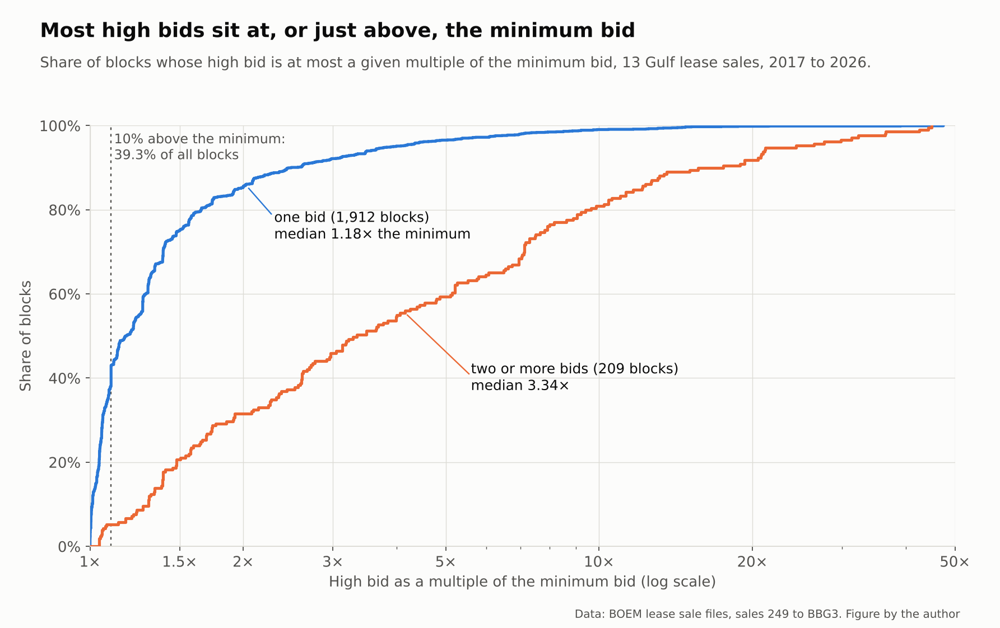
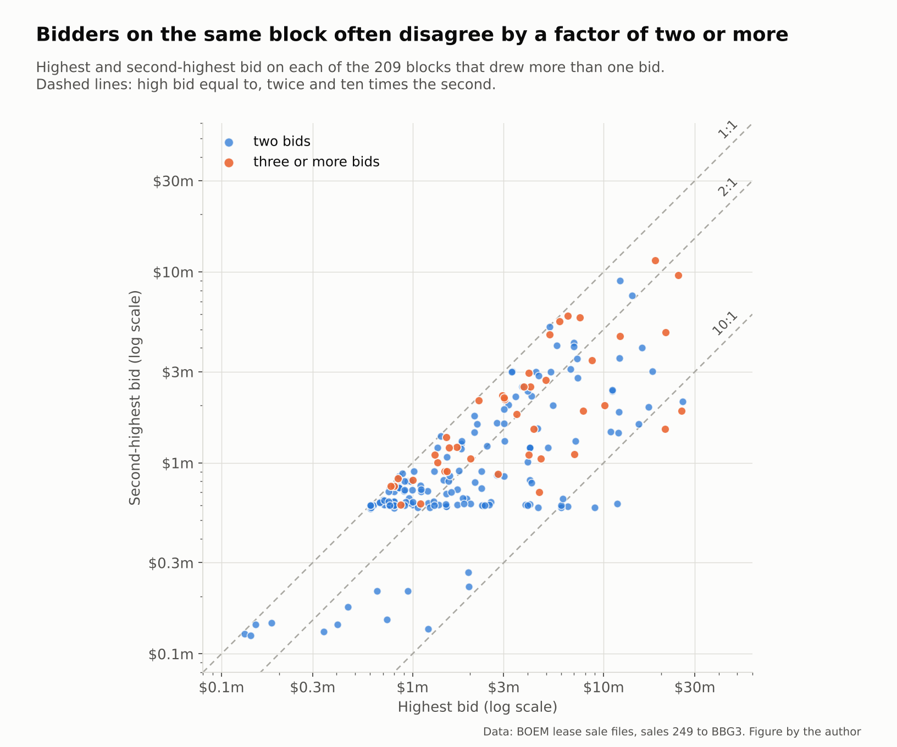
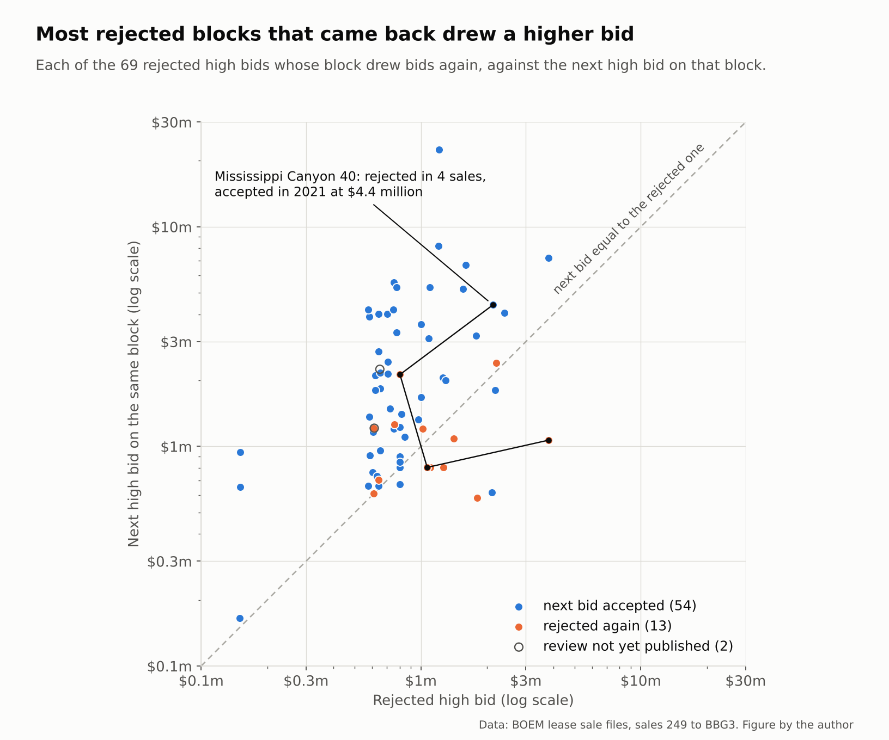
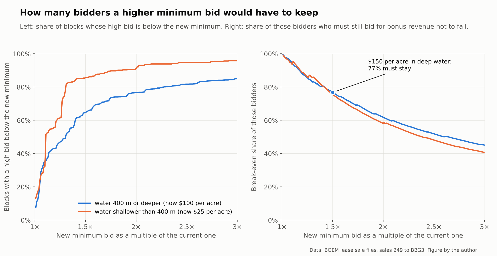

# Minimum Bids, Rejected Bids and Thin Competition in US Offshore Oil and Gas Lease Sales, 2017 to 2026

*A real-data case study for the series Game and Auction Theory for Data Scientists: 2,388 sealed bids from thirteen lease sales, what auction theory explains in them, and which decisions they cannot settle without more information. Python code provided.*

The six parts of [Game and Auction Theory for Data Scientists](https://medium.com/@diogo-ribeiro-1975/game-and-auction-theory-for-data-scientists-6ed2048c7167) ran on simulated data. That was deliberate: when the true values are known, every estimator can be checked against them. It also leaves an obvious question open. Do the ideas survive contact with a real table of bids, with its odd conventions, its gaps and its institutions?

This article answers it with one of the most studied auction datasets in economics. The US Bureau of Ocean Energy Management (BOEM) sells the right to explore for oil and gas on federal offshore blocks in sealed-bid auctions, and it publishes every bid, the company that made it and whether the government accepted it. I use the thirteen sales held in the Gulf between August 2017 and August 2026.

Three findings organise what follows. Competition is thin: when a block drew any bids, 90.1% of the time it drew exactly one. As a result, the minimum bid that BOEM sets does most of the pricing, and the median high bid is only 24% above it. And BOEM operates a second, hidden reserve price: it reviews the high bids against its own valuation and rejects some of them, and most of the blocks it rejected later drew a higher bid. The last section turns the analysis into a decision a data scientist could be asked to support, whether the minimum bid should be higher, and shows what the data can and cannot say about it.

## The auctions and the data

BOEM divides the federal seabed into blocks, most of them 5,760 acres, three miles on a side. In each sale it offers a set of blocks, and companies submit sealed bids for a cash payment called the bonus. The highest bidder wins and pays its own bid, so these are first-price sealed-bid auctions of the kind studied in [Part 5](https://medium.com/@diogo-ribeiro-1975/game-and-auction-theory-for-data-scientists-6fe7bc42b211). The winner also pays a royalty on any oil and gas produced, at a rate fixed in advance for each sale, and annual rentals. The lease terms and royalty rates changed between sales over this period, which is why some of the comparisons below are made within sales.

Two rules set floors. The notices of sale fix a minimum bid of $25 per acre for blocks in water shallower than 400 metres and $100 per acre for deeper blocks, as stated, for example, in the [final notice for Sale 261](https://www.federalregister.gov/documents/2023/08/25/2023-18342/gulf-of-mexico-outer-continental-shelf-oil-and-gas-lease-sale-261) and in the [final notice for Sale BBG1](https://www.federalregister.gov/documents/2025/11/10/2025-19828/gulf-of-america-ocs-oil-and-gas-one-big-beautiful-bill-act-lease-sale-1). And after the sale BOEM evaluates every high bid and accepts it only if it judges the amount adequate. [Porter (1995)](https://ideas.repec.org/a/ecm/emetrp/v63y1995i1p1-27.html) describes the program since 1954, including the government's decision to accept or reject the highest bid, and [Hendricks and Porter (1988)](https://ideas.repec.org/a/aea/aecrev/v78y1988i5p865-83.html) used the bids of the 1950s and 1960s to show how better-informed bidders behave. The files used here are the modern continuation of that record.

For each sale BOEM publishes a set of files. Sales 249 to 261, held between 2017 and 2023, come with plain-text files in fixed columns: one listing the blocks that received bids, one listing the bids, and translation tables for areas and companies. For the three sales of 2025 and 2026, which BOEM calls BBG1 to BBG3, I used the bid recaps in PDF form. The region's name changed in the federal documents in 2025, from Gulf of Mexico to Gulf of America, and both appear in the files.

A joint bid by several companies appears once per partner in the bid file, with the same amount and each partner's share. The first job is to collapse those rows into bids:

```python
import zipfile

import pandas as pd

def read_bids(path):
    """Bids of one sale from BID.DAT: lease, amount, companies and their shares."""
    with zipfile.ZipFile(path) as z:
        name = next(n for n in z.namelist() if n.upper().startswith("BID."))
        text = z.read(name).decode("latin-1")
    rows = pd.DataFrame([{"lease": ln[8:15].strip(), "amount": float(ln[16:26]),
                          "company": ln[27:32].strip(), "share": float(ln[35:43])}
                         for ln in text.splitlines() if ln.strip()])
    # a joint bid appears once per partner, with the same amount; the shares add to 100
    return (rows.groupby(["lease", "amount"], sort=False)
                .agg(companies=("company", ";".join), share=("share", "sum"))
                .reset_index())

bids_261 = read_bids("data/raw/sale-261.zip")
len(bids_261), bids_261.amount.sum()      # 352 bids, $441,896,332, as in BOEM's summary
```

The full script, `build_dataset.py`, does the same for every sale, reads the PDF recaps with a set of regular expressions, attaches depth bands, minimum bids and the outcome of BOEM's review, and then checks itself. For each of the thirteen sales it recomputes the number of blocks receiving bids, the number of bids, the sum of all bids, the sum of the high bids and the number of rejected bids, and compares them with the totals printed in BOEM's own sale summaries. All 64 published totals match exactly; the 65th, the rejections in Sale BBG3, is not yet published. That check is the most useful line of code in the project: a parser that misreads one column of a fixed-format file usually still produces a plausible table.

The result has 2,388 bids. Blocks received bids 2,121 times, on 1,936 distinct blocks, since some were offered and bid on in more than one sale. Sixty-nine companies took part, alone or in groups, and 8.8% of the bids were joint. The high bids add up to $2,309.4 million.

## Competition is thin

Of the 2,121 times a block received bids, 1,912 times it received exactly one. That is 90.1%, ranging from 81.7% to 97.1% across sales. In water shallower than 400 metres the share is 97.8%, and in deeper water 87.7%. The average number of bids per block is 1.13, and the largest number on any block is five. The single-bid blocks are not marginal in money terms either: they account for 66.2% of the sum of high bids.

A first-price auction with one bidder is not much of an auction. The winner pays its own bid, and nobody forces that bid above the minimum except the bidder's own uncertainty about whether a rival will show up. [Part 6](https://medium.com/@diogo-ribeiro-1975/game-and-auction-theory-for-data-scientists-f4b30bfb2516) found, in a simulation, that the gain from a well-chosen reserve price was 12.3% with two bidders and 0.2% with five. This market sits at the end of that range where the reserve matters most.

## The minimum bid sets most prices

Dividing each high bid by the minimum bid for its block puts all blocks on one scale. A high bid here is the highest bid submitted, whether or not BOEM later accepted it.

```python
bids = pd.read_csv("data/bids.csv", dtype={"sale": str})
high = bids[bids["rank"] == 1]                    # the high bid on each block
ratio = high.amount / high.minimum_bid
(high.n_bids == 1).mean(), ratio.median(), (ratio <= 1.10).mean()   # 0.901, 1.24, 0.393
```


*Figure 1. Cumulative share of blocks by the ratio of the high bid to the minimum bid, for blocks with one bid and with two or more. High bids include those BOEM later rejected. Figure by the author, from BOEM data.*

The median high bid is 1.24 times the minimum. More than a fifth of the high bids (22.4%) are within 5% of it, and 39.3% within 10%. Four in five are at most twice the minimum. The lowest bids per acre in the whole dataset are exactly $25.00 in shallow water and $100.00 in deep water, and 36 bids sit at the minimum to the cent.

On blocks with a single bid the median high bid is 1.18 times the minimum. On blocks with two bids it is 2.97 times, and with three or more 6.83 times. Comparing blocks within the same sale and depth band narrows the gap but leaves it large: on a logarithmic scale, high bids on two-bid blocks are 2.35 times those on single-bid blocks, and on blocks with three or more bids 4.19 times.

It is tempting to read that gradient as the effect of competition, and it cannot be read that way. Companies bid on the blocks they think are best, so blocks that attract several bidders are better blocks, and their bids would be higher even without the rivalry. Part 5 showed that the theoretical answer depends on the setting: with private values bids rise with the number of rivals, while with a value common to all bidders each must also shade more as rivals are added. Testing it requires variation in the number of bidders that is unrelated to the quality of the block, or data on what the blocks turned out to be worth. [Hendricks, Pinkse and Porter (2003)](https://ideas.repec.org/a/oup/restud/v70y2003i1p115-145.html) did the second with the production records of leases sold between 1954 and 1970. The files used here contain no such information.

One more pattern in the bids is worth a name. Nearly half of all bids, 45.7%, are what I will call standard bids: the same company bidding the same amount on three or more blocks in the same sale. They make up 48.3% of the high bids. The largest set is 94 blocks in Sale 257, each bid at $158,400, which is $27.50 per acre on a 5,760-acre block. All 94 were in water shallower than 400 metres, and none drew another bid. A company that bids the same amount on 94 blocks does not seem to be pricing each block separately. My conjecture, which these data cannot confirm, is that such bids buy options on blocks the company has not evaluated in detail, at a fixed premium over the minimum to guard against the occasional rival.

The textbook model of Part 5 has each bidder map its own estimate of a block's value into a bid. My reading of the standard bids is that they reflect a more economical behaviour that the same theory predicts at its boundary: a bidder that expects to be alone should bid close to the reserve, whatever the block is worth to it.

## Where bidders compete, they disagree

On the 209 blocks with two or more bids, the two highest bids can be compared directly.


*Figure 2. Highest and second-highest bid on each block that drew more than one bid, on logarithmic scales. Figure by the author, from BOEM data.*

The median high bid is 1.65 times the second, with quartiles at 1.26 and 3.12, and in 40.2% of these auctions the winner bid more than twice as much as the runner-up. The median second bid is 60.5% of the high bid. The row of points at about $0.6 million in Figure 2 is a minimum bid on a 5,760-acre deep-water block: 33.0% of the second bids are within 10% of the minimum.

The difference between the highest and the second bid is sometimes called money left on the table, because the winner could have bid a little above the runner-up and still won. On these blocks it adds up to $479.6 million, or 61.5% of their high bids. That total is concentrated, with the ten largest gaps accounting for 34.4% of it, but the typical gap is also large: the median is 39.5% of the high bid, or $0.7 million.

Gaps this wide are the setting of the winner's curse of Part 5. Suppose every bidder bid in proportion to its own estimate of a value common to all of them, with estimates that are unbiased on a logarithmic scale. Then the spread of the log bids on the same block would measure the noise in the estimates. Here that spread is 0.53 on a robust measure based on the median gap and 0.75 on the pooled variance. Under that model, the higher of two estimates would exceed the true value on average by 0.30 to 0.42 on a logarithmic scale, a factor of about 1.35 to 1.53, and a company that bid its estimate without correction would systematically overpay.

That calculation is an illustration with stated assumptions, and its errors run both ways. Part of the disagreement reflects real differences in what blocks are worth to different companies, such as nearby infrastructure, and part reflects different bidding strategies, both of which inflate the spread. The minimum bid works in the other direction: companies whose estimates were low did not bid at all, and a third of the second bids sit near the minimum, which compresses the observed spread. The point is the order of magnitude. The disagreement is wide enough that the correction of Part 5 matters, and the engineers who first described the winner's curse, [Capen, Clapp and Campbell (1971)](https://doi.org/10.2118/2993-PA), did so for US offshore lease sales.

## The hidden reserve: BOEM's review of high bids

The minimum bid is a public reserve. BOEM also runs a private one. Under the [procedures used for the sales up to 2023](https://boem.gov/Summary-of-Procedures-For-Determining-Bid-Adequacy), every high bid goes through a two-phase review. In the first phase, blocks of the kinds the procedures call wildcat and confirmed that BOEM judges unlikely to hold an economic deposit have their high bid accepted. For the others, BOEM computes its own estimate of the block's value with a discounted cash-flow model, and accepts the high bid if it reaches that estimate or one of the related measures the procedures define. A wildcat or confirmed block whose high bid falls short, and which has a single bid or a second bid below a quarter of the first, may have its bid rejected. Other blocks face further tests, one of which averages the bids with BOEM's estimate. [Revised procedures](https://www.boem.gov/oil-gas-energy/leasing/new-procedures-determining-bid-adequacy), used from Sale BBG1, replace part of the valuation with a lower confidence bound on BOEM's estimate.

In game-theoretic terms this is a reserve price that the bidders cannot see, applied after the bids are opened and based on the seller's own geological information. Part 6 assumed a seller who knows the distribution of values and posts the reserve in advance. BOEM is a seller with private information about the item, which is a different and harder game.

Across the twelve sales whose final results are published, BOEM reviewed 2,062 high bids and rejected 85 of them, 4.1%, worth $82.6 million, or 3.7% of the reviewed high bids. Almost all rejections were in deep water: 82 of 1,568 deep-water high bids (5.2%) against 3 of 494 in shallow water (0.6%). Single-bid blocks were rejected slightly more often than contested ones, 4.2% against 3.0%. The rejected deep-water bids were not unusually low relative to the minimum, at a median of 1.34 times it against 1.30 times for accepted ones. BOEM rejects bids that are low relative to its own valuation of the block, and that valuation is not in the data.

What the data do contain is what happened next. A rejected block returns to the pool and can be offered in a later sale.


*Figure 3. Each rejected high bid whose block drew bids again, against the next high bid on that block, on logarithmic scales. The black path follows one block through five sales. Figure by the author, from BOEM data.*

Of the 85 rejected blocks, 69 received bids again in a later sale within this period. In 85.5% of those cases the next high bid was higher than the rejected one, and the median next bid was 1.79 times the rejected bid. Bidding in general did not rise by anything like that between the same pairs of sales: the median high bid, relative to the minimum, changed by a factor of 1.02. The next high bid came from the same company in 37.7% of cases and from a contested auction in 24.6%. BOEM accepted 54 of the 67 next bids whose review has been published, 80.6%, and rejected 13 again. Counted over all 85 rejected blocks, including those that drew no further bid, 59 (69.4%) later drew a higher bid and 50 (58.8%) a higher bid that BOEM accepted.

One block shows the process at length. Mississippi Canyon 40 drew a single bid of $3.8 million in August 2017, which was rejected. It drew $1.1 million in March 2019 (two bids, rejected), $0.8 million in August 2019 (rejected) and $2.1 million in November 2020 (rejected). In November 2021 it drew two bids and the high bid, $4.4 million, was accepted.

On this evidence the hidden reserve does what a reserve is meant to do: it turns down offers below the seller's valuation, and for most of the rejected blocks a higher offer followed. Whether waiting paid is a separate question, and three cautions apply. The rejected blocks are, by construction, blocks BOEM judged valuable, so they are not a sample of ordinary blocks. Waiting has a cost, from one to several years of delay before any bonus or production, and there is no record of what the original bidders would have done had their bids been accepted. And 16 of the 85 rejected blocks did not draw another bid within these sales, so for them the outcome so far is no lease at all.

## A decision: should the minimum bid be higher?

Suppose the question on a data scientist's desk is whether BOEM should raise the minimum bid, say from $100 to $150 per acre in deep water. Part 6 offered a method: recover bidders' values from their bids with the inversion of Guerre, Perrigne and Vuong, then choose the reserve that maximises revenue against the recovered distribution. It cannot be applied here, for three reasons. The inversion needs auctions with several bidders, and nine in ten of these have one. It needs bidders who know how many rivals they face, and these bidders do not. And it assumes private values, while the studies of these auctions cited above treat the value of a block as largely common to all bidders, something these files alone cannot test.

What can be computed is a break-even. Take the blocks whose high bid is below the proposed minimum. The data cannot say whether those bidders would have paid the higher minimum or stayed away. But if a share `p` of them pay it and the rest drop out, the change in bonus revenue is

```
p × (sum of the new minimums on those blocks) − (sum of their current bids)
```

which is zero at a break-even share `p* = (sum of current bids) / (sum of new minimums)`. Blocks whose bid is already above the new minimum are assumed to pay what they paid, which is conservative: in theory a higher reserve raises the bids above it.

```python
import numpy as np

def breakeven_share(tracts, new_per_acre):
    """Share of the bidders now below a new minimum bid who must still bid
    for bonus revenue not to fall, with the other blocks paying as before."""
    new_min = new_per_acre * np.ceil(tracts.acres)
    below = tracts.amount < new_min
    return tracts.amount[below].sum() / new_min[below].sum()

deep = high[~high.shallow]
breakeven_share(deep, 150)          # 0.77
```


*Figure 4. Left: share of blocks whose high bid is below a new minimum bid, as a multiple of the current one, by water depth. Right: the share of those bidders who must still bid for bonus revenue not to fall. Figure by the author, from BOEM data.*

For deep water, a minimum of $150 per acre is above the high bid on 64.7% of the blocks, 1,045 of them, whose high bids account for 31.1% of the deep-water total. If every one of those bidders paid the new minimum, bonus revenue would rise by 9.4%. If none did, it would fall by 31.1%. The break-even is 77%: at least 77% of those bidders must still take the lease for the change to pay. A minimum of $125 needs 86% of the 759 bidders below it to stay, for a gain of at most 3.5%. A minimum of $200 needs 62% and could gain at most 24.5%. In shallow water, where competition is thinnest, a minimum of $30 per acre is above 55.7% of the high bids and needs 89% of those bidders to stay, and $50 is above 91.1% of them and needs 58%.

The data cannot supply `p`. The closest evidence in these files is the rejected blocks, where BOEM in effect asked for more and 69 of 85 blocks drew a bid again. My conjecture is that this overstates how bidders on ordinary blocks would respond, since rejected blocks are those the government considered undervalued and the bidders presumably knew were worth bidding on. A change in the minimum bid at some point in the history of the program, or a deliberate variation between comparable blocks, would estimate `p` directly.

The break-even also leaves out three things that a full analysis would add. A lease that is not sold pays no rentals and, if it would have produced, no royalties. A block that is not sold can be offered again, so a lost sale is partly a delayed one. And the program has objectives beyond bonus revenue, which are outside the scope of this article.

The deliverable, then, is not a forecast. It is a threshold that converts a question the data cannot answer into one that people with domain knowledge can argue about: would more than three quarters of the high bids now made between $100 and $150 per acre still be made at $150?

## Limits

The sales differ in royalty rates, lease terms and the price of oil at the time. The comparison by number of bids and the control for drift in the analysis of rejected blocks are made within sales; the rejection rates and the break-even pool all sales. The typical high bid relative to the minimum moved only between 1.10 and 1.44 across sales, which limits, without removing, the risk of pooling.

The outcome of BOEM's review comes from two sources. For the three most recent sales it is marked in the bid recaps. For sales 249 to 261 I transcribed the list of rejected bids from each sale's final bid recap, and the build script checks every entry against the bid data by lease and block number. One entry, in Sale 256, gives a block number in the list of rejections that differs from the block number in the bid listing for the same lease. I used the lease number, which matches, and noted the discrepancy in the data folder. The final results of Sale BBG3 were not yet published when I assembled the data, so its bids are excluded from the analysis of rejections.

Joint bids are treated as one bid, and the company listed first is treated as its leader. The high bids include those BOEM later rejected and, for Sale BBG3, those not yet reviewed. The data contain nothing on what happened to the leases afterwards, so no claim here concerns whether winners overpaid, only whether their bids were consistent with the conditions under which the winner's curse arises.

## What the case study adds to the series

The tools of the six parts appear in this data, though not always where the series put them. Part 5's first-price auction is the format, but with one bidder in nine auctions out of ten the interesting decisions are about the floor, not the bids. Part 6's reserve price is the main lever, in two forms, one public and one hidden, and the hidden one leaves a measurable trace in what happens to rejected blocks. Part 5's winner's curse is plausible wherever bidders compete, because their bids are far apart. And Part 6's method for recovering values from bids does not apply, which is itself a finding: the method's assumptions are part of its specification, and here the first of them, several bidders who know how many rivals they face, does not hold.

The data-science work that made the analysis possible is less visible than any of the theory. It consists of a parser checked against every total BOEM has published for these sales, a definition of a bid that handles joint bidding, a careful separation between what the files show and what needs an assumption, and the replacement of an unidentified forecast with a break-even that can be argued about.

## Data and code

The analysis is in the `case-study` folder of the [series repository](https://gitlab.com/DiogoRibeiro7/game-auction-theory-ds). The raw files from BOEM are in `data/raw`; [BOEM states](https://www.boem.gov/copyright) that materials produced by federal agencies are generally in the public domain. `build_dataset.py` turns them into `data/bids.csv` and writes its check against BOEM's totals to `data/build_check.txt`, `offshore_bids.py` prints every other number in this article, and `figures.py` draws the figures. They need `numpy`, `pandas`, `pdfplumber` and `matplotlib`.

## The series

1. [Payoffs, best responses and Nash equilibrium](https://medium.com/@diogo-ribeiro-1975/game-and-auction-theory-for-data-scientists-6ed2048c7167)
2. [Mixed strategies and zero-sum games](https://medium.com/@diogo-ribeiro-1975/game-and-auction-theory-for-data-scientists-792a563995aa)
3. [Cooperative games and the Shapley value](https://medium.com/@diogo-ribeiro-1975/game-and-auction-theory-for-data-scientists-part-3-of-6-cooperative-games-and-the-shapley-value-3572fa60117b)
4. [Games of incomplete information](https://medium.com/@diogo-ribeiro-1975/game-and-auction-theory-for-data-scientists-92803a10d8a6)
5. [Auction formats, bidding and revenue equivalence](https://medium.com/@diogo-ribeiro-1975/game-and-auction-theory-for-data-scientists-6fe7bc42b211)
6. [Reserve prices, values recovered from bids and position auctions](https://medium.com/@diogo-ribeiro-1975/game-and-auction-theory-for-data-scientists-f4b30bfb2516)

## References

Bureau of Ocean Energy Management (2016). Summary of Procedures for Determining Bid Adequacy at Offshore Oil and Gas Lease Sales. https://boem.gov/Summary-of-Procedures-For-Determining-Bid-Adequacy

Bureau of Ocean Energy Management (2024). Procedures for Determining Bid Adequacy, finalized in 2024, effective 1 October 2025. https://www.boem.gov/oil-gas-energy/leasing/new-procedures-determining-bid-adequacy

Bureau of Ocean Energy Management. Lease sale pages and data files for Sales 249, 250, 251, 252, 253, 254, 256, 257, 259, 261, BBG1, BBG2 and BBG3. https://www.boem.gov/oil-gas-energy/leasing

Bureau of Ocean Energy Management (2023). Gulf of Mexico Outer Continental Shelf Oil and Gas Lease Sale 261, final notice of sale. *Federal Register*, 25 August 2023. https://www.federalregister.gov/documents/2023/08/25/2023-18342/gulf-of-mexico-outer-continental-shelf-oil-and-gas-lease-sale-261

Bureau of Ocean Energy Management (2025). Gulf of America OCS Oil and Gas Lease Sale BBG1, final notice of sale. *Federal Register*, 10 November 2025. https://www.federalregister.gov/documents/2025/11/10/2025-19828/gulf-of-america-ocs-oil-and-gas-one-big-beautiful-bill-act-lease-sale-1

Capen, E. C., Clapp, R. V. and Campbell, W. M. (1971). Competitive Bidding in High-Risk Situations. *Journal of Petroleum Technology*, 23, 641–653. https://doi.org/10.2118/2993-PA

Hendricks, K. and Porter, R. H. (1988). An Empirical Study of an Auction with Asymmetric Information. *American Economic Review*, 78(5), 865–883. https://ideas.repec.org/a/aea/aecrev/v78y1988i5p865-83.html

Hendricks, K., Pinkse, J. and Porter, R. H. (2003). Empirical Implications of Equilibrium Bidding in First-Price, Symmetric, Common Value Auctions. *Review of Economic Studies*, 70(1), 115–145. https://ideas.repec.org/a/oup/restud/v70y2003i1p115-145.html

Porter, R. H. (1995). The Role of Information in U.S. Offshore Oil and Gas Lease Auctions. *Econometrica*, 63(1), 1–27. https://ideas.repec.org/a/ecm/emetrp/v63y1995i1p1-27.html
