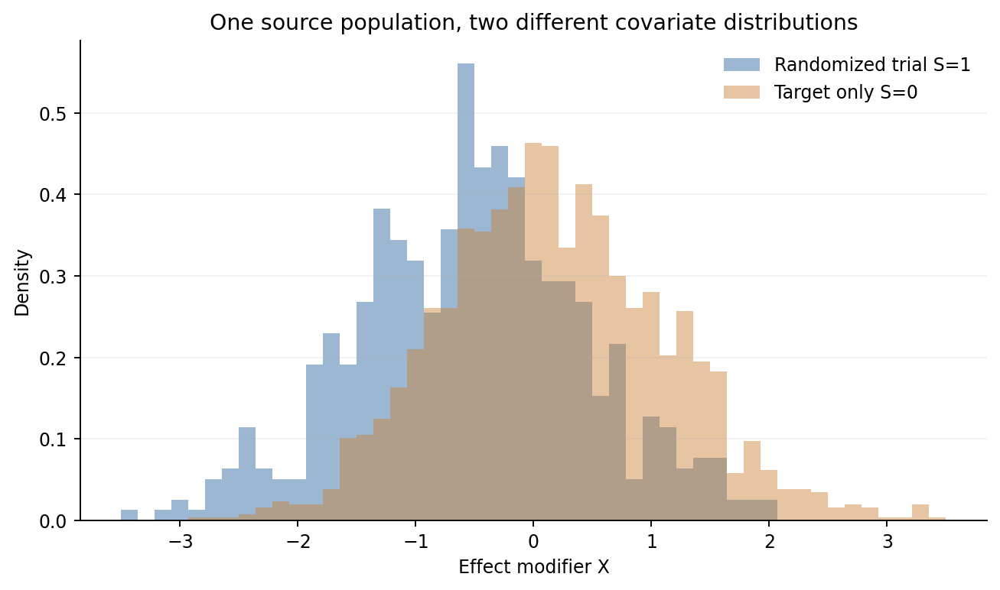
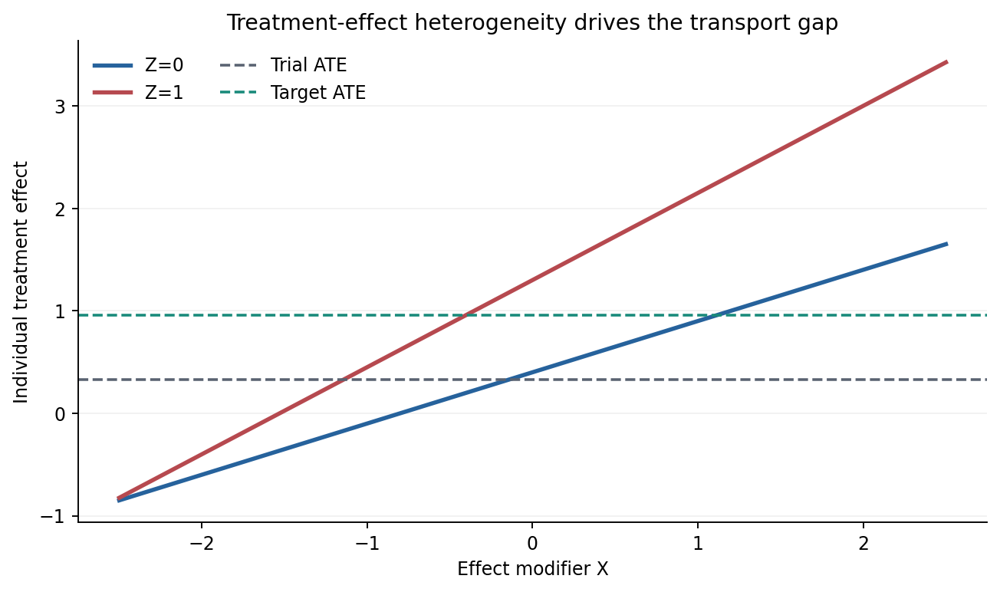
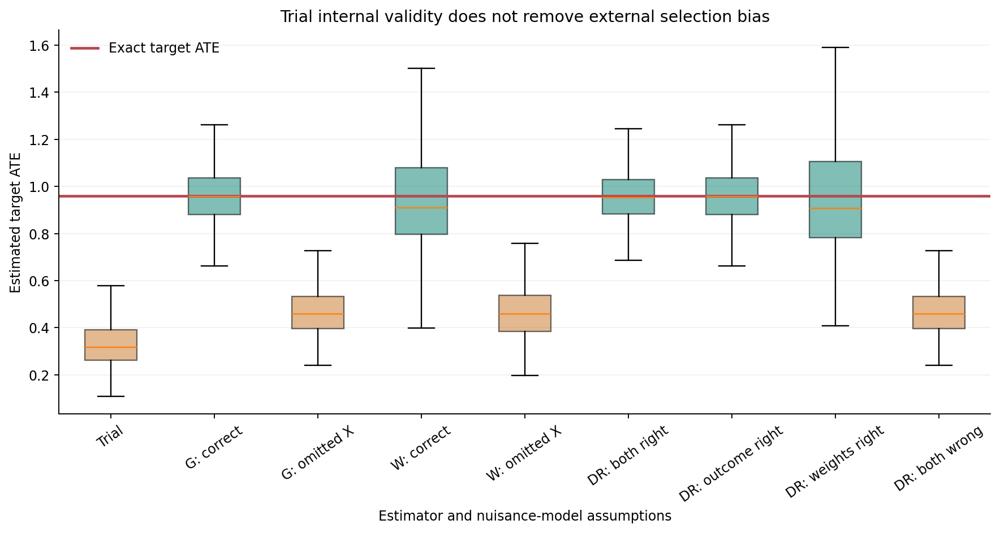
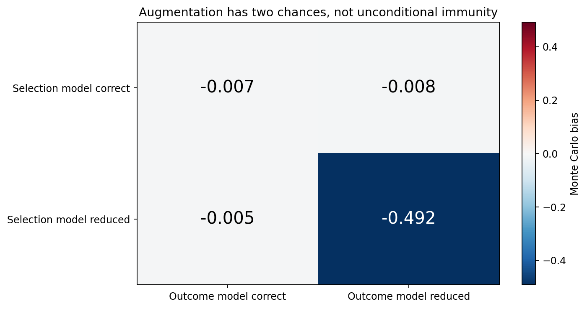
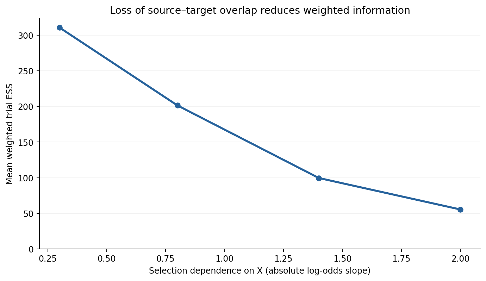
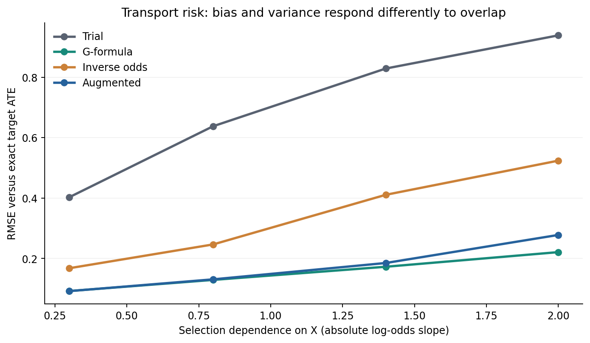
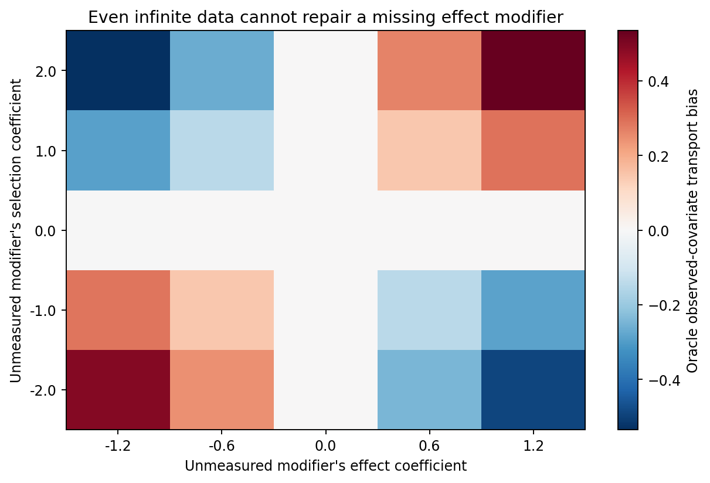
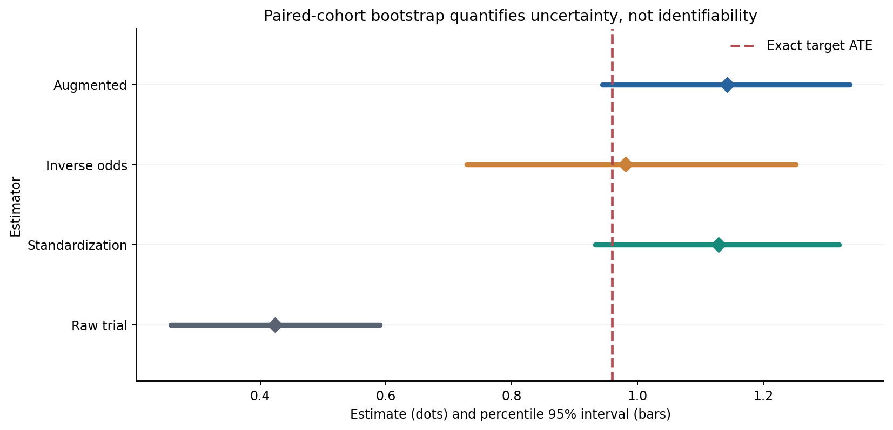

# A Randomized Trial Is Not a Universal Policy

## Transporting Causal Effects, External Validity, and the Price of an Unrepresentative Experiment

*Diogo Ribeiro — Mathematics, Statistics, and Data Science*

---

Imagine a trial conducted with care. Treatment assignment is concealed. The allocation probability is known. Follow-up is complete. The outcome is measured consistently, and the statistical analysis was registered before the data were examined. The difference between treatment groups is an unbiased estimate of the average causal effect in the people randomized. Nothing in that statement is a guarantee about people who were **not** randomized.

That distinction is easy to understand in conversation and remarkably easy to lose in a dashboard. A hospital asks whether a treatment benefits its own patients. A manufacturer asks whether a process change will work in another plant. An educational authority asks whether an intervention evaluated in a few schools should be introduced nationally. A public agency asks whether a programme tested among volunteers improves outcomes among the people it is supposed to serve. The trial answers a question; the decision maker may be asking a different one.

The usual reaction is to say that the experimental sample should be representative. Sometimes that is possible. Often it is neither realistic nor necessary: recruitment has eligibility criteria, costs, geography, operational constraints, and voluntary participation. The more useful question is mathematical. **Under what assumptions can a causal effect identified in one population be transported to a different population, and how do we estimate that effect using the information actually available?**

In this article, I will construct a randomized trial that is internally valid but gives a substantially misleading estimate of the effect in its intended target population. I will then derive and compare three strategies: outcome standardization, inverse odds of selection weighting, and augmented—often called *doubly robust*—estimation. I will expose the conditions under which they agree, and the conditions under which all of them can fail. Every numerical result and every figure comes from one executable Python companion study using synthetic data and an analytically defined population truth.

The distinction between internal and external validity has a substantial history. Cole and Stuart explored generalizing randomized clinical-trial findings using the ACTG 320 example [1]. Stuart and colleagues developed tools for measuring trial-to-population similarity [2,3]. Westreich and colleagues formalized inverse odds of sampling weights for a target distinct from the randomized sample [4]. Dahabreh and collaborators clarified identification, study designs, and augmented estimation [5–8]. Pearl and Bareinboim developed a broader graphical theory of transportability that asks whether a causal effect remains identifiable when populations differ in specified mechanisms [9,10]. These contributions share an important principle: identifying an effect *somewhere* is different from identifying it *where a decision will be made*.

The same question appears in experimental education and the hierarchy of evidence. Tipton examined propensity-score subclassification for generalizing experiments [11], while Westreich and colleagues argued for judging evidence by validity for the *target* rather than study-design labels alone [12]. Generalizing from trial participants to an entire trial-eligible population has its own identification and estimation literature [16]. A particular transport estimator should therefore be chosen only after deciding which population is meant by the word "target."

This article is part of a statistical series. Earlier entries concerned identification in inverse problems, conformal intervals, decision-aware prediction, and the danger of treating a statistically significant estimate as a replicable effect. External validity adds a further question: even if an estimated treatment effect is perfectly credible in its source experiment, is it the effect we need?

## 1. Before estimating anything, write down the population

Let \(S\) indicate membership in two disjoint groups:

- \(S=1\): eligible individuals enrolled in a randomized trial.
- \(S=0\): eligible target-population nonparticipants, whose covariates are observed but whose treatment outcomes are not.

We observe \(A\in\{0,1\}\), the randomized treatment, and \(Y\), its observed outcome, for the first group. We observe pretreatment variables \(X\) for both groups. A binary variable \(Z\) will later be an additional measured effect modifier. The target here is deliberately the nonparticipant population, not the union of participants and nonparticipants. That design choice determines the correct sampling weights.

Define potential outcomes \(Y(1)\) and \(Y(0)\), the outcomes that would be observed under each well-defined treatment. The study-specific average treatment effect is

\[
\psi_1=\mathbb E\left[Y(1)-Y(0)\mid S=1\right].
\]

The decision maker needs

\[
\boxed{\psi_0=\mathbb E\left[Y(1)-Y(0)\mid S=0\right].}
\]

These are not two estimates of a common parameter. They are two different parameters, unless the populations happen to have the same average effect. A precisely estimated \(\psi_1\) does not automatically estimate \(\psi_0\).

It is also important to keep the effect scale explicit. Here we use a **mean difference**, which is collapsible: an average conditional mean difference can be averaged over the relevant covariate distribution. Odds ratios are generally noncollapsible, so their population changes can occur even without conventional effect modification on the conditional odds-ratio scale. Carrying a transport formula from an additive mean difference into a logistic odds-ratio interpretation without rederiving it would be a mistake.

Sometimes the target population includes trial participants. That is the *generalizability* or nested-trial design. Sometimes the trial and target datasets are disjoint, as here. That is often called *transportability*. The terminology is not perfectly uniform across disciplines, but the sampling-frame distinction is substantive: when the target is specifically \(S=0\), **inverse odds** arise naturally; when the target represents everybody eligible regardless of trial participation, a different sampling-probability formula may be appropriate [4,7].

Suppose a trial reports an ATE of \(0.30\), with a confidence interval from \(0.20\) to \(0.40\). That interval can have excellent source-population coverage. Yet if the target-population effect is \(0.95\), additional precision around \(0.30\) will not solve the transport problem. The gap is not conventional sampling error. It is a mismatch between the estimand represented by trial recruitment and the estimand required for policy.

## 2. Internal randomization does one job very well

Randomization identifies causal treatment contrasts among the people randomized. Conditional on trial participation and design eligibility, a simple trial may satisfy

\[
A\ \perp\ \{Y(0),Y(1)\}\mid S=1,
\qquad 0<P(A=1\mid S=1)<1.
\]

Assume consistency: the observed response satisfies \(Y=Y(A)\), with no relevant multiple versions of treatment and no interference between units. If the allocation probability is \(e_A=1/2\), then

\[
\mathbb E[Y\mid A=1,S=1]-\mathbb E[Y\mid A=0,S=1]
=\psi_1.
\]

There is no confounding of treatment assignment within this randomized trial. The equality is a powerful result. What it does **not** say is

\[
\psi_1=\psi_0.
\]

Equality of those two expectations would follow under additional conditions—for example, an additive treatment effect that is constant across all individuals, or a source sample and target population with the same distribution of every variable that changes the additive treatment effect. Neither property is a consequence of randomization.

To see why, let \(W=(X,Z)\) collect measured pretreatment characteristics and define a conditional average treatment effect

\[
\tau_s(w)=\mathbb E[Y(1)-Y(0)\mid W=w,S=s].
\]

Then

\[
\psi_1=\int\tau_1(w)\,dF_1(w),\qquad
\psi_0=\int\tau_0(w)\,dF_0(w).
\]

Two kinds of differences can appear. First, \(F_1\) and \(F_0\) may differ: even if \(\tau_1(w)=\tau_0(w)\), the two groups may assign different importance to the same conditional effects. Second, the response functions themselves may differ because treatment delivery, concurrent care, implementation, measurement, or unobserved characteristics differ across settings. The first problem is sometimes corrected by reweighting or standardization. The second requires much more substantive knowledge. Covariate adjustment cannot guarantee that a treatment actually delivered in a new setting is the same intervention.

This is why a trial can be unbiased for its source-population effect and still be inappropriate as a direct national-policy estimator. The statistical argument is not that randomization is unhelpful. Quite the opposite: randomization solves the hardest internal identification problem and lets us focus separately on the assumptions required for extrapolation.

## 3. A synthetic population with a known answer

The companion study specifies an infinite superpopulation. Each unit has a continuous covariate \(X\sim N(0,1)\), a binary characteristic \(Z\sim\operatorname{Bernoulli}(0.45)\), and a latent binary characteristic \(U\sim\operatorname{Bernoulli}(0.5)\). These are independent *before* selection into trial and target populations. In the baseline experiment \(U\) does not modify treatment or selection; later I will activate both mechanisms to study an omitted effect modifier.

Trial enrollment is generated by

\[
\Pr(S=1\mid X=x,Z=z,U=u)
=\operatorname{expit}(-0.85-1.1z-\lambda x+\gamma u),
\]

where \(\operatorname{expit}(t)=1/(1+e^{-t})\), \(\lambda=0.8\) in the baseline, and \(\gamma=0\) unless explicitly varied. The trial is therefore less likely to contain people with larger \(X\) and those with \(Z=1\). The target nonparticipant cohort is selected according to \(S=0\), the complementary event. We draw the source and target samples independently from their respective conditional distributions. We do not pretend that the two files are two independent random samples from the *same* distribution.

Within the selected trial, treatment is assigned independently with probability \(1/2\). Potential outcomes follow

\[
\begin{aligned}
Y(0)&=1+0.5Z+0.4X+0.15X^2+\varepsilon,\\
Y(1)&=Y(0)+\tau(X,Z,U),\\
\tau(X,Z,U)&=0.4+0.9Z+0.5X+0.35ZX+\delta_U U,\\
\varepsilon&\sim N(0,0.8^2).
\end{aligned}
\]

In the baseline, \(\delta_U=0\). The quadratic term means that a properly specified outcome model needs some curvature; the \(ZX\) term means that the treatment effect changes with two characteristics together. The outcome is continuous and has no clinical, economic, or industrial unit. This is an identification experiment, not an empirical statement about a particular treatment.

The population causal effects can be computed without drawing noisy outcomes. Let \(f(x,z,u)\) be the superpopulation distribution and \(p(x,z,u)=P(S=1\mid x,z,u)\). Then

\[
\psi_1=
\frac{\mathbb E_f[\tau(X,Z,U)p(X,Z,U)]}
{\mathbb E_f[p(X,Z,U)]},
\quad
\psi_0=
\frac{\mathbb E_f[\tau(X,Z,U)\{1-p(X,Z,U)\}]}
{\mathbb E_f[1-p(X,Z,U)]}.
\]

The Python implementation performs the expectation over \(X\) by Gaussian–Hermite quadrature, while integrating exactly over the four possible \((Z,U)\) combinations. With 80 quadrature nodes, increasing the numerical resolution leaves the reported values unchanged to the displayed precision. There is no Monte Carlo error in the reference effects used to calculate estimator bias.

For the baseline design, the exact results are:

| Population | Exact average treatment effect |
| :--- | ---: |
| Randomized participants, \(S=1\) | **0.326304** |
| Target nonparticipants, \(S=0\) | **0.959350** |
| Difference, target minus trial | **0.633045** |

The enrollment probability in this superpopulation is approximately \(0.243821\). The target therefore represents the remaining roughly \(75.6\%\), although we deliberately draw fixed-size independent datasets for the two conditional groups. The experimental effect and the target effect differ almost threefold. Nothing about this divergence requires treatment confounding: assignment within the trial is perfectly random.

This truth is exported in [`results/population_truth.csv`](results/population_truth.csv). The code also exports observed cohort characteristics in [`results/cohort_diagnostics.csv`](results/cohort_diagnostics.csv), allowing readers to check that the realized samples differ in the intended ways. Fixed-seed samples illustrate individual realizations; the quadrature values define the estimands.

## 4. The effect is not a constant waiting to be discovered

*Figure 1.* The source trial overrepresents lower values of \(X\); the target contains more observations with higher values. This is a selection mechanism deliberately imposed by the simulation, not an inference from human population data. The histogram values are available in [`results/covariate_density.csv`](results/covariate_density.csv).

The relevant statistical observation is not merely that two histograms look different. Distributional shift matters for the ATE **because \(X\) modifies the treatment effect**. If a covariate predicts the outcome but does not modify the chosen effect measure, a shift in that variable does not necessarily change the population average additive treatment effect. If it does modify treatment response, the same shift can change the policy-relevant mean even when every within-stratum causal effect is stable.

*Figure 2.* The additive effect increases with \(X\) and is greater when \(Z=1\). Dashed lines show average effects after integrating the same conditional response function over different population distributions. The source effect is lower because recruitment systematically weights lower-response combinations. The exact plotted curves are stored in [`results/conditional_effect_curves.csv`](results/conditional_effect_curves.csv).

This picture explains why a robust causal model and a robust forecasting model are not interchangeable. A predictive regression that fits \(Y\) well can still omit a small interaction that is crucial for transporting a treatment *difference*. Conversely, a covariate that strongly predicts outcomes in both arms may matter little for a mean treatment difference if its contribution cancels. Variable importance for \(Y\) is not the same as effect-modifier importance for \(Y(1)-Y(0)\).

Consider the decomposition

\[
\psi_0-\psi_1
=\underbrace{\int\tau_1(w)\{dF_0(w)-dF_1(w)\}}_{\text{difference in population composition}}
+\underbrace{\int\{\tau_0(w)-\tau_1(w)\}\,dF_0(w)}_{\text{difference in conditional effects}}.
\]

The identity is algebraic. Add and subtract \(\int\tau_1(w)dF_0(w)\). It separates two scientific questions. Can we measure and adjust the variables responsible for population composition? And is the conditional effect function learned in the trial a valid function for the target? In our baseline experiment, the second term is zero by construction and the entire gap comes from population composition. The hidden-modifier experiment will make the second term nonzero.

## 5. Transport is an identification problem before it is an estimation problem

To identify the target ATE from trial outcomes and target covariates, four assumptions deserve separate inspection.

**Consistency and a comparable treatment.** The intervention called \(A=1\) must represent the same relevant treatment strategy across the trial and its proposed target setting; likewise for the control. A treatment with a different dose, implementation, comparator, eligibility process, or interference structure may constitute a different causal question. A portable software label does not make an intervention portable.

**Internal randomization.** Conditional treatment exchangeability and treatment positivity hold in the trial: \(Y(a)\perp A\mid W,S=1\), with \(0<P(A=a\mid W,S=1)<1\). The companion simulation uses a fixed allocation probability of \(0.5\). If a study randomizes within strata, its known design probabilities should be used instead of pretending that everyone had the same assignment probability.

**Conditional transport exchangeability.** A sufficient assumption for our additive mean target is

\[
\mathbb E[Y(a)\mid W=w,S=1]
=\mathbb E[Y(a)\mid W=w,S=0],\quad a\in\{0,1\}.
\]

This is stronger than strictly necessary for transporting only the **contrast**: equality of \(\tau_1(w)\) and \(\tau_0(w)\) suffices for the ATE if the conditional outcome *levels* differ but their difference does not. The stronger pair of potential-outcome mean equalities is conventional and convenient when deriving arm-specific g-formula estimators. Neither version can be proven from trial randomization alone. The variables included in \(W\) must make the chosen version plausible.

**Sampling positivity.** Wherever the target distribution has positive probability, the source trial must offer a chance of observing individuals with those pretreatment characteristics:

\[
f_0(w)>0\quad\Longrightarrow\quad f_1(w)>0.
\]

In a superpopulation formulation, this is a condition on trial participation probabilities for target-relevant covariates. A target stratum never represented in the trial cannot be identified nonparametrically by the observed-data transport formula. A linear regression may return a number there, but the number is model-driven extrapolation, not evidence created by data.

There are practical measurement conditions as well. The target covariates must be measured comparably to trial covariates. The sampling mechanism and available sampling frames must correspond to the target estimand. Missing outcomes, treatment nonadherence, loss to follow-up, and observational confounding require separate treatment. We set them aside to expose external validity without introducing those additional problems. The design literature stresses that the data-collection scheme determines what is identified [7,8].

## 6. Standardization: carry trial response functions to target covariates

Under the above assumptions, define the trial outcome regressions

\[
m_a(w)=\mathbb E[Y\mid A=a,W=w,S=1],\qquad a\in\{0,1\}.
\]

Trial randomization identifies each \(m_a(w)\) as the conditional mean of \(Y(a)\) among randomized participants. Conditional transport exchangeability lets us treat the same functions as the target conditional potential-outcome means. The law of iterated expectation then gives the identification formula

\[
\boxed{\psi_0=\mathbb E\left[m_1(W)-m_0(W)\mid S=0\right].}
\]

Given a trial with \(n_1\) participants and an independent target covariate sample of size \(n_0\), an outcome-standardized estimator is

\[
\widehat\psi_{\mathrm{G}}
=\frac{1}{n_0}\sum_{j:S_j=0}
\{\widehat m_1(W_j)-\widehat m_0(W_j)\}.
\]

This procedure is sometimes called the *g-formula* or g-computation. It sounds almost ordinary: fit outcome models in the randomized trial, predict both potential outcome means for every target unit, subtract them, and average in the target. The target sample tells us **which covariate combinations matter and how often**; the trial tells us **what effect those combinations are expected to experience**.

The apparent simplicity hides model requirements. In our synthetic data the true trial conditional means contain \(X\), \(X^2\), \(Z\), and \(XZ\). We fit two separate ordinary least-squares models—one for each randomized arm—using the design vector \((1,Z,X,XZ,X^2)\). The form is correctly specified for both arms. For a deliberate wrong-model comparison we also fit \((1,Z)\), omitting \(X\) and its interaction. A flexible machine learner would not automatically solve this problem unless its estimated conditional means were accurate specifically where the target sample concentrates and its training and tuning respected the study design.

Standardization can be efficient when the outcome model is informative. It may perform better than weighting when selection probabilities are extreme, because it uses a structural response model instead of allowing a few source observations to represent many target units. But if that model extrapolates badly, standardization can be confidently wrong. Good fit on the **trial** distribution is not sufficient evidence of reliable prediction on the **target** distribution.

## 7. Inverse odds: let the target distribution decide how much each trial unit counts

The g-formula models outcomes. A second route models selection into the trial. In this design, the source and target groups are disjoint. Let \(\pi(w)=P(S=1\mid W=w)\) in the common eligible superpopulation. By Bayes' rule,

\[
\begin{aligned}
\frac{f_0(w)}{f_1(w)}
&=\frac{f_{W\mid S}(w\mid S=0)}{f_{W\mid S}(w\mid S=1)}\\
&=\frac{P(S=0\mid W=w)}{P(S=1\mid W=w)}
\frac{P(S=1)}{P(S=0)}\\
&\propto\frac{1-\pi(w)}{\pi(w)}.
\end{aligned}
\]

Thus the relative weight

\[
\boxed{\omega(w)=\frac{1-\pi(w)}{\pi(w)}}
\]

transforms expectations over randomized participants into expectations over the target nonparticipants, up to a constant that cancels under normalization. For a measurable function \(h\),

\[
\mathbb E[h(W)\mid S=0]
=\frac{\mathbb E[\omega(W)h(W)\mid S=1]}
{\mathbb E[\omega(W)\mid S=1]}.
\]

If \(A\) is randomized with probability \(e_A(w)\), inverse-odds weighted trial outcome contrasts identify \(\psi_0\) under the same transport assumptions. Our implementation uses separately normalized treatment-arm means:

\[
\widehat\psi_{\mathrm{W}}=
\frac{\sum_{i:S_i=1}\widehat\omega_i A_iY_i}
{\sum_{i:S_i=1}\widehat\omega_i A_i}
-\frac{\sum_{i:S_i=1}\widehat\omega_i(1-A_i)Y_i}
{\sum_{i:S_i=1}\widehat\omega_i(1-A_i)}.
\]

These are normalized or Hájek-style weighted means. Because randomization probability is the same across the entire trial, fixed treatment-probability factors cancel within each arm. If allocation probabilities vary across strata, the corresponding inverse probability of randomized treatment belongs in the weighting formula. The more general augmented estimator below retains the explicit treatment probabilities.

There is a surprisingly important data-design subtlety. We draw \(550\) randomized participants and \(1{,}800\) target nonparticipants as independent samples from \(f_1\) and \(f_0\). Their ratio was chosen by the experimenter; it is **not** an estimate of the superpopulation prevalence of trial participation. Fitting a logistic model to a pooled file labeled with \(S\) recovers the conditional **sample-membership** odds. The regression intercept generally differs from the intercept of the superpopulation selection mechanism. Under correct logistic slope specification and covariate-dependent selection, however, the fitted odds differ from the required density ratio only by a constant. That constant disappears in self-normalized inverse-odds estimation.

This gives a concrete interpretation to the often casually written phrase "weight by the probability of being in the trial." Probabilities depend on a reference sampling frame. If the target sample is an independent file of nonparticipants, inverse odds are appropriate for our estimand. If the target sample is representative of the entire eligible population, the source-to-target density ratio is proportional to \(1/\pi(w)\) instead. Substituting one formula for the other without checking whether the target includes trial participants changes the population being represented. Westreich and colleagues make this design distinction explicit [4], and Dahabreh and colleagues analyze corresponding study-design requirements [7,8].

We fit the selection logistic model with features \((1,Z,X)\). Since the true selection log odds use exactly those terms, this rich model is correctly specified in the baseline. As a deliberate counterexample, we also fit a reduced model containing \((1,Z)\), which cannot distinguish high- and low-\(X\) participants with the same \(Z\). Both models can converge and return tidy propensity scores. Only one contains the variable needed to align source and target distributions in this simulation.

The weighting intuition is concrete. A rare trial participant with covariates common in the target may stand in for many target individuals. This can improve bias when the probability model is accurate, but it can also create a large variance penalty: a few observations become very influential. In the baseline illustrative trial, the estimated weighted effective sample size of the \(550\) participants is approximately \(279.4\), even though the number of people observed has not changed. There is no new information in a weight. We have redistributed the influence of existing information.

## 8. Augmentation: two nuisance models and one target estimand

Outcome standardization depends on estimates of \(m_0\) and \(m_1\). Inverse-odds weighting depends on estimates of \(\omega\). We can combine them. With known randomized treatment probability \(e_A\) and estimated outcome functions \(\widehat m_a\), define

\[
\begin{aligned}
\widehat\psi_{\mathrm{DR}}={}&
\frac{1}{n_0}\sum_{j:S_j=0}
\{\widehat m_1(W_j)-\widehat m_0(W_j)\}\\[4pt]
&+\frac{1}{\sum_{i:S_i=1}\widehat\omega_i}
\sum_{i:S_i=1}\widehat\omega_i\left[
\frac{A_i}{e_A}(Y_i-\widehat m_1(W_i))
-\frac{1-A_i}{1-e_A}(Y_i-\widehat m_0(W_i))
\right].
\end{aligned}
\]

The first term carries modeled conditional effects to the target covariates. The second term uses randomized trial residuals to correct systematic errors in those modeled effects. The adjustment is weighted toward the characteristics important in the target. The method belongs to a family of augmented inverse-probability estimators; its connection with trial generalization is studied in the work of Dahabreh, Robertson, and Hernán [6] and in the trial-to-target methodological literature [5,8].

Why can it be *doubly robust*? At the population level, write \(\widetilde m_a\) for possibly incorrect fitted regression limits and \(\widetilde\omega\) for possibly incorrect weighting limits. If \(\widetilde m_a=m_a\), then

\[
\mathbb E\left[\frac{A}{e_A}\{Y-m_1(W)\}
-\frac{1-A}{1-e_A}\{Y-m_0(W)\}
\mid W,S=1\right]=0.
\]

The residual correction consequently has mean zero, regardless of the estimated weights, and the first term identifies \(\psi_0\). This is the **correct-outcome-model route**.

Alternatively, suppose \(\widetilde\omega\) is proportional to \(f_0/f_1\). Randomization implies that the trial conditional expectation of the residual expression equals

\[
\{m_1(W)-\widetilde m_1(W)\}
-\{m_0(W)-\widetilde m_0(W)\}.
\]

Weighting transports that difference into the target distribution. It cancels the bias of the first term, leaving the target average of \(m_1-m_0\). This is the **correct-selection-model route**. The two routes justify the term "doubly robust." They do not mean that arbitrary model errors cancel each other, that the estimator is resistant to extreme weights, or that an unobserved transport modifier stops mattering.

In finite samples, several qualifications remain. The normalization of the weights introduces small finite-sample effects. Highly variable weights can dominate residuals; even a consistent estimator can have unacceptable finite-sample dispersion. The nuisance regressions must be estimated with enough data, treatment positivity must hold, and inference must account for estimation of both nuisance functions. If flexible machine learning is used, cross-fitting and appropriate regularity conditions are commonly invoked to control overfitting and establish asymptotic guarantees. Our study deliberately uses low-dimensional, prespecified parametric nuisance models; it does not claim semiparametric efficiency or universal machine-learning robustness.

The estimand is still \(\psi_0\). The algorithm has two statistical paths toward it, but no extra causal information about an unmeasured effect modifier. That distinction is the central point of the article.

## 9. The simulation: correct randomization, wrong target

The main Monte Carlo experiment uses \(300\) independently simulated trials, each with \(500\) randomized participants and \(1{,}400\) independent target covariate observations. Every replicate has the same superpopulation structural model. Randomization, covariates, enrollment, and outcome noise are regenerated. The oracle target ATE, \(0.959350\), remains fixed across replicates, because it is defined before sampling.

We evaluate nine estimators: the unadjusted randomized trial contrast; correctly specified and reduced outcome-standardization models; correctly specified and reduced inverse-odds models; and augmented estimators for all four combinations of correctly specified and reduced outcome and selection models.

For each method, bias is the mean estimate minus the **exact** target ATE. Root mean squared error (RMSE) is the square root of the mean squared distance from that same target ATE. Standard deviation is variability across the 300 generated studies. The methods are not being compared by how closely they recover the trial-population ATE—that would be a different problem.

*Figure 3.* Distributions over 300 independent synthetic studies. G denotes outcome standardization, W inverse odds, and DR the augmented estimator. A red horizontal line marks the analytically determined target ATE. A lower-variance estimator is not necessarily a more accurate estimator for this target: the reduced models are visibly concentrated around the wrong quantity. Raw study-level values are in [`results/estimator_replicates.csv`](results/estimator_replicates.csv).

Selected results are as follows:

| Method | Monte Carlo bias | RMSE | Across-study SD |
| :--- | ---: | ---: | ---: |
| Raw randomized trial difference | −0.632 | 0.639 | 0.099 |
| Correct outcome standardization | −0.005 | 0.115 | 0.115 |
| Outcome standardization omitting \(X\) | −0.492 | 0.505 | 0.114 |
| Correct inverse odds | −0.010 | 0.256 | 0.257 |
| Inverse odds omitting \(X\) | −0.492 | 0.507 | 0.121 |
| Augmentation, both models correct | −0.007 | 0.116 | 0.116 |
| Augmentation, correct outcome only | −0.005 | 0.115 | 0.115 |
| Augmentation, correct selection only | −0.008 | 0.267 | 0.267 |
| Augmentation, both models reduced | −0.492 | 0.505 | 0.114 |

The full-precision numbers, exact target reference, and replication counts are exported in [`results/estimator_summary.csv`](results/estimator_summary.csv). Rounded table values above are displayed for readability; the machine-readable file is authoritative.

Several findings deserve attention. First, the naïve trial estimator is doing exactly the job its randomization allows. Its mean, approximately \(0.328\), is near the exact trial ATE of \(0.326\), while its bias relative to the intended target is approximately \(-0.632\). The estimate is not a defective estimator of \(\psi_1\). It is a defective estimator **of \(\psi_0\)**. The problem was posed incorrectly if those two were silently treated as interchangeable.

Second, correct standardization recovers the target effect in repeated sampling, with an RMSE of approximately \(0.115\). The source trial itself did not become representative. Its response model was used to answer a target-population question by integrating over the right covariate distribution. The target sample supplies information that the trial alone cannot give: the distribution of effect modifiers among the people for whom the decision is made.

Third, correct inverse-odds weighting also removes most of the bias, but with more variance: an RMSE around \(0.256\) rather than \(0.115\). That is not proof that standardization is universally superior. Here the outcome model has the exact finite-dimensional form used by the data-generating process, while weights can be extreme. In a different setting with a complicated outcome mechanism and easier selection model, the comparison could reverse.

Fourth, omitting \(X\) from both nuisance models is a serious structural error. The resulting estimates remain roughly \(0.49\) below the target truth. The models are not rescued by their elegant syntax or by the fact that they produce finite estimates. **A converged nuisance model is not evidence that the nuisance function is correct.**

## 10. Double robustness is conditional, not magical

*Figure 4.* Rows indicate whether the trial-participation model correctly includes \(X\); columns indicate whether the outcome models include the true effect-modifying terms. Monte Carlo bias stays near zero when at least one nuisance family is correctly specified. When both omit \(X\), the bias approaches \(-0.492\). These are finite-replicate estimates; the small nonzero values in the three correctly supported cells are not theoretical violations of double robustness.

This matrix is a practical way to read the guarantee. The four model combinations are not four philosophical opinions about the same data. They correspond to four specific interventions on the computational design: use or remove \(X\) from the outcome nuisance function and use or remove it from the selection nuisance function.

The observed robustness is not a permission slip for careless modeling. If \(X\) has complex nonlinear interactions with \(Z\), the models can both be wrong in more subtle ways than a simple omission. If \(X\) is measured differently in the target, both can be systematically inconsistent. If a target stratum has no source support, the models can agree because they share an extrapolation, not because they have become identified.

There is also a distinction between robustness to nuisance-model **specification** and robustness to **causal assumptions**. Our doubly robust estimator is protected if one statistical model is correct while the assumed transport exchangeability and positivity conditions are true. If an effect modifier \(U\) is omitted and changes participation, both nuisance functions can be perfectly fitted as functions of the observed covariates yet the target effect may be unidentified. The next sections explore the two main failure mechanisms separately: insufficient overlap and unobserved effect modification.

## 11. Overlap is a property of information, not just a diagnostic plot

In the selection model, \(\lambda\) controls how strongly \(X\) changes the probability of entering the trial. The baseline uses \(\lambda=0.8\). We independently rerun the experiment at \(\lambda\in\{0.3,0.8,1.4,2.0\}\), performing 180 repetitions at each setting with a trial of \(450\) and a target sample of \(1{,}350\). Each scenario has its own exact target ATE, computed by quadrature. Comparing error against a single fixed target number across these scenarios would be incorrect because changing the recruitment process changes the distribution of the group defined by \(S=0\).

For a nonnegative vector of source weights \(w_1,\ldots,w_n\), a common summary of concentration is Kish's effective sample size,

\[
n_{\mathrm{eff}}=\frac{(\sum_i w_i)^2}{\sum_iw_i^2}.
\]

It equals \(n\) for equal weights and approaches one if almost all mass is placed on a single unit. This is a descriptive concentration diagnostic, **not** an exact universally valid effective sample size for every causal estimator or correlation structure. In particular, it does not account for outcome-model assistance or treatment-specific sample imbalance. It still gives a useful warning about the amount of source information being asked to represent the target population.

*Figure 5.* Mean weighted effective source sample size falls from approximately \(311\) to \(55\) out of \(450\) randomized participants as the selection dependence on \(X\) becomes more severe. The result is an overlap warning: increasingly few source observations are influential enough to stand in for target covariate patterns. The full repeated-study diagnostics are in [`results/overlap_replicates.csv`](results/overlap_replicates.csv).

The decline is substantial. It does not mean the other 395 people cease to exist, nor does it prove that the weighting estimator is inconsistent. Positivity still holds in the theoretical generating process because the logistic selection probability is strictly between zero and one for finite covariates. But practical positivity deteriorates. At feasible sample sizes, a region of target covariate space can be so weakly represented that fitted weights become enormous and empirical behavior is dominated by chance.

*Figure 6.* Correct inverse-odds weighting remains centered approximately at the right estimand, but its RMSE increases from about \(0.168\) to \(0.524\). Correct standardization grows from about \(0.092\) to \(0.221\). The augmented estimator grows from about \(0.092\) to \(0.278\). The unadjusted trial estimator becomes increasingly biased against the increasingly different target. Summary values and the appropriate target truth for each scenario are in [`results/overlap_summary.csv`](results/overlap_summary.csv).

This experiment separates two claims sometimes treated as one. A method can be asymptotically unbiased or consistent under positivity yet have a large finite-sample variance in the region where policy must be decided. A low bias is not a sufficient operational criterion. An intervention decision often has asymmetric consequences, a resource constraint, or an explicit minimum-benefit threshold. The uncertainty and the expected decision loss matter, not merely the asymptotic existence of an estimator.

Weight truncation is sometimes proposed when an extreme tail dominates. It may reduce variance, but it changes the estimating equation and can introduce bias if influential observations correspond to genuinely important parts of the target. If weights are truncated, the threshold should be reported, sensitivity should be examined, and the resulting bias–variance tradeoff should be treated as part of the analysis—not as an invisible preprocessing step. In this article, weights are **not** trimmed. All untruncated positive odds weights are normalized, so the plotted variance is allowed to reveal the cost of weak practical overlap.

The more serious difficulty arises when target covariate combinations are absent from the source sample altogether. The software may still return standardized predictions from a parametric model, but it cannot use outcomes to validate those predictions in unsupported regions. Sensitivity analysis and explicit restrictions to a well-supported overlap population can be more honest than a point estimate asserting universal transportability. Such a restriction, however, changes the target estimand; it should be discussed with the decision maker before analysis rather than quietly introduced afterward.

## 12. An unmeasured effect modifier: the limit that more computation cannot cross

Return to the latent binary covariate \(U\), with \(P(U=1)=0.5\) before selection. In the baseline it did not affect enrollment or the treatment effect. Now let it affect trial participation by coefficient \(\gamma\) in the selection log odds and modify treatment effect by \(\delta_U\):

\[
P(S=1\mid x,z,u)=\operatorname{expit}(-0.85-1.1z-0.8x+\gamma u),
\]

\[
\tau(x,z,u)=0.4+0.9z+0.5x+0.35zx+\delta_Uu.
\]

Suppose we still observe only \(W=(X,Z)\). Even an infinitely large trial and target covariate sample cannot reveal \(U\) through the specified measured data. The conditional effect among trial participants is

\[
\tau_1(x,z)=\tau_{\mathrm{base}}(x,z)
+\delta_U P(U=1\mid x,z,S=1),
\]

whereas the target conditional effect is

\[
\tau_0(x,z)=\tau_{\mathrm{base}}(x,z)
+\delta_U P(U=1\mid x,z,S=0).
\]

Bayes' rule gives an exact expression for the latent characteristic's prevalence in each group. Write \(p_u(x,z)=P(S=1\mid x,z,U=u)\) and \(q=P(U=1)=0.5\). Then

\[
\begin{aligned}
q_1(x,z)&=P(U=1\mid x,z,S=1)
=\frac{q p_1(x,z)}{(1-q)p_0(x,z)+q p_1(x,z)},\\
q_0(x,z)&=P(U=1\mid x,z,S=0)
=\frac{q\{1-p_1(x,z)\}}
{(1-q)\{1-p_0(x,z)\}+q\{1-p_1(x,z)\}}.
\end{aligned}
\]

If we had infinite observed data and a perfect conditional treatment-effect model **restricted to the measured variables**, it would learn \(\tau_1(x,z)\), not \(\tau_0(x,z)\). Standardizing this source function over the target covariate distribution would converge to

\[
\psi_{\mathrm{observed\ oracle}}
=\mathbb E[\tau_1(X,Z)\mid S=0].
\]

Its bias relative to the true target effect is

\[
\boxed{B_U=\delta_U\,
\mathbb E\left[q_1(X,Z)-q_0(X,Z)\mid S=0\right].}
\]

The expression is valuable because it exposes exactly what the measured-covariate transport formula cannot remove: a difference in the hidden effect modifier's prevalence within covariate strata. Its magnitude depends both on how strongly the hidden characteristic modifies response and on how strongly it changes selection. A large prevalence difference with \(\delta_U=0\) produces no additive treatment-effect transport bias. A large effect modifier with \(\gamma=0\) is independent of selection conditional on the measured variables and also produces no bias in this construction. The **product of mechanisms** matters.

*Figure 7.* Analytically computed source-to-target effect bias when \(U\) is unmeasured and both latent coefficients vary from negative to positive values. The central row and column are zero by construction. Other cells can be large in magnitude and reverse sign. The plotted numbers are **population identification biases**, calculated without finite-sample noise. The complete 25-scenario table is [`results/hidden_modifier_sensitivity.csv`](results/hidden_modifier_sensitivity.csv).

This heatmap makes a deeper point than a conventional estimator simulation. Even if we grant an oracle for the conditional mean effects on every **observed** covariate value, the target effect is not automatically known. No optimizer, larger neural network, or more accurate logistic fit can reconstruct \(q_0(x,z)\) from variables that do not measure \(U\). The missing ingredient is not computational capacity; it is an identifying assumption or additional relevant information.

In a substantive study, hidden modification might reflect biological condition, baseline vulnerability, implementation intensity, institutional capacity, behavioural response, environmental context, or any feature that changes how treatment works. It would be irresponsible to name an unmeasured modifier after seeing a mismatch and claim to have identified its cause. Sensitivity parameters should represent plausible effects and participation differences justified by domain knowledge or external evidence. Nguyen and colleagues examine sensitivity approaches for modifiers not observed in the target [13], and later work develops bias-function frameworks for trial-to-target inference [14]. Our figure is a transparent synthetic instance of the same general problem, not a validated sensitivity range for any application.

## 13. Confidence intervals describe uncertainty conditional on a model and estimand

To illustrate sampling uncertainty, the companion analysis selects a single seeded trial of \(550\) and a separate seeded target covariate sample of \(1{,}800\). It then performs \(400\) paired-cohort bootstrap replications: sample trial records with replacement within the trial, sample target records independently with replacement within the target, and refit the necessary models. This respects the disjoint two-sample construction. We compute percentile intervals for the raw trial difference, standardization, inverse-odds weighting, and augmentation.

*Figure 8.* The dots are the four estimates from one fixed synthetic study; horizontal bars are 2.5th–97.5th bootstrap percentiles; the dashed red line marks the exact target-population effect. The original unadjusted trial interval does not reach the target truth, even though the trial was randomized. The transported estimates are much closer. See [`results/bootstrap_intervals.csv`](results/bootstrap_intervals.csv) and [`results/bootstrap_replicates.csv`](results/bootstrap_replicates.csv).

This is not a claimed repeated-sampling 95% coverage demonstration. A bootstrap percentile interval computed from one observed dataset is a representation of resampling variability under its design and fitted modeling procedure; it is not proof that all assumptions hold or that the procedure achieves nominal coverage under every distribution. Its reliability depends on regularity, overlap, appropriate nuisance estimation, and the absence of severe boundary or nonsmooth behavior. Our discrete case uses ordinary low-dimensional regressions, which keeps the example manageable.

The point is that there are **two categories of uncertainty** that should not be conflated. Sampling variability concerns how an estimator moves across hypothetical datasets generated by the same research design. Identification uncertainty concerns whether the observed information and causal assumptions determine the target parameter at all. A bootstrap can quantify aspects of the first; it does not remove the second. Under omitted effect modification, the interval can become narrower around an incorrect transport estimand as sample sizes grow. High precision is not a substitute for a credible population bridge.

## 14. A practical workflow for transporting an experiment

The mathematics suggests a sequence that a working data scientist can actually follow. It begins with the policy question rather than the estimator implementation.

1. **Specify the target population and time.** Is the estimand the average effect among all eligible people, nonparticipants only, a geographic region, a future cohort, or people who would receive treatment under a proposed policy? Make inclusion and exclusion criteria explicit. Where eligibility or baseline measurements change over time, define the relevant calendar period.

2. **Specify interventions and the effect scale.** Is the comparison treatment versus no treatment, two treatment versions, or two policy regimes? Is the desired contrast a mean difference, risk difference, ratio, survival contrast, or decision-value difference? Transport assumptions can depend on the effect scale.

3. **Draw the data-generating and data-collection diagrams.** Separate treatment assignment, trial recruitment, target sampling, loss to follow-up, and outcome measurement. A causal graph can distinguish variables that modify treatment effects from those that merely predict outcomes, and distinguish selection pathways from post-treatment pathways [9,10]. A diagram alone does not verify its arrows.

4. **Audit the actual sampling frames.** Record whether the target file includes trial participants, whether target units were sampled with known probabilities, and whether sampling fractions are known. A logistic model for pooled file membership is not automatically a model for superpopulation participation probability. Derive weights from the stated design.

5. **Identify plausible effect modifiers before analyzing outcomes.** Consult domain experts, mechanism knowledge, previous studies, and the trial protocol. Prefer variables measured comparably in both populations. Do not select transport variables solely because a predictive feature-importance chart ranks them highly.

6. **Inspect support and balance.** Compare target and trial distributions, joint patterns, relevant subgroup frequencies, estimated selection propensities, and weight concentration. Report weighted effective sample size and unusually large weights. State explicitly which target strata require model extrapolation.

7. **Fit and compare estimators.** For a well-supported problem, compare a transparent standardized outcome model, inverse-odds weighting, and a correctly implemented augmented estimator. Large disagreement is diagnostic information; agreement is not proof of causal transportability. Keep nuisance-model choices and validation procedures visible.

8. **Quantify both sampling and assumption sensitivity.** Use resampling appropriate for the trial and target sampling frames. Vary plausible unmeasured modifier effects, selection differences, measurement errors, truncation thresholds, and implementation assumptions. Report which decisions change under these alternatives.

9. **Translate estimates into decisions carefully.** A population ATE is an average. It may conceal clinically, operationally, or socially important negative effects in subgroups. If a policy must decide whom to treat, the relevant object may be an individualized decision rule with costs, constraints, and fairness requirements, not merely whether \(\psi_0>0\).

10. **Document the boundary of the claim.** State whether the conclusion concerns the trial population, the target sample, a specified eligible population, or a future deployment environment. Avoid writing "the intervention works" when the identified statement is narrower.

The checklist is not a promise that the desired effect is always identifiable. Sometimes the right scientific conclusion is that the randomized trial supplies an internally credible effect but the proposed target cannot be reached with available measurements. That answer can guide a new recruitment design, targeted data collection, a pragmatic trial, or a policy pilot. It is preferable to manufacturing precision around an unidentified effect.

## 15. What this experiment can and cannot establish

This study has unusually strong internal knowledge because the population mechanism is synthetic and explicit. The trial and target distributions are drawn conditionally by rejection sampling. The full structural outcome equation is known. The correct outcome and selection regressions are low-dimensional and are specified using that knowledge. Gaussian–Hermite quadrature gives an almost exact numerical benchmark. Those properties make the experiment useful for teaching identification and model misspecification. They do not make its numerical ranking of estimators universal.

We do not estimate real treatment effects. The experiment has no clustering, temporal drift, treatment nonadherence, interference, competing events, censoring, measurement error, or missing trial outcomes. It fixes a binary randomized treatment with probability \(0.5\), an additive continuous response, and independent conditional samples. In practice, many external-validity problems intersect exactly those additional complications. Transporting from a cluster-randomized trial may require different weighting and uncertainty accounting, for example; transport of an effect over a long horizon can be affected by changing mechanisms.

We also do not claim that the correctly specified parametric outcome model would be known in a real study. It is correctly specified by construction. The reduced models intentionally omit key variables; their errors are more visible than subtle shape and interaction misspecification in high dimensions. The finite-replicate simulation numbers depend on the chosen sample sizes, effect heterogeneity, selection strength, noise level, and random seed. The script exports raw replicates so another analyst can change those assumptions and examine how conclusions move.

The hidden-modifier analysis is deliberately an **oracle sensitivity analysis**, not a claim that measured-data procedures can recover latent \(U\). In Figure 7 we use the fully known generating mechanism to compute the infinite-sample error of a measured-covariate transport formula. Real analysts would not know that mechanism. The illustrative sensitivity grid is a way of expressing consequences under posited parameter values, not an estimator of unobserved parameters from available outcomes.

Finally, the causal interpretation depends on consistent treatments, relevant conditional exchangeability, positivity, and the study's sampling frames. The same mathematics cannot be transferred indiscriminately to observational treatment allocation. If treatment is confounded in the source study, additional adjustment and assumptions are required before any external-validity problem can be solved. A model that transfers association need not transfer causation. Hernán and Robins's target-trial framework is useful for sharpening the causal comparison when a randomized source experiment is unavailable [15].

## 16. Reproducibility: inspect the target, not just the conclusion

The complete companion study lives beside this manuscript:

- [`analysis.py`](analysis.py) generates the population truth, all Monte Carlo replicates, plots, and CSV results with an explicit seed.
- [`transportability.ipynb`](transportability.ipynb) runs a smaller independent analysis in a clean kernel without overwriting publication evidence.
- [`README.md`](README.md) documents assumptions, methodology, reproducibility commands, evidence-table schemas, and limitations.
- [`tests/`](tests/) covers population identities, sampling, logistic fitting, weighting invariances, augmented estimation, artifact generation, and notebook execution.
- [Twelve evidence CSV files](results/) and [eight publication figures](figures/) are included for independent inspection.

The full command is `python analysis.py`; `python analysis.py --quick --output <directory>` regenerates a cheaper, suffixed set of files in a separate directory. The standard-library unit tests are executed with `python -m unittest discover -s tests -v`, and a dedicated GitHub Actions workflow runs them together with the quick analysis. The notebook is checked from a new Python kernel when the declared optional scientific notebook dependencies are installed.

The code separates exact quadrature truth from simulation estimates. That separation is not cosmetic. It means each reported Monte Carlo bias is measured against the correct mathematical estimand rather than a noisy simulated "truth" that could itself change with the random seed. Tables include identifiers, scenario parameters, replication counts, and the relevant target truth. A reader can decide whether an effect belongs to the trial, the nonparticipant population, or an assumption-sensitive oracle calculation.

## 17. The conclusion is about the people who were not in the room

An internally valid trial is one of the best tools for learning causal effects. It is not a universal passport authorizing a claim about every population. To use the result for a new population, the analyst must specify the target, understand why trial participation differed, measure relevant effect modifiers, and defend the stability of the conditional causal comparison.

In our reproducible example, trial randomization is flawless. Nevertheless, the true average effect among randomized participants is about \(0.326\), compared with \(0.959\) among target nonparticipants. Standardization, correct inverse-odds weighting, and appropriately specified augmentation can recover the target because the missing bridge is **observable covariate composition**. When source and target overlap becomes weak, estimation variance rises sharply. When an unobserved factor changes both selection and treatment response, even an infinite amount of observed data can leave a nonzero transport bias.

The practical lesson is not that every trial must recruit a miniature replica of the population. It is that every application must justify the move from the trial's causal question to the decision maker's causal question. That move is an argument made of assumptions, data, and mathematics. It should be visible, reproducible, and open to challenge.

> Randomization tells us what happened, causally, among the people we studied. Transportability asks whether we have enough reason to expect the same conditional causal relationships among the people we hope to serve.

---

## References

1. Cole, S. R., & Stuart, E. A. (2010). Generalizing evidence from randomized clinical trials to target populations: The ACTG 320 trial. *American Journal of Epidemiology*, 172(1), 107–115. [doi:10.1093/aje/kwq084](https://doi.org/10.1093/aje/kwq084).
2. Stuart, E. A., Cole, S. R., Bradshaw, C. P., & Leaf, P. J. (2011). The use of propensity scores to assess the generalizability of results from randomized trials. *Journal of the Royal Statistical Society: Series A*, 174(2), 369–386. [doi:10.1111/j.1467-985X.2010.00673.x](https://doi.org/10.1111/j.1467-985X.2010.00673.x).
3. Stuart, E. A., Bradshaw, C. P., & Leaf, P. J. (2015). Assessing the generalizability of randomized trial results to target populations. *Prevention Science*, 16, 475–485. [doi:10.1007/s11121-014-0513-z](https://doi.org/10.1007/s11121-014-0513-z).
4. Westreich, D., Edwards, J. K., Lesko, C. R., Stuart, E. A., & Cole, S. R. (2017). Transportability of trial results using inverse odds of sampling weights. *American Journal of Epidemiology*, 186(8), 1010–1014. [doi:10.1093/aje/kwx164](https://doi.org/10.1093/aje/kwx164).
5. Dahabreh, I. J., Robertson, S. E., Steingrimsson, J. A., Stuart, E. A., & Hernán, M. A. (2019). Extending inferences from a randomized trial to a target population. *European Journal of Epidemiology*, 34, 719–722. [doi:10.1007/s10654-019-00533-2](https://doi.org/10.1007/s10654-019-00533-2).
6. Dahabreh, I. J., Robertson, S. E., & Hernán, M. A. (2019). On the relation between g-formula and inverse probability weighting estimators for generalizing trial results. *Epidemiology*, 30(6), 807–812. [doi:10.1097/EDE.0000000000001097](https://doi.org/10.1097/EDE.0000000000001097).
7. Dahabreh, I. J., Haneuse, S.-J. P. A., Robins, J. M., Robertson, S. E., Buchanan, A. L., Stuart, E. A., & Hernán, M. A. (2021). Study designs for extending causal inferences from a randomized trial to a target population. *American Journal of Epidemiology*, 190(8), 1632–1642. [doi:10.1093/aje/kwaa270](https://doi.org/10.1093/aje/kwaa270).
8. Dahabreh, I. J., Robertson, S. E., Steingrimsson, J. A., Stuart, E. A., & Hernán, M. A. (2020). Extending inferences from a randomized trial to a new target population. *Statistics in Medicine*, 39, 1999–2014. [doi:10.1002/sim.8426](https://doi.org/10.1002/sim.8426).
9. Pearl, J., & Bareinboim, E. (2014). External validity: From do-calculus to transportability across populations. *Statistical Science*, 29(4), 579–595. [doi:10.1214/14-STS486](https://doi.org/10.1214/14-STS486).
10. Bareinboim, E., & Pearl, J. (2016). Causal inference and the data-fusion problem. *Proceedings of the National Academy of Sciences*, 113(27), 7345–7352. [doi:10.1073/pnas.1510507113](https://doi.org/10.1073/pnas.1510507113).
11. Tipton, E. (2013). Improving generalizations from experiments using propensity score subclassification: Assumptions, properties, and contexts. *Journal of Educational and Behavioral Statistics*, 38(3), 239–266. [doi:10.3102/1076998612441947](https://doi.org/10.3102/1076998612441947).
12. Westreich, D., Edwards, J. K., Lesko, C. R., Cole, S. R., & Stuart, E. A. (2019). Target validity and the hierarchy of study designs. *American Journal of Epidemiology*, 188(2), 438–443. [doi:10.1093/aje/kwy228](https://doi.org/10.1093/aje/kwy228).
13. Nguyen, T. Q., et al. (2018). Sensitivity analyses for effect modifiers not observed in the target population when generalizing treatment effects from a randomized controlled trial: Assumptions, models, effect scales, data scenarios, and implementation details. *PLOS ONE*, 13(12), e0208795. [doi:10.1371/journal.pone.0208795](https://doi.org/10.1371/journal.pone.0208795).
14. Dahabreh, I. J., et al. (2023). Sensitivity analysis using bias functions for studies extending inferences from a randomized trial to a target population. *Statistics in Medicine*. [doi:10.1002/sim.9550](https://doi.org/10.1002/sim.9550).
15. Hernán, M. A., & Robins, J. M. (2016). Using big data to emulate a target trial when a randomized trial is not available. *American Journal of Epidemiology*, 183(8), 758–764. [doi:10.1093/aje/kwv254](https://doi.org/10.1093/aje/kwv254).
16. Dahabreh, I. J., Robertson, S. E., Tchetgen Tchetgen, E. J., Stuart, E. A., & Hernán, M. A. (2019). Generalizing causal inferences from individuals in randomized trials to all trial-eligible individuals. *Biometrics*, 75(2), 685–694. [doi:10.1111/biom.13009](https://doi.org/10.1111/biom.13009).

The reference list covers the underlying identification framework and related methods. All numerical claims and original graphics in this article are generated by the associated synthetic experiment rather than extracted from these publications.

