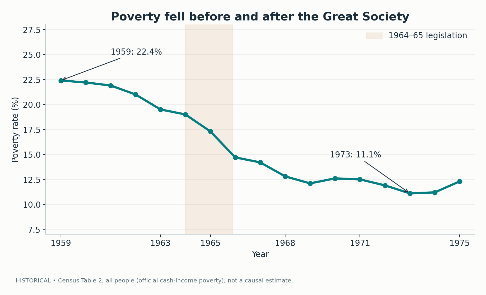
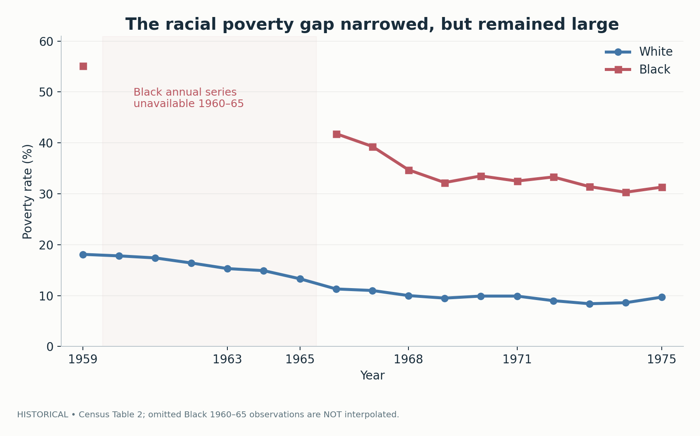
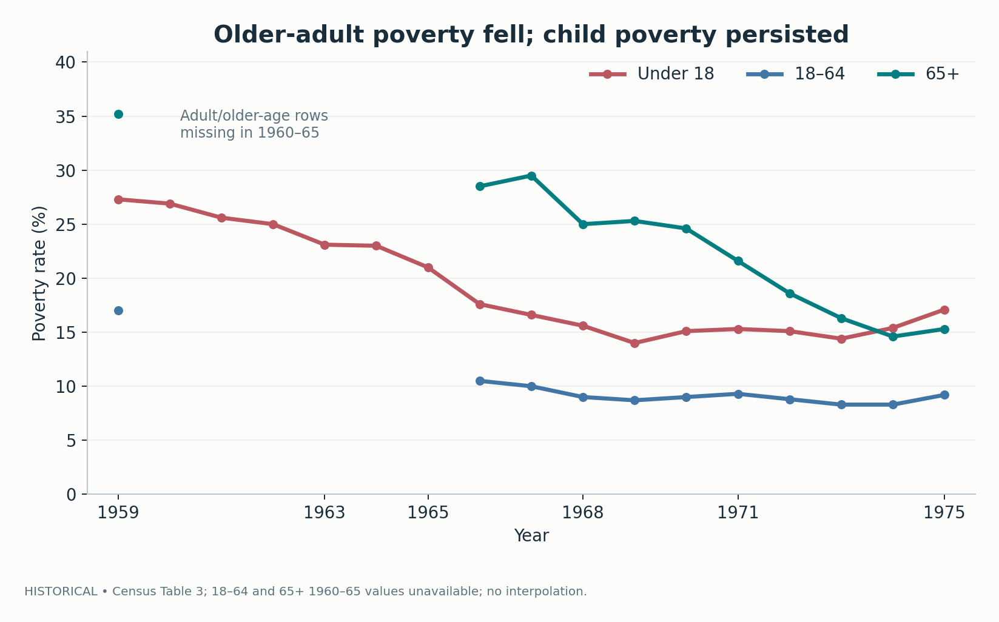
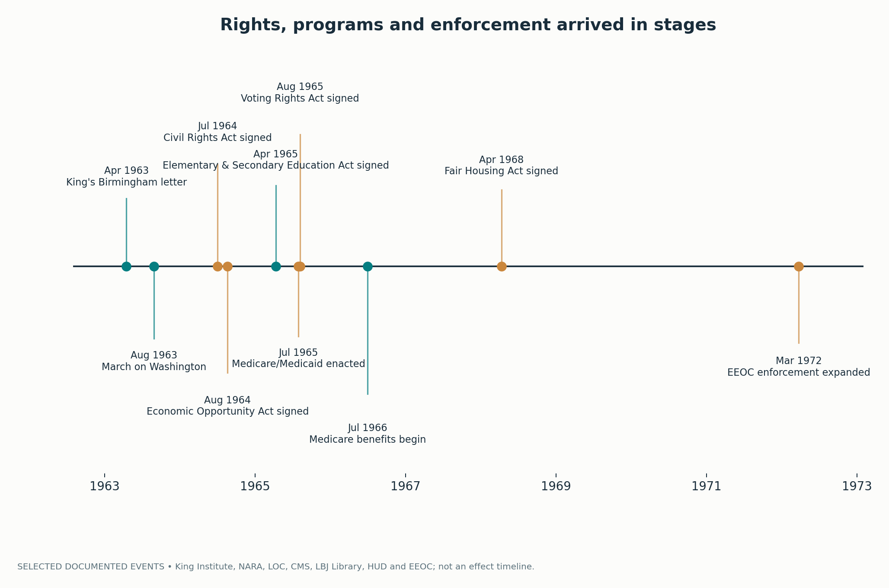
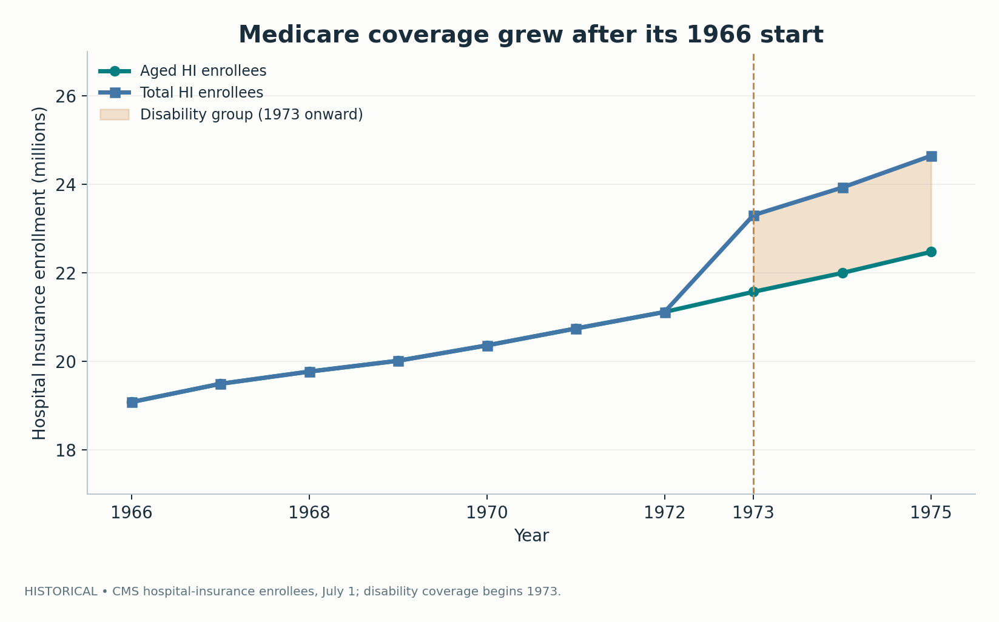
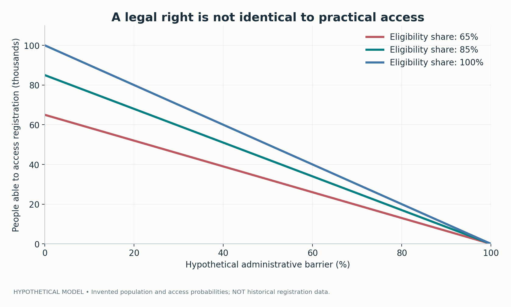
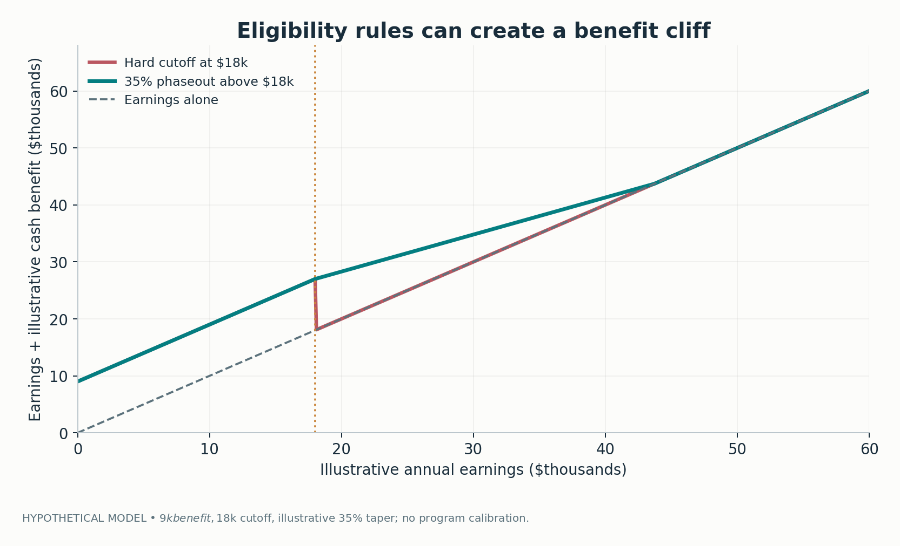
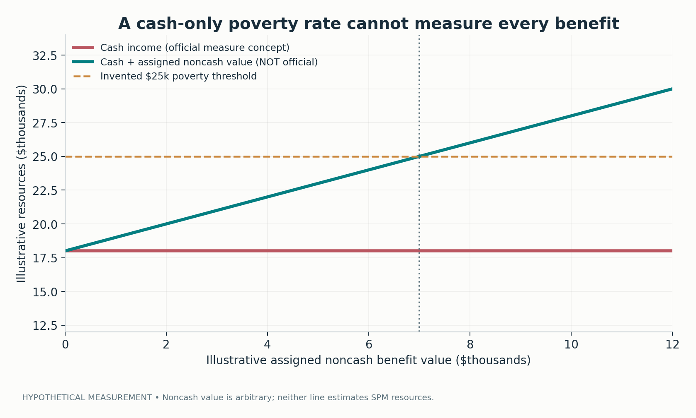

# The Right to Vote Was Only the Beginning

## Civil Rights, the Great Society, and the Limits of Reform

*A historical and quantitative essay on how social movements made federal action possible, why rights required administrative enforcement, and why falling poverty cannot be read as a simple verdict on the War on Poverty.*

---

The instruction to be civil often arrives at the least civil moment in a society's life: when people who have patiently petitioned an institution decide that patience has ceased to be a reasonable political strategy. It is frequently addressed to those who are most burdened by the existing order. The request sounds even-handed. Calm down. Find common ground. Let the process work. Do not antagonize people whose cooperation you need. Yet the practical meaning of those sentences depends upon who controls the process, who is allowed to vote in it, who can buy time, and who pays for the delay.

In April 1963, Martin Luther King Jr. answered precisely this problem from a Birmingham jail. His [letter](https://kinginstitute.stanford.edu/letter-birmingham-jail) defended nonviolent direct action as a way to create the urgency that routine negotiation had failed to produce. His objection to the respectable white moderate was not a rejection of peace. It was a rejection of an understanding of peace that placed public quiet ahead of justice. In the politics of segregation, the absence of visible conflict could mean that unequal power had been left undisturbed.

This was not an abstract philosophical dispute. A Black citizen denied access to the ballot could not simply wait for the next election to change the people who administered the denial. A worker excluded from a job for racial reasons could not necessarily find an effective federal remedy. An older person without health insurance might know perfectly well what medical treatment was needed and still be unable to afford it. A child in a poor neighborhood could have a formally equal right to education while attending a school that had a different tax base, different resources, and different opportunities.

The 1960s answered parts of these problems with an extraordinary series of legal and administrative acts: the Civil Rights Act of 1964, the Economic Opportunity Act of 1964, the Elementary and Secondary Education Act of 1965, Medicare and Medicaid, the Voting Rights Act of 1965, and the Fair Housing Act of 1968. None was identical to the movement that helped make it politically possible. None brought the struggle to an end. And no single measure is adequate for evaluating them.

This essay belongs to a longer history. The [Gilded Age](../gilded-age-political-economy/article.md) exposed the gap between economic growth and broadly shared security. The [Progressive Era](../progressive-era-reform-gap/article.md) demonstrated that passing a statute is not the same as implementing a reform. The [New Deal](../new-deal-social-contract/article.md) built durable protections against economic risk while preserving significant exclusions. An earlier essay on [political civility](../civility-and-political-change/article.md) examined how calls for restraint can sustain an unequal bargaining position.

The civil-rights era connects these questions. Its central lesson is not that civility is always false, federal programs always work, or protest always succeeds. It is that political rights, material security, and administrative capacity have to be examined together. A law may remove an explicit barrier without removing an economic disadvantage. A program may deliver a major benefit without moving the official poverty rate. A protest may be indispensable to lawmaking without itself providing the machinery for enforcement.

The argument below is supported by five descriptive figures drawn from original official records and three openly hypothetical mathematical illustrations. The historical figures record changes over time; they do **not** attribute those changes to particular laws. The mathematical figures explain mechanisms; they do **not** estimate historical effect sizes. That separation is as important to the politics as it is to the statistics.

## 1. The problem the New Deal left behind

The New Deal is often remembered as the federal government's discovery of social responsibility. The discovery was real, but incomplete. The Social Security Act of 1935 formalized old-age insurance and other programs. Federal banking regulation, labor-law enforcement, unemployment insurance, and public employment expanded the range of risks treated as public concerns. The institutions changed what Americans could expect from government.

They were not, however, built as universal citizenship rights. Early contributory old-age coverage excluded major categories of agricultural and domestic work. Relief administration was deeply dependent on states and localities. Labor rights did not cover everyone and could be frustrated by weak enforcement. Housing finance and local land-use practices could reinforce spatial inequality. In a federal system, a nominally national promise could encounter different gatekeepers at every county line.

This history does not justify describing the New Deal as nothing but exclusion. Its programs materially changed the possibilities of social insurance and regulation. The correct interpretation is more demanding: an institution can make an enormous contribution and still be designed around a restricted image of whose work, family, and citizenship count. Subsequent reform must grapple with both parts of that inheritance.

By the early 1960s, two broad categories of unfinished business were visible. One concerned access to public and private institutions: who could vote, attend a school, enter a restaurant, occupy a hotel room, obtain a job, or rent a home without racial discrimination. The other concerned the social conditions under which formally equal citizens lived: health care, educational opportunity, income security, and durable exposure to poverty. These categories overlapped but did not collapse into one another.

A federal law forbidding discrimination in public accommodations could change the legal basis for denying service. It could not, by itself, raise the cash income of a household far below the poverty line. A health insurance program could pay for hospital care that would otherwise be unaffordable. It could not, by itself, give a disenfranchised person a meaningful voice in selecting public officials. Treating either accomplishment as sufficient would leave the other outside the definition of freedom.

The 1960s reforms are sometimes gathered under the flattering name *Great Society*. The label is useful as an administrative and political shorthand, but it can conceal important differences. Civil-rights statutes prohibited conduct, authorized federal intervention, and strengthened claims to equal status. Poverty programs distributed services, funds, insurance, or access to opportunity. The Voting Rights Act altered the rules by which political power could be contested. Medicare established a broadly defined national social-insurance entitlement for older people; Medicaid was built through a different federal–state design. Their mechanisms, coverage rules, and implementation constraints differed.

Consequently, there is no single Great Society treatment variable that a chart can safely switch on in 1964. The historical question is a combination of several questions: Which problems had already begun to improve? Which legal barriers changed? Which offices gained the authority to enforce the change? Which households qualified for the new programs? And how did public measures record, or fail to record, what followed?

## 2. Poverty declined, but chronology is not causality

It is tempting to take the national poverty rate, draw a line through the 1960s, and announce either a victory or a failure. Both claims ask more of one historical series than it can supply. The [U.S. Census Bureau's historical poverty Table 2](https://www.census.gov/data/tables/time-series/demo/income-poverty/historical-poverty-people.html) reports that 22.4% of people were below the official poverty threshold in 1959. By 1963, the rate was 19.5%. In 1965, it was 17.3%; in 1969, 12.1%; and in 1973, 11.1%. The rate then rose to 12.3% in 1975.

*Figure 1 — Historical series: the official all-person poverty rate, 1959–1975, from Census historical Table 2. The shaded interval marks major legislation, not an estimated treatment window.*

The first observation is simple and frequently neglected: poverty was already falling before the Economic Opportunity Act was signed in August 1964. The second is equally important: it continued to fall for much of the period in which the major reforms were enacted and administered. The third is that the improvement was not permanent or monotonic. A national rate is sensitive to labor markets, family composition, demographic changes, price thresholds, earnings, cash transfers, and macroeconomic shocks. It is not a controlled experiment.

When someone says that the War on Poverty “failed” because poverty still exists, the argument treats a policy as if its promise were the immediate elimination of every structural source of deprivation. That is an implausibly demanding standard for a bundle of heterogeneous programs. When someone says it “succeeded” because the poverty rate fell after 1964, the argument makes the opposite error: it assigns all subsequent movement to an intervention that occurred amid a changing economy and a long-running prior trend.

The distinction matters statistically. Imagine an outcome time series `Y_t` and an indicator `D_t` that becomes one after 1964. A naive comparison of average rates before and after the date estimates `E[Y | D=1] - E[Y | D=0]`. That difference is not automatically the causal estimand `E[Y(1)-Y(0)]`, because there is no directly observed counterfactual path in which the same United States experienced the same economic and political conditions without the legislation. The outcome and policy were changing inside the same historical system.

An interrupted time-series model can improve on a simple before–after average by allowing a trend and an intervention break. But identifying assumptions remain demanding. The intervention date is not a sharp dose: statutes were passed in different years, programs phased in, and agencies acquired powers gradually. The number of pre-intervention years in the Census series is limited. Other policies and shocks co-occurred. The nation is not interchangeable with a randomly selected untreated control. A regression coefficient attached to a post-1964 dummy would therefore require a careful research design before it could be interpreted as an effect.

This does not mean historical evidence is useless. A time series can refute simplistic claims about when decline began. It can show how much of a change occurred in a particular officially defined indicator. It can identify an important difference between policy passage and measurable public outcomes. It can motivate more credible causal designs, including research exploiting staggered adoption or exposure differences when their assumptions can be defended. Descriptive accuracy is not a consolation prize; it is the discipline on which more ambitious inference depends.

It also matters what the indicator measures. The official U.S. poverty measure compares a family's or unrelated individual's **pre-tax cash income** to a threshold that varies with family size and composition. It counts cash benefits such as Social Security and excludes many noncash benefits, tax credits, and medical insurance. The Census explicitly distinguishes the [official and Supplemental Poverty Measures](https://www.census.gov/topics/income-poverty/poverty/guidance/poverty-measures.html). Therefore, the official rate can respond to some parts of the Great Society package more directly than others. A child receiving early education, or an older person gaining hospital insurance, may be materially better off without being reclassified as nonpoor under the official cash-income definition.

This point cuts in more than one direction. Critics who use a cash-income line to conclude that Medicaid delivered no value are asking the measure to record something excluded by construction. Defenders who convert the value of health insurance into ordinary spendable income without adjustment make a different mistake. Health coverage can provide risk protection, access to care, and financial security without being the same object as dollars available for groceries. The measurement question cannot be resolved by merely choosing the politically convenient definition.

## 3. Race changes the meaning of the aggregate

The national poverty line in Figure 1 combines populations that entered the 1960s with profoundly different life chances. A decline in the aggregate rate cannot tell us whether racial inequality narrowed, whether the least advantaged experienced similar improvement, or whether access to opportunity became more equal.

The same Census historical Table 2 provides separate poverty rates for White and Black Americans. In 1959 the reported White rate was 18.1%; the Black rate was 55.1%. The difference was **37.0 percentage points**, not merely 37% in a relative sense. By 1966 the rates were 11.3% and 41.8%. By 1969 they were 9.5% and 32.2%. In 1975 they stood at 9.7% and 31.3%, respectively. The 1975 difference was still **21.6 percentage points**. These are large disparities even though the absolute gap was smaller than the one observed in 1959.

*Figure 2 — Historical series: White and Black official poverty rates. The Census workbook used here provides the Black rate for 1959 and 1966–1975, but not for 1960–1965. The figure deliberately leaves that period disconnected rather than interpolating it.*

The visible gap in the red line is not an editorial flourish. It is a statement about the source. The current historical workbook has a 1959 Black observation and then resumes the Black annual series in 1966; it does not supply comparable rows for 1960–65. A straight line from 1959 to 1966 would imply a known path that this source does not actually report. It would also risk encouraging the reader to imagine exactly when the decline occurred, an inference with political consequences because several major laws were passed during those unobserved years.

This is what responsible data visualization demands when the data are politically salient: missingness should be visible, not disguised. An unsourced interpolation is not harmless merely because the result looks smooth. If a reader wants to examine historical compilations with different series or survey reconstructions, that is a legitimate next research task, but the new dataset must be identified, its methodology understood, and any discontinuities handled explicitly.

The numbers also reveal why a civil-rights statute and an anti-poverty program address distinct margins. A discriminatory employer might stop explicitly rejecting applicants because of race while wages remain unequal. The legal equality of entry to a university does not erase the accumulated disadvantages of segregated earlier schooling. A fair-housing rule can prohibit a racial refusal to rent while leaving the geography of inherited wealth and school-tax resources largely intact. These are not arguments against equal-rights law. They explain why equal-rights law cannot be treated as the total program of equal opportunity.

Racial poverty rates reflect many interacting processes: differences in employment and earnings, industry and region, educational access, family circumstances, wealth, social insurance coverage, discrimination, and historical conditions. The graph does not partition their contributions. Nor can it demonstrate which intervention is responsible for closing any particular fraction of the gap. A descriptive gap is a warning about the distribution of opportunity; it is not a ready-made coefficient for the effectiveness of the Voting Rights Act.

One distinction is especially important in public debate: *relative* and *absolute* inequality can tell different stories. From 1959 to 1975, the absolute difference between the displayed rates fell from 37.0 to 21.6 percentage points. Yet a Black poverty rate of 31.3% remained more than three times the White rate of 9.7%. A narrowing gap is meaningful progress. A remaining ratio of that size is also evidence that formal legal equality did not equalize material outcomes. Both statements can be true without rhetorical compromise.

If the aim of politics is not merely to reduce the average national deprivation rate but to alter whose lives are exposed to it, then disaggregation is central to the question, not a technical footnote. It changes what counts as a completed reform.

## 4. The age profile tells a different story

Disaggregating poverty by age produces another pattern. The Census [historical Table 3](https://www.census.gov/data/tables/time-series/demo/income-poverty/historical-poverty-people.html) reports that 35.2% of people aged 65 or older were poor in 1959. The rate was 28.5% in 1966, 25.3% in 1969, 16.3% in 1973, and 15.3% in 1975. For children younger than 18, the corresponding published rates were 27.3% in 1959, 17.6% in 1966, 14.0% in 1969, 14.4% in 1973, and 17.1% in 1975.

*Figure 3 — Historical series: Census official poverty rates for people under 18, aged 18–64, and aged 65+. Age 18–64 and 65+ observations for 1960–1965 are unavailable in this source and remain disconnected.*

This figure is an antidote to talk of “the poor” as though poverty were a single social experience. Poverty in old age may involve retirement, low or nonexistent pension income, medical costs, widowhood, and lost earning capacity. Childhood poverty is tied to the resources available to the household in which a child grows up, and children cannot correct that condition by increasing their labor supply. Working-age poverty is mediated by the labor market, disability, care responsibilities, employment instability, family size, and available supports. A public program aimed at one mechanism may have a smaller effect on another.

The decline in older-adult cash poverty is historically important, but it must be described correctly. Medicare was enacted in 1965 and began providing benefits in July 1966. Its principal benefit was **health insurance**, not an ordinary cash payment that automatically enters the official poverty numerator. The old-age cash income system was also changing through Social Security coverage, benefit rules, inflation, and economic conditions. The graph cannot separate these mechanisms. It would be wrong to credit Medicare alone for the older-adult poverty decline, just as it would be wrong to describe Medicare as irrelevant because its benefits are generally excluded from the cash-income measure.

The same conceptual discipline applies to children. Head Start could provide an early educational and developmental service. Federal education aid could direct resources toward districts serving low-income children. Neither necessarily appears as additional household cash income in the official series. A child can benefit from a funded classroom without the family's measured cash poverty status changing that year. Conversely, a family can cross the cash-income threshold while still facing serious disadvantages in housing, schools, and neighborhood safety.

Notice also that the age-group trends are not monotonically improving. The displayed child rate rose between 1973 and 1975. That is not proof that any particular program was terminated, ineffective, or reversed. It is a reminder that broad labor-market and price conditions can overwhelm or coexist with program effects in an aggregate series. A policy can reduce hardship relative to a worse counterfactual even while the observed hardship rate rises; the converse is also possible.

The missing adult-age data for 1960–65 deserve the same honesty as the missing Black rates. The historical workbook literally marks these entries as unavailable. We do not invent them to make a prettier chart or calculate a slope through them as if those values were measurements. A good historical argument can survive an admitted gap. One that requires the gap to disappear should be treated skeptically.

## 5. Why direct action changed the bargaining environment

The politics that produced the Great Society cannot be reduced to a president deciding that government should be kinder. Reform emerged from local organizers, churches, students, lawyers, labor activists, civil-rights associations, community institutions, and national campaigns that made segregation and exclusion increasingly difficult to ignore or defend. The state did not spontaneously discover problems that those living with them had been trying to remedy for generations.

King's [Birmingham letter](https://kinginstitute.stanford.edu/letter-birmingham-jail) is a particularly sharp analysis of political timing. Nonviolent direct action was designed to disrupt the equilibrium in which local officials could indefinitely postpone meaningful negotiation. It created a public confrontation that exposed the coercive structure maintaining seemingly ordinary social arrangements. The goal was not disruption as entertainment. It was to transform a formally available but substantively useless channel of discussion into one where the stronger side had reason to make concessions.

The strategy placed the moral content of civility under pressure. A movement could be disciplined, nonviolent, and willing to negotiate, yet still be called irresponsible for refusing to remain quiet. The accusation of incivility often focused on the moment protesters created discomfort, rather than the long period in which public institutions created and maintained the conditions being protested. There is an asymmetry between asking the oppressed to postpone justice and asking the powerful to postpone an inconvenience.

But romanticizing protest would obscure its difficulty. Movement organizers faced strategic choices about tactics, legal risk, resources, media representation, community disagreement, and the safety of participants. Not every disruptive action is just; not every negotiation is a trap. Civil rights organizers debated timing and strategy among themselves. Their achievements depended on coalition-building and institutional work as well as public confrontation. The point is not that intensity substitutes for a program; it is that without a credible challenge, a program may never reach the legislative agenda.

The [March on Washington for Jobs and Freedom](https://www.loc.gov/item/today-in-history/august-28/) on August 28, 1963, illustrates the fusion of claims that are too often separated in memory. The event is remembered above all for King's speech, but its name already contained an economic argument. Freedom was associated not merely with entry into formerly segregated spaces but with employment, wages, and the material terms of citizenship. The [Library of Congress's civil-rights collections](https://www.loc.gov/exhibits/civil-rights-act/civil-rights-era.html) situate the march within a broader movement of organizing and legislative pressure.

It is important not to convert temporal sequence into a story of unilateral causation here either. Protests changed public information and political costs, but congressional majorities, executive action, legal strategies, elections, regional opposition, and the activity of federal agencies also mattered. A serious history would trace these mechanisms in each legislative fight rather than assume that the existence of a demonstration mechanically produced a law. Yet it would be equally misleading to describe the legislation as a gift from moderate institutions detached from the sustained conflict that preceded it.

This is the recurring paradox of demands for calm. Reformers may be urged to show that they respect the legislative process while being denied meaningful entry into that process. Once direct action helps make legislation possible, public memory often presents the resulting compromise as evidence that patient moderation worked all along. The compromise was real; the pressure that made it available should not be edited out.

## 6. The Civil Rights Act: a rule needs an enforcer

The [Civil Rights Act of 1964](https://www.archives.gov/milestone-documents/civil-rights-act), signed July 2, addressed several domains rather than a single generic wrong. Title II concerned discrimination in public accommodations. Title VI addressed discrimination in federally assisted programs and activities. Title VII prohibited specified employment discrimination and created the Equal Employment Opportunity Commission. Other provisions concerned public facilities and education. Understanding the statute requires distinguishing these legal channels.

Consider a restaurant that had previously refused service by race. A federal prohibition changed the legal status of that practice, enabling new claims and enforcement. But implementation still depended on whether a complainant could pursue a remedy, what federal authority was available, and how courts interpreted the statutory power. A legal sentence on paper does not self-execute when an institution is determined to resist.

Employment made the enforcement problem especially clear. The EEOC began operating in July 1965. Its early role involved receiving, investigating, and attempting to resolve discrimination charges, but it initially lacked the litigation powers it would later receive. Congress strengthened federal employment-discrimination enforcement through the [Equal Employment Opportunity Act of 1972](https://www.eeoc.gov/history/eeoc-history-law). The same general prohibition thus operated within different enforcement regimes over time.

This distinction complicates the popular idea that passage of a landmark act marks a final policy event. The date a president signs a bill is a highly visible milestone. It is rarely the point at which every covered workplace changes practice, every excluded person knows their rights, every agency has adequate staff, or every court resolves ambiguities. Enforcement must be funded, staffed, interpreted, monitored, contested, and sometimes amended. The process extends beyond a press photograph.

Title VI offered a particularly important form of leverage because it connected civil rights to federal funding. When a federally supported institution depended on funds that could be conditioned on compliance, the government held an instrument that did not require each individual victim to negotiate from a position of equal power. Whether such leverage was used firmly, and how institutions responded, remained administrative and political questions.

The lesson generalizes beyond racial discrimination. A regulatory promise may define a right to safe working conditions, fair treatment, an accessible service, or accurate information. To evaluate it, one must ask who detects violations, what evidence they can obtain, what remedies exist, how long the process takes, and what penalties make compliance worthwhile. A right without a credible enforcement path is different in practice from a right backed by an accessible and powerful institution.

That does not mean enforcement agencies should be regarded as infallible. They may face imperfect evidence, institutional incentives, budget constraints, political interference, and tradeoffs between negotiation and sanctions. A poor enforcement design can generate delay or arbitrary decisions of its own. The point is structural: evaluating a statute while ignoring these conditions treats law as a declaration of intent rather than a system of incentives, procedures, and remedies.

## 7. Voting rights: the difference between permission and power

Of all the 1960s reforms, the [Voting Rights Act of 1965](https://www.archives.gov/milestone-documents/voting-rights-act) most directly confronted the problem of who possessed the means to change the political system from within. The Fifteenth Amendment had long prohibited denial of voting rights on grounds of race, but constitutional language coexisted with literacy tests, discriminatory administration, intimidation, and other barriers. The existence of a formal guarantee had plainly not been sufficient.

Signed on August 6, 1965, the Act attacked discriminatory voting practices more directly. It prohibited specified tests and devices and authorized federal examiners in relevant circumstances. Its original Section 5 required certain covered jurisdictions to obtain federal review, known as *preclearance*, before implementing changes to voting rules. The [Department of Justice's historical explanation](https://www.justice.gov/crt/about-section-5-voting-rights-act) is useful here: this was an institutional answer to a pattern of jurisdictions replacing one challenged barrier with another.

The administrative innovation is analytically distinctive. Much law enforcement waits for a person to experience a violation and then seek a remedy. Preclearance inverted part of that burden for covered places: specified election changes were not to take effect until they had been reviewed. The design recognized that an individual may be unable to repair an election after the fact. Timing itself is a dimension of a right. A vote that was unlawfully blocked cannot always be restored by winning a lawsuit years later.

The National Archives notes that approximately **250,000 new Black voters were registered by the end of 1965** following the Act's passage. This is a historical administrative outcome, not a randomized estimate of the Act's effect. Nonetheless it demonstrates the scale of the participation margin at stake. Registration is also not identical to turnout, representation, policy influence, or equal political power. It is a necessary component of democratic access, not a complete measure of democratic equality.

It would be easy to treat this history as proof that good rights require more federal intervention under every circumstance. That would overgeneralize. The argument is narrower and stronger. Where local administrators possess both an incentive and an opportunity to exclude particular citizens, a purely declarative prohibition may have weak practical force. An outside enforcement authority, an ex ante review procedure, or a credible appeal mechanism may change the bargaining environment. The precise institutional design matters.

This also helps explain the strategic significance of the movement's insistence on urgency. Appeals to wait for local officials to reform themselves sounded different when those officials controlled registration practices and the composition of the electorate. There was no neutral clock. Every delayed election could reproduce the officials and institutions responsible for the delay. Civil rights organizers were not merely asking a polite majority to change its opinion. They were trying to alter the rules through which majorities could be formed.

The Voting Rights Act was not a final solution to all disputes about access, representation, and constitutional authority. Later litigation, statutory amendments, districting practices, and Supreme Court decisions altered the legal environment. For this essay's 1963–75 focus, the important historical point is the original shift from a largely case-by-case struggle against barriers toward a stronger federal machinery capable of preventing certain changes from taking effect without review.

## 8. The legislation arrived as a sequence, not a single event

The dates are worth arranging visually because the word *reform* can flatten nearly a decade into a single moment. King's Birmingham letter preceded the March on Washington. The 1964 Civil Rights Act preceded the Economic Opportunity Act. The 1965 education law, Medicare and Medicaid enactment, and Voting Rights Act formed a compressed sequence, but they addressed different administrative domains. Medicare benefits began only in 1966. The Fair Housing Act followed in 1968. EEOC litigation authority was strengthened in 1972.

*Figure 5 — Selected, source-documented institutional chronology, 1963–1972. The figure illustrates legal and administrative timing, not the size or causal sequence of policy effects.*

Chronology is useful for distinguishing an authorization date from implementation. It does not automatically establish that the earlier item caused the later one. Events are selected, and many crucial acts of local organizing, litigation, congressional negotiation, and administrative interpretation are not displayed. The figure is a map of milestones, not a causal diagram.

Notice also the order in which different kinds of capacity appeared. A civil-rights prohibition could precede the full powers of its enforcement agency. Health coverage was enacted before its benefits started. Housing discrimination was regulated after earlier civil-rights advances had already altered public accommodations and voting. The institutional state was assembled, adjusted, and disputed in stages.

This is a more useful framework for understanding what political victories look like. Movements may win a change in public opinion, then an agenda commitment, then legislative language, then funding, then agency capacity, then court victories, then improved access. At any stage, actors may declare success or failure depending on which endpoint they believe matters. Some stages can be skipped; others can stall. A staged description does not diminish achievement. It explains why preserving and extending an achievement takes continued political work.

## 9. The War on Poverty was a portfolio, not a magic switch

The [Economic Opportunity Act of 1964](https://www.lbjlibrary.org/object/text/remarks-upon-signing-economic-opportunity-act-08-20-1964) is often used as the symbolic starting line of the War on Poverty. But it was not a cash transfer to every poor family. The legislation and related initiatives supported a set of efforts concerned with employment, training, community action, and services. Different elements had different target populations, administrative arrangements, and theories of change.

This matters for judging results. A training program proposes that improved skills or access to work will change future earnings. A community action program may attempt to build local capacity or alter the institutional conditions of access. An early-childhood service may affect learning or development through mechanisms that become visible only over time. These are not interchangeable treatments, and none promises an instant, universal change in current cash income.

Programs can also be evaluated at different units. For a participant, one may ask whether services improved employment, learning, health, or civic participation. For a municipality, one may ask whether grants altered institutional capacity or resources. For a national anti-poverty strategy, one may ask whether the composition of spending and social insurance changed the distribution of welfare across households. Evidence at one unit does not automatically scale to the others. A favorable effect in a selected local program does not imply the national package eliminated poverty. A flat national series does not prove that an effective individual program had no beneficiaries.

Community participation was itself contested. Public initiatives that encouraged poor residents to influence local decision-making could challenge established political organizations and service providers. The democratic promise of participation may look different from the perspective of the residents given a voice and the officials whose authority is questioned. A movement's demand for voice does not simply vanish when a federal grant is issued; it can reappear inside the governance of the program.

There is also a practical question about continuity. One-time legislation cannot guarantee sustained administrative quality. Program outcomes may depend on appropriations, staff, geography, the state of the labor market, and whether future governments preserve or alter their rules. If an analysis treats the phrase *War on Poverty* as a timeless policy with constant intensity, it erases the variation that would be essential for credible evaluation.

For this reason, the existence of national poverty is neither a sufficient critique nor a sufficient defense of the specific programs. The more informative questions are: What was the mechanism? Who was eligible? Who actually enrolled? What changed relative to a credible counterfactual? How did the answer vary among populations? And what did the outcome measure omit? There is no rhetorical shortcut around that research program.

## 10. Medicare and Medicaid: two institutions, two designs

The 1965 health legislation occupies a singular place in this history because it changed the institutional relationship between the federal government and medical care. But referring simply to “government health care” blurs a critical distinction. Medicare and Medicaid were enacted together while operating through different eligibility, financing, and administration structures. One began as a broad national insurance framework for older people. The other created a federal–state framework for medical assistance to specified low-income categories, with greater variation in eligibility and administration across states.

The difference is not merely constitutional vocabulary. It affects the practical experience of citizenship. A person included in a comparatively standard nationwide insurance category faces a different process from a person who must qualify under state-specific rules and administrative procedures. Both designs can deliver large benefits; both also face problems of financing, covered services, provider participation, and implementation. But a single enrollment number cannot be used to describe them interchangeably.

The [Centers for Medicare & Medicaid Services' historical account](https://www.cms.gov/files/document/hcfr-85-supp-013pdf) records that the legislation was signed in July 1965 and the programs began operating in 1966. Medicare's early implementation was unusually rapid by the standards of large federal initiatives, requiring enrollment, claims administration, hospital participation, and coordination with other institutions on a national scale. The expansion of social insurance was therefore also a formidable administrative project.

An [original CMS hospital-insurance enrollment table](https://www.cms.gov/Research-Statistics-Data-and-Systems/Statistics-Trends-and-Reports/MedicareEnrpts/downloads/HI2010.pdf) reports **19,082,454** aged enrollees as of July 1, 1966. That population grew to **22,472,104** by July 1, 1975. Total hospital-insurance enrollment in 1975 was **24,640,497**, including **2,168,393** people in the disability-entitlement category. The disability category appears beginning in 1973, reflecting a later expansion of eligibility; earlier blank cells should not be mistaken for ordinary missing contemporary measurements of a category already in operation.

*Figure 4 — Historical administrative counts: Medicare Hospital Insurance enrollment as of July 1, 1966–1975, from CMS. Aged and total lines diverge with disability enrollment from 1973. These are enrollment counts, not poverty effects or measures of health outcomes.*

The graph establishes several important facts. A large administrative insurance population existed from the beginning. Enrollment in the original aged category increased. An expanded entitlement population appears in the later years. The graph does **not** show how many hospital admissions were avoided, what medical outcomes improved, how much financial risk households shed, or whether a particular treatment became accessible to a particular racial group. Those require different outcomes, different data, and stronger research designs.

Enrollment is an intermediate measure. It may be the correct outcome for the question “Did people enter the program?” But it cannot answer “What was the program's effect on mortality?” without further evidence. Nor should hospital insurance enrollment be silently equated with comprehensive insurance coverage, total health spending, or access to every medical service. A well-designed figure should make its denominator and coverage category unmistakable.

This distinction between insurance and cash income returns us to Figure 3. Medicare may shield an older household from a catastrophic hospital bill even if the household's official cash income remains below the poverty threshold. The household's financial risks and actual possibilities have changed, but the official poverty line may record no change because it excludes health-insurance benefits. That is a feature of the measure's definition, not proof of irrelevance. It is also why any attempt to evaluate welfare using a dollar value assigned to insurance must make explicit whether the value reflects expected spending, actuarial protection, household willingness to pay, or some other concept.

Medicaid raises another issue: the variability of the federal–state partnership. A federal entitlement structure and funding stream can coexist with unequal access across local jurisdictions. State choices and administrative capacity influence eligibility and service experience. The comparison with Medicare therefore illuminates a broader lesson from the New Deal: national legislation can create a common architecture without creating identical practical conditions everywhere.

## 11. The hospital desegregation mechanism

Health insurance and civil rights were not separate legislative universes. The combination of Medicare participation and Title VI of the Civil Rights Act created powerful incentives for hospitals receiving federal funds to comply with desegregation requirements. CMS's historical discussion of the program describes [Medicare participation as connected to Title VI compliance](https://www.cms.gov/research-statistics-data-and-systems/research/healthcarefinancingreview/downloads/cms1191479dl.pdf). That connection transformed a legal right into a condition attached to a widely important revenue source.

The [CMS compilation of presidential statements](https://www.cms.gov/History/downloads/CMSPresidentsSpeeches.pdf) records President Johnson's June 30, 1966 report that more than 92% of beds in general hospitals were then in compliance with the law. The figure is a contemporary administrative claim about hospital-bed compliance at a particular point, not a comprehensive estimate of equal treatment or an independent measure of all hospitals' lived practices. The distinction is worth preserving precisely because the speed and magnitude of the reported transition are historically significant.

Consider the incentives. A hospital could previously have viewed demands for desegregation largely as a legal and local-political contest. As Medicare became a major payer, federal program participation created an additional institutional stake. Noncompliance threatened access to the program. The government did not merely ask the hospital to endorse a principle. It changed the practical consequences of refusing to comply.

This is an example of policy complementarities: one law established an anti-discrimination obligation; another created a large financing channel; an administrative decision connected participation to compliance. Neither law can be understood in full isolation from the other. A legal norm can become more effective when funding, verification, and sanctions align with it. Conversely, an insurance program that increases resources without enforcing nondiscrimination may distribute those resources through institutions that preserve previous exclusions.

This mechanism is not a guarantee that hospitals became substantively equal overnight. Compliance records can be imperfect. Segregation can give way to unequal treatment, unequal geography, or different patient outcomes that are less visible than formal admission rules. A contemporary report about beds is not a patient-level causal study. Still, the institutional logic is clear: rights enforcement became more credible because it was attached to a program that providers had concrete reason to join.

The larger principle reaches beyond health care. Public money can either reproduce a discriminatory pattern or help dismantle it, depending on what conditions govern its use and whether those conditions are enforced. Distribution and rights are therefore not independent policy realms. They meet in contracts, grants, certification, procurement, hospitals, schools, housing, and other ordinary administrative sites.

## 12. Education: equal entry and unequal starting positions

The [Elementary and Secondary Education Act of 1965](https://www.archives.gov/legislative/resources/education/great-society-congress) expanded federal involvement in school funding, including assistance aimed at educational disadvantage. Title I directed resources toward schools serving children from low-income families. The underlying problem was not just that some children were legally barred from particular classrooms. It was that the distribution of resources and opportunities was unequal even where legal access existed.

Here, too, the theory of change is distinct from an immediate transfer of family cash. School funding may alter staffing, materials, instructional support, or educational services. A well-implemented intervention could change learning trajectories, future attainment, or long-run labor-market outcomes. The official household poverty rate in the year of spending might remain unchanged. Neither possibility establishes effectiveness by itself; the point is that the appropriate outcomes depend on the proposed mechanism.

Head Start, launched in 1965, addressed early-childhood development through a broader set of services. Its later history includes variation in program models, intensity, local implementation, and outcomes. A responsible treatment of its effects would distinguish children actually served from those merely eligible, examine comparison-group construction, and ask whether findings relate to short-term test scores, health, school progression, or later life outcomes. A program name is not a constant intervention over multiple decades.

Education also demonstrates a deep relationship between geography and rights. School opportunities are influenced by residential location, local resources, family mobility, and the institutional structure of school districts. Legal desegregation can therefore encounter the continuing effects of housing segregation and unequal wealth. Even when two students hold the same formal right to public education, their real opportunity sets can diverge substantially.

It is tempting to describe this as a failure to finish the civil-rights movement. That is partly right but too vague. There are multiple obstacles with different remedies: direct discrimination, underfunding, school assignment rules, housing markets, transportation, poverty, and uneven administrative capacity. One type of law cannot solve all of them by declaring a principle more emphatically. Institutional reform is often additive because the underlying disadvantages are produced by interacting systems.

The Great Society's education initiatives were therefore neither substitutes for school desegregation nor automatically effective supplements to it. Their contribution must be studied through what services they financed, how resources were allocated, how institutions responded, and what outcomes changed. The moral case for supporting children and the empirical case for a particular design are related but not interchangeable.

## 13. Fair housing and the geography of opportunity

The [Fair Housing Act of 1968](https://archives.hud.gov/local/ia/goodstories/2012-04-25.cfm), enacted as Title VIII of the Civil Rights Act of that year, extended federal antidiscrimination protections into housing. The original protections covered race, color, religion, and national origin; later amendments extended the protected categories. The timing matters: housing law followed other landmark civil-rights acts, even though access to housing shaped the schools, jobs, transportation, and amenities people could realistically reach.

Imagine that a person has finally obtained a right not to be rejected by an employer on the basis of race. If the feasible set of neighborhoods is constrained by discriminatory rental and sales practices, distance and transportation can still limit employment options. If housing opportunities determine access to school districts with different resources, the effects may last across generations. If homeownership is a major means of wealth accumulation, unequal access to housing finance and neighborhoods can contribute to differences that cannot be eliminated merely by guaranteeing equal treatment in a new transaction.

A prohibition on discriminatory refusals is essential, but its practical scope is specific. It can regulate conduct by covered actors. It cannot instantly redistribute accumulated housing wealth, erase existing residential segregation, or make all locations equally affordable. The distinction is not a criticism of the law's purpose; it is a description of the mechanisms required to move from formal nondiscrimination to broader spatial opportunity.

Enforcement is again central. Discrimination may be overt, documented, and easily classified; it may also occur through unequal information, inconsistent screening, steering, or practices that are harder to observe. A legal standard needs a way to test compliance and provide remedies. Housing markets also interact with local zoning, lending rules, property taxes, and infrastructure. A federal prohibition enters this institutional environment rather than replacing it.

There is a political cost to forgetting these interactions. When disparities persist after passage of an antidiscrimination statute, observers may conclude that discrimination never mattered or that law has no power. Neither conclusion follows. An intervention can close a channel of exclusion while leaving other channels and historical stocks of disadvantage. The relevant evidence would ask which margins changed, where enforcement was effective, and how remaining constraints operated.

This is why the civil-rights agenda cannot be reduced to two images: a person finally casting a ballot and a person finally entering a previously segregated building. Those moments matter profoundly. Yet an equal vote, an equal doorway, a funded school, an insured hospital admission, and the ability to live near economic opportunity are different dimensions of substantive citizenship.

## 14. A hypothetical model of political access

We can formalize one of these distinctions without pretending to measure the Voting Rights Act's historical effect. Suppose a fictional community has a population of 100,000 people relevant to a registration process. Let `e` denote the share who meet the stipulated eligibility conditions, and let `b` denote an administrative barrier, interpreted as the fraction of otherwise eligible people prevented from completing registration by a deliberately simplified process. Then an illustrative access count is

\[
A(N,e,b)=N e(1-b).
\]

The formula is a teaching device. It assumes eligibility and the barrier act multiplicatively; it ignores turnout, preferences, campaign activity, intimidation, misinformation, social networks, and changing behavior. It does not describe actual Black voter registration in the 1960s. No historical parameter has been estimated. Its value is that it keeps two concepts distinct: legal eligibility and practical passage through a procedure.

*Figure 6 — Hypothetical model: registration access under three invented eligibility shares and an invented administrative barrier, for a fixed population of 100,000. No line is a historical estimate of disenfranchisement.*

With `N=100,000`, `e=0.85`, and `b=0.40`, the model yields 51,000 people who can access registration. Keeping eligibility fixed while reducing the barrier to `b=0.10` yields 76,500. The arithmetic increase is 25,500. It is not an estimate of the number registered because of any 1965 law. It demonstrates only the model's internal implication: where an administrative barrier is substantial, lowering that barrier can change practical access even if the legal eligibility share is unchanged.

The model also shows why an eligibility rule cannot be evaluated in isolation. Suppose a formal reform increases `e` from 0.65 to 0.85, but the administrative barrier remains at 0.60. Access rises from 26,000 to 34,000 in this fiction, yet a majority of otherwise eligible people remain unable to complete the process. Formal inclusion has a meaningful effect; the remaining bottleneck continues to matter.

In real politics, the barrier might depend on eligibility, geography, administrative resources, litigation, fear, community mobilization, or officials' strategic responses. It would not generally be a constant independent probability. If a law changes those interactions, the simple formula fails. That limitation is useful because it points toward the institutional data a serious empirical study would need: registration records, administrative practices, jurisdictional coverage, pre-intervention trends, and a defensible counterfactual.

This is not a mathematical proof that federal enforcement always dominates local discretion. It illustrates the difference between a legal right and a usable right. The actual historical argument for the Voting Rights Act rests on evidence of discriminatory barriers, the institutional design of the statute, and observed developments after enactment. The hypothetical equation is a lens for understanding the mechanism, not a substitute for that evidence.

## 15. A hypothetical benefit cliff

Eligibility design also shapes the experience of social programs. A benefit conditioned on income may disappear abruptly when earnings cross a threshold. Alternatively, its amount may decline gradually as income increases. These two designs can deliver similar maximum support while producing different incentives and resource profiles around the eligibility boundary.

Take a wholly invented annual cash benefit of $9,000. A hard-cutoff policy pays the full amount when earnings `y` do not exceed $18,000, then pays nothing for any higher earnings:

\[
B_{\text{cutoff}}(y)=
\begin{cases}
9{,}000, & y\leq 18{,}000,\\
0, & y>18{,}000.
\end{cases}
\]

Compare it with another invented program that pays up to $9,000 and gradually withdraws 35 cents for each additional dollar earned beyond $18,000:

\[
B_{\text{taper}}(y)=
\max\{0, 9{,}000-0.35\max(0,y-18{,}000)\}.
\]

In each case, the illustrative current resources are `R(y)=y+B(y)`. We deliberately omit taxes, other benefits, work costs, family size, price changes, and eligibility constraints. The numbers do **not** describe any specific 1960s program, Medicaid eligibility rule, or actual marginal tax rate.

*Figure 7 — Hypothetical mechanism: resources under a discontinuous $18,000 cutoff versus a 35% benefit phaseout. The $9,000 benefit and all thresholds are invented for illustration.*

At exactly $18,000 of earnings, the cutoff version provides $27,000 of combined earnings and benefit. At $18,001, resources collapse to $18,001. The one-dollar earnings increase coincides with a loss of $8,999 in this artificial program. Under the taper, the same one-dollar increase reduces the benefit by 35 cents, so combined resources increase by 65 cents. This difference exists entirely by design, before we make any claims about how individuals actually respond.

The illustration explains why social policy cannot be assessed solely by how much a program spends. Access rules determine who receives support; withdrawal rules determine how the program interacts with earnings and household choices. Yet the existence of a model cliff does not demonstrate the behavioral magnitude of an actual cliff. People make decisions with uncertainty, timing, multiple household members, imperfect information, job preferences, transportation costs, and concerns about losing services that are difficult to price. An economist wanting to estimate labor-supply responses would need actual program schedules and credible variation in exposure.

In the civil-rights context, the broader connection is administrative. A statutory benefit does not deliver itself. People must learn of it, qualify for it, navigate its procedures, and maintain access. The complicated route between legal authorization and lived benefit can reproduce inequalities in information, time, and institutional power. Design is not simply a technical appendix to justice. It helps determine how widely the promise is realized.

## 16. A hypothetical measurement problem: cash, care, and classifications

The official poverty measure's treatment of noncash benefits deserves a separate illustration because it is frequently confused with an evaluation of a program's real value. Consider an invented person or household with $18,000 of cash income and an invented poverty threshold of $25,000. Under a cash-only resource concept, this unit falls below the threshold. Now suppose the person receives a noncash service or insurance protection to which an analyst assigns a value between $0 and $12,000. The official cash-income comparison does not mechanically add that assigned value to income.

For illustration only, write

\[
P_{\mathrm{cash}}=\mathbf{1}\{18{,}000<25{,}000\}
\]

and contrast it with a hypothetical expanded-resources classification,

\[
P_{\mathrm{expanded}}(v)=\mathbf{1}\{18{,}000+v<25{,}000\}.
\]

The second formula is **not** an implementation of the Census Supplemental Poverty Measure. It does not subtract necessary expenses, adjust thresholds appropriately, or apply the SPM's resource and unit definitions. It is a deliberately naive counterexample showing that two measures can disagree because they count different things.

*Figure 8 — Hypothetical measurement illustration: an invented $18,000 cash income, an invented $25,000 threshold, and an assigned noncash value. No threshold or imputed value here is an actual Census estimate.*

The cash-only line remains at $18,000. The illustrative expanded-resources line crosses the invented threshold when `v` reaches $7,000. The conclusion is not that this person has become objectively nonpoor at that value. It is that classification depends on the resource concept, and valuation of noncash support is a substantive statistical choice.

Insurance is particularly difficult to represent. If two older people receive identical coverage but one becomes gravely ill and the other does not, the observed medical claims differ enormously. Counting claims as their respective income would imply that the sick person had enjoyed a dramatic increase in spendable resources. That would misdescribe the economic protection provided by insurance. Counting the same actuarial value for all covered persons could also miss differences in need, access, risk, and preferences. There is no costless conversion from health insurance to ordinary cash.

The Supplemental Poverty Measure was designed in part to address limitations of the official measure by incorporating a broader set of resources, relevant expenses, and modernized thresholds. It has its own definitions and assumptions. Researchers have also constructed historical versions and proposed consumption or expenditure measures. Each is suited to certain questions and limited for others. The productive question is not “Which number proves my party right?” but “What resource concept corresponds to the claim I am making?”

This bears directly on historical judgments about the Great Society. A national rate defined by pre-tax cash income can register changes in earnings and cash transfers while omitting much of the direct value of Medicare, Medicaid, housing assistance, or school services. It remains a valid descriptive indicator within its definition. It is not a comprehensive welfare statistic. A program may be effective at reducing medical financial risk and yet have little immediate mechanical effect on official cash poverty. Another program may increase cash income enough to change poverty classification while leaving health needs unmet. One number should not be compelled to answer both questions.

## 17. The causal debate is real—and worth having carefully

Historians and economists continue to debate the anti-poverty effects of the 1960s policy changes. The disagreement is not always a dispute over the same data under the same definition. It often begins with different views of which resources count, which poverty threshold should be used, whether thresholds should be absolute or relative, and how to construct a historical comparison that remains meaningful across decades of changing policy and household behavior.

For example, the research behind [*Waging War on Poverty: Historical Trends in Poverty Using the Supplemental Poverty Measure*](https://www.nber.org/papers/w19789) develops a historical series built around the broader SPM concept. [*Evaluating the Success of President Johnson's War on Poverty*](https://www.nber.org/papers/w26532) examines the historical record using an absolute full-income measure. A newer paper, [*Poverty and Dependency in the United States, 1939–2023*](https://www.nber.org/papers/w34759), revisits long-run patterns and argues that the pace of absolute poverty decline did not accelerate after the declaration of the War on Poverty under its chosen framework. These studies are contributions to research, not three interchangeable observations of one settled object.

The existence of conflicting conclusions should not be exploited to suggest that evidence has no standing. It means the first step is to inspect the estimand. What population is covered? Which transfers are included? Are taxes and medical benefits counted? What is the price index? How is the poverty threshold updated? Does the work describe a time trend, construct a counterfactual, or estimate a causal impact through a particular identification strategy?

Suppose a study shows that a constructed post-tax, post-transfer poverty rate is substantially lower than a comparable market-income rate. That is useful evidence about how tax-and-transfer accounting changes the resources recorded by the measure. It does not automatically mean every dollar of difference was caused by policies enacted in 1964 or 1965. Some underlying programs predated the Great Society; later programs and amendments matter; market earnings and behavior may respond to transfers. A decomposition is not always a historical causal experiment.

Conversely, suppose a paper argues that poverty was already declining rapidly before 1964 and did not accelerate afterward. That is relevant evidence against a simplistic before–after success narrative. It does not by itself show that the programs had zero impact, because an observed post-policy path might have been worse in the absence of particular transfers, services, or civil-rights enforcement. A statement about acceleration in the observed trend and a statement about the difference from an unobserved counterfactual are logically distinct.

Good causal studies therefore require more than a well-formatted national series. They need a clear treatment, a plausible comparison, attention to selection and spillovers, and evidence that the comparison's assumptions are credible. They should report heterogeneity rather than assume a uniform effect on older people, children, workers, and racial groups. They should distinguish program participation from policy eligibility and both from outcomes. Where those designs are not possible, carefully bounded descriptive work remains valuable.

The debate also teaches political humility. Neither side of a policy dispute owns the definition of poverty. But neither side is entitled to replace a definition quietly when the result is inconvenient. A consistent evaluation begins by stating what is being measured, why it is relevant, what it excludes, and which conclusions remain unsupported. The rigor is especially important when the historical people represented by the data have little opportunity to challenge the stories told about them.

## 18. When a call for moderation is a claim about who bears the cost

We can now return to King's argument about moderation with a more precise understanding of what was at stake. A demand for calm can refer to at least three different ideas: restraint in the means of protest, willingness to compromise over institutional design, or postponement of a substantive claim. These are not equivalent. A movement can maintain strict nonviolence while refusing an indefinite timetable. It can accept a negotiated enforcement mechanism without accepting that the right itself should be optional. It can reject a proposed compromise because the administrative details would render the promise ineffective.

This distinction is useful because “moderate” is not a complete political position. It gives us little information about the baseline arrangement someone is trying to preserve, the changes they would accept, and the time frame on which they would accept them. A person may be moderate relative to the ideology of other legislators and simultaneously uncompromising about a local practice that excludes people from the franchise. Conversely, an activist may demand immediate legal equality while favoring careful, gradual administrative implementation where haste would harm intended beneficiaries. The label does not do the analytical work.

The civil-rights movement exposed an especially consequential asymmetry: the party asked to wait could not necessarily use the ordinary electoral process to alter the wait. Time was not a neutral resource. For the excluded voter, another electoral cycle meant another cycle governed by people selected through exclusion. For a worker denied employment, delay could mean lost wages and training opportunities that would never be recovered. For a child growing up in poverty, a lost year of schooling was not a pause that could later be restored without cost.

None of this implies that every urgent claim should override every procedural safeguard. Civil liberties, democratic accountability, evidence, and administrative competence matter. Indeed, much of the movement sought precisely to make constitutional procedures real for people to whom they had been denied. The argument is that an appeal to procedure loses moral credibility when the existing procedures systematically prevent the affected people from participating on equal terms.

There is an important lesson here for people who prize institutions. The durable accomplishments of the 1960s were institutional: enforceable rights, federal monitoring, insurance administration, grants, and legal remedies. Protest did not make institutions irrelevant. It pressured them to fulfill claims they had long professed. A serious commitment to stable institutions may therefore require accepting the discomfort of reform rather than treating stability as an overriding reason to refuse it.

The strongest response to this history is not the slogan that civility is racism. That would be too crude. Civility can protect vulnerable speakers, reduce threats, and support durable cooperation. Nor does every public conflict advance justice. The question is whether a particular demand for civility specifies a defensible method of disagreement or whether it functions as a veto on the timing and substance of reform. Its ethical status depends on context, power, and consequences.

## 19. What would a serious evaluation of this era look like?

If we were designing an empirical research program from scratch, we would begin by refusing to treat the entire decade as a single binary exposure. The major laws had different target populations and mechanisms. We would separate changes in legal eligibility, changes in administrative access, changes in services received, and changes in economic or health outcomes. We would also document the historical units of observation: persons, households, hospitals, schools, counties, states, and jurisdictions.

For voting, a plausible research question might concern registration changes in places newly exposed to particular federal enforcement rules compared with carefully chosen comparison jurisdictions. It would require attention to pre-law trends, selective coverage, migration, spillovers, and changes in administrative reporting. For hospital desegregation, the unit might be an institution facing Title VI certification requirements and Medicare participation decisions; one could examine compliance records and patient access while recognizing that the expansion of insurance and desegregation enforcement occurred together.

For poverty programs, a participant-level evaluation would need program-specific eligibility and treatment information rather than a national post-1964 dummy. The estimand might be an effect on short-run earnings, school attainment, medical expenditure risk, or long-run outcomes. Different outcomes require different horizons and administrative data. A reduction in expected financial catastrophe is not equivalent to an increase in annual cash income, even if both have economic value.

The research should also ask about heterogeneous effects. An intervention may help a group with high baseline exclusion more than a group with ready access. A cash transfer may have different effects on a retired person, a household with children, and someone temporarily unemployed. State administrative practices may alter access independent of statutory eligibility. The national mean can obscure the mechanism that made reform socially consequential.

Finally, the data should be audited before results are interpreted. Which source vintage is used? Did a category exist in the earlier years? Are footnotes and missing cells treated honestly? Have dollar values been adjusted consistently? Has an enrollment series been confused with a rate? Is a model parameter a historically estimated quantity or an illustrative number chosen by the writer? Figure 2's missing racial years and Figure 4's changing eligibility category are not nuisances to be swept away. They are part of the historical evidence.

The reproducible [companion analysis](README.md) makes these distinctions explicit. It ships with the original official source links, small typed CSV transcriptions, a documented Python module, unit tests, a notebook, and eight generated figures. The figures can be rebuilt without network access; alternative historical source vintages can be investigated without silently replacing the evidence used in this publication. The mathematical examples are labeled *hypothetical* in the code, output tables, captions, and documentation.

One should not confuse reproducibility with validity. Reproducing a calculation perfectly does not prove that a counterfactual assumption is correct or that a source measures the desired construct. It does make the choices inspectable. That is the first requirement of a historical argument that asks readers to trust quantitative evidence.

## 20. What the victories changed—and what they could not finish

The most defensible conclusions are neither a triumphalist inventory nor a declaration of failure.

The civil-rights movement helped change the political cost of maintaining segregation and exclusion. The 1964 Civil Rights Act established important prohibitions and legal channels. The 1965 Voting Rights Act attacked administrative devices that made a constitutional guarantee difficult to exercise. The 1968 Fair Housing Act extended federal antidiscrimination law into a vital determinant of opportunity. Each changed the institutional terms on which a person could demand equal treatment.

The Great Society's social programs expanded federal responsibility for medical security, educational opportunity, and responses to poverty. Medicare's hospital-insurance enrollment demonstrates the rapid scale of one entitlement system. Medicaid's different structure reminds us that federal action may remain dependent on state-level implementation. The official poverty series documents large reductions in cash-income poverty across much of the 1960s and early 1970s, including a shrinking but still profound Black–White gap. The figures do not tell us how much each law caused.

These accomplishments also exposed the limits of reform understood only as legislation. A legal prohibition may need federal examination, funding leverage, litigation authority, compliance monitoring, and effective remedies. Insurance may not be available in practice without participating providers. Equal school access may coexist with unequal resources. Fair treatment in a housing transaction does not instantly undo inherited differences in location and wealth. A cash-income poverty rate does not capture every contribution of medical or educational programs.

The main lesson is therefore institutional rather than sentimental: **a right must be usable, a program must be accessible, and an outcome must be measured with a definition appropriate to what the policy actually changes.** A society can make substantial progress and still remain unjust along important dimensions. Recognizing the first fact need not excuse the second; recognizing the second need not erase the first.

King's critique of moderation endures because it asks us to specify the price of waiting. Calls for a more civil politics are valuable when they make disagreement safer and cooperation more durable. They become an instrument of injustice when they ask people to accept indefinite delay under rules that deprive them of meaningful power. The distinction cannot be settled by the tone of the demand alone.

And the work of reform does not end when a political speech becomes a statute. The decisive question is what happens afterward: who can vote, who can appeal, who receives care, who can reach a school or home, who is counted by the data, and who has authority to correct an institution when it fails. The ballot was indispensable. It was never the whole meaning of freedom.

---

## Sources and methodological notes

**Historical and documentary sources**

1. Martin Luther King Jr., [“Letter from Birmingham Jail,” April 16, 1963](https://kinginstitute.stanford.edu/letter-birmingham-jail), Martin Luther King, Jr. Research and Education Institute, Stanford University. Paraphrased, not reproduced at length.
2. Library of Congress, [March on Washington for Jobs and Freedom](https://www.loc.gov/item/today-in-history/august-28/) and [Civil Rights Act exhibition](https://www.loc.gov/exhibits/civil-rights-act/civil-rights-era.html).
3. National Archives, [Civil Rights Act of 1964](https://www.archives.gov/milestone-documents/civil-rights-act), with original legislative context and date.
4. National Archives, [Voting Rights Act of 1965](https://www.archives.gov/milestone-documents/voting-rights-act), including contemporary registration figures.
5. U.S. Department of Justice, [Section 5 of the Voting Rights Act](https://www.justice.gov/crt/about-section-5-voting-rights-act), historical federal preclearance enforcement explanation.
6. EEOC, [History of the Law](https://www.eeoc.gov/history/eeoc-history-law), [Equal Employment Opportunity Act of 1972](https://www.eeoc.gov/history/equal-employment-opportunity-act-1972), and [1970–1979 agency history](https://www.eeoc.gov/history/eeoc-history-1970-1979).
7. Lyndon B. Johnson Presidential Library, [Remarks upon signing the Economic Opportunity Act, August 20, 1964](https://www.lbjlibrary.org/object/text/remarks-upon-signing-economic-opportunity-act-08-20-1964).
8. National Archives, [Great Society Congress educational resources](https://www.archives.gov/legislative/resources/education/great-society-congress), including Elementary and Secondary Education Act context.
9. U.S. Department of Housing and Urban Development, [Fair Housing Act anniversary history](https://archives.hud.gov/local/ia/goodstories/2012-04-25.cfm) and [HUD institutional history](https://www.hud.gov/aboutus/history).
10. Centers for Medicare & Medicaid Services, [historical hospital-insurance enrollment table, 1966–2010](https://www.cms.gov/Research-Statistics-Data-and-Systems/Statistics-Trends-and-Reports/MedicareEnrpts/downloads/HI2010.pdf) and [historical retrospective, 1985](https://www.cms.gov/files/document/hcfr-85-supp-013pdf).
11. CMS, [*Thirty Years of Medicare: Impact on the Covered Population*](https://www.cms.gov/research-statistics-data-and-systems/research/healthcarefinancingreview/downloads/cms1191479dl.pdf) and [compilation of presidential statements](https://www.cms.gov/History/downloads/CMSPresidentsSpeeches.pdf), for the Title VI connection and contemporary compliance claim.
12. U.S. Census Bureau, [Historical Poverty Tables: People, Tables 2 and 3](https://www.census.gov/data/tables/time-series/demo/income-poverty/historical-poverty-people.html); direct source workbooks: [Table 2](https://www2.census.gov/programs-surveys/cps/tables/time-series/historical-poverty-people/hstpov2.xlsx) and [Table 3](https://www2.census.gov/programs-surveys/cps/tables/time-series/historical-poverty-people/hstpov3.xlsx).
13. U.S. Census Bureau, [Poverty Measures guidance](https://www.census.gov/topics/income-poverty/poverty/guidance/poverty-measures.html), on official and supplemental resource concepts.
14. U.S. Census Bureau, [historical poverty and income compilation, 1979](https://www2.census.gov/library/publications/1979/demographics/p23-080.pdf), retained as a separate historical cross-check rather than silently combined with the modern tables.

**Research illustrating measurement and interpretation debates**

15. [*Waging War on Poverty: Historical Trends in Poverty Using the Supplemental Poverty Measure*](https://www.nber.org/papers/w19789), NBER Working Paper 19789.
16. [*Evaluating the Success of President Johnson's War on Poverty: Revisiting the Historical Record Using an Absolute Full-Income Poverty Measure*](https://www.nber.org/papers/w26532), NBER Working Paper 26532.
17. [*Poverty and Dependency in the United States, 1939–2023*](https://www.nber.org/papers/w34759), NBER Working Paper 34759. These three papers use materially different constructions and do not by themselves establish one shared causal estimate.

**Data and calculation boundaries**

- Figures **1–3** use the Census historical poverty files in the source-page vintage available during preparation (October 2026); rates are percentages of people under the official poverty definition. The Black series in Table 2 has **no values for 1960–65** in the downloaded workbook; Table 3 has **no 18–64 or 65+ rates for 1960–65**. The corresponding CSV cells are empty, the model reader converts them to NaN, and the plots do not connect across the gap. The rates are descriptive and are not causal treatment effects.
- Figure **4** uses CMS *Hospital Insurance* enrolled-person counts **as of July 1**, not spending, all insurance coverage, or a measure of health outcomes. Disability enrollment becomes a separate reported eligible category starting in **1973**. Earlier disability cells are blank to preserve the changing program scope.
- Figure **5** is a selective ten-event chronology assembled from the dated original sources above. It omits numerous consequential acts and is not a claim that one event caused the next.
- Figures **6–8** are **invented mathematical models**: hypothetical registration friction, an illustrative cash-benefit cutoff and taper, and an intentionally simplified cash versus assigned noncash resource comparison. None is estimated from historical data or coded as an actual Great Society program. The illustrative expanded resources of Figure 8 do not reproduce the Supplemental Poverty Measure.
- Percentages and poverty-rate differences are reported in their appropriate units. The 1959 White–Black difference, for instance, is 37.0 **percentage points**. Census source vintage, tabulation conventions, historical category definitions, and program enrollment categories should be checked before combining these series with other datasets.
- Source CSVs, type-checked model functions, validation tests, notebook cells, published figures, and output tables are documented in the [reproducibility README](README.md). No evidence is imputed to make a line continuous, and a source-based descriptive change is never labeled as the effect of a law.

