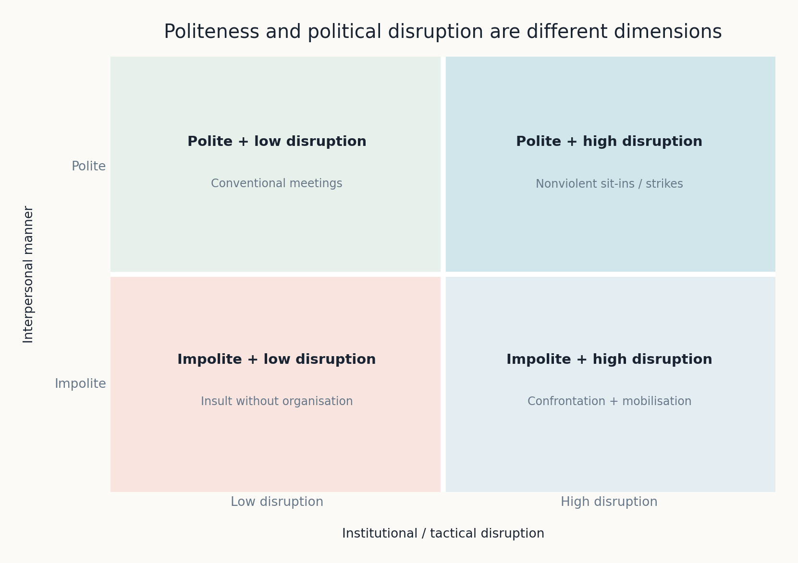
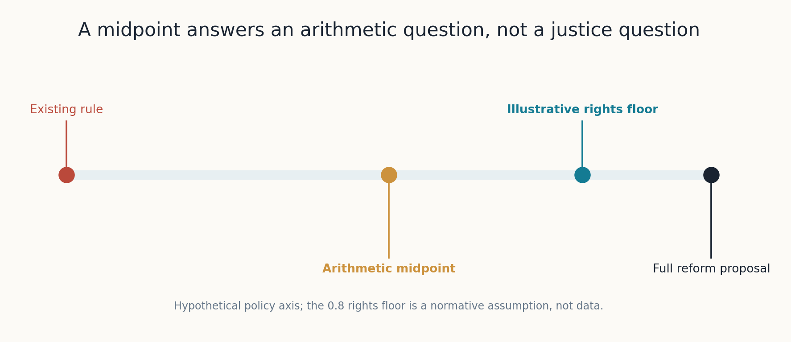
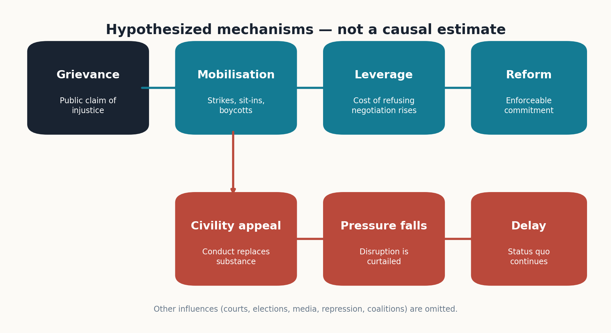
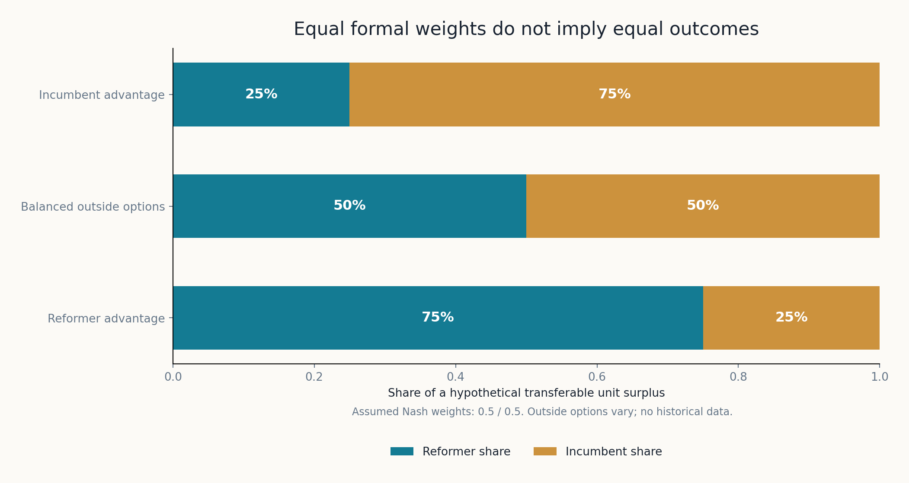
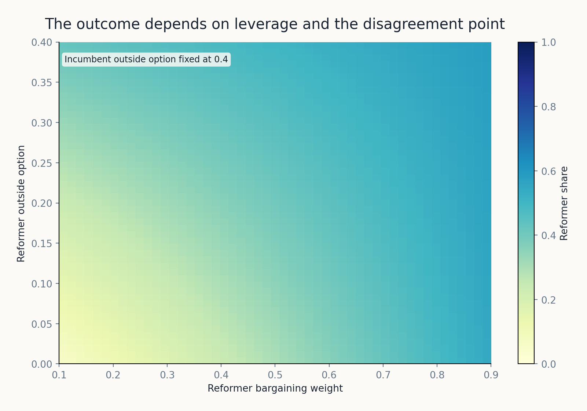
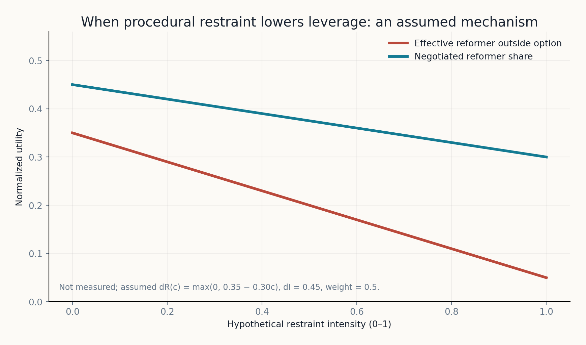
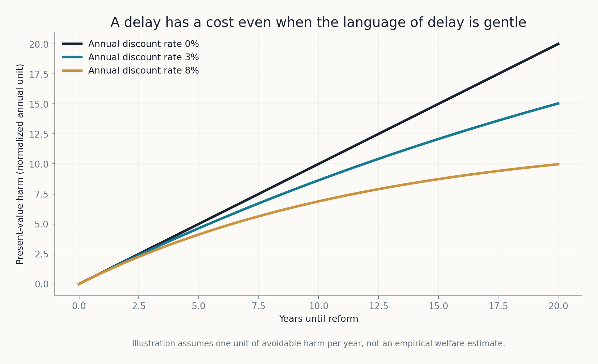
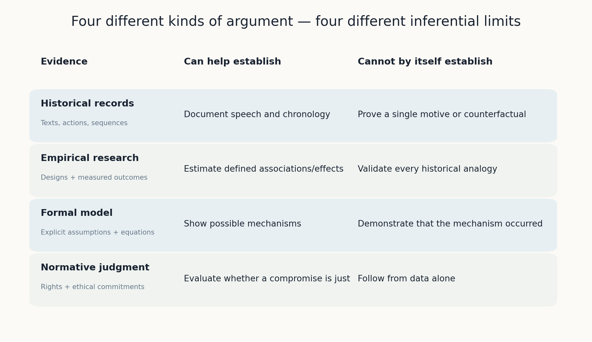

# When Power Calls for Civility: How Moderation Can Contain Social Change

*From Birmingham Jail to Bargaining Theory: Why the Demand to Calm Down Often Arrives When a Movement Begins to Matter*

Diogo Ribeiro | October 2026

*A historical, political, and mathematical essay. Its argument is interpretive rather than a systematic causal estimate. Eight original figures accompany the essay. Figures involving numbers are calculations under stated hypothetical assumptions, **not** measurements of a country, protest movement, or political party. [Reproducible model, figures, and tests](README.md) are included in the companion repository directory.*

## The most convenient moment to ask for patience

In April 1963, Martin Luther King Jr. was in a Birmingham jail. He had been arrested during a campaign against racial segregation. Eight local clergymen, who did not present themselves as enthusiastic defenders of segregation, criticised the campaign as badly timed and urged respect for established legal procedures. Their objection was directed at the way the campaign was being conducted. It was, in their account, too disruptive and too impatient. A more appropriate route would involve negotiation, judicial processes, and a calmer public environment.

The episode matters because of the question hidden inside the language of reasonableness. Who gets to decide when a demand for rights is timely? If the rules of public conduct are determined by institutions that the movement seeks to change, can obedience to those rules be treated as the neutral prerequisite for legitimate politics? And if protesters must suspend pressure before their opponents negotiate, what incentive remains for the other side to make a meaningful concession?

The [Martin Luther King Jr. Research and Education Institute](https://kinginstitute.stanford.edu/letter-birmingham-jail) documents both the ministers' criticism and King's reply. His answer was not a rejection of negotiation. Quite the opposite: he described direct action as a way of making serious negotiation possible when conventional approaches had failed. The point of a peaceful demonstration was to create a condition in which those who had refused to negotiate could no longer afford to ignore the issue. His account placed fact-finding, negotiation, preparation, and direct action within a single strategy.

That historical distinction is the starting point for a contemporary problem. We regularly hear that social movements should be more civil, less extreme, less emotional, less disruptive, and more willing to meet their opponents halfway. Such language has obvious attractions. Most of us would prefer a society in which disagreements are resolved without intimidation or cruelty. A refusal to demonise opponents can be an admirable interpersonal practice, and democratic institutions need rules that allow people with opposing interests to coexist.

Yet an appeal to civility can play a very different political role. It can redirect attention from the substance of a grievance to the manners of those presenting it. It can transform a disagreement over rights, power, wages, housing, or racial discrimination into an examination of tone. The side with institutional power is then able to claim the position of the reasonable arbiter, while the side seeking change must first demonstrate that it deserves to be heard.

Alex Zamalin's *Against Civility: The Hidden Racism in Our Obsession with Civility* (Beacon Press, 2021) makes this distinction central. Zamalin argues that political invocations of civility have repeatedly served to discipline antiracist mobilisation and defend racial hierarchies. One chapter is pointedly named *Civility Is Deployed When Democratic Movements Are on the Rise and Reactionaries Are on the Ropes*. His argument is not simply that some people use polite language hypocritically. It is that civility, when promoted as a general rule for political conflict without attention to power, can help legitimate an unjust status quo. See the [publisher's synopsis and chapter list](https://www.beacon.org/Against-Civility-P1786.aspx) and [Zamalin's own excerpt](https://lithub.com/the-case-against-civility-in-politics/).

It is an important thesis. It is also one that deserves testing rather than automatic acceptance. Not every call for moderation is a strategy of repression. Not every militant campaign succeeds. Deliberative practices can sometimes improve understanding and produce more representative decisions. An adequate analysis must account for these facts as carefully as it examines the history of attempts to silence dissent.

My argument is therefore narrower, and in some respects more demanding, than the claim that civility is bad. **A call for political moderation can be a mechanism of containment when it imposes costs on those seeking change without imposing equivalent obligations on those who benefit from the existing system.** The mechanism is especially plausible when protest has begun to increase the costs of inaction. But it is a hypothesis about institutions, incentives, and asymmetric power, not an assertion that every moderate is disingenuous.

To make that claim precise we need history, empirical research, and some basic mathematics. These three forms of reasoning answer different questions. History can establish what people said and did. Social science can investigate how tactics, media coverage, public opinion, and institutional responses are related. Mathematical modelling can show which consequences follow from explicit assumptions about bargaining power. None of them, alone, can tell us what justice requires.

## 1. Four concepts that should not be confused

The first difficulty is conceptual. In ordinary conversation, *civil*, *moderate*, *nonviolent*, and *reasonable* often merge into a single flattering description. In political conflict they denote different things.

Interpersonal civility concerns how we treat another person in conversation: whether we listen, avoid gratuitous insult, acknowledge uncertainty, and respect someone's basic humanity. This is a social virtue, though it is not the only virtue. A person may be gentle in speech while supporting a deeply harmful policy. Another may be angry and impatient while advancing an ethically defensible demand.

Procedural restraint concerns how political action is conducted: whether protests require prior authorisation, whether strikes should be postponed, whether blockades are permitted, whether demonstrations may interfere with commerce, and whether negotiations can proceed while public pressure continues. These are not merely questions of etiquette. They determine the resources available to each participant in a political conflict.

Policy moderation concerns the substance of a proposal. A moderate tax reform, for instance, could mean a smaller change in rates than a radical proposal. That substantive position might be justified on practical grounds, or it might be inadequate in light of the problem. Its merits cannot be inferred from the adjective *moderate*.

Nonviolence concerns the means employed. A peaceful sit-in can be highly disruptive. A lawful insult can be thoroughly non-disruptive. A strike may be nonviolent while imposing substantial economic costs. The common habit of equating nonviolence with passivity obscures the strategic history of civil resistance.

*Figure 2.* A conceptual classification. Civil discussion and disruptive collective action are compatible; an occupation or strike need not involve interpersonal cruelty. Conversely, insults can occur without any serious challenge to institutional arrangements. The four cells are analytic distinctions, not measured categories or moral rankings.

These distinctions lead to an uncomfortable but necessary observation. Someone can be personally civil and politically uncompromising. Someone can be rhetorically moderate and institutionally coercive. Someone can call for nonviolence while demanding that protesters relinquish the tactics that give nonviolent protest its effectiveness.

The most consequential demand is often not *please stop insulting people*. It is *please stop the boycott, leave the streets, suspend the strike, and allow the appropriate authorities time to act*. That instruction changes the bargaining environment. Whether it is warranted depends on what the authorities promise, who bears the cost of delay, and whether the movement retains an effective means of holding them accountable.

This is also why the phrase *both sides should calm down* is not always symmetric in its effects. The same behavioural rule can impose radically different costs on groups with different resources. If one side controls the law, budgets, police, corporate decisions, and legislative agenda while the other has only public mobilisation, equal restrictions on public agitation do not create equal bargaining positions. They may remove the less powerful party's principal instrument.

## 2. The arithmetic of the centre is not a theory of justice

The second difficulty is a logical one. Centrism is frequently presented as the default location of a reasonable view. Two groups make competing demands; the wise observer selects the midpoint. This intuition can sometimes be useful in bargaining over divisible objects. It is not a general method for identifying moral truth or designing defensible institutions.

Let a one-dimensional policy be represented by \(x\in[0,1]\). Suppose an incumbent favours \(x_0=0\) and a reform movement favours \(x_1=1\). An arithmetic midpoint is

\[
x_m=\frac{x_0+x_1}{2}=0.5.
\]

The formula is correct. But what does \(x=0.5\) mean? Without additional information about rights, costs, distributive consequences, institutional feasibility, and the people affected, its ethical quality is unknown. If the existing rule denies a basic entitlement, a halfway denial is not automatically a reasonable solution. Conversely, if a proposed reform creates an unacceptable risk, an intermediate policy might be better than either extreme. Geometry alone cannot decide.

Imagine, only as an illustration, that an independently defended rights standard requires \(x\geq0.8\). Then \(x_m=0.5\) fails that standard. The number 0.8 is **not** a universal measurement of justice; the point is that the relevant normative criterion must be specified independently of the positions adopted by contestants.

*Figure 1.* A hypothetical policy line. The arithmetic midpoint at 0.5 is below an illustrative rights floor at 0.8. The figure proves no historical or legal proposition. It shows that a midpoint and a defensible minimum standard answer different questions.

This can be expressed more formally. Let \(J(x)\) be a defensible but contestable measure of justice or welfare, conditional on stated ethical principles, and let \(x^*=\arg\max_x J(x)\) subject to institutional and rights constraints. There is no general theorem ensuring

\[
x^*=\frac{x_0+x_1}{2}.
\]

There is not even a theorem ensuring that the midpoint belongs to the feasible or lawful set. A right may be non-divisible; a policy may have thresholds, complementarities, irreversible consequences, or distributions of harm that are invisible when the whole decision is collapsed onto one axis.

This does not mean compromise is inherently suspect. It means the merits of compromise must be argued rather than presumed. Compromise is an instrument for reconciling disagreement under constraints, not a substitute for evaluating the content of proposals. A good negotiator may find a feasible agreement between two unrealistic positions. A bad negotiator may use the language of balance to preserve an indefensible baseline.

The baseline matters especially in social conflict. When two groups negotiate a change from an unequal status quo, the proposal to split the difference treats the inherited inequality as one of two equally legitimate moral reference points. That may be defensible in some divisible economic disputes. It is more questionable when one position concerns an acknowledged violation of fundamental rights.

Political debates often conceal this baseline choice. The status quo enters the conversation as *normality*, while the reform appears as a new demand requiring special justification. A proposal for change is described as an intervention; the continuation of existing harm is described as doing nothing. But doing nothing is itself a decision with a distribution of consequences.

## 3. King's objection was to the timetable, not to reason

King's *Letter from Birmingham Jail* remains one of the clearest accounts of why procedural restraint can be politically asymmetric. Written in response to the local clergy's criticism, it addressed the accusation that the campaign was inappropriate in timing and method. King did not deny the value of negotiation, lawful reform, or peaceful relationships. He argued that asking people to wait for justice, without creating a mechanism that would compel action, was not a neutral appeal.

The distinction between the *absence of tension* and *the presence of justice* is essential. A city in which segregation is calmly accepted can appear orderly; the order rests on an arrangement that denies equal status. A demonstration against that arrangement creates visible tension, yet it may be an indispensable step towards a more just peace. Public tranquility is not a sufficient indicator of institutional legitimacy.

The clergy were not responding to a purely theoretical dispute. The Birmingham movement had pursued legal and organisational strategies for years. By April 1963, the campaign coordinated marches, sit-ins, and an economic boycott aimed at segregationist practices. King was arrested after defying an injunction against the demonstrations. According to the [Stanford King Institute's account](https://kinginstitute.stanford.edu/birmingham-campaign), local business leaders became increasingly vulnerable to the boycott and to national coverage of the authorities' reaction.

The clergy's appeal invoked law and order when the disputed laws and enforcement practices were themselves part of the problem. This is the central difficulty with a procedural rule that says legitimacy depends on compliance with existing arrangements. The argument is circular if the procedure is precisely what reformers are entitled to challenge.

Yet King's approach was not a licence to do whatever a movement wished. His conception of nonviolent direct action involved discipline and accountability. Its purpose was to expose injustice and create pressure for negotiation, not to celebrate conflict for its own sake. The movement's ethical case depended in part on its willingness to suffer repression without retaliatory violence.

Here the common opposition between *radical action* and *reasonable negotiation* dissolves. King treated direct action as a means of making negotiation possible. An invitation to negotiate can be sincere and productive. An invitation to negotiate that requires the weaker party first to abandon the only means it has of being taken seriously is a very different offer.

The historical record also reminds us that the movement did not speak with one voice about when to compromise. During the Birmingham campaign, national officials facilitated discussions with local business leaders. King became willing to accept an interim settlement and suspend demonstrations. Local organiser Fred Shuttlesworth, who had not been fully involved while hospitalised after police repression, strongly objected to easing pressure without his consent. The [King Institute documents this internal disagreement](https://kinginstitute.stanford.edu/birmingham-campaign). The dispute complicates any heroic tale in which the correct boundary between mobilisation and negotiation was always obvious.

That complication is valuable. A democratic movement must itself decide who can negotiate on its behalf, which concessions are acceptable, and what safeguards prevent a temporary halt from becoming permanent demobilisation. Even when pressure succeeds in opening negotiations, the design of the settlement matters. A partial concession can be a durable step forward or a mechanism for dispersing collective power; one cannot know in advance without examining its terms and subsequent enforcement.

King's wider political development strengthens this point. His later work did not stop at the dismantling of explicit segregation. He confronted questions of housing, poverty, labour, and economic power, and regarded formal legal rights as incomplete when material exclusion persisted. The contrast is not between a polite early King and an angry later King. It is between the image of a harmless national icon and the historically situated organiser who understood that durable reform required institutional pressure.

## 4. Zamalin's uncomfortable historical thesis

Zamalin pushes the argument beyond Birmingham. In *Against Civility*, he traces how demands for civility were made by defenders of American slavery, opponents of abolition, segregationists, and political actors committed to preserving racial hierarchy. His provocative claim is that political civility cannot be assumed to be neutral, because its historical uses were themselves implicated in the organisation and defence of inequality.

One example concerns the nineteenth-century defenders of slavery. As Zamalin explains in an [interview about the book](https://www.firesidepod.org/episodes/zamalin), antislavery agitation was portrayed by leading proslavery politicians as an uncivil threat to peace and unity. In that framing, the central problem was no longer the ownership of human beings. It was the supposedly dangerous anger of those demanding that the institution end. The moral question was displaced by a claim about public manners.

The distinction between the *speaker's intention* and the *political function* of a statement becomes particularly important here. An appeal to avoid conflict may be motivated by sincere fear of violence. It may also make the continued operation of an unjust system easier. Those two facts can coexist. We should not need to prove that every person asking for calm was consciously defending slavery in order to study whether their proposed rule advantaged slavery's defenders.

Zamalin sees a similar pattern in later political appeals to national reconciliation and racial harmony. A country can celebrate interpersonal goodwill while failing to change discriminatory institutions. A government can announce programmes of inclusion while maintaining punitive policies and economic arrangements that reproduce material inequality. The language of unity then becomes a cheap substitute for a costly redistribution of power, opportunity, or public resources.

This is not simply an attack on conservatives. Zamalin also criticises liberal politicians who reduce a structural political problem to a matter of tone. In his [2021 essay, *Civility Won't End Racism*](https://www.yesmagazine.org/opinion/2021/03/02/racial-justice-civility), he uses examples from Reconstruction and late twentieth-century American policy to question reconciliation rhetoric unaccompanied by substantive reform. His broader concern is that racial injustice cannot be solved through the cultivation of admirable private manners alone.

The argument is appealing because it exposes a hidden assumption: that an agreeable social atmosphere is itself evidence that competing groups are treated fairly. It is also susceptible to overreach. From the fact that political civility has often been instrumentalised by reactionary actors, it does not follow that *all* civility appeals are reactionary. From the fact that a particular period of reconciliation coincided with injustice, it does not follow that reconciliation caused the injustice. Careful analysis must avoid confusing historical association, causal mechanism, and moral evaluation.

The strongest version of Zamalin's proposition is therefore conditional. Civility is politically suspect when it functions as **a demand that the disadvantaged surrender leverage in return for a promise of future consideration**. It is more defensible when it establishes reciprocal protection against intimidation, preserves rights of assembly and association, and accompanies concrete commitments that can be monitored.

This refinement does not weaken the central concern. It makes the proposition more useful. It tells us what to investigate rather than offering an adjective with which to dismiss every advocate of moderation.

## 5. Why the appeal to restraint may arrive when a movement becomes effective

There is a strategic reason the timing of a civility appeal matters. Political action that has no consequences can be ignored. An isolated petition, a small peaceful rally, or a complaint filed into an institutionally secure process may generate little response. The call to moderate becomes more valuable to those in power when mobilisation begins to impose reputational, electoral, financial, or administrative costs.

Think of a boycott that reduces commercial revenue, a strike that interrupts production, a march that attracts national reporting, or a rent campaign that exposes poor housing conditions. These acts transform a moral demand into an incentive problem for decision-makers. Continued refusal now carries a cost.

At that point, an appeal to patience has a possible strategic value that it lacked earlier. If the campaign stops while negotiations are prepared, if the boycott ends in exchange for a vague undertaking, or if the movement accepts a long review period without an enforceable timetable, the incumbent may recover the ability to postpone reform at low cost. The action that made negotiation attractive has been suspended before its aims have been secured.

*Figure 3.* A schematic of **hypothesized mechanisms**, not a causal estimate. Direct action may increase the cost of refusing negotiation, while an appeal that successfully redirects attention to conduct may lower pressure. Courts, elections, repression, public opinion, and coalition dynamics also affect outcomes. An empirical study would have to measure these pathways and account for alternatives.

We can distinguish several related mechanisms.

**Agenda displacement.** A question about unequal treatment is replaced with a question about whether the complainants protested appropriately. The latter question is easier to debate without addressing the substantive grievance. Journalists can write about damaged property, confrontational speeches, traffic congestion, or offended sensibilities while leaving the original institutional problem relatively unexplored.

**Legitimacy filtering.** Protesters must prove that they are respectable before their claims are considered. This permits established institutions to define which forms of grievance count as reasonable. The evidentiary burden becomes unequal: the status quo is presumed legitimate, and the movement must justify both its aims and its methods.

**Temporal displacement.** Reform is repeatedly transferred into the future. We are told that the moment is too polarised, public opinion is not ready, the economy needs stability, or more consultation must take place. Some of these considerations can be genuine. But if there is no deadline, no specification of interim safeguards, and no cost for failure to act, the procedural promise may have almost no value.

**Asymmetric demobilisation.** Calls for order may restrict the tactic that gives an otherwise excluded group influence without restricting the institutions that enforce the inherited settlement. Removing a blockade, ending a strike, or halting demonstrations may create an appearance of symmetry, but the distribution of power after demobilisation is not the same as before the movement organised.

**False equivalence.** A conversation may describe parties as equally extreme merely because they disagree passionately. This erases differences between a coercive exercise of institutional power and the methods used to resist it. The label *uncivil* can then become a way of classifying a demand without evaluating its underlying claims.

These mechanisms need not be conscious conspiracies. An editor may prefer the drama of confrontation. A politician may sincerely believe social peace is an urgent public good. An official may be rewarded for reducing immediate disruption rather than solving the underlying problem. Institutions can reproduce an unequal pattern through ordinary incentives, without every participant sharing a hidden intention.

There is also an important alternative. A movement may face genuine strategic risks from its own tactics. A violent escalation could lose potential allies, produce a more punitive public response, or harm people the movement seeks to protect. A call to revise strategy may therefore be based on evidence and concern, not on deference to power. The key analytical question is whether the advice improves the movement's ability to secure legitimate goals, or merely reduces the costs imposed on its opponents.

We should be suspicious of a universal rule that says *calm down first*. We should be equally suspicious of a universal rule that says *escalate always*. Strategy is conditional, and historical success is not established by righteous intention alone.

## 6. Historical cases: pressure, compromise, and the people who are told to wait

The historical evidence is richer than a sequence of occasions on which moderates were wrong. A movement can be politically effective because some participants are disruptive and others are capable of translating that disruption into legal, administrative, or electoral change. It can also fail despite intense mobilisation. A serious comparison must specify who acted, what they demanded, when the response occurred, and what institutional result followed.

### Birmingham, 1963: negotiation followed organised pressure

Birmingham offers an unusually clear record of both mechanisms. The local movement did not begin with a national celebrity arriving to conduct a symbolic march. Fred Shuttlesworth and the Alabama Christian Movement for Human Rights had built local organisational capacity over years, alongside litigation and demonstrations. The Southern Christian Leadership Conference joined the campaign in 1963. Its organisers selected a moment that made commercial disruption consequential: the Easter shopping season. Boycotts, marches, and sit-ins were deliberately connected to the city's segregated economic institutions.

The state's response converted local contention into national attention. Police used dogs and high-pressure hoses against demonstrators, including children. Images of this repression had consequences far beyond Birmingham. The growing costs to the city's reputation and commercial activity, coupled with national pressure, contributed to negotiations with business representatives. The [National Park Service's historical account](https://www.nps.gov/bicr/learn/historyculture.htm) describes the importance of the campaign to the national civil-rights struggle and its contribution to the political momentum behind the Civil Rights Act of 1964.

This is strong historical evidence for the proposition that direct action can create conditions in which negotiation becomes politically necessary. It is not proof that every act of disruption was strategically optimal, or that the subsequent federal legislation would not have passed under another scenario. The counterfactual history is unobserved. The movement also had national allies, an expanding civil-rights infrastructure, changes within party politics, courts, and a media system capable of transmitting images of state violence.

The 1963 compromise is particularly instructive. During negotiations, leaders considered halting demonstrations in exchange for partial concessions. Shuttlesworth objected to a decision made without adequate consultation with the local leadership. This was not a disagreement between a righteous movement and a uniformly hostile outside world. It was a dispute *inside the movement* about representation, timing, and the value of pressure. Anyone interested in the ethics of negotiation should take this seriously.

The mechanism matters more than the slogan. If leaders can credibly resume mobilisation when promises are broken, a temporary pause may support a durable agreement. If the suspension destroys the coalition's organisational capacity while the concession remains discretionary, it may leave the movement weaker. Those are different bargaining contracts even if they are announced in similarly civil language.

### British women's suffrage: a counterexample to a simplistic anti-moderate story

The British suffrage campaign is useful precisely because it resists a neat moral division. The Women's Social and Political Union, founded in 1903, became famous for disruptive and sometimes violent tactics. The National Union of Women's Suffrage Societies pursued constitutional and peaceful methods. Both participated in a wider struggle over women's political rights, and both changed the environment in which the other operated.

The [UK Parliament's history of the movement](https://www.parliament.uk/about/living-heritage/transformingsociety/electionsvoting/womenvote/overview/startsuffragette-/) explicitly acknowledges the substantial contribution of the moderate suffragists to constitutional and legal support, while describing the high-profile disruptions associated with the suffragettes. The [National Archives](https://www.nationalarchives.gov.uk/education/teaching-resources/suffragettes-on-file-1840-1912/) records that the two wings sometimes cooperated and that the failure of proposed suffrage legislation contributed to later escalation.

Limited parliamentary suffrage arrived in 1918, in a political context transformed by the First World War; equal parliamentary franchise with men followed in 1928. These dates are not proof that militancy caused one law and moderation caused the other. War, labour, organisational experience, parliamentary bargaining, and changes in public expectations all mattered. The case shows why the question *did moderation work?* is underspecified. We need to ask: moderate *about what*? Were these activists moderate in policy objectives or in tactics? Did their constitutional work translate pressure into legislation? How did militant action alter the government's perception of the stakes?

This distinction changes how we evaluate a moderate faction. The moderate suffragists were not merely telling other women to accept their exclusion. They were themselves organising for enfranchisement through a different strategic repertoire. Their activities can be compatible with the claim that purely procedural pleas for patience may serve incumbents. A group pursuing the same substantive reform through constitutional methods is not equivalent to an incumbent demanding that all reformers stop campaigning.

The case also warns against romanticising every escalation. The WSPU's movement towards property attacks and other illegal acts remains historically and ethically controversial. Recognition that disruption can attract attention is not an argument that destruction or intimidation is automatically productive. Tactics must be evaluated against outcomes, the risks imposed on third parties, and the moral constraints a movement is prepared to defend.

### Portugal, 1974–1976: a different political structure

Portugal offers another instructive comparison, with an important warning against false analogy. The Carnation Revolution began with the military overthrow of the Estado Novo dictatorship on 25 April 1974. The democratic transition then involved mass mobilisation, strikes, workplace occupations, competing political organisations, changing governments, conflicts over decolonisation, and new constitutional institutions. This was not simply a contest over the civility of public debate inside an established liberal democracy.

The [Portuguese Parliament's account of the democratic transition](https://www.parlamento.pt/Parlamento/Paginas/construcao-democracia_1974-1976.aspx/1000) identifies democratisation and decolonisation as central objectives completed through the 1974–1976 constitutional period. Contemporary archival material, including [RTP's collection on the PREC](https://arquivos.rtp.pt/colecoes/p-r-e-c/), documents the intensity of political conflict, mass mobilisation, and institutional instability. The Portuguese experience forces us to distinguish the immediate overthrow of a dictatorship from the subsequent question of how social and political disagreements are institutionalised within democracy.

One should be wary of turning this history into either a celebration of unlimited radicalism or a fable in which moderation rescued the country from itself. Both formulations erase important actors and processes. The military's central role, party competition, social conflict, international pressures, and the constitutional settlement require separate analysis. In Portugal, what should be called *moderation*—a defence of parliamentary democracy, a rejection of particular forms of coercion, a specific distribution of property, or an appeal to stop popular mobilisation—must be defined before it can be evaluated.

The lesson for this essay is methodological. An appeal to order can protect fundamental democratic procedures in one setting and inhibit democratic participation in another. To judge it, we need to identify which institutions already exist, whether citizens can exercise meaningful political rights, and what alternatives are realistically available. An inherited order is not automatically legitimate merely because it is an order; neither is an alternative automatically just because it is radical.

### The comparison, without pretending these are identical cases

| Case | Organised challenge | Relevant institutional context | What we can reasonably infer |
| --- | --- | --- | --- |
| Birmingham, 1963 | Economic boycotts, sit-ins, marches | Segregation, injunctions, commercial leverage, federal attention | Disruption helped create bargaining pressure; no simple single-cause claim about all later reform |
| British suffrage, 1897–1928 | Constitutional campaigns and militant mobilisation | Parliamentary franchise exclusion, war, party politics | Multiple tactical wings contributed; their individual causal shares cannot be read from chronology alone |
| Portugal, 1974–1976 | Military overthrow followed by broad social mobilisation | Dictatorship replaced by contested democratic transition | Institutional order can be reconstructed through conflict; the setting differs sharply from established-democracy protest |

Three cases are not a statistical sample capable of estimating an average treatment effect. They illustrate different institutional arrangements and warn us against careless generalisation. The underlying question remains productive: when an actor calls for restraint, does the proposed restraint help translate collective demands into enforceable outcomes, or does it neutralise the movement's capacity to achieve them?

## 7. What does empirical research say about protest and its consequences?

Historical narratives can establish sequences and mechanisms, but readers should resist inferring effectiveness from a few celebrated victories. Movements and tactics that succeeded are more visible than those that failed. Moreover, the relevant outcome could be media attention, recruitment, a change in opinion, a legislative vote, a court judgment, a budget allocation, or actual improvements in people's lives. These endpoints are not interchangeable.

Omar Wasow's 2020 study in the *American Political Science Review*, [*Agenda Seeding: How 1960s Black Protests Moved Elites, Public Opinion and Voting*](https://doi.org/10.1017/S000305542000009X), is a valuable starting point. It examines protest activity between 1960 and 1972 alongside newspapers, congressional speech, public opinion, and county-level voting. The central idea is that groups lacking conventional political power can change the media agenda through direct action.

Wasow finds evidence consistent with nonviolent protest helping push attention toward civil rights, especially when nonviolent protesters faced state or vigilante repression. Protester-initiated violence was more closely associated with media frames about disorder, and with political outcomes favouring social control rather than the protesters' preferred policies. This is a particularly important result for an essay about civility: it challenges both the premise that legitimate protest must be quiet and the assumption that greater confrontation must always improve an emancipatory cause.

The study combines temporal and geographic variation with several identification strategies. Its strengths include distinguishing protest tactics rather than aggregating everything called a protest and investigating media mechanisms rather than jumping from marches directly to elections. Its limitations matter too. Historical protest coding depends on records that were not collected as a random sample; geographic, political, and media differences can confound associations; and the credibility of a causal interpretation relies on the study's design assumptions. The paper itself discusses those inferential problems. We should neither reduce its findings to a political slogan nor dismiss them because they complicate our preferred narrative.

Herbert Haines's 1984 article, [*Black Radicalization and the Funding of Civil Rights: 1957–1970*](https://academic.oup.com/socpro/article-abstract/32/1/31/1699011), provides a different angle. It examines whether radicalisation within the broader civil-rights movement affected financial contributions to relatively moderate organisations. Haines reports evidence that radical organisations and urban unrest contributed to greater outside support for moderate civil-rights groups, particularly in the late 1960s.

That result is often discussed as a *positive radical-flank effect*: the existence of a more radical alternative can make a comparatively moderate organisation appear more attractive to funders or negotiators. But a rise in funding to moderate groups is not identical to successful reform, and the historical correlation does not supply an estimate of what would have happened without the radical flank. A radical presence can create leverage for one faction without benefiting every part of a movement.

The two papers help us separate at least three hypotheses:

1. Disruptive action can increase political attention by forcing an issue onto the public agenda.
2. The *form* of disruption affects how journalists, politicians, and potential allies interpret the issue.
3. The presence of radical actors can change the bargaining position and relative attractiveness of moderate actors.

These mechanisms can work together, against one another, or not at all in a particular setting. It follows that *more protest* is not a sufficient policy prescription; neither is *less protest*. The useful variables include organisation, scale, discipline, visibility, repertoire, timing, repression, public framing, and feasible institutional outcomes.

Erica Chenoweth and Maria J. Stephan's [*Why Civil Resistance Works*](https://cup.columbia.edu/book/why-civil-resistance-works/9780231527484/) provides evidence from a much wider range of campaigns. Their comparison of major campaigns between 1900 and 2006 found higher historical success rates for nonviolent than violent resistance. The result concerns large campaigns with specified political objectives, not every local labour stoppage or symbolic protest, and it should not be repurposed as an estimate of the effect of politeness. Nonviolent resistance may depend precisely on forms of organised noncooperation that are highly disruptive.

Chenoweth subsequently reported that the effectiveness of nonviolent resistance had declined during the 2010s, while the number of movements had increased. In [*The Future of Nonviolent Resistance*](https://www.journalofdemocracy.org/articles/the-future-of-nonviolent-resistance-2/), the explanation includes changing state responses and weaknesses in movements' organising capacity. This complicates the idea that a repertoire proven successful in one historical period will retain a fixed success rate. Political institutions adapt, technological mediation changes, and the structure of mobilisation matters.

More recent evidence also limits sweeping claims. Amory Gethin and Vincent Pons's 2024 working paper, [*The Limited Effects of U.S. Protests*](https://doi.org/10.3386/w32342), examines fourteen U.S. protest waves from 2017 to 2022, combining digital traces, surveys, electoral outcomes, and political measures. Their results suggest that protest can attract substantial online interest while having limited average effects on political attitudes and other measured outcomes. A movement may dominate attention without securing durable institutional changes.

At the same time, a 2024 review by Eric Shuman and colleagues, [*When Are Social Protests Effective?*](https://doi.org/10.1016/j.tics.2023.10.003), distinguishes tactics, audiences, and outcomes. It concludes that conventional nonviolent protest can be effective at mobilising sympathisers, while more disruptive tactics can sometimes influence people initially resistant to change. Different tactics may be evaluated favourably by different groups, depending on what the study actually measures.

A 2026 review of [the effect of nonviolent disruptive protests on public opinion](https://doi.org/10.1093/pnasnexus/pgag082) further distinguishes approval of the protesters from attitudes toward their underlying cause. Disruption can lower approval of the people using it without necessarily reducing support for the issue they raise. That result is relevant because political commentary often conflates negative feelings about protesters with evidence that the movement's demands have become less popular.

Here is the key empirical correction to both romantic and dismissive accounts of protest: **attention is not persuasion; persuasion is not legislative change; legislation is not implementation; and implementation is not necessarily equal treatment in practice.** A well-designed investigation must name its endpoint and avoid treating success on one measure as a proxy for all the others.

The research literature also does not provide a clean causal estimate of Zamalin's precise hypothesis—that appeals to civility become more frequent *because* a justice movement is becoming effective and are then responsible for slowing reform. That would require observing appeals, movement strength, competing explanations for timing, and subsequent policy trajectories. The plausibility of the mechanism is not a substitute for such evidence.

## 8. A mathematical illustration: why equal compromise can preserve asymmetric power

Now consider the problem from the viewpoint of bargaining theory. The purpose is not to derive the history of Birmingham from an equation. It is to investigate a narrower proposition: **even when a bargaining procedure treats parties symmetrically in one formal sense, the resulting allocation may depend strongly on the unequal positions they bring to the negotiation.**

John Nash's classic 1950 paper, [*The Bargaining Problem*](https://www.haverford.edu/sites/default/files/Nash1950.pdf), gives a mathematical framework for understanding how an agreement depends on a feasible set and the alternatives available if agreement fails. We can use a deliberately simple version to expose the distinction between equal bargaining weights and equal outcomes.

Suppose a hypothetical, transferable unit surplus is divided between a reformer \(R\) and an incumbent \(I\). The resulting shares are \(r\) and \(i\), with

\[
r+i=1,\qquad r\geq0,\qquad i\geq0.
\]

Let \(d_R\) and \(d_I\) be the utilities each party can secure if bargaining fails—their disagreement or *outside-option* utilities. We assume \(d_R,d_I\in[0,1]\) and \(d_R+d_I\leq1\). The parties do not accept agreements below these payoffs. The feasible set for the reformer's allocation is therefore

\[
d_R\leq r\leq 1-d_I.
\]

Introduce a bargaining weight \(\alpha\in[0,1]\) for the reformer and \(1-\alpha\) for the incumbent. An illustrative weighted Nash bargaining objective is

\[
\max_{r\in[d_R,\,1-d_I]}
\quad (r-d_R)^\alpha
\bigl(1-r-d_I\bigr)^{1-\alpha}.
\]

For \(0<\alpha<1\) and a positive residual surplus, taking logarithms and differentiating yields

\[
\frac{\alpha}{r-d_R}
-\frac{1-\alpha}{1-r-d_I}=0.
\]

Solving and extending continuously to the endpoints gives

\[
\boxed{r^*=d_R+\alpha(1-d_R-d_I),\qquad i^*=1-r^*.}
\]

The expression says something precise and limited. The reformer receives the payoff it can already secure without an agreement, plus a proportion \(\alpha\) of the remaining gains from cooperation. The incumbent's outside option is deducted before those gains are divided. Formal symmetry in the weight \(\alpha=0.5\) does not imply a fifty-fifty final allocation unless the disagreement utilities are also symmetric.

Consider three invented cases, all with \(\alpha=0.5\):

| Hypothetical case | \(d_R\) | \(d_I\) | \(r^*\) | \(i^*\) |
| --- | ---: | ---: | ---: | ---: |
| Incumbent has the stronger outside option | 0.05 | 0.55 | 0.25 | 0.75 |
| Both outside options are equal | 0.30 | 0.30 | 0.50 | 0.50 |
| Reformer has the stronger outside option | 0.55 | 0.05 | 0.75 | 0.25 |

*Figure 4.* The model assigns equal bargaining weights in all three cases. The changing outside options alone move the negotiated reformer share from 25% to 50% to 75%. These are **constructed examples**. The quantities do not represent the percentage of civil rights obtained by any historical movement.

There is no contradiction with Nash's mathematical fairness properties. The bargaining solution treats the remaining gains from agreement according to the stated weight and disagreement point. The economic or political significance of the disagreement point is an input to the model, not a question that algebra can settle on its own.

The general sensitivity is transparent:

\[
\frac{\partial r^*}{\partial d_R}=1-\alpha,\qquad
\frac{\partial r^*}{\partial d_I}=-\alpha,\qquad
\frac{\partial r^*}{\partial\alpha}=1-d_R-d_I.
\]

Holding other parameters fixed within the feasible domain, an improvement in the reformer's outside option raises its negotiated allocation; a stronger incumbent outside option lowers it; and a higher reformer bargaining weight matters most when there is substantial residual surplus to divide.

*Figure 5.* A deterministic parameter sensitivity calculation. The incumbent outside option is held at 0.4 while the reformer outside option and bargaining weight vary across their illustrated ranges. Every colour is calculated from the displayed equation. None is a social-science estimate.

Why is this relevant to political calls for civility? Because political pressure can change what participants expect to obtain if an agreement fails. A credible strike may make continued refusal expensive for an employer. A boycott may make inaction costly for a company. Public mobilisation may change electoral risks for a government. Conversely, a movement that suspends the activities providing leverage may have a less favourable bargaining position even if every negotiator remains extremely polite.

But this connection is conditional. The Nash model does not show that every strike increases the reformer's outside option, or that every appeal for restraint reduces it. Public support could increase when a movement changes tactics. A demonstration might exhaust resources without affecting the incumbent. A court victory could strengthen a movement's outside option independently of street mobilisation. The direction and magnitude of an actual effect must be established empirically.

There are deeper limitations. A model of *transferable utility* assumes one unit of surplus can be allocated between actors as though they were dividing a divisible resource. Political rights are frequently not transferable in that sense. Equal protection before the law cannot be understood as a pie from which one party receives a percentage while the other receives the rest. People may have noncompensable entitlements; policy consequences can be multidimensional, irreversible, and distributed among millions of participants. The assumed two-party game also excludes third parties, information problems, agenda power, enforcement failures, and internal disagreement within each camp.

In other words, the mathematical model is a teaching instrument, not an ethical theory of rights and not a retrospective reconstruction of the civil-rights movement. Its useful lesson is structural: **a procedure that looks balanced can generate unequal outcomes when it is applied to unequal initial conditions**. That is something we can prove within a model without pretending to have proved the historical mechanism.

## 9. What if the call for civility changes the price of disagreement?

We can use the same simple model to illustrate Zamalin's proposed mechanism without hiding its assumptions. Let \(c\in[0,1]\) represent the intensity of a hypothetical procedural restraint that lowers a reformer's ability to impose costs on an incumbent. This variable does not measure kindness, politeness, or the quality of conversation. It represents a specific constraint on effective collective action.

Suppose—purely as an example—that restraint reduces the reformer's outside option according to

\[
d_R(c)=\max\{0,\ 0.35-0.30c\},
\qquad
d_I=0.45,\qquad \alpha=0.5.
\]

The assumption has been selected to display a mechanism, not inferred from an historical case. Over the illustrated range the max operator does not bind, and the Nash solution becomes

\[
r^*(c)=d_R(c)+0.5\bigl[1-d_R(c)-0.45\bigr]
=0.45-0.15c.
\]

The reformer's negotiated share is 0.45 when \(c=0\) and 0.30 when \(c=1\). A formally symmetric bargaining rule remains in place throughout, while the effective outcome changes because the assumed procedural constraint alters the disagreement position.

*Figure 6.* A transparent *if–then* statement in graphical form. **If** a procedural restraint reduces \(d_R\) at the specified rate, while other parameters remain fixed, the computed allocation falls. Nothing in this figure establishes that civility actually produces this reduction, or how large it might be in any real setting.

The apparent force of the conclusion is entirely conditional on the sign of the assumption. If civil discourse instead broadens a coalition, attracts sympathetic voters, improves a legal case, or increases trust sufficiently to raise the reformer's effective disagreement payoff, the relationship could reverse. If a violent escalation produces a backlash, the reformer's outside option might deteriorate even without any new restriction. If negotiations are backed by an enforceable commitment, lowering the immediate level of protest might not weaken the movement at all.

This is why it would be intellectually dishonest to present the red and blue lines as a discovered law of politics. The graph is a conditional mathematical deduction. The historical proposition to investigate is whether political elites' appeals for calm systematically *change* the feasible strategies, payoffs, and public legitimacy of reform movements. The empirical direction is a question, not a parameter we know.

The model suggests another distinction between the language of civility and the practical content of an offer. Consider two institutions that both ask a movement to suspend a boycott. One offers a publicly verifiable implementation schedule, independent monitoring, legal remedies, and an agreed procedure for restoring collective action after noncompliance. The other offers only a statement that everyone should listen more respectfully. These negotiations share a courteous tone, but they do not have the same credible commitments or fallback positions. Only the first significantly reduces the risk that the pause becomes an indefinite concession.

An official who sincerely favours reform should be willing to specify such commitments. The question is not whether the participants say *please*. It is whether the agreement changes the institutional reality that produced the grievance.

## 10. The mathematics of waiting: delay has a distribution of costs

Calls for moderation often include a temporal component: reform must wait until public emotions subside, a review is finished, or a more appropriate moment arrives. Sometimes delay is necessary. Institutions have administrative capacities, evidence must be assembled, legal safeguards matter, and implementing a poorly designed change can harm the people it intends to help. But postponement also imposes costs. Those costs are rarely distributed equally.

Suppose an unjust condition causes an avoidable loss of \(h\) units per year until reform. Let \(T\) be the duration of delay, and \(\rho\geq0\) a social discount rate chosen transparently. The present value of the harm incurred during the waiting period is

\[
L(T;\rho,h)
=\int_0^T h e^{-\rho t}\,dt
=
\begin{cases}
hT,&\rho=0,\\[4pt]
\dfrac{h(1-e^{-\rho T})}{\rho},&\rho>0.
\end{cases}
\]

For any \(h>0\), the marginal loss from another year is positive:

\[
\frac{\partial L}{\partial T}
=h e^{-\rho T}>0.
\]

The result is obvious in one sense and easy to forget in political rhetoric. Even if waiting reduces the risk of conflict, the continuation of a harmful status quo carries an opportunity cost. Any serious policy evaluation must compare this cost with the expected benefits of waiting, not assume that delay is free because it is described as prudent.

*Figure 7.* The curves assume one unit of avoidable harm per year and hypothetical annual discount rates of 0%, 3%, and 8%. The horizontal axis is years of delay. Neither the annual harm nor the chosen rates are empirical estimates; this is an accounting identity under stated assumptions.

There is a second problem hidden in aggregate calculations. The person asking for patience may bear almost none of the cost of waiting. Imagine that the potential gains from reform accrue primarily to people who already have few resources, while the administrative or financial inconvenience of reform falls on a powerful institution. A decision-maker's preference for delay is then influenced by a distribution of costs different from the one facing those who suffer exclusion.

To describe the resulting policy as moderate because it balances *both sides* misses a basic distributional fact. Costs must be counted with their incidence: who pays, who benefits, whose time is valued, and whose losses are ignored. The economic value of a year of delay cannot be evaluated only from the perspective of the actor who controls the timetable.

This is the ethical centre of King's objection to being told to wait. Waiting is not an abstract suspension of a debate. For people excluded from equal rights, housing, employment, or participation, the days of delay occur inside real lives. The arithmetic of discounted harm does not determine the content of justice, but it prevents the word *patience* from making the costs of inaction disappear.

## 11. The strongest objections to the argument

The thesis of this essay becomes more defensible when we take seriously the research that cuts against it. There are at least four important objections.

### First: civility can improve democratic deliberation

In a field experiment involving more than 500 registered voters, James Fishkin and colleagues studied structured, informed deliberation across major public issues. Their 2021 *American Political Science Review* paper, [*Is Deliberation an Antidote to Extreme Partisan Polarization?*](https://doi.org/10.1017/S0003055421000642), reports substantial movement in policy attitudes and reductions in affective polarisation among participants relative to relevant controls.

This finding is not refuted by pointing to Birmingham or nineteenth-century slavery. The interventions and questions are different. The study concerns how structured conversation among citizens can change attitudes when participants receive balanced materials and opportunities to exchange arguments. Zamalin's criticism concerns political institutions' use of civility to restrict collective dissent. A carefully designed public deliberation and a command to suspend a civil-rights demonstration are not the same treatment.

It follows that the normative value of civility is conditional on the social process it organises. Deliberation may be constructive when participation is inclusive, information is fair, coercive power is limited, the affected groups are represented, and collective action outside the deliberative forum remains protected. Under those conditions, conversation can be part of change rather than a substitute for it.

### Second: incivility can have real democratic costs

Troels Bøggild and Carsten Jensen's study [*When Politicians Behave Badly: Political, Democratic, and Social Consequences of Political Incivility*](https://doi.org/10.1111/ajps.12897), published in the *American Journal of Political Science*, draws on a multiwave panel of Danish citizens. The authors report associations and research designs supporting adverse effects of political incivility on political trust, satisfaction with democracy, and intentions to comply with public policies.

These are outcomes that matter. A democracy cannot simply dismiss the consequences of elites treating one another with contempt. The study does not establish that civil disobedience or a disruptive strike has the same consequences as politicians' personal insults. It makes the conceptual distinction more urgent: criticising *interpersonal cruelty by political elites* is not equivalent to criticising *collective disruption intended to change an institution*.

We should therefore reject the false dichotomy that to defend protest one must approve of abusive speech. There is room for fierce substantive disagreement, responsible use of evidence, disruptive nonviolent action, and a genuine commitment not to dehumanise opponents. Whether a movement uses these tools is a strategic and ethical question, not a matter of asking permission from whoever currently holds power.

### Third: not all organised protest produces reform

The modern protest literature is not a series of unanimous victories. Gethin and Pons find limited average effects across the contemporary waves they examine. Chenoweth documents a decline in the effectiveness of nonviolent mass campaigns during an era when such campaigns became more frequent. Wasow's findings suggest that protester-initiated violence could push political attention toward repressive social-control frames.

These findings create a reasonable obligation for anyone who advocates disruption: specify the strategic objective, the path from pressure to institutional decision, the coalition needed, and the risk of backlash. The mere fact that a demand is morally attractive does not guarantee that every action taken in its name will advance it. Movements can misjudge timing, lose public support, exhaust resources, or be defeated by adversaries who learn to adapt.

But the same evidence creates an obligation for those who advocate moderation. If a movement's tactics are said to be counterproductive, that should be a testable claim supported by evidence about the actual audience and outcome. Calling a strike *extreme* is not a causal demonstration that abandoning it would lead to better wages. Calling a march *divisive* is not a causal demonstration that cancelling it would produce greater equality.

### Fourth: some compromises are indispensable and morally defensible

Democratic politics often requires compromise because rights and objectives conflict, resources are scarce, and no single group has a legitimate claim to determine every policy. Procedural rules protect minorities within movements as well as opponents outside them. Courts must assess evidence; legislative agreements require broad coalitions; changes to budgets and public services can create substantial transition risks.

An uncompromising movement can be wrong about its objectives. A moderate position can be supported by stronger empirical evidence than a radical proposal. The word *radical* is no certificate of moral correctness, just as the word *moderate* is no certificate of rationality.

The critique advanced here applies when a demand for restraint **asymmetrically preserves institutional advantage** or replaces substantive reform with indefinite assurances. It does not apply automatically to good-faith negotiations with enforceable terms, equal rights of participation, credible implementation, and protection against violence. The fact that a movement is gaining momentum should trigger careful consideration of its goals and methods, not automatic allegiance.

The British suffrage example makes this especially clear: constitutional campaigning was not merely an excuse to defer reform, and political militancy did not possess a monopoly on courage. Both kinds of work contributed to a changing political environment. The most productive question is often how collective pressure, legal advocacy, and negotiation can be combined without allowing the latter two to absorb the energy of the first.

## 12. How could we actually test the civility-as-containment hypothesis?

As a mathematician and data scientist, I am reluctant to treat a compelling narrative as a verified causal law. Zamalin proposes a historical regularity: civility appeals become particularly salient when movements for justice are rising and incumbent groups face pressure. We can turn that proposition into an empirical research programme, while recognising that every step introduces difficulties.

First, define the treatment or exposure. An ordinary request to avoid personal insults is different from a politician's demand that a strike stop before any negotiation. A reproducible study would need to code political statements into categories—for example *interpersonal decorum*, *nonviolence*, *legal compliance*, *suspension of disruptive action*, *substantive compromise*, and *enforceable negotiation offer*. These categories should allow overlap rather than forcing complex language into a single moral label.

Second, define the movement's position. What does it mean for a movement to be *winning*? A campaign could experience increasing participation, favourable media coverage, legislative allies, electoral mobilisation, successful litigation, or completed policy reform. These are different variables. A protest wave might be rising in numbers and losing in public support, or winning a court decision while its street mobilisation declines. Measurement error and selective reporting would be serious concerns.

Third, state a falsifiable hypothesis. One candidate is:

> Conditional on comparable public contention and media exposure, institutional actors will become more likely to demand suspension of disruptive tactics after a movement achieves a measurable increase in political leverage.

That is more informative than saying that moderates always oppose progress. It identifies an actor, a time ordering, an observable discourse category, and a definition of leverage that would need to be declared before inspecting the data.

Fourth, distinguish at least two estimands. The first concerns the **timing** of appeals: does an increase in mobilisation or bargaining leverage precede a change in the probability that institutional actors demand restraint? The second concerns the **effect** of those appeals: do they actually reduce mobilisation, delay negotiations, or lower the probability of reform? A positive answer to the first question would not establish the second.

For a movement \(i\) at time \(t\), we might denote an outcome \(Y_{it}\) such as the proportion of public statements demanding an end to protest. Let \(P_{it}\) measure public pressure, and \(X_{it}\) include pre-specified characteristics of the movement and institutional context. A descriptive panel model might be written as

\[
Y_{it}
=\mu_i+\lambda_t+\sum_{k=-K}^{L}\beta_k
\mathbf{1}\{t-t_i^*=k\}+\gamma^\top X_{it}+\varepsilon_{it},
\]

where \(t_i^*\) is a clearly defined leverage event. But this equation is **not automatically a causal event-study design**. Movements are not randomly assigned a moment of success. Shocks to media attention, policing, elections, violence, court proceedings, and coalition formation may change both movement strength and the rhetoric directed at it. Parallel trends, timing exogeneity, event overlap, and measurement consistency would all need critical scrutiny.

An initial study might therefore concentrate on descriptive accuracy: a transparent archive of elite statements and movement events, an explicit codebook, blinded human annotation, inter-annotator agreement, and sensitivity analysis for alternative definitions of *civility*. Automated language classification would be useful only after validation against genuinely independent examples. A classifier that simply treats the word *calm* as evidence of containment would encode the conclusion in the measurement instrument.

To investigate mechanisms, researchers could compare coverage that foregrounds grievances with coverage that foregrounds conduct, or study whether calls for restraint were accompanied by proposals with deadlines and legal remedies. To investigate effects, they might exploit policy or media changes that plausibly alter rhetoric independently of movement strength, if such variation could be justified. Experimental work on how citizens interpret statements of civility would answer a narrower question about perceptions, not the full institutional effect of changing protest behaviour.

A robust study should also specify counterexamples that could disconfirm the theory. If civility appeals rise principally after violent escalation rather than after measurable reform gains, the timing mechanism would need revision. If appeals paired with credible commitments reliably accelerate reform, they should not be grouped with empty delay tactics. If some institutional actors never use this rhetoric despite facing strong movements, we should investigate what differs about their incentives and norms.

This is the advantage of treating the argument as a research question rather than an ideological identity. It becomes possible to distinguish the contexts in which appeals to moderation protect democratic deliberation from those in which they make injustice more durable.

*Figure 8.* An evidence map. Chronology documents events; empirical research estimates associations or effects under design assumptions; mathematics derives implications from premises; normative reasoning evaluates what ought to count as a just outcome. Moving from one form of evidence to another requires an argument, not a rhetorical shortcut.

## 13. A practical standard: is the appeal to moderation reciprocal and enforceable?

We can now propose a practical test for real political arguments. Rather than asking whether the person calling for calm identifies as moderate, ask what their proposal requires of each party.

**Who must change their behaviour first?** If protesters must stop organising while officials are free to continue existing policies, the cost is asymmetric. If both sides accept concrete restrictions, obligations, and safeguards, the proposal may genuinely create space for agreement.

**Is the underlying grievance addressed?** A promise to improve the tone of public discussion is not the same as an agreement to change a discriminatory rule, repair unsafe housing, increase wages, restore voting access, or enforce equal treatment. We need to know the substance, not the ceremony.

**Is there a timetable?** An agreement with clear milestones, assigned responsibilities, and measurable indicators differs from a statement that the issue will be considered when tensions subside. Time does not merely pass. It distributes benefits and losses.

**Can the weaker party enforce the agreement?** Monitoring, independent review, remedies for noncompliance, and the legitimate ability to resume collective action can make a compromise credible. Without enforcement, a plea for patience may amount to a unilateral surrender of bargaining power.

**Are rights preserved while negotiations proceed?** Peaceful assembly, speech, union organisation, due process, and participation are not merely tactical conveniences granted at the incumbent's discretion. Restraints that disable these rights require much stronger justification than a general preference for quiet streets or comfortable conversations.

**Do the costs of tactics fall disproportionately on uninvolved people?** Responsible movements need to account for public safety, essential services, and the effects of disruption on vulnerable third parties. A defence of collective leverage should not erase those obligations.

**What would count as success or failure?** If a proposal can be evaluated only through flattering words—reasonable, pragmatic, dignified, mature—it is not yet a plan. Define the decision, the affected population, the expected outcome, and the evidence that could revise the strategy.

The test is deliberately symmetrical in moral principle, but not blind to asymmetry in institutional power. Both reformers and incumbents owe others reasons for their choices. Yet they do not enter political conflict with the same capacities to shape law, media access, employment, or public spending. Equal moral standing does not imply identical constraints or bargaining positions.

## Conclusion: a quiet society is not necessarily a just society

The central insight of *Against Civility* is worth taking seriously: political appeals to civility have a history, and that history includes attempts to silence people who were demanding changes to unjust institutions. The attraction of politeness should not prevent us from studying what a demand for politeness *does* within a conflict.

Martin Luther King Jr.'s Birmingham letter shows why an invitation to wait can become an obstacle when the people making the invitation control the timetable. The Birmingham campaign shows that disciplined nonviolent disruption can make negotiation possible. British suffrage shows that constitutional moderation and militancy can coexist within the same struggle, with different contributions and risks. Portugal's democratic transition reminds us that the value of order depends on the kind of political order being defended.

The empirical literature provides useful distinctions rather than universal slogans. Protest can affect news agendas, public support, and political outcomes in different directions. Nonviolent action can be strategically powerful without being quiet. Disruption can sometimes backfire. Civil deliberation can change attitudes constructively. Incivility by political elites can reduce democratic trust. None of these findings licences a blanket instruction to remain silent, nor an automatic demand for permanent escalation.

The mathematical illustration adds a limited but important observation. A nominally balanced bargaining procedure can produce profoundly different results depending on the disagreement positions and power that parties bring into it. If a request for civility changes these positions asymmetrically, its material consequences may differ from its language of neutrality. Mathematics demonstrates the conditional mechanism; it does not establish that the mechanism occurred in any historical case.

The most defensible conclusion is therefore not that civility is always a vice, or that moderates are always secretly opposed to progress. It is that **the political value of moderation must be judged by the reforms it enables, the rights it protects, the costs it distributes, and the power it leaves intact**.

A compromise can be wise. A conversation can be generous. A public appeal to reduce hatred can improve democratic life. But there is no moral virtue in demanding calm from people whose legitimate grievances are then left unresolved.

The question to ask when power calls for civility is not simply whether the protesters are polite. It is whether the proposed peace contains a credible path to justice—and who benefits if that path is indefinitely postponed.

---

## Sources and further reading

The list prioritises original texts, primary institutional histories, and peer-reviewed research. The essay is an interpretive synthesis, not a systematic literature review; cited studies differ substantially in period, population, intervention, design, and outcome.

### Political theory and historical texts

1. **Zamalin, Alex** (2021). *Against Civility: The Hidden Racism in Our Obsession with Civility*. Beacon Press. [Publisher and table of contents](https://www.beacon.org/Against-Civility-P1786.aspx). The [author's excerpt](https://lithub.com/the-case-against-civility-in-politics/) offers direct access to the argument.
2. **Zamalin, Alex** (2021). *Civility Won't End Racism*. YES! Magazine. [Author essay](https://www.yesmagazine.org/opinion/2021/03/02/racial-justice-civility).
3. **King, Martin Luther Jr.** (1963). *Letter from Birmingham Jail*. [Martin Luther King Jr. Research and Education Institute, Stanford University](https://kinginstitute.stanford.edu/letter-birmingham-jail). See also King's *Why We Can't Wait* (1964).
4. **King Institute**. *Birmingham Campaign*. [Historical account and source notes](https://kinginstitute.stanford.edu/birmingham-campaign).
5. **U.S. National Park Service**. *Birmingham Civil Rights National Monument: History and Culture*. [Institutional history](https://www.nps.gov/bicr/learn/historyculture.htm).
6. **UK Parliament**. *Start of the Suffragette Movement*. [Historical account](https://www.parliament.uk/about/living-heritage/transformingsociety/electionsvoting/womenvote/overview/startsuffragette-/).
7. **UK National Archives**. *Suffragettes on File, 1840–1912*. [Archival teaching collection and background](https://www.nationalarchives.gov.uk/education/teaching-resources/suffragettes-on-file-1840-1912/).
8. **Assembleia da República**. *A construção da Democracia (1974–1976)*. [Portuguese Parliament](https://www.parlamento.pt/Parlamento/Paginas/construcao-democracia_1974-1976.aspx/1000).
9. **RTP Arquivos**. *P.R.E.C.* [Historical audiovisual collection](https://arquivos.rtp.pt/colecoes/p-r-e-c/).
10. **Nash, John F. Jr.** (1950). *The Bargaining Problem*. *Econometrica*, 18(2), 155–162. [Primary paper (PDF)](https://www.haverford.edu/sites/default/files/Nash1950.pdf).

### Social movement research and competing evidence

11. **Wasow, Omar** (2020). *Agenda Seeding: How 1960s Black Protests Moved Elites, Public Opinion and Voting*. *American Political Science Review*, 114(3), 638–659. [DOI](https://doi.org/10.1017/S000305542000009X).
12. **Haines, Herbert H.** (1984). *Black Radicalization and the Funding of Civil Rights: 1957–1970*. *Social Problems*, 32(1), 31–43. [Journal record](https://academic.oup.com/socpro/article-abstract/32/1/31/1699011).
13. **Chenoweth, Erica, and Maria J. Stephan** (2011). *Why Civil Resistance Works: The Strategic Logic of Nonviolent Conflict*. Columbia University Press. [Publisher](https://cup.columbia.edu/book/why-civil-resistance-works/9780231527484/).
14. **Chenoweth, Erica** (2020). *The Future of Nonviolent Resistance*. *Journal of Democracy*, 31(3), 69–84. [Article](https://www.journalofdemocracy.org/articles/the-future-of-nonviolent-resistance-2/).
15. **Gethin, Amory, and Vincent Pons** (2024). *The Limited Effects of U.S. Protests*. NBER Working Paper 32342. [DOI](https://doi.org/10.3386/w32342).
16. **Shuman, Eric, Amit Goldenberg, Tamar Saguy, Eran Halperin, and Martijn van Zomeren** (2024). *When Are Social Protests Effective?* *Trends in Cognitive Sciences*, 28(3), 252–263. [DOI](https://doi.org/10.1016/j.tics.2023.10.003).
17. **Vandeweerdt, Clara** (2026). *The Effect of Disruptive Protests on Public Opinion*. *PNAS Nexus*, 5(4), pgag082. [DOI and review](https://doi.org/10.1093/pnasnexus/pgag082).
18. **Fishkin, James S., Alice Siu, Larry Diamond, and Norman Bradburn** (2021). *Is Deliberation an Antidote to Extreme Partisan Polarization? Reflections on “America in One Room”*. *American Political Science Review*, 115(4), 1464–1481. [DOI](https://doi.org/10.1017/S0003055421000642).
19. **Bøggild, Troels, and Carsten Jensen** (2025). *When Politicians Behave Badly: Political, Democratic, and Social Consequences of Political Incivility*. *American Journal of Political Science*, 69(3), 1064–1081. [DOI](https://doi.org/10.1111/ajps.12897).

### Reproducibility and interpretation

The figures and tables in this article can be regenerated from the accompanying [analysis script](analysis.py), with numerical contracts covered by [unit tests](tests/test_analysis.py). These are calculations under explicit assumptions. They have **no** externally collected microdata or historical effect estimates. A policy or social-science application would require a separately justified measurement model, data provenance, identification strategy, uncertainty analysis, and ethical review.

