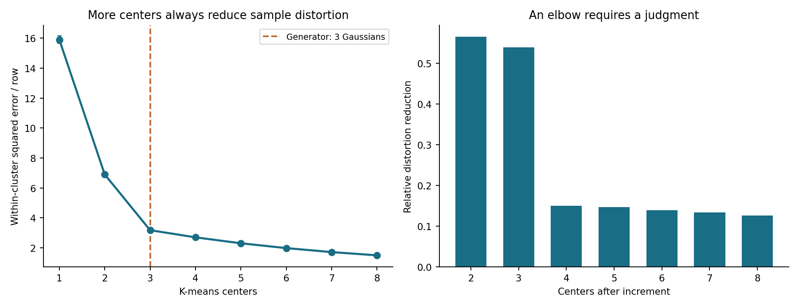
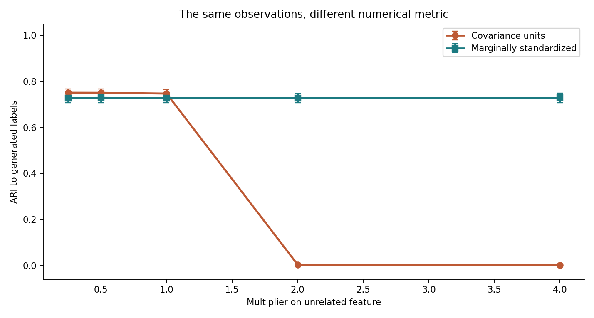
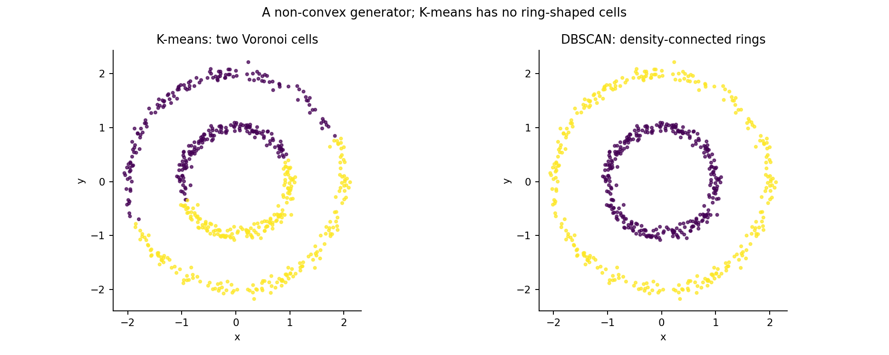
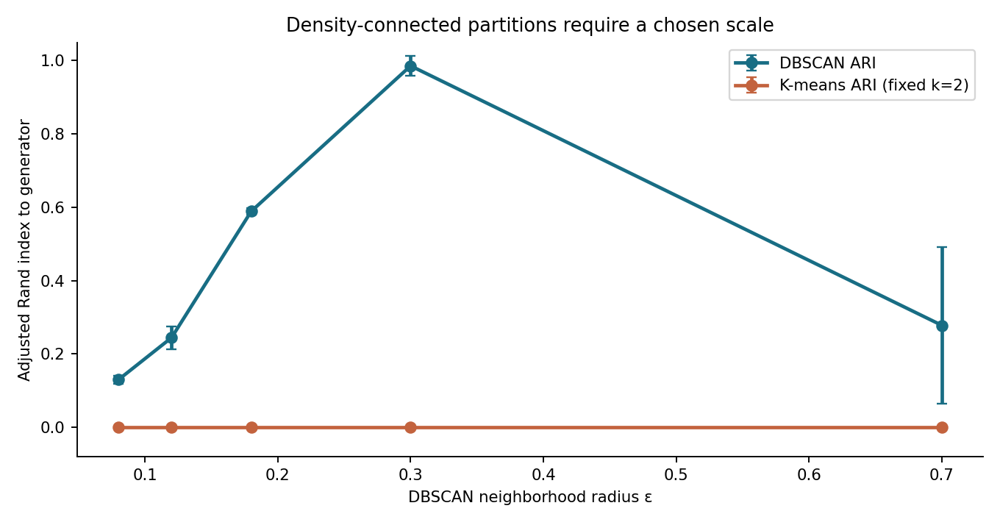
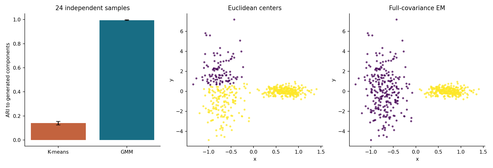
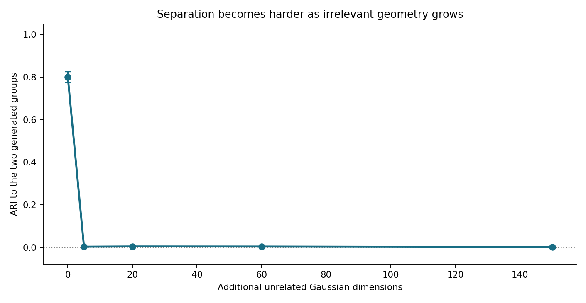
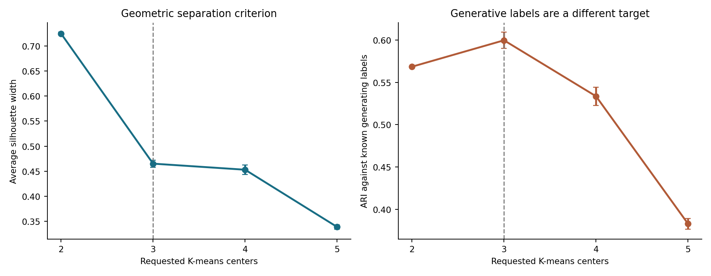
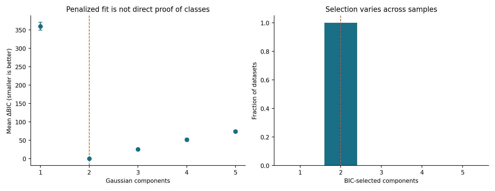
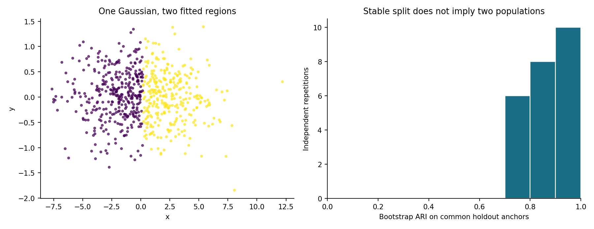
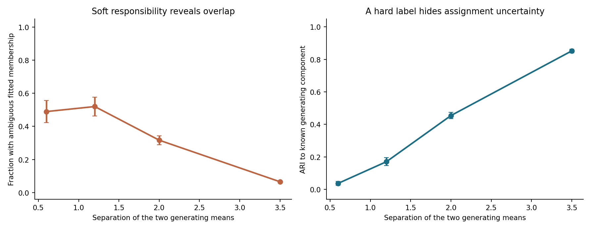

# A Cluster Is Not a Population: K-means, Mixtures, Stability, and the Limits of Unsupervised Labels

*Article #28 · Mathematical derivations and reproducible synthetic experiments · 1 November 2026*

> **Abstract.** An unsupervised algorithm can always return a partition
> when asked for one. The partition may be useful for compression,
> visualization, routing, anomaly screening, or scientific discovery,
> but it does not follow that the observations belong to distinct
> populations or that the clusters correspond to causes. We distinguish
> a Euclidean partition, a density-connected region, a probabilistic
> mixture component, and a scientifically validated group. We derive
> the K-means objective and its monotone distortion property; examine
> the silhouette coefficient and adjusted Rand index; develop the
> Gaussian-mixture likelihood, EM responsibilities, and BIC penalty;
> and explain why bootstrap stability is not an identification
> theorem. Nine seeded synthetic studies produce ten original figures
> and eighteen machine-readable evidence tables. They show how
> rescaling a nuisance feature changes K-means, how concentric rings
> violate centroid geometry, how unequal covariance shapes favor a
> likelihood model, how irrelevant dimensions erase separability,
> why silhouette can prefer two groups when three generated components
> exist, and why a stable split can occur in data from one continuous
> Gaussian population. We report independent Monte Carlo uncertainty
> and 94 automated checks, including an executable notebook. The
> experiments establish conditional possibilities, not the prevalence
> of these behaviors in any particular field dataset.

## 1. The seductive leap from colored points to populations

Imagine an analyst fitting a clustering algorithm to household data.
The result is a two-dimensional plot with three colored regions. One
region has higher average income, another has more children, and a
third has longer commutes. The analyst names the clusters *prosperous
urban professionals*, *working families*, and *rural dependents*,
then publishes a claim that society contains three identifiable
types of households. The plot may be accurate as a display of
assigned labels. It does not, by itself, establish that those
categories exist as separate natural populations, that they will
replicate under another survey instrument, or that the categories
are the causes of the measured behavior.

This is not a criticism of discovering patterns. Clustering is
valuable precisely because analysts often lack an outcome variable
or agreed taxonomy. It can expose possible structure, create
compact descriptions, accelerate later computation, and suggest
scientific hypotheses. A customer-segmentation project may use a
cluster to choose a communication strategy without believing that
customers possess permanent, mutually exclusive psychological
types. An image-compression algorithm can partition pixels by
color without asserting that every pixel belongs to a distinct
physical process. The problem begins when a conditional
optimization result becomes an ontological conclusion.

Three questions are repeatedly collapsed. **Can an algorithm
partition these observations?** Usually yes, when supplied with
a desired number of regions or a density rule. **Does the
partition behave well under an explicit task and validation
procedure?** That is a substantive empirical question. **Does
the partition identify scientifically meaningful populations?**
That is a stronger claim requiring measurement theory,
sampling, external replication, and sometimes causal evidence.
The first answer does not entail the second, and neither
automatically entails the third.

We will use the word *cluster* carefully. Sometimes it means a
set of observations with a common assigned label. Sometimes it
means a high-density connected region. In a mixture model it
may refer to an unobserved generating component. These meanings
cannot be substituted without assumptions. We use synthetic data
to know which generating components were built into an experiment,
but even there the generator's hidden labels are not necessarily
the single best partition for every decision. A geometric partition
can be useful even when there are no generative classes at all.

The foundational methods predate current machine-learning
fashion. Lloyd's least-squares quantization [1], MacQueen's
classification approach [2], and later work on careful
initialization [3] focus on well-defined computational tasks.
Those mathematical tasks are useful irrespective of whether a
social, biological, or economic group is subsequently named.
Our aim is to keep the computational guarantee while making
the interpretation earn its own evidence.

## 2. A partition, a mixture component, and a population differ

Suppose we observe a matrix
\(X=(x_1,\ldots,x_n)^\top\in\mathbb R^{n\times p}\).
A hard clustering is a map
\(z:\{1,\ldots,n\}\to\{1,\ldots,k\}\).
It induces sets \(C_j=\{i:z(i)=j\}\). If every observation
receives one label, the sets form a partition. Nothing in the
definition says that the data were produced by \(k\) separate
distributions. A deterministic rule can partition observations
from a single unimodal distribution just as easily as it can
partition samples from well-separated generators.

A finite mixture model states something different:

\[
 p(x)=\sum_{j=1}^{k}\pi_j f_j(x;\theta_j),
 \qquad \pi_j\geq0,\quad\sum_j\pi_j=1.
\]

The \(f_j\) are component densities or probability laws, and
\(\pi_j\) are mixture weights. A generative interpretation
introduces an unobserved component label \(Z\), with
\(P(Z=j)=\pi_j\) and \(X\mid Z=j\sim f_j\).
If components overlap, knowing \(X=x\) does not reveal \(Z\)
with certainty. A fitted mixture can report conditional
responsibilities rather than pretending that each observation
has an objectively known type. Moreover, statistical mixture
components can be convenient approximating basis functions:
several Gaussians may approximate a skewed single population
without implying several independently existing causes.

The phrase *population* introduces a third level. In survey
statistics, a population might be the set of households in a
specified place and year, with a defined sampling frame.
In a scientific taxonomy, a purported subtype might require
invariant mechanisms, independent measurements, and a model of
how an individual enters or leaves the class. The population
is specified by the scientific question; a clustering label
is a product of an estimation procedure. If a training sample
has selection bias, a stable cluster can be stable evidence
about the sample-collection mechanism rather than the broader
population under study.

Identifiability is yet another distinction. A model can fit
the observed distribution while admitting equivalent parameter
descriptions. Mixture components are exchangeable under
permutation of their labels. Degenerate or nearly overlapping
components can make their individual parameters difficult to
estimate. In high-dimensional settings, a finite sample may
contain insufficient information to distinguish several
component counts. A highly accurate fit to observed data
does not automatically identify every hidden generator.

We therefore distinguish at least five targets: squared-error
compression, density geometry, a probabilistic generative
approximation, reproducibility of a partition, and scientific
interpretation. A method optimized for one can perform badly
against another. Throughout this article we name the target
before interpreting a score. In particular, the synthetic
component labels are an *oracle reference* supplied by the
simulation author, not a source of truth available to a
real-world unsupervised learner.

## 3. What K-means actually minimizes

Classical K-means assigns points to \(k\) centers. Let
\(\mu_1,\ldots,\mu_k\in\mathbb R^p\) denote those centers and
\(z_i\in\{1,\ldots,k\}\) the assignments. Its empirical objective
is the within-cluster sum of squares,

\[
 W_k(X)=\min_{\mu,z}
 \sum_{i=1}^{n}\|x_i-\mu_{z_i}\|_2^2.
\]

For fixed assignments, the optimal center for a nonempty
cluster is its arithmetic mean. To see why, differentiate
\(\sum_{i:z_i=j}\|x_i-\mu_j\|_2^2\) with respect to \(\mu_j\):

\[
 -2\sum_{i:z_i=j}(x_i-\mu_j)=0
 \quad\Longrightarrow\quad
 \mu_j=\frac{1}{|C_j|}\sum_{i\in C_j}x_i.
\]

For fixed centers, each point is assigned to its closest center.
Alternating these two steps never increases the displayed
squared-error objective, provided the algorithm treats empty
clusters consistently. This is the central logic behind
Lloyd-style refinement [1]. It is not a proof that the
algorithm reaches a global optimum from every initialization.
The optimization is nonconvex in the joint assignment and
center variables. Different starts can converge to
different local solutions.

The objective also tells us about the geometry. For two centers
\(\mu_a,\mu_b\), a point is assigned to \(a\) when
\(\|x-\mu_a\|^2\leq\|x-\mu_b\|^2\).
Expanding and cancelling \(x^\top x\) yields

\[
 2x^\top(\mu_b-\mu_a)
 \leq \|\mu_b\|^2-\|\mu_a\|^2.
\]

The boundary is a hyperplane. Each center's assigned region is
a Euclidean Voronoi cell, a convex intersection of half-spaces
when centers are fixed. Ordinary K-means therefore cannot
represent a concentric ring as one connected, non-convex
cluster while representing a second ring separately. It can
divide the rings into wedge-like regions, but that answers a
different optimization problem.

Multi-start fitting reduces sensitivity to unlucky initial
centers, and k-means++ gives a careful randomized seeding
strategy with a useful approximation guarantee for the
initial potential [3]. Neither choice changes the squared
Euclidean distance objective, its dependence on feature
units, or its inability to identify causal populations.
The experiments use ten K-means initializations per fit,
with deterministic seeds. This reduces a numerical nuisance;
it is not an external validation of the resulting labels.

There are legitimate purposes for this method. Vector
quantization and codebook construction need representative
centers. A logistics problem may want groups of delivery
locations served by nearby depots. A pipeline may want
rough partitioning before a computationally expensive
downstream stage. Those uses can justify K-means through
reconstruction cost, travel distance, or task performance.
They do not require claiming that a cluster label is a
property intrinsic to the object being clustered.

## 4. The elbow is a tradeoff curve, not an oracle of true rank

The globally optimal K-means distortion cannot increase
when an additional center is permitted:

\[
 W_{k+1}(X)\leq W_k(X).
\]

The reasoning is elementary. An optimum with \(k+1\) centers
can reproduce any \(k\)-center assignment by using an
additional unused or duplicate center, subject to the
usual formulation of the objective. Increasing model
capacity cannot worsen the optimum of the same-sample
squared-error criterion. At \(k=n\) the empirical distortion
is zero if every observation has its own center. Thus a
decreasing inertia curve is expected whether the observations
come from two populations, ten populations, or one smooth
continuous distribution. It is not itself evidence of
discrete structure.

An elbow heuristic searches for a point after which marginal
improvement becomes less attractive. But *less attractive*
requires a scale, tolerance, or application cost. A storage
system might accept a ten-percent distortion reduction for
one extra center; an expensive service-location deployment
might not. Different normalizations or transformations can
change the apparent sharpness of the elbow. The analyst's
loss function, not the plotted bend alone, determines how
many centers are useful.

Our first experiment generates 420 observations from three
equal-weight, isotropic Gaussian components in two dimensions.
Their means are \((-4,-1),(0,2),(4,-1)\), and each
coordinate has component standard deviation 1.3.
In each of 18 independent replications we fit
\(k=1,\ldots,8\), with ten initializations per fit.
We archive independent-repetition values of inertia per
observation, together with mean and Monte Carlo standard
error for each \(k\). The generating count three is
known only to the simulation.

Mean distortion decreases from about **15.90** at \(k=1\)
to **3.18** at \(k=3\), **2.70** at \(k=4\), and **1.50**
at \(k=8\). The reduction after three centers is smaller,
which makes three a reasonable compression choice under
some costs. But the fourth center still improves the exact
declared objective, and a different data geometry could
produce a smooth decay without a conspicuous bend. The
figure cannot determine whether there are exactly three
scientifically meaningful source populations.

Care is also needed when comparing different \(k\) values
after extensive trial and error. If an analyst reports the
best-looking elbow among many scalings, distance metrics,
subsets, and random initializations, the apparent clarity
may be a selected artifact. Reporting the choices tried,
their uncertainty, and the intended downstream objective
is more informative than declaring that the elbow
*revealed* a true number.

## 5. Units can manufacture a different partition

K-means depends on the numerical metric. Suppose a
feature vector is rescaled by a diagonal matrix
\(D=\operatorname{diag}(d_1,\ldots,d_p)\).
The squared distance becomes

\[
 \|Dx-Dy\|_2^2
 =\sum_{j=1}^{p}d_j^2(x_j-y_j)^2.
\]

Rescaling one feature therefore changes its contribution
to K-means quadratically. Changing kilometers to meters,
or weighting one signal more heavily for scientific reasons,
can change which assignments minimize distortion. The
algorithm does exactly what its metric asks. The
interpretive risk arises when labels are treated as
unit-invariant categories despite being produced by a
unit-dependent loss.

We generate 440 observations in two equally sized
label-bearing groups. The first coordinate has conditional
means \(-1\) and \(1\) with common standard deviation
\(0.65\); the second is independent unit-variance noise,
unrelated to the label. We multiply only that second
coordinate by \(s\in\{0.25,0.5,1,2,4\}\). Within each of
24 replications the underlying observations and generating
labels remain fixed across all five scales. We fit two
K-means centers in the rescaled raw coordinates and,
separately, after marginal standardization.

Agreement with generated labels is measured using the
adjusted Rand index, derived in Section 10. In brief,
an ARI near one indicates strong agreement up to label
permutation, while zero corresponds to its chance-adjusted
reference. It is not a probability of cluster correctness
and can be negative. We never supply the generator labels
to K-means; they appear only in the evaluation.

With nuisance multiplier \(s=0.25\), mean raw-coordinate
ARI is about **0.751**. At \(s=4\), it is approximately
**0.0009**: the partition has become nearly unrelated to
the labels we constructed. The standardized pipeline stays
near **0.728** across these multipliers. That numerical
stability has a simple cause: multiplying a coordinate by
a positive constant and then dividing by its empirical
standard deviation cancels the multiplier, apart from
floating-point and solver details.

Standardization is not automatically a scientifically
correct choice. Giving every feature unit marginal variance
can amplify a noisy or poorly measured coordinate. In
some applications a physically meaningful distance or
cost matrix should deliberately weight features unequally.
The lesson is to declare the metric, audit units and
measurement errors, and verify that the assigned groups
serve the actual task. A cluster that disappears when a
nuisance variable changes units has a fragile substantive
interpretation even if its K-means loss was optimized
perfectly.

## 6. The geometry of two rings cannot be captured by two centroids

Not every useful cluster is approximately spherical, convex,
or even representable by one center. Imagine observations
concentrated along two concentric circular tracks. Each
track forms a connected region with a different radius.
Yet both have approximately the same Euclidean center.
The two-centroid K-means objective must divide the plane
into two half-space-like Voronoi regions, slicing through
both rings. The failure follows from the algorithm's
geometry rather than from a poor random initialization.

Density-based clustering approaches the problem differently.
DBSCAN, introduced by Ester, Kriegel, Sander, and Xu [6],
defines a neighborhood radius \(\varepsilon\) and a minimum
number of points required for a core point. Core points
with sufficiently connected neighborhoods form clusters;
some reachable border points may join them, while other
observations receive a noise designation. This permits
connected regions of non-convex shape. It does not make
the recovered groups independent generative populations,
and it requires a density scale appropriate to the data.

Our third experiment constructs 600 points: 300 near
radius one and 300 near radius two, with independent
two-dimensional Gaussian perturbations of standard
deviation \(0.065\). There are eighteen independently
generated point clouds. For each cloud we fit K-means
with \(k=2\), and DBSCAN with
\(\varepsilon\in\{0.08,0.12,0.18,0.30,0.70\}\)
and a minimum sample count of five. We retain
the adjusted Rand index, the number of density clusters,
and the fraction of points that are not labeled noise.
All parameters are explicitly reported because the
conclusions depend on them.

Across the eighteen full replications, mean K-means ARI
is approximately **−0.0008**, essentially chance-level
agreement with the known ring labels. At
\(\varepsilon=0.30\), mean DBSCAN ARI is approximately
**0.986**, with almost all observations assigned to a
non-noise cluster. But with \(\varepsilon=0.08\),
DBSCAN identifies about **32** density clusters on
average and labels only **54%** of observations as
assigned. At the much larger radius \(0.70\), the
algorithm often connects the rings into one region,
and mean ARI falls to about **0.278**. The same
generator supports very different output partitions
depending on the declared density scale.

ARI in this experiment treats DBSCAN's label \(-1\)
as another label in a partition comparison. That
convention is convenient for a whole-sample score,
but treating every noise point as one shared group
does not mean DBSCAN believes those points constitute
a single meaningful population. One could instead
evaluate cluster quality conditional on assigned
points and separately report coverage. Such a change
would answer a different question and should not be
hidden behind the same number.

The constructive conclusion is limited but useful.
When a problem concerns density connectivity in a
well-chosen metric space, DBSCAN can represent shapes
that centroid methods cannot. If local densities differ
greatly, one global radius may fragment sparse clusters
or merge dense ones. The algorithmic notion of
*density-connected* must still be validated against
domain mechanisms, sampling, and deployment costs.
An annulus is a known generating class here because
we created it; an annulus-shaped region in an unknown
dataset could be a sensor artifact, a projection of
a higher-dimensional manifold, or a genuine regime.

## 7. An elongated Gaussian and a compact Gaussian are not two equal balls

K-means favors roughly compact groups measured by one
Euclidean scale. A Gaussian mixture with unrestricted
component covariance matrices can represent regions with
different orientations and spreads. This distinction
matters when one population has naturally wide variation
along one variable and another is tightly concentrated.
A Euclidean distance threshold may divide the spread-out
group before it recognizes the compact one, even if the
two component densities overlap very little in a
different coordinate.

For this experiment, one generating component has
mean \((-0.7,0)\), first-coordinate standard deviation
\(0.25\), and second-coordinate standard deviation
\(2.1\). The other has mean \((0.7,0)\), with standard
deviations \(0.25\) and \(0.30\). Both contain 260
observations in each of 24 independent datasets.
The narrow first-coordinate distributions make
the generating component labels distinguishable,
but the extreme vertical spread of the first
component gives K-means an incentive to allocate
two centers along that spread rather than separate
the two Gaussian generators.

We compare two K-means centers with a two-component
Gaussian mixture fitted by expectation–maximization.
The mixture has unrestricted symmetric positive
covariance matrices with a small, declared diagonal
regularizer. Both algorithms receive multiple random
initializations. Neither has access to the generating
labels. We report agreement with those labels only
after fitting; this is a controlled comparison of
model assumptions, not a universal ranking of
clustering algorithms.

Mean K-means ARI is approximately **0.140**,
compared with **0.995** for the fitted Gaussian
mixture. The representative panels show why: one
Euclidean partition cuts the tall component
approximately horizontally, while the mixture
can assign a vertically elongated elliptical
density to one component and a small compact
density to the other. The mixture's advantage
in this particular Gaussian model follows from
its ability to represent the known covariance
asymmetry.

It would be wrong to conclude that Gaussian mixtures
always recover the correct populations. If the true
density is multimodal for a different reason, if
component tails are heavy, if the sample contains
unmodeled contaminants, or if many covariance
parameters must be estimated from few observations,
a Gaussian mixture can overfit or return unstable
components. A sufficiently flexible Gaussian mixture
can approximate a single non-Gaussian distribution
with several components. Those components can be
useful for estimating a density without representing
multiple distinct scientific types. The right model
is determined by its declared target and assumptions.

## 8. Irrelevant dimensions can bury the useful distance

Adding features to a clustering input is sometimes
treated as adding information. But a feature can be
measured accurately and still be irrelevant to the
population distinction one hopes to recover. Euclidean
distance accumulates contributions from every coordinate.
If nuisance dimensions are independent, their squared
distances do not cancel; they add nonnegative random
terms, increasing total distance and its variability.
This changes which pairwise comparisons dominate
centroid assignment.

Consider two observations drawn from the same
independent Gaussian noise distribution with
\(q\) nuisance coordinates, each having variance
\(\sigma^2\). Their expected squared Euclidean
distance due to those coordinates alone is

\[
 \mathbb E\|N_a-N_b\|_2^2=2q\sigma^2.
\]

Suppose a two-group signal contributes a fixed
between-group squared displacement \(\Delta^2\).
As \(q\) increases, the ratio of the fixed displacement
to the typical total squared noise distance shrinks.
Exact classification behavior also depends on
sample size, dimensionality, geometry, and the
algorithm, so this expectation is not a complete
failure theorem. It does explain why adding many
high-variance unrelated coordinates can alter
Euclidean neighborhoods and empirical clusters.

Our fifth study constructs 340 observations with
two informative coordinates. The first separates
two equally sized generating groups with means
\(-1.05\) and \(1.05\), common standard deviation
\(0.65\); the second is independent noise of
standard deviation \(0.6\). We then append
\(q\in\{0,5,20,60,150\}\) independent nuisance
coordinates, each with standard deviation
\(1.65\). Within an outer repetition we reuse
the same generated two-dimensional signal and
the first \(q\) columns of one larger nuisance
matrix. Eighteen independent repetitions
quantify the resulting variation.

With no appended nuisance columns, mean K-means
ARI is approximately **0.800**. With just five
added columns it falls to approximately **0.003**,
and with 150 it is about **0.0009**. The size
of this deterioration is particular to our chosen
separations and nuisance variance; it should
not be transported as a predicted failure rate
for all high-dimensional datasets. The figure
shows why a dataset can become richer in recorded
features yet poorer for a Euclidean partition
against one scientific target.

Possible remedies include choosing features for
the actual task, using a domain-justified metric,
learning a representation under appropriate
evaluation, or modeling signal and noise
separately. Standardizing every coordinate is
not sufficient when many standardized
coordinates are still irrelevant. Dimensionality
reduction can help when relevant structure is
concentrated in leading directions, but an
unsupervised variance criterion has no guarantee
of preserving a low-variance predictive or
scientific signal. Feature selection itself
must be fitted within training folds if
external evaluation is to remain honest.

## 9. A high silhouette score is not the number of generating causes

Rousseeuw's silhouette [4] is a useful diagnostic
of within-partition cohesion and between-partition
separation under a chosen dissimilarity. For an
observation \(i\), let \(a_i\) be its mean distance
to other observations assigned to its own cluster.
Let \(b_i\) be the smallest mean distance to
another assigned cluster. The individual
silhouette coefficient is

\[
 s_i=\frac{b_i-a_i}{\max(a_i,b_i)},
\]

with conventional treatment of singleton clusters.
The average \(\bar s=n^{-1}\sum_i s_i\) summarizes
how well observations fit their assigned groups
relative to alternatives. Large positive values
favor groups that are compact and well separated
under the specified distance. The statistic
does not contain the density generator's
latent label, a causal theory, or the costs
of subsequent decisions.

We create three Gaussian generating components
in two dimensions. Their means are
\((-4,0),(1,0),(2,0)\), with shared isotropic
standard deviation \(0.8\). Each contributes
150 observations; the first is well separated
from the other two, while the latter overlap.
For 24 independent datasets, we fit
\(k=2,3,4,5\) K-means solutions and compute
a silhouette score on a reproducibly sampled
subset of 350 observations. We also compare
each partition to the three actual generator
labels using ARI.

The mean silhouette is approximately **0.725**
for two clusters and **0.465** for three.
The two-cluster solution combines the neighboring
Gaussian components into a single geometric
region. Its ARI against the three generating
labels is approximately **0.568**, while
the three-center solution reaches about
**0.600**. The two scores favor different
answers because they evaluate different
targets. The largest silhouette value is
not a miscalculation; it is evidence for a
compactness-and-separation preference.

Nor is the simulation's three-component answer
automatically the best applied answer. If a
policy can support only two service strategies,
the two-cluster grouping might be operationally
better. If the goal is inferential recovery of
the known generator, an identified mixture
model with external validation may be more
appropriate. When two components overlap
heavily, even the generative distinction can
be hard to estimate from finite observations.
Claiming that silhouette *failed to detect
three real populations* would already assume
the scientific conclusion that needs proof.

The silhouette has additional limitations.
Computing its exact all-pairs distances can
be expensive. Results depend on the distance
metric and can be distorted by varying density,
imbalance, noise labeling, and non-convex
geometry. A single mean hides heterogeneous
individual values: a cluster with a good
average may contain a substantial ambiguous
subgroup. These are reasons to report
distributional diagnostics and task-specific
results alongside any selected scalar score.

## 10. Adjusted Rand index evaluates a reference, not nature itself

We have used adjusted Rand index because our
synthetic generators provide a known label
for each observation. The statistic compares
two partitions of the same \(n\) objects,
ignoring arbitrary permutations of their
numeric label names. It counts pairs that
are together or apart in both partitions,
then adjusts the raw correspondence for
chance under a specified partition
randomization reference. Hubert and
Arabie's formulation [5] makes the
chance adjustment explicit.

Let \(n_{ij}\) be the number of observations
in generated class \(i\) and fitted class \(j\).
Define \(a_i=\sum_j n_{ij}\),
\(b_j=\sum_i n_{ij}\), and
\(M=\binom n2\). With
\(A=\sum_i\binom{a_i}{2}\),
\(B=\sum_j\binom{b_j}{2}\), and
\(C=\sum_{ij}\binom{n_{ij}}2\),
the conventional adjusted Rand index is

\[
 \operatorname{ARI}
 =\frac{C-AB/M}{\tfrac12(A+B)-AB/M},
\]

when the denominator is nonzero. Label
permutation does not affect any contingency
count. ARI equals one for identical
partitions, is zero at its chance-adjusted
reference under the stated model, and can
be negative when pairwise agreement is
worse than that reference. It is not an
ordinary correlation, a posterior
probability, or an estimate of what fraction
of fitted labels is causally correct.

In a synthetic study we can ask whether
an estimator recovers an intentionally
planted component variable. In a real
application there may be no oracle.
One can compare clusters with an existing
administrative category, a clinical
diagnosis, an external taxonomy, or a
human annotation, but those references
have their own definitions and errors.
A high ARI to billing categories validates
agreement with billing categories, not
necessarily agreement with disease
mechanisms. A low ARI may mean that the
algorithm found something useful that
the administrative reference did not
measure—or that it found noise.
The statistic cannot decide between
those explanations alone.

External metrics also require a valid
comparison design. If an analyst examines
many feature sets and clustering methods,
chooses the one that best matches a
reference label, and then claims to have
performed fully unsupervised discovery,
the reference label has influenced
model selection. The pipeline has become
a supervised tuning procedure even if
the algorithm never ingested labels
directly. Honest evaluation would
reserve independent labels, people,
sites, or time periods for final
assessment. Interpret the selected
ARI alongside assignment stability,
subgroup behavior, and the actual
downstream decision cost.

## 11. A Gaussian mixture is a density model, not K-means with ellipses

K-means returns a hard partition by minimizing
squared Euclidean reconstruction error. A
Gaussian mixture instead specifies a
probabilistic model for the observations.
For \(k\) components in \(p\) dimensions,
let the \(j\)-th component have mean
\(\mu_j\), positive-definite covariance
\(\Sigma_j\), and mixing weight
\(\pi_j\). The modeled density is

\[
 p(x\mid\Theta)
 =\sum_{j=1}^{k}\pi_j\,
   \phi_p(x;\mu_j,\Sigma_j),
 \qquad
 \sum_{j=1}^{k}\pi_j=1,
\]

where \(\phi_p\) denotes the multivariate
Gaussian density. For independent
observations, the observed-data
log-likelihood is

\[
 \ell(\Theta)
 =\sum_{i=1}^{n}\log
   \left[
   \sum_{j=1}^{k}\pi_j
   \phi_p(x_i;\mu_j,\Sigma_j)
   \right].
\]

The logarithm wraps a sum over unknown
component labels. Maximizing this
likelihood is not equivalent to
minimizing within-center squared error
unless additional limiting or
restrictive assumptions are imposed.
In particular, unequal covariance
matrices change the geometry of
membership boundaries. The Gaussian
model includes normalization terms
and log determinants, so a very wide
component incurs a different density
penalty from a narrow one.

The expectation–maximization procedure
developed broadly by Dempster, Laird,
and Rubin [7] provides an iterative
way to fit such latent-variable
models. Given current parameters,
the E-step calculates each
responsibility,

\[
 r_{ij}
 =P(Z_i=j\mid x_i,\Theta)
 =\frac{\pi_j\phi_p(x_i;\mu_j,\Sigma_j)}
 {\sum_{h=1}^{k}\pi_h\phi_p(x_i;\mu_h,\Sigma_h)}.
\]

For each observation, the responsibilities
are nonnegative and sum to one.
The M-step takes weighted sufficient
statistics. Writing \(N_j=\sum_i r_{ij}\),
the unconstrained Gaussian updates
include

\[
 \pi_j^{\mathrm{new}}=\frac{N_j}{n},
 \qquad
 \mu_j^{\mathrm{new}}
 =\frac{1}{N_j}\sum_i r_{ij}x_i,
\]

\[
 \Sigma_j^{\mathrm{new}}
 =\frac{1}{N_j}\sum_i
 r_{ij}(x_i-\mu_j^{\mathrm{new}})
 (x_i-\mu_j^{\mathrm{new}})^\top.
\]

These expressions explain why the
algorithm can fit a vertically
elongated density separately from
a tight compact density in Section 7.
They also reveal some of its problems.
If a component is effectively assigned
very few observations, an estimated
covariance can become singular or
nearly singular. A Gaussian density
can become arbitrarily sharp around
an individual point, producing an
unbounded likelihood in an
unconstrained mixture. Our
implementation adds \(10^{-4}\)
to fitted covariance diagonals,
uses full covariance matrices,
three initialization attempts,
and an explicit convergence
tolerance. These are numerical
and statistical modeling choices;
the Gaussian assumptions remain.

EM also optimizes a nonconvex
objective and is not assured to
find the best solution from an
arbitrary start. Increasing the
number of components increases
flexibility, but it may approximate
one continuous skewed distribution
with several Gaussians. Fraley
and Raftery [8] develop model-based
clustering as an approach that uses
the probabilistic specification
to make assumptions and selection
criteria explicit. That is a
substantial improvement in
interpretive discipline, not a
theorem that each fitted Gaussian
is a natural population.

## 12. BIC is a penalty for a specified likelihood family

A mixture can improve its training
likelihood by adding components,
just as K-means reduces distortion
by adding centers. A model-selection
criterion must balance fit against
complexity. Schwarz's Bayesian
information criterion [9] takes
the familiar form

\[
 \operatorname{BIC}
 =-2\ell(\widehat\Theta)+d\log n,
\]

where \(d\) is the number of free
parameters in the fitted candidate
model and \(n\) is the sample size.
Smaller BIC is preferred within
the same declared candidate
comparison. For a full-covariance
Gaussian mixture in \(p\) dimensions,
a typical parameter count is

\[
 d=(k-1)+kp+
 k\,\frac{p(p+1)}{2}.
\]

The first term accounts for
weights summing to one, the
second for component means,
and the third for symmetric
component covariance matrices.
For \(p=2\), this gives \(d=6k-1\).
The penalty depends on the
covariance family; a common
diagonal covariance assumption
would have a different count.

Our seventh experiment generates
300 observations from two
well-separated Gaussian components.
Their means are \((-2,-1)\)
and \((2,1)\), their weights
are approximately 140/300 and
160/300, and their covariance
matrices are distinct and
diagonal. We fit full-covariance
Gaussian mixtures with
\(k=1,\ldots,5\) on each of
18 independent datasets.
We archive the BIC value and
ARI to the known generating
component for every fitted
candidate, then summarize
independent runs.

Mean BIC is approximately
**2144.5** for \(k=1\),
**1784.5** for \(k=2\), and
**1809.8** for \(k=3\).
The two-component model performs
well under the assumed Gaussian
family, with mean ARI about
**0.996** against the generator.
This is a favorable controlled
example in which the candidate
family contains the mechanism
we used to create the sample.
It does not establish that the
same BIC calculation identifies
natural groups in an unknown
application.

One technical caveat matters.
Ordinary BIC intuition is often
derived under regular,
identifiable model assumptions.
Mixture models can be
nonregular: weights approach
zero, components coincide,
and label permutations create
equivalent parameter descriptions.
The usual large-sample expansion
must therefore be interpreted
with care near such boundaries.
Finite-sample selection is also
affected by initialization,
covariance restrictions, model
misspecification, and the set
of candidate \(k\) values
considered. A BIC minimum is
evidence conditional on a
family and fitting procedure,
not proof of a precise number
of independently existing causes.

## 13. A mixture component label is not identified by its integer

The component numbers in a
Gaussian mixture have no
intrinsic meaning. Let
\(\sigma\) be any permutation
of \(\{1,\ldots,k\}\).
Reordering the parameters
as
\((\pi_{\sigma(j)},
\mu_{\sigma(j)},
\Sigma_{\sigma(j)})\)
leaves the modeled density
exactly unchanged:

\[
 \sum_{j=1}^{k}
 \pi_j\phi_p(x;\mu_j,\Sigma_j)
 =
 \sum_{j=1}^{k}
 \pi_{\sigma(j)}
 \phi_p(x;\mu_{\sigma(j)},\Sigma_{\sigma(j)}).
\]

This is *label switching*.
One run may print a compact
cluster as component zero,
while another prints it as
component one, even if
their fitted densities are
effectively identical.
Raw accuracy comparing
numeric labels position by
position is misleading
without alignment. ARI
avoids this specific
problem because it depends
on the induced partition
rather than label names.
The probabilities themselves
must also be matched
appropriately if one
wants to compare fitted
components across runs.

Label switching is not the
only identification issue.
When two component
distributions are almost
identical, estimating their
individual parameters can
be weakly identified
or unstable. When the
specified number of
components exceeds what
the data support,
different fits may split
one density mode in
different ways.
Conversely, components
with very different
covariances may overlap
spatially and still be
distinguishable in
population under the
model, given enough data.

It helps to distinguish
identifiability of a
mathematical mixture
distribution from
identifiability of a
scientific cause.
Under appropriate
conditions, a Gaussian
mixture may be identifiable
up to label permutation,
yet its components need
not correspond to
intervenable mechanisms.
A change in component
weight could reflect
measurement, selection,
or population composition
rather than a causal
effect. Before assigning
names such as *disease
subtype* or *economic
class*, one needs
independent indicators
and a defensible model
of what those names
are meant to measure.

## 14. One unimodal Gaussian can produce a stable two-cluster solution

Bootstrap stability sounds like
a promising answer to the
question of how many groups
are real. If repeated samples
produce nearly the same
partition, perhaps the
partition reflects robust
population structure.
That reasoning contains a
valuable diagnostic,
but it does not complete
the identification argument.
An algorithm can be stable
because the optimization
problem has a reproducible
geometric solution, even
when the generating
distribution contains no
discrete latent classes.

To demonstrate the distinction,
we draw 650 observations
from one centered bivariate
Gaussian distribution with
covariance
\(\operatorname{diag}(9,0.25)\).
Its density has one mode.
There is no hidden
two-category generator
and no mixture of
two subpopulations
in this study's
data-generating mechanism.
Nevertheless, the
distribution is strongly
elongated horizontally.
If instructed to use
two centers, K-means
will usually place
them along the long
axis, dividing one
smooth cloud into
two approximate halves.

For each of 24 independent
datasets, we reserve 250
observations as untouched
*anchor* points. From the
remaining 400 we draw two
bootstrap resamples with
replacement and fit
two-center K-means
separately. Both models
then predict assignments
for the same 250 anchors.
We compute ARI between
these two predicted
partitions. Using
common anchors matters:
the statistic compares
assignments of the
same objects, not
labels attached to
different bootstrap
samples. The fit pools
are bootstrapped;
the evaluation anchors
are never used to
fit either model.

The mean bootstrap agreement
is approximately **0.861**,
with independent-run
Monte Carlo standard
error around **0.020**.
That is substantial
reproducibility for
a two-region assignment.
But the known generator
has exactly one
Gaussian density.
There are no two
generating categories
to recover. The
stable split is
a repeatable property
of the algorithm,
the chosen \(k\),
the metric, and the
elongated geometry.

This counterexample
is closely related
to theoretical cautions
about interpreting
clustering stability
as a direct estimator
of the number of
true classes [10,11].
Stability can expose
fragile solutions,
dependence on starts,
or sensitivity to
resampling. It can
also certify
reproducibility of
a convention without
certifying the
convention's meaning.
The resampling unit
and similarity metric
must be specified.
For longitudinal
individuals,
spatially correlated
samples, or repeated
devices, resampling
individual rows as
if they were
independent can
overstate what
will replicate
in a new setting.

## 15. Hard membership hides uncertainty near overlapping densities

K-means assigns one integer
to each observation.
DBSCAN may assign a
cluster or a noise
designation. A
Gaussian mixture
provides more
information: its
responsibilities
\(r_{ij}\) give
conditional model
probabilities for
the unobserved
component variable.
An observation
whose maximum
responsibility is
near one is
unambiguous
*under the fitted
model*; one with
responsibilities
near 0.5 and
0.5 is not.

Our ninth experiment
uses two equal-weight
Gaussian components
in two dimensions,
each with identity
covariance. Their
means lie at
\((-\delta/2,0)\)
and
\((\delta/2,0)\),
where
\(\delta\in
\{0.6,1.2,2.0,3.5\}\).
Each dataset contains
420 observations,
210 from each
component, and there
are 24 independent
replications for
each separation
condition. A
two-component
full-covariance
mixture is fitted
without generator
labels. We report
the fraction of
observations for
which the maximum
fitted responsibility
is below 0.8,
along with hard
assignment ARI.

At separation
\(\delta=1.2\),
approximately **52%**
of observations have
maximum fitted
responsibility
below 0.8.
At \(\delta=3.5\),
that fraction
falls to about
**6.5%**, and
hard-assignment
ARI rises to
approximately
**0.852**.
When separation
is only 0.6,
mean hard-label
ARI is near
**0.038**.
The difficulty
is inherent in
overlapping
conditional
distributions;
an algorithm
cannot assign
every observation
to its hidden
generator without
information
that is not
present in
the features.

Responsibilities
are not
automatically
calibrated
probabilities
for real-world
categories.
They are
conditional on
the fitted
Gaussian family,
its parameter
estimates,
and its
component-count
assumption.
In a
misspecified
mixture,
posterior-like
numbers can
look confident
while failing
external
validation.
If the
application
requires
decisions,
the cost
of an
uncertain
assignment
may justify
abstention,
manual review,
or reporting
several
plausible
memberships
instead of
an irreversible
hard label.

## 16. Cluster validation must follow the intended decision

An analyst can obtain several reasonable but
different partitions from one dataset.
That plurality is not merely a nuisance
to be removed by choosing a popular
validation index. It often reflects
the existence of several legitimate
objectives. A retailer may care
about whether a grouping supports
stable stock allocation. A
scientist may care about whether
a proposed subtype predicts
an independent biological
measurement. A transport planner
may care about actual service
distances or response-time
distributions. None of those
objectives is contained
automatically in inertia,
silhouette, ARI, BIC, or
bootstrap stability.

For a purely compressive
objective, one might minimize
an external reconstruction
or quantization loss,
including the cost of
each additional center.
For a density-estimation
objective, held-out
log likelihood or a
proper predictive score
may be relevant.
For anomaly screening,
the cost of missed
events and unnecessary
investigations matters.
For scientific discovery,
replication of a
predeclared measurement
pattern may be more
informative than a
single scalar internal
validation score.
The model and validation
design should be chosen
from the objective,
not retroactively
attached to the
prettiest scatterplot.

There is a common
selection trap.
Suppose an analyst
tries five transformations,
four distance metrics,
ten values of \(k\),
and several algorithms.
If the same held-out
dataset is used to
choose and report the
best score, the
score has become
an optimized
selection statistic.
Its reported value
is no longer a
fully independent
estimate of
deployment behavior.
This problem remains
even if no target
label was supplied
directly to the
clustering routine.
It is the reuse
of evaluation
information for
model selection
that matters.

For time-dependent
observations, use
chronological validation
when deployment
predicts the future.
For repeated customers,
patients, or devices,
group related
observations across
folds rather than
scattering duplicates
between training
and evaluation.
If clustering
is followed by
a supervised
model, fit scaling,
feature selection,
clustering, and
the downstream
learner inside
the training
portion of each
fold. Whether
the final
representation
generalizes
must be tested
at the level
of the full
pipeline.

Cluster identities
also require a
matching procedure
when a model is
retrained.
Comparing numeric
label zero across
two fits is
meaningless without
accounting for
label permutation.
More subtly,
components can
split, merge,
or disappear.
Forcing every
new component
into an old
label can
conceal real
drift; assigning
brand-new
names to
mere permutations
can create
false alarms.
One should
compare assignment
maps on common
anchors,
component densities
where a generative
model is defensible,
and task outcomes
on independent
observations.

## 17. When does a cluster deserve a scientific name?

Giving a cluster a
memorable name can
help communication,
but the name may
carry assumptions
that the algorithm
never tested.
A cluster with
high average
income is not
necessarily a
latent *wealth
class*; a
cluster with
similar medical
measurements is
not necessarily
a separate disease
mechanism.
A label may
serve as a
descriptive
summary while
remaining entirely
conditional on
sampling and
feature choices.

The first step
toward stronger
interpretation is
to specify the
construct before
using it.
What observable
relationships should
hold if the
proposed group
is meaningful?
Are the measurements
comparable across
locations, instruments,
and periods?
Would a member
of the proposed
group exhibit
some independent
predictive or
mechanistic property
not used to
generate the
clusters? A
claim that
cannot be
distinguished
from a
relabeling
of the
original features
is limited
evidence for
a new scientific
entity.

Suppose a researcher
finds three
clusters of
patient measurements
and names them
clinical subtypes.
A constructive
validation program
would test whether
the assignments
replicate in
an independent
clinic, whether
measurement devices
operate similarly,
whether subtype
prevalence changes
under differences
in sampling,
and whether
the proposed
subtypes predict
independent outcomes.
If one group
is mainly
patients measured
on a particular
machine, the
cluster may
represent a
batch effect.
If a subtype
predicts outcome
only after
its features
are reused
to define
that same
outcome, the
validation is
circular.

One must also
distinguish
association
from intervention.
Even a reproducible
cluster predicting
later events
does not establish
that changing
the cluster label
would cause
the events
to change.
The label
is usually
a function
of measured
features.
An intervention
on that label
is not a
well-defined
scientific
operation unless
the underlying
causal process
and intervention
are specified.
Observational
clustering does
not identify
such a
process by
itself.

Scientific
categories need
not be perfectly
separated to
be useful.
Medical conditions,
economic groups,
and ecological
species may
overlap in
some measured
variables.
Conversely,
a highly
separated
two-dimensional
plot could
reflect a
known confounder
or design
artifact.
The strongest
interpretations
combine measurement
theory, independent
replication,
appropriate
uncertainty,
and external
scientific
evidence.
A colorful
partition can
motivate those
tests; it
cannot replace
them.

## 18. Sampling, missing values, and dependence change cluster geometry

Our experiments use
complete, independent,
synthetic observations.
That design isolates
algorithmic effects
but omits several
common applied
problems. A
dataset can
be selected
from a larger
population through
participation,
survival, or
administrative
rules. Differences
in sampling
probability can
create apparent
density modes
that are not
present under
the intended
population
distribution.
Clustering such
a sample
describes the
observed sample
until a valid
transport or
weighting argument
supports broader
claims.

Missingness is
not a neutral
preprocessing
detail. If
people with
extreme measurements
are more likely
to lack
a feature,
complete-case
clustering selects
a different
population.
Mean imputation
creates artificial
concentration near
feature means.
Adding a
missingness
indicator changes
the geometry
again and
may create
clusters of
measurement processes
instead of
scientific
groups. More
sophisticated
imputation
requires assumptions
about the missing
data mechanism
and an evaluation
design that
prevents leakage.

Dependent rows
raise a different
issue. If
each subject
contributes
dozens of
similar measurements,
K-means treats
those rows
as additional
mass in
its objective.
Frequently sampled
subjects can
dominate center
placement.
Bootstrap stability
that resamples
individual rows
may substantially
underestimate
uncertainty across
independent subjects.
For temporal
and spatial
data, blocked
or grouped
resampling may
be necessary
to test the
intended generalization.
The effective
unit of replication
is determined
by the scientific
sampling process,
not the number
of rows in
a data frame.

Distribution shift
can also change
the apparent
meaning of
a fixed
clustering model.
A device
calibration
update may
move one
feature distribution;
a new customer
cohort may
change mixing
weights; a
policy change
may alter
within-group
variance.
Such drift
may change
assignments even
when no
new scientific
population appears.
Monitoring should
therefore include
measurement definitions,
population composition,
component or
center stability,
and task quality,
not merely
the number
of printed
clusters.

The underlying
problem is
one of
estimands.
Does a
clustering
target the
distribution of
all individuals,
their repeated
events, standardized
measurements,
or one
observed database?
Each choice
induces a
different measure
of similarity
and a
different objective.
An algorithm
cannot resolve
that ambiguity
without a
scientific
specification.

## 19. What the error bars measure, and what they do not

The figures use repeated
independent Monte Carlo
draws to separate
systematic differences
in the declared
models from
finite-sample
randomness.
For a statistic
\(T_r\) computed
on independent
replication
\(r=1,\ldots,R\),
we report

\[
 \bar T=\frac1R\sum_{r=1}^{R}T_r,\qquad
 s_T^2=\frac{1}{R-1}
 \sum_{r=1}^{R}(T_r-\bar T)^2,
 \qquad
 \widehat{\operatorname{MCSE}}(\bar T)
 =\frac{s_T}{\sqrt R}.
\]

Where whiskers
are displayed,
they show the
mean plus
or minus
\(1.96\) times
this Monte Carlo
standard error.
These are
descriptive normal
approximations
for the
simulation mean,
not guaranteed
finite-sample
coverage intervals,
nor confidence
intervals for
an unknown
applied population.
The repository
contains every
independent
outer replication,
not just
the plotted
means.

Some parameter
sweeps deliberately
reuse observations
within one
replicate.
Scaling the
nuisance variable,
appending nuisance
dimensions, and
trying several
clustering parameters
on one point
cloud create
paired comparisons.
The most direct
uncertainty
estimate for
their difference
would subtract
the two statistics
within each
replicate,
then estimate
the standard
error of
those differences.
Combining two
marginal MC
standard errors
as though
the experiments
were independent
would ignore
their covariance.
The replicate
identifiers make
correct paired
post-analysis
possible.

There are also
exact statements
that need
no Monte
Carlo error
bars. The
definition of
ARI, the
Gaussian mixture
label-permutation
identity, and
the nonincrease
of globally
optimal K-means
distortion are
mathematical
properties.
Simulation can
illustrate their
consequences;
it cannot
strengthen
their logical
status. Conversely,
the ARI values
of our
particular Gaussian
or annular
models are
conditional
empirical results,
not universal
constants of
clustering.

## 20. An applied workflow that resists overinterpretation

A defensible clustering study begins with an operational or scientific
question written before a search for attractive partitions. What
would a grouping allow us to decide or explain? What would count
as an unsuccessful result? If no externally consequential use
can be specified, clustering can still be exploratory; it should
simply be presented as an exploration. An exploratory label can
organize discussion without claiming the existence of a
reproducible natural type.

Start by describing the sampling frame and the measurement process.
Document units, missingness, repeated observations, temporal coverage,
and known collection batches. A clustering algorithm does not
recognize that one feature is measured in thousands of euros,
another in centimeters, and a third as a device-specific score.
It sees numbers under a chosen metric. Sensitivity to plausible
transformations belongs in the reported result, not only in
an analyst's private debugging notes.

Then compare methods whose assumptions correspond to different
plausible explanations. K-means may be appropriate when compact
Euclidean regions are useful. A density-connectivity method may
be appropriate for irregular spatial shapes. A Gaussian mixture
can be appropriate when modeling a density through weighted
Gaussian components is defensible. Other approaches, including
hierarchical, spectral, graph-based, and robust clustering,
answer additional geometric questions. These families are
not interchangeable. Agreement across several methods can
be reassuring, but algorithms sharing the same metric or
preprocessing may agree because they share the same
biases, not because the labels are scientifically true.

For each candidate, record parameter choices, initialization
procedures, and stability on an appropriate resampling unit.
Do not use repeated random starts as if they were independent
samples from the population. Refit the full preprocessing
pipeline during resampling. Examine whether particular observations
are frequently reassigned, whether small clusters are
compositionally distinct or merely extreme tails, and whether
the assigned groups correspond mostly to measurement batches.
Assess stability of a *common-point assignment* when possible;
otherwise distinguish changes in composition from changes
in label numbering. The single-Gaussian example warns that
even strong stability needs external interpretation.

If a mixture model is used, examine responsibilities,
covariance matrices, component weights, log likelihood,
and sensitivity to the number of components. A hard
assignment with maximum responsibility 0.51 should
not be communicated with the same confidence as
one with responsibility 0.999. Conversely,
a very confident fitted responsibility may
reflect a misspecified or overfit density model.
Where decisions are sensitive, validate probability
quality and consider deferring ambiguous cases.

Finally, reserve evidence independent of the feature set
and tuning process. For prediction or intervention targeting,
use outcomes and splits aligned to the deployment task.
For scientific subtypes, seek independent measurements,
replication across instruments and sites, a defensible
measurement model, and an explanation of why the
categories should persist. Check subgroup error and
assignment behavior before embedding categories in
policies or products. A label can affect people even
when it started as an arbitrary result of an
unsupervised loss function.

A useful reporting statement is precise: *Under this metric,
sample, and algorithm, we obtained \(k\) groups that achieved
the following held-out performance and stability. We have
not independently established \(k\) latent populations.*
If external evidence later supports a stronger interpretation,
the claim can be strengthened. That progression is
scientifically healthier than starting with a categorical
name and then searching for evidence to defend it.

## 21. Reproducibility and evidence boundaries

The article is accompanied by a versioned Python implementation,
an executable Jupyter notebook, a notebook generator, a path-scoped
GitHub Actions workflow, and a suite of 94 tests. All nine
experiments use deterministic independent outer random streams
derived from seed **20261101**. Controlled interventions reuse
data within a replication where that pairing is relevant.
The 18 full-run CSVs preserve condition-level replicates and
summary means with Monte Carlo standard errors. Ten original
figures appear in the article and are regenerated from the
declared study. The extra Figure 3b makes the DBSCAN
neighborhood-radius sensitivity visible rather than hiding
it in a single selected scatterplot.

The principal algorithms use scikit-learn's multi-start K-means,
full-covariance GaussianMixture, and DBSCAN. We rely on
documented public implementations for numerical fitting while
deriving their objectives and relevant formulas here. Covariance
regularization is declared; fixed pseudorandom seeds control
initialization. Quick-run outputs have separate filenames
and do not overwrite the canonical evidence. The notebook runs
quick experiments in an isolated temporary directory and
renders all ten figures. Its fresh-kernel execution is
tested separately in CI.

From the article directory, install the dependencies in
*requirements.txt* and run *python analysis.py*. Running
*python analysis.py --quick* creates smaller smoke-test
outputs. Run *python -m unittest discover -s tests -v*
for numerical and artifact checks. Setting
*RUN_NOTEBOOK_EXECUTION=1* additionally executes the
notebook in a new Jupyter kernel. The README records exact
sample sizes, fitted settings, file inventory, and testing
commands. A path-specific CSV exception avoids the
repository's global Git LFS filter for these small,
inspectable evidence tables.

Reproducibility establishes that the methods compute the
reported synthetic quantities under the stated assumptions.
It does not demonstrate that a survey, hospital, consumer
dataset, or learned embedding follows any of our generators.
The controlled examples are useful because their
data-generating mechanisms are known. Their empirical
failure rates cannot be transferred to a field population
without external data and an argument connecting the
two settings.

## 22. Conclusion: a cluster is a hypothesis until validated

Clustering is not broken. K-means solves a concrete
least-squares partitioning problem; DBSCAN identifies
density-connected structures under a chosen neighborhood;
Gaussian mixtures model observed densities with latent
components; and silhouette, ARI, BIC, and stability
provide different kinds of diagnostic information.
These methods can be effective precisely because
their mathematical targets are explicit.

Our synthetic examples establish several limits to
casual interpretation. Increasing the number of
centers reduces distortion without revealing a true
rank. Changing feature units can reverse assignments.
Two concentric rings defeat centroid geometry.
Unequal covariance shapes favor an appropriate
likelihood model, while irrelevant dimensions bury
a useful Euclidean signal. Silhouette can prefer
two geometric groups in data generated by three
overlapping components. A unimodal Gaussian can
support a highly stable two-cluster partition.
And hard labels hide the ambiguity of observations
near overlapping mixture components.

The constructive lesson is to match the claim to
the objective and evidence. A partition may
be useful without being a population. A
probabilistic component may be identifiable
within a model without corresponding to a
distinct scientific mechanism. A stable
cluster may be a reproducible convention
rather than a discovered kind of person,
place, or process. When a scientific
name is warranted, it should survive
independent measurement, honest validation,
and a defensible account of what the
name means. The colored plot is the
beginning of that inquiry, not its end.

## References

1. Lloyd, S. P. (1982). “Least squares quantization in PCM.”
   *IEEE Transactions on Information Theory*, 28(2), 129–137.
   https://doi.org/10.1109/TIT.1982.1056489
2. MacQueen, J. (1967). “Some methods for classification and analysis
   of multivariate observations.” *Proceedings of the Fifth
   Berkeley Symposium on Mathematical Statistics and Probability*,
   Volume 1, 281–297.
   https://digicoll.lib.berkeley.edu/record/113015
3. Arthur, D., and Vassilvitskii, S. (2007). “k-means++: the
   advantages of careful seeding.” *Proceedings of the Eighteenth
   Annual ACM–SIAM Symposium on Discrete Algorithms*, 1027–1035.
   https://theory.stanford.edu/~sergei/papers/kMeansPP-soda.pdf
4. Rousseeuw, P. J. (1987). “Silhouettes: a graphical aid to the
   interpretation and validation of cluster analysis.” *Journal
   of Computational and Applied Mathematics*, 20, 53–65.
   https://doi.org/10.1016/0377-0427(87)90125-7
5. Hubert, L., and Arabie, P. (1985). “Comparing partitions.”
   *Journal of Classification*, 2, 193–218.
   https://doi.org/10.1007/BF01908075
6. Ester, M., Kriegel, H.-P., Sander, J., and Xu, X. (1996).
   “A density-based algorithm for discovering clusters in large
   spatial databases with noise.” *Proceedings of the Second
   International Conference on Knowledge Discovery and Data
   Mining*, 226–231.
   https://file.biolab.si/papers/1996-DBSCAN-KDD.pdf
7. Dempster, A. P., Laird, N. M., and Rubin, D. B. (1977).
   “Maximum likelihood from incomplete data via the EM algorithm.”
   *Journal of the Royal Statistical Society, Series B*, 39(1), 1–22.
   https://doi.org/10.1111/j.2517-6161.1977.tb01600.x
8. Fraley, C., and Raftery, A. E. (2002). “Model-based clustering,
   discriminant analysis, and density estimation.” *Journal of
   the American Statistical Association*, 97(458), 611–631.
   https://doi.org/10.1198/016214502760047131
9. Schwarz, G. (1978). “Estimating the dimension of a model.”
   *The Annals of Statistics*, 6(2), 461–464.
   https://doi.org/10.1214/aos/1176344136
10. Ben-David, S., von Luxburg, U., and Pál, D. (2006).
    “A sober look at clustering stability.” *Proceedings of
    COLT 2006*. https://doi.org/10.1007/11776420_4
11. von Luxburg, U. (2010). “Clustering stability: an overview.”
    *Foundations and Trends in Machine Learning*.
    https://www.tml.cs.uni-tuebingen.de/team/luxburg/publications/Luxburg_Stability_2010.pdf
