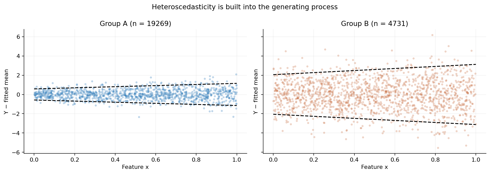
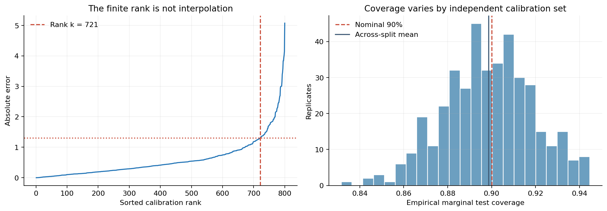
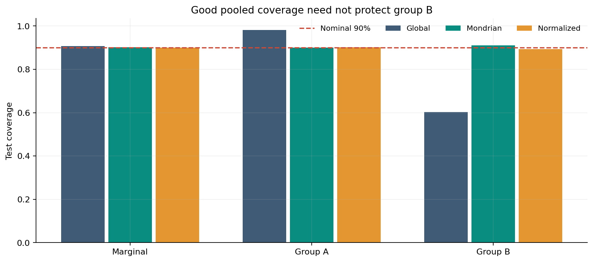
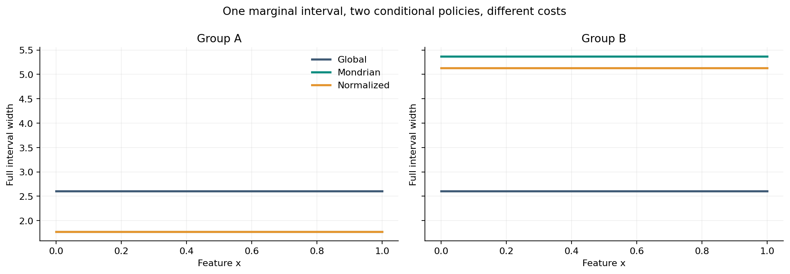
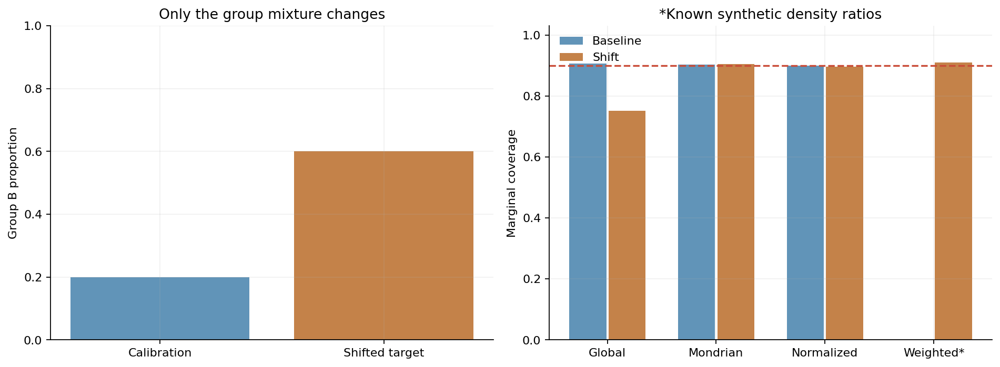
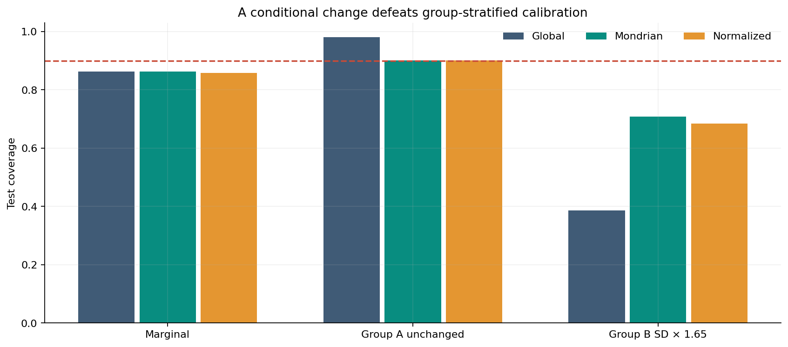
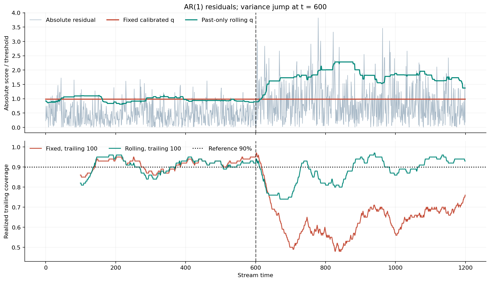
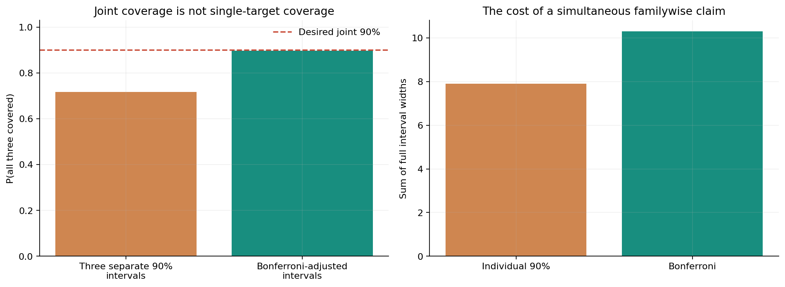

# A 90% Interval Is Not a Promise

## Conformal Prediction Under Distribution Shift

*The mathematics of calibrated uncertainty, the limits of marginal coverage, and what happens when the people, machines, or processes we predict begin to change.*

*By Diogo Ribeiro*

---

We frequently speak about uncertainty as if its label tells us how to use it. A forecast comes with a 90% interval, an experiment reports a 95% confidence level, a classifier assigns 80% probability to a positive class, and a planning system converts those numbers into decisions. The numbers look similar. Their meanings are not.

Consider a system predicting how long an operation will take. It serves two classes of jobs. Most are relatively predictable. A smaller class has much more variable processing times. The team builds a reasonably accurate mean predictor, calibrates intervals, and reports 90% coverage on a holdout set. Management considers the uncertainty problem solved.

But what does the 90% refer to?

If the system covers 98% of routine jobs and only 60% of complex ones, the overall figure can still look excellent. If complex jobs become the majority next quarter, the same interval can fail badly even when the relationship between job features and processing times has not changed. If the machinery changes, the relationship itself might change; no amount of historical calibration can magically protect against an arbitrary new response distribution.

This is the problem I want to examine. Not because conformal prediction is defective, but because it is unusually clear about the conditions under which its statements are true. A mathematical guarantee is most useful when we can also say where it stops.

Conformal prediction offers a distribution-free route to prediction sets with finite-sample *marginal* coverage under an exchangeability assumption. In regression, these sets can be intervals. In classification, they can be collections of labels. The method is attractive because the prediction model can be almost anything: linear regression, a random forest, a neural network, a forecasting model, or a complicated ensemble. Calibration is applied to the errors or other nonconformity scores produced by that model. [Vovk, Gammerman and Shafer (2005)](https://link.springer.com/book/10.1007/b106715); [Lei et al. (2018)](https://www.stat.cmu.edu/~ryantibs/papers/conformal-jasa.pdf).

The attraction is also a source of confusion. If the model is unrestricted and the uncertainty statement is distribution-free, it is tempting to read 90% as an operational promise for every situation. It is not. The theorem has a sampling experiment behind it, an event it covers, and a set of assumptions that must remain intelligible after the model is deployed.

In this article, I use an original, fully reproducible Python experiment to separate six questions:

1. How does the exact finite-sample calibration rank produce the coverage guarantee?
2. Why can pooled coverage be close to 90% while an important group is severely undercovered?
3. What do group-specific and normalized conformal intervals actually repair?
4. What survives when the covariate population changes, and what fails when the conditional response law changes?
5. Why is temporal recalibration a useful response to drift but not automatically a new theorem?
6. Why do three separate 90% intervals not provide 90% simultaneous coverage?

The plots are generated from a synthetic population whose true conditional mean and variance are known by construction. There are no purchased datasets, hidden transformations, field measurements, or unreported model-selection steps. The source, notebook, eight figures, tests, and ten machine-readable tables are in the [reproducibility companion](README.md). The numbers below are the realized results of the stated experiment, not measurements from a real business.

## 1. What a prediction interval is supposed to predict

An interval around an estimated mean is not necessarily an interval for a new observation. This distinction comes before conformal methods.

Suppose a regression model estimates the conditional mean

\[
\mu(x)=\mathbb E[Y\mid X=x].
\]

If we ask how uncertain that estimated mean is, we are concerned with estimation error. More training data, under suitable assumptions, can make the estimate of the mean increasingly precise. If instead we ask where a new response is likely to fall, we must also account for the irreducible variability of \(Y\) around \(\mu(x)\).

A narrow confidence interval for the mean can coexist with a wide prediction interval for an individual outcome. A hospital can estimate the average waiting time for a patient category accurately and still be unable to predict any particular patient's waiting time closely. A manufacturing plant can estimate mean throughput accurately and still experience substantial cycle-time variability. Conflating these uncertainty objects is not a minor terminology problem: it can change staffing, safety stock, maintenance schedules, and service commitments.

Conformal prediction starts from a candidate prediction rule \(\widehat\mu(x)\) and constructs a set \(\mathcal C(x)\) intended to cover the *future response* \(Y\). The classical split-conformal result concerns the probability

\[
\Pr\left\{Y_{\mathrm{new}}\in\mathcal C(X_{\mathrm{new}})\right\}
\geq 1-\alpha.
\]

Set \(\alpha=0.10\). The intended statement is that a new pair drawn exchangeably with the calibration sample has at least 90% *marginal* probability of being covered, averaging over the randomness of the calibration data and the future observation, conditional on the independently trained prediction rule.

Notice the absence of a condition such as \(X_{\mathrm{new}}=x\). The theorem is not saying

\[
\Pr\left\{Y_{\mathrm{new}}\in\mathcal C(x)
\mid X_{\mathrm{new}}=x\right\}\geq 0.90
\quad\text{for every }x.
\]

It does not generally provide that stronger statement. In rich nonparametric settings, finite-sample distribution-free conditional coverage with informative intervals faces fundamental limitations, not merely a lack of clever algorithms. See [Barber et al., *The Limits of Distribution-Free Conditional Predictive Inference*](https://doi.org/10.1093/imaiai/iaaa017).

Nor does the marginal theorem assert that any particular fixed calibration set will yield at least 90% empirical coverage over a small finite deployment window. Across independent repetitions of the full calibration-and-test experiment, the probability statement is meaningful. A specific week can fall below it. That is not a paradox; it is the difference between probability over a repeated experiment and one realized sample path.

One can design prediction sets for other objectives: conditionally calibrated discrete groups, asymmetrically distributed responses, multiple outputs, or sequences with dependence. However, changing the target usually changes either the method, the assumptions, or the form of the guarantee. This is exactly where mathematical precision matters.

## 2. Building a population where the failure is visible

To isolate the issue, we do not need an impressive predictive model. In fact, using a complicated learner would make the lesson less clear. We deliberately build an essentially correctly specified mean model and make the problem live in the conditional uncertainty.

Every synthetic observation contains one continuous feature \(X\in[0,1]\) and a binary group \(G\in\{0,1\}\). Call the groups A and B. Under the original data distribution,

\[
X\sim U(0,1),\qquad
\Pr(G=1)=0.20,
\]

and \(X\) is independent of group. The conditional mean is

\[
\mu(x,g)=1.25\sin(2\pi x)+0.50\cos(4\pi x)+0.30g.
\]

The outcome follows

\[
Y=\mu(X,G)+\sigma(X,G)Z,\qquad Z\sim N(0,1),
\]

with

\[
\begin{aligned}
\sigma(x,0)&=0.35+0.35x,\\
\sigma(x,1)&=1.25+0.65x.
\end{aligned}
\]

Group B is only one-fifth of the population, but its conditional noise scale is substantially larger. The distribution remains simple enough that we know whether any observed coverage error is coming from model misspecification, group composition, or actual drift.

The mean model uses the four features

\[
(1,\ \sin(2\pi X),\ \cos(4\pi X),\ G).
\]

We estimate its coefficients by ordinary least squares using 4,000 training observations. Its functional form matches the generating mean. There is ordinary finite-sample estimation error, but no omitted nonlinear term in the mean specification. This matters: poor conditional coverage does not require an incompetent point predictor.

We then draw 800 independent calibration observations. The model and all scale estimates are frozen before calibration. The baseline evaluation population consists of another 24,000 newly drawn observations. Those response values are not used to select the calibration threshold, fit the model, or adapt the interval. Separate random streams are used throughout, and all subsequent comparisons are defined independently of the reported outcomes.

For the finite-sample experiment, we also repeat fresh calibration and evaluation draws 400 times, using 240 calibration observations and 1,300 evaluation observations per replicate. The smaller calibration size is intentional: it exposes the randomness of the selected threshold without disguising it beneath a huge sample.

Finally, we construct two deployment alternatives. In the first, the proportion of group B rises from 20% to 60%, but \(Y\mid X,G\) does not change. In the second, the group proportions stay fixed while the conditional standard deviation for group B is multiplied by 1.65. These two types of shift have different mathematical consequences. Treating both as generic *data drift* loses precisely the information needed to decide whether a correction is valid.



*Figure 1.* Observed residuals against \(X\), split by group, alongside the known synthetic Gaussian \(\pm1.645\sigma(x,g)\) reference bands. The two populations use the same mean-model family but very different conditional response scales. These reference curves are *generating-model quantities*, not conformal intervals.

The plot makes the statistical difficulty concrete. Prediction is not only a question of finding the expected value. We need to understand how uncertainty changes with the covariates, how the calibration population weights those covariates, and whether that weighting remains applicable later.

## 3. The finite-sample rank is the core of the theorem

Split conformal prediction can be understood without a complicated optimization procedure. After fitting a model on a training split, define a nonconformity score for each independent calibration point. For symmetric regression intervals, we use absolute residuals:

\[
S_i=\left|Y_i-\widehat\mu(X_i,G_i)\right|,
\quad i=1,\ldots,n.
\]

Let \(S_{(1)}\leq\cdots\leq S_{(n)}\) be the sorted calibration scores. The correct rank for target miscoverage \(\alpha\) is

\[
k=\left\lceil(n+1)(1-\alpha)\right\rceil.
\]

The threshold is

\[
\widehat q=
\begin{cases}
S_{(k)},&k\leq n,\\
+\infty,&k>n.
\end{cases}
\]

The interval for a new covariate value is simply

\[
\mathcal C(x,g)=
[\widehat\mu(x,g)-\widehat q,\
\widehat\mu(x,g)+\widehat q].
\]

That is the algorithm. Its apparent simplicity should not hide the care required in implementation. An ordinary percentile routine may interpolate between two scores, returning a threshold smaller than the conformal rank requires. When \(n\) is small and \(\alpha\) is very small, the required rank can exceed the sample size; the formally safe prediction set is then unbounded. Returning the largest observed score instead would quietly change the guarantee.

Why does the rank work? Under exchangeability of the calibration and future pairs, and with a prediction model trained independently of them, the \(n+1\) scores are exchangeable. If their distribution is continuous, the future score's rank among all \(n+1\) scores is uniform. The event that the future score does not exceed the calibrated order statistic thus has probability at least \(k/(n+1)\), with the usual finite-sample rounding. Ties make the standard non-randomized construction conservative, not anticonservative, when coverage is defined inclusively.

In the continuous-score, finite-threshold case,

\[
1-\alpha
\leq
\Pr\{Y_{\mathrm{new}}\in\mathcal C(X_{\mathrm{new}})\}
\leq 1-\alpha+\frac{1}{n+1}.
\]

This upper refinement is not a blanket theorem when scores have atoms and ties; the reliable general statement is the lower marginal bound. Also observe what the argument did *not* use: Gaussian errors, a correct mean model, homoscedasticity, or a consistent learning algorithm. It used exchangeability of calibrated scores and the independence of model fitting from calibration. A bad mean predictor can still achieve marginal coverage by producing very wide intervals.

The code implements the rank explicitly:

```python
def split_threshold(scores: np.ndarray, alpha: float = 0.1) -> float:
    """Return the finite-sample conformal score threshold."""
    if scores.ndim != 1 or len(scores) == 0:
        raise ValueError("scores must be a nonempty vector")
    rank = int(np.ceil((len(scores) + 1) * (1 - alpha)))
    if rank > len(scores):
        return float("inf")
    return float(np.partition(scores, rank - 1)[rank - 1])
```

The public implementation also validates score finiteness, nonnegativity, types and the admissible range of \(\alpha\). The short extract above is to expose the mathematical mechanism.



*Figure 2.* Left: sorted scores from the 800-point calibration set, marking the exact rank and threshold. Right: realized test coverage under 400 fresh calibration/test repetitions. The mean is 0.8986 for this finite seeded simulation. The variability of individual runs is not an error in the theorem; the theorem addresses the corresponding repeated-data probability.

The two panels should be read together. A guarantee about how a rank behaves under random sampling does not mean that a single selected threshold is the one and only correct answer for every future batch. The rank is correct *because of the sampling construction*, not because the selected numerical width is an immutable property of the world.

This is where a practical validation report should include at least three quantities: the nominal target, the realized coverage on a new evaluation set, and the variability or uncertainty of that realized estimate. A solitary label saying *90% calibrated* conceals too much.

## 4. The subgroup problem: marginal coverage can be honest and insufficient

We now apply the global interval to the original synthetic population. The realized pooled holdout coverage is 90.64%, comfortably close to the requested target. If a dashboard displayed only this statistic, the prediction system might receive a green indicator.

The subgroup results are radically different.

| Baseline method | What it calibrates | Observed result |
| --- | --- | ---: |
| Global | One absolute-residual threshold across all calibration points | 90.64% pooled; **60.24% for group B** |
| Mondrian | Separate thresholds for groups A and B | **91.04% for group B** |
| Normalized | One threshold on errors divided by frozen training-estimated group scales | Adaptive widths; pooled near the target |

The global interval is calibrated to the mixture. Because group A dominates that mixture and has relatively small residuals, a single threshold that delivers approximately 90% marginal coverage can be far too narrow for group B. The original global threshold is 1.3024 in the synthetic response units. The group-specific thresholds are approximately 0.8848 for group A and 2.6862 for group B.

Nothing in the pooled theorem says these numbers are wrong. The global method is doing the job it was mathematically asked to do: calibrating a new draw from the *combined* population. The difficulty is that the operational use case may care about reliability within a group, not only the average over groups.



*Figure 3.* The pooled percentages tell a nearly identical story for all three interval policies, whereas the group B percentages differ materially. Here, the global method's group B coverage is about 60%, despite its pooled coverage exceeding 90%.

In a real decision system, group membership might represent hospital departments, production lines, device families, geographic areas, patient pathways, demand regimes, or classes of industrial orders. These are not interchangeable ethically or economically. Undercoverage in a rare, high-cost group can be a more serious operational failure than mild overcoverage in the majority group.

Suppose an organization uses the upper endpoint of a predicted service-time interval to reserve capacity. If 40% of group B outcomes lie above or below the global band rather than the planned 10%, the capacity rule is underprotecting precisely the jobs whose variability matters most. A high overall coverage statistic does not neutralize this asymmetry.

This suggests a necessary step in uncertainty evaluation: define the decision unit before deciding what coverage should mean. Are we reserving capacity for a random order from the current mixture, or committing to a service standard within each product family? Are we making a portfolio-wide decision, or a decision for a specific patient? Neither objective is automatically superior. They are different mathematical questions.

### A subtle point about changing representation

Even if two groups enjoy the same measured coverage today, the reported pooled statistic can change tomorrow if their relative frequencies change. Conversely, an aggregate statistic can remain stable while one subgroup deteriorates and another improves. The composition of the evaluation population is therefore part of the meaning of the metric.

This is related to broader problems of aggregation and transportability. The same numeric average does not imply the same conditional performance. Calibration cannot be assessed responsibly without knowing what distribution has been averaged over.

## 5. Two repairs, and two different statements

One response to heteroscedasticity is to use **Mondrian conformal prediction**: partition the calibration sample into predefined categories, then compute a separate conformal threshold for each category. For group \(g\), write

\[
\widehat q_g=
S^{(g)}_{\left(\left\lceil(n_g+1)(1-\alpha)\right\rceil\right)},
\]

with the same \(+\infty\) convention when the rank exceeds \(n_g\). The resulting interval uses \(\widehat q_g\) for a new case in group \(g\).

Under exchangeability *within each discrete group*, and with the prediction rule fitted separately, we obtain the group-conditional marginal statement

\[
\Pr\{Y_{\mathrm{new}}\in\mathcal C(X_{\mathrm{new}},g)
\mid G_{\mathrm{new}}=g\}\geq1-\alpha
\]

for a group whose calibration sample satisfies the construction. This is a valid and useful strengthening. It does not mean conditional coverage at every value of continuous \(X\), nor does it survive an arbitrary change in \(Y\mid X,G\).

The calibration sizes matter. Our 800-point calibration split contains 162 points from group B. That is enough to produce a useful finite threshold here, but the group-specific estimate will be noisier than one based on thousands of observations. More finely dividing categories makes the problem worse. A group with very few observations may need a huge or infinite conservative threshold. A system that advertises detailed group-conditional coverage while quietly pooling tiny categories or changing their definitions is making a promise that the mathematics might not support.

A second response is **normalized conformal prediction**. Instead of giving every residual the same raw scale, first estimate a positive scale \(\widehat\sigma(x,g)\) using the *training* sample. Calibrate normalized residual scores

\[
R_i=
\frac{|Y_i-\widehat\mu(X_i,G_i)|}
{\widehat\sigma(X_i,G_i)}.
\]

Using the pooled conformal threshold \(\widehat q_R\) on these normalized scores produces intervals

\[
\mathcal C_{\mathrm{norm}}(x,g)
=
[\widehat\mu(x,g)-\widehat q_R\widehat\sigma(x,g),\
\widehat\mu(x,g)+\widehat q_R\widehat\sigma(x,g)].
\]

In our experiment, \(\widehat\sigma\) is the training residual RMS within each group, approximately 0.5394 for A and 1.5616 for B. These estimates are frozen before calibration. This separation is important: learning group scales from the same calibration outcomes and then treating the resulting scores as if nothing had been fitted can invalidate the simple exchangeability argument. More elaborate algorithms can address data reuse, but they need their own justification.

Normalized intervals adapt to the observed heteroscedastic structure and can dramatically improve group performance. Yet their default theorem remains **pooled marginal coverage** for the normalized score construction. The choice to normalize does not by itself produce an exact group-conditional guarantee. Good observed subgroup performance in this simulation is empirical evidence for *this model and population*, not a new distribution-free theorem for every subgroup.



*Figure 4.* Global intervals have one width; Mondrian intervals have one width per group; normalized intervals use scales estimated only on training data. The deliberately simple group-RMS scale is constant in \(x\) within each group. A richer independently fitted scale model could vary with \(x\), but the corresponding marginal-vs-conditional distinction would remain.

Wider intervals are not free. They can cause additional stock, delayed release, excessive staff reservations, reduced automation, or unnecessary inspections. Conversely, intervals that are too narrow transfer risk to the people affected by the resulting decision. Coverage evaluation should therefore accompany a width, utility, or loss analysis. A system can achieve very high coverage by issuing uselessly wide bands; it does not follow that those bands support good decisions.

The selection between global, group-specific, and normalized policies is thus not simply a contest for the highest coverage bar. It is a choice about the probability statement the organization actually needs, the granularity it can support with data, and the downstream cost of being wrong.

## 6. Covariate shift: the same conditional process, a different population

We now change the population while leaving the conditional response law alone. In the calibration population, group B accounts for 20% of observations. In the deployment population, it accounts for 60%. The continuous feature \(X\) remains uniformly distributed within each group, and the conditional mean and conditional noise distribution remain exactly the same:

\[
P_{\mathrm{deployment}}(Y\mid X,G)
=P_{\mathrm{calibration}}(Y\mid X,G).
\]

But the marginal distribution of covariates changes:

\[
P_{\mathrm{deployment}}(G=1)=0.60
\ne P_{\mathrm{calibration}}(G=1)=0.20.
\]

This is a particularly clean example of *covariate shift*. The response mechanism is unchanged for each feature-and-group combination. What changes is the frequency with which we encounter those combinations. In production, it might correspond to a new mix of orders, a shift toward a different customer segment, a busier hospital specialty, or changed demand across stores. We need not imagine anything breaking mechanically to see a prediction guarantee stop transferring.

For any interval policy \(\mathcal C\), write its group-specific coverage as

\[
c_g=\Pr\{Y\in\mathcal C(X,G)\mid G=g\}.
\]

With two groups, the pooled coverage is

\[
c_{\mathrm{pooled}}=(1-p_B)c_0+p_Bc_1.
\]

The arithmetic is obvious but often absent from monitoring dashboards. If \(c_0\) is near one and \(c_1\) near 0.60, changing \(p_B\) from 0.20 to 0.60 changes the aggregate even if both conditional coverage rates remain unchanged. The very distribution over which the original theorem averaged is no longer the deployment distribution.

The actual experiment shows pooled global coverage falling from 0.9064 at baseline to **0.7513** in the shifted mixture. We have not modified the mean model, added noise, altered the group-specific relationship, or maliciously selected hard examples. We have only changed the proportion of a group already present in the data.

The group-stratified Mondrian policy is much more stable under this particular change. Because its coverage statement is separately tied to the group and within-group response law, merely reweighting groups does not destroy the relevant within-group exchangeability. Here, a future group B observation still follows the same conditional data-generating process as the calibration B observations.

That difference is important: the protection is not *invariance to all distribution shift*. It is invariance to a specific kind of shift, under a specific conditional stability assumption and the use of the same predefined grouping rule.

### An oracle weighted alternative

There is a second solution for covariate shift. If the target-to-calibration density ratio is known, conformal calibration can be weighted to reflect the target population. Tibshirani, Barber, Candès and Ramdas formalize this approach in [*Conformal Prediction Under Covariate Shift*](https://proceedings.neurips.cc/paper/2019/file/8fb21ee7a2207526da55a679f0332de2-Paper.pdf).

Let \(Z=(X,G)\) denote the covariates and suppose the conditional outcome mechanism remains invariant. Define

\[
w(z)=
\frac{p_{\mathrm{deployment}}(z)}
{p_{\mathrm{calibration}}(z)},
\]

assuming common support and positive finite ratios wherever needed. In our constructed population, because the distribution of \(X\mid G\) is unchanged, the ratio reduces to a group weight:

\[
w(g)=
\begin{cases}
(1-0.60)/(1-0.20)=0.50,&g=0,\\
0.60/0.20=3.00,&g=1.
\end{cases}
\]

The weight for a B observation is six times the weight for an A observation. Intuitively, calibration residuals from group B become more influential because group B is more common in the target distribution. But the exact conformal construction is not just a weighted percentile of the historical scores.

For a proposed test point with group \(g_*\), the finite-sample weighted distribution must include the prospective test point as an atom at \(+\infty\). With calibration scores \(S_i\), its weights are

\[
p_i(z_*)=
\frac{w(Z_i)}
{\sum_{j=1}^{n}w(Z_j)+w(z_*)},
\qquad
p_{\infty}(z_*)=
\frac{w(z_*)}
{\sum_{j=1}^{n}w(Z_j)+w(z_*)}.
\]

We take the \(1-\alpha\) quantile of the discrete distribution placing the masses \(p_i(z_*)\) at \(S_i\) and the mass \(p_{\infty}(z_*)\) at \(+\infty\). Notice that the threshold can depend on the new covariate value \(z_*\). Omitting the infinity atom generally changes the finite-sample validity calculation, even if the resulting implementation looks intuitively reasonable.

In our experiment, this **oracle weighted** construction achieves 0.9093 pooled coverage in the shifted target. That is a realized number for one seeded synthetic test population, close to the desired 90%.

The adjective *oracle* is essential. Here we know both group probabilities because we invented them. In an actual deployment, we would generally need to estimate the target density ratio, and estimation error could make the nominal finite-sample theorem inapplicable without additional assumptions and procedures. Extreme weights can also make the calibration effectively depend on very few historical points, producing unstable or infinite intervals. The simulation deliberately isolates the ideal known-ratio case; it does not claim an automatic data-driven fix.



*Figure 5.* Left: the controlled group-proportion intervention. Right: realized pooled coverage under the original and shifted populations. The weighted method uses the **true** synthetic density ratio, not an estimate learned from deployment data. Its baseline bar is intentionally absent because it was defined as a correction for the shifted target.

There is a useful lesson in this figure. A guarantee that depends on the distribution of incoming cases is an *operating condition*. Monitoring the feature population is therefore not just a separate machine-learning-engineering concern. It is part of determining whether the probability statement attached to a prediction interval remains applicable.

## 7. Conditional shift: when the process itself changes

Now consider a different deployment mechanism. Return the group mixture to its original 80% A and 20% B. Hold the mean response function fixed. Increase group B's conditional response standard deviation by 65%:

\[
\sigma_{\mathrm{new}}(x,1)
=1.65\,\sigma_{\mathrm{old}}(x,1),
\qquad
\sigma_{\mathrm{new}}(x,0)
=\sigma_{\mathrm{old}}(x,0).
\]

This is not merely a new proportion of old observations. The distribution \(Y\mid X,G=1\) is now different. A machine's variability might increase with wear, an industrial input may have become less consistent, a medical pathway might be subject to a new operational bottleneck, or the business may begin serving outcomes that are noisier even for previously familiar covariates.

When the conditional law changes, the old residual scores from group B are not exchangeable with the new group B residuals. The Mondrian theorem no longer applies to that new group distribution. Nor do we recover it by plugging the original group label into a fixed normalized-width formula. The change is in the conditional response itself, not in the marginal composition.

The results reflect that distinction. Under this controlled conditional shift, the originally calibrated Mondrian interval covers only **0.7078** of the new group B outcomes. The same method that achieved approximately 91% for B under the original population now misses almost 30% of the changed group's responses.



*Figure 6.* The group proportion stays at its baseline value, while the B response standard deviation rises by a factor of 1.65. The original interval thresholds are not refitted. Even group-specific calibration fails to maintain the previous coverage rate when the within-group response mechanism changes.

Would reweighting help? The covariate density ratio here is one: the covariate distribution has not changed. A weighted covariate-shift procedure has no information that distinguishes these two response laws. Reweighting old observations by their covariates cannot create unobserved examples of the new conditional noise distribution.

That does not mean recalibration is impossible. After sufficient labelled outcomes arrive from the changed process, we can form a new calibration sample reflecting the current law. Depending on the application, we may also refit the mean predictor, update the scale model, or redesign the score. But we must distinguish *detecting that recalibration is needed* from *claiming that an old guarantee already covers the new mechanism*.

This is also where operational cost enters. In a safety-critical setting, waiting for hundreds of new outcomes might be unacceptable. One may need conservative fallback policies, domain constraints, additional sensors, escalation rules, or explicit monitoring of the consequences of missed coverage. A theorem cannot supply domain knowledge that the data-generating process no longer contains.

## 8. Time changes everything—including the interpretation of calibration

So far the baseline experiments were constructed from independent observations. Many data-science applications are not like that. A production line has temporal dependence. Customer arrivals come in bursts. Queue lengths are correlated. A patient monitoring stream has cycles. Forecast errors can be serially dependent even when the marginal distribution looks stable.

For an iid calibration sample and an independent future draw, exchangeability is natural. For a time-ordered series, it often is not. Even when each score has the same marginal distribution, positive autocorrelation changes the joint distribution and invalidates the simple uniform-rank argument that treats the calibration scores and the next score as exchangeable.

To illustrate the difference between *adaptation* and *validity*, we generate an autoregressive residual series:

\[
e_t=\rho e_{t-1}
+\sqrt{1-\rho^2}\,\sigma_t\varepsilon_t,
\qquad
\varepsilon_t\overset{\mathrm{iid}}{\sim}N(0,1),
\]

with \(\rho=0.5\). The target innovation scale corresponds to a marginal standard deviation of 0.60 before time 600 and 1.05 after time 600, apart from the transient induced by the change. The series contains 1,200 observations.

A fixed threshold is computed beforehand from 800 independent baseline Gaussian calibration residuals. The stream itself is serially dependent, so even before the variance change we do *not* advertise the exact iid split-conformal theorem for the sequence. After the change, the threshold is both temporally stale and based on the wrong residual scale.

As a comparison, we construct a simple rolling procedure. Before predicting observation \(t\), it takes the 120 most recent *observed* absolute scores and uses the finite-sample conformal rank formula to select a new threshold. It then observes outcome \(t\) and adds the new score to history. This ordering avoids a common implementation mistake: using the current response to choose the interval that is supposed to predict that same response.

The rolling procedure reacts to variance growth. In the realized post-change period, the fixed threshold covers **0.6217**, while the rolling threshold covers **0.8750**. The improvement is visible, but the second number is not an exact guaranteed 90%. The rolling scores are dependent, the population changes, and the calibration window was chosen heuristically.



*Figure 7.* Top: absolute residuals, the fixed threshold, and a moving threshold based only on the previous 120 scores. Bottom: trailing realized 100-observation coverage. The dashed vertical line marks the variance change. The rolling method adapts more rapidly, but neither the figure nor the code proves conditional, online, or anytime coverage.

This distinction deserves emphasis because a plotting convention can be misread as a formal statement. A line fluctuating around 90% is not proof of 90% conditional coverage. A trailing window summarizes outcomes already observed; it does not bound the probability of the next error. A moving quantile estimates a recent score distribution; it does not become a mathematically valid online conformal algorithm solely by being updated frequently.

There is substantive research on time-ordered conformal methods, including [Gibbs and Candès, *Adaptive Conformal Inference Under Distribution Shift*](https://proceedings.neurips.cc/paper_files/paper/2021/hash/0d441de75945e5acbc865406fc9a2559-Abstract.html), and [Barber et al., *Conformal Prediction Beyond Exchangeability*](https://doi.org/10.1214/23-AOS2276). These works examine alternative algorithms, assumptions, and forms of coverage control under nonexchangeability. Our illustration is deliberately not an implementation of their full procedures. Calling it *adaptive conformal inference* in the formal sense would overstate what the code does.

For an operational monitoring system, I would ask four separate questions. Has the residual distribution changed? How quickly can a rolling method detect the change? What penalty do we pay for its additional width or overreaction? And which theoretical guarantee, if any, applies to our dependence and feedback structure? Answering only the second question is not enough.

## 9. Three 90% intervals do not make a 90% joint region

Many models produce more than one output. A monitoring model may jointly predict heart rate, respiration, and movement. A logistics model may predict demand for multiple products. A manufacturing model may estimate yield, energy use, and cycle time. It is tempting to give each output a separate interval labeled 90% and to treat the collection as a 90% prediction region for the whole system.

The logic is wrong.

Let \(A_j\) be the event that the interval for response \(j\) covers its next observed value. For three outputs, individual statements

\[
\Pr(A_j)\geq0.90,\qquad j=1,2,3,
\]

do not imply

\[
\Pr(A_1\cap A_2\cap A_3)\geq0.90.
\]

If the events happened to be independent and each had exactly 90% coverage, their joint coverage would be

\[
\Pr(A_1\cap A_2\cap A_3)=0.9^3=0.729.
\]

Dependence can make the joint probability different; the product is an illustration, not a universal identity. We need a simultaneous statement if the decision requires all three outputs to be covered together.

One elementary solution is Bonferroni. To target familywise miscoverage at most \(\alpha=0.10\), calibrate each of three outputs at level \(\alpha/3\). Then the union bound gives

\[
\begin{aligned}
\Pr\{\text{at least one miss}\}
&=\Pr(A_1^c\cup A_2^c\cup A_3^c)\\
&\leq\sum_{j=1}^3\Pr(A_j^c)\\
&\leq 3\left(\frac{\alpha}{3}\right)=\alpha.
\end{aligned}
\]

This does not require independence between outputs. It does require that each coordinate's conformal marginal coverage statement applies under the relevant calibration/test assumptions. The probability is still over the random calibration and future response vector, not an assertion that every fixed calibration realization will attain exactly the target.

In the simulation we generate three independent Gaussian response channels with different standard deviations. We form three ordinary 90% split-conformal intervals and, separately, three intervals calibrated at \(1-\alpha/3\). Calibration uses 700 independent response vectors and testing uses 28,000 new vectors. The realized joint coverage of the ordinary intervals is **0.7168**; the adjusted collection covers **0.8961**. The latter is just below 0.90 in this one realization, which does not contradict the unconditional finite-sample Bonferroni guarantee.



*Figure 8.* Left: the probability that all three intervals cover their respective outcomes. Right: the sum of their full widths. The Bonferroni adjustment greatly increases joint coverage, but it also requires wider bands.

Why not always use Bonferroni? It can be conservative, particularly when targets are strongly dependent or when high-dimensional simultaneous coverage is required. Joint nonconformity scores and structured multivariate prediction sets can sometimes be more efficient. The relevant point here is simpler: the decision maker must specify whether coverage is wanted for each coordinate or for the vector as a whole. No mathematical method can answer a question that has not been asked clearly.

## 10. From calibrated intervals to actual decisions

One recurring theme in statistical learning is the temptation to evaluate an intermediate object as if it were the final objective. An interval is an intermediate object. It becomes useful when translated into an action under some loss function.

Suppose an industrial planner reserves capacity \(a\) for an uncertain completion time \(Y\). Under-reserving capacity causes an expensive delay; over-reserving wastes a resource. A stylized expected loss might be

\[
\mathcal L(a,Y)
=c_{\mathrm{under}}(Y-a)_+
+c_{\mathrm{over}}(a-Y)_+,
\]

where \((u)_+=\max(u,0)\). The action minimizing expected loss is a conditional quantile whose level depends on the ratio of the two cost coefficients. There is no reason that level must be 90%; it could be much higher or lower. If the operational cost varies by group, one pooled coverage target may be especially hard to defend.

Conformal prediction does not erase this decision problem. It supplies a statistically structured set around a prediction under defined conditions. The next step is to decide whether the upper or lower endpoint, an entire set, a point forecast, or an alternative decision rule minimizes the relevant loss. Those choices also depend on whether the guarantee is marginal, group-specific, simultaneous, or something else.

Three often-confused performance dimensions should be reported separately:

**Coverage** asks how often the new outcome lies inside the proposed interval. Its unit is a probability or realized fraction. Coverage has to be tied to a distribution and an event.

**Efficiency** asks how large or costly the interval is. In regression, average width is a basic measure. For asymmetric intervals, their position matters as well. A method covering nearly all outcomes with unbounded intervals can satisfy a coverage target while being operationally useless.

**Decision quality** asks what happened after the interval was used. Did the staffing rule reduce delays? Did the inventory policy reduce expected shortage cost? Did wider uncertainty bands cause unnecessary escalation? A coverage metric alone cannot answer these questions.

This separation also protects against two common forms of overclaiming. First, describing conformal prediction as inherently robust to distribution shift is incorrect: the underlying theorem specifies the exchangeability or weighted-shift conditions needed. Second, describing marginal validity as *reliable for every user* attributes a conditional property to a statement that lacks it.

It is possible to have intervals that are mathematically valid, empirically wide, and economically poor. It is also possible to have an apparently accurate mean predictor whose intervals are operationally dangerous. Evaluation has to reach the decision stage.

### Who bears the undercoverage?

There is an additional organizational question. If a high-variance subgroup is undercovered, the group may bear disproportionate consequences: delayed service, unexpected workloads, false alerts, or failure to flag unusual outcomes. The ethical and commercial relevance depends on what the groups represent, and our synthetic experiment does not encode any real-world harm. But the mathematical diagnostic is general.

When an organization reports one pooled percentage, it is implicitly choosing to average over its current population mix. If that population mix has historical or institutional structure, the aggregate can reflect it. A properly scoped group-conditional analysis makes the averaging policy visible. It does not settle every fairness question, but it prevents one numerical mean from pretending to answer all of them.

## 11. A deployment checklist that makes the assumptions auditable

In a production ML system, I would make conformal coverage a documented service property with an explicit validity envelope. That requires more than a plot and a threshold.

1. **Name the prediction event.** Does the 90% refer to one future outcome, a family of future outcomes, a subgroup, a fixed horizon, or all possible times? Write the event mathematically when ambiguity matters.
2. **Record the calibration population.** Include dates, feature distributions, group proportions, exclusions, and the relevant selection process. An exchangeability assumption does not exist independently of the way observations enter the sample.
3. **Separate fitting from calibration.** Freeze the mean model and any learned normalization before the held-out scores are computed, unless using a method with a separate data-reuse justification.
4. **Implement the exact finite rank.** Test ties, very small calibration sets, invalid scores, and the infinity case. Store the calibration size and the chosen threshold alongside the model version.
5. **Evaluate coverage at the decision level.** Report overall, subgroup and, when relevant, simultaneous coverage. Attach intervals or uncertainty estimates to empirical rates rather than treating one test percentage as truth.
6. **Report width and cost.** An interval that is wider is not automatically better. Compare cost-weighted misses and operational consequences, and consider who pays them.
7. **Monitor covariate composition.** A new mix may invalidate a pooled guarantee even when conditional behavior remains unchanged. If using weighting, document how density ratios are obtained and whether their support and estimation conditions are plausible.
8. **Monitor labelled residuals.** Unlabelled feature drift does not reveal every conditional response change. Once outcomes arrive, monitor score distributions and realized coverage with appropriate uncertainty and delay.
9. **Distinguish drift adaptation from proof.** A rolling quantile, an online threshold, and a formally valid sequential conformal procedure are not interchangeable. Document the actual theorem, if any, for temporal dependence and the selection mechanism.
10. **Define fallback behavior.** If the deployment population falls outside the supported regime, decide whether to widen intervals, request additional data, route cases to human review, use a conservative policy, or temporarily suspend automatic decisions.

All ten items are testable in a reproducible workflow. They are also organizational commitments: a team needs to decide who owns the calibration population, who investigates drift, how often new labels become available, and what constitutes evidence of recovery. An interval without that governance is a number detached from its sampling experiment.

## 12. What this experiment does and does not establish

The eight plots support a carefully bounded conclusion: under the constructed baseline law, a pooled conformal interval has the intended approximate marginal behavior while severely undercovering a smaller high-variance group. Group-specific or scaled intervals alter the distribution of widths and observed subgroup coverage. A pure group-mixture shift damages the pooled interval; a known-ratio weighted method repairs the marginal target in this constructed covariate-shift setting. A change in the conditional noise law defeats old group-specific thresholds. A rolling historic-score heuristic adapts to temporal variance growth, but it does not prove online coverage. Three individually calibrated output intervals do not imply the same joint coverage level.

We must also state what was deliberately excluded:

- The population is synthetic, Gaussian conditional on covariates, and has a correctly specified mean basis. It is not evidence for a healthcare, transport, retail, or manufacturing deployment.
- Group membership is known and binary. Real applications may have overlapping, continuous, missing or unstable grouping variables.
- The normalized scale model is only a group RMS residual estimator. We do not compare flexible variance models, quantile regression learners, or adaptive-width learned interval architectures.
- Covariate weighting uses an oracle ratio known solely because the population was specified in code. It does not test density-ratio estimation under poor support, sample selection, or large weights.
- Concept shift changes group B variance by a chosen factor. Real conditional changes may involve the mean, tails, multimodality, censoring, new regimes, label policy, or sensor failure.
- The temporal example is one stationary-to-nonstationary AR(1) realization. Its moving window is an illustrative heuristic, not a substitute for sequentially valid methods.
- The multiple-output example uses three independent Gaussian channels. More complex dependence can change the efficiency of joint prediction-set methods.
- Every reported test fraction is one realized empirical frequency. The mathematical finite-sample statements concern appropriate probabilities over the relevant random calibration and test experiment.

These limitations are not a disclaimer added after the analysis. They are part of the analysis. Statistical arguments become useful when their assumptions are visible enough that another person can challenge them.

## 13. The interval is only as meaningful as its sampling story

I began with a familiar sentence: *we have a 90% prediction interval*. By itself, that sentence does not tell us what a decision maker needs to know. It omits the event being covered, the population being averaged over, the dependence assumptions, the cost of interval width, and the way future cases differ from calibration cases.

Conformal prediction gives us a powerful discipline. It makes a coverage statement attainable without assuming that the conditional response distribution is Gaussian or that the chosen prediction algorithm is correct. It also forces us to identify the source of that statement: exchangeability, a rank argument, and a precisely constructed score.

The moment we ask for more—coverage within every relevant group, transportability to a changed population, protection after the response law shifts, or simultaneous guarantees for several outcomes—the theorem must be revisited. Sometimes a group-specific rank suffices. Sometimes the exact covariate density ratio permits a weighted construction. Sometimes new labelled data are necessary. Sometimes no nontrivial distribution-free guarantee with the requested strength is available under the stated assumptions.

For me, the interesting part is not that 90% can fail. It is that we can explain *which* 90% was promised, *why* it failed to describe the decision we cared about, and *what additional assumptions* would make a stronger claim defensible.

Reliable data science is not the absence of uncertainty. It is the ability to say precisely what our uncertainty estimates mean—and when we need to stop trusting them.

---

## Reproduce the results

The self-contained companion contains:

- The [typed Python simulation and figure generator](analysis.py), with a fixed seed and separate train/calibration/test random streams.
- An [executable notebook](conformal_prediction.ipynb) demonstrating each major construction.
- The [eight original figures](figures/) referenced throughout this article.
- Ten [machine-readable result tables](results/), including calibration scores, split-level coverage, shift comparisons, temporal scores and multi-target coverage.
- [Mathematical and reproduction tests](tests/test_analysis.py) plus a focused CI workflow.
- A [methodology README](README.md) with commands, assumptions, and a compact result table.

From the project directory:

```bash
python -m pip install -r requirements.txt
python analysis.py
python -m unittest discover -s tests -v
```

The optional `python analysis.py --quick` command generates suffixed smoke-test artifacts and does not overwrite full publication outputs. All numerical claims in this article can be matched to the full seeded run, not to unavailable organizational data.

## References

1. Vovk, V., Gammerman, A., and Shafer, G. (2005). *Algorithmic Learning in a Random World*. Springer. [Book](https://link.springer.com/book/10.1007/b106715). Foundational algorithmic treatment of conformal prediction and exchangeability.
2. Lei, J., G'Sell, M., Rinaldo, A., Tibshirani, R. J., and Wasserman, L. (2018). “Distribution-Free Predictive Inference for Regression.” *Journal of the American Statistical Association*, 113(523), 1094–1111. [Author-hosted article](https://www.stat.cmu.edu/~ryantibs/papers/conformal-jasa.pdf). Split conformal and related regression constructions.
3. Romano, Y., Patterson, E., and Candès, E. (2019). “Conformalized Quantile Regression.” *NeurIPS 2019*. [Proceedings paper](https://proceedings.neurips.cc/paper/8613-conformalized-quantile-regression.pdf). Adaptive asymmetric regression intervals and quantile-based methods, distinct from the symmetric score used here.
4. Tibshirani, R. J., Barber, R. F., Candès, E. J., and Ramdas, A. (2019). “Conformal Prediction Under Covariate Shift.” *NeurIPS 2019*. [Proceedings paper](https://proceedings.neurips.cc/paper/2019/file/8fb21ee7a2207526da55a679f0332de2-Paper.pdf). Density-ratio weighted conformal calibration under the covariate-shift assumption.
5. Barber, R. F., Candès, E. J., Ramdas, A., and Tibshirani, R. J. (2021). “The Limits of Distribution-Free Conditional Predictive Inference.” *Information and Inference: A Journal of the IMA*, 10(2), 455–482. [DOI](https://doi.org/10.1093/imaiai/iaaa017). Why exact informative conditional coverage cannot be assumed without structural restrictions.
6. Gibbs, I., and Candès, E. (2021). “Adaptive Conformal Inference Under Distribution Shift.” *NeurIPS 2021*. [Proceedings paper](https://proceedings.neurips.cc/paper_files/paper/2021/hash/0d441de75945e5acbc865406fc9a2559-Abstract.html). Temporal adaptation with formal objectives different from the heuristic rolling quantile in this study.
7. Barber, R. F., Candès, E. J., Ramdas, A., and Tibshirani, R. J. (2023). “Conformal Prediction Beyond Exchangeability.” *Annals of Statistics*, 51(2), 816–845. [DOI](https://doi.org/10.1214/23-AOS2276). Quantifying and responding to nonexchangeable data.
8. Angelopoulos, A. N., and Bates, S. (2023). “Conformal Prediction: A Gentle Introduction.” *Foundations and Trends in Machine Learning*, 16(4), 494–591. [DOI](https://doi.org/10.1561/2200000101). General overview and connections across regression, classification, and distribution-free uncertainty estimation.

*Suggested Medium tags: Data Science · Statistics · Machine Learning · Conformal Prediction · Uncertainty Quantification*
