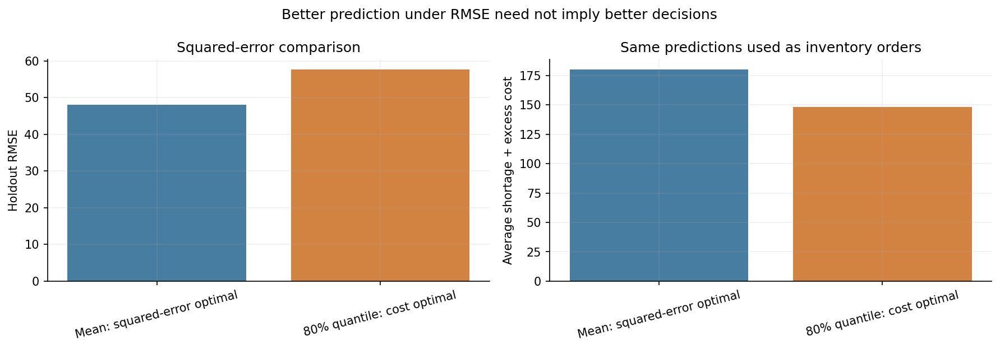
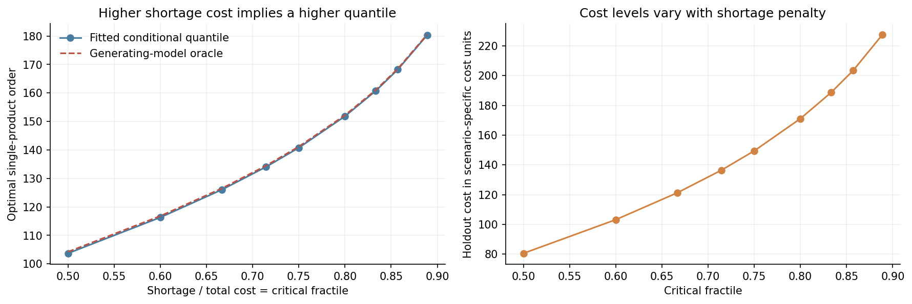
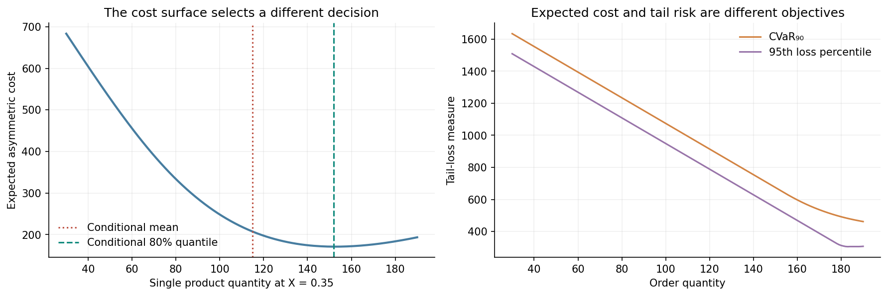
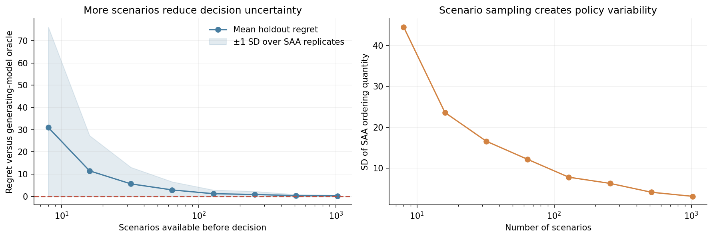
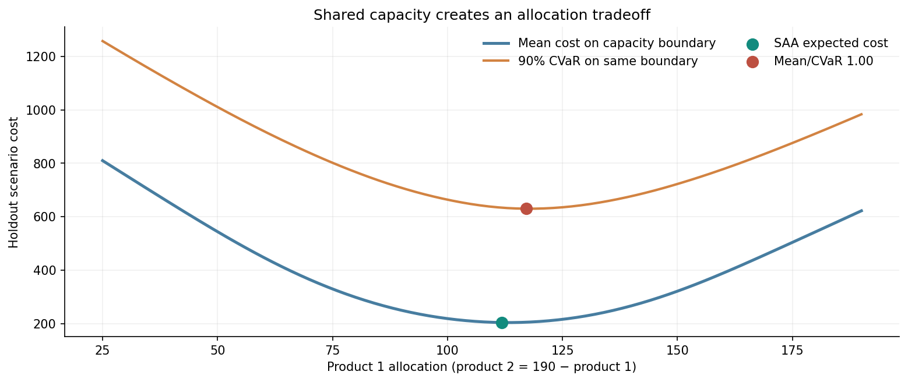
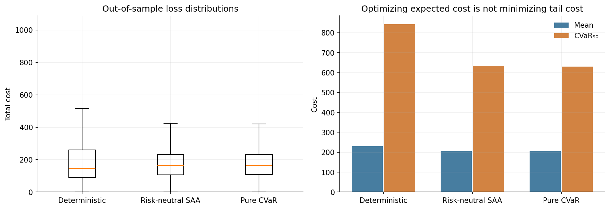
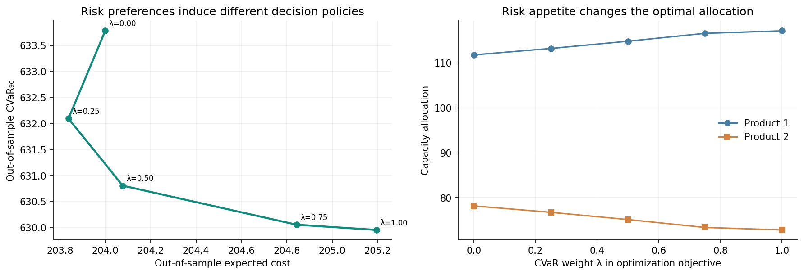
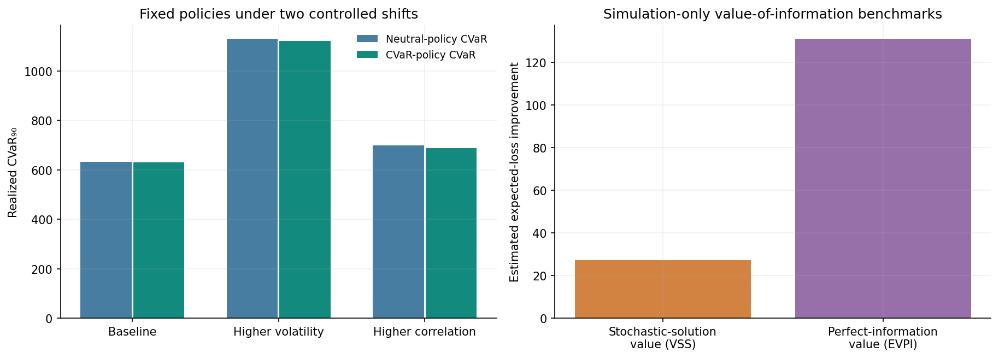

# The Lowest RMSE Is Not the Best Decision

## From Prediction to Stochastic Optimization

*Why accurate forecasting can create expensive policies—and how asymmetric loss, scenario optimization, risk measures, and the value of information change what we should build.*

*By Diogo Ribeiro*

---

Two models predict demand for the same product. The first has lower root mean squared error. It tracks the conditional mean well, stays close to the center of the observed demand distribution, and would probably win the forecasting benchmark. The second systematically predicts larger quantities. Its squared error is worse.

Which model should a company use to decide how much inventory to order?

That question cannot be answered from RMSE alone. If the penalty for running out of stock is much larger than the cost of carrying one excess unit, the second model may lead to lower operational cost. Its upward deviation from the mean is not necessarily an undesirable statistical bias. It may be exactly what the optimization problem requires.

This is the distinction between *prediction quality* and *decision quality*. It sounds elementary when stated in words. In deployed data science, however, the distinction is surprisingly easy to lose. Model teams are often rewarded for reducing MAE, RMSE, cross-entropy, or some other objective that ends at the prediction. The people making decisions face capacity limits, asymmetric losses, delayed feedback, tail events, and competing resources. The mathematical problem on their side of the interface is different.

The gap becomes particularly important in manufacturing and supply-chain systems. A plant does not purchase demand estimates; it purchases raw materials, allocates machine time, chooses safety stock, and schedules workers. A distribution center does not maximize forecast accuracy; it attempts to meet customer demand with finite capacity and uncertain lead times. A hospital does not directly optimize a predictive score; it allocates beds, staff, and equipment under uncertainty. The forecasts may be good inputs to those decisions. They are not the decisions themselves.

Modern research calls some approaches to closing this gap *predict-then-optimize*, *decision-focused learning*, and *task-based learning*. The literature is substantial: [Ban and Rudin](https://doi.org/10.1287/opre.2018.1757) connect machine learning with the newsvendor problem; [Elmachtoub and Grigas](https://doi.org/10.1287/mnsc.2020.3922) study prediction losses informed by downstream optimization; and [Donti, Amos, and Kolter](https://proceedings.neurips.cc/paper/2017/file/3fc2c60b5782f641f76bcefc39fb2392-Paper.pdf) consider learning models for a stochastic optimization task.

I want to approach the question as a mathematician and data scientist, through an experiment whose assumptions are visible. We will not claim to have implemented every method in that literature. Instead, we will construct two transparent problems from first principles:

- A single-product ordering decision in which the conditional mean is good for RMSE but the conditional quantile is better for asymmetric cost.
- A two-product allocation problem with a common capacity constraint, solved using sample-average approximation and linear programming, then evaluated under risk-sensitive objectives and distribution shift.

From these examples we can examine decision regret, scenario uncertainty, conditional value-at-risk, capacity interactions, dependence, and the value of information. The resulting eight figures, typed Python code, executable notebook, tests, and ten CSV tables are included in the [reproducibility companion](README.md). Every dataset is generated synthetically. No organization-specific operational data or confidential inventory figures are used.

The central question is simple:

> If a forecast is only valuable because it changes an action, why do we evaluate the forecast without evaluating the action?

## 1. Predicting the mean solves one optimization problem—not every problem

The squared-error objective has a familiar mathematical solution. Let \(X\) denote observed features and \(Y\) a future response. A predictor \(f(X)\) is evaluated through

\[
R(f)=\mathbb E[(Y-f(X))^2].
\]

Provided the relevant second moments exist, the conditional decomposition is

\[
\begin{aligned}
\mathbb E[(Y-a)^2\mid X=x]
&=\operatorname{Var}(Y\mid X=x)\\
&\quad+\left(\mathbb E[Y\mid X=x]-a\right)^2.
\end{aligned}
\]

Therefore,

\[
a_{\mathrm{MSE}}^*(x)=\mathbb E[Y\mid X=x].
\]

The conditional mean is the Bayes action for squared error. This is an important and valid result. The trouble starts when we silently substitute a different loss function while keeping the same recommended action.

Suppose \(a\) is an inventory quantity and \(Y\) is demand. If the organization incurs a shortage cost \(c_u\) per unfilled unit and an excess cost \(c_o\) per unsold unit, the relevant loss is

\[
L(a,Y)=c_u(Y-a)_++c_o(a-Y)_+,
\]

where \((z)_+=\max(z,0)\). Its expected value has no reason to be minimized by the mean. A very inaccurate underestimate can be costly when lost sales, contractual penalties, or production interruptions dominate the cost of surplus. Conversely, when spoilage or storage dominates, the best action may lie *below* the mean.

For continuous conditional demand distribution \(F(y\mid x)\), we can differentiate the expected cost with respect to \(a\). The derivative of the expected shortage term is \(-[1-F(a\mid x)]\), while the derivative of the expected excess term is \(F(a\mid x)\). Hence

\[
\frac{\partial}{\partial a}\mathbb E[L(a,Y)\mid X=x]
=-c_u[1-F(a\mid x)]+c_oF(a\mid x).
\]

At an interior optimum,

\[
F(a^*\mid x)=\frac{c_u}{c_u+c_o}.
\]

The fraction on the right is the **critical fractile**. We obtain the newsvendor solution

\[
\boxed{
a^*(x)=F^{-1}\left(\frac{c_u}{c_u+c_o}\mid x\right).
}
\]

This is a first-order condition for a convex optimization problem. At atoms or flat portions of a discrete distribution, a suitable generalized quantile solves the same convex problem; uniqueness is not required.

The contrast with the conditional mean is immediate. If \(c_u=c_o\), the critical fractile is \(1/2\): a conditional median minimizes expected absolute loss. If \(c_u=8\) and \(c_o=2\), the critical fractile is \(8/10=0.80\). Our decision should be based on the 80th conditional percentile, not the mean.

This does not make RMSE mathematically wrong. It makes RMSE the answer to a different optimization question.

### An important distinction between prediction and prescription

We should be precise about what is being compared. A model trained for the conditional mean and a model trained for a conditional quantile estimate *different statistical functionals*. The 80th percentile is expected to have worse squared error than the mean for a skewed conditional distribution. It can nevertheless be the better ordering quantity under asymmetric costs. This is not evidence that quantile estimation is universally superior as a predictor or that an inaccurate forecasting algorithm is preferable. It is evidence that **the scoring rule must match the decision problem**.

The broader literature goes further by using downstream optimization regret directly in model fitting. Our demonstration isolates the estimand mismatch before adding complications such as end-to-end gradients or differentiating through a solver. The mathematical point does not depend on a neural network.

## 2. An entirely synthetic demand process

We construct a positive, skewed single-product demand distribution with an interpretable feature \(X\in[0,1]\). Its logarithm follows

\[
\log D\mid X=x
=m(x)+\sigma Z,\qquad
Z\sim N(0,1),
\]

where

\[
m(x)=\log(85)+0.20\sin(2\pi x)+0.12x,
\qquad \sigma=0.45.
\]

The corresponding conditional demand mean is

\[
\mathbb E[D\mid X=x]=\exp\left(m(x)+\frac{\sigma^2}{2}\right),
\]

and its conditional \(\tau\)-quantile is

\[
Q_\tau(D\mid X=x)=
\exp\left(m(x)+\sigma\Phi^{-1}(\tau)\right).
\]

Here \(\Phi^{-1}\) is the standard-normal quantile function. The lognormal family is used because it gives a positive and asymmetrically distributed outcome, closed-form moments and quantiles, and a clean way to verify the statistical calculations. It is not presented as a universal demand law.

We fit a three-coefficient linear model for log-demand using the features \(1\), \(\sin(2\pi X)\), and \(X\). The functional form matches the generating log-mean. The residual standard deviation is estimated using the same independent training set of 5,000 observations; no evaluation outcomes are used to estimate it. From the fitted lognormal approximation we derive both the conditional mean prediction and the conditional 80th-percentile prediction.

An independent holdout sample of 60,000 observations evaluates two policies:

1. Order the estimated conditional mean.
2. Order the estimated 80th percentile.

Neither policy is allowed to observe the new demand before choosing the order. Both use the same trained model parameters and the same held-out demand outcomes for evaluation. Their differences are attributable to the choice of predictive functional and resulting decision, not to different train/test splits.

The full seeded run gives:

| Quantity | Estimated mean policy | Estimated 80th-percentile policy |
| --- | ---: | ---: |
| Holdout RMSE | 48.042 | 57.611 |
| Mean decision loss at shortage cost 8, excess cost 2 | 179.897 | 148.383 |
| Mean order quantity | 100.325 | 132.572 |

The point forecast that wins on squared-error accuracy loses on the decision objective. The quantile policy reduces the realized average asymmetric cost by approximately 17.5% relative to the mean policy in this synthetic experiment. This is not a prospective business savings forecast; it is the difference between two explicitly constructed policies under an equally explicit loss.



*Figure 1.* Left: mean forecasting is preferable under RMSE, the metric it is designed to optimize. Right: the conditional 80th percentile creates a lower average shortage-plus-excess cost, the metric relevant to this ordering problem. Both evaluations use exactly the same independent test outcomes.

The conclusion is stronger than the observation that algorithms sometimes disagree about rankings. In the population limit, with a correctly specified model, the mean remains optimal for squared error while the 80th percentile remains optimal for the stated asymmetric newsvendor loss. More training data does not eliminate the mismatch because it is not fundamentally a parameter-estimation problem.

An important practical consequence follows. If we build a forecasting system to supply decisions, model evaluation should include the cost of the actions those predictions induce. RMSE may remain useful as a diagnostic. It should not necessarily be the final acceptance criterion.

## 3. A loss function changes the optimal quantile

The critical-fractile rule lets us understand how business assumptions enter the mathematical solution. A cost function is not an innocent implementation detail. It carries assumptions about shortages, excess, waste, delay, and the relative value of competing resources.

Holding \(c_o=2\) fixed, increasing the shortage penalty \(c_u\) changes the target quantile:

\[
\tau(c_u)=\frac{c_u}{c_u+2}.
\]

If \(c_u=2\), \(\tau=0.50\). If \(c_u=8\), \(\tau=0.80\). If \(c_u=16\), \(\tau\approx0.889\). The optimal order increases even though the demand distribution has not changed at all. It changes because the decision maker has expressed a different loss asymmetry.

The Python experiment evaluates multiple shortage penalties for a fixed feature value \(x=0.35\). For each ratio, we calculate the fitted conditional quantile and a **simulation-only oracle quantile** obtained from the known generating parameters. A separate 35,000-observation holdout sample at that fixed feature value is used for the displayed cost calculation.



*Figure 2.* Left: the fitted optimal quantity increases with the critical fractile, closely tracking the generating-model oracle. Right: the realized expected cost changes as the shortage penalty itself increases. Because this second panel changes the loss function, its cost levels should not be interpreted as a comparison of policies under a single fixed objective.

The last point matters. If the shortage penalty doubles, a higher numerical expected cost may simply reflect that each shortage has become twice as expensive. We cannot rank the quality of two decisions using loss numbers computed under different objective functions. The quantities are meaningful only relative to their specified costs.

### The role of the loss surface

For the original \(c_u=8\), \(c_o=2\) case, we can hold the feature \(X=0.35\) fixed, evaluate a grid of candidate order quantities, and compute the expected cost of each on the same independent demand sample. The shape is convex, as the positive-part loss suggests.

For this feature value, the fitted conditional mean order is approximately 114.903, while the fitted 80th percentile is approximately 151.836. The former is closer to the center of the distribution. The latter is closer to the minimum of the asymmetrically weighted cost surface.



*Figure 3.* Left: the asymmetric cost surface with the fitted conditional mean and cost-relevant quantile marked. Right: two distinct tail-loss summaries across the same candidate quantities. This is a controlled, one-feature slice through the demand model.

The right panel introduces another complication. A policy that minimizes expected loss might still generate an undesirable loss distribution. The expected cost integrates all outcomes. It does not say how concentrated the risk is in the largest losses, nor whether the organization can survive those losses.

If a disruption would interrupt an entire production line, expected loss may not adequately represent the relevant business tolerance. We might want to examine high-percentile loss, conditional value-at-risk, probability of capacity violation, or other measures with explicit operational interpretations. These objectives cannot be inferred from RMSE.

There is a danger in the opposite direction too. Choosing a high quantile without a justified shortage penalty is not automatically prudent. Excess stock can be expensive, especially when inventory depreciates, expires, or crowds out another product. The model should not decide how much risk the organization is willing to take. It should expose how a stated risk preference changes the decision.

## 4. From a fitted distribution to sample-average approximation

The single-product case is analytically convenient because the optimal quantile can be written explicitly. Most operational problems do not have closed-form solutions.

Demand can have many dimensions. The feasible actions can be constrained by labor, machine hours, cash, minimum order sizes, storage, transport, and supplier agreements. The loss may include nonlinear penalties or recourse decisions. In such settings, even if the full probability model is conceptually specified, its expected value may be difficult to calculate.

**Sample-average approximation**, usually abbreviated SAA, replaces the intractable expectation by an average over simulated or historically resampled scenarios. For a decision \(a\) and random outcome \(\xi\),

\[
a^*=\arg\min_{a\in\mathcal A}\mathbb E[L(a,\xi)]
\]

is approximated by

\[
\widehat a_N
=\arg\min_{a\in\mathcal A}
\frac{1}{N}\sum_{s=1}^{N}L(a,\xi_s),
\]

where \(\xi_1,\ldots,\xi_N\) are scenarios sampled from the assumed predictive distribution. This is a stochastic optimization technique, not a new forecasting metric. Its consistency and finite-sample behavior depend on the scenario process and regularity conditions; see the theoretical treatment in [Shapiro, Dentcheva and Ruszczyński](https://epubs.siam.org/doi/10.1137/1.9781611976595.ch1) and the SAA literature, including [Kleywegt, Shapiro and Homem-de-Mello](https://epubs.siam.org/doi/10.1137/S1052623499363220).

### The SAA solution is itself random

For our one-product newsvendor problem, minimizing the empirical asymmetric loss leads to an empirical critical-fractile quantile. At finite \(N\), this order quantity changes from one scenario sample to another.

We make that variability visible by drawing 90 independent scenario samples at each size

\[
N\in\{8,16,32,64,128,256,512,1024\}.
\]

Each sample produces an ordering decision. We then evaluate the decision on a separate, fixed holdout population at \(X=0.35\). Because the generating conditional demand distribution is known, we can also compare the SAA decision with the oracle critical-fractile quantity. The quantity labeled *regret* is the evaluated loss difference from this oracle decision.

For \(N=8\), the mean estimated regret is approximately 30.97 in the synthetic cost units, with substantial variability across scenario replicates. For \(N=1024\), the mean falls to approximately 0.20. The SAA quantity's standard deviation also decreases from about 44.54 to 3.09.



*Figure 4.* The left panel shows mean independently evaluated regret and a one-standard-deviation descriptive band across 90 scenario samples. The right shows how much the chosen order quantity varies across those samples. The band is not a confidence interval or a formal uniform regret bound.

The pattern is what we should expect under a stable, correctly specified sampling model: more scenarios reduce the randomness of the empirical objective. But the curve is not guaranteed to decrease monotonically at every sample size or for every finite realization. The experiment uses independent scenario sets at each size, so local irregularities are ordinary Monte Carlo fluctuations.

More importantly, the result depends on sampling from the right distribution. If the scenarios represent a demand law that no longer applies to the deployment population, adding more samples can make us increasingly precise about the wrong problem. Statistical convergence and operational validity are separate requirements.

SAA also clarifies why a downstream optimization can amplify some predictive errors while ignoring others. A small change near a decision boundary may switch the optimal action, whereas a larger error far from that boundary may leave the action unchanged. That observation motivates optimization-aware model-training losses, although we do not implement the full algorithms of those papers here.

## 5. Two products, one resource: the geometry of a shared capacity constraint

The one-product problem illustrates the difference between a conditional mean and a loss-relevant quantile. But a factory rarely chooses each quantity independently. Products compete for raw materials, machine time, storage space, and working capital. An individually reasonable safety stock for every product can be collectively infeasible.

Consider two products whose uncertain demands are denoted by the random vector \(D=(D_1,D_2)\). We choose the vector \(q=(q_1,q_2)\) *before* demand is observed. For each product we impose the same positive-part cost structure as before, but allow product-specific penalties:

\[
L(q,D)=\sum_{i=1}^{2}
\left[c_{u,i}(D_i-q_i)_+
+c_{o,i}(q_i-D_i)_+\right].
\]

Our synthetic factory has a common production capacity of 190 units. Each unit of either product uses one unit of that capacity, so the feasible set is

\[
\mathcal Q=\{q\in\mathbb R_+^2:q_1+q_2\leq190\}.
\]

The nominal marginal demand means are 90 and 70 units. We take shortage costs \(c_u=(8,6)\) and excess costs \(c_o=(2,3)\). These are arbitrary synthetic cost units, not estimates from any business. Under these asymmetries, product 1 has a stronger incentive to avoid shortages than product 2.

If there were no shared constraint, we could choose the appropriate marginal newsvendor quantile separately for each product. Capacity changes the structure: increasing \(q_1\) can prevent an increase in \(q_2\). The relevant question is no longer merely whether either forecast is accurate. It is what marginal value the next available unit of capacity creates in each product.

### A correlated, positive-demand scenario model

We generate two positive demand marginals using lognormal laws, with log-scale standard deviations 0.34 and 0.44. Their log means are calibrated so that the arithmetic demand means remain exactly 90 and 70 under the model. Dependence is introduced through a Gaussian copula with correlation parameter \(\rho=0.65\). Conceptually, we first generate correlated standard-normal variables and then transform each marginal into its lognormal demand.

This is deliberately a more interesting construction than drawing two independent product demands. In actual manufacturing, shared seasonality, promotions, disruption events, or economic activity can move several products together. An inventory policy that considers only separate marginal forecasts may omit important joint-tail behavior.

The correlation parameter belongs to the *latent Gaussian variables*. It should not be misreported as the Pearson correlation of the transformed demands. A Gaussian copula provides a convenient dependence mechanism; it does not establish that real product-demand tails follow a Gaussian copula.

We draw 240 scenarios for optimization and a separate 70,000-scenario test population. All policies are optimized without access to test outcomes. That split is central: a solver can fit stochastic scenarios just as a prediction model can fit training data. We therefore need out-of-sample decision evaluation.

### The linear-programming formulation

The expected-cost SAA problem is

\[
\begin{aligned}
\min_{q\geq0}\quad&
\frac1N\sum_{s=1}^N\sum_{i=1}^2
\left[c_{u,i}(d_{si}-q_i)_+
+c_{o,i}(q_i-d_{si})_+\right],\\
\text{subject to}\quad&q_1+q_2\leq190.
\end{aligned}
\]

It can be written as a linear program. Introduce nonnegative shortage variables \(u_{si}\) and surplus variables \(v_{si}\) for every scenario and product:

\[
\begin{aligned}
\min_{q,u,v}\quad&
\frac1N\sum_{s=1}^N\sum_{i=1}^{2}
\left(c_{u,i}u_{si}+c_{o,i}v_{si}\right),\\
\text{subject to}\quad&
u_{si}\geq d_{si}-q_i,\qquad
v_{si}\geq q_i-d_{si},\\
&u_{si},v_{si}\geq0,\qquad
q_1,q_2\geq0,\qquad
q_1+q_2\leq190.
\end{aligned}
\]

The nonnegative slack variables implement the positive-part expressions because the objective assigns them positive costs. The same \(q_1\) and \(q_2\) appear in *every* scenario. This enforces **nonanticipativity**: we do not get to choose tomorrow's production allocation after seeing tomorrow's demand. Scenario-specific slack describes realized shortages and surpluses, not a clairvoyant production decision.

This distinction is essential when reading stochastic-optimization examples. An optimization that lets the decision vector change separately for every demand realization can look dramatically better while solving an operationally impossible problem. Recourse actions are legitimate only when they represent actions actually available after uncertainty is revealed. Our simple model includes no second-stage replenishment, transfers, or emergency purchases.

### The capacity frontier is not a forecast plot

For a transparent visual comparison, we evaluate decisions along the boundary \(q_1+q_2=190\), from a strong preference for product 2 to a strong preference for product 1. At each allocation we estimate average asymmetric loss and a tail-risk summary on the common holdout population.



*Figure 5.* The horizontal axis transfers one unit of production from one product to the other while preserving the 190-unit capacity limit. The mean-cost minimum and tail-risk behavior are calculated from the same held-out demand scenarios. This is a line through feasible decisions, not a statistical confidence interval and not a complete two-dimensional uncertainty surface.

The mean-based deterministic policy chooses \(q=(90,70)\). That uses only 160 of 190 available units. Its holdout average cost is approximately 231.272. By contrast, the risk-neutral SAA linear program selects

\[
\widehat q_{\mathrm{SAA}}=(111.806,\ 78.194),
\]

which uses the full capacity and has holdout average cost approximately 204.000. The observed reduction is roughly 11.8% relative to the deterministic mean-based policy. The comparison is informative, but it blends two deliberate changes: accounting for asymmetric costs and using the available shared capacity. It is not an isolated causal estimate of the benefit of adding a solver.

Notice also what did *not* happen. The solver did not find a more accurate point forecast. It found an action that better translates the assumed distribution and costs into a feasible allocation. A probabilistic model can be imperfect and still enable useful decisions, but its misspecification remains a source of operational risk.

## 6. Evaluate a policy where it will be used, not where it was optimized

Forecast accuracy is usually evaluated on data omitted from model fitting. Optimization deserves the same discipline. The scenarios used to approximate an expected-loss function are effectively an optimization sample. Tuning risk weights, constraints, and model parameters on the same outcomes used to declare victory creates a second channel for overfitting.

Our policy evaluation holds demand scenarios fixed across policies in order to use a paired comparison. Every tested policy sees the identical 70,000 realized demand vectors; only the precommitted allocation changes. That avoids attributing independent Monte Carlo fluctuations to policy changes. It does not, however, convert simulation into causal evidence about a real supply chain.

Let \(q^{\mathrm{ref}}\) denote an implementable reference policy. A convenient measure of decision performance is its expected **policy regret** relative to another feasible policy \(q\):

\[
\mathcal R(q;q^{\mathrm{ref}})
=\mathbb E[L(q,D)]-\mathbb E[L(q^{\mathrm{ref}},D)].
\]

Regret is a difference in the loss units that the organization actually cares about. It can be positive or negative depending on the reference. If the reference is the population optimizer in the same feasible set, theoretical regret is nonnegative. If the reference is a finite-sample SAA estimate, there is no such universal sign guarantee for comparisons among other estimated policies.



*Figure 6.* The policies are evaluated on a holdout distribution independent of the 240 optimization scenarios. The deterministic mean allocation has a larger mean cost and substantially larger upper-tail loss than the main stochastic allocations. Estimated regret is measured against the evaluated risk-neutral SAA reference, not against an unknown exact population optimum.

The deterministic policy has 90%-CVaR approximately 843.469, compared with 633.779 for the risk-neutral stochastic allocation. These numbers quantify the average of the worst tenth of synthetic cost realizations, subject to the precise empirical CVaR definition described below. They are not probabilities of bankruptcy, defect rates, or contractual service-level guarantees.

The fact that one policy improves both average loss and tail loss is not mysterious. An inefficient allocation can be dominated by another. There is no need for a trade-off until we compare reasonably optimized policies along an actual risk preference.

### Three validation layers

For a real deployment, I would separate three validation layers instead of reporting a single headline score:

1. **Statistical validity.** Check calibration, bias, distributional fit, uncertainty coverage, and whether predictive features would truly be available at the decision time.
2. **Decision validity.** Measure realized asymmetric cost, service levels, constraint violations, utilization, and decision regret against predeclared operational baselines.
3. **Economic validity.** Include implementation and switching costs, supplier terms, lead times, workforce constraints, risk exposure, and the cost of obtaining or refreshing the information used by the policy.

Even this three-layer evaluation is only credible if its samples respect time order and data availability. A random train/test split can leak future seasons into earlier operational decisions. Simulation is useful to test a mechanism, but real-world policy assessment needs time-based or genuinely prospective validation, with careful treatment of interventions and feedback.

More prediction data are not always the highest-value next investment. A better cost model, an improved constraint representation, or a modest increase in available capacity can outweigh a small RMSE reduction. Conversely, a precise objective built on the wrong costs can produce confidently bad decisions.

## 7. From expected cost to conditional value-at-risk

Minimizing expected cost is a rational objective when losses are aggregable, risk tolerance is represented adequately by expectation, and there are no special penalties for extreme events. Industrial decisions often violate one or more of these assumptions. A shortage that halts a production line may cause secondary consequences that are not linear in the number of missing units. A company facing limited liquidity might care about the tail of the distribution even if the average is acceptable.

One coherent way to make that concern explicit is conditional value-at-risk, or CVaR. For a loss random variable \(Z=L(q,D)\) and confidence level \(\alpha\in(0,1)\), the Rockafellar–Uryasev representation is

\[
\operatorname{CVaR}_{\alpha}(Z)
=\min_{\eta\in\mathbb R}
\left\{\eta+\frac{1}{1-\alpha}
\mathbb E[(Z-\eta)_+]\right\}.
\]

For a continuous distribution, CVaR at level 0.90 can be interpreted as the mean loss in the worst 10% of outcomes. More carefully, the optimization representation handles atoms or ties at the quantile as well. This is why we use the mathematical definition rather than relying exclusively on a verbal 'average of the tail' description.

For \(N\) equally weighted scenarios, the epigraph introduces \(\eta\) and nonnegative variables \(z_s\), constrained by

\[
z_s\geq L(q,d_s)-\eta,\qquad z_s\geq0.
\]

The empirical CVaR objective is

\[
\eta+\frac{1}{(1-\alpha)N}\sum_{s=1}^Nz_s.
\]

In our two-product problem, the scenario loss \(L(q,d_s)\) is already represented by the linear shortage and excess slack variables, so these additional constraints preserve linearity. We solve the following family of linear programs:

\[
\min_{q\in\mathcal Q}
\bigl(1-\lambda\bigr)\widehat{\mathbb E}[L(q,D)]
+\lambda\,\widehat{\operatorname{CVaR}}_{0.90}[L(q,D)],
\qquad \lambda\in[0,1].
\]

At \(\lambda=0\), we minimize estimated mean cost. At \(\lambda=1\), we minimize empirical 90%-CVaR. Intermediate weights combine two cost quantities with the same units. They express a chosen risk preference; they are not parameters learned from RMSE. The underlying approach follows [Rockafellar and Uryasev](https://sites.math.washington.edu/~rtr/papers/rtr179-CVaR1.pdf).

### A measured rather than assumed trade-off

We optimize five policies using \(\lambda\in\{0,0.25,0.50,0.75,1\}\) on the same 240 planning scenarios. After optimization, all five are frozen and evaluated on the independent test sample.

| Risk weight \(\lambda\) | Product 1 | Product 2 | Holdout mean cost | Holdout CVaR 90% |
| ---: | ---: | ---: | ---: | ---: |
| 0.00 | 111.806 | 78.194 | 204.000 | 633.779 |
| 0.25 | 113.238 | 76.762 | 203.838 | 632.096 |
| 0.50 | 114.847 | 75.153 | 204.077 | 630.809 |
| 0.75 | 116.603 | 73.397 | 204.843 | 630.060 |
| 1.00 | 117.159 | 72.841 | 205.196 | 629.960 |



*Figure 7.* Increasing the training-objective weight on CVaR shifts capacity toward product 1 and generally reduces observed upper-tail cost. The plotted points are independently evaluated, finite-scenario policy estimates; their connected trace is not certified as the population mean–CVaR Pareto frontier.

There is a useful wrinkle in the table. At \(\lambda=0.25\), we observe a slightly *lower* mean cost than at \(\lambda=0\), even though \(\lambda=0\) was optimized for mean cost. That is not a mathematical contradiction. The policies were optimized using only 240 scenarios. The risk-neutral policy minimizes their *training-scenario* mean loss, not the exact population mean. The independent 70,000-scenario evaluation need not preserve that training ordering. Small differences can also reflect holdout Monte Carlo error.

In a fully known population with an exact mean-optimal solution, another feasible policy cannot have strictly lower population expected cost. We should not turn a finite-sample irregularity into a story about violating optimization theory. Nor should we assume that every increment in the CVaR weight improves out-of-sample CVaR: there is estimation error, and finite samples need not trace an exact frontier.

The pure CVaR policy raises the estimated mean cost from 204.000 to 205.196 while reducing 90%-CVaR from 633.779 to 629.960. These differences are small relative to the variability of individual losses. They illustrate how to state the competing objectives and evaluate them; they do not, on their own, establish economically meaningful risk protection.

This is also **not distributionally robust optimization**. We optimize a risk measure under a specified scenario distribution. We do not optimize against an ambiguity set of alternative probability laws, as in the robust-optimization framework reviewed by [Bertsimas, Brown, and Caramanis](https://epubs.siam.org/doi/10.1137/080734510). Tail sensitivity and distributional robustness are different properties.

## 8. Distribution shift changes the decision problem itself

An inventory allocation can be optimal under one demand law and inadequate under another. This is more than the standard observation that forecasting error changes over time. A change in volatility, dependence, cost asymmetry, or production capacity can change the location of the decision optimum even if average demand remains exactly the same.

To isolate these mechanisms, we freeze every policy trained under the original scenario distribution. We then evaluate its losses in two new synthetic populations. We never silently re-optimize the actions using outcomes from the changed populations.

Our first stress test increases each product's conditional lognormal standard deviation by a factor of 1.45, while recalibrating the log means so that the arithmetic marginal means remain 90 and 70. This is a **mean-preserving volatility change**, not an increase in expected demand. A point-forecasting dashboard focused on mean predictions could miss the change entirely.

With higher variance, both extreme shortages and large excesses become more likely for a given fixed allocation. Under the stress population, the risk-neutral SAA allocation's mean cost rises from approximately 204.000 to 305.850, while its 90%-CVaR rises from 633.779 to 1129.744. The pure-CVaR-trained allocation has stress-population mean cost approximately 303.921 and CVaR 1121.638. These are outcomes of the frozen policies; neither allocation was optimized for the new volatility.

The second stress test changes only the Gaussian-copula correlation parameter from 0.65 to 0.92. The marginal laws, including their means and variability, remain the same. The risk-neutral allocation's estimated 90%-CVaR rises to about 698.786, whereas the pure-CVaR allocation's CVaR is about 688.610.

Why does dependence matter if the sum of expected product losses is separable? We can use the linearity of expectation to show

\[
\mathbb E[L(q,D)]
=\sum_{i=1}^{2}\mathbb E[\ell_i(q_i,D_i)].
\]

For a *fixed* \(q\), each term depends only on the corresponding marginal distribution. Therefore changing the copula while preserving both marginals leaves the **population expected cost** exactly unchanged in this particular additive-loss model. It does not necessarily leave the *distribution* of total cost unchanged, because the two component losses can become large together. CVaR depends on that joint distribution.

This is a useful reason to separate marginal adequacy from joint-risk adequacy. Two multivariate models can agree on every individual product distribution and on the expected total cost of a fixed policy while disagreeing on the joint tail. Dependence modeling matters when a company has simultaneous shortage exposure, aggregate budget constraints, nonlinear penalties, or tail-risk objectives.

The tiny change in the simulated mean cost under the correlation shift—from approximately 204.000 to 203.657 for the risk-neutral policy—is therefore **Monte Carlo sampling variation**, not an asserted population effect of correlation on additive expected loss. Reporting it as an economic improvement would be a mistake.



*Figure 8.* The left panel evaluates the same decisions under a baseline distribution, a mean-preserving volatility increase, and higher dependence with fixed marginals. The right panel compares the mean-based, SAA, and hypothetical perfect-information benchmark costs. Both panels report finite-simulation estimates, not confidence guarantees.

The lesson is broader than inventory. In workforce planning, energy dispatch, credit limits, maintenance scheduling, and manufacturing quality control, a correct conditional mean does not imply a correct risk distribution. If operations are sensitive to joint extremes, monitoring mean forecast error alone is too narrow. We need to inspect relevant conditional quantiles, tail behavior, dependencies, and the decision's sensitivity to each.

Stress tests do not replace a robust guarantee. We deliberately chose two stress mechanisms and a fixed set of parameters. A real system would need to justify alternative laws using domain knowledge, historical evidence, and prospective risk controls. It might also need feasible fallback actions when the estimated demand law fails.

## 9. How much are uncertainty and perfect information worth?

Stochastic programming has two useful information-value concepts: the **value of the stochastic solution** (VSS) and the **expected value of perfect information** (EVPI). They sound similar but answer different questions.

Let \(Q\) be the same nonanticipative feasible set used in the stochastic program. Define the population expected-cost optimum

\[
z_{\mathrm{SP}}=\min_{q\in Q}\mathbb E[L(q,D)].
\]

Let \(q_{\mathrm{EV}}\) be a feasible decision constructed from an expected-value, deterministic approximation—for example, a policy using marginal mean demands. The expected result of this policy is

\[
z_{\mathrm{EEV}}=\mathbb E[L(q_{\mathrm{EV}},D)].
\]

The value of the stochastic solution is

\[
\operatorname{VSS}=z_{\mathrm{EEV}}-z_{\mathrm{SP}}\geq0,
\]

where the inequality assumes \(q_{\mathrm{EV}}\) belongs to the same feasible set. This difference measures how much expected cost we can avoid by using the stochastic optimization model instead of the specified deterministic policy. It is conditional on that choice of deterministic approximation and on the model being the right one.

Now imagine an impossible privilege: the planner sees the realized demand *before* choosing \(q\). The corresponding wait-and-see objective is

\[
z_{\mathrm{WS}}=\mathbb E\left[\min_{q\in Q}L(q,D)\right].
\]

The expected value of perfect information is

\[
\operatorname{EVPI}=z_{\mathrm{SP}}-z_{\mathrm{WS}}\geq0.
\]

The sign follows from an elementary inequality:

\[
\mathbb E\left[\min_{q\in Q}L(q,D)\right]
\leq \min_{q\in Q}\mathbb E[L(q,D)].
\]

If we can wait to observe the outcome before selecting a feasible action, we cannot do worse than a fixed action under the same loss. But the mathematical advantage does not mean perfect information is available, purchasable, or even definable in a realistic decision timeline.

In our seeded baseline simulation, the deterministic mean-based policy costs approximately 231.272, the risk-neutral SAA policy 204.000, and the hindsight benchmark 72.900. The resulting **estimated** values are

\[
\begin{aligned}
\widehat{\operatorname{VSS}}&=231.272-204.000=27.272,\\
\widehat{\operatorname{EVPI}}&=204.000-72.900=131.100.
\end{aligned}
\]

These are finite-sample comparisons involving a finite-scenario optimizer and finite holdout estimates. They are not exact population identities. In a theoretical calculation, \(z_{\mathrm{SP}}\) is the true stochastic optimum; in our calculation we substitute the independently evaluated SAA solution.

The hindsight benchmark is especially easy to misuse. It solves the allocation problem separately after each demand vector becomes known. That is a valid *information benchmark* but **not a deployable policy**. Claiming the full difference between 204.000 and 72.900 as available business savings would suggest we can obtain tomorrow's demand with certainty. We cannot.

What the comparison does provide is an economic frame for the information problem. VSS asks whether it is worth solving a distribution-aware problem instead of the chosen deterministic baseline. EVPI places an upper bound, under the model and loss, on what perfect advance demand information could be worth. The value of an actually available, imperfect forecast is a separate calculation and would require specifying its signals, costs, and decision timing.

This separation is valuable for research prioritization. A company considering a new data collection system can ask: which uncertainty does the information reduce, which decision changes as a result, and what is the maximum attainable improvement even under perfect information? Forecasting accuracy becomes one intermediate ingredient rather than the final answer.

## 10. Decision-aware learning is a further step—not what this notebook implements

So far we have used fitted predictive summaries and a separate optimization step. A different research direction asks whether the forecasting model itself should be trained against downstream decision regret.

In abstract form, suppose a model with parameters \(\theta\) transforms available features \(x\) into information needed by a solver. The solver returns a decision \(q_\theta(x)\). One can consider a learning objective such as

\[
\min_\theta
\frac1n\sum_{j=1}^{n}
L\bigl(q_\theta(x_j),y_j\bigr)
+\operatorname{penalty}(\theta),
\]

possibly with separate estimation of uncertainty, nested optimization, or surrogate gradients. The key difference from RMSE training is that the model is assessed by actions induced by its outputs. For a constrained decision, the mapping from predictions to optimal actions can be nonsmooth, set-valued, and sensitive to constraint activation. Those are mathematical difficulties, not mere software inconveniences.

[Elmachtoub and Grigas](https://doi.org/10.1287/mnsc.2020.3922) develop a framework for the predict-then-optimize setting, including an optimization-aware surrogate loss. [Donti, Amos, and Kolter](https://proceedings.neurips.cc/paper/2017/file/3fc2c60b5782f641f76bcefc39fb2392-Paper.pdf) study task-based end-to-end learning with stochastic optimization. These approaches address questions that go beyond our fitted lognormal summaries and SciPy linear programs.

There are reasons to be interested. Consider two forecasting errors of identical absolute size. One occurs where extra demand will be absorbed by abundant spare capacity; the other occurs where a single-unit perturbation changes which product receives a scarce machine slot. A decision-aware model may reasonably place greater learning emphasis on the second case. The gradients of a simple prediction loss would not inherently reflect that distinction.

There are also reasons for caution. If historical outcomes were influenced by previous inventory decisions, observed sales may be censored by stockouts and are not an unbiased record of latent demand. A model trained directly on observed decision losses can learn the limitations of the old policy rather than the demand process. More flexible objectives can increase overfitting, especially when operational losses are noisy, delayed, or imperfectly measured.

End-to-end training also does not remove the need to specify feasibility constraints, risk preferences, and cost coefficients. It can only optimize the problem given to it. A more powerful solver and a more expressive neural network cannot repair a missing labor constraint or a shortage penalty set to the wrong economic value.

Therefore the notebook makes a narrower, verifiable claim: **choosing a forecast according to an upstream scoring rule can differ from choosing an action according to its downstream loss**, and scenario optimization provides a practical way to evaluate and improve that action in a constrained system. It does not claim to implement SPO+, differentiate through the LP, or provide a new decision-focused training algorithm.

## 11. What I would put into production

The difference between prediction and optimization suggests a workflow that is more disciplined than fitting an estimator, choosing the lowest cross-validation RMSE, and handing the result to operations.

### Start with the decision contract

Before selecting an algorithm, define precisely what an operator controls. What can be ordered today, and when does uncertainty resolve? Which constraints are hard and which are soft? Can shortages be backordered, substituted, or repaired? Is the available capacity fixed, random, or shared across periods? Which costs are genuinely incremental? Without these definitions, a loss function can look precise while representing an irrelevant decision.

Define the benchmark as well: a current operational rule, a carefully constructed deterministic policy, or another implementable strategy. Avoid comparisons with hindsight actions disguised as deployable competitors.

### Validate probability information, not just point accuracy

If an objective depends on a quantile, assess quantile calibration and relevant coverage. If it depends on CVaR, assess the quality of the modeled loss tail and how stable it is under the available data. If multiple products interact, examine dependence in the appropriate scenarios. A predictive distribution is only operationally useful to the extent that its features and timing correspond to the decision environment.

Time-based evaluation is often essential. A factory making weekly production allocations should be validated using information snapshots available before each relevant production week. Using later realized demand, retrospective stock corrections, or future orders to construct the input features contaminates the exercise.

### Separate the sources of improvement

It is tempting to compare the final optimized policy with a naïve baseline and attribute every difference to machine learning. We should instead run controlled ablations:

- Hold the forecast fixed and change only the decision objective.
- Hold the objective fixed and change only the forecast or predictive distribution.
- Hold both fixed and change the feasible set or operational constraints.
- Compare mean-based, quantile-based, and stochastic policies on the same outcomes.
- Quantify runtime, maintenance cost, and feasibility alongside decision loss.

Our two-product experiment shows why: switching from \(q=(90,70)\) to the SAA allocation changes both resource utilization and cost-sensitive allocation. The result is valuable as a total-policy comparison but does not isolate each mechanism by itself.

### Monitor the resulting actions

Deployment monitoring should join statistics and operations. Track forecast calibration, relevant quantiles, conditional volatility, observed shortage and excess, capacity utilization, constraints near their boundaries, decision churn, realized policy loss, and the quality of scenario generation. Monitor the *population used for the decision*, not merely the population of records that happened to reach the reporting database.

Every optimization also needs a feasible fallback. Inputs may be missing. A solver may fail, time out, or return an infeasible status. A supplier may change a minimum order quantity while the model is running. Production software should check dimensional consistency, nonnegative allocations, resource constraints, solver termination, and the timestamp of the information behind every decision. A mathematical optimum is not an excuse for unsafe automation.

When a decision changes, the operator should be able to see what moved it: the forecast distribution, shortage cost, capacity, risk weight, or a new hard constraint. This interpretability is an argument for a transparent mathematical interface even when the upstream predictive model is complex.

## 12. Limits of the experiment and the broader conclusion

Our experiment is deliberately small enough that its assumptions, objective functions, and solver formulation remain inspectable. That makes the mechanism understandable, but also defines its limits.

The synthetic data come from correctly specified lognormal marginal laws and a chosen copula. The one-product conditional log mean belongs to the fitted model family. Real demand may exhibit intermittency, censoring, calendar effects, structural breaks, heavy tails, multiple regimes, or unpredictable supplier interventions. We use a single-period allocation model, not a multi-period inventory system with lead times, perishability, production setups, substitution, or inventory carryover. Our cost penalties are linear and chosen for demonstration, not estimated from accounting systems.

The two-product SAA model has only 240 planning scenarios. Although we use a much larger independent holdout for evaluation, the training-scenario approximation affects the chosen allocation and the apparent risk trade-off. The report provides seeded point estimates, not formal uncertainty intervals for every policy difference. Repeating the experiment over independent planning sets and reporting distributional uncertainty would be necessary before interpreting small differences such as the CVaR change between adjacent risk weights as reliable.

The stress tests are illustrative changes to volatility and dependence, not an exhaustive ambiguity set. CVaR is not a universal definition of risk; different enterprises have different liquidity, service-level, safety, and contractual obligations. No method can infer those priorities from historical RMSE.

Still, the central mathematical conclusion is robust to these modeling limitations. Squared-error loss selects a conditional mean. Asymmetric linear inventory cost selects a conditional quantile. Shared constraints couple actions across products. SAA turns predictive distributions into feasible decisions. CVaR changes the objective from expected loss to a different preference over loss distributions. Information-value calculations clarify what could be gained from uncertainty modeling and what remains unavailable without advance knowledge.

These are different mathematical questions. Treating them as interchangeable makes a data science system easy to benchmark and hard to trust.

My preference in industrial statistics is to start from the action and work backward: define the loss, define the constraints, model the uncertainty that changes the optimum, and evaluate the resulting policy independently. The forecast is important. The decision is what creates value—or cost.

---

## References and further reading

1. Ban, G.-Y., & Rudin, C. (2019). *The Big Data Newsvendor: Practical Insights from Machine Learning*. **Operations Research**, 67(1), 90–108. [https://doi.org/10.1287/opre.2018.1757](https://doi.org/10.1287/opre.2018.1757).
2. Bertsimas, D., Brown, D. B., & Caramanis, C. (2011). *Theory and Applications of Robust Optimization*. **SIAM Review**, 53(3), 464–501. [https://doi.org/10.1137/080734510](https://doi.org/10.1137/080734510).
3. Donti, P. L., Amos, B., & Kolter, J. Z. (2017). *Task-based End-to-end Model Learning in Stochastic Optimization*. **Advances in Neural Information Processing Systems 30**. [Conference paper](https://proceedings.neurips.cc/paper/2017/file/3fc2c60b5782f641f76bcefc39fb2392-Paper.pdf).
4. Elmachtoub, A. N., & Grigas, P. (2022). *Smart “Predict, then Optimize”*. **Management Science**, 68(1), 9–26. [https://doi.org/10.1287/mnsc.2020.3922](https://doi.org/10.1287/mnsc.2020.3922).
5. Kleywegt, A. J., Shapiro, A., & Homem-de-Mello, T. (2002). *The Sample Average Approximation Method for Stochastic Discrete Optimization*. **SIAM Journal on Optimization**, 12(2), 479–502. [https://doi.org/10.1137/S1052623499363220](https://doi.org/10.1137/S1052623499363220). The study here uses a continuous LP; this paper is included for broader SAA background, not as a direct derivation of the implementation.
6. Rockafellar, R. T., & Uryasev, S. (2000). *Optimization of Conditional Value-at-Risk*. **The Journal of Risk**, 2(3), 21–41. [Author manuscript](https://sites.math.washington.edu/~rtr/papers/rtr179-CVaR1.pdf).
7. Shapiro, A., Dentcheva, D., & Ruszczyński, A. (2021). *Lectures on Stochastic Programming: Modeling and Theory* (3rd ed.). SIAM / Mathematical Programming Society. [Publisher chapter](https://epubs.siam.org/doi/10.1137/1.9781611976595.ch1).

## Reproduce the results

The manuscript, full Python implementation, automated mathematical checks, executable notebook, eight original figures and ten source tables are in the [companion directory](README.md). From that directory:

```bash
python -m pip install -r requirements.txt
python analysis.py
python -m unittest discover -s tests -v
```

The shorter smoke run is `python analysis.py --quick`. Both variants use fixed random streams and independent model-fitting, optimization, and evaluation samples. All displayed business quantities are synthetic. Please reuse the methods where they fit, but do not reuse the illustrative cost coefficients as if they were empirical estimates.

