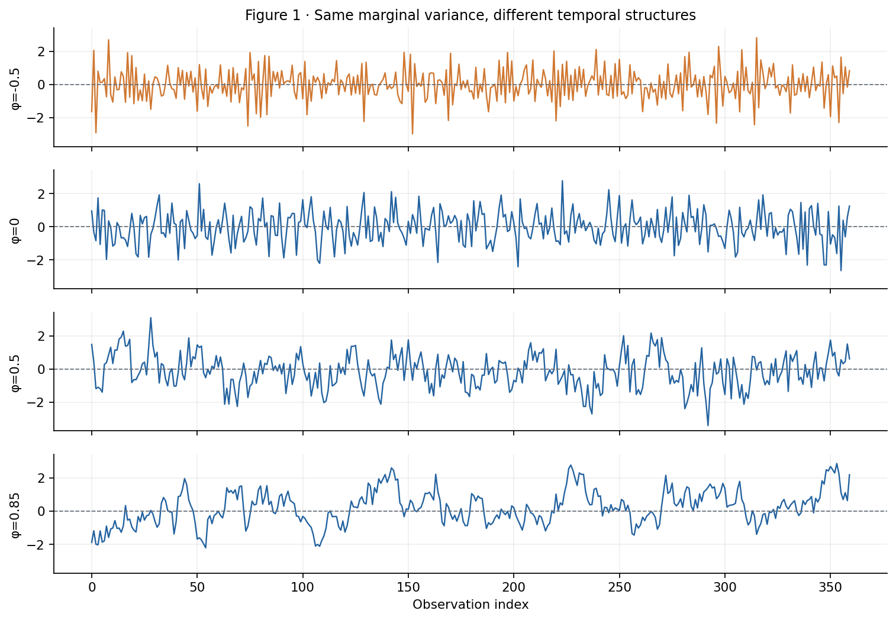
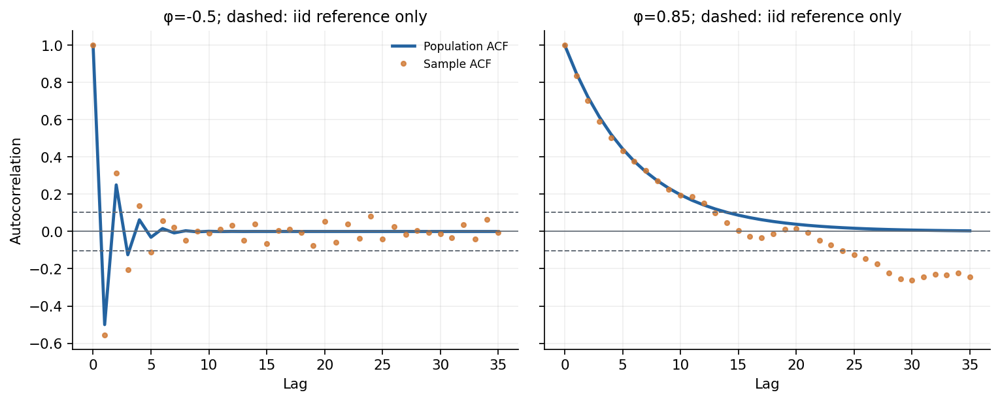
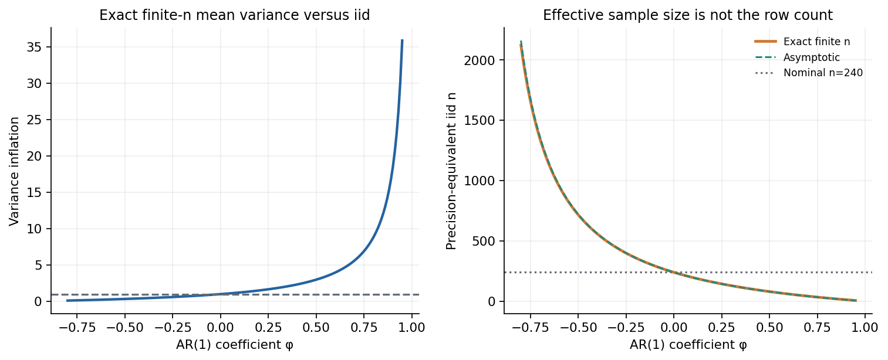
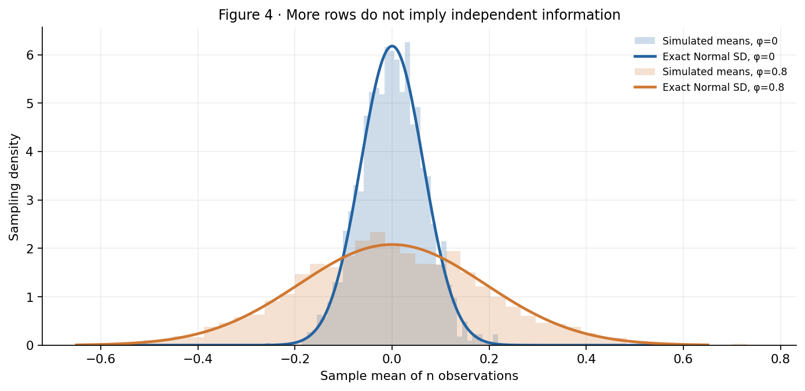
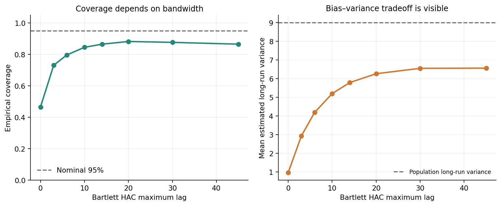
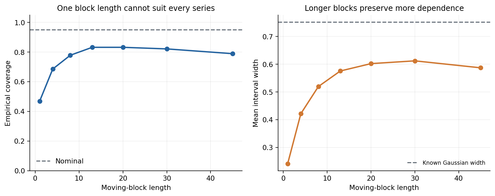
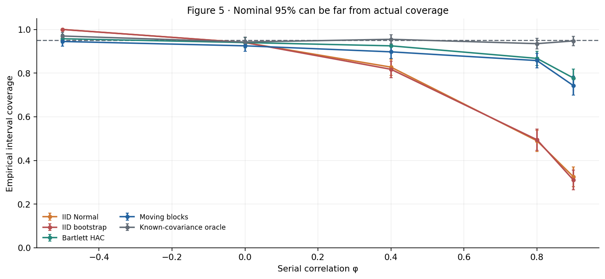
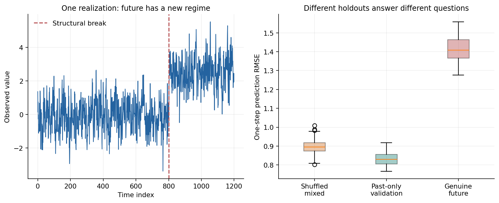

# A Thousand Observations Are Not a Thousand Replicates

## Autocorrelation, Effective Sample Size, and the Block Bootstrap

*A mathematical and computational investigation of what repeated measurements do—and do not—tell us about statistical uncertainty.*

Imagine a device recording one measurement every minute. By the end of a shift, it has collected 240 observations. A conventional calculation reports a mean, an estimated standard deviation, and a remarkably narrow confidence interval. The sample is large enough, we might say, for the central limit theorem to take care of uncertainty.

Now imagine another experiment. Instead of measuring one evolving process 240 times, we restart the process under independent conditions 240 times and take one observation from each run. The marginal histogram looks nearly identical to the histogram from the first device. Its mean and standard deviation are similar too. But the second experiment contains genuinely independent experimental information. The first does not.

Both datasets have 240 rows. They need not have comparable precision.

This distinction arises in health monitoring, process control, finance, climate measurements, logistics, digital experimentation, and almost any application with timestamps. Devices sample faster than their underlying systems change. Businesses record daily values shaped by the same economic conditions. Patients contribute several observations within one physiologically persistent episode. Factory sensors report correlated values while temperature, load, tool wear, and ambient conditions evolve slowly.

It is easy to treat the storage unit—a row—as the experimental unit. That is usually where the inference begins to go wrong.

The central example of this article is deliberately elementary: a Gaussian autoregressive process with one lag. Nothing more complicated is needed. When its correlation between adjacent observations is 0.8, a sample of 240 readings carries, **for estimating its stationary mean**, roughly the precision of 27 independent observations with the same marginal variance. In our seeded simulation, the standard 95% confidence interval that ignores dependence covers the true mean in only **49%** of repeated experiments.

Replacing an independent-data confidence interval with an independent-data bootstrap does not solve the problem. A heteroskedasticity-and-autocorrelation-consistent (HAC) estimator and a moving-block bootstrap do much better, but their actual coverage remains below the nominal level under strong persistence with the settings used here. This is not an argument against either method. It is an argument for distinguishing asymptotic guarantees from finite-sample performance and for treating tuning choices as part of the scientific analysis.

We will also see a related mistake in model validation: a random train/test split can answer a perfectly legitimate question about a mixture of historical regimes while failing to estimate performance after a future structural break. This is a problem of defining the target population, not merely of selecting a cross-validation function.

The analysis is reproducible. A [Python implementation](analysis.py), an [executable notebook](dependent_data_uncertainty.ipynb), eight original figures, ten CSV result tables and mathematical tests accompany the article. Every numerical result below comes from a specified synthetic model. No proprietary measurements or claims about real sensor deployments are involved.

## 1. Dependence changes the experiment before it changes the formula

Before deriving a correction, we need to decide what independence means in the problem. There are at least three different questions that are often conflated.

First, are observations independent conditional on the variables included in the model? Two measurements might be independent once time-of-day, batch, patient and temperature are fixed, even if they are correlated marginally. Conversely, residuals may remain correlated after those variables have been included. Correlation in the observed series and correlation in the model errors are distinct diagnostic objects.

Second, what is the unit of repetition? Suppose 100 people each contribute 20 measurements. A procedure could contain 2,000 rows while the independently sampled units are only 100 people. That does not mean there are exactly 100 effective observations for every possible parameter. A within-person treatment effect, a between-person prevalence estimate and a population mean have different information structures. The point is that 2,000 marginally correlated measurements cannot automatically be analyzed as 2,000 independently sampled people.

Third, what parameter are we estimating? An estimator for a stationary mean reacts differently to serial correlation than an estimator for a regression coefficient or a trend. There is no universal scalar called the effective sample size of a dataset. Effective sample size is always relative to an estimand, estimator, and assumed dependence structure.

Consider a time series \(X_1,\ldots,X_n\) with constant mean \(\mu\), common marginal variance \(\gamma_0\), and stationary autocovariance

\[
\gamma(k)=\operatorname{Cov}(X_t,X_{t+k}),
\qquad
\rho(k)=\frac{\gamma(k)}{\gamma_0}.
\]

Its sample mean remains

\[
\bar X=\frac{1}{n}\sum_{t=1}^n X_t.
\]

Under suitable stationarity and integrability conditions, this is still an estimator of \(\mu\). But unbiasedness of an estimator and accuracy of its standard error are different properties. We can estimate the right parameter and nevertheless be badly wrong about how much uncertainty remains.

For independent observations, every off-diagonal covariance vanishes, leading to the familiar expression

\[
\operatorname{Var}(\bar X)=\frac{\gamma_0}{n}.
\]

With dependent observations, the off-diagonal terms remain. Writing out the variance of a sum gives

\[
\begin{aligned}
\operatorname{Var}(\bar X)
&=\operatorname{Var}\left(\frac{1}{n}\sum_{t=1}^nX_t\right)\\
&=\frac{1}{n^2}\sum_{s=1}^n\sum_{t=1}^n
\operatorname{Cov}(X_s,X_t)\\
&=\frac{1}{n^2}
\left[n\gamma_0+2\sum_{k=1}^{n-1}(n-k)\gamma(k)\right].
\end{aligned}
\]

After dividing by \(\gamma_0\), we obtain the exact finite-sample identity

\[
\boxed{
\operatorname{Var}(\bar X)=
\frac{\gamma_0}{n}
\left[1+2\sum_{k=1}^{n-1}
\left(1-\frac{k}{n}\right)\rho(k)\right].
}
\]

The term in square brackets is the **variance inflation factor for the sample mean** relative to the independent-data formula. Under positive serial correlation, it may be substantially greater than one. Under alternating negative correlation, it may be smaller. Its weights reflect a simple counting fact: there are \(n-k\) ordered pairs separated by lag \(k\), not \(n\).

This is not a heuristic adjustment to the sample size. It follows directly from the covariance matrix of the observations.

Let \(\Sigma\) denote that \(n\times n\) covariance matrix and \(\mathbf{1}\) the vector of ones. The same identity can be written compactly as

\[
\operatorname{Var}(\bar X)=
\frac{\mathbf{1}^{\mathsf T}\Sigma\mathbf{1}}{n^2}.
\]

The familiar inverse-\(n\) variance reduction is thus a consequence of a diagonal covariance matrix. It is not a universal reward for collecting more rows.

## 2. A controlled AR(1) experiment

To separate dependence from changes in scale, use the stationary Gaussian model

\[
X_t=\phi X_{t-1}+\sqrt{1-\phi^2}\,\varepsilon_t,
\qquad
\varepsilon_t\overset{\mathrm{iid}}{\sim}N(0,1),
\qquad |\phi|<1.
\]

We initialize \(X_0\sim N(0,1)\) independently of future innovations. Consequently, the process is stationary from its first observation. Its marginal mean is zero, its marginal variance is exactly one, and its autocorrelation function is

\[
\rho(k)=\phi^{|k|}.
\]

That normalization is useful. If we set \(\phi=-0.5,0,0.5,0.85\), all four processes are marginally standard normal. Their stationary histograms have the same theoretical distribution. Yet their time paths look different. Positive \(\phi\) produces long runs above and below the mean; negative \(\phi\) produces alternating movements; \(\phi=0\) produces independent Gaussian observations.

*Figure 1. Four independent synthetic series. The vertical scale is shared; the marginal distribution alone does not reveal the temporal dependence.*

The long runs matter because a sample mean averages observations that tend to depart from zero together. A high realization is more likely to be followed by another high realization. Summing 240 such values does not cancel deviations as quickly as summing 240 independent values.

The autocorrelation function provides a more direct view. For positive \(\phi\), correlations decay geometrically. For negative \(\phi\), successive lags alternate in sign. A sample ACF is itself noisy; even when the population ACF is known exactly, estimates from one finite path deviate from the theoretical curve.

*Figure 2. The population AR(1) ACF is compared with an empirical ACF. Dashed horizontal lines show an IID white-noise reference scale, not a valid universal confidence band for general dependent series.*

The distinction between the theoretical and sample curves is important. We cannot diagnose autocorrelation merely by inspecting a visually attractive ACF plot and counting spikes beyond a horizontal line. The common \(\pm1.96/\sqrt n\) reference relies on white-noise assumptions and is not a general simultaneous confidence band under fitted time-series models, strong dependence or multiple inspection. We should combine graphical checks with an explicit process hypothesis and residual diagnostics appropriate to that hypothesis.

Autocorrelation also is not proof of a particular mechanism. A slowly drifting mean can produce persistent-looking correlations without a stationary autoregressive process. A daily cycle can create positive and negative lags at regular intervals. Smoothing, interpolation and overlapping windows can manufacture dependence even when the original innovations were independent. The ACF is a description of second-order association, not an explanation of causality or stationarity.

## 3. What effective sample size actually measures

For the stationary AR(1) process, substitute \(\rho(k)=\phi^k\) into the exact variance identity:

\[
\operatorname{Var}(\bar X)=
\frac{1}{n}\left[
1+2\sum_{k=1}^{n-1}\left(1-\frac{k}{n}\right)\phi^k
\right].
\]

We can define a precision-equivalent independent sample count by asking how many independent observations, each with variance one, would give the same variance for their mean. Call this number \(n_{\mathrm{eff}}\). Then

\[
\frac{1}{n_{\mathrm{eff}}}
=\operatorname{Var}(\bar X),
\qquad
n_{\mathrm{eff}}
=\frac{1}{\operatorname{Var}(\bar X)}.
\]

For a general marginal variance \(\gamma_0\), the matching definition is \(n_{\mathrm{eff}}=\gamma_0/\operatorname{Var}(\bar X)\). This is a definition for **mean estimation**, not an invariant property of the array in computer memory.

Under short-range dependence, the series of autocovariances is absolutely summable. In that setting, the variance of the mean has the large-sample approximation

\[
\operatorname{Var}(\bar X)\approx\frac{\Omega}{n},
\qquad
\Omega=\gamma_0+2\sum_{k=1}^{\infty}\gamma(k).
\]

The quantity \(\Omega\) is the **long-run variance**. It aggregates covariance over all lags, rather than using only the variance of an observation at one time. When the autocorrelation is \(\phi^k\), a geometric series gives

\[
\Omega
=1+2\sum_{k=1}^{\infty}\phi^k
=1+\frac{2\phi}{1-\phi}
=\frac{1+\phi}{1-\phi}.
\]

Thus the asymptotic effective sample size for the stationary mean is

\[
\boxed{
n_{\mathrm{eff},\infty}
\approx n\,\frac{1-\phi}{1+\phi}.
}
\]

For \(\phi=0.8\), this is \(240/9=26.67\). The exact finite-sample identity gives a variance inflation factor of **8.8333** and hence \(n_{\mathrm{eff}}=27.17\). The exact and asymptotic calculations differ slightly because a series of 240 observations does not contain infinitely many lagged pairs.

One sometimes sees effective sample size presented as \(n/(1+2\sum_k\rho_k)\), with no discussion of the parameter or the truncation scheme. That is convenient shorthand for a particular asymptotic mean-variance calculation. If the correlations are estimated unreliably at large lags, the denominator can itself be very noisy. For a nearly nonstationary process, the asymptotic approximation may be poor at realistic sample sizes. For long-memory processes whose autocovariances are not summable, the usual finite long-run variance argument can fail altogether.

*Figure 3. Exact finite-sample variance inflation and precision-equivalent independent sample size for n=240. Positive persistence reduces precision; alternating negative correlation can increase it.*

Negative correlation makes a useful counterexample to overgeneralization. If \(\phi=-0.5\), neighboring values tend to offset each other. For a stationary mean, the long-run variance becomes \((1-0.5)/(1+0.5)=1/3\). In this model, the mean can be more precise than the mean of 240 independent standard normal values. That does not create new patients, machines or experimental assignments. It only means that this particular dependence pattern causes the sample mean to cancel fluctuations efficiently.

The phrase *effective sample size* is therefore helpful only when accompanied by the question: **effective for estimating what, under which stochastic model?**

## 4. Why the central limit theorem does not rescue the wrong standard error

It is often said that with enough observations, the central limit theorem makes the mean approximately Gaussian. That statement is too incomplete to justify the standard independent-data interval.

For independent observations with finite variance, the classical central limit theorem involves

\[
\sqrt{n}(\bar X-\mu)\;\Rightarrow\;N(0,\gamma_0).
\]

For a stationary, sufficiently weakly dependent process, an appropriate dependent-data central limit theorem may instead give

\[
\sqrt{n}(\bar X-\mu)\;\Rightarrow\;N(0,\Omega).
\]

The limiting shape may still be Gaussian, but the variance parameter has changed. Getting the shape right is not enough if the variance is wrong.

In the Gaussian AR(1) experiment, there is an even stronger observation: \(\bar X\) is **exactly Gaussian for every finite \(n\)** because it is a linear combination of jointly Gaussian observations. No appeal to an asymptotic central limit theorem is needed to derive its distribution. We know its exact variance from the autocorrelation function. This makes the example a direct test of uncertainty estimation, uncontaminated by skewness or heavy tails.

The standard error that incorrectly assumes independence is

\[
\widehat{\operatorname{SE}}_{\mathrm{iid}}(\bar X)
=\frac{s}{\sqrt n},
\]

where \(s\) is the ordinary sample standard deviation. The basic 95% interval is

\[
\bar X\pm 1.96\frac{s}{\sqrt n}.
\]

It may be narrow, familiar and numerically stable. When the series is strongly positively correlated, it omits a large part of the covariance of the sum. The problem is structural. Better floating-point accuracy, a different charting library or more significant digits cannot repair it.

*Figure 4. Repeated sample means are compared with their exact Gaussian sampling distributions. Every underlying observation has variance one, yet the variance of the mean changes substantially.*

Notice the contrast between inference for an average and prediction for the next observation. Serial correlation can make the next value **more predictable** given the current one, while making the stationary mean **less precisely estimated** from a fixed-length path. These two statements are compatible. Predictive conditional variance and sampling variance of an estimator are different mathematical objects.

That distinction is especially relevant when a system appears to forecast well but produces confidence bands for aggregate behavior that are implausibly narrow. A model can exploit persistence for short-horizon prediction and still underestimate uncertainty in long-term levels, changes or policy effects.

## 5. HAC estimation: estimating the variance of a sum

Knowing the exact autocorrelation structure is an intellectual luxury. In real analysis, the covariance function is unknown. We usually have one observed series, an estimated mean or regression model, and the task of estimating long-run uncertainty from limited data.

Heteroskedasticity-and-autocorrelation-consistent covariance estimation addresses this problem without requiring a fully specified parametric autoregressive likelihood. In econometrics it is closely associated with the work of Newey and West (1987), and with bandwidth-selection analysis such as Andrews (1991). The central idea is to estimate the relevant autocovariances and combine them with carefully chosen lag weights.

Let

\[
\widehat{\gamma}(k)=
\frac{1}{n}\sum_{t=1}^{n-k}
(X_t-\bar X)(X_{t+k}-\bar X).
\]

An unweighted estimate of the full long-run variance would accumulate empirical autocovariances from many lags. Unfortunately, long-lag covariances are estimated using relatively few pairs. Summing them naively can introduce substantial sampling noise and can yield unsuitable covariance estimates.

A Bartlett lag window truncates the sum at a maximum lag \(L\) and tapers the included terms:

\[
\boxed{
\widehat{\Omega}_{\mathrm{HAC}}=
\widehat{\gamma}(0)+
2\sum_{k=1}^{L}
\left(1-\frac{k}{L+1}\right)\widehat{\gamma}(k).
}
\]

For estimation of one stationary mean, the corresponding standard error is

\[
\widehat{\operatorname{SE}}_{\mathrm{HAC}}(\bar X)
=\sqrt{\frac{\widehat{\Omega}_{\mathrm{HAC}}}{n}}.
\]

The confidence interval in this experiment uses the normal approximation

\[
\bar X\pm z_{0.975}
\widehat{\operatorname{SE}}_{\mathrm{HAC}}(\bar X).
\]

The Bartlett kernel is not chosen merely because triangular weights look appealing. In the standard covariance construction, its relationship to sums of weighted periodogram estimates produces a nonnegative long-run variance estimate, up to floating-point effects. Positive-semidefiniteness matters when a scalar standard error becomes a covariance matrix for several regression coefficients.

The parameter \(L\) controls a bias–variance compromise. Small \(L\) suppresses noisy long-lag estimates but may omit important genuine dependence. Large \(L\) includes more of the true autocovariance mass but adds imprecisely estimated tails. The ideal choice depends on persistence, sample size, kernel, target statistic and desired loss criterion.

Our implementation declares the simple rule

\[
L=\left\lceil 2n^{1/3}\right\rceil,
\]

bounded below \(n\). For \(n=240\), it chooses \(L=13\). This is a transparent illustration, not an optimal bandwidth claim. Proper HAC analysis should consider the literature's automatic bandwidth procedures or problem-specific selection criteria and examine sensitivity to nearby alternatives.

Consider \(\phi=0.8\). The population long-run variance is exactly nine. But the mean estimated long-run variance from 350 independent paths in our sensitivity experiment is approximately 0.96 for \(L=0\), 2.93 for \(L=3\), 5.20 for \(L=10\), 6.26 for \(L=20\), and 6.55 for \(L=30\). Even quite wide windows substantially underestimate nine in this short, persistent sample.

There are several interacting reasons. Bartlett weights downweight every nonzero lag, even within the truncated window. Sample autocovariances around an estimated mean have finite-sample bias under persistence. Large-lag estimates have high variability. Increasing the bandwidth does not monotonically cure all these effects, as the noisy estimated tail can eventually dominate.

*Figure 6. In this finite sample, HAC coverage and estimated long-run variance depend materially on the maximum lag. The dashed reference for the right panel is the known population long-run variance, nine.*

The corresponding estimated interval coverage rises from about 46.6% at \(L=0\) to 84.6% at \(L=10\) and 88.3% at \(L=20\), before showing no further sustained improvement in these replications. That pattern makes a crucial point: replacing an IID standard error with a HAC standard error is a methodological improvement only if the remaining assumptions and tuning choices are appropriate. It is not an automatic machine for producing exact nominal coverage.

In ordinary least-squares regression, the same principle applies to the covariance of estimated coefficients, not just to a sample mean. The relevant long-run covariance is that of appropriately defined score or estimating-equation contributions. Applying a scalar mean formula independently to regression residuals would not generally reproduce a correct sandwich covariance matrix. A serious implementation must preserve the matrix structure and account for the regressors and fitted model.

For regression with time dependence, the question is also whether heteroskedasticity and autocorrelation occur in the residuals conditional on covariates, whether regressors are exogenous, and whether the model is correctly specified for the parameter of interest. HAC covariance cannot eliminate bias from omitted variables, endogenous predictors, structural breaks or incorrect estimating equations.

It can make a valid estimating procedure's uncertainty more credible. It cannot make an invalid estimating procedure valid by itself.

## 6. Why an IID bootstrap cannot recover serial dependence

The ordinary nonparametric bootstrap has an intuitive appeal. If we do not know the sampling distribution of an estimator, repeatedly draw samples with replacement from the observed data, recalculate the statistic and use the resulting empirical distribution to describe uncertainty.

For genuinely IID observations, that idea has a large and powerful theory. For serial data, the resampling operation matters. Drawing individual observations independently with replacement is equivalent to pretending that the order and local covariance structure are irrelevant. The resampled sequence has no deliberate mechanism for preserving long runs of high or low values.

Suppose the observed series contains a stretch of 30 consecutive positive values because the process is persistent. An IID bootstrap scatters those values independently across each pseudo-sample. It erases the persistence that made the original mean uncertain. What looks like an empirical calculation is therefore silently based on an independence model.

In our experiment, the IID bootstrap interval is the *basic* two-sided confidence interval. If \(\bar X_b^*\) is the mean of bootstrap sample \(b\), define the centered deviations

\[
D_b^*=\bar X_b^*-\bar X.
\]

Write \(q_\alpha^*\) for the empirical \(\alpha\) quantile of these deviations. The basic interval is

\[
\left[
\bar X-q_{0.975}^*,
\;\bar X-q_{0.025}^*
\right].
\]

This construction reflects the bootstrap distribution around the observed estimate. It does not repair the underlying resampling law. If that law treats 240 correlated readings as 240 exchangeable independent values, the bootstrap can reproduce the wrong IID uncertainty with considerable numerical precision.

That is exactly what the experiment finds. At \(\phi=0.8\), the IID normal interval covers the true mean in 49.0% of repeated samples; the IID bootstrap covers in 49.5%. The tiny numerical difference is not meaningful evidence in favor of either procedure. Both are badly undercalibrated, because both ignore the same serial dependence.

In other words, simulation is not automatically a defense against misspecification. A thousand bootstrap replications from an inappropriate resampling scheme do not create a single independent observation that was absent from the original study.

## 7. The moving-block bootstrap

The moving-block bootstrap changes the unit of resampling. Instead of sampling individual observations, it samples short contiguous blocks of the observed series.

For a series \(X_1,\ldots,X_n\) and block length \(\ell\), construct the overlapping blocks

\[
B_j=(X_j,X_{j+1},\ldots,X_{j+\ell-1}),
\qquad
j=1,\ldots,n-\ell+1.
\]

For one bootstrap replicate, sample blocks uniformly with replacement from the collection \(B_1,\ldots,B_{n-\ell+1}\). Concatenate enough selected blocks to reach at least \(n\) observations, then retain the first \(n\). Calculate the mean on this synthetic sequence and repeat.

Within a sampled block, the original lag structure is preserved. Between sampled blocks, it is generally broken. Increasing \(\ell\) therefore retains more medium-range dependence but supplies fewer effectively distinct blocks and greater boundary or resampling variability.

This is the non-circular, overlapping moving-block bootstrap. Künsch (1989) developed foundational results for resampling general stationary observations. The stationary bootstrap of Politis and Romano (1994) is a related but distinct procedure: it uses random block lengths and a construction that can yield stationary bootstrap sequences. The algorithm used in this article is **not** that stationary-bootstrap algorithm.

In the mean-estimation experiment, we generate 190 block-bootstrap replicates of each path and calculate the same basic interval from their centered means. The publication setting uses \(\ell=13\), numerically equal to the illustrative HAC lag window, but there is no theorem requiring these two choices to be equal. They are distinct tuning parameters for distinct estimators.

The basic consistency intuition requires blocks to grow with \(n\) so they can capture increasingly distant dependence, while remaining small relative to the whole sample. A common asymptotic regime is

\[
\ell\rightarrow\infty,
\qquad
\frac{\ell}{n}\rightarrow0.
\]

This expresses a compromise, not a finite-sample prescription. It is also not sufficient by itself for every statistic or every dependent process. Mixing conditions, moment assumptions, smoothness or structure of the target statistic, and the relevant bootstrap theorem matter. For long-range dependence, heavy-tailed innovations, unit roots, changing regimes or non-smooth statistics, standard block-bootstrap assurances may not apply.

We examine block lengths \(\ell=1,4,8,13,20,30,45\), using an additional collection of 280 independent paths at \(\phi=0.8\). When \(\ell=1\), the algorithm reduces to IID resampling and coverage is only 46.8%. Increasing \(\ell\) improves coverage to approximately 77.9% at eight and 83.2% at 13. In these runs it remains near 83.2% at 20, then declines at longer lengths.

The mean interval width shows the same underlying tradeoff. With one-point blocks the average width is approximately 0.241; with 13-point blocks, approximately 0.576; with 30-point blocks, approximately 0.612. The idealized Gaussian interval using the true finite-sample covariance has width approximately 0.752. The bootstrap intervals remain too narrow on average under this design.

*Figure 7. Block length affects both empirical coverage and interval width. Results are finite-sample Monte Carlo estimates, not a monotone theoretical curve.*

The small decline in empirical coverage at longer block lengths is not paradoxical. Longer blocks reduce the number of independently resampled pieces, amplify edge effects in the non-circular construction, and produce a less diverse collection of effective pseudo-series. Block bootstrap performance is not monotonic in the block length.

Hall, Horowitz and Jing (1995) studied blocking rules and showed why selecting the block length requires attention to the statistical target. A value that works for variance estimation need not be optimal for a distribution approximation, and neither need optimize confidence-interval coverage. There is no universally correct choice that can be transferred from one dataset to another without scrutiny.

An additional practical limitation is often overlooked: the block-bootstrap pseudo-series do not reproduce every time-series feature equally well. If the parameter is an extreme-tail quantile, maximum run length, change-point location, spectral peak or nonlinear functional, a block length suitable for a sample mean may be inadequate. The estimand must guide the resampling scheme.

Finally, ordinary moving-block bootstrapping is not a license to mix structural regimes. If the process mean changes during the observed window, a block bootstrap that resamples indiscriminately across the break can produce pseudo-series that represent neither the pre-change nor the post-change mechanism. Address the nonstationarity—by modeling the regimes, transforming the series, or changing the inferential question—before relying on a stationary resampling theorem.

## 8. What 400 repeated experiments show

The coverage study compares five methods on independently generated stationary AR(1) paths. We use \(n=240\) per path and five correlation parameters: \(-0.5,0,0.4,0.8,0.9\). Each correlation setting has 400 independent replications. The target is the known stationary mean, zero.

Every method constructs a nominal 95% interval:

1. IID normal: the ordinary sample standard deviation divided by \(\sqrt n\).
2. IID bootstrap: the basic interval formed from independently resampled observations.
3. Bartlett HAC: a normal interval using a lag-window estimate with \(L=13\).
4. Moving-block bootstrap: a basic interval using overlapping 13-point blocks.
5. Known-covariance oracle: the exact Gaussian variance formula for the specified AR(1) model.

The oracle is intentionally unrealistic. It uses the true correlation parameter, the true marginal variance and the true finite-sample covariance function. Its interval is exactly calibrated under the mathematical model before Monte Carlo sampling error. It establishes what the problem permits when the covariance is known.

For every repeated path, we record whether the interval contains zero and how wide it is. Coverage is the fraction of repeated intervals containing that parameter. It is a repeated-sampling property of a *procedure*, not the probability that zero belongs to one already observed interval.

| Correlation \(\phi\) | IID normal | IID bootstrap | Bartlett HAC | Moving blocks | Oracle |
| ---: | ---: | ---: | ---: | ---: | ---: |
| -0.5 | 100.0% | 100.0% | 95.8% | 94.5% | 97.0% |
| 0.0 | 94.0% | 94.0% | 94.0% | 92.5% | 94.3% |
| 0.4 | 82.8% | 81.8% | 92.5% | 89.8% | 95.5% |
| 0.8 | **49.0%** | **49.5%** | **86.8%** | **85.8%** | 93.5% |
| 0.9 | **32.5%** | **31.0%** | **77.8%** | **74.3%** | 94.8% |

*Table 1. Seeded empirical coverage of nominal 95% intervals across 400 independent AR(1) paths per correlation. Values are rounded; full precision and interval widths appear in [coverage_summary.csv](results/coverage_summary.csv).*

These results have three distinct interpretations.

First, the ordinary IID interval has severe undercoverage when positive autocorrelation is strong. More persistence means a more consequential omission of covariance. With \(\phi=0.9\), a 95% label is attached to an interval that covers only 32.5% of the time in this experiment.

Second, IID resampling does not fix a dependence problem. The ordinary bootstrap is nearly identical in performance to the ordinary IID interval in the correlated scenarios. It is repeating the wrong sampling experiment.

Third, HAC and moving blocks improve the calibration but do not attain 95% coverage in the most persistent finite-sample settings. An interval method can be asymptotically justified and still disappoint on the finite dataset that the researcher actually has.

*Figure 5. Empirical coverage for nominal 95% intervals. Error bars are approximate pointwise Monte Carlo uncertainty intervals calculated from the observed Bernoulli coverage frequencies. They do not represent uncertainty about one reported sample mean.*

We should not present the differences as exact population properties. With \(R=400\) independent coverage trials and estimated rate \(\widehat p\), a useful Monte Carlo standard-error approximation is

\[
\operatorname{MCSE}(\widehat p)\approx
\sqrt{\frac{\widehat p(1-\widehat p)}{R}}.
\]

At estimated coverage 0.49, this is about 0.025, or 2.5 percentage points. At estimated coverage 0.8675, it is about 0.017. A plotted 95% normal approximation to a coverage estimate would extend roughly twice those standard errors in either direction. At estimated coverage exactly one, the plug-in standard-error formula is zero, but **that is not evidence of zero uncertainty or perfect population coverage**. Extreme observed proportions require more careful binomial interval construction.

All five methods are evaluated on the same outer paths at each \(\phi\), so their coverage estimates are statistically paired; treating the method estimates as independent when comparing them would be incorrect. We do not conduct formal paired difference tests here. The experiment is built to expose the dominant inferential failure and its finite-sample consequences, not to establish an optimal ranking of HAC kernels or bootstrap variants.

There is also an inner layer of Monte Carlo uncertainty. A basic bootstrap interval formed from 190 bootstrap means estimates extreme quantiles with limited numerical resolution. Increasing that number would reduce simulation error in the bootstrap quantiles, but it would **not** remove the finite-sample bias of the resampling method or the dependence-model assumptions. Outer replications answer how often the method covers; inner bootstrap resamples approximate one method's conditional distribution. Confusing those two simulation budgets is another common source of false confidence.

## 9. Forecast validation: the test set defines the claim

Uncertainty about a stationary mean is only one casualty of treating temporal data as interchangeable rows. A second is the evaluation of predictive models.

Suppose a forecasting system has been running in an unchanged regime. We are asked how well it will predict after a process intervention, new machine configuration, seasonal transition, changed care routine or external economic shock. We hold a dataset containing both the old and new periods. A random split distributes observations from both periods into training and testing.

That procedure can be useful if the scientific question is, *How accurately can we predict a randomly held-out observation from this mixed historical population when training data from both regimes are available?* It does not automatically answer, *How accurately would a model fitted before the intervention have predicted the first observations after it?*

The distinction is about the estimand. The two questions describe different information sets and different target distributions. Calling one number a cross-validation score does not make those differences disappear.

To make the issue measurable, we generate a different synthetic experiment. It is **deliberately nonstationary**, and it is not part of the stationary-mean coverage analysis. The one-step process is

\[
X_t=\mu_t+\phi(X_{t-1}-\mu_t)
+\sqrt{1-\phi^2}\,\varepsilon_t,
\]

with \(\phi=0.55\), 1,200 total observations, and

\[
\mu_t=
\begin{cases}
0,&t<800,\\
2.5,&t\ge 800.
\end{cases}
\]

The shift at observation 800 is known by construction. It changes the conditional mean, not just the marginal histogram. Before the shift,

\[
\mathbb E[X_t\mid X_{t-1}]=0.55X_{t-1}.
\]

After the shift,

\[
\mathbb E[X_t\mid X_{t-1}]
=1.125+0.55X_{t-1}.
\]

The difference of 1.125 in conditional intercept is especially relevant for a predictor trained only before the change. It can still estimate the slope reasonably well while missing the new level.

For each of 90 independently seeded realizations, we fit a one-lag linear predictor with an intercept. We evaluate it in three ways:

- **Random mixed-regime holdout:** randomly assign 80% of lagged pairs to training and 20% to testing, including pairs on both sides of the break in each split. Future-regime examples are available in training.
- **Chronological pre-change holdout:** train on the first 70% of the pre-break period and evaluate on the remaining pre-break period. This estimates performance while the old mechanism continues.
- **Genuine future after shift:** train on all available pairs strictly before observation 800 and evaluate on pairs whose targets occur at or after the break. The model has not seen the new conditional intercept.

In the generated study, the mean RMSEs across the 90 paths are approximately 0.895 for the random mixed split, 0.832 for the chronological pre-change split, and **1.413** for the genuine future after the change.

*Figure 8. Left: one synthetic time series with a known mean shift. Right: replicated one-step prediction RMSE under three evaluation protocols. These protocols estimate different target risks.*

The numerical contrast is substantial, but its interpretation must be precise. We should **not** subtract the three RMSEs and declare that the difference is a universal or unbiased estimate of random-split optimism. The mixed-regime model has been allowed to train on a different distribution. The old-regime validation is evaluated on a different target period. The true future score includes a structural break that the pre-break model is not designed to anticipate. These are different experiments, not merely different implementations of the same experiment.

What the simulation establishes is narrower and more useful: performance estimates have to be tied to the information available at the prediction date and to the population or horizon that the model will actually serve.

The same problem appears when feature pipelines use trailing averages, lags and overlapping labels. If a training row and a test row share raw observations, a nominally random holdout may allow one side of the split to carry information about the other. Leakage may arise through target encoding, global normalization, fitted preprocessing, outcome-dependent feature selection, or the accidental use of future measurements. Grouping and purging choices have to follow how features and labels are constructed, not merely where row boundaries happen to fall.

At the same time, it would be an overstatement to say that all random cross-validation on autoregressive data is mathematically invalid. Under suitable assumptions about a stationary autoregressive data-generating mechanism, prediction target and model, some random cross-validation schemes can have a legitimate interpretation; Bergmeir, Hyndman and Koo (2018) discuss precisely such conditions. Our experiment intentionally violates stationarity through a known regime change. It is designed to show why those assumptions cannot be omitted.

For operational forecasting, an evaluation design should specify at least five things: the training cutoff, the forecast origin, the prediction horizon, the available features at that origin, and the definition of the target population. If the procedure is adaptive, the refitting schedule and allowed use of previous outcomes must also be part of the protocol.

Rolling-origin evaluation is often appropriate when the intended deployment repeatedly retrains as new observations arrive. A one-off pre/post intervention forecast is a different problem. A cross-sectional split across independent machines can answer another. None is universally the best validation method; each is valid only for a clearly stated deployment or scientific question.

## 10. An uncertainty audit for real data work

The advantage of an analytical example is that the correct answer is known. In practice, uncertainty audits have to be designed before ground truth is available. I would use the following sequence.

**Identify the sampling unit and estimand.** Decide whether the question concerns a patient-level mean, an overall population prevalence, a treatment contrast, a slope, a long-run process level, a one-step forecast or an intervention response. Record how observations are nested within people, devices, machines, locations, batches or days. This determines which dependencies can affect the estimator. The same table can require entirely different variance estimators for different questions.

**Draw the time line.** Plot the raw series and annotate maintenance events, sensor replacements, policy changes, missing intervals and known interventions. Look for trends, seasonality, shifts, heteroskedasticity and changing recording frequency. A smooth ACF is not evidence that a constant mean or covariance assumption is credible. For persistent nonstationarity, investigate a model with explicit time-varying components rather than automatically invoking a stationary correction.

**Inspect the right residuals.** If the estimand is a regression coefficient, examine temporal structure in the fitted model's score contributions and residuals as appropriate. If the question concerns a mean, inspect the centered series under a plausible stationary segment. Plot ACF and, when relevant, partial ACF and spectral diagnostics. Treat diagnostic tests as supporting evidence, not as proof that observations are independent.

**Estimate uncertainty more than one way when possible.** An explicit parametric time-series likelihood can be efficient if its model is defensible. HAC offers a semiparametric covariance route under suitable assumptions. Block resampling offers another approximation for stationary weak dependence. Cluster-robust inference can be appropriate for repeated measurements grouped into independently sampled units; spatial covariance methods may be needed when neighbors are correlated. The right choice follows the dependence mechanism and estimator.

**Vary important tuning parameters.** Show whether a HAC interval changes materially when its maximum lag is 8, 13, 20 or 30. Show whether block-bootstrap intervals change when blocks are shorter or longer than the apparent dependence horizon. A fragile conclusion is a result worth reporting. If the interval changes from excluding zero to including zero after a reasonable bandwidth adjustment, hiding that sensitivity would misrepresent the evidence.

**Simulate from a plausible fitted model.** An application-specific Monte Carlo study can assess empirical coverage for the sample sizes, persistence, clustering and missingness the actual project encounters. Vary the plausible dependence strength instead of calibrating only at the best-fitting point estimate. Distinguish simulation under an assumed model from empirical validation of the real data-generating process.

**Protect the evaluation horizon.** Define the intended forecasting information set and keep later outcomes out of earlier training or preprocessing. Report historical fit, pre-change validation and genuine future performance separately if they serve different purposes. Where possible, evaluate on several independent time periods or operational units, and do not advertise a single lucky cutoff as a general performance guarantee.

**Translate uncertainty into decisions.** A wide interval may still support action if the possible losses are asymmetric and the choice is robust over the uncertainty range. A narrow interval may be useless if it ignores the very dependence that governs the decision. The relevant quantity is not always the precision of a point estimate; it may be the probability of violating a threshold, the time until an alarm, or the distribution of cumulative costs.

This sequence is more useful than adopting a blanket rule such as always multiply the sample variance by a fixed inflation factor. A correction that is appropriate for a stable, short-memory mean may be inappropriate for a seasonal residual process, a heavy-tailed clustered outcome or an adaptive feedback system.

## 11. Four places where the argument needs qualification

The phrase “240 rows are worth 27” is memorable. Without its assumptions, it is also dangerous. Four distinctions keep it honest.

### 11.1 A finite effective sample size does not imply a finite set of independent observations

The value 27.17 comes from matching the variance of a Gaussian stationary **sample mean** with the variance of an IID unit-variance sample mean. It says nothing directly about estimating a nonlinear transition parameter, predicting an extreme value, learning a rare-event decision boundary or estimating a treatment effect. For some parameters, observing the temporal trajectory supplies information that an IID sample would not provide. For others, a shared latent state can reduce information much more than the mean-based formula suggests.

If we divide 240 by 8.833 and report “27 independent people,” we commit a category error. A precision equivalent is not a literal experimental-unit count.

### 11.2 Autocorrelation does not necessarily make every interval too narrow

At \(\phi=-0.5\), the IID interval is much wider than the correct mean interval. Our 400 seeded replications all happen to cover zero, corresponding to 100% observed coverage. This is **overcoverage**, not the good calibration intended by a 95% procedure. A method should represent the intended uncertainty, not merely err on the side of width. Overly conservative intervals can obscure real effects and distort resource allocation.

The correct response to negative dependence is not to shrink all intervals mechanically. It is to estimate the covariance structure relevant to the statistic with appropriate uncertainty about that estimate.

### 11.3 Robust standard errors do not repair bias or nonstationarity

HAC estimation assumes a meaningful long-run variance under an appropriate asymptotic framework. It does not undo omitted-variable bias, incorrect model dynamics, dependent treatment assignment or a changing target parameter. The moving-block bootstrap similarly depends on an appropriate stationary or locally stationary resampling framework. Both methods can return clean numbers in a situation where their foundational assumptions are false.

Unit-root processes, integrated series, long memory and structural breaks often require different theory. A stationary AR(1) with \(\phi=0.99\) may resemble a stochastic trend in finite data, but it is not the same mathematical process as a unit root at \(\phi=1\). Extrapolating our numerical results all the way to the boundary would be unjustified.

### 11.4 Coverage in a simulator is conditional on its model

We deliberately give the simulator Gaussian innovations, a fixed coefficient, a common stationary variance and no missing observations. Real streams often contain bursts, gaps, censoring, irregular sampling, outliers, interventions and simultaneous common shocks. The clean experiment isolates one mechanism; it does not establish that any one method will attain a given coverage rate on real systems.

The zero-mean oracle is an important reminder. We can compute its exact interval under the model, yet its *observed* coverage over 400 repetitions is 93.5% at \(\phi=0.8\). That deviation is ordinary Monte Carlo randomness, not evidence that Gaussian theory has failed. The more complicated estimators add covariance-estimation and resampling error on top of the sampling variation.

## 12. From repeated measurements to reliable decisions

Consider an ambient-health monitoring system. It may record heart rate, motion activity, room occupancy and sleep measurements many times each day. A week can contain thousands of sensor readings. That scale is operationally useful, but it does not mean a week's readings provide thousands of independent pieces of evidence about a resident's long-term baseline.

For a stable baseline mean, positive temporal dependence affects uncertainty. Circadian cycles and weekend effects affect what counts as a stable baseline. A change in routine may invalidate stationarity altogether. If the purpose is to detect a true change, the primary objective is a sequential stopping rule with a specified false-alarm burden, not merely a narrower confidence interval for one mean. The sampling plan, baseline model and decision objective have to be developed together.

In industrial statistics, dozens of readings from one machine during one uninterrupted run cannot be substituted for dozens of independently selected production batches. The raw series can still be very informative about transient dynamics, sensor drift and maintenance effects. But a process capability claim about future batches needs uncertainty at the level of batch-to-batch variation as well as within-batch measurement error. A nominal sample size that pools both levels without a model can be misleading.

In marketing and digital experimentation, a treatment may be assigned at the customer level while outcomes arrive as correlated daily observations. Randomization of customers can support a causal comparison, but treating each daily outcome as an independently randomized unit inflates apparent precision. If interventions are assigned by region or week, cluster and temporal dependence may coexist. An IID bootstrap over rows erases both forms of design information.

In finance, the temptation is often reversed: one assumes observed returns are nearly uncorrelated and concludes that averages and risks can be treated as independent. Even if the raw return ACF is small, squared returns and volatility may remain serially dependent, creating different challenges for uncertainty estimates of volatility, tail risk and strategy performance. Autocorrelation of a statistic's relevant score or influence contribution matters more than a single diagnostic on the untransformed data.

These examples are conceptual. The companion experiment contains none of those real-world datasets. Their purpose is to show why a measurement frequency, database row count or train/test partition is not itself a statistical design.

## 13. Reproducibility and a useful falsification checklist

The companion [study README](README.md) lists exact commands, eight publication figures and ten machine-readable result tables. The analysis uses typed Python functions, explicit random seeds, a stationary AR(1) generator initialized from its invariant distribution, and a separate nonstationary generator for forecast evaluation. Its tests check the mathematical identities, boundary conditions, sample covariance properties, coverage calculations, deterministic artifact regeneration and the executable notebook.

The distinction between full and quick runs matters. Publication figures use 400 independent paths per AR(1) setting and 190 inner resamples, with separate 350-path HAC-bandwidth and 280-path block-length studies. The quick workflow uses smaller replication counts for CI and writes suffixed files so that machine checks do not overwrite the publication results. The published CSV tables, not the quick-run numbers, support the numerical claims in this article.

A critical reader can try to falsify the practical conclusion in several ways. Set \(\phi=0\) and verify that IID uncertainty becomes reasonable. Set \(\phi=-0.5\) and verify the direction of the mean-variance correction. Increase \(n\) while varying the HAC bandwidth or bootstrap block length according to an explicit rule. Change the process from stationary to one with a break and observe which assumptions cease to hold. Increase outer Monte Carlo replications to distinguish systematic undercoverage from simulation noise. Increase inner bootstrap draws to measure quantile Monte Carlo error separately.

The underlying question in every case is the same: **Which probability experiment is the analysis pretending to repeat, and is that the experiment that produced the data?**

## Conclusion

Statistical uncertainty is a property of an estimator under a sampling process. It is not a function of the row count alone.

For a stationary AR(1) mean, the exact covariance of the observations determines the variance of the average. When \(\phi=0.8\), 240 readings provide mean-estimation precision comparable to about 27 independent unit-variance observations. Our seeded experiment turns that abstract result into a practical failure: an interval advertised as 95% covers the true mean only 49% of the time if it assumes independence.

HAC estimation and the moving-block bootstrap are principled attempts to preserve information about dependence. They improve the result markedly, but neither is a default guarantee of 95% finite-sample coverage. Their bandwidths, block lengths and assumptions require inspection. The forecasting experiment extends the same principle from confidence intervals to validation: a random mixed-regime test and a genuinely future test answer different questions, even when both use an ordinary RMSE formula.

The best diagnostic question is not whether the dataset is large. It is whether our uncertainty calculation and evaluation protocol preserve the structure that makes observations informative or redundant.

One thousand rows can be one thousand useful measurements. They are not necessarily one thousand replicates.

---

## References and further reading

The following links point to original methodological papers or an official scholarly text, rather than relying on general summaries.

1. Newey, W. K., and West, K. D. (1987). “A Simple, Positive Semi-definite, Heteroskedasticity and Autocorrelation Consistent Covariance Matrix.” *Econometrica*, 55(3), 703–708. [DOI: 10.2307/1913610](https://doi.org/10.2307/1913610). Foundational Bartlett-kernel HAC covariance estimator.

2. Andrews, D. W. K. (1991). “Heteroskedasticity and Autocorrelation Consistent Covariance Matrix Estimation.” *Econometrica*, 59(3), 817–858. [DOI: 10.2307/2938229](https://doi.org/10.2307/2938229). HAC asymptotics, lag windows and bandwidth considerations.

3. Efron, B. (1979). “Bootstrap Methods: Another Look at the Jackknife.” *The Annals of Statistics*, 7(1), 1–26. [DOI: 10.1214/aos/1176344552](https://doi.org/10.1214/aos/1176344552). Original bootstrap foundation; IID resampling is not a generic dependent-series resampling mechanism.

4. Künsch, H. R. (1989). “The Jackknife and the Bootstrap for General Stationary Observations.” *The Annals of Statistics*, 17(3), 1217–1241. [DOI: 10.1214/aos/1176347265](https://doi.org/10.1214/aos/1176347265). Foundational block resampling for stationary dependent observations.

5. Politis, D. N., and Romano, J. P. (1994). “The Stationary Bootstrap.” *Journal of the American Statistical Association*, 89(428), 1303–1313. [DOI: 10.1080/01621459.1994.10476870](https://doi.org/10.1080/01621459.1994.10476870). Random-length stationary-bootstrap construction, distinct from the fixed moving blocks implemented here.

6. Hall, P., Horowitz, J. L., and Jing, B.-Y. (1995). “On Blocking Rules for the Bootstrap with Dependent Data.” *Biometrika*, 82(3), 561–574. [DOI: 10.1093/biomet/82.3.561](https://doi.org/10.1093/biomet/82.3.561). Block-length selection depends on the statistical task.

7. Tashman, L. J. (2000). “Out-of-Sample Tests of Forecasting Accuracy: An Analysis and Review.” *International Journal of Forecasting*, 16(4), 437–450. [DOI: 10.1016/S0169-2070(00)00065-0](https://doi.org/10.1016/S0169-2070(00)00065-0). Rolling-origin and out-of-sample evaluation design.

8. Bergmeir, C., Hyndman, R. J., and Koo, B. (2018). “A Note on the Validity of Cross-Validation for Evaluating Autoregressive Time Series Prediction.” *Computational Statistics & Data Analysis*, 120, 70–83. [DOI: 10.1016/j.csda.2017.11.003](https://doi.org/10.1016/j.csda.2017.11.003). Conditions under which random cross-validation for autoregressive forecasting can be interpreted correctly.

9. Roberts, D. R., et al. (2017). “Cross-Validation Strategies for Data with Temporal, Spatial, Hierarchical, or Phylogenetic Structure.” *Ecography*, 40(8), 913–929. [DOI: 10.1111/ecog.02881](https://doi.org/10.1111/ecog.02881). Dependence-aware design and target extrapolation in validation.

10. Diebold, F. X., and Mariano, R. S. (1995). “Comparing Predictive Accuracy.” *Journal of Business & Economic Statistics*, 13(3), 253–263. [DOI: 10.1080/07350015.1995.10524599](https://doi.org/10.1080/07350015.1995.10524599). Dependence in forecast-loss differences matters for formal predictive-accuracy comparisons.

11. Hyndman, R. J., and Athanasopoulos, G. *Forecasting: Principles and Practice*, 3rd ed. [Official online chapter: Time Series Cross-Validation](https://otexts.com/fpp3/tscv.html). Exposition of rolling forecasting origins and forecast-error evaluation.

**Reproducible materials:** [full analysis](analysis.py) · [notebook](dependent_data_uncertainty.ipynb) · [study notes](README.md) · [results](results/) · [figures](figures/). Source figures and numerical tables were generated from independent synthetic random streams with an explicit seed; no real-world effect size or operational performance is implied.
