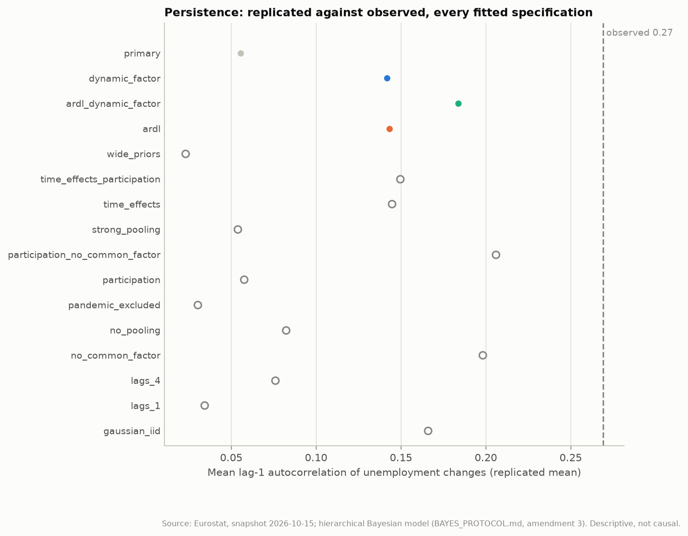
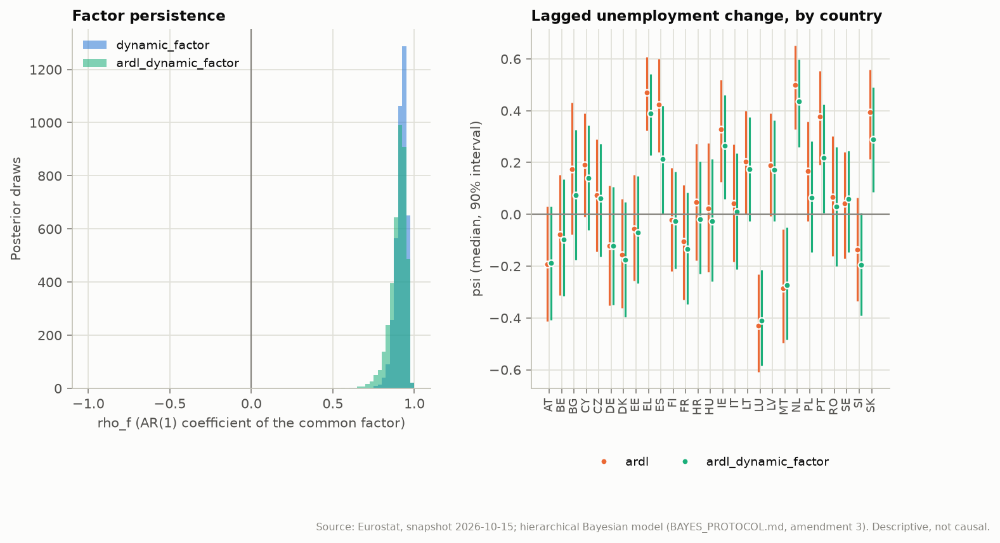
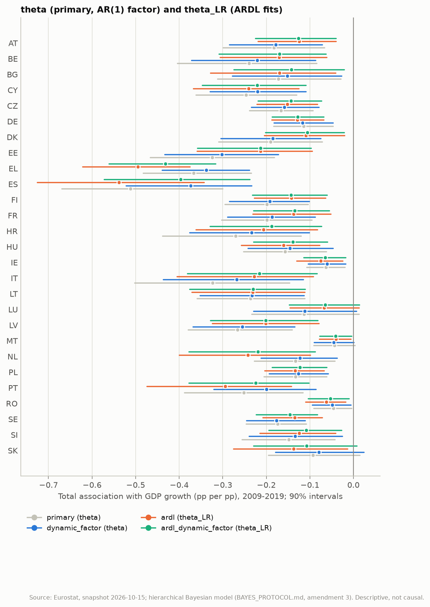

# Hierarchical Bayes: dynamics that address the misfits

Generated by `eu-okun bayes-dynamics` from the frozen snapshot `snapshots/eurostat-2026-10-15`. Amendment 3 of [BAYES_PROTOCOL.md](../BAYES_PROTOCOL.md) (section 11) registered the three specifications, their estimands and every decision rule below before any of them was fitted. They are reported **alongside** the pre-registered results in [HIERARCHICAL_BAYES.md](HIERARCHICAL_BAYES.md), which they do not replace. Every coefficient is a descriptive conditional association; no specification identifies a causal GDP shock ([IDENTIFICATION_RESULTS.md](IDENTIFICATION_RESULTS.md)).

## Summary

- `dynamic_factor` does not fix the persistence misfit (p = 0.030); its factor dynamics are supported (rho_f +0.92, 90% [+0.86, +0.96]); it is better supported than `primary` by PSIS-LOO.
- `ardl` does not fix the persistence misfit (p = 0.007); it keeps an i.i.d. factor, whose posterior lag-1 autocorrelation is +0.51; PSIS-LOO does not distinguish it from `primary`.
- `ardl_dynamic_factor` fixes the persistence misfit (p = 0.102); its factor dynamics are supported (rho_f +0.91, 90% [+0.80, +0.96]); it is better supported than `primary` by PSIS-LOO.
- `ardl_dynamic_factor` against `ardl`: elpd difference +11.8 (SE 5.7), ardl_dynamic_factor better supported.
- Credibly negative in `dynamic_factor`: 24 of 27 countries (`primary`: 24); added: none; dropped: none.
- Credibly negative in `ardl`: 26 of 27 countries (`primary`: 24); added: MT and SK; dropped: none.
- Credibly negative in `ardl_dynamic_factor`: 25 of 27 countries (`primary`: 24); added: MT; dropped: none.
- Mean of the 27 country estimates (`theta`, or `theta_LR` in the ARDL fits; median, 90% interval): `primary` -0.200 [-0.234, -0.160]; `dynamic_factor` -0.181 [-0.213, -0.147]; `ardl` -0.186 [-0.225, -0.146]; `ardl_dynamic_factor` -0.168 [-0.207, -0.132].
- The posterior factor stays correlated with mean GDP growth (median correlation: `primary` -0.60, `dynamic_factor` -0.68, `ardl` -0.50, `ardl_dynamic_factor` -0.65), as section 11.4 anticipated: `theta` remains an association beyond the common European cycle.

## 1. Convergence

Same sampler, acceptance criteria and single retry as sections 4 and 6 (4 chains x 1000 draws; the retry uses 3000 warm-up iterations).

| Specification | Accepted | Max R-hat | Min ESS | Divergences | Min E-BFMI | Warm-up | Minutes |
| --- | --- | ---: | ---: | ---: | ---: | ---: | ---: |
| `primary` | yes | 1.0070 (log_sigma_raw[9]) | 504 | 0 | 0.52 | 1000 | 2.3 |
| `dynamic_factor` | yes | 1.0084 (f[10]) | 469 | 0 | 0.55 | 1000 | 0.9 |
| `ardl` | yes | 1.0066 (mu_log_sigma) | 775 | 0 | 0.53 | 1000 | 0.7 |
| `ardl_dynamic_factor` | yes | 1.0076 (alpha_raw[11]) | 634 | 0 | 0.47 | 1000 | 0.7 |

## 2. Prior predictive check

The check of section 9.3 with the new priors: 1000 prior draws per specification, each propagated to a simulated data set on the real design (the ARDL simulations start from the observed first quarter of each segment, on which their likelihood conditions). 5%, 50% and 95% quantiles; the observed value is in the last row.

| Specification | Mean country SD (pp) | Largest absolute change (pp) | Lag-1 autocorrelation | Cross-country correlation | Cells beyond 5 pp |
| --- | ---: | ---: | ---: | ---: | ---: |
| `primary` | 0.68 / 1.43 / 3.43 | 8.11 / 21.70 / 49.86 | -0.41 / -0.03 / 0.30 | 0.01 / 0.10 / 0.23 | 3.9% |
| `dynamic_factor` | 0.71 / 1.42 / 3.54 | 8.03 / 21.43 / 50.17 | -0.43 / -0.05 / 0.30 | 0.00 / 0.09 / 0.22 | 4.0% |
| `ardl` | 0.72 / 1.55 / 3.50 | 8.36 / 22.62 / 59.05 | -0.62 / -0.08 / 0.53 | 0.01 / 0.10 / 0.25 | 5.2% |
| `ardl_dynamic_factor` | 0.73 / 1.54 / 3.65 | 8.29 / 22.52 / 58.65 | -0.63 / -0.09 / 0.51 | 0.00 / 0.09 / 0.25 | 5.3% |
| **observed** | 0.49 | 3.00 | 0.27 | 0.17 |  |

## 3. The persistence misfit

Posterior predictive check of the mean lag-1 autocorrelation of unemployment changes (400 replicated data sets per fit; p = share of replications at or above the observed value). Fixed when p lies in [0.05, 0.95].

| Specification | Observed | Replicated mean | p | Misfit | p, cross-country corr. | p, mean SD | 50% coverage | 90% coverage |
| --- | ---: | ---: | ---: | --- | ---: | ---: | ---: | ---: |
| `primary` | 0.269 | 0.055 | 0.000 | not fixed | 0.365 | 0.070 | 0.558 | 0.937 |
| `dynamic_factor` | 0.269 | 0.142 | 0.030 | not fixed | 0.110 | 0.020 | 0.552 | 0.928 |
| `ardl` | 0.269 | 0.143 | 0.007 | not fixed | 0.268 | 0.130 | 0.559 | 0.924 |
| `ardl_dynamic_factor` | 0.269 | 0.184 | 0.102 | fixed | 0.165 | 0.077 | 0.553 | 0.926 |

For context, the other 12 fitted specifications replicate a mean lag-1 autocorrelation of 0.023 to 0.206 (p = 0.000 to 0.050). Coverage is one-step-ahead, over the cells of each likelihood (the ARDL fits condition on the first quarter).



## 4. The common factor

`rho_f` is the AR(1) coefficient of the factor (90% interval). The last columns check the posterior factor itself: its lag-1 autocorrelation and its correlation with the cross-country mean of GDP growth (medians over draws, 90% intervals).

| Specification | rho_f | Factor dynamics | Factor lag-1 autocorr. | Corr. with mean GDP growth |
| --- | ---: | --- | ---: | ---: |
| `primary` | i.i.d. (not modelled) | - | +0.75 [+0.62, +0.83] | -0.60 [-0.68, -0.50] |
| `dynamic_factor` | +0.924 [+0.856, +0.962] | supported | +0.93 [+0.89, +0.95] | -0.68 [-0.73, -0.61] |
| `ardl` | i.i.d. (not modelled) | - | +0.51 [+0.31, +0.66] | -0.50 [-0.62, -0.36] |
| `ardl_dynamic_factor` | +0.911 [+0.805, +0.960] | supported | +0.89 [+0.80, +0.94] | -0.65 [-0.72, -0.57] |



## 5. PSIS-LOO on common cells

Each accepted fit is scored on the 1098 cells that every compared likelihood contains: the unmasked cells without each segment's first quarter, which the ARDL fits condition on. The terms are one-step conditional densities in every fit, so they are comparable. 'Better supported' needs an elpd difference above twice its standard error.

| Specification | elpd | SE | p_loo | Pareto k > 0.7 | Reliable |
| --- | ---: | ---: | ---: | ---: | --- |
| `primary` | -375.4 | 31.4 | 163.0 | 6 | yes |
| `dynamic_factor` | -359.9 | 31.6 | 143.4 | 5 | yes |
| `ardl` | -360.9 | 31.8 | 153.5 | 7 | yes |
| `ardl_dynamic_factor` | -349.1 | 32.1 | 141.5 | 5 | yes |

| A | B | elpd A - B | SE | Verdict | Reliable |
| --- | --- | ---: | ---: | --- | --- |
| `dynamic_factor` | `primary` | +15.5 | 5.8 | dynamic_factor better supported | yes |
| `ardl` | `primary` | +14.4 | 7.3 | not distinguishable | yes |
| `ardl_dynamic_factor` | `primary` | +26.2 | 7.9 | ardl_dynamic_factor better supported | yes |
| `ardl_dynamic_factor` | `ardl` | +11.8 | 5.7 | ardl_dynamic_factor better supported | yes |

## 6. Country estimates

Posterior median and 90% interval of the total association with GDP growth, 2009-2019: `theta` (sum of the GDP coefficients at lags 0-2) for `primary` and `dynamic_factor`, the long-run multiplier `theta_LR = theta / (1 - psi)` for the ARDL fits. (?) marks a sign that is not credible at 0.95 and (+) a credibly positive one. Because `1 - psi > 0`, `theta_LR` has the sign of `theta` in every draw.

| Country | `primary` (theta) | `dynamic_factor` (theta) | `ardl` (theta_LR) | `ardl_dynamic_factor` (theta_LR) |
| --- | ---: | ---: | ---: | ---: |
| AT | -0.182 [-0.299, -0.067] | -0.179 [-0.285, -0.072] | -0.124 [-0.219, -0.040] | -0.126 [-0.226, -0.040] |
| BE | -0.240 [-0.404, -0.084] | -0.221 [-0.372, -0.087] | -0.171 [-0.306, -0.062] | -0.170 [-0.309, -0.063] |
| BG | -0.172 [-0.313, -0.029] | -0.152 [-0.278, -0.027] | -0.170 [-0.329, -0.041] | -0.142 [-0.274, -0.021] |
| CY | -0.246 [-0.362, -0.130] | -0.220 [-0.329, -0.109] | -0.240 [-0.368, -0.125] | -0.221 [-0.347, -0.109] |
| CZ | -0.167 [-0.239, -0.093] | -0.158 [-0.235, -0.079] | -0.151 [-0.222, -0.082] | -0.143 [-0.219, -0.073] |
| DE | -0.114 [-0.184, -0.047] | -0.117 [-0.182, -0.047] | -0.129 [-0.188, -0.069] | -0.128 [-0.187, -0.068] |
| DK | -0.190 [-0.310, -0.072] | -0.185 [-0.304, -0.075] | -0.109 [-0.205, -0.020] | -0.106 [-0.202, -0.022] |
| EE | -0.324 [-0.467, -0.182] | -0.302 [-0.433, -0.172] | -0.213 [-0.359, -0.095] | -0.213 [-0.358, -0.097] |
| EL | -0.367 [-0.483, -0.234] | -0.338 [-0.439, -0.239] | -0.495 [-0.622, -0.376] | -0.432 [-0.561, -0.317] |
| ES | -0.512 [-0.670, -0.300] | -0.374 [-0.522, -0.234] | -0.539 [-0.726, -0.343] | -0.397 [-0.572, -0.238] |
| FI | -0.199 [-0.295, -0.104] | -0.192 [-0.285, -0.102] | -0.142 [-0.228, -0.064] | -0.143 [-0.232, -0.061] |
| FR | -0.199 [-0.303, -0.095] | -0.187 [-0.289, -0.088] | -0.137 [-0.231, -0.052] | -0.135 [-0.230, -0.056] |
| HR | -0.270 [-0.439, -0.120] | -0.233 [-0.376, -0.101] | -0.206 [-0.362, -0.083] | -0.187 [-0.329, -0.073] |
| HU | -0.157 [-0.252, -0.062] | -0.146 [-0.242, -0.047] | -0.161 [-0.258, -0.077] | -0.139 [-0.229, -0.060] |
| IE | -0.063 [-0.108, -0.019] | -0.060 [-0.104, -0.018] | -0.075 [-0.130, -0.025] | -0.064 [-0.115, -0.018] |
| IT | -0.323 [-0.502, -0.146] | -0.268 [-0.437, -0.116] | -0.228 [-0.405, -0.092] | -0.216 [-0.381, -0.083] |
| LT | -0.236 [-0.359, -0.112] | -0.233 [-0.353, -0.113] | -0.231 [-0.371, -0.112] | -0.230 [-0.376, -0.111] |
| LU | -0.113 [-0.234, +0.013] (?) | -0.112 [-0.230, +0.007] (?) | -0.067 [-0.146, +0.013] (?) | -0.065 [-0.147, +0.013] (?) |
| LV | -0.266 [-0.380, -0.141] | -0.255 [-0.369, -0.135] | -0.201 [-0.324, -0.080] | -0.201 [-0.328, -0.082] |
| MT | -0.044 [-0.091, +0.004] (?) | -0.045 [-0.091, +0.001] (?) | -0.040 [-0.078, -0.006] | -0.040 [-0.077, -0.004] |
| NL | -0.133 [-0.228, -0.042] | -0.123 [-0.212, -0.038] | -0.242 [-0.400, -0.099] | -0.219 [-0.378, -0.087] |
| PL | -0.133 [-0.206, -0.061] | -0.126 [-0.194, -0.058] | -0.134 [-0.204, -0.067] | -0.123 [-0.187, -0.061] |
| PT | -0.251 [-0.388, -0.116] | -0.199 [-0.321, -0.086] | -0.294 [-0.474, -0.142] | -0.225 [-0.378, -0.102] |
| RO | -0.046 [-0.091, -0.004] | -0.049 [-0.095, -0.006] | -0.062 [-0.110, -0.018] | -0.053 [-0.104, -0.010] |
| SE | -0.174 [-0.246, -0.109] | -0.177 [-0.246, -0.111] | -0.135 [-0.208, -0.071] | -0.146 [-0.223, -0.083] |
| SI | -0.148 [-0.256, -0.043] | -0.134 [-0.240, -0.026] | -0.124 [-0.215, -0.041] | -0.108 [-0.195, -0.027] |
| SK | -0.093 [-0.195, +0.015] (?) | -0.080 [-0.179, +0.024] (?) | -0.138 [-0.276, -0.014] | -0.107 [-0.229, +0.008] (?) |

- Largest change of a median against `primary` in `dynamic_factor`: ES, -0.512 to -0.374.
- Largest change of a median against `primary` in `ardl`: EL, -0.367 to -0.495.
- Largest change of a median against `primary` in `ardl_dynamic_factor`: ES, -0.512 to -0.397.

The lagged-change coefficient `psi` (median) and the descriptive long-run delayed share `(theta_LR - beta0) / theta_LR` (median; not a decision rule):

| Country | psi, `ardl` | psi, `ardl_dynamic_factor` | Delayed share, `ardl` | Delayed share, `ardl_dynamic_factor` |
| --- | ---: | ---: | ---: | ---: |
| AT | -0.19 | -0.19 | 0.51 | 0.48 |
| BE | -0.08 | -0.10 | 0.35 | 0.34 |
| BG | +0.17 | +0.07 | 0.70 | 0.69 |
| CY | +0.19 | +0.14 | 0.64 | 0.66 |
| CZ | +0.07 | +0.06 | 0.88 | 0.89 |
| DE | -0.12 | -0.12 | 0.75 | 0.76 |
| DK | -0.16 | -0.18 | 0.64 | 0.66 |
| EE | -0.05 | -0.07 | 0.41 | 0.43 |
| EL | +0.47 | +0.39 | 0.66 | 0.63 |
| ES | +0.42 | +0.21 | 0.47 | 0.27 |
| FI | -0.02 | -0.03 | 0.53 | 0.53 |
| FR | -0.10 | -0.13 | 0.64 | 0.67 |
| HR | +0.05 | -0.02 | 0.57 | 0.56 |
| HU | +0.02 | -0.03 | 0.66 | 0.72 |
| IE | +0.33 | +0.26 | 0.90 | 0.91 |
| IT | +0.04 | +0.01 | 0.45 | 0.46 |
| LT | +0.20 | +0.17 | 0.54 | 0.53 |
| LU | -0.43 | -0.41 | 0.65 | 0.68 |
| LV | +0.19 | +0.17 | 0.79 | 0.79 |
| MT | -0.29 | -0.27 | 0.41 | 0.45 |
| NL | +0.50 | +0.44 | 0.88 | 0.88 |
| PL | +0.17 | +0.06 | 0.69 | 0.70 |
| PT | +0.38 | +0.22 | 0.72 | 0.70 |
| RO | +0.07 | +0.03 | 0.49 | 0.40 |
| SE | +0.04 | +0.06 | 0.47 | 0.45 |
| SI | -0.14 | -0.19 | 0.92 | 1.03 |
| SK | +0.39 | +0.29 | 1.24 | 1.44 |

- `ardl`: tanh(mu_psi) +0.083 [-0.026, +0.190], tau_psi 0.291.
- `ardl_dynamic_factor`: tanh(mu_psi) +0.033 [-0.067, +0.129], tau_psi 0.254.



Countries credibly negative (P(estimate < 0) >= 0.95):

| Specification | Count | Countries |
| --- | ---: | --- |
| `primary` | 24 | AT, BE, BG, CY, CZ, DE, DK, EE, EL, ES, FI, FR, HR, HU, IE, IT, LT, LV, NL, PL, PT, RO, SE and SI |
| `dynamic_factor` | 24 | AT, BE, BG, CY, CZ, DE, DK, EE, EL, ES, FI, FR, HR, HU, IE, IT, LT, LV, NL, PL, PT, RO, SE and SI |
| `ardl` | 26 | AT, BE, BG, CY, CZ, DE, DK, EE, EL, ES, FI, FR, HR, HU, IE, IT, LT, LV, MT, NL, PL, PT, RO, SE, SI and SK |
| `ardl_dynamic_factor` | 25 | AT, BE, BG, CY, CZ, DE, DK, EE, EL, ES, FI, FR, HR, HU, IE, IT, LT, LV, MT, NL, PL, PT, RO, SE and SI |

## 7. The three earlier claims

The rules of section 7. In the ARDL fits, Luxembourg and Spain use `theta_LR` against the per-draw mean of `theta_LR` over the 27 countries; the Netherlands rule keeps `theta` and `beta0` (protocol change log).

| Claim | Specification | Probability | Status | Detail |
| --- | --- | ---: | --- | --- |
| Luxembourg weak | `primary` | 0.870 | neither | P(theta_LU > mu_theta) = 0.870; 90% interval [-0.234, +0.013] |
| Netherlands delayed | `primary` | 0.966 | holds | P(lag share > 0.5) = 0.966; median lag share 0.94 |
| Spain large | `primary` | 0.996 | holds | P(theta_ES < mu_theta) = 0.996 |
| Luxembourg weak | `dynamic_factor` | 0.829 | neither | P(theta_LU > mu_theta) = 0.829; 90% interval [-0.230, +0.007] |
| Netherlands delayed | `dynamic_factor` | 0.948 | neither | P(lag share > 0.5) = 0.948; median lag share 0.93 |
| Spain large | `dynamic_factor` | 0.995 | holds | P(theta_ES < mu_theta) = 0.995 |
| Luxembourg weak | `ardl` | 0.995 | holds | P(theta_LR_LU > mean theta_LR) = 0.995; 90% interval [-0.146, +0.013] |
| Netherlands delayed | `ardl` | 0.846 | neither | P(lag share > 0.5) = 0.846; median lag share 0.76 |
| Spain large | `ardl` | 1.000 | holds | P(theta_LR_ES < mean theta_LR) = 1.000 |
| Luxembourg weak | `ardl_dynamic_factor` | 0.981 | holds | P(theta_LR_LU > mean theta_LR) = 0.981; 90% interval [-0.147, +0.013] |
| Netherlands delayed | `ardl_dynamic_factor` | 0.873 | neither | P(lag share > 0.5) = 0.873; median lag share 0.79 |
| Spain large | `ardl_dynamic_factor` | 0.997 | holds | P(theta_LR_ES < mean theta_LR) = 0.997 |

Descriptive check, not a rule: the same probabilities against the per-draw mean of the country estimates, and with the short-run `theta` against `mu_theta` (the section 7 rule) in the same fit. The first isolates the change of reference, the second the change of estimand.

| Specification | LU above the mean | LU short run above mu_theta | ES below the mean | ES short run below mu_theta |
| --- | ---: | ---: | ---: | ---: |
| `primary` | 0.881 | 0.870 | 0.997 | 0.996 |
| `dynamic_factor` | 0.840 | 0.829 | 0.995 | 0.995 |
| `ardl` | 0.995 | 0.805 | 1.000 | 0.984 |
| `ardl_dynamic_factor` | 0.981 | 0.813 | 0.997 | 0.989 |

- Reference: in `primary`, Luxembourg gives 0.881 against the mean of the country estimates and 0.870 against `mu_theta`, so the change of reference does not change the status.
- Estimand: in `ardl` the short-run `theta_LU` gives 0.805, so the Luxembourg claim holds because of the long-run multiplier: Luxembourg's median `psi` is -0.43, which shrinks `theta_LR` towards zero, while 17 of the other 26 countries have a positive median `psi`.
- Estimand: in `ardl_dynamic_factor` the short-run `theta_LU` gives 0.813, so the Luxembourg claim holds because of the long-run multiplier: Luxembourg's median `psi` is -0.41, which shrinks `theta_LR` towards zero, while 15 of the other 26 countries have a positive median `psi`.

## 8. What this changes

Section 11.4 fixes the status of these specifications: a fit that fixes the misfits and is better supported is described as such, and it does not retroactively replace the primary specification of sections 3-7. The robustness and claim judgements of HIERARCHICAL_BAYES.md and BAYES_ROBUSTNESS.md keep their own specification sets.

- `dynamic_factor` does not fix the persistence misfit (p = 0.030); its factor dynamics are supported (rho_f +0.92, 90% [+0.86, +0.96]); it is better supported than `primary` by PSIS-LOO.
- `ardl` does not fix the persistence misfit (p = 0.007); it keeps an i.i.d. factor, whose posterior lag-1 autocorrelation is +0.51; PSIS-LOO does not distinguish it from `primary`.
- `ardl_dynamic_factor` fixes the persistence misfit (p = 0.102); its factor dynamics are supported (rho_f +0.91, 90% [+0.80, +0.96]); it is better supported than `primary` by PSIS-LOO.

## Reproduce

```bash
poetry install --extras "bayes report"
poetry run eu-okun bayes-fit --data-dir snapshots/eurostat-2026-10-15 \
  --output-dir results/bayes --specs primary,dynamic_factor,ardl,ardl_dynamic_factor --retry-warmup 3000
poetry run eu-okun bayes-dynamics --fits-dir results/bayes --data-dir snapshots/eurostat-2026-10-15 --output-dir docs/bayes-dynamics --report docs/BAYES_DYNAMICS.md
```
