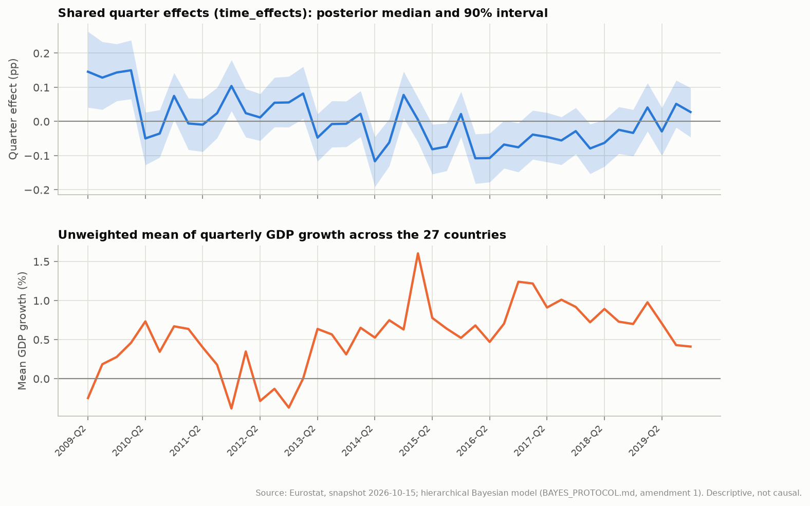
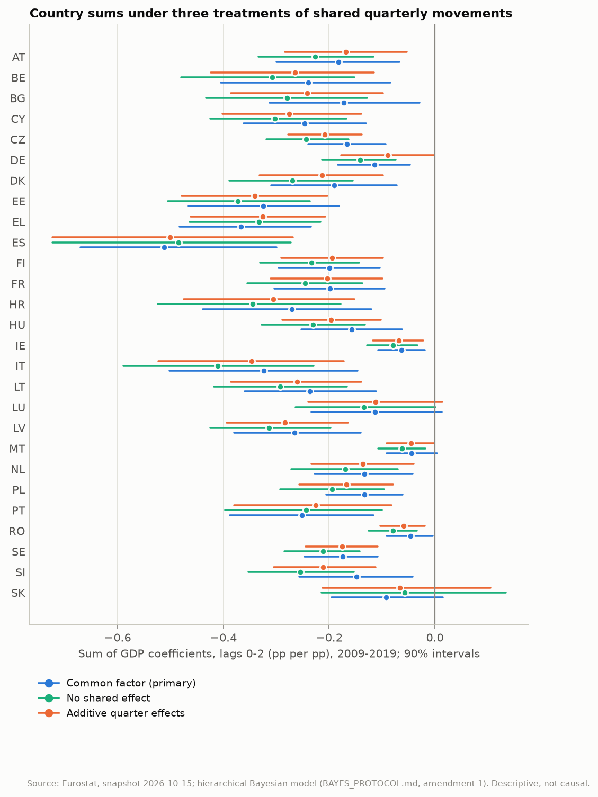
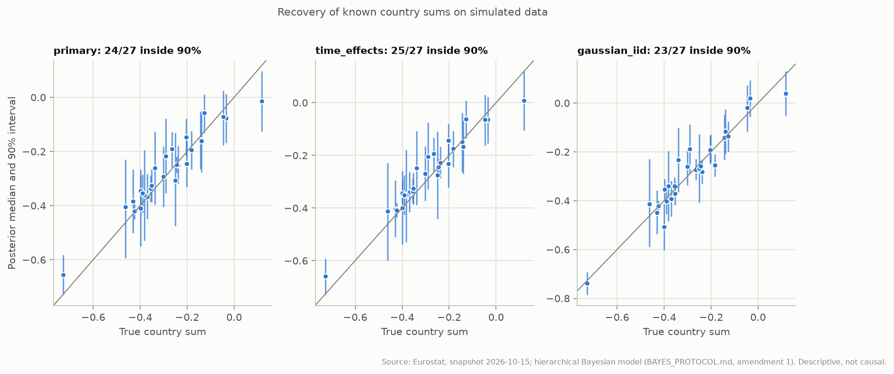

# Hierarchical Bayes: quarter effects, prior predictive checks and recovery

Generated by `eu-okun bayes-checks` from the frozen snapshot `snapshots/eurostat-2026-10-15`. Amendment 1 of [BAYES_PROTOCOL.md](../BAYES_PROTOCOL.md) (section 9) registered these checks and the three new specifications before any of them was fitted. The pre-registered results in [HIERARCHICAL_BAYES.md](HIERARCHICAL_BAYES.md) are unchanged: their robustness and claim judgements use the nine original specifications only. Everything here is a descriptive conditional association; no specification identifies a causal GDP shock.

## Summary

- `time_effects`: accepted; mu_theta -0.209 [-0.269, -0.154], tau of the quarter effects +0.085 [+0.060, +0.115] pp.
- LOO, `time_effects` vs `no_common_factor`: elpd difference +22.2 (SE 9.3), time_effects better supported.
- LOO, `time_effects_participation` vs `participation_no_common_factor`: elpd difference +24.9 (SE 9.5), time_effects_participation better supported.
- LOO, `time_effects` vs `primary`: elpd difference -23.7 (SE 9.2), primary better supported.
- LOO, `time_effects_participation` vs `time_effects`: elpd difference +20.4 (SE 7.5), time_effects_participation better supported.
- Prior predictive: simulated changes beyond 5 pp in absolute value exceed 1% of cells for 12 of 12 specifications (primary: 3.9%; median largest simulated change 21.7 pp against 3.0 pp observed). The weakly informative priors put visible mass on implausibly large quarterly changes; they are reported, not changed.
- Recovery, `primary`: 24 of 27 true country sums inside their 90% intervals (accepted fit, max R-hat 1.0091).
- Recovery, `time_effects`: 25 of 27 true country sums inside their 90% intervals (accepted fit, max R-hat 1.0068).
- Recovery, `gaussian_iid`: 23 of 27 true country sums inside their 90% intervals (not accepted fit, max R-hat 1.0104).
- An independent run (Linux replication, GitHub Actions run 38881472042) gives the same LOO verdicts; see section 6.

## 1. Additive shared quarter effects

`delta[t]` is a quarter effect common to all countries, constrained to sum to zero over the 43 quarters so that the country intercepts carry the level. With it, `theta[i]` measures the association with the country's GDP growth beyond the quarter's common effect, and `mu_theta` is identified only from cross-country differences in growth within quarters.

| Specification | Description | Convergence | Max R-hat | Min ESS | Divergences | mu_theta, median [90%] |
| --- | --- | --- | ---: | ---: | ---: | ---: |
| `primary` | Partial pooling, K=2, 2009-Q2..2019-Q4, Student-t AR(1) errors and a common factor | accepted | 1.007 | 504 | 0 | -0.198 [-0.254, -0.145] |
| `no_common_factor` | No common quarterly factor | accepted | 1.006 | 632 | 0 | -0.240 [-0.300, -0.189] |
| `participation` | Adds the participation change, partially pooled | accepted | 1.006 | 696 | 0 | -0.196 [-0.254, -0.146] |
| `time_effects` | Additive shared quarter effects (sum to zero) instead of the common factor | accepted | 1.005 | 843 | 0 | -0.209 [-0.269, -0.154] |
| `time_effects_participation` | Additive shared quarter effects plus the participation change | accepted | 1.006 | 809 | 0 | -0.209 [-0.272, -0.154] |
| `participation_no_common_factor` | The participation change, no common factor and no quarter effects | accepted | 1.005 | 742 | 0 | -0.239 [-0.297, -0.187] |

Country sums `theta[i]`, posterior median and 90% interval (alphabetical; no ranking):

| Country | primary (factor) | no_common_factor | time_effects | time_effects_participation |
| --- | ---: | ---: | ---: | ---: |
| AT | -0.182 [-0.299, -0.067] | -0.226 [-0.334, -0.116] | -0.169 [-0.284, -0.053] | -0.185 [-0.293, -0.076] |
| BE | -0.240 [-0.404, -0.084] | -0.308 [-0.479, -0.153] | -0.264 [-0.424, -0.115] | -0.263 [-0.416, -0.117] |
| BG | -0.172 [-0.313, -0.029] | -0.280 [-0.433, -0.128] | -0.241 [-0.386, -0.098] | -0.237 [-0.389, -0.089] |
| CY | -0.246 [-0.362, -0.130] | -0.302 [-0.425, -0.167] | -0.276 [-0.402, -0.139] | -0.299 [-0.420, -0.168] |
| CZ | -0.167 [-0.239, -0.093] | -0.243 [-0.318, -0.163] | -0.208 [-0.277, -0.138] | -0.203 [-0.271, -0.131] |
| DE | -0.114 [-0.184, -0.047] | -0.142 [-0.213, -0.074] | -0.089 [-0.177, -0.002] | -0.096 [-0.186, -0.004] |
| DK | -0.190 [-0.310, -0.072] | -0.270 [-0.388, -0.155] | -0.213 [-0.332, -0.098] | -0.214 [-0.331, -0.098] |
| EE | -0.324 [-0.467, -0.182] | -0.373 [-0.505, -0.236] | -0.341 [-0.479, -0.203] | -0.359 [-0.496, -0.219] |
| EL | -0.367 [-0.483, -0.234] | -0.333 [-0.464, -0.216] | -0.325 [-0.462, -0.207] | -0.336 [-0.473, -0.218] |
| ES | -0.512 [-0.670, -0.300] | -0.485 [-0.724, -0.272] | -0.501 [-0.724, -0.268] | -0.524 [-0.738, -0.277] |
| FI | -0.199 [-0.295, -0.104] | -0.233 [-0.330, -0.143] | -0.195 [-0.291, -0.098] | -0.196 [-0.296, -0.104] |
| FR | -0.199 [-0.303, -0.095] | -0.245 [-0.354, -0.137] | -0.203 [-0.310, -0.099] | -0.182 [-0.292, -0.082] |
| HR | -0.270 [-0.439, -0.120] | -0.344 [-0.524, -0.179] | -0.306 [-0.475, -0.152] | -0.250 [-0.414, -0.099] |
| HU | -0.157 [-0.252, -0.062] | -0.230 [-0.327, -0.133] | -0.196 [-0.289, -0.102] | -0.158 [-0.253, -0.071] |
| IE | -0.063 [-0.108, -0.019] | -0.079 [-0.129, -0.033] | -0.069 [-0.117, -0.022] | -0.070 [-0.116, -0.023] |
| IT | -0.323 [-0.502, -0.146] | -0.411 [-0.589, -0.229] | -0.346 [-0.523, -0.172] | -0.315 [-0.476, -0.148] |
| LT | -0.236 [-0.359, -0.112] | -0.293 [-0.417, -0.167] | -0.261 [-0.386, -0.139] | -0.253 [-0.377, -0.137] |
| LU | -0.113 [-0.234, +0.013] | -0.134 [-0.263, +0.001] | -0.112 [-0.239, +0.014] | -0.114 [-0.246, +0.012] |
| LV | -0.266 [-0.380, -0.141] | -0.313 [-0.425, -0.197] | -0.284 [-0.394, -0.165] | -0.322 [-0.452, -0.188] |
| MT | -0.044 [-0.091, +0.004] | -0.062 [-0.108, -0.018] | -0.045 [-0.091, -0.002] | -0.044 [-0.095, +0.005] |
| NL | -0.133 [-0.228, -0.042] | -0.169 [-0.271, -0.071] | -0.136 [-0.234, -0.040] | -0.142 [-0.236, -0.044] |
| PL | -0.133 [-0.206, -0.061] | -0.194 [-0.292, -0.096] | -0.167 [-0.256, -0.079] | -0.165 [-0.257, -0.078] |
| PT | -0.251 [-0.388, -0.116] | -0.244 [-0.397, -0.100] | -0.226 [-0.379, -0.082] | -0.230 [-0.386, -0.083] |
| RO | -0.046 [-0.091, -0.004] | -0.079 [-0.125, -0.034] | -0.059 [-0.103, -0.019] | -0.059 [-0.102, -0.018] |
| SE | -0.174 [-0.246, -0.109] | -0.212 [-0.285, -0.143] | -0.176 [-0.245, -0.108] | -0.179 [-0.249, -0.112] |
| SI | -0.148 [-0.256, -0.043] | -0.255 [-0.352, -0.153] | -0.212 [-0.305, -0.112] | -0.207 [-0.300, -0.109] |
| SK | -0.093 [-0.195, +0.015] | -0.057 [-0.214, +0.135] | -0.066 [-0.212, +0.106] | -0.070 [-0.215, +0.099] |

The posterior median quarter effects correlate -0.53 with average GDP growth and +0.87 with the average unemployment change across countries. A strong correlation with GDP growth means the quarter effects absorb part of the common GDP association, as the identification argument above anticipates.





## 2. With versus without shared quarter effects

PSIS-LOO over the unmasked cells of the 2009-Q2..2019-Q4 window (identical for every specification listed). Leave-one-cell-out; for AR(1) errors each term conditions on the previous quarter, so this is not temporal validation.

| Specification | elpd LOO | SE | p_loo | Cells | Pareto k > 0.7 | Reliable |
| --- | ---: | ---: | ---: | ---: | ---: | ---: |
| `primary` | -399.7 | 32.1 | 176.1 | 1124 | 10 | yes |
| `no_common_factor` | -445.6 | 31.5 | 114.0 | 1124 | 5 | yes |
| `participation` | -377.8 | 31.9 | 199.1 | 1124 | 10 | yes |
| `time_effects` | -423.4 | 31.8 | 145.5 | 1124 | 6 | yes |
| `time_effects_participation` | -402.9 | 31.6 | 169.6 | 1124 | 7 | yes |
| `participation_no_common_factor` | -427.9 | 31.1 | 138.2 | 1124 | 8 | yes |

Registered comparisons (A minus B; 'better supported' when the difference exceeds twice its standard error):

| A | B | elpd difference | SE | Verdict | Reliable |
| --- | --- | ---: | ---: | --- | --- |
| `time_effects` | `no_common_factor` | +22.2 | 9.3 | time_effects better supported | yes |
| `time_effects_participation` | `participation_no_common_factor` | +24.9 | 9.5 | time_effects_participation better supported | yes |
| `time_effects` | `primary` | -23.7 | 9.2 | primary better supported | yes |
| `time_effects_participation` | `time_effects` | +20.4 | 7.5 | time_effects_participation better supported | yes |

Posterior predictive check of the average cross-country correlation (p-value: share of replications at least as large as observed):

| Specification | Observed | Replicated mean | p-value | One-step 90% coverage |
| --- | ---: | ---: | ---: | ---: |
| `primary` | 0.168 | 0.152 | 0.36 | 0.94 |
| `no_common_factor` | 0.168 | 0.042 | 0.00 | 0.92 |
| `participation` | 0.168 | 0.154 | 0.36 | 0.94 |
| `time_effects` | 0.168 | 0.095 | 0.04 | 0.93 |
| `time_effects_participation` | 0.168 | 0.097 | 0.04 | 0.93 |
| `participation_no_common_factor` | 0.168 | 0.043 | 0.00 | 0.93 |

## 3. Prior predictive checks

1000 prior draws per specification, each propagated to a simulated data set on the real design. 5%, 50% and 95% quantiles; the observed value is in the last row. The priors were fixed in advance and are not changed by this check.

| Specification | Mean country SD (pp) | Largest |change| (pp) | Lag-1 autocorrelation | Cross-country correlation | Cells beyond 5 pp |
| --- | ---: | ---: | ---: | ---: | ---: |
| `primary` | 0.68 / 1.43 / 3.43 | 8.11 / 21.70 / 49.86 | -0.41 / -0.03 / 0.30 | 0.01 / 0.10 / 0.23 | 3.9% |
| `wide_priors` | 2.79 / 10.19 / 2.63e+04 | 40.80 / 257.75 / 1.31e+06 | -0.73 / -0.06 / 0.55 | -0.01 / 0.08 / 0.26 | 49.8% |
| `strong_pooling` | 0.66 / 1.40 / 3.43 | 7.98 / 21.55 / 47.62 | -0.43 / -0.04 / 0.30 | 0.01 / 0.10 / 0.24 | 3.8% |
| `no_pooling` | 1.11 / 1.37 / 1.79 | 10.25 / 19.92 / 46.27 | -0.15 / -0.05 / 0.06 | 0.00 / 0.04 / 0.08 | 2.5% |
| `no_common_factor` | 0.66 / 1.40 / 3.39 | 8.13 / 21.39 / 49.33 | -0.43 / -0.04 / 0.33 | -0.00 / 0.06 / 0.17 | 3.9% |
| `gaussian_iid` | 0.65 / 1.30 / 2.44 | 7.64 / 20.72 / 46.48 | -0.33 / -0.03 / 0.27 | 0.00 / 0.07 / 0.19 | 2.4% |
| `participation` | 0.72 / 1.41 / 3.07 | 8.21 / 21.52 / 53.80 | -0.42 / -0.04 / 0.34 | 0.01 / 0.09 / 0.21 | 3.7% |
| `lags_4` | 1.01 / 1.87 / 3.83 | 11.47 / 25.43 / 60.40 | -0.36 / 0.01 / 0.36 | 0.01 / 0.10 / 0.22 | 5.6% |
| `pandemic_excluded` | 0.66 / 1.40 / 3.59 | 7.99 / 21.62 / 51.98 | -0.42 / -0.04 / 0.30 | 0.00 / 0.09 / 0.22 | 3.8% |
| `time_effects` | 0.69 / 1.44 / 3.42 | 8.15 / 21.68 / 49.73 | -0.40 / -0.04 / 0.30 | 0.00 / 0.11 / 0.37 | 3.9% |
| `time_effects_participation` | 0.72 / 1.42 / 3.07 | 8.22 / 21.50 / 53.74 | -0.41 / -0.04 / 0.34 | 0.01 / 0.10 / 0.36 | 3.7% |
| `participation_no_common_factor` | 0.69 / 1.38 / 3.15 | 8.24 / 21.39 / 50.06 | -0.43 / -0.03 / 0.36 | -0.00 / 0.06 / 0.17 | 3.8% |
| **observed (primary window)** | 0.49 | 3.00 | 0.27 | 0.17 |  |

## 4. Posterior recovery on synthetic data

One data set per specification, simulated on the real design from parameters fixed in code (mu_theta = -0.30, tau_theta = 0.15), fitted with the protocol settings. With 27 countries, 21 to 27 true values inside the 90% intervals is consistent with calibration (central 95% of the binomial distribution); the last column gives that range for each row. A single data set is a recovery check, not simulation-based calibration.

| Specification | Parameter | Values | Inside 50% | Inside 90% | Consistent range |
| --- | --- | ---: | ---: | ---: | --- |
| `primary` | theta | 27 | 15 (56%) | 24 (89%) | 21-27 |
| `primary` | beta0 | 27 | 14 (52%) | 22 (81%) | 21-27 |
| `primary` | alpha | 27 | 17 (63%) | 26 (96%) | 21-27 |
| `primary` | sigma | 27 | 14 (52%) | 24 (89%) | 21-27 |
| `primary` | phi | 27 | 9 (33%) | 21 (78%) | 21-27 |
| `primary` | lam | 27 | 14 (52%) | 23 (85%) | 21-27 |
| `primary` | f | 43 | 25 (58%) | 32 (74%) | 35-42 **outside** |
| `time_effects` | theta | 27 | 15 (56%) | 25 (93%) | 21-27 |
| `time_effects` | beta0 | 27 | 14 (52%) | 22 (81%) | 21-27 |
| `time_effects` | alpha | 27 | 16 (59%) | 26 (96%) | 21-27 |
| `time_effects` | sigma | 27 | 18 (67%) | 23 (85%) | 21-27 |
| `time_effects` | phi | 27 | 12 (44%) | 23 (85%) | 21-27 |
| `time_effects` | quarter_effect | 43 | 19 (44%) | 39 (91%) | 35-42 |
| `gaussian_iid` | theta | 27 | 16 (59%) | 23 (85%) | 21-27 |
| `gaussian_iid` | beta0 | 27 | 12 (44%) | 23 (85%) | 21-27 |
| `gaussian_iid` | alpha | 27 | 11 (41%) | 23 (85%) | 21-27 |
| `gaussian_iid` | sigma | 27 | 11 (41%) | 26 (96%) | 21-27 |

90% coverage outside the range expected under calibration: `primary` f (32/43). These intervals are too narrow for those parameters in this data set.

Hyperparameters: the generating value, its realised sample analogue in the simulated data (the posterior conditions on the simulated country sums and quarter effects, so it centres on these), and the 90% interval. The registered check is whether the generating value lies inside.

| Specification | Hyperparameter | Generating value | Realised in the data | 90% interval | Inside |
| --- | --- | ---: | ---: | ---: | --- |
| `primary` | mu_theta | -0.300 | -0.281 | [-0.326, -0.214] | yes |
| `primary` | tau_theta | +0.150 | +0.165 | [+0.119, +0.204] | yes |
| `primary` | nu | +8.000 |  | [+8.307, +36.777] | **no** |
| `time_effects` | mu_theta | -0.300 | -0.281 | [-0.319, -0.205] | yes |
| `time_effects` | tau_theta | +0.150 | +0.165 | [+0.121, +0.207] | yes |
| `time_effects` | nu | +8.000 |  | [+7.373, +29.338] | yes |
| `time_effects` | tau_quarter | +0.150 | +0.114 | [+0.083, +0.127] | **no** |
| `gaussian_iid` | mu_theta | -0.300 | -0.281 | [-0.337, -0.218] | yes |
| `gaussian_iid` | tau_theta | +0.150 | +0.165 | [+0.141, +0.233] | yes |



## 5. Posterior artifacts

Every fit directory holds `posterior.nc`, an ArviZ-compatible NetCDF file (xarray DataTree) with the groups `posterior`, `prior`, `prior_predictive`, `observed_data`, `constant_data` and `log_likelihood`, plus `sample_stats` for fits run after this amendment. Root attributes record the sampler settings and seed, software versions, snapshot hashes and diagnostics. The nine original fits were exported from their saved draws (`eu-okun bayes-export`), so their files have no `sample_stats` group.

```python
import xarray as xr
tree = xr.open_datatree("results/bayes/primary/posterior.nc", engine="h5netcdf")
```

## 6. Replication on a second platform

Linux replication, GitHub Actions run 38881472042: the same snapshot, lock file, seeds, sampler settings and single retry. Its results are in `replication-linux/`.

| A | B | elpd difference (SE), this run | Verdict | elpd difference (SE), replication | Verdict |
| --- | --- | ---: | --- | ---: | --- |
| `time_effects` | `no_common_factor` | +22.2 (9.3) | time_effects better supported | +20.9 (9.3) | time_effects better supported |
| `time_effects_participation` | `participation_no_common_factor` | +24.9 (9.5) | time_effects_participation better supported | +24.5 (9.6) | time_effects_participation better supported |
| `time_effects` | `primary` | -23.7 (9.2) | primary better supported | -24.9 (9.6) | primary better supported |
| `time_effects_participation` | `time_effects` | +20.4 (7.5) | time_effects_participation better supported | +20.6 (7.5) | time_effects_participation better supported |

- Convergence: acceptance differs for `strong_pooling` (this run accepted, replication failed, R-hat 1.007 / 1.017); `no_pooling` (this run failed, replication accepted, R-hat 1.011 / 1.005).
- Recovery, `primary`: 24/27 country sums inside 90% intervals here (accepted), 24/27 in the replication (accepted).
- Recovery, `time_effects`: 25/27 country sums inside 90% intervals here (accepted), 24/27 in the replication (accepted).
- Recovery, `gaussian_iid`: 23/27 country sums inside 90% intervals here (not accepted), 24/27 in the replication (accepted).

## 7. Limitations

- Quarter effects absorb every common movement, including the part of GDP growth that all countries share, so `theta` under quarter effects is a within-quarter association and not comparable one-to-one with the primary estimand.
- PSIS-LOO leaves out single cells; it rewards fitting the in-sample quarter effects, which are informed by the other 26 countries in the same quarter. Temporal predictive performance is assessed separately (PREDICTIVE_PROTOCOL.md).
- One synthetic data set per specification checks recovery, not calibration.
- None of these models identifies a structural GDP shock.

## 8. Reproduction

```bash
poetry run eu-okun bayes-fit --data-dir snapshots/eurostat-2026-10-15 --output-dir results/bayes --specs time_effects,time_effects_participation,participation_no_common_factor --retry-warmup 3000
poetry run eu-okun bayes-export --fits-dir results/bayes --data-dir snapshots/eurostat-2026-10-15
poetry run eu-okun bayes-recovery --data-dir snapshots/eurostat-2026-10-15 --output-dir results/bayes-recovery
poetry run eu-okun bayes-checks --fits-dir results/bayes --data-dir snapshots/eurostat-2026-10-15 --output-dir docs/bayes-checks --report docs/BAYES_MODEL_CHECKS.md --recovery-dir results/bayes-recovery --replication-dir docs/bayes-checks/replication-linux
```
