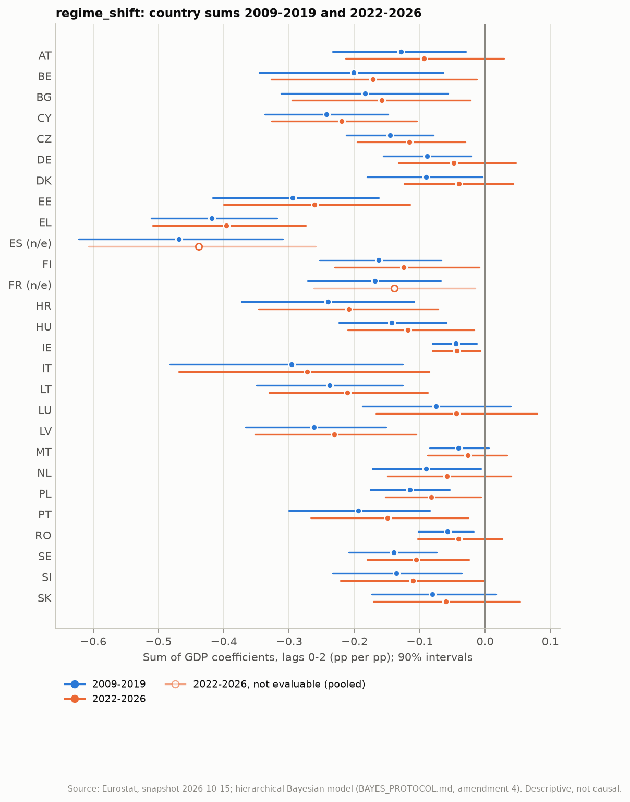
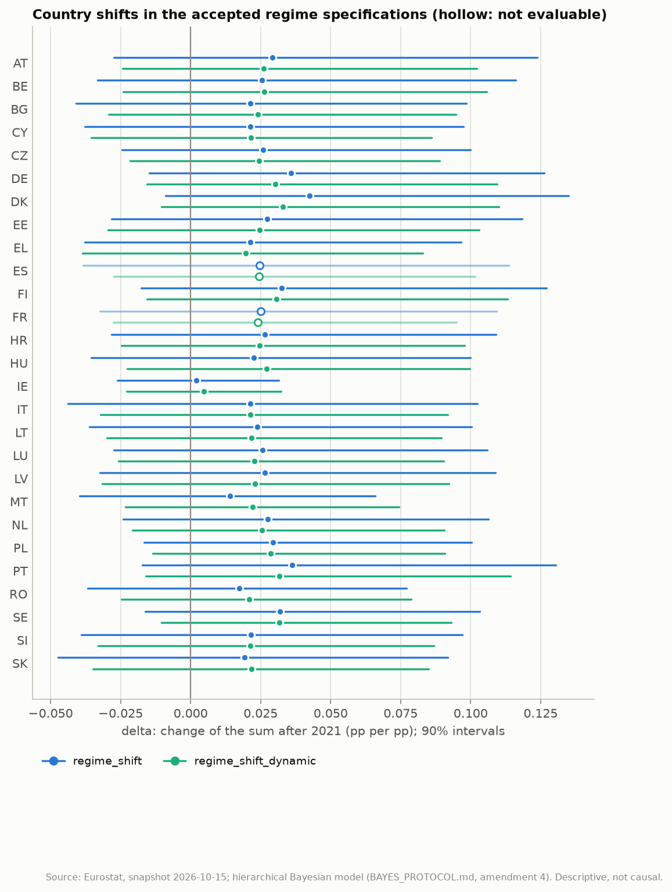
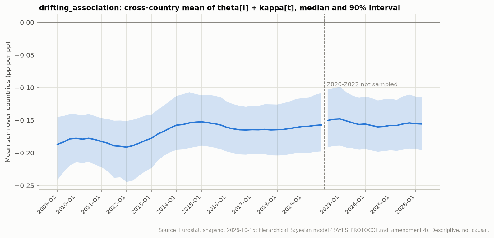

# Hierarchical Bayes: regime-specific and time-varying coefficients

Generated by `eu-okun bayes-regimes` from the frozen snapshot `snapshots/eurostat-2026-10-15`. Amendment 4 of [BAYES_PROTOCOL.md](../BAYES_PROTOCOL.md) (section 12) registered the five specifications, their estimands and every decision rule below before any of them was fitted. They are reported alongside the earlier results, which they do not replace. Every coefficient is a descriptive conditional association. A shift after 2021 may reflect measurement (definitions, provisional data), a different mix of shocks (the energy shock, inflation) or a changed labour-market response; this study cannot separate them ([IDENTIFICATION_RESULTS.md](IDENTIFICATION_RESULTS.md)).

## Summary

- `regime_shift_final_gdp` failed the acceptance criteria after the single retry (R-hat 1.012 > 1.01 (phi[9]); ESS 356 < 400 (phi[9])); its results are not used.
- Average shift of the GDP coefficient sum after 2021 (`regime_shift`): mu_delta +0.028 [-0.007, +0.072], P(> 0) = 0.902: **no credible change**. The mean sum over the 25 evaluable countries moves from -0.164 [-0.195, -0.134] (2009-2019) to -0.136 [-0.173, -0.095] (2022-2026).
- Country shifts (`regime_shift`): rises in 0 (none), falls in 0 (none), no credible change in 25; not evaluable: ES and FR (fewer than 12 post-2021 terms).
- After 2021 the sum is credibly negative in 17 evaluable countries (BE, BG, CY, CZ, EE, EL, FI, HR, HU, IE, IT, LT, LV, PL, PT, SE and SI).
- Without the terms that use provisional GDP: not available, because `regime_shift_final_gdp` failed the acceptance criteria.
- With the ARDL and AR(1) factor dynamics: average shift no credible change (P = 0.910); no country verdict changes.
- Common drift (`drifting_association`): D1 (2014-2019 minus 2009-2013) +0.021 [-0.002, +0.054], no credible change; D2 (2022-2026 minus 2014-2019) +0.004 [-0.015, +0.027], no credible change.
- PSIS-LOO `regime_shift` against `pandemic_excluded`: +9.9 (SE 5.8), not distinguishable.
- PSIS-LOO `drifting_association` against `pandemic_excluded`: +14.2 (SE 6.0), drifting_association better supported.
- PSIS-LOO `drifting_association` against `regime_shift`: +4.3 (SE 1.8), drifting_association better supported; the replication gives +3.5 (SE 1.8), not distinguishable, so this verdict is not stable.
- PSIS-LOO `regime_shift_dynamic` against `pandemic_excluded_dynamic`: +6.2 (SE 6.8), not distinguishable.
- Recovery of a known average shift of +0.15: detected (P(mu_delta > 0) = 1.000); 23 of 25 country shifts inside their 90% intervals (consistent range 19-25).
- Replication (Linux replication, GitHub Actions run 38983863147): 1 verdict differs and is not treated as established: PSIS-LOO `drifting_association` against `regime_shift` (drifting_association better supported here, +4.3 SE 1.8; not distinguishable in the replication, +3.5 SE 1.8). Every other verdict is the same.

## 1. Convergence

Same sampler, acceptance criteria and single retry as sections 4 and 6 (4 chains x 1000 draws; the retry uses 3000 warm-up iterations).

| Specification | Accepted | Max R-hat | Min ESS | Divergences | Min E-BFMI | Warm-up |
| --- | --- | ---: | ---: | ---: | ---: | ---: |
| `pandemic_excluded` | yes | 1.0085 (phi[9]) | 486 | 0 | 0.50 | 1000 |
| `regime_shift` | yes | 1.0074 (tau_log_sigma) | 586 | 0 | 0.56 | 1000 |
| `regime_shift_final_gdp` | **no** | 1.0124 (phi[9]) | 356 | 0 | 0.54 | 3000 |
| `pandemic_excluded_dynamic` | yes | 1.0066 (rho_f) | 612 | 0 | 0.42 | 1000 |
| `regime_shift_dynamic` | yes | 1.0098 (tau_log_sigma) | 565 | 0 | 0.50 | 1000 |
| `drifting_association` | yes | 1.0056 (phi_logit_raw[23]) | 522 | 0 | 0.62 | 3000 |

## 2. Prior and posterior predictive checks

Prior predictive (section 9.3, 1000 draws): 5%, 50% and 95% quantiles of simulated statistics; the observed values are in the last row.

| Specification | Mean country SD (pp) | Largest absolute change (pp) | Lag-1 autocorrelation | Cells beyond 5 pp |
| --- | ---: | ---: | ---: | ---: |
| `pandemic_excluded` | 0.66 / 1.40 / 3.59 | 7.99 / 21.62 / 51.98 | -0.42 / -0.04 / 0.30 | 3.8% |
| `regime_shift` | 0.73 / 1.43 / 3.74 | 8.77 / 22.21 / 56.84 | -0.38 / -0.01 / 0.35 | 4.3% |
| `regime_shift_final_gdp` | 0.74 / 1.44 / 3.77 | 8.77 / 22.21 / 56.70 | -0.38 / -0.01 / 0.33 | 4.3% |
| `pandemic_excluded_dynamic` | 0.72 / 1.51 / 3.59 | 8.39 / 23.27 / 57.50 | -0.64 / -0.09 / 0.53 | 5.0% |
| `regime_shift_dynamic` | 0.80 / 1.59 / 3.79 | 9.13 / 23.53 / 59.84 | -0.60 / -0.05 / 0.57 | 5.2% |
| `drifting_association` | 0.72 / 1.44 / 3.61 | 8.71 / 22.07 / 55.23 | -0.39 / -0.02 / 0.33 | 3.9% |
| **observed** | 0.45 | 3.00 | 0.26 |  |

Posterior predictive checks written with each fit (p = share of replications at or above the observed statistic; one-step coverage over the likelihood cells):

| Specification | p, lag-1 autocorr. | p, cross-country corr. | p, mean SD | 50% coverage | 90% coverage |
| --- | ---: | ---: | ---: | ---: | ---: |
| `pandemic_excluded` | 0.000 | 0.395 | 0.110 | 0.561 | 0.925 |
| `regime_shift` | 0.000 | 0.310 | 0.115 | 0.566 | 0.930 |
| `regime_shift_final_gdp` | 0.000 | 0.228 | 0.040 | 0.563 | 0.931 |
| `pandemic_excluded_dynamic` | 0.147 | 0.190 | 0.172 | 0.541 | 0.917 |
| `regime_shift_dynamic` | 0.105 | 0.090 | 0.135 | 0.539 | 0.920 |
| `drifting_association` | 0.000 | 0.282 | 0.107 | 0.561 | 0.929 |

## 3. The average shift

`mu_delta` is the pooled mean of the country shifts of the GDP coefficient sum; the means of the pre- and post-2021 sums are unweighted over the evaluable countries of each specification. In `regime_shift_dynamic` the sums are short-run; the long-run shift is `delta / (1 - psi)` and has the same sign.

| Specification | mu_delta | P(> 0) | Verdict | tau_delta | Mean sum 2009-2019 | Mean sum 2022-2026 | Median 1 / (1 - psi) |
| --- | ---: | ---: | --- | ---: | ---: | ---: | ---: |
| `regime_shift` | +0.028 [-0.007, +0.072] | 0.902 | no credible change | +0.031 [+0.003, +0.073] | -0.164 [-0.195, -0.134] | -0.136 [-0.173, -0.095] | - |
| `regime_shift_final_gdp` | failed acceptance; not used | - | - | - | - | - | - |
| `regime_shift_dynamic` | +0.026 [-0.005, +0.066] | 0.910 | no credible change | +0.025 [+0.003, +0.063] | -0.123 [-0.158, -0.089] | -0.096 [-0.136, -0.054] | 0.99 |

## 4. Country shifts

`regime_shift`, by country: post-2021 terms in the likelihood (a country is evaluable with at least 12); the 2009-2019 and 2022-2026 sums and their difference `delta` (median, 90% interval); the verdict of section 12.5 ('rises': P(delta > 0) >= 0.95); the same verdict in the two sensitivity specifications (n/e: not evaluable); and the classical review's weaker-after-2021 rule, recomputed from its tables.

| Country | Post terms | Sum 2009-2019 | Sum 2022-2026 | delta | P(delta > 0) | Verdict | Final GDP only (terms) | Dynamic | Classical |
| --- | ---: | ---: | ---: | ---: | ---: | --- | --- | --- | --- |
| AT | 16 | -0.128 [-0.233, -0.029] | -0.094 [-0.213, +0.029] | +0.029 [-0.027, +0.124] | 0.814 | - | failed | - | - |
| BE | 16 | -0.202 [-0.346, -0.064] | -0.172 [-0.327, -0.013] | +0.025 [-0.033, +0.116] | 0.779 | - | failed | - | - |
| BG | 14 | -0.184 [-0.312, -0.057] | -0.158 [-0.295, -0.022] | +0.021 [-0.041, +0.098] | 0.740 | - | failed | - | - |
| CY | 16 | -0.243 [-0.337, -0.149] | -0.220 [-0.326, -0.104] | +0.021 [-0.038, +0.097] | 0.755 | - | failed | - | weaker |
| CZ | 16 | -0.145 [-0.212, -0.079] | -0.116 [-0.195, -0.030] | +0.026 [-0.025, +0.100] | 0.804 | - | failed | - | weaker |
| DE | 16 | -0.089 [-0.156, -0.021] | -0.048 [-0.133, +0.047] | +0.036 [-0.015, +0.126] | 0.864 | - | failed | - | weaker |
| DK | 14 | -0.090 [-0.181, -0.004] | -0.040 [-0.124, +0.043] | +0.042 [-0.009, +0.135] | 0.902 | - | failed | - | weaker |
| EE | 16 | -0.295 [-0.417, -0.163] | -0.261 [-0.400, -0.115] | +0.027 [-0.028, +0.118] | 0.800 | - | failed | - | weaker |
| EL | 16 | -0.419 [-0.511, -0.319] | -0.396 [-0.508, -0.275] | +0.021 [-0.038, +0.097] | 0.753 | - | failed | - | - |
| ES | 0 | -0.469 [-0.622, -0.310] | n/e | (+0.025, pooled) | - | n/e | failed | n/e | weaker |
| FI | 16 | -0.163 [-0.253, -0.067] | -0.125 [-0.230, -0.009] | +0.032 [-0.018, +0.127] | 0.853 | - | failed | - | weaker |
| FR | 0 | -0.169 [-0.271, -0.068] | n/e | (+0.025, pooled) | - | n/e | failed | n/e | - |
| HR | 16 | -0.240 [-0.373, -0.108] | -0.208 [-0.347, -0.072] | +0.026 [-0.028, +0.109] | 0.803 | - | failed | - | weaker |
| HU | 16 | -0.143 [-0.224, -0.059] | -0.118 [-0.210, -0.017] | +0.023 [-0.035, +0.100] | 0.764 | - | failed | - | - |
| IE | 16 | -0.045 [-0.081, -0.013] | -0.043 [-0.081, -0.007] | +0.002 [-0.026, +0.031] | 0.543 | - | failed | - | - |
| IT | 16 | -0.296 [-0.482, -0.126] | -0.272 [-0.469, -0.085] | +0.021 [-0.044, +0.102] | 0.730 | - | failed | - | weaker |
| LT | 16 | -0.238 [-0.349, -0.126] | -0.211 [-0.331, -0.088] | +0.024 [-0.036, +0.100] | 0.772 | - | failed | - | - |
| LU | 16 | -0.075 [-0.188, +0.039] | -0.044 [-0.167, +0.080] | +0.026 [-0.027, +0.106] | 0.791 | - | failed | - | - |
| LV | 16 | -0.262 [-0.367, -0.152] | -0.230 [-0.352, -0.105] | +0.026 [-0.032, +0.109] | 0.790 | - | failed | - | - |
| MT | 16 | -0.041 [-0.085, +0.006] | -0.027 [-0.088, +0.034] | +0.014 [-0.040, +0.066] | 0.696 | - | failed | - | - |
| NL | 16 | -0.090 [-0.173, -0.006] | -0.058 [-0.149, +0.040] | +0.028 [-0.024, +0.106] | 0.819 | - | failed | - | weaker |
| PL | 16 | -0.115 [-0.175, -0.055] | -0.082 [-0.152, -0.006] | +0.029 [-0.017, +0.100] | 0.846 | - | failed | - | weaker |
| PT | 16 | -0.194 [-0.300, -0.085] | -0.149 [-0.267, -0.026] | +0.036 [-0.017, +0.130] | 0.861 | - | failed | - | weaker |
| RO | 16 | -0.058 [-0.102, -0.018] | -0.041 [-0.103, +0.026] | +0.017 [-0.037, +0.077] | 0.721 | - | failed | - | - |
| SE | 16 | -0.140 [-0.208, -0.074] | -0.105 [-0.181, -0.024] | +0.032 [-0.016, +0.103] | 0.860 | - | failed | - | - |
| SI | 16 | -0.136 [-0.233, -0.036] | -0.110 [-0.221, -0.000] | +0.022 [-0.039, +0.097] | 0.760 | - | failed | - | weaker |
| SK | 16 | -0.080 [-0.173, +0.017] | -0.060 [-0.171, +0.054] | +0.019 [-0.047, +0.092] | 0.732 | - | failed | - | - |

- The classical rule marks 13 countries (CY, CZ, DE, DK, EE, ES, FI, HR, IT, NL, PL, PT and SI); 12 of them are evaluable here, and the shift rises credibly in 0 (none). Countries that rise here but are not in the classical set: none.
- The two rules answer related but different questions, on different designs:
  - classical: country-by-country OLS with K = 1, a post-2021 sample of 17 quarters from 2022-Q2, no common factor and no intercept shift, judged by whether every leave-one-out post-2021 sum lies above the 2009-2019 95% interval;
  - here: K = 2, a post-2021 sample of 16 quarters from 2022-Q3, partial pooling of the shifts, a common factor and post-2021 intercept and scale shifts, judged by a posterior probability.
- Which of these differences drives the disagreement is not tested here.



## 5. Provisional GDP and dynamics

- `regime_shift_final_gdp` failed the acceptance criteria after the single retry (R-hat 1.012 > 1.01 (phi[9]); ESS 356 < 400 (phi[9])), so the sensitivity to provisional GDP cannot be judged; none of its estimates is used.
- `regime_shift_dynamic`: 25 countries evaluable in both specifications. No verdict changes.



## 6. A gradual or an abrupt change?

`drifting_association` lets the GDP coefficient sum of every country move with a common random walk `kappa[t]`. `D1` and `D2` contrast period means of the walk; the random walk cannot place a change inside the unobserved 2020-2022 gap.

| Quantity | Median [90%] | P(> 0) | Verdict |
| --- | ---: | ---: | --- |
| tau_kappa (per quarter) | +0.008 [+0.001, +0.021] | - | - |
| D1 | +0.021 [-0.002, +0.054] | 0.915 | no credible change |
| D2 | +0.004 [-0.015, +0.027] | 0.632 | no credible change |



## 7. PSIS-LOO

Each comparison scores both fits on the cells common to them; 'better supported' needs an elpd difference above twice its standard error. `regime_shift_final_gdp` has fewer cells and is not compared.

| A | B | Cells | elpd A - B | SE | Verdict | Pareto k > 0.7 | Reliable |
| --- | --- | ---: | ---: | ---: | --- | ---: | --- |
| `regime_shift` | `pandemic_excluded` | 1520 | +9.9 | 5.8 | not distinguishable | 4 / 3 | yes |
| `drifting_association` | `pandemic_excluded` | 1520 | +14.2 | 6.0 | drifting_association better supported | 9 / 3 | yes |
| `drifting_association` | `regime_shift` | 1520 | +4.3 | 1.8 | drifting_association better supported | 9 / 4 | yes |
| `regime_shift_dynamic` | `pandemic_excluded_dynamic` | 1469 | +6.2 | 6.8 | not distinguishable | 3 / 1 | yes |

## 8. Recovery of a known shift

One data set simulated from `regime_shift` on the real design (seed 20261021) with mu_delta = +0.15 and tau_delta = 0.10; the realised mean of the 27 shifts is +0.168. Fit accepted (max R-hat 1.0088).

- mu_delta: median +0.167, 90% interval [+0.104, +0.226], P(> 0) = 1.000: the average-shift rule detects the known shift.
- Country shifts: 23 of 25 evaluable true values inside their 90% intervals (consistent with calibration: 19-25), 13 inside their 50% intervals.
- Pre-2020 sums: 24 of 27 inside their 90% intervals.
- One data set is a check of the machinery, not a power analysis.

## 9. What this changes

The new specifications are reported alongside the earlier results and do not replace them. The pre-registered judgements of HIERARCHICAL_BAYES.md, BAYES_ROBUSTNESS.md and BAYES_DYNAMICS.md keep their own specification sets. Spain and France have no post-2021 terms (definition change), so nothing here describes them after 2021.

## 10. Replication on a second platform

Linux replication, GitHub Actions run 38983863147: the same snapshot, lock file, seeds, sampler settings and single retry. Its results are in `replication-linux/`.

| Specification | Accepted (here / there) | Warm-up (here / there) | mu_delta median (here / there) | Largest delta median difference |
| --- | --- | --- | ---: | ---: |
| `pandemic_excluded` | yes / yes | 1000 / 1000 | - | - |
| `regime_shift` | yes / yes | 1000 / 1000 | +0.028 / +0.028 | 0.001 |
| `regime_shift_final_gdp` | no / no | 3000 / 3000 | - | - |
| `pandemic_excluded_dynamic` | yes / yes | 1000 / 1000 | - | - |
| `regime_shift_dynamic` | yes / yes | 1000 / 1000 | +0.026 / +0.026 | 0.001 |
| `drifting_association` | yes / yes | 3000 / 3000 | - | - |

Verdicts that differ between the two runs: PSIS-LOO `drifting_association` against `regime_shift` (drifting_association better supported here, +4.3 SE 1.8; not distinguishable in the replication, +3.5 SE 1.8).

## Reproduce

```bash
poetry install --extras "bayes report"
poetry run eu-okun bayes-fit --data-dir snapshots/eurostat-2026-10-15 \
  --output-dir results/bayes --specs pandemic_excluded,regime_shift,regime_shift_final_gdp,pandemic_excluded_dynamic,regime_shift_dynamic,drifting_association --retry-warmup 3000
poetry run eu-okun bayes-regime-recovery --data-dir snapshots/eurostat-2026-10-15 --output-dir results/bayes-regime-recovery
poetry run eu-okun bayes-regimes --fits-dir results/bayes --data-dir snapshots/eurostat-2026-10-15 --output-dir docs/bayes-regimes --report docs/BAYES_REGIMES.md --recovery-dir results/bayes-regime-recovery --replication-dir docs/bayes-regimes/replication-linux
```
