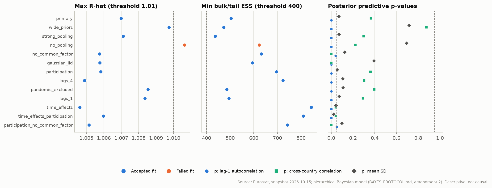
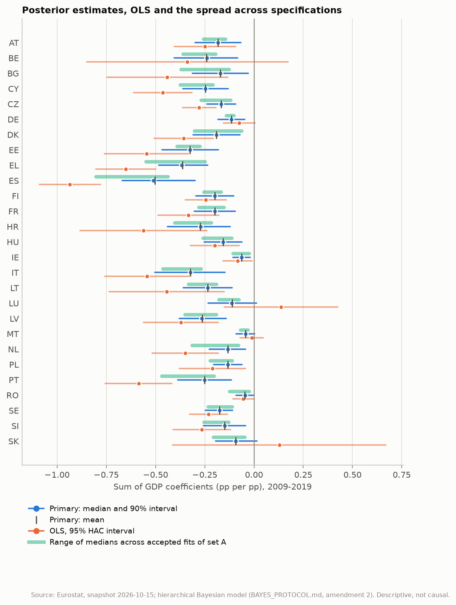
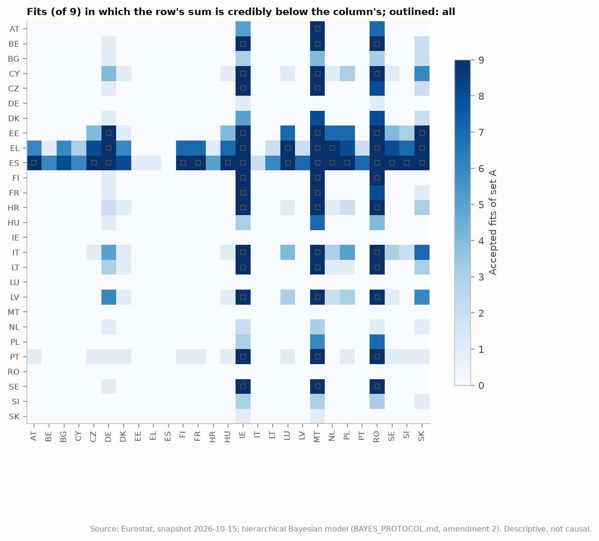
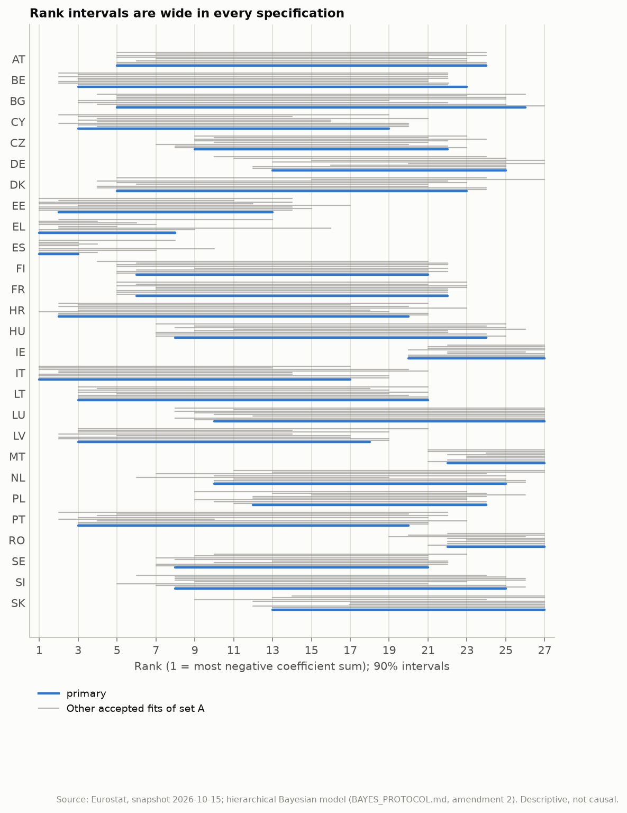
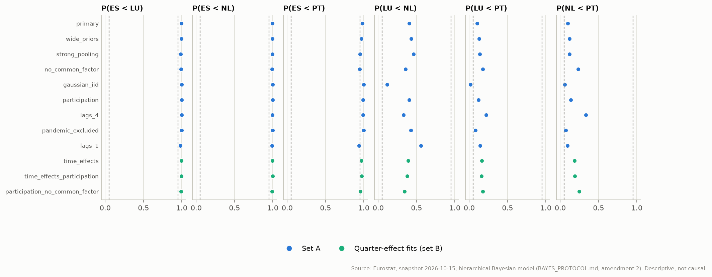

# Hierarchical Bayes: robustness of country differences and ranks

Generated by `eu-okun bayes-robustness` from the saved posterior draws of the frozen snapshot `snapshots/eurostat-2026-10-15`. The rules were registered in amendment 2 of [BAYES_PROTOCOL.md](../BAYES_PROTOCOL.md) (section 10) before any cross-specification pairwise or rank result was computed and before `lags_1` was fitted. Everything here is a descriptive conditional association: a posterior probability that one country's coefficient sum is below another's is not evidence of a causal difference in labour markets.

## Summary

- **Fits.** Set A (registered): 9 of 10 specifications accepted; set B (with quarter effects): 12 accepted. Failed: `no_pooling`.
- **Country differences.** 99 of 351 pairs are credible (P >= 0.95) in `primary`; 59 survive in every accepted fit of set A and 59 in set B. 40 pairs credible in `primary` do not survive.
- **Ranks.** The median width of the 90% rank interval is 15 places in `primary` and 18 places across set A (envelope). No country's rank is established; positions are described only through surviving pairs.
- **Focus countries.** ES-LU: survives; ES-NL: survives; ES-PT: does not survive; LU-NL: does not survive; LU-PT: not supported by either; NL-PT: not supported by either.
- **Coefficient sums.** `theta` equals `beta0 + sum_k b_k` draw by draw in every fit (largest absolute deviation 1.1e-16).

## 1. Specifications, convergence and predictive checks

Acceptance (protocol, section 6): R-hat <= 1.01 (rank-normalised), bulk and tail ESS >= 400, no divergent transitions, E-BFMI >= 0.3 in every chain. Failed fits stay listed and are excluded from every robustness judgement. Posterior predictive p-values: share of replications at least as large as observed.

| Fit | Set | Status | Max R-hat | Min bulk ESS | Min tail ESS | Divergences | Min E-BFMI | Tree depth hits | p: lag-1 autocorr. | p: cross-country corr. | p: mean SD | One-step 90% coverage |
| --- | --- | --- | ---: | ---: | ---: | ---: | ---: | ---: | ---: | ---: | ---: | ---: |
| `primary` | A | accepted | 1.007 | 648 | 504 | 0 | 0.52 | 0 | 0.00 | 0.36 | 0.07 | 0.94 |
| `wide_priors` | A | accepted | 1.010 | 596 | 473 | 0 | 0.52 | 0 | 0.00 | 0.88 | 0.72 | 0.93 |
| `strong_pooling` | A | accepted | 1.007 | 437 | 589 | 0 | 0.61 | 0 | 0.00 | 0.30 | 0.07 | 0.94 |
| `no_pooling` | A | **failed** | 1.011 | 623 | 1257 | 0 | 0.68 | 0 | 0.00 | 0.22 | 0.69 | 0.94 |
| `no_common_factor` | A | accepted | 1.006 | 632 | 1262 | 0 | 0.62 | 0 | 0.04 | 0.00 | 0.12 | 0.92 |
| `gaussian_iid` | A | accepted | 1.006 | 594 | 605 | 0 | 0.61 | 0 | 0.00 | 0.00 | 0.39 | 0.93 |
| `participation` | A | accepted | 1.006 | 810 | 696 | 0 | 0.57 | 0 | 0.00 | 0.36 | 0.06 | 0.94 |
| `lags_4` | A | accepted | 1.005 | 724 | 798 | 0 | 0.59 | 0 | 0.00 | 0.30 | 0.11 | 0.94 |
| `pandemic_excluded` | A | accepted | 1.009 | 486 | 545 | 0 | 0.50 | 0 | 0.00 | 0.40 | 0.11 | 0.93 |
| `lags_1` | A | accepted | 1.008 | 495 | 793 | 0 | 0.53 | 0 | 0.00 | 0.29 | 0.07 | 0.93 |
| `time_effects` | B | accepted | 1.005 | 843 | 1399 | 0 | 0.54 | 0 | 0.00 | 0.04 | 0.04 | 0.93 |
| `time_effects_participation` | B | accepted | 1.006 | 809 | 1358 | 0 | 0.57 | 0 | 0.00 | 0.04 | 0.02 | 0.93 |
| `participation_no_common_factor` | B | accepted | 1.005 | 742 | 1471 | 0 | 0.59 | 0 | 0.05 | 0.00 | 0.10 | 0.93 |



## 2. Country coefficient sums

`primary`: posterior mean, median and 90% equal-tailed interval of each country's sum of GDP coefficients (lags 0-2), next to OLS with a 95% HAC interval on the same quarters. The last columns give the range of posterior medians across the accepted fits of set A. Alphabetical; no ranking.

| Country | Mean | Median | 90% interval | P(theta < 0) | OLS | 95% HAC interval | Lowest median (set A) | Highest median (set A) |
| --- | ---: | ---: | ---: | ---: | ---: | ---: | ---: | ---: |
| AT | -0.183 | -0.182 | [-0.299, -0.067] | 0.995 | -0.249 | [-0.406, -0.093] | -0.256 | -0.146 |
| BE | -0.242 | -0.240 | [-0.404, -0.084] | 0.995 | -0.339 | [-0.850, +0.172] | -0.362 | -0.194 |
| BG | -0.172 | -0.172 | [-0.313, -0.029] | 0.978 | -0.440 | [-0.747, -0.133] | -0.371 | -0.127 |
| CY | -0.247 | -0.246 | [-0.362, -0.130] | 1.000 | -0.463 | [-0.610, -0.315] | -0.374 | -0.209 |
| CZ | -0.166 | -0.167 | [-0.239, -0.093] | 1.000 | -0.278 | [-0.363, -0.193] | -0.270 | -0.118 |
| DE | -0.114 | -0.114 | [-0.184, -0.047] | 0.996 | -0.074 | [-0.155, +0.006] | -0.142 | -0.103 |
| DK | -0.191 | -0.190 | [-0.310, -0.072] | 0.994 | -0.357 | [-0.507, -0.208] | -0.303 | -0.063 |
| EE | -0.325 | -0.324 | [-0.467, -0.182] | 1.000 | -0.544 | [-0.758, -0.331] | -0.390 | -0.275 |
| EL | -0.364 | -0.367 | [-0.483, -0.234] | 1.000 | -0.652 | [-0.803, -0.500] | -0.549 | -0.248 |
| ES | -0.504 | -0.512 | [-0.670, -0.300] | 1.000 | -0.934 | [-1.090, -0.779] | -0.804 | -0.437 |
| FI | -0.199 | -0.199 | [-0.295, -0.104] | 1.000 | -0.245 | [-0.349, -0.142] | -0.255 | -0.167 |
| FR | -0.198 | -0.199 | [-0.303, -0.095] | 0.999 | -0.333 | [-0.486, -0.179] | -0.282 | -0.152 |
| HR | -0.274 | -0.270 | [-0.439, -0.120] | 0.999 | -0.562 | [-0.883, -0.240] | -0.403 | -0.217 |
| HU | -0.157 | -0.157 | [-0.252, -0.062] | 0.996 | -0.199 | [-0.322, -0.075] | -0.260 | -0.113 |
| IE | -0.063 | -0.063 | [-0.108, -0.019] | 0.991 | -0.083 | [-0.157, -0.009] | -0.108 | -0.025 |
| IT | -0.323 | -0.323 | [-0.502, -0.146] | 0.999 | -0.543 | [-0.758, -0.328] | -0.464 | -0.270 |
| LT | -0.235 | -0.236 | [-0.359, -0.112] | 0.999 | -0.443 | [-0.736, -0.151] | -0.332 | -0.192 |
| LU | -0.112 | -0.113 | [-0.234, +0.013] | 0.932 | +0.137 | [-0.150, +0.425] | -0.178 | -0.076 |
| LV | -0.264 | -0.266 | [-0.380, -0.141] | 1.000 | -0.371 | [-0.562, -0.181] | -0.352 | -0.191 |
| MT | -0.044 | -0.044 | [-0.091, +0.004] | 0.937 | -0.012 | [-0.070, +0.047] | -0.070 | -0.032 |
| NL | -0.134 | -0.133 | [-0.228, -0.042] | 0.994 | -0.348 | [-0.516, -0.181] | -0.316 | -0.079 |
| PL | -0.133 | -0.133 | [-0.206, -0.061] | 0.999 | -0.211 | [-0.378, -0.043] | -0.223 | -0.111 |
| PT | -0.251 | -0.251 | [-0.388, -0.116] | 0.997 | -0.586 | [-0.754, -0.417] | -0.469 | -0.202 |
| RO | -0.046 | -0.046 | [-0.091, -0.004] | 0.964 | -0.054 | [-0.108, -0.001] | -0.126 | -0.026 |
| SE | -0.176 | -0.174 | [-0.246, -0.109] | 1.000 | -0.231 | [-0.326, -0.135] | -0.233 | -0.111 |
| SI | -0.148 | -0.148 | [-0.256, -0.043] | 0.987 | -0.265 | [-0.410, -0.120] | -0.255 | -0.128 |
| SK | -0.093 | -0.093 | [-0.195, +0.015] | 0.924 | +0.128 | [-0.412, +0.669] | -0.207 | -0.047 |

Partial pooling and the error model move the medians a median 0.134 from OLS; 25 of 27 move towards zero.



## 3. Which country differences survive

A difference is credible in a fit when P(theta[i] < theta[j]) >= 0.95 or <= 0.05, computed from aligned joint draws; it survives when it is credible in the same direction in every accepted fit of the set.

| Specification set | Pairs credible in every fit (of 351) |
| --- | ---: |
| Set A (9 accepted fits) | 59 |
| Set B (12 accepted fits) | 59 |
| `primary` alone | 99 |

Robust differences per country (set A). 'Below' lists countries whose sum is credibly larger (less negative) in every accepted fit:

| Country | Robust differences | Credibly below | Credibly above |
| --- | ---: | --- | --- |
| AT | 2 | MT | ES |
| BE | 3 | IE, MT and RO | none |
| BG | 0 | none | none |
| CY | 3 | IE, MT and RO | none |
| CZ | 3 | IE and MT | ES |
| DE | 3 | none | EE, EL and ES |
| DK | 0 | none | none |
| EE | 5 | DE, IE, MT, RO and SK | none |
| EL | 7 | DE, IE, LU, MT, NL, RO and SK | none |
| ES | 15 | AT, CZ, DE, FI, FR, HU, IE, LU, MT, NL, PL, RO, SE, SI and SK | none |
| FI | 4 | IE, MT and RO | ES |
| FR | 3 | IE and MT | ES |
| HR | 3 | IE, MT and RO | none |
| HU | 1 | none | ES |
| IE | 14 | none | BE, CY, CZ, EE, EL, ES, FI, FR, HR, IT, LT, LV, PT and SE |
| IT | 3 | IE, MT and RO | none |
| LT | 3 | IE, MT and RO | none |
| LU | 2 | none | EL and ES |
| LV | 3 | IE, MT and RO | none |
| MT | 15 | none | AT, BE, CY, CZ, EE, EL, ES, FI, FR, HR, IT, LT, LV, PT and SE |
| NL | 2 | none | EL and ES |
| PL | 1 | none | ES |
| PT | 3 | IE, MT and RO | none |
| RO | 12 | none | BE, CY, EE, EL, ES, FI, HR, IT, LT, LV, PT and SE |
| SE | 4 | IE, MT and RO | ES |
| SI | 1 | none | ES |
| SK | 3 | none | EE, EL and ES |



40 pairs credible in `primary` do not survive in set A: AT<RO, CY<SK, CZ<RO, DK<IE, DK<MT, DK<RO, EE<CZ, EE<HU, EE<LU, EE<NL, EE<PL, EL<AT, EL<BG, EL<CZ, EL<DK, EL<FI, EL<FR, EL<HU, EL<PL, EL<SE, EL<SI, ES<BE, ES<BG, ES<CY, ES<DK, ES<HR, ES<LT, ES<LV, ES<PT, FR<RO, HU<MT, HU<RO, IT<DE, IT<LU, IT<PL, IT<SK, LV<DE, LV<SK, PL<MT, PL<RO.

## 4. Rank uncertainty

Rank 1 is the most negative sum. For each country: the median rank and 90% interval in `primary`, and the envelope of the 90% intervals across the accepted fits of set A (model uncertainty included, no averaging). Alphabetical.

| Country | Median rank (primary) | 90% interval (primary) | Envelope (set A) | Places spanned |
| --- | ---: | ---: | ---: | ---: |
| AT | 14 | 5-24 | 5-24 | 20 |
| BE | 9 | 3-23 | 2-23 | 22 |
| BG | 15 | 5-26 | 3-27 | 25 |
| CY | 8 | 3-19 | 2-21 | 20 |
| CZ | 16 | 9-22 | 7-24 | 18 |
| DE | 21 | 13-25 | 10-27 | 18 |
| DK | 13 | 5-23 | 4-27 | 24 |
| EE | 4 | 2-13 | 1-17 | 17 |
| EL | 3 | 1-8 | 1-16 | 16 |
| ES | 1 | 1-3 | 1-10 | 10 |
| FI | 12 | 6-21 | 4-22 | 19 |
| FR | 13 | 6-22 | 5-23 | 19 |
| HR | 7 | 2-20 | 1-23 | 23 |
| HU | 17 | 8-24 | 7-26 | 20 |
| IE | 24 | 20-27 | 20-27 | 8 |
| IT | 4 | 1-17 | 1-21 | 21 |
| LT | 9 | 3-21 | 3-21 | 19 |
| LU | 21 | 10-27 | 8-27 | 20 |
| LV | 7 | 3-18 | 2-21 | 20 |
| MT | 26 | 22-27 | 21-27 | 7 |
| NL | 19 | 10-25 | 6-27 | 22 |
| PL | 19 | 12-24 | 9-26 | 18 |
| PT | 8 | 3-20 | 2-23 | 22 |
| RO | 26 | 22-27 | 19-27 | 9 |
| SE | 15 | 8-21 | 7-23 | 17 |
| SI | 17 | 8-25 | 5-26 | 22 |
| SK | 22 | 13-27 | 9-27 | 19 |



## 5. Portugal, Spain, the Netherlands and Luxembourg

Classical: the review's paired block bootstrap (difference a - b at block length 8; smallest Holm-adjusted sign p over block lengths 4, 8 and 12). 'Apparent' means Holm p < 0.05 in the pandemic-excluded sample, the closest to the Bayesian 2009-2019 window. Bayesian: P(theta_a < theta_b).

| Pair | Classical, full (Holm p) | Classical, excl. 2020-21 (Holm p) | Apparent | P(a < b), primary | Range over set A | Survives (A) | Survives (B) | Verdict |
| --- | ---: | ---: | --- | ---: | ---: | --- | --- | --- |
| ES-LU | -0.222 (0.144) | -0.904 (<0.001) | yes | 0.996 | 0.983-1.000 | yes | yes | **survives** |
| ES-NL | -0.069 (0.060) | -0.502 (0.008) | yes | 0.996 | 0.991-1.000 | yes | yes | **survives** |
| ES-PT | -0.144 (0.012) | -0.294 (<0.001) | yes | 0.982 | 0.939-0.999 | no | no | **does not survive** |
| LU-NL | +0.153 (0.408) | +0.401 (0.012) | yes | 0.403 | 0.119-0.556 | no | no | **does not survive** |
| LU-PT | +0.077 (0.965) | +0.609 (0.052) | no | 0.101 | 0.016-0.220 | no | no | **not supported by either** |
| NL-PT | -0.075 (0.965) | +0.208 (0.166) | no | 0.101 | 0.061-0.337 | no | no | **not supported by either** |

Median rank (90% interval) of the focus countries in each accepted fit of set A:

| Country | `primary` | `wide_priors` | `strong_pooling` | `no_common_factor` | `gaussian_iid` | `participation` | `lags_4` | `pandemic_excluded` | `lags_1` |
| --- | ---: | ---: | ---: | ---: | ---: | ---: | ---: | ---: | ---: |
| ES | 1 (1-3) | 1 (1-4) | 1 (1-7) | 1 (1-10) | 1 (1-1) | 1 (1-3) | 1 (1-4) | 1 (1-3) | 1 (1-8) |
| LU | 21 (10-27) | 20 (9-27) | 20 (8-27) | 22 (12-27) | 21 (10-27) | 21 (9-27) | 19 (8-27) | 22 (11-27) | 20 (8-27) |
| NL | 19 (10-25) | 19 (10-26) | 19 (10-26) | 20 (11-25) | 12 (6-19) | 19 (10-25) | 15 (7-24) | 21 (13-27) | 21 (11-27) |
| PT | 8 (3-20) | 8 (3-21) | 9 (3-21) | 13 (4-23) | 4 (2-10) | 9 (3-21) | 11 (4-22) | 10 (5-20) | 8 (2-22) |



## 6. Limitations

- All results are conditional associations between GDP growth and unemployment changes; none identifies a causal effect or a structural shock.
- Specification sets are fixed in advance, but they do not span every defensible model; a difference that survives them can still depend on assumptions shared by all of them (for example, the 2009-2019 window or the Student-t AR(1) family).
- The fitted models understate the persistence of unemployment changes (posterior predictive lag-1 check), which can make intervals too narrow.
- Ranks of coefficient sums are not rankings of labour markets.

## 7. Reproduction

```bash
poetry run eu-okun bayes-fit --data-dir snapshots/eurostat-2026-10-15 --output-dir results/bayes --specs all --retry-warmup 3000
poetry run eu-okun bayes-robustness --fits-dir results/bayes --output-dir docs/bayes-robustness --report docs/BAYES_ROBUSTNESS.md --pairs-csv docs/review/pairs_review.csv
```
