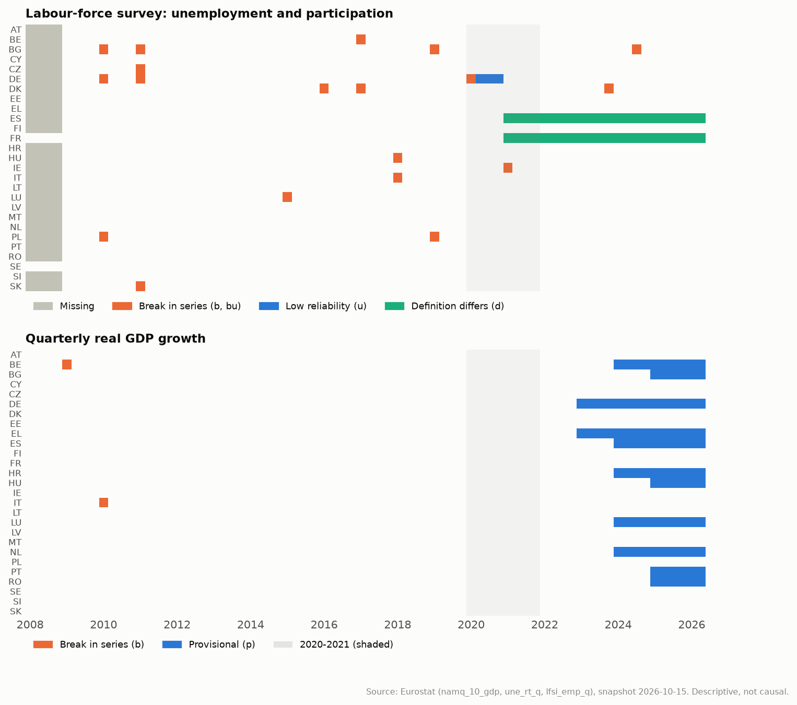
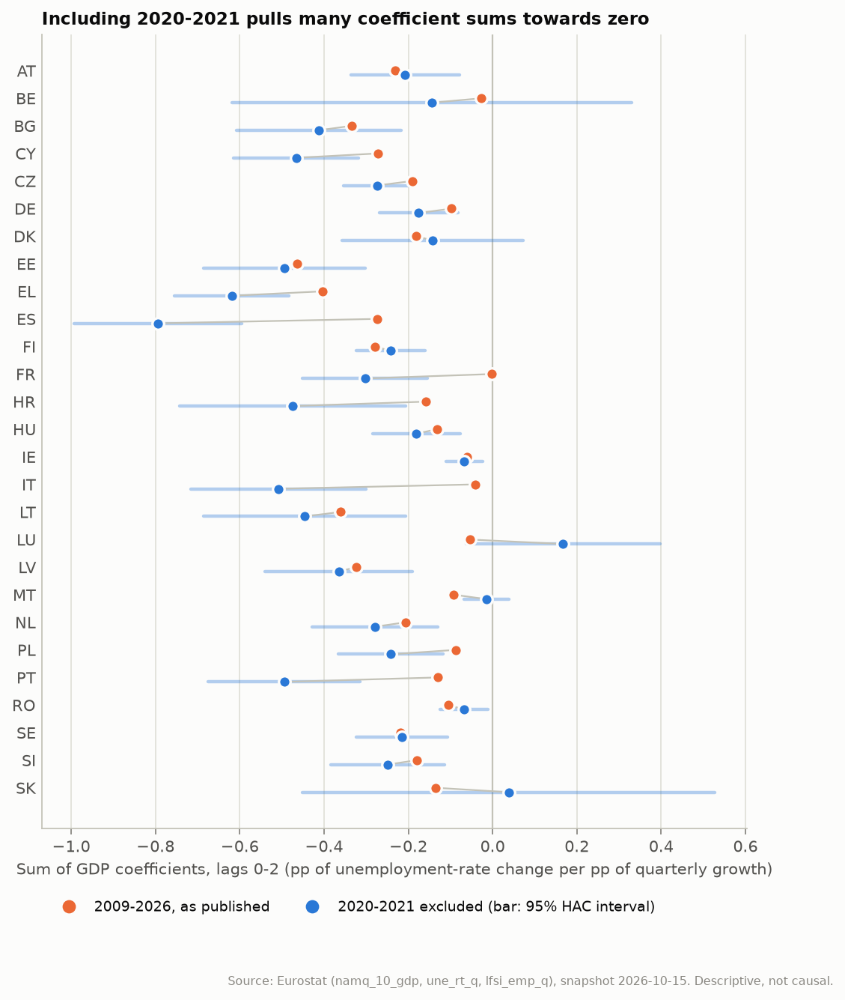
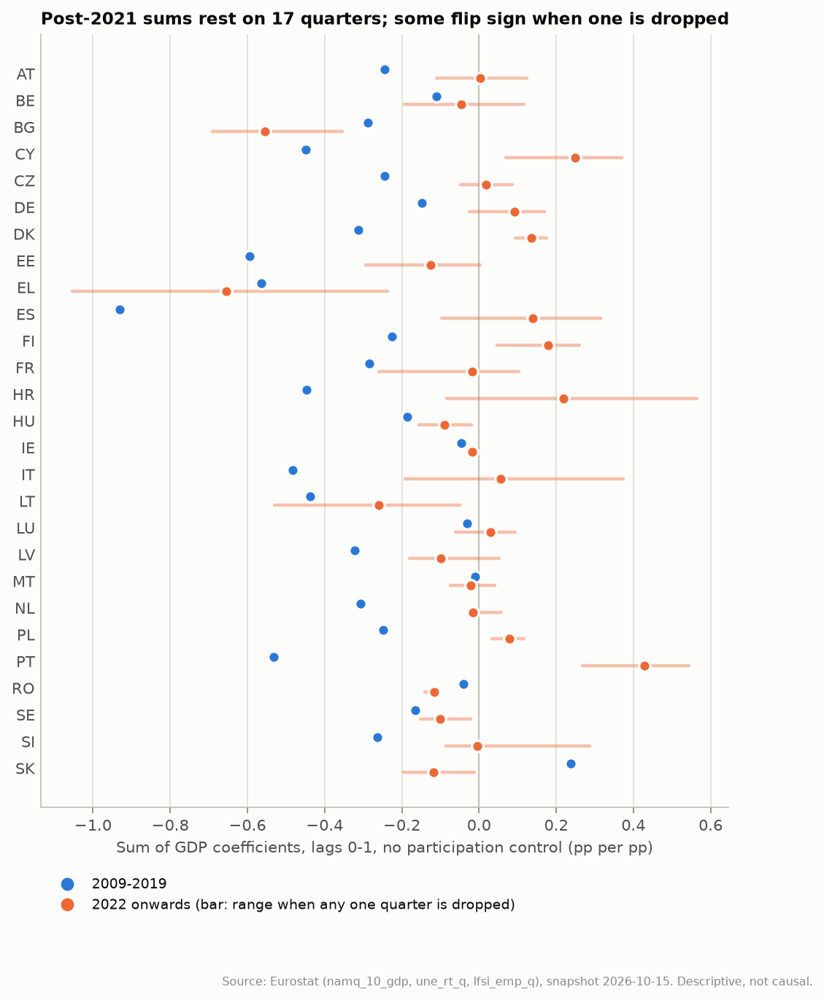
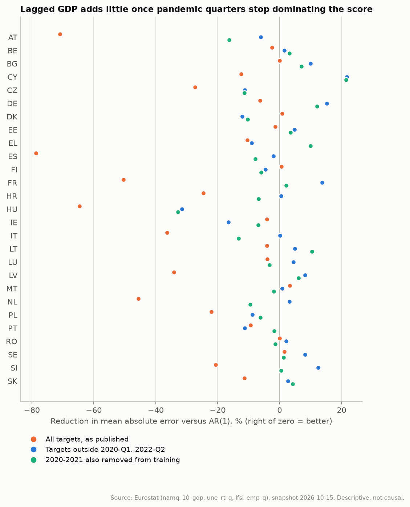
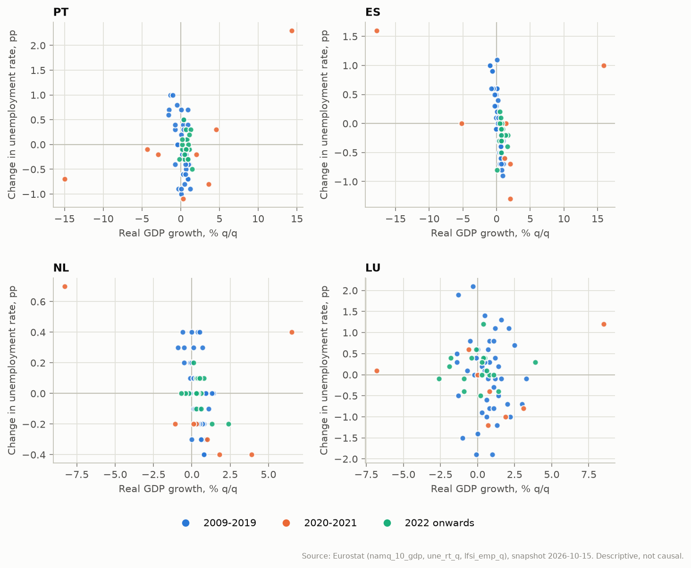
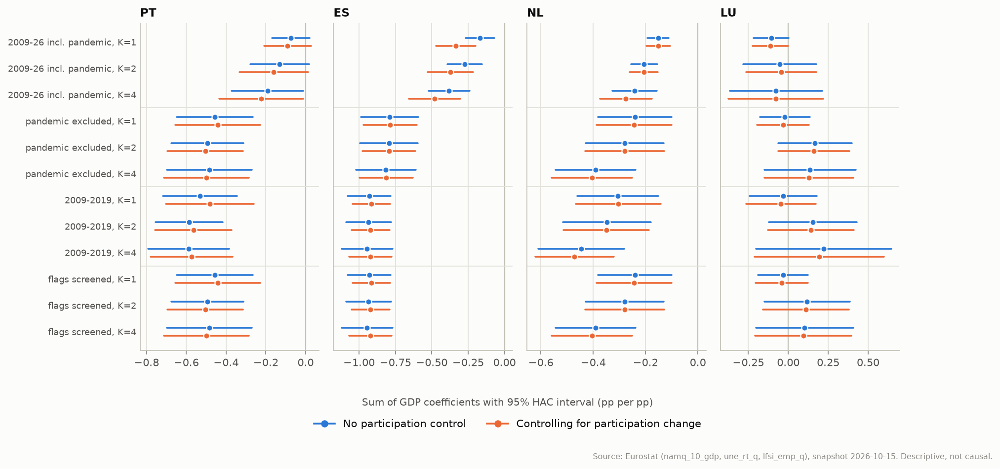

# Classical results review: EU-27 Okun's law

> Generated by `eu-okun review` from the frozen Eurostat snapshot described in section 1. Do not edit by hand; rerun the command instead. All results are descriptive conditional associations. None identifies a causal effect of a GDP shock.

## Summary

| Category | Finding |
| --- | --- |
| **Verified computation** | All 17 independent checks pass (14,364 quantities; largest absolute discrepancy 6.8e-13). The 6 archived CI result files were regenerated from the frozen snapshot; the largest numerical difference is 5.3e-13. |
| **Verified, reportable** | Excluding 2020-2021, the two-lag GDP coefficient sum is negative with a 95% HAC interval below zero in 22 of 27 countries. In 17 countries (AT, BG, CY, CZ, DE, EE, EL, ES, FI, HU, IE, LT, LV, NL, PL, SE and SI) all 24 core specifications agree in sign and exclude zero. These are descriptive associations, not causal effects. |
| **Sensitivity-dependent** | The published 27-country table includes 2020-2021, which supplies a median 78% of the current-quarter GDP variation; for 10 countries (CY, CZ, EL, ES, FR, HR, IT, MT, PL and PT) the published estimate lies outside the pandemic-excluded 95% interval. Signs or significance also depend on the specification for BE, DK, FR, HR, IT, LU, MT, PT, RO and SK. Without 2020-2021 the focus-country pair differences are a median 3.4 times larger, and the sign changes for 1 of 6. |
| **Inconclusive** | Post-2021 coefficients (17 quarters): 14 of 54 pre/post change tests are Holm-significant, but the asymptotic HAC tests are unreliable at this length and 14 of 27 post-2021 sums change sign when one quarter is dropped. Forecasting: with all published targets, adding GDP to AR(1) lowers MAE in 4 of 27 countries; outside the pandemic targets in 17 (median gain 2%), and with pandemic-free training in 12; the loss difference is distinguishable from zero in favour of GDP in 1 and against it in 3 countries (non-pandemic targets). |
| **Limitations** | GDP is a domestic concept, the labour data are residential; ES and FR follow a different unemployment definition from 2021; post-2021 GDP is partly provisional in 11 countries (up to 82% of the window); contemporaneous GDP and participation are endogenous; no shock is identified. |

## 1. Scope and provenance

This review audits the classical (non-Bayesian) results produced by `eu-okun baseline`, `compare`, `regimes`, `infer` and `forecast`. It adds no new statistical model: it recomputes the published numbers by an independent numerical route, re-estimates the *existing* specifications on pre-declared alternative samples, and re-scores the existing forecasts.

| Item | Value |
| --- | --- |
| Snapshot downloaded (UTC) | 2026-10-15T14:49:07.262393+00:00 |
| Snapshot manifest SHA-256 | `8a8c8a107d584ba91b61584fd29397e68ff83d82982371a35db253c0803a0464` |
| Processed panel SHA-256 | `250a7dd94d3678ca9ee4f29567e771fb53aeadf89e1f2fd0155d2f31d6e0ec0d` |
| Download window | 2008-Q1 to 2026-Q2 |
| Countries | EU-27 (fixed present-day composition) |
| Archived outputs compared | CI artifact eu-okun-empirical-baselines, workflow run 38754743850 (commit e73ee68) |

Eurostat revises past observations, so every number here belongs to this snapshot. The snapshot is committed under `snapshots/` so the report can be regenerated exactly (section 12).

## 2. Sources, definitions and data quality

### 2.1 Series as delivered

Read from the JSON-stat labels of the snapshot itself:

| Dataset | Series | Filters (Eurostat labels) | Last update |
| --- | --- | --- | --- |
| `namq_10_gdp` | gdp | unit: Chain linked volumes, percentage change on previous period; s_adj: Seasonally and calendar adjusted data; na_item: Gross domestic product at market prices | 2026-10-15T11:00:00+0200 |
| `une_rt_q` | unemployment | age: From 15 to 74 years; sex: Total; unit: Percentage of population in the labour force; s_adj: Seasonally adjusted data, not calendar adjusted data | 2026-09-10T23:00:00+0200 |
| `lfsi_emp_q` | participation | indic_em: Persons in the labour force; age: From 15 to 74 years; sex: Total; unit: Percentage of total population; s_adj: Seasonally adjusted data, not calendar adjusted data | 2026-09-10T23:00:00+0200 |

Eurostat flag meanings: `b` = break in time series; `bu` = break in time series, low reliability; `d` = definition differs (see metadata); `e` = estimated; `p` = provisional; `u` = low reliability.

### 2.2 Are the three series compatible?

| Aspect | GDP growth | Unemployment | Participation | Consequence |
| --- | --- | --- | --- | --- |
| Source | National accounts | Labour Force Survey (LFS) | LFS | Unemployment and participation share sample, weights and flags (checked: identical flags on every row). |
| Population | Production of *resident producer units* on the territory, including work by non-residents | Residents in private households | Same as unemployment | GDP and labour data cover different people where cross-border commuting is large (Luxembourg above all). |
| Age band | n/a | 15-74 (16-74 in Spain and Italy) | 15-74 | Small level difference for ES and IT, constant over time. |
| Unit | % change on previous quarter, chain-linked volumes | % of labour force | % of population 15-74 | Coefficients are percentage points of unemployment-rate change per percentage point of quarterly growth. |
| Adjustment | Seasonally and calendar adjusted | Seasonally adjusted only | Seasonally adjusted only | Calendar effects matter for output, hardly for rates. |
| Definition changes | Breaks flagged for BE (2009) and IT (2010) | 2021 regulation; break-corrected back to 2009 (see 2.5) | Same as unemployment | Spain and France still differ from 2021 (flag `d`). |
| Revisions | Recent quarters provisional (`p`) | Revised with weights and census | Same | Post-2021 results depend on provisional GDP. |

Metadata: [national accounts](https://ec.europa.eu/eurostat/cache/metadata/en/namq_10_gdp_esms.htm), [labour-force survey](https://ec.europa.eu/eurostat/cache/metadata/en/lfsi_esms.htm).

### 2.3 Missing observations

| Series | Quarters | Countries | Cells |
| --- | --- | --- | ---: |
| participation | 2008-Q1..2008-Q4 | 25: AT, BE, BG, CY, CZ, DE, DK, EE, EL, ES, FI, HR, HU, IE, IT, LT, LU, LV, MT, NL, PL, PT, RO, SI and SK | 100 |
| unemployment | 2008-Q1..2008-Q4 | 25: AT, BE, BG, CY, CZ, DE, DK, EE, EL, ES, FI, HR, HU, IE, IT, LT, LU, LV, MT, NL, PL, PT, RO, SI and SK | 100 |

No value is imputed. Because the 2008 labour data are missing for these countries, the first usable change in unemployment is 2009-Q2, not 2009-Q1, and every common EU-27 sample starts there.

### 2.4 Quality flags

Flags are retained in the processed panel, but **none of the published models uses them**: flagged values enter the regressions like any other.

| Series | Flag | Country | Cells | Quarters |
| --- | --- | --- | ---: | --- |
| GDP | `b` | BE | 1 | 2009-Q1 |
| GDP | `b` | IT | 1 | 2010-Q1 |
| GDP | `p` | BE | 10 | 2024-Q1..2026-Q2 |
| GDP | `p` | BG | 6 | 2025-Q1..2026-Q2 |
| GDP | `p` | DE | 14 | 2023-Q1..2026-Q2 |
| GDP | `p` | EL | 14 | 2023-Q1..2026-Q2 |
| GDP | `p` | ES | 10 | 2024-Q1..2026-Q2 |
| GDP | `p` | HR | 10 | 2024-Q1..2026-Q2 |
| GDP | `p` | HU | 6 | 2025-Q1..2026-Q2 |
| GDP | `p` | LU | 10 | 2024-Q1..2026-Q2 |
| GDP | `p` | NL | 10 | 2024-Q1..2026-Q2 |
| GDP | `p` | PT | 6 | 2025-Q1..2026-Q2 |
| GDP | `p` | RO | 6 | 2025-Q1..2026-Q2 |
| LFS | `b` | BE | 1 | 2017-Q1 |
| LFS | `b` | BG | 4 | 2010-Q1, 2011-Q1, 2019-Q1, 2024-Q3 |
| LFS | `b` | CZ | 1 | 2011-Q1 |
| LFS | `b` | DE | 2 | 2010-Q1, 2011-Q1 |
| LFS | `b` | DK | 3 | 2016-Q1, 2017-Q1, 2023-Q4 |
| LFS | `b` | HU | 1 | 2018-Q1 |
| LFS | `b` | IE | 1 | 2021-Q1 |
| LFS | `b` | IT | 1 | 2018-Q1 |
| LFS | `b` | LU | 1 | 2015-Q1 |
| LFS | `b` | PL | 2 | 2010-Q1, 2019-Q1 |
| LFS | `b` | SK | 1 | 2011-Q1 |
| LFS | `bu` | DE | 1 | 2020-Q1 |
| LFS | `d` | ES | 22 | 2021-Q1..2026-Q2 |
| LFS | `d` | FR | 22 | 2021-Q1..2026-Q2 |
| LFS | `u` | DE | 3 | 2020-Q2..2020-Q4 |



### 2.5 The 2021 Labour Force Survey change

Eurostat's LFS metadata state that the 2021 regulation (IESS) created breaks, that Eurostat and the member states ran a joint break-correction exercise, and that the new tables contain break-corrected data for 2009-Q1 to 2020-Q4 which "mostly start in 2009". The snapshot is consistent with this: the labour series begin in 2009 for 25 countries, and only IE carries a break flag at 2021-Q1.

Two residual issues remain. ES and FR are flagged `d` (definition differs) from 2021-Q1 onward: both keep counting workers on temporary lay-off under the pre-2021 job-attachment rule. The Netherlands phased the new survey in during 2021 without a flag. The published models treat all of these as comparable observations; the `quality_screened` sample below removes flagged changes instead.

## 3. Independent verification of the published numbers

Each published quantity was recomputed by a deliberately different route: a QR solve instead of `lstsq`; a Bartlett HAC built from an explicit n-by-n kernel on calendar distances instead of a loop over lag orders; the coefficient sum read off a reparameterised regression (regressors g_t and g_{t-k} - g_t) instead of the contrast c'Vc; and the pre/post tests rebuilt from two separate regressions. Tolerance: absolute difference of at most 1e-9 (1e-6 for Wald statistics).

| Area | Quantity | Independent route | Compared | Max abs. difference | Result |
| --- | --- | --- | ---: | ---: | --- |
| Country baselines | OLS coefficients | QR solve | 918 | 3.3e-15 | pass |
| Country baselines | marginal HAC s.e. | calendar kernel-matrix HAC | 918 | 3.6e-15 | pass |
| Country comparison | GDP coefficient sum | reparameterised regression | 216 | 7.8e-16 | pass |
| Country comparison | HAC s.e. of the sum | diagonal of reparameterised kernel-matrix HAC | 216 | 6.4e-16 | pass |
| Country comparison | 95% interval bound | estimate - 1.96 s.e. | 216 | 1.2e-15 | pass |
| Country comparison | R-squared | QR residuals | 216 | 3.3e-16 | pass |
| Country comparison | HAC covariance entries | kernel-matrix HAC | 4,428 | 3.1e-15 | pass |
| Regime sensitivity | GDP coefficient sum | reparameterised regression | 594 | 1.6e-15 | pass |
| Regime sensitivity | HAC s.e. of the sum | kernel-matrix HAC | 594 | 2.3e-15 | pass |
| Pre/post stability | change in GDP sum | separate pre and post fits | 54 | 3.4e-15 | pass |
| Pre/post stability | HAC s.e. of the change | summed period covariances | 54 | 7.8e-16 | pass |
| Pre/post stability | joint Wald statistic | summed period covariances | 54 | 6.8e-13 | pass |
| Country pairs | observed difference of sums | QR solve | 18 | 3.1e-16 | pass |
| Country pairs | bootstrap interval bounds | same seed, re-run (reproducibility only; not independent) | 36 | 0 | pass |
| Forecast evaluation | point forecasts | QR solve on raw panel values | 5,508 | 1.6e-14 | pass |
| Forecast evaluation | MAE | recomputed from forecasts | 162 | 0 | pass |
| Forecast evaluation | RMSE | recomputed from forecasts | 162 | 0 | pass |

Archived CI outputs against outputs regenerated from the committed snapshot:

| File | SHA-256 (archived) | Max abs. difference |
| --- | --- | ---: |
| `ols_hac.json` | `84d94cc59ae412f3…` | 2.0e-14 |
| `comparison/comparison.json` | `927d477c60a49df2…` | 2.0e-14 |
| `regimes/regimes.json` | `b74d88d1f810f846…` | 3.1e-15 |
| `inference/stability.json` | `8278fa4d4b0ee170…` | 5.3e-13 |
| `inference/country_pairs.json` | `90dea6190cbb5f75…` | 7.2e-16 |
| `forecast/scores.json` | `43663feb55d614f5…` | 1.1e-15 |

Two latent issues were found; neither changes a published number for this snapshot:

- `eu-okun baseline` measured HAC lags in rows rather than calendar quarters. This only matters when a country's complete-case sample skips a quarter; 0 of 216 baseline samples do. The baseline now uses calendar lags, like every other command.
- The pre/post Wald tests and all intervals use asymptotic normal and chi-square approximations with an uncorrected Newey-West covariance. The arithmetic is right; the approximation is weak for the 17-quarter post-2021 window (section 5).

## 4. Sensitivity of the GDP coefficient sums

### 4.1 Samples and decision rules

| Sample | Definition | Quarters (EU-27 common) | GDP lags |
| --- | --- | --- | --- |
| `full` | 2009-2026 including 2020-2021 (as published) | 69 (2009-Q2..2026-Q2) | 0, 1, 2, 4 |
| `pandemic_excluded` | 2020-2021 removed from outcomes and lag history | 57 (2009-Q2..2026-Q2) | 0, 1, 2, 4 |
| `pre_2020` | 2009-2019 only | 43 (2009-Q2..2019-Q4) | 0, 1, 2, 4 |
| `quality_screened` | pandemic excluded and flagged labour-force changes removed (per country) | country-specific (see `grid.csv`) | 0, 1, 2, 4 |
| `post_2021` | 2022 onwards; GDP lags 0-1 only | 17 (2022-Q2..2026-Q2) | 0, 1 |

The *core grid* for each country is GDP lags 1, 2, 4 x with/without participation x the samples `full`, `pandemic_excluded`, `pre_2020`, `quality_screened` (24 estimates). Verdicts, fixed before looking at the results:

- **Robust negative**: every point estimate is negative and every 95% HAC interval lies below zero.
- **Negative; significance depends on specification**: every point estimate is negative, but at least one interval reaches zero.
- **Sign-unstable**: at least one point estimate is zero or positive.

A second verdict drops the pandemic-inclusive `full` sample, separating instability caused by 2020-2021 from instability that remains without it. Lag order changes the estimand (a longer cumulative horizon), so its spread is a sensitivity, not a confidence interval. The post-2021 sample is reported separately (section 5) because two GDP lags cannot be estimated reliably on it.

### 4.2 Pandemic influence

In the published common sample the eight quarters of 2020-2021 are 12% of observations but supply between 22% and 98% (median 78%) of the variation in current-quarter GDP growth. Ordinary least squares weights observations by that variation, so those quarters - when job-retention schemes kept unemployment flat during record GDP falls - largely determine the published coefficients.



| Country | Published (incl. 2020-21) | Pandemic excluded, 95% interval | Share of GDP variation from 2020-21 | Published outside interval |
| --- | ---: | ---: | ---: | --- |
| AT | -0.231 | -0.207 [-0.337, -0.078] | 95% |  |
| BE | -0.026 | -0.144 [-0.618, +0.330] | 98% |  |
| BG | -0.335 | -0.412 [-0.607, -0.217] | 67% |  |
| CY | -0.272 | -0.466 [-0.615, -0.318] | 76% | yes |
| CZ | -0.191 | -0.273 [-0.354, -0.193] | 86% | yes |
| DE | -0.097 | -0.175 [-0.268, -0.082] | 90% |  |
| DK | -0.181 | -0.142 [-0.356, +0.073] | 54% |  |
| EE | -0.464 | -0.494 [-0.686, -0.303] | 49% |  |
| EL | -0.403 | -0.619 [-0.755, -0.483] | 69% | yes |
| ES | -0.275 | -0.794 [-0.994, -0.595] | 97% | yes |
| FI | -0.280 | -0.241 [-0.323, -0.160] | 69% |  |
| FR | -0.003 | -0.302 [-0.451, -0.154] | 98% | yes |
| HR | -0.159 | -0.475 [-0.743, -0.207] | 83% | yes |
| HU | -0.132 | -0.181 [-0.284, -0.077] | 91% |  |
| IE | -0.061 | -0.067 [-0.110, -0.024] | 22% |  |
| IT | -0.040 | -0.508 [-0.716, -0.301] | 97% | yes |
| LT | -0.361 | -0.446 [-0.686, -0.206] | 64% |  |
| LU | -0.053 | +0.167 [-0.063, +0.397] | 58% |  |
| LV | -0.323 | -0.365 [-0.540, -0.191] | 65% |  |
| MT | -0.092 | -0.015 [-0.068, +0.038] | 62% | yes |
| NL | -0.206 | -0.279 [-0.428, -0.130] | 88% |  |
| PL | -0.087 | -0.241 [-0.366, -0.117] | 78% | yes |
| PT | -0.130 | -0.495 [-0.676, -0.314] | 95% | yes |
| RO | -0.106 | -0.067 [-0.125, -0.010] | 35% |  |
| SE | -0.218 | -0.216 [-0.324, -0.107] | 67% |  |
| SI | -0.180 | -0.249 [-0.384, -0.114] | 87% |  |
| SK | -0.135 | +0.038 [-0.451, +0.528] | 90% |  |

Two GDP lags, no participation control, HAC bandwidth 4. For 10 countries the published estimate lies outside the pandemic-excluded interval: the published all-country table should not be read as typical Okun coefficients for them.

### 4.3 Robustness verdicts

| Country | Verdict (24 estimates) | Without the full sample (18) | Core range | Core median | Largest single influence |
| --- | --- | --- | ---: | ---: | --- |
| AT | Robust negative | Robust negative | [-0.341, -0.204] | -0.238 | GDP lag order (0.092) |
| BE | Negative; significance depends on specification | Negative; significance depends on specification | [-0.646, -0.023] | -0.150 | sample selection (0.461) |
| BG | Robust negative | Robust negative | [-0.640, -0.267] | -0.412 | GDP lag order (0.351) |
| CY | Robust negative | Robust negative | [-0.478, -0.201] | -0.443 | pandemic treatment (0.245) |
| CZ | Robust negative | Robust negative | [-0.300, -0.109] | -0.273 | GDP lag order (0.169) |
| DE | Robust negative | Robust negative | [-0.201, -0.078] | -0.158 | pandemic treatment (0.086) |
| DK | Negative; significance depends on specification | Negative; significance depends on specification | [-0.413, -0.093] | -0.194 | sample selection (0.219) |
| EE | Robust negative | Robust negative | [-0.601, -0.440] | -0.528 | pandemic treatment (0.121) |
| EL | Robust negative | Robust negative | [-0.734, -0.322] | -0.594 | pandemic treatment (0.245) |
| ES | Robust negative | Robust negative | [-0.945, -0.168] | -0.865 | pandemic treatment (0.621) |
| FI | Robust negative | Robust negative | [-0.374, -0.217] | -0.250 | GDP lag order (0.132) |
| FR | Sign-unstable | Robust negative | [-0.436, +0.014] | -0.290 | pandemic treatment (0.300) |
| HR | Negative; significance depends on specification | Robust negative | [-0.609, -0.071] | -0.461 | pandemic treatment (0.316) |
| HU | Robust negative | Robust negative | [-0.204, -0.104] | -0.176 | GDP lag order (0.093) |
| IE | Robust negative | Robust negative | [-0.110, -0.035] | -0.067 | GDP lag order (0.065) |
| IT | Negative; significance depends on specification | Robust negative | [-0.651, -0.013] | -0.506 | pandemic treatment (0.491) |
| LT | Robust negative | Robust negative | [-0.510, -0.317] | -0.451 | pandemic treatment (0.153) |
| LU | Sign-unstable | Sign-unstable | [-0.113, +0.222] | +0.037 | GDP lag order (0.253) |
| LV | Robust negative | Robust negative | [-0.497, -0.249] | -0.365 | pandemic treatment (0.148) |
| MT | Negative; significance depends on specification | Negative; significance depends on specification | [-0.092, -0.008] | -0.015 | pandemic treatment (0.078) |
| NL | Robust negative | Robust negative | [-0.471, -0.152] | -0.279 | GDP lag order (0.167) |
| PL | Robust negative | Robust negative | [-0.254, -0.087] | -0.224 | pandemic treatment (0.154) |
| PT | Negative; significance depends on specification | Robust negative | [-0.588, -0.074] | -0.483 | pandemic treatment (0.382) |
| RO | Negative; significance depends on specification | Negative; significance depends on specification | [-0.157, -0.038] | -0.080 | GDP lag order (0.089) |
| SE | Robust negative | Robust negative | [-0.402, -0.159] | -0.226 | GDP lag order (0.194) |
| SI | Robust negative | Robust negative | [-0.318, -0.158] | -0.250 | GDP lag order (0.095) |
| SK | Sign-unstable | Sign-unstable | [-0.429, +0.238] | -0.009 | GDP lag order (0.557) |

Verdict counts: 17 robust negative, 7 precision-dependent, 3 sign-unstable. Without the pandemic-inclusive sample: 21, 4 and 2. Sign-unstable even without 2020-2021: LU and SK.

The largest single influence is the biggest change in the sum caused by one choice with the others held fixed: GDP lag order: AT, BG, CZ, FI, HU, IE, LU, NL, RO, SE, SI and SK; pandemic treatment: CY, DE, EE, EL, ES, FR, HR, IT, LT, LV, MT, PL and PT; sample selection: BE and DK.

### 4.4 HAC bandwidth

For the pandemic-excluded two-lag sum, intervals were recomputed with Bartlett bandwidths 0, 2, 4, 8. Countries whose interval excludes zero at bandwidth 4 but not at every bandwidth: none. No small-sample correction is applied at any bandwidth.

## 5. Regimes and pre/post stability

The published stability tests compare 2009-2019 (43 quarters) with 2022 onwards (17 quarters) in a fully interacted model with one GDP lag. The arithmetic is verified (section 3). Holm-significant changes in the GDP sum (family of 54 tests): bandwidth 0: 12, bandwidth 2: 13, bandwidth 4: 14, bandwidth 8: 14. So the count barely depends on the bandwidth; the concern is the length of the post window and what it contains:

- 17 quarters for 3-4 coefficients: Newey-West tests are known to over-reject at this length, and nothing here corrects for it.
- GDP growth varied less after 2021 than before 2020 in 19 of 27 countries, so the post coefficients are weakly identified.
- Post-2021 sums change sign when a single quarter is dropped in 14 countries (AT, BE, CZ, DE, EE, ES, FR, HR, IT, LU, LV, MT, NL and SI). Positive and stable under that check: CY, DK, FI, PL and PT.
- Post-2021 labour data follow a different definition (`d`) in ES and FR, and post-2021 GDP is partly provisional in 11 countries (up to 82% of the window).
- The pre-2020 window mixes the 2009-2013 crisis with the recovery; no split within it was tested.



Regime estimates published by `eu-okun regimes` (K=1, no participation), with the stability tests and the leave-one-out range for the focus countries:

| Country | 2009-2019 | Pandemic excluded | 2022 onwards | Post range, one quarter dropped | Holm p (bandwidth 4) |
| --- | ---: | ---: | ---: | ---: | ---: |
| PT | -0.531 [-0.717, -0.346] | -0.456 [-0.648, -0.264] | +0.428 [+0.011, +0.846] | [+0.268, +0.543] | 0.002 |
| ES | -0.931 [-1.080, -0.782] | -0.789 [-0.986, -0.592] | +0.139 [-0.172, +0.451] | [-0.097, +0.316] | < 0.001 |
| NL | -0.307 [-0.461, -0.152] | -0.241 [-0.382, -0.100] | -0.015 [-0.073, +0.043] | [-0.026, +0.057] | 0.022 |
| LU | -0.031 [-0.241, +0.179] | -0.021 [-0.177, +0.134] | +0.030 [-0.117, +0.177] | [-0.062, +0.094] | 1.000 |

Descriptively, in 13 countries (CY, CZ, DE, DK, EE, ES, FI, HR, IT, NL, PL, PT and SI) every leave-one-out post-2021 sum lies above the upper bound of the 2009-2019 95% interval: the association is weaker after 2021 there. Not reportable: the size or sign of any post-2021 coefficient, or a dated structural break.

## 6. Country-pair comparisons

The published paired block bootstrap (999 draws, synchronised quarters, two GDP lags, no participation) uses the full sample. The same procedure was re-run with 2020-2021 removed. Block length 8 shown; all lengths are in `pairs_review.csv`.

| Pair | Full: difference | 95% percentile interval | Holm sign p | Excl. 2020-21: difference | 95% percentile interval | Holm sign p |
| --- | ---: | ---: | ---: | ---: | ---: | ---: |
| ES - LU | -0.222 | [-1.011, -0.011] | 0.144 | -0.904 | [-1.161, -0.349] | 0.048 |
| ES - NL | -0.069 | [-0.532, -0.011] | 0.080 | -0.502 | [-0.700, -0.087] | 0.078 |
| ES - PT | -0.144 | [-0.388, -0.090] | 0.012 | -0.294 | [-0.658, -0.101] | 0.048 |
| LU - NL | +0.153 | [-0.036, +0.596] | 0.408 | +0.401 | [+0.128, +0.730] | 0.048 |
| LU - PT | +0.077 | [-0.150, +0.794] | 1.000 | +0.609 | [-0.024, +0.915] | 0.108 |
| NL - PT | -0.075 | [-0.148, +0.253] | 1.000 | +0.208 | [-0.262, +0.323] | 0.210 |

Without 2020-2021 the absolute differences are a median 3.4 times larger (block length 8), and the sign changes for 1 of 6 pairs (NL-PT). Pairs below 0.05 after Holm adjustment at every block length (4, 8, 12) without 2020-2021: LU-NL; at some lengths only: ES-LU, ES-NL and ES-PT. Which pairs look different therefore depends on the pandemic treatment and, to a lesser degree, on the block length.

The sign frequency is descriptive, not a null-centred test, and a difference in coefficient sums is not a difference in causal labour-market responses.

## 7. Predictive evaluation

The published forecasts were recomputed independently (section 3) and re-scored on three pre-declared evaluation sets. 'Better MAE' counts countries where the model's mean absolute error is below AR(1)'s. 'Distinguishable' counts countries where the mean absolute-loss difference exceeds 1.96 HAC standard errors (bandwidth 4; a Diebold-Mariano-type ratio, approximate with 24-34 origins).

| Evaluation | Model vs AR(1) | Origins | Better MAE | Median MAE reduction | Distinguishably better | Distinguishably worse |
| --- | --- | ---: | ---: | ---: | ---: | ---: |
| All targets (as published) | zero change | 34 | 21/27 | 4% | 6 | 0 |
| All targets (as published) | historical mean | 34 | 21/27 | 2% | 2 | 0 |
| All targets (as published) | two GDP lags | 34 | 8/27 | -7% | 1 | 0 |
| All targets (as published) | AR(1) + two GDP lags | 34 | 4/27 | -10% | 0 | 1 |
| All targets (as published) | AR(1) + two GDP lags + participation | 34 | 3/27 | -16% | 1 | 2 |
| Targets outside 2020-Q1..2022-Q2 | zero change | 24 | 22/27 | 5% | 5 | 0 |
| Targets outside 2020-Q1..2022-Q2 | historical mean | 24 | 19/27 | 2% | 2 | 0 |
| Targets outside 2020-Q1..2022-Q2 | two GDP lags | 24 | 15/27 | 2% | 6 | 0 |
| Targets outside 2020-Q1..2022-Q2 | AR(1) + two GDP lags | 24 | 17/27 | 2% | 1 | 3 |
| Targets outside 2020-Q1..2022-Q2 | AR(1) + two GDP lags + participation | 24 | 10/27 | -2% | 2 | 1 |
| 2020-2021 removed from training too | zero change | 24 | 24/27 | 4% | 4 | 0 |
| 2020-2021 removed from training too | historical mean | 24 | 18/27 | 1% | 3 | 0 |
| 2020-2021 removed from training too | two GDP lags | 24 | 14/27 | 1% | 3 | 0 |
| 2020-2021 removed from training too | AR(1) + two GDP lags | 24 | 12/27 | -2% | 1 | 1 |
| 2020-2021 removed from training too | AR(1) + two GDP lags + participation | 24 | 10/27 | -5% | 1 | 2 |



In the published scores, adding two GDP lags to AR(1) lowers the MAE in 4 of 27 countries. Those scores are dominated by the pandemic targets: without them the count is 17 (median reduction 2%), and with 2020-2021 also removed from training it is 12 (median -2%). The loss difference is distinguishable from zero in at most 1 country in favour of GDP. Whether lagged GDP helps is therefore unresolved. AR(1) is itself a weak benchmark: the zero-change forecast beats it in 22 of 27 countries outside the pandemic targets. The evaluation uses revised data and assumes previous-quarter GDP is known, so it is not a real-time test.

## 8. Portugal, Spain, the Netherlands and Luxembourg

Descriptive detail only. Differences between these countries are associations under different measurement conditions; none is interpreted as causal or institutional.





### Portugal (PT)

| Sample | K=1 | K=2 | K=4 |
| --- | ---: | ---: | ---: |
| `full` | -0.074 [-0.169, +0.020] | -0.130 [-0.278, +0.017] | -0.192 [-0.372, -0.011] |
| `full` + participation | -0.091 [-0.209, +0.027] | -0.160 [-0.332, +0.011] | -0.224 [-0.434, -0.013] |
| `pandemic_excluded` | -0.456 [-0.648, -0.264] | -0.495 [-0.676, -0.314] | -0.483 [-0.697, -0.270] |
| `pandemic_excluded` + participation | -0.441 [-0.654, -0.229] | -0.504 [-0.694, -0.315] | -0.498 [-0.711, -0.285] |
| `pre_2020` | -0.531 [-0.717, -0.346] | -0.586 [-0.754, -0.417] | -0.588 [-0.791, -0.384] |
| `pre_2020` + participation | -0.482 [-0.702, -0.262] | -0.565 [-0.757, -0.372] | -0.573 [-0.779, -0.367] |
| `quality_screened` | -0.456 [-0.648, -0.264] | -0.495 [-0.676, -0.314] | -0.483 [-0.697, -0.270] |
| `quality_screened` + participation | -0.441 [-0.654, -0.229] | -0.504 [-0.694, -0.315] | -0.498 [-0.711, -0.285] |

- Verdict: **Negative; significance depends on specification**; without the pandemic-inclusive sample: **Robust negative**. Largest single influence: pandemic treatment (0.382).
- 2020-2021 supplies 95% of the current-quarter GDP variation in the published sample.
- Post-2021 sum (K=1) +0.428; range with one quarter dropped [+0.268, +0.543]; pre-2020 -0.531; Holm p for the change 0.002.
- Forecast MAE reduction of AR(1) + GDP over AR(1): -9% (published), -11% (non-pandemic targets), -2% (pandemic-free).
- Eurostat flags: GDP `p` 2025-Q1..2026-Q2.
- The Eurostat labour-force metadata reviewed contain no Portugal-specific comparability note for the 2021 survey change.

### Spain (ES)

| Sample | K=1 | K=2 | K=4 |
| --- | ---: | ---: | ---: |
| `full` | -0.168 [-0.266, -0.070] | -0.275 [-0.393, -0.156] | -0.381 [-0.522, -0.240] |
| `full` + participation | -0.335 [-0.472, -0.198] | -0.372 [-0.529, -0.215] | -0.481 [-0.657, -0.304] |
| `pandemic_excluded` | -0.789 [-0.986, -0.592] | -0.794 [-0.994, -0.595] | -0.816 [-1.022, -0.610] |
| `pandemic_excluded` + participation | -0.786 [-0.969, -0.603] | -0.795 [-0.977, -0.612] | -0.814 [-0.996, -0.632] |
| `pre_2020` | -0.931 [-1.080, -0.782] | -0.934 [-1.090, -0.779] | -0.945 [-1.120, -0.771] |
| `pre_2020` + participation | -0.915 [-1.044, -0.786] | -0.921 [-1.051, -0.791] | -0.922 [-1.068, -0.775] |
| `quality_screened` | -0.931 [-1.080, -0.782] | -0.934 [-1.090, -0.779] | -0.945 [-1.120, -0.771] |
| `quality_screened` + participation | -0.915 [-1.044, -0.786] | -0.921 [-1.051, -0.791] | -0.922 [-1.068, -0.775] |

- Verdict: **Robust negative**; without the pandemic-inclusive sample: **Robust negative**. Largest single influence: pandemic treatment (0.621).
- 2020-2021 supplies 97% of the current-quarter GDP variation in the published sample.
- Post-2021 sum (K=1) +0.139; range with one quarter dropped [-0.097, +0.316]; pre-2020 -0.931; Holm p for the change < 0.001.
- Forecast MAE reduction of AR(1) + GDP over AR(1): -79% (published), -2% (non-pandemic targets), -8% (pandemic-free).
- Eurostat flags: GDP `p` 2024-Q1..2026-Q2; LFS `d` 2021-Q1..2026-Q2.
- Eurostat metadata: under the 2021 regulation, and because of the COVID crisis, Spain continues to test the job attachment of employed persons on temporary lay-off as in the pre-2021 definition. Eurostat therefore flags Spanish labour-force values 'definition differs' from 2021-Q1.
- Eurostat metadata: unemployment in Spain refers to ages 16-74, not 15-74.

### Netherlands (NL)

| Sample | K=1 | K=2 | K=4 |
| --- | ---: | ---: | ---: |
| `full` | -0.152 [-0.192, -0.112] | -0.206 [-0.256, -0.156] | -0.242 [-0.326, -0.158] |
| `full` + participation | -0.152 [-0.197, -0.107] | -0.206 [-0.260, -0.153] | -0.275 [-0.375, -0.175] |
| `pandemic_excluded` | -0.241 [-0.382, -0.100] | -0.279 [-0.428, -0.130] | -0.391 [-0.544, -0.238] |
| `pandemic_excluded` + participation | -0.244 [-0.387, -0.100] | -0.279 [-0.430, -0.129] | -0.405 [-0.558, -0.251] |
| `pre_2020` | -0.307 [-0.461, -0.152] | -0.348 [-0.516, -0.181] | -0.445 [-0.609, -0.281] |
| `pre_2020` + participation | -0.304 [-0.467, -0.142] | -0.350 [-0.514, -0.187] | -0.471 [-0.622, -0.321] |
| `quality_screened` | -0.241 [-0.382, -0.100] | -0.279 [-0.428, -0.130] | -0.391 [-0.544, -0.238] |
| `quality_screened` + participation | -0.244 [-0.387, -0.100] | -0.279 [-0.430, -0.129] | -0.405 [-0.558, -0.251] |

- Verdict: **Robust negative**; without the pandemic-inclusive sample: **Robust negative**. Largest single influence: GDP lag order (0.167).
- 2020-2021 supplies 88% of the current-quarter GDP variation in the published sample.
- Post-2021 sum (K=1) -0.015; range with one quarter dropped [-0.026, +0.057]; pre-2020 -0.307; Holm p for the change 0.022.
- Forecast MAE reduction of AR(1) + GDP over AR(1): -46% (published), 3% (non-pandemic targets), -9% (pandemic-free).
- Eurostat flags: GDP `p` 2024-Q1..2026-Q2.
- Eurostat metadata: Statistics Netherlands phased in data collection under the 2021 regulation during 2021, uses a rolling reference week, and kept publishing monthly unemployment on the pre-2021 definition during 2021. These quarters are not flagged in the data.

### Luxembourg (LU)

| Sample | K=1 | K=2 | K=4 |
| --- | ---: | ---: | ---: |
| `full` | -0.106 [-0.216, +0.004] | -0.053 [-0.281, +0.175] | -0.077 [-0.365, +0.211] |
| `full` + participation | -0.113 [-0.225, -0.002] | -0.045 [-0.263, +0.174] | -0.077 [-0.374, +0.220] |
| `pandemic_excluded` | -0.021 [-0.177, +0.134] | +0.167 [-0.063, +0.397] | +0.136 [-0.150, +0.423] |
| `pandemic_excluded` + participation | -0.033 [-0.195, +0.129] | +0.159 [-0.064, +0.382] | +0.128 [-0.150, +0.406] |
| `pre_2020` | -0.031 [-0.241, +0.179] | +0.154 [-0.120, +0.429] | +0.222 [-0.202, +0.645] |
| `pre_2020` + participation | -0.047 [-0.265, +0.172] | +0.141 [-0.127, +0.410] | +0.195 [-0.211, +0.600] |
| `quality_screened` | -0.032 [-0.188, +0.124] | +0.118 [-0.150, +0.386] | +0.102 [-0.202, +0.406] |
| `quality_screened` + participation | -0.042 [-0.206, +0.121] | +0.111 [-0.159, +0.381] | +0.095 [-0.207, +0.396] |

- Verdict: **Sign-unstable**; without the pandemic-inclusive sample: **Sign-unstable**. Largest single influence: GDP lag order (0.253).
- 2020-2021 supplies 58% of the current-quarter GDP variation in the published sample.
- Post-2021 sum (K=1) +0.030; range with one quarter dropped [-0.062, +0.094]; pre-2020 -0.031; Holm p for the change 1.000.
- Forecast MAE reduction of AR(1) + GDP over AR(1): -4% (published), 4% (non-pandemic targets), -3% (pandemic-free).
- Eurostat flags: GDP `p` 2024-Q1..2026-Q2; LFS `b` 2015-Q1.
- GDP measures production by resident producer units, including work done by cross-border commuters; unemployment and participation describe the resident population. Commuters account for a large share of domestic employment in Luxembourg, so resident unemployment captures only part of any labour-input response to output. This is a measurement mismatch, not an institutional finding.

## 9. What can be reported

**Verified and robust enough to report** (as descriptive associations):

- The published estimates are computed correctly: 17 independent checks pass, and the archived CI outputs are reproduced from the frozen snapshot.
- Outside 2020-2021, unemployment-rate changes are negatively associated with current and lagged GDP growth in most EU-27 countries; in 17 (AT, BG, CY, CZ, DE, EE, EL, ES, FI, HU, IE, LT, LV, NL, PL, SE and SI) every core specification agrees.
- Including 2020-2021 moves the two-lag sum towards zero in 20 of 27 countries; that attenuation is a property of the pandemic quarters, not of the 2009-2019 relationship.

**Sensitivity-dependent** (report only with the sensitivity shown):

- Magnitudes: the GDP lag order is the largest influence in 12 countries, pandemic treatment in 13, sample selection in 2.
- A weaker association after 2021 (CY, CZ, DE, DK, EE, ES, FI, HR, IT, NL, PL, PT and SI; section 5).
- Signs or significance in BE, DK, FR, HR, IT, LU, MT, PT, RO and SK.
- All country-pair differences and any ordering of countries.

**Inconclusive** (do not report as findings):

- The sign or size of post-2021 coefficients, and any dated structural break.
- Whether lagged GDP improves unemployment forecasts over simple benchmarks.
- Any Okun relation for LU and SK, where the sign is unstable even without 2020-2021.

## 10. Methodological limitations

- **Measurement**: domestic GDP versus resident labour data; ES and FR definitions differ from 2021; age band 16-74 in ES and IT; provisional recent GDP; revisions after the snapshot.
- **Specification**: contemporaneous GDP growth and participation are endogenous; the participation control can absorb part of the GDP association (a bad-control risk); lag order changes the estimand.
- **Inference**: uncorrected Newey-West covariance with a fixed bandwidth and normal/chi-square approximations; no adjustment for testing many countries except Holm within the stability and pair families; common shocks make country estimates dependent.
- **Samples**: one snapshot; the pre-2020 window mixes crisis and recovery; the post-2021 window is short and spans an energy-price shock and high inflation.
- **Forecasting**: revised data, optimistic information timing, no vintage reconstruction.

## 11. Unresolved research questions

1. Does the weak post-2021 association reflect a changed labour-market response, measurement (definitions, provisional GDP), or too little GDP variation to identify anything? Small-sample-valid inference (fixed-b or bootstrap) and later data are needed.
2. Do the pandemic-era coefficients describe job-retention schemes? That needs data on hours worked and scheme take-up, not unemployment alone.
3. For Luxembourg, does an employment- or hours-based measure that includes cross-border workers restore a measurable association?
4. Are differences between countries larger than common European shocks and estimation dependence allow? Partial pooling (Phase 2) should address this jointly instead of pairwise.
5. Is the 2009-2019 association stable within that window (crisis versus recovery)?
6. How much do results move between Eurostat vintages?

## 12. Reproduction

From `eu-okun-law/`, with the `report` extra installed:

```bash
eu-okun review --data-dir snapshots/eurostat-2026-10-15 --output-dir docs/review --report docs/CLASSICAL_RESULTS_REVIEW.md --published-dir snapshots/ci-results-38754743850 --provenance "CI artifact eu-okun-empirical-baselines, workflow run 38754743850 (commit e73ee68)"
```

The archived CI outputs compared in section 3 are frozen with the snapshot named by `--published-dir`; without it, the report omits that comparison. Machine-readable tables (`grid.csv`, `robustness.csv`, `verification.csv`, `stability_review.csv`, `pairs_review.csv`, `forecast_review.csv`, `quality_flags.csv`, `review.json`) sit next to the figures. The bootstrap uses the published seed, so a rerun on the same snapshot reproduces every number.
