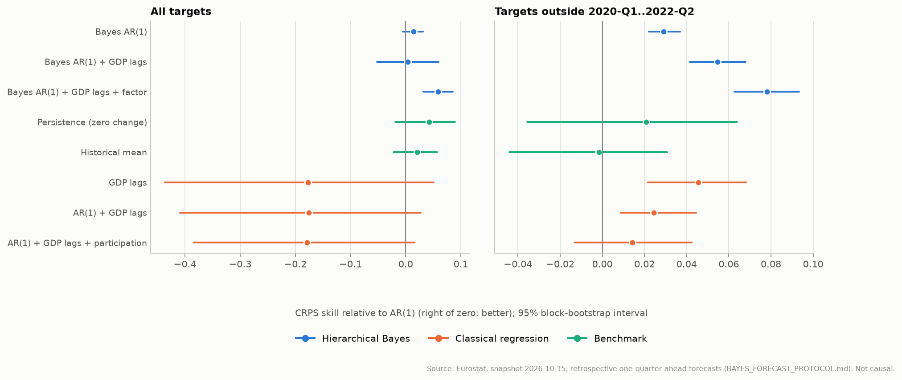
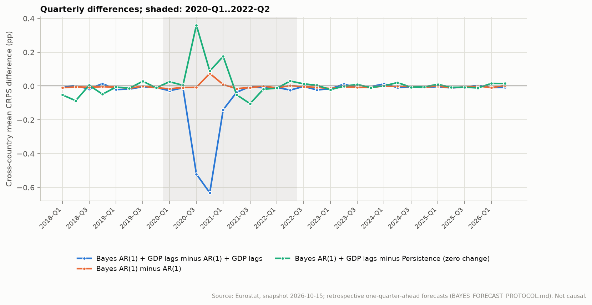
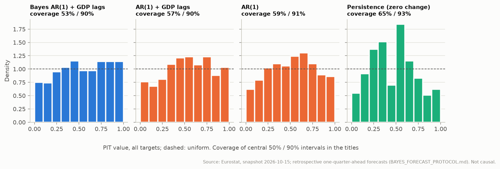
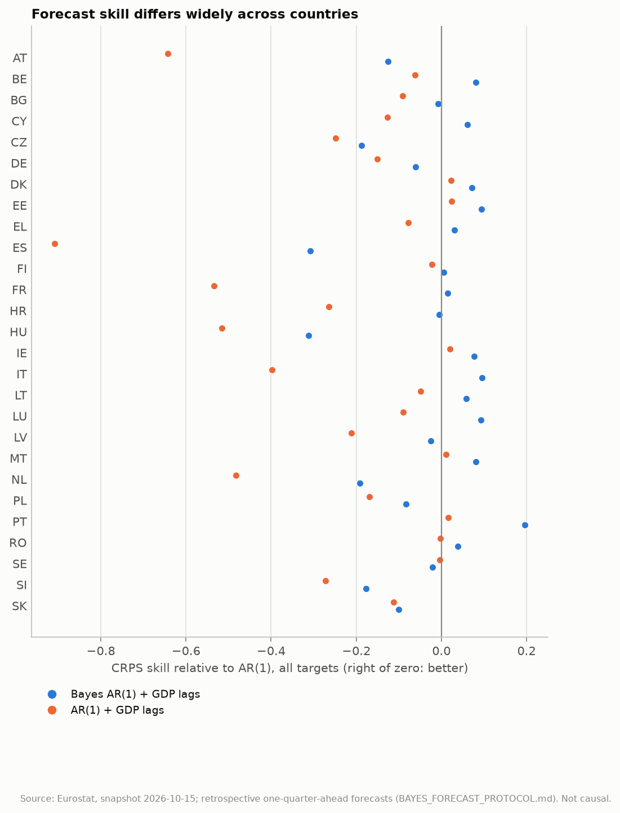

# One-quarter-ahead forecasts: hierarchical Bayes against classical models

Generated by `eu-okun forecast-report` from the frozen snapshot `snapshots/eurostat-2026-10-15` and the Bayesian refits. Design, models, scores and decision rules were pre-registered in [BAYES_FORECAST_PROTOCOL.md](../BAYES_FORECAST_PROTOCOL.md) before any fit or score.

**Information set.** The forecast for quarter t is issued at the end of t-1 and uses unemployment, participation and GDP growth up to t-1 only: no value dated t. **Retrospective, not real-time:** every value is the revised one in the snapshot; release lags and historical data vintages are not reconstructed. Better forecasts are not evidence of causal effects.

## Summary

- Bayes AR(1) + GDP lags vs AR(1) + GDP lags: mean CRPS -15.3% (95% interval -25.6% to -2.9%; Holm p 0.276), not distinguishable.
- Bayes AR(1) vs AR(1): mean CRPS -1.4% (95% interval -3.1% to +0.5%; Holm p 0.276), not distinguishable.
- Bayes AR(1) + GDP lags vs Persistence (zero change): mean CRPS +4.0% (95% interval -6.8% to +14.7%; Holm p 1.000), not distinguishable.
- Bayes AR(1) + GDP lags vs Bayes AR(1): mean CRPS +1.0% (95% interval -3.3% to +5.4%; Holm p 1.000), not distinguishable.
- Bayes AR(1) + GDP lags + factor vs Bayes AR(1) + GDP lags: mean CRPS -5.5% (95% interval -9.2% to -1.9%; Holm p 0.230), not distinguishable.

0 of 5 pre-registered comparisons are decided at the 5% familywise level (synchronised circular block bootstrap, block length 4, all 34 targets).

- Sensitivity, block 8: no verdict changes.
- Sensitivity, excluding pandemic: verdicts change for Bayes AR(1) + GDP lags vs AR(1) + GDP lags; Bayes AR(1) vs AR(1); Bayes AR(1) + GDP lags vs Bayes AR(1); Bayes AR(1) + GDP lags + factor vs Bayes AR(1) + GDP lags.
- Sensitivity, without failed refits: no verdict changes.
- Convergence: 31 of 102 refits failed the acceptance criteria after the single retry (`bayes_ar1` 3 of 34; `bayes_gdp_ar1` 16 of 34; `bayes_gdp_ar1_factor` 12 of 34). In their final attempts: R-hat at most 1.017, ESS at least 246, 0 divergent transitions; the parameter named most often is `mu_s`. Their forecasts are scored, as registered; the sensitivity analysis without their target quarters is in section 2.
- Point and probabilistic accuracy, all targets: lowest CRPS Bayes AR(1) + GDP lags + factor, lowest MAE Persistence (zero change), lowest RMSE Persistence (zero change); 90% intervals cover 90%-93% of outcomes across models.
- Point and probabilistic accuracy, outside 2020-Q1..2022-Q2: lowest CRPS Bayes AR(1) + GDP lags + factor, lowest MAE Bayes AR(1) + GDP lags + factor, lowest RMSE GDP lags; 90% intervals cover 95%-98% of outcomes across models.
- Replication (Linux replication, GitHub Actions run 38919566372): the same verdicts for all five comparisons. See section 5.

## 1. Design and computation

- Framework sample: 68 common complete-case quarters (2009-Q3 to 2026-Q2), 27 countries.
- Origins: 34 targets (2018-Q1 to 2026-Q2); training windows 34 to 67 quarters, starting 2009-Q3.
- Sensitivity set: 24 targets outside 2020-Q1..2022-Q2.
- Every model uses identical origins, training rows and targets; the classical point forecasts are exactly those of `eu-okun forecast`.
- Snapshot manifest SHA-256 `8a8c8a107d584ba91b61584fd29397e68ff83d82982371a35db253c0803a0464`.

| Model | Origins | Fits run | Accepted at first attempt | Accepted after retry | Failed after retry | Worst final R-hat | Sampling minutes |
| --- | ---: | ---: | ---: | ---: | --- | ---: | ---: |
| `bayes_ar1` | 34 | 40 | 28 | 3 | 2019-Q2, 2019-Q3, 2026-Q2 | 1.011 | 46 |
| `bayes_gdp_ar1` | 34 | 67 | 1 | 17 | 2018-Q1, 2018-Q2, 2018-Q4, 2019-Q1, 2019-Q2, 2019-Q3, 2020-Q1, 2020-Q2, 2021-Q2, 2022-Q3, 2023-Q2, 2023-Q3, 2023-Q4, 2024-Q1, 2024-Q2, 2025-Q1 | 1.014 | 111 |
| `bayes_gdp_ar1_factor` | 34 | 55 | 13 | 9 | 2019-Q3, 2021-Q2, 2021-Q3, 2022-Q3, 2022-Q4, 2023-Q1, 2023-Q2, 2023-Q3, 2023-Q4, 2024-Q1, 2024-Q3, 2026-Q2 | 1.017 | 104 |

## 2. Pre-registered comparisons

Mean CRPS over target quarters of the cross-country mean (pp; lower is better). Difference A - B with its 95% bootstrap percentile interval; ratio with its interval; null-centred bootstrap p-value, Holm-adjusted over the five comparisons (999 resamples, seed 20261020). The verdict uses the null-centred p-value; when a few quarters dominate, the bootstrap distribution is skewed and the percentile interval can exclude zero while p > 0.05.

| A | B | CRPS A | CRPS B | Difference [95%] | A vs B [95%] | p | Holm p | Verdict |
| --- | --- | ---: | ---: | ---: | ---: | ---: | ---: | --- |
| Bayes AR(1) + GDP lags | AR(1) + GDP lags | 0.2542 | 0.3000 | -0.0458 [-0.1125, -0.0058] | -15.3% [-25.6%, -2.9%] | 0.069 | 0.276 | not distinguishable |
| Bayes AR(1) | AR(1) | 0.2516 | 0.2552 | -0.0036 [-0.0071, +0.0016] | -1.4% [-3.1%, +0.5%] | 0.087 | 0.276 | not distinguishable |
| Bayes AR(1) + GDP lags | Persistence (zero change) | 0.2542 | 0.2444 | +0.0098 [-0.0149, +0.0437] | +4.0% [-6.8%, +14.7%] | 0.550 | 1.000 | not distinguishable |
| Bayes AR(1) + GDP lags | Bayes AR(1) | 0.2542 | 0.2516 | +0.0026 [-0.0073, +0.0159] | +1.0% [-3.3%, +5.4%] | 0.692 | 1.000 | not distinguishable |
| Bayes AR(1) + GDP lags + factor | Bayes AR(1) + GDP lags | 0.2402 | 0.2542 | -0.0140 [-0.0317, -0.0039] | -5.5% [-9.2%, -1.9%] | 0.046 | 0.230 | not distinguishable |

Sensitivity, block 8:

| A | B | Targets | A vs B | 95% interval | Holm p | Verdict |
| --- | --- | ---: | ---: | ---: | ---: | --- |
| Bayes AR(1) + GDP lags | AR(1) + GDP lags | 34 | -15.3% | [-25.1%, -2.6%] | 0.240 | not distinguishable |
| Bayes AR(1) | AR(1) | 34 | -1.4% | [-3.0%, +0.4%] | 0.240 | not distinguishable |
| Bayes AR(1) + GDP lags | Persistence (zero change) | 34 | +4.0% | [-6.7%, +13.6%] | 1.000 | not distinguishable |
| Bayes AR(1) + GDP lags | Bayes AR(1) | 34 | +1.0% | [-2.8%, +5.0%] | 1.000 | not distinguishable |
| Bayes AR(1) + GDP lags + factor | Bayes AR(1) + GDP lags | 34 | -5.5% | [-9.1%, -2.0%] | 0.240 | not distinguishable |

Sensitivity, excluding pandemic:

| A | B | Targets | A vs B | 95% interval | Holm p | Verdict |
| --- | --- | ---: | ---: | ---: | ---: | --- |
| Bayes AR(1) + GDP lags | AR(1) + GDP lags | 24 | -3.1% | [-4.6%, -1.7%] | 0.005 | **Bayes AR(1) + GDP lags better** |
| Bayes AR(1) | AR(1) | 24 | -2.9% | [-3.7%, -2.2%] | 0.005 | **Bayes AR(1) better** |
| Bayes AR(1) + GDP lags | Persistence (zero change) | 24 | -3.5% | [-9.1%, +0.9%] | 0.241 | not distinguishable |
| Bayes AR(1) + GDP lags | Bayes AR(1) | 24 | -2.6% | [-3.6%, -1.7%] | 0.005 | **Bayes AR(1) + GDP lags better** |
| Bayes AR(1) + GDP lags + factor | Bayes AR(1) + GDP lags | 24 | -2.5% | [-3.3%, -1.5%] | 0.005 | **Bayes AR(1) + GDP lags + factor better** |

Sensitivity, without failed refits:

| A | B | Targets | A vs B | 95% interval | Holm p | Verdict |
| --- | --- | ---: | ---: | ---: | ---: | --- |
| Bayes AR(1) + GDP lags | AR(1) + GDP lags | 13 | -26.7% | [-37.7%, -4.2%] | 0.212 | not distinguishable |
| Bayes AR(1) | AR(1) | 13 | +0.5% | [-3.3%, +3.7%] | 0.671 | not distinguishable |
| Bayes AR(1) + GDP lags | Persistence (zero change) | 13 | +18.7% | [-1.5%, +33.9%] | 0.354 | not distinguishable |
| Bayes AR(1) + GDP lags | Bayes AR(1) | 13 | +9.1% | [-0.3%, +16.4%] | 0.297 | not distinguishable |
| Bayes AR(1) + GDP lags + factor | Bayes AR(1) + GDP lags | 13 | -10.3% | [-16.2%, -2.2%] | 0.210 | not distinguishable |

## 3. All models: accuracy, skill and calibration

Descriptive. Skill is 1 - score / score of the reference (positive: better than the reference), with its 95% block-bootstrap interval. Bias is the mean of the predictive mean minus the outcome.

**All targets**

| Model | CRPS | MAE | RMSE | Bias | CRPS skill vs persistence [95%] | CRPS skill vs AR(1) [95%] | 50% cover | 90% cover |
| --- | ---: | ---: | ---: | ---: | ---: | ---: | ---: | ---: |
| Bayes AR(1) | 0.2516 | 0.3417 | 0.5179 | -0.0324 | -0.030 [-0.098, +0.045] | +0.014 [-0.005, +0.031] | 51% | 91% |
| Bayes AR(1) + GDP lags | 0.2542 | 0.3458 | 0.5366 | -0.0229 | -0.040 [-0.147, +0.068] | +0.004 [-0.052, +0.060] | 53% | 90% |
| Bayes AR(1) + GDP lags + factor | 0.2402 | 0.3237 | 0.4960 | -0.0254 | +0.017 [-0.049, +0.092] | +0.059 [+0.032, +0.085] | 58% | 91% |
| Persistence (zero change) | 0.2444 | 0.3218 | 0.4738 | +0.0464 | reference | +0.042 [-0.019, +0.089] | 65% | 93% |
| Historical mean | 0.2500 | 0.3302 | 0.4876 | -0.0091 | -0.023 [-0.047, +0.004] | +0.020 [-0.022, +0.057] | 63% | 93% |
| AR(1) | 0.2552 | 0.3444 | 0.5196 | -0.0251 | -0.044 [-0.098, +0.019] | reference | 59% | 91% |
| GDP lags | 0.3004 | 0.3955 | 0.7467 | +0.0204 | -0.229 [-0.568, +0.058] | -0.177 [-0.436, +0.050] | 61% | 91% |
| AR(1) + GDP lags | 0.3000 | 0.4048 | 0.7184 | -0.0030 | -0.228 [-0.541, +0.032] | -0.176 [-0.409, +0.028] | 57% | 90% |
| AR(1) + GDP lags + participation | 0.3009 | 0.4093 | 0.7268 | -0.0023 | -0.231 [-0.508, +0.016] | -0.179 [-0.384, +0.016] | 54% | 90% |

**Targets outside 2020-Q1..2022-Q2 (24)**

| Model | CRPS | MAE | RMSE | Bias | CRPS skill vs persistence [95%] | CRPS skill vs AR(1) [95%] | 50% cover | 90% cover |
| --- | ---: | ---: | ---: | ---: | ---: | ---: | ---: | ---: |
| Bayes AR(1) | 0.1942 | 0.2679 | 0.3730 | -0.0357 | +0.009 [-0.037, +0.062] | +0.029 [+0.022, +0.037] | 59% | 96% |
| Bayes AR(1) + GDP lags | 0.1891 | 0.2609 | 0.3607 | -0.0489 | +0.035 [-0.009, +0.091] | +0.055 [+0.042, +0.068] | 58% | 95% |
| Bayes AR(1) + GDP lags + factor | 0.1844 | 0.2511 | 0.3487 | -0.0342 | +0.059 [+0.020, +0.107] | +0.078 [+0.063, +0.093] | 62% | 96% |
| Persistence (zero change) | 0.1959 | 0.2537 | 0.3546 | +0.0515 | reference | +0.021 [-0.036, +0.064] | 72% | 97% |
| Historical mean | 0.2004 | 0.2623 | 0.3662 | -0.0057 | -0.023 [-0.040, -0.005] | -0.001 [-0.044, +0.031] | 69% | 98% |
| AR(1) | 0.2001 | 0.2715 | 0.3779 | -0.0318 | -0.021 [-0.068, +0.034] | reference | 65% | 96% |
| GDP lags | 0.1909 | 0.2548 | 0.3466 | -0.0471 | +0.025 [-0.013, +0.072] | +0.046 [+0.022, +0.068] | 67% | 97% |
| AR(1) + GDP lags | 0.1952 | 0.2681 | 0.3670 | -0.0475 | +0.004 [-0.045, +0.065] | +0.024 [+0.009, +0.045] | 63% | 96% |
| AR(1) + GDP lags + participation | 0.1972 | 0.2726 | 0.3730 | -0.0551 | -0.007 [-0.073, +0.072] | +0.014 [-0.013, +0.042] | 60% | 96% |

MAE skill over all targets (the framework's point metric):

| Model | MAE skill vs persistence [95%] | MAE skill vs AR(1) [95%] |
| --- | ---: | ---: |
| Bayes AR(1) | -0.062 [-0.122, +0.009] | +0.008 [-0.005, +0.022] |
| Bayes AR(1) + GDP lags | -0.075 [-0.176, +0.034] | -0.004 [-0.064, +0.055] |
| Bayes AR(1) + GDP lags + factor | -0.006 [-0.066, +0.068] | +0.060 [+0.029, +0.090] |
| Persistence (zero change) | reference | +0.066 [+0.006, +0.111] |
| Historical mean | -0.026 [-0.058, +0.007] | +0.041 [+0.002, +0.076] |
| AR(1) | -0.070 [-0.125, -0.006] | reference |
| GDP lags | -0.229 [-0.544, +0.042] | -0.149 [-0.409, +0.072] |
| AR(1) + GDP lags | -0.258 [-0.552, -0.004] | -0.176 [-0.410, +0.024] |
| AR(1) + GDP lags + participation | -0.272 [-0.553, -0.027] | -0.188 [-0.410, +0.004] |





- Bayes AR(1) + GDP lags minus AR(1) + GDP lags: largest quarterly differences 2020-Q4 (-0.631) and 2020-Q3 (-0.521); mean difference -0.0458 over all 34 quarters, -0.0127 without these two.
- Bayes AR(1) minus AR(1): largest quarterly differences 2020-Q4 (+0.075) and 2020-Q1 (-0.016); mean difference -0.0036 over all 34 quarters, -0.0056 without these two.
- Bayes AR(1) + GDP lags minus Persistence (zero change): largest quarterly differences 2020-Q3 (+0.360) and 2021-Q1 (+0.175); mean difference +0.0098 over all 34 quarters, -0.0063 without these two.



## 4. Countries (descriptive)

CRPS skill relative to AR(1) by country over the 34 targets, and the CRPS difference of comparison 1 (Bayes AR(1) + GDP lags minus AR(1) + GDP lags) with its block-bootstrap interval. Alphabetical; no ranking and no per-country significance claims.

| Country | Bayes AR(1) + GDP lags | AR(1) + GDP lags | Persistence (zero change) | Comparison 1 difference [95%] |
| --- | ---: | ---: | ---: | ---: |
| AT | -0.126 | -0.643 | +0.019 | -0.1310 [-0.3585, -0.0117] |
| BE | +0.081 | -0.062 | -0.066 | -0.0271 [-0.0668, -0.0019] |
| BG | -0.008 | -0.091 | +0.045 | -0.0191 [-0.0453, -0.0014] |
| CY | +0.061 | -0.127 | +0.081 | -0.0616 [-0.1785, +0.0153] |
| CZ | -0.187 | -0.249 | -0.089 | -0.0062 [-0.0134, -0.0006] |
| DE | -0.061 | -0.150 | +0.132 | -0.0097 [-0.0199, -0.0007] |
| DK | +0.071 | +0.023 | +0.023 | -0.0101 [-0.0241, +0.0007] |
| EE | +0.094 | +0.024 | +0.035 | -0.0329 [-0.1072, +0.0360] |
| EL | +0.030 | -0.078 | +0.188 | -0.0633 [-0.1404, -0.0018] |
| ES | -0.308 | -0.908 | -0.107 | -0.1538 [-0.4671, +0.0138] |
| FI | +0.006 | -0.023 | -0.003 | -0.0068 [-0.0198, +0.0061] |
| FR | +0.015 | -0.534 | -0.003 | -0.0984 [-0.2849, -0.0005] |
| HR | -0.005 | -0.265 | -0.015 | -0.0919 [-0.2456, +0.0007] |
| HU | -0.312 | -0.516 | +0.076 | -0.0335 [-0.0590, -0.0108] |
| IE | +0.077 | +0.020 | +0.109 | -0.0154 [-0.0249, -0.0077] |
| IT | +0.095 | -0.398 | +0.047 | -0.1796 [-0.4490, -0.0039] |
| LT | +0.058 | -0.049 | +0.068 | -0.0433 [-0.1093, +0.0070] |
| LU | +0.093 | -0.090 | +0.052 | -0.0619 [-0.1535, -0.0004] |
| LV | -0.024 | -0.212 | -0.036 | -0.0470 [-0.1005, -0.0106] |
| MT | +0.081 | +0.011 | +0.053 | -0.0151 [-0.0446, +0.0056] |
| NL | -0.191 | -0.483 | -0.135 | -0.0306 [-0.0881, +0.0032] |
| PL | -0.084 | -0.169 | +0.029 | -0.0126 [-0.0233, -0.0035] |
| PT | +0.196 | +0.016 | +0.161 | -0.0594 [-0.1549, -0.0062] |
| RO | +0.039 | -0.003 | +0.078 | -0.0073 [-0.0154, -0.0001] |
| SE | -0.021 | -0.004 | +0.075 | +0.0042 [-0.0060, +0.0137] |
| SI | -0.177 | -0.272 | +0.016 | -0.0232 [-0.0772, +0.0182] |
| SK | -0.100 | -0.112 | -0.230 | -0.0013 [-0.0041, +0.0017] |

Bayes AR(1) + GDP lags has the lower mean CRPS in 26 of 27 countries; the interval excludes zero in its favour in 15 and against it in 0 (unadjusted, descriptive).



## 5. Replication on a second platform

Linux replication, GitHub Actions run 38919566372: the same snapshot, lock file, seeds, sampler settings and single retry. Its tables are in `replication-linux/`.

| A | B | A vs B (this run) | Holm p | Verdict | A vs B (replication) | Holm p | Verdict |
| --- | --- | ---: | ---: | --- | ---: | ---: | --- |
| Bayes AR(1) + GDP lags | AR(1) + GDP lags | -15.3% | 0.276 | not distinguishable | -15.3% | 0.272 | not distinguishable |
| Bayes AR(1) | AR(1) | -1.4% | 0.276 | not distinguishable | -1.4% | 0.272 | not distinguishable |
| Bayes AR(1) + GDP lags | Persistence (zero change) | +4.0% | 1.000 | not distinguishable | +4.0% | 1.000 | not distinguishable |
| Bayes AR(1) + GDP lags | Bayes AR(1) | +1.0% | 1.000 | not distinguishable | +1.0% | 1.000 | not distinguishable |
| Bayes AR(1) + GDP lags + factor | Bayes AR(1) + GDP lags | -5.5% | 0.230 | not distinguishable | -5.6% | 0.240 | not distinguishable |

- Bayesian forecasts: the CRPS of the 2754 Bayesian cells differs by 0.0021 on average and at most 0.0439 between the runs.
- Failed refits: `bayes_ar1` 3 here, 4 there; `bayes_gdp_ar1` 16 here, 16 there; `bayes_gdp_ar1_factor` 12 here, 5 there.
- Verdicts: identical for all five comparisons.

## 6. Interpretation and limitations

- **Improvement, significance, causality.** A lower mean score is an improvement in this sample; the bootstrap intervals and Holm-adjusted p-values say whether it is distinguishable from sampling variation; neither says anything causal.
- **Retrospective forecasts.** Revised data, with GDP growth for t-1 assumed known at the end of t-1. A real-time evaluation needs Eurostat data as published at each origin.
- **Pandemic quarters** are in training and targets, as in the framework; the sensitivity set without 2020-Q1..2022-Q2 targets shows how much they drive the results.
- **Power.** 34 target quarters; 'not distinguishable' never means equal accuracy.

## 7. Reproduction

```bash
poetry run eu-okun forecast-bayes-fit --data-dir snapshots/eurostat-2026-10-15 --output-dir results/forecast-bayes
poetry run eu-okun forecast-report --data-dir snapshots/eurostat-2026-10-15 --fits-dir results/forecast-bayes --output-dir docs/forecast-comparison --report docs/FORECAST_COMPARISON.md --replication-dir docs/forecast-comparison/replication-linux
```
