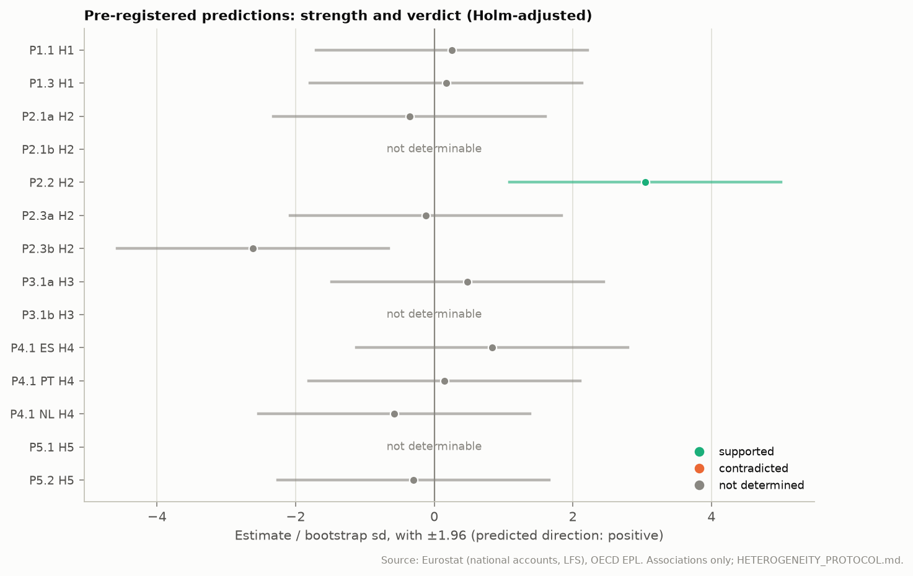
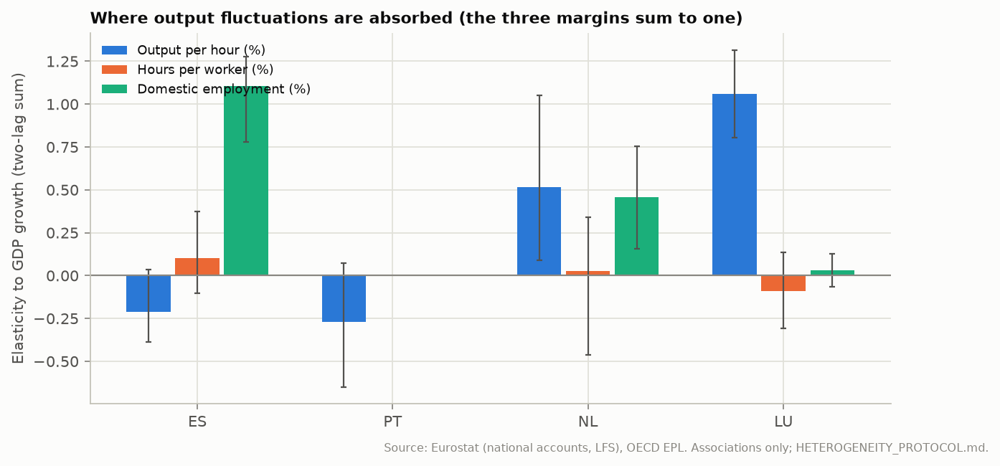
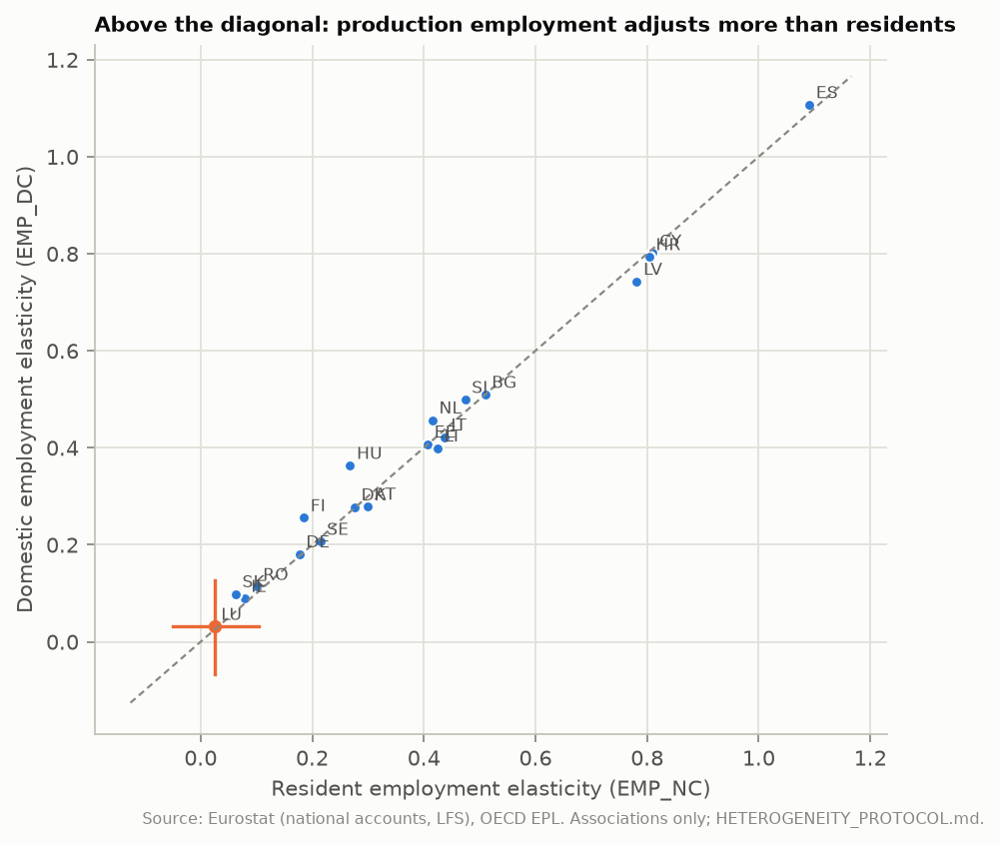
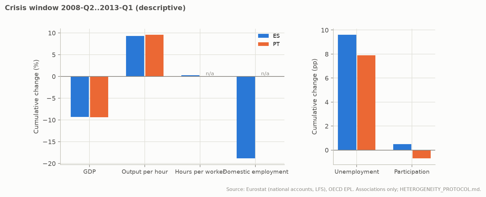
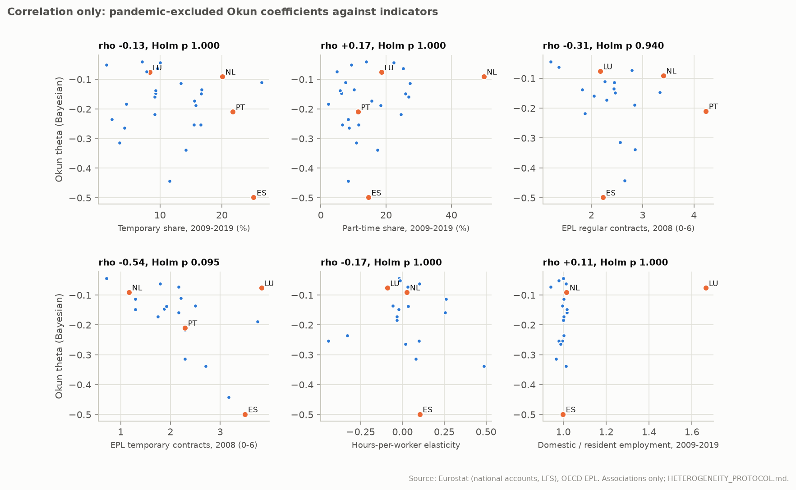

# Country heterogeneity: Portugal, Spain, the Netherlands and Luxembourg

Generated by `eu-okun heterogeneity` from the frozen Eurostat and OECD snapshots and the committed classical and Bayesian estimates. Hypotheses, predictions, decision rules and the list of untestable hypotheses were pre-registered in [HETEROGENEITY_PROTOCOL.md](../HETEROGENEITY_PROTOCOL.md) before any computation.

**How to read this report.** Three classes of evidence are kept apart:

- **correlation**: cross-country associations (section 7) and descriptive companions;
- **pattern consistent with a mechanism**: where output fluctuations are absorbed (margins, measurement concepts, contract types), sections 2-6 and 8;
- **identified causal effect**: none. No identification strategy is available (IDENTIFICATION_STUDY.md), so no result here says that an institution *causes* a country's Okun coefficient.

## Summary

| Prediction | Statement | Estimate [95%] | Holm p | Verdict |
| --- | --- | ---: | ---: | --- |
| P1.1 | LU: domestic minus resident employment elasticity > 0 (equivalently, the commuting margin responds to GDP; P1.2 is the same test) | +0.01 [-0.05, +0.05] | 1.000 | not determined |
| P1.3 | LU's domestic-resident gap exceeds the median gap of the other countries | +0.00 [-0.06, +0.05] | 1.000 | not determined |
| P2.1a | NL hours-per-worker elasticity > ES | -0.08 [-0.60, +0.23] | 1.000 | not determined |
| P2.1b | NL hours-per-worker elasticity > PT | n/a | n/a | not determined |
| P2.2 | NL output-per-hour elasticity > ES | +0.73 [+0.31, +1.23] | 0.022 | **supported** |
| P2.3a | NL participation elasticity > ES | -0.01 [-0.15, +0.15] | 1.000 | not determined |
| P2.3b | NL participation elasticity > PT | -0.22 [-0.39, -0.06] | 0.100 | not determined |
| P3.1a | NL lagged share of the unemployment response > ES | +0.46 [-0.13, +1.04] | 1.000 | not determined |
| P3.1b | NL lagged share of the unemployment response > PT | n/a | n/a | not determined |
| P4.1 ES | ES temporary employment more GDP-elastic than permanent | +0.72 [-1.28, +2.08] | 1.000 | not determined |
| P4.1 PT | PT temporary employment more GDP-elastic than permanent | +0.10 [-1.51, +1.16] | 1.000 | not determined |
| P4.1 NL | NL temporary employment more GDP-elastic than permanent | -0.46 [-2.07, +1.06] | 1.000 | not determined |
| P5.1 | ES domestic-employment elasticity > PT | n/a | n/a | not determined |
| P5.2 | PT output-per-hour elasticity > ES | -0.06 [-0.51, +0.28] | 1.000 | not determined |

1 supported, 0 contradicted, 13 not determined, of 14 pre-registered predictions (Holm over the determinable ones; P1.2 is the same test as P1.1, see the protocol's change log).

- P2.1b: data not available.
- P3.1b: not determinable: the K = 4 sum of PT is not distinguishable from zero.
- P5.1: data not available.



## 1. Data, definitions and coverage

All series are official and frozen with SHA-256 hashes; nothing is interpolated. Ratios combine numerator and denominator of the same concept (domestic with domestic, resident with resident). Countries with an estimate under the primary design:

| Measure | Countries | Missing |
| --- | ---: | --- |
| Output per hour (%) | 26 | BE |
| Hours per worker (%) | 20 | BE, CZ, EL, FR, MT, PL, PT |
| Domestic employment (%) | 20 | BE, CZ, EL, FR, MT, PL, PT |
| Hours worked (%) | 26 | BE |
| Resident employment (%) | 21 | BE, CZ, FR, MT, PL, PT |
| Commuting margin (%) | 20 | BE, CZ, EL, FR, MT, PL, PT |
| Unemployment rate (pp) | 27 | none |
| Participation rate (pp) | 27 | none |
| Temporary employees, y/y (%) | 27 | none |
| Permanent employees, y/y (%) | 27 | none |

Sources: `namq_10_pe` (unit=THS_PER, s_adj=SCA, na_item=EMP_DC); `namq_10_pe` (unit=THS_PER, s_adj=SCA, na_item=EMP_NC); `namq_10_a10_e` (unit=THS_PER, s_adj=SCA, na_item=EMP_DC, nace_r2=TOTAL); `namq_10_a10_e` (unit=THS_HW, s_adj=SCA, na_item=EMP_DC, nace_r2=TOTAL); `lfsq_etgaed` (unit=THS_PER, sex=T, age=Y15-74, isced11=TOTAL); `lfsq_eegaed` (unit=THS_PER, sex=T, age=Y15-74, isced11=TOTAL); `lfsq_etpga` (unit=PC, sex=T, age=Y15-74); `lfsq_eppga` (unit=PC, sex=T, age=Y15-74); OECD `DSD_EPL@DF_EPL` (EPL_R, EPL_T, version 3, 2008). National statistical offices identified but not used (STATEC, CBS, INE Spain, INE Portugal): protocol, section 2.

## 2. Margins of adjustment

Two-lag elasticities to GDP growth (sum of the coefficients on g[t], g[t-1], g[t-2]), 95% block-bootstrap intervals. Output per hour, hours per worker and domestic employment sum to one by construction.

| Measure | ES | PT | NL | LU | Median, all countries |
| --- | ---: | ---: | ---: | ---: | ---: |
| Output per hour (%) | -0.21 [-0.39, +0.03] | -0.27 [-0.65, +0.07] | +0.52 [+0.09, +1.05] | +1.06 [+0.80, +1.32] | +0.61 |
| Hours per worker (%) | +0.10 [-0.10, +0.37] | n/a | +0.03 [-0.46, +0.34] | -0.09 [-0.31, +0.13] | +0.02 |
| Domestic employment (%) | +1.11 [+0.78, +1.28] | n/a | +0.46 [+0.16, +0.75] | +0.03 [-0.07, +0.13] | +0.38 |
| Hours worked (%) | +1.21 [+0.97, +1.39] | +1.27 [+0.93, +1.65] | +0.48 [-0.05, +0.91] | -0.06 [-0.32, +0.20] | +0.39 |
| Resident employment (%) | +1.09 [+0.78, +1.27] | n/a | +0.42 [+0.12, +0.71] | +0.02 [-0.05, +0.10] | +0.41 |
| Commuting margin (%) | +0.02 [-0.05, +0.06] | n/a | +0.04 [+0.01, +0.07] | +0.01 [-0.05, +0.05] | +0.00 |
| Unemployment rate (pp) | -0.74 [-0.93, -0.41] | -0.48 [-0.64, +0.17] | -0.28 [-0.48, -0.09] | +0.12 [-0.18, +0.40] | -0.26 |
| Participation rate (pp) | -0.03 [-0.14, +0.05] | +0.18 [+0.09, +0.31] | -0.04 [-0.17, +0.09] | +0.16 [-0.31, +0.64] | +0.03 |



## 3. Luxembourg: production and residents (H1)

GDP counts production by everyone working in Luxembourg; unemployment and participation count residents only. Domestic employment (`EMP_DC`) includes cross-border commuters, resident employment (`EMP_NC`) does not.

| Prediction | Statistic | Estimate [95%] | p | Holm p | Verdict |
| --- | --- | ---: | ---: | ---: | --- |
| P1.1 | beta_e_dom_pe(LU) - beta_e_res(LU) | +0.01 [-0.05, +0.05] | 0.801 | 1.000 | not determined |
| P1.3 | gap(LU) - median gap(others) | +0.00 [-0.06, +0.05] | 0.993 | 1.000 | not determined |

LU's domestic-employment elasticity (+0.03) lies outside the interquartile range of the other countries [+0.23, +0.50] (descriptive companion).

Luxembourg: domestic employment +0.03 [-0.07, +0.13], resident employment +0.02 [-0.05, +0.10], unemployment +0.12 [-0.18, +0.40] pp.



## 4. The Netherlands: margins and timing (H2, H3)

| Prediction | Statistic | Estimate [95%] | Holm p | Verdict |
| --- | --- | ---: | ---: | --- |
| P2.1a | beta_hpw(NL) - beta_hpw(ES) | -0.08 [-0.60, +0.23] | 1.000 | not determined |
| P2.1b | beta_hpw(NL) - beta_hpw(PT) | n/a | n/a | not determined |
| P2.2 | beta_prod(NL) - beta_prod(ES) | +0.73 [+0.31, +1.23] | 0.022 | supported |
| P2.3a | beta_dp(NL) - beta_dp(ES) | -0.01 [-0.15, +0.15] | 1.000 | not determined |
| P2.3b | beta_dp(NL) - beta_dp(PT) | -0.22 [-0.39, -0.06] | 0.100 | not determined |
| P3.1a | share(NL) - share(ES) | +0.46 [-0.13, +1.04] | 1.000 | not determined |
| P3.1b | share(NL) - share(PT) | n/a | n/a | not determined |

Unemployment response with four lags (pp per %): the lagged share is reported only where the sum's interval excludes zero. **Timing says nothing about temporary contracts.**

| Country | K = 4 sum [95%] | Share from lags 1-4 |
| --- | ---: | ---: |
| ES | -0.79 [-1.01, -0.46] | 0.28 |
| PT | -0.49 [-0.69, +0.14] | not determinable |
| NL | -0.43 [-0.63, -0.23] | 0.74 |
| LU | +0.12 [-0.36, +0.69] | not determinable |

## 5. Temporary jobs as a buffer (H4)

Year-on-year elasticities of temporary and permanent employees (LFS, not seasonally adjusted) to year-on-year GDP growth; changes spanning a break or low-reliability flag are dropped. A larger temporary elasticity shows where employment adjustment falls; it does not show that temporary contracts cause a country's Okun coefficient.

| Country | Temporary [95%] | Permanent [95%] | Verdict (P4.1) |
| --- | ---: | ---: | --- |
| ES | +1.92 [+0.29, +2.94] | +1.20 [+0.76, +1.66] | not determined |
| PT | +1.14 [-0.23, +1.94] | +1.04 [+0.72, +1.44] | not determined |
| NL | -0.10 [-1.48, +1.07] | +0.36 [-0.19, +0.75] | not determined |
| LU | -3.62 [-6.06, -0.50] | +0.09 [-0.31, +0.51] |  |

## 6. Portugal and Spain (H5)

| Prediction | Statistic | Estimate [95%] | Holm p | Verdict |
| --- | --- | ---: | ---: | --- |
| P5.1 | beta_e_dom(ES) - beta_e_dom(PT) | n/a | n/a | not determined |
| P5.2 | beta_prod(PT) - beta_prod(ES) | -0.06 [-0.51, +0.28] | 1.000 | not determined |

Crisis window 2008-Q2 to 2013-Q1 (cumulative changes, descriptive): GDP and the national-accounts margins from the start of the window; unemployment and participation from the first quarter their series exist.

| Country | GDP (%) | Output per hour (%) | Hours per worker (%) | Domestic employment (%) | Unemployment rate (pp) | Participation rate (pp) |
| --- | ---: | ---: | ---: | ---: | ---: | ---: |
| ES | -9.3 | +9.3 | +0.2 | -18.8 | +9.6 (from 2009-Q2) | +0.5 (from 2009-Q2) |
| PT | -9.4 | +9.6 | n/a (not published) | n/a (not published) | +7.9 (from 2009-Q2) | -0.7 (from 2009-Q2) |



## 7. Institutions and structure across countries (H6, correlation only)

Spearman correlation between the pandemic-excluded Okun coefficient and each indicator; permutation p-values, Holm over the six indicators within each variant. theta is negative: a positive correlation means a weaker unemployment response.

| theta | Indicator | Predicted sign | Countries | rho | p | Holm p | Verdict |
| --- | --- | ---: | ---: | ---: | ---: | ---: | --- |
| Bayesian | Temporary share, 2009-2019 (%) | − | 27 | -0.13 | 0.518 | 1.000 | not determined |
| Bayesian | Part-time share, 2009-2019 (%) | + | 27 | +0.17 | 0.410 | 1.000 | not determined |
| Bayesian | EPL regular contracts, 2008 (0-6) | + | 20 | -0.31 | 0.188 | 0.940 | not determined |
| Bayesian | EPL temporary contracts, 2008 (0-6) | + | 20 | -0.54 | 0.016 | 0.095 | not determined |
| Bayesian | Hours-per-worker elasticity | + | 20 | -0.17 | 0.493 | 1.000 | not determined |
| Bayesian | Domestic / resident employment, 2009-2019 | + | 20 | +0.11 | 0.628 | 1.000 | not determined |
| classical | Temporary share, 2009-2019 (%) | − | 27 | -0.33 | 0.090 | 0.391 | not determined |
| classical | Part-time share, 2009-2019 (%) | + | 27 | +0.23 | 0.244 | 0.733 | not determined |
| classical | EPL regular contracts, 2008 (0-6) | + | 20 | -0.60 | 0.006 | 0.035 | contradicted |
| classical | EPL temporary contracts, 2008 (0-6) | + | 20 | -0.40 | 0.078 | 0.391 | not determined |
| classical | Hours-per-worker elasticity | + | 20 | -0.10 | 0.662 | 1.000 | not determined |
| classical | Domestic / resident employment, 2009-2019 | + | 20 | +0.13 | 0.588 | 1.000 | not determined |
| Bayesian, without LU and IE | Temporary share, 2009-2019 (%) | − | 25 | -0.07 | 0.735 | 1.000 | not determined |
| Bayesian, without LU and IE | Part-time share, 2009-2019 (%) | + | 25 | +0.07 | 0.746 | 1.000 | not determined |
| Bayesian, without LU and IE | EPL regular contracts, 2008 (0-6) | + | 18 | -0.13 | 0.613 | 1.000 | not determined |
| Bayesian, without LU and IE | EPL temporary contracts, 2008 (0-6) | + | 18 | -0.67 | 0.003 | 0.020 | contradicted |
| Bayesian, without LU and IE | Hours-per-worker elasticity | + | 18 | -0.10 | 0.690 | 1.000 | not determined |
| Bayesian, without LU and IE | Domestic / resident employment, 2009-2019 | + | 18 | +0.05 | 0.838 | 1.000 | not determined |



## 8. Do the country differences remain under other measures?

Elasticity differences (first minus second country) under four labour-input measures. A difference *remains* if its 95% interval excludes zero with the same sign as under unemployment (`-du`); *disappears* if the interval includes zero; *reverses* otherwise. Units differ across measures: only the persistence of the ordering is compared.

| Pair | Measure | Difference [95%] | Status |
| --- | --- | ---: | --- |
| ES-PT | Minus unemployment rate (pp) | +0.26 [+0.12, +0.70] | different |
| ES-PT | Resident employment (%) | n/a | not available |
| ES-PT | Domestic employment (%) | n/a | not available |
| ES-PT | Hours worked (%) | -0.06 [-0.51, +0.28] | disappears |
| ES-NL | Minus unemployment rate (pp) | +0.46 [+0.20, +0.66] | different |
| ES-NL | Resident employment (%) | +0.68 [+0.31, +0.99] | remains |
| ES-NL | Domestic employment (%) | +0.65 [+0.28, +0.95] | remains |
| ES-NL | Hours worked (%) | +0.73 [+0.31, +1.23] | remains |
| ES-LU | Minus unemployment rate (pp) | +0.87 [+0.46, +1.18] | different |
| ES-LU | Resident employment (%) | +1.07 [+0.71, +1.27] | remains |
| ES-LU | Domestic employment (%) | +1.08 [+0.73, +1.27] | remains |
| ES-LU | Hours worked (%) | +1.27 [+0.88, +1.62] | remains |
| PT-NL | Minus unemployment rate (pp) | +0.20 [-0.31, +0.33] | not distinguishable |
| PT-NL | Resident employment (%) | n/a | not available |
| PT-NL | Domestic employment (%) | n/a | not available |
| PT-NL | Hours worked (%) | +0.79 [+0.33, +1.39] | no difference under unemployment to compare |
| PT-LU | Minus unemployment rate (pp) | +0.61 [-0.08, +0.93] | not distinguishable |
| PT-LU | Resident employment (%) | n/a | not available |
| PT-LU | Domestic employment (%) | n/a | not available |
| PT-LU | Hours worked (%) | +1.33 [+0.86, +1.81] | no difference under unemployment to compare |
| NL-LU | Minus unemployment rate (pp) | +0.41 [+0.03, +0.77] | different |
| NL-LU | Resident employment (%) | +0.39 [+0.08, +0.72] | remains |
| NL-LU | Domestic employment (%) | +0.43 [+0.10, +0.77] | remains |
| NL-LU | Hours worked (%) | +0.54 [-0.13, +1.12] | disappears |

## 9. Sensitivity (pre-registered)

Verdict of every prediction under each sensitivity setting (each with its own Holm family).

| Prediction | Primary | lags_1 | lags_4 | pre_2020 | block_8 |
| --- | --- | --- | --- | --- | --- |
| P1.1 | not determined | not determined | not determined | not determined | not determined |
| P1.3 | not determined | not determined | not determined | not determined | not determined |
| P2.1a | not determined | not determined | not determined | not determined | not determined |
| P2.1b | not determined | not determined | not determined | not determined | not determined |
| P2.2 | supported | supported | not determined | supported | supported |
| P2.3a | not determined | not determined | not determined | not determined | not determined |
| P2.3b | not determined | not determined | not determined | not determined | not determined |
| P3.1a | not determined | not determined | not determined | supported | not determined |
| P3.1b | not determined | not determined | not determined | not determined | not determined |
| P4.1 ES | not determined | not determined | not determined | supported | not determined |
| P4.1 PT | not determined | not determined | not determined | not determined | not determined |
| P4.1 NL | not determined | not determined | not determined | not determined | not determined |
| P5.1 | not determined | not determined | not determined | not determined | not determined |
| P5.2 | not determined | not determined | not determined | not determined | not determined |

Pair differences under the alternative measures:

| Setting | Remain | Disappear | Reverse |
| --- | ---: | ---: | ---: |
| primary | 8 | 2 | 0 |
| lags_1 | 6 | 1 | 0 |
| lags_4 | 6 | 1 | 0 |
| pre_2020 | 9 | 2 | 0 |
| block_8 | 8 | 2 | 0 |

## 10. What can and cannot be concluded

**Patterns consistent with a mechanism (supported predictions):** P2.2 (NL output-per-hour elasticity > ES).

**Contradicted predictions:** none.

**Correlations (H6):** EPL regular contracts, 2008 (0-6) (classical: rho -0.60, contradicted); EPL temporary contracts, 2008 (0-6) (Bayesian, without LU and IE: rho -0.67, contradicted).

**Identified causal effects:** none.

**Hypotheses that cannot be tested reliably** (documented in the protocol before any result):

- that temporary contracts *cause* the Dutch or Spanish responses;
- the effects of the 2012 labour-market reforms in Spain and Portugal (single events coinciding with the sovereign-debt crisis);
- short-time work schemes (no harmonised quarterly take-up before 2020);
- labour hoarding as distinct from unmeasured effort or capacity utilisation;
- collective bargaining, minimum wages and benefit generosity;
- the unemployment of Luxembourg's cross-border workers, recorded in their countries of residence;
- sectoral composition.

## 11. References

- Ball, L., Leigh, D. and Loungani, P. (2017). Okun's law: fit at 50? *Journal of Money, Credit and Banking* 49(7).
- Bentolila, S., Cahuc, P., Dolado, J. J. and Le Barbanchon, T. (2012). Two-tier labour markets in the Great Recession: France versus Spain. *Economic Journal* 122(562).
- Blanchard, O. and Portugal, P. (2001). What hides behind an unemployment rate: comparing Portuguese and U.S. labor markets. *American Economic Review* 91(1).
- Ohanian, L. E. and Raffo, A. (2012). Aggregate hours worked in OECD countries: new measurement and implications for business cycles. *Journal of Monetary Economics* 59(1).
- Okun, A. M. (1962). Potential GNP: its measurement and significance. *Proceedings of the Business and Economic Statistics Section, American Statistical Association*.
- Eurostat: `namq_10_pe`, `namq_10_a10_e`, `lfsq_etgaed`, `lfsq_eegaed`, `lfsq_etpga`, `lfsq_eppga` (Eurostat database; reuse with acknowledgement).
- OECD (2020). OECD Indicators of Employment Protection (EPL), version 3 (CC BY 4.0).

## 12. Provenance and reproduction

Eurostat quarterly snapshot manifest `8a8c8a107d584ba91b61584fd29397e68ff83d82982371a35db253c0803a0464`; heterogeneity snapshot downloaded 2026-10-18T12:48:38.077196+00:00, file hashes and URLs in `provenance.json`. Bootstrap: 1999 synchronised circular block resamples, block length 4, seed 20261018.

```bash
poetry install --extras "bayes report"
poetry run eu-okun heterogeneity --data-dir snapshots/eurostat-2026-10-15 --snapshot snapshots/heterogeneity-2026-10-18 --output-dir docs/heterogeneity --report docs/HETEROGENEITY_CASE_STUDY.md
```
