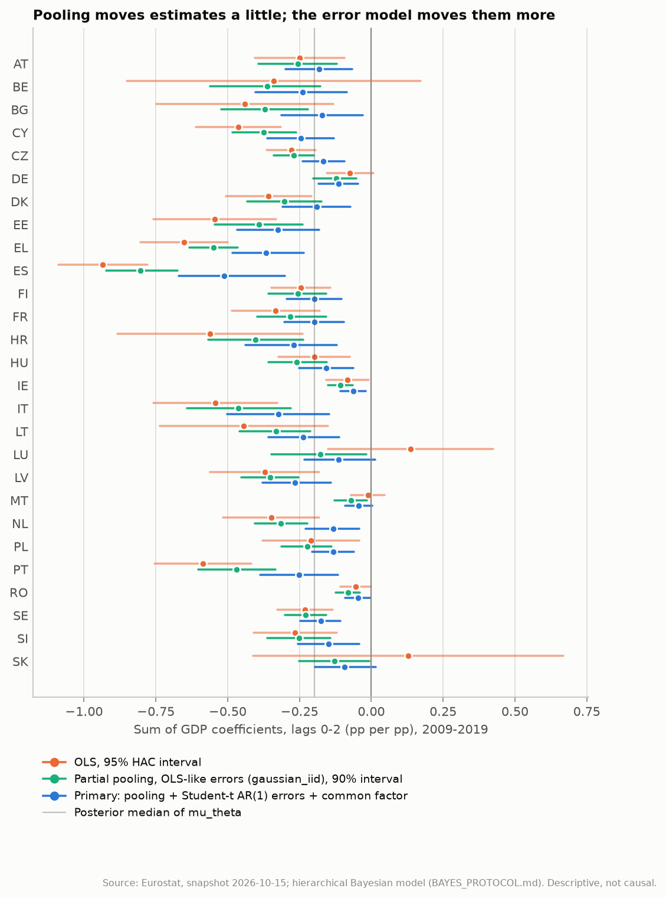
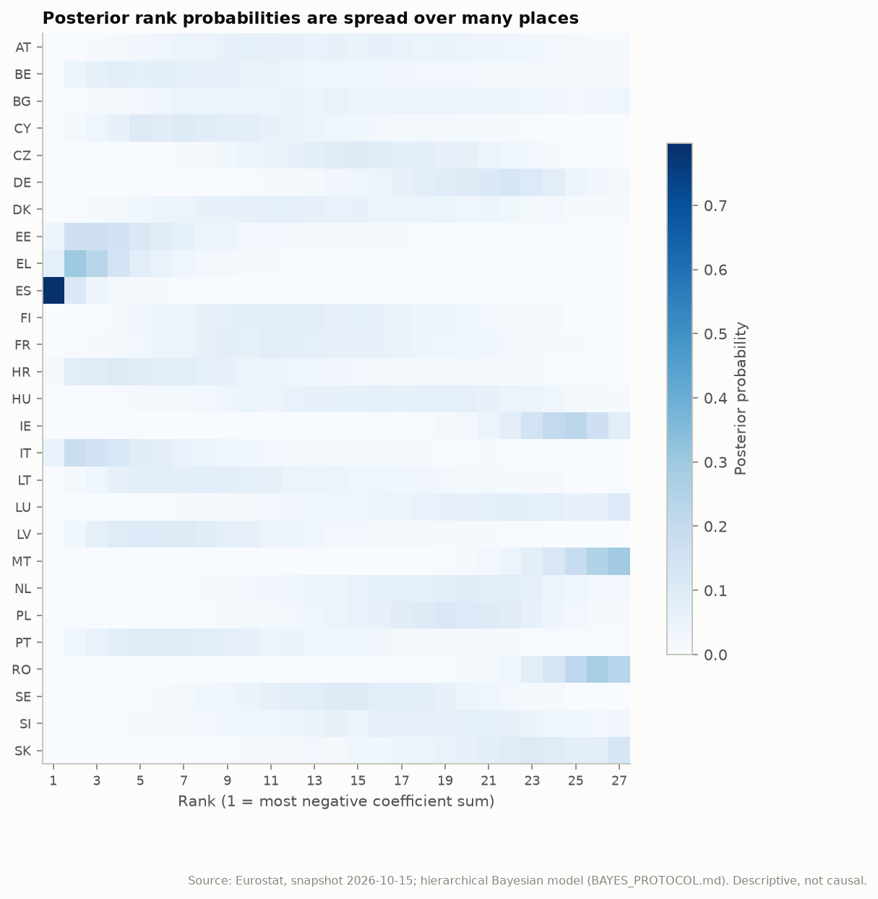
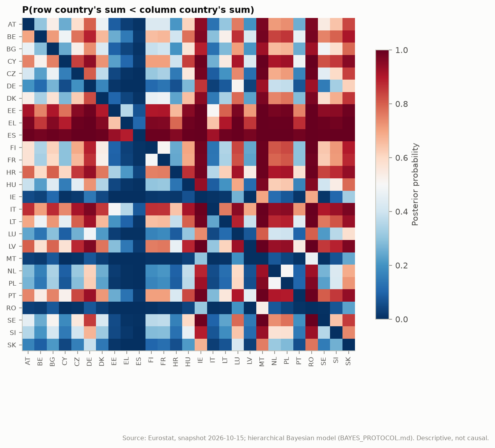
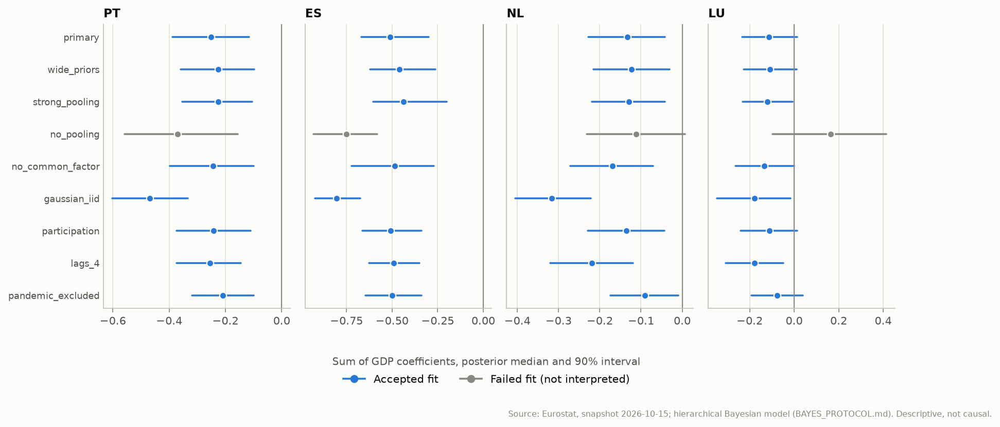

# Hierarchical Bayesian estimates: EU-27 Okun coefficients

> Generated by `eu-okun bayes-report` from saved posterior draws. Do not edit by hand. The model, priors, sensitivity set, acceptance criteria and decision rules were fixed in [BAYES_PROTOCOL.md](../BAYES_PROTOCOL.md) before any estimate was inspected. Results are descriptive conditional associations, not causal effects.

## Summary

| Topic | Finding |
| --- | --- |
| Computation | 8 of 9 specifications pass every acceptance criterion (R-hat <= 1.01, bulk and tail ESS >= 400, no divergences, E-BFMI >= 0.3); failed: no_pooling. |
| Average association | mu_theta, the unweighted mean of the country sums, has median -0.198 and 90% interval [-0.254, -0.145]; P(mu_theta < 0) = 1.000. Between-country s.d. tau_theta: median 0.126, 90% interval [+0.081, +0.175]. |
| Country signs | Credibly negative in the primary fit: 24 of 27; sign uncertain: LU, MT and SK. Credibly negative in every accepted specification: 22 countries; classification changes across specifications for BG, DK, LU, MT and SK. |
| Rank uncertainty | Median width of the 90% rank interval: 15 of 27 places. 99 of 351 country pairs differ with posterior probability >= 0.95. |
| Earlier claims | Luxembourg weak: **not resolved**; Netherlands delayed: **not resolved**; Spain large: **supported**. |
| Magnitude | Specification-dependent: across accepted fits the median of mu_theta ranges from -0.300 to -0.181. Against OLS on the same quarters, partial pooling with OLS-like errors (`gaussian_iid`) moves country sums by a median 0.054; the primary error model (Student-t, AR(1), common factor) moves them a further median 0.096, towards zero in 27 of 27 countries. |
| Model checks | The lag-1 autocorrelation check fails (p <= 0.05 or >= 0.95) in 9 of 9 specifications: observed 0.27, replicated means 0.02 to 0.20, so the models understate the persistence of unemployment changes. The fitted common factor is autocorrelated (median lag-1 0.75) and correlated with average GDP growth (median -0.60), although the model treats it as independent of both. In factor specifications theta therefore describes the association with each country's GDP beyond the common European cycle, not the classical coefficient sum. |
| Replication | An independent run on a second platform (section 9) reproduces posterior medians within 0.004 where both runs accept a fit. Acceptance differs for `strong_pooling` and `no_pooling`, which sit at the R-hat threshold. Countries credibly negative in every accepted fit: 22 here, 15 under that run's acceptance set; the difference is BE, DE, HU, IE, NL, PL and RO. Claim verdicts are identical. |

## 1. Data, software and sampler

- Snapshot: manifest SHA-256 `8a8c8a107d584ba91b61584fd29397e68ff83d82982371a35db253c0803a0464`, processed panel `250a7dd94d3678ca9ee4f29567e771fb53aeadf89e1f2fd0155d2f31d6e0ec0d`.
- Primary sample: 2009-Q2..2019-Q4, 43 quarters x 27 countries; 37 likelihood terms masked because of Eurostat flags.
- NUTS: 4 chains x (1000 warm-up + 1000 draws), target acceptance 0.95, maximum tree depth 10, seed 20261016.
- Software: Python 3.12.10, JAX 0.11.2, NumPyro 0.22.0, ArviZ 1.3.0, NumPy 2.5.4 on Windows-11-10.0.26200-SP0.

## 2. Convergence and acceptance

| Specification | Description | Warm-up | Max R-hat | Min ESS | Divergences | Min E-BFMI | Minutes | Status |
| --- | --- | ---: | ---: | ---: | ---: | ---: | ---: | --- |
| `primary` | Partial pooling, K=2, 2009-Q2..2019-Q4, Student-t AR(1) errors and a common factor | 1000 | 1.007 | 504 | 0 | 0.52 | 2.3 | accepted |
| `wide_priors` | All location and scale priors widened four-fold | 1000 | 1.010 | 473 | 0 | 0.52 | 2.0 | accepted |
| `strong_pooling` | tau_theta ~ HalfNormal(0.05) | 3000 | 1.007 | 437 | 0 | 0.61 | 2.1 | accepted |
| `no_pooling` | Independent country parameters, no hyperparameters | 3000 | 1.011 | 623 | 0 | 0.68 | 22.7 | **failed**: R-hat 1.011 > 1.01 (phi[26]) |
| `no_common_factor` | No common quarterly factor | 1000 | 1.006 | 632 | 0 | 0.62 | 1.3 | accepted |
| `gaussian_iid` | Normal errors, no AR(1), no common factor (closest to OLS) | 1000 | 1.006 | 594 | 0 | 0.61 | 0.5 | accepted |
| `participation` | Adds the participation change, partially pooled | 1000 | 1.006 | 696 | 0 | 0.57 | 3.2 | accepted |
| `lags_4` | GDP lags 0..4 | 1000 | 1.005 | 724 | 0 | 0.59 | 2.0 | accepted |
| `pandemic_excluded` | 2009-Q2..2019-Q4 and 2022-Q3..2026-Q2 as two segments | 1000 | 1.009 | 486 | 0 | 0.50 | 1.3 | accepted |

Re-run with longer warm-up after failing the criteria at 1000 warm-up iterations, as section 6 of the protocol allows (model and priors unchanged; first-attempt diagnostics are in the protocol change log): `strong_pooling` and `no_pooling`.

## 3. Country estimates (primary specification)

Posterior median and 90% credible interval of each country's sum of GDP coefficients (lags 0-2), next to OLS with a calendar-aware HAC 95% interval on exactly the same quarters. Alphabetical order; no ranking is implied.



| Country | Bayes median | 90% credible interval | P(theta < 0) | Classical OLS | 95% HAC interval | Lag share (median) |
| --- | ---: | ---: | ---: | ---: | ---: | ---: |
| AT | -0.182 | [-0.299, -0.067] | 0.995 | -0.249 | [-0.406, -0.093] | 0.60 |
| BE | -0.240 | [-0.404, -0.084] | 0.995 | -0.339 | [-0.850, +0.172] | 0.40 |
| BG | -0.172 | [-0.313, -0.029] | 0.978 | -0.440 | [-0.747, -0.133] | 0.65 |
| CY | -0.246 | [-0.362, -0.130] | 1.000 | -0.463 | [-0.610, -0.315] | 0.58 |
| CZ | -0.167 | [-0.239, -0.093] | 1.000 | -0.278 | [-0.363, -0.193] | 0.93 |
| DE | -0.114 | [-0.184, -0.047] | 0.996 | -0.074 | [-0.155, +0.006] | 0.60 |
| DK | -0.190 | [-0.310, -0.072] | 0.994 | -0.357 | [-0.507, -0.208] | 0.57 |
| EE | -0.324 | [-0.467, -0.182] | 1.000 | -0.544 | [-0.758, -0.331] | 0.42 |
| EL | -0.367 | [-0.483, -0.234] | 1.000 | -0.652 | [-0.803, -0.500] | 0.43 |
| ES | -0.512 | [-0.670, -0.300] | 1.000 | -0.934 | [-1.090, -0.779] | 0.22 |
| FI | -0.199 | [-0.295, -0.104] | 1.000 | -0.245 | [-0.349, -0.142] | 0.65 |
| FR | -0.199 | [-0.303, -0.095] | 0.999 | -0.333 | [-0.486, -0.179] | 0.73 |
| HR | -0.270 | [-0.439, -0.120] | 0.999 | -0.562 | [-0.883, -0.240] | 0.46 |
| HU | -0.157 | [-0.252, -0.062] | 0.996 | -0.199 | [-0.322, -0.075] | 0.64 |
| IE | -0.063 | [-0.108, -0.019] | 0.991 | -0.083 | [-0.157, -0.009] | 0.86 |
| IT | -0.323 | [-0.502, -0.146] | 0.999 | -0.543 | [-0.758, -0.328] | 0.33 |
| LT | -0.236 | [-0.359, -0.112] | 0.999 | -0.443 | [-0.736, -0.151] | 0.44 |
| LU | -0.113 | [-0.234, +0.013] | 0.932 | +0.137 | [-0.150, +0.425] | n/a |
| LV | -0.266 | [-0.380, -0.141] | 1.000 | -0.371 | [-0.562, -0.181] | 0.59 |
| MT | -0.044 | [-0.091, +0.004] | 0.937 | -0.012 | [-0.070, +0.047] | n/a |
| NL | -0.133 | [-0.228, -0.042] | 0.994 | -0.348 | [-0.516, -0.181] | 0.94 |
| PL | -0.133 | [-0.206, -0.061] | 0.999 | -0.211 | [-0.378, -0.043] | 0.69 |
| PT | -0.251 | [-0.388, -0.116] | 0.997 | -0.586 | [-0.754, -0.417] | 0.58 |
| RO | -0.046 | [-0.091, -0.004] | 0.964 | -0.054 | [-0.108, -0.001] | 0.36 |
| SE | -0.174 | [-0.246, -0.109] | 1.000 | -0.231 | [-0.326, -0.135] | 0.56 |
| SI | -0.148 | [-0.256, -0.043] | 0.987 | -0.265 | [-0.410, -0.120] | 0.75 |
| SK | -0.093 | [-0.195, +0.015] | 0.924 | +0.128 | [-0.412, +0.669] | n/a |

Against OLS on the same quarters, partial pooling with OLS-like errors (`gaussian_iid`) moves country sums by a median 0.054; the primary error model (Student-t, AR(1), common factor) moves them a further median 0.096, towards zero in 27 of 27 countries. The differences from OLS are therefore not only shrinkage: the error model and the common factor change what the coefficient measures (section 8). Lag share = (theta - beta0) / theta, the part of the sum carried by lagged growth, shown only where theta is credibly negative.

## 4. Rank uncertainty

Rank 1 is the most negative coefficient sum. The heat map shows the posterior probability of each rank; the matrix shows P(row country's sum < column country's sum).





| Country | Median rank | 90% rank interval |
| --- | ---: | ---: |
| AT | 14 | 5-24 |
| BE | 9 | 3-23 |
| BG | 15 | 5-26 |
| CY | 8 | 3-19 |
| CZ | 16 | 9-22 |
| DE | 21 | 13-25 |
| DK | 13 | 5-23 |
| EE | 4 | 2-13 |
| EL | 3 | 1-8 |
| ES | 1 | 1-3 |
| FI | 12 | 6-21 |
| FR | 13 | 6-22 |
| HR | 7 | 2-20 |
| HU | 17 | 8-24 |
| IE | 24 | 20-27 |
| IT | 4 | 1-17 |
| LT | 9 | 3-21 |
| LU | 21 | 10-27 |
| LV | 7 | 3-18 |
| MT | 26 | 22-27 |
| NL | 19 | 10-25 |
| PL | 19 | 12-24 |
| PT | 8 | 3-20 |
| RO | 26 | 22-27 |
| SE | 15 | 8-21 |
| SI | 17 | 8-25 |
| SK | 22 | 13-27 |

99 of 351 pairs meet the protocol's 0.95 threshold. A country's position relative to others is reportable only for those pairs.

## 5. Earlier claims

Rules from the protocol; 'supported' requires the rule to hold in the primary fit and in every accepted sensitivity fit.

| Claim | Verdict | Primary fit | Rule holds in | Fails in (accepted fits) |
| --- | --- | --- | --- | --- |
| Luxembourg weak | **not resolved** | P(theta_LU > mu_theta) = 0.870; 90% interval [-0.234, +0.013] | 1 of 9 fits | `primary`, `wide_priors`, `strong_pooling`, `no_common_factor`, `gaussian_iid`, `participation`, `lags_4` and `pandemic_excluded` |
| Netherlands delayed | **not resolved** | P(lag share > 0.5) = 0.966; median lag share 0.94 | 6 of 9 fits | `gaussian_iid` and `pandemic_excluded` |
| Spain large | **supported** | P(theta_ES < mu_theta) = 0.996 | 9 of 9 fits | none |

## 6. Sensitivity across specifications

Posterior medians of each country's sum by specification; `*` marks a sum that is not credibly negative. Failed fits are greyed in the table header and do not count towards robustness.

| Country | `primary` | `wide_priors` | `strong_pooling` | `no_pooling` (failed) | `no_common_factor` | `gaussian_iid` | `participation` | `lags_4` | `pandemic_excluded` | Robust sign |
| --- | ---: | ---: | ---: | ---: | ---: | ---: | ---: | ---: | ---: | --- |
| AT | -0.182 | -0.174 | -0.174 | -0.205 | -0.226 | -0.256 | -0.204 | -0.223 | -0.159 | credibly negative |
| BE | -0.240 | -0.219 | -0.217 | -0.293* | -0.308 | -0.362 | -0.235 | -0.295 | -0.218 | credibly negative |
| BG | -0.172 | -0.141* | -0.169 | -0.168* | -0.280 | -0.371 | -0.179 | -0.223 | -0.184 | not robust |
| CY | -0.246 | -0.219 | -0.228 | -0.378 | -0.302 | -0.374 | -0.273 | -0.267 | -0.253 | credibly negative |
| CZ | -0.167 | -0.155 | -0.163 | -0.180 | -0.243 | -0.270 | -0.167 | -0.200 | -0.147 | credibly negative |
| DE | -0.114 | -0.114 | -0.121 | -0.070* | -0.142 | -0.122 | -0.121 | -0.140 | -0.114 | credibly negative |
| DK | -0.190 | -0.177 | -0.181 | -0.215 | -0.270 | -0.303 | -0.188 | -0.252 | -0.063* | not robust |
| EE | -0.324 | -0.301 | -0.288 | -0.465 | -0.373 | -0.390 | -0.342 | -0.361 | -0.314 | credibly negative |
| EL | -0.367 | -0.349 | -0.327 | -0.543 | -0.333 | -0.549 | -0.375 | -0.431 | -0.443 | credibly negative |
| ES | -0.512 | -0.460 | -0.437 | -0.751 | -0.485 | -0.804 | -0.508 | -0.491 | -0.499 | credibly negative |
| FI | -0.199 | -0.189 | -0.188 | -0.220 | -0.233 | -0.255 | -0.202 | -0.243 | -0.172 | credibly negative |
| FR | -0.199 | -0.187 | -0.184 | -0.280 | -0.245 | -0.282 | -0.181 | -0.236 | -0.189 | credibly negative |
| HR | -0.270 | -0.237 | -0.242 | -0.465 | -0.344 | -0.403 | -0.217 | -0.309 | -0.253 | credibly negative |
| HU | -0.157 | -0.146 | -0.157 | -0.062* | -0.230 | -0.260 | -0.123 | -0.193 | -0.138 | credibly negative |
| IE | -0.063 | -0.059 | -0.068 | -0.027* | -0.079 | -0.108 | -0.066 | -0.101 | -0.044 | credibly negative |
| IT | -0.323 | -0.288 | -0.279 | -0.455 | -0.411 | -0.464 | -0.270 | -0.330 | -0.338 | credibly negative |
| LT | -0.236 | -0.217 | -0.221 | -0.273 | -0.293 | -0.332 | -0.233 | -0.294 | -0.236 | credibly negative |
| LU | -0.113* | -0.109* | -0.120 | +0.164* | -0.134* | -0.178 | -0.112* | -0.177 | -0.076* | not robust |
| LV | -0.266 | -0.243 | -0.242 | -0.332 | -0.313 | -0.352 | -0.313 | -0.295 | -0.264 | credibly negative |
| MT | -0.044* | -0.043* | -0.048 | +0.023* | -0.062 | -0.070 | -0.043* | -0.067 | -0.040* | not robust |
| NL | -0.133 | -0.123 | -0.129 | -0.111* | -0.169 | -0.316 | -0.136 | -0.219 | -0.091 | credibly negative |
| PL | -0.133 | -0.125 | -0.135 | -0.070* | -0.194 | -0.223 | -0.129 | -0.150 | -0.111 | credibly negative |
| PT | -0.251 | -0.226 | -0.226 | -0.369 | -0.244 | -0.469 | -0.241 | -0.255 | -0.210 | credibly negative |
| RO | -0.046 | -0.045 | -0.051 | -0.015* | -0.079 | -0.081 | -0.047 | -0.126 | -0.052 | credibly negative |
| SE | -0.174 | -0.170 | -0.169 | -0.191 | -0.212 | -0.228 | -0.177 | -0.233 | -0.148 | credibly negative |
| SI | -0.148 | -0.128 | -0.149 | -0.184 | -0.255 | -0.252 | -0.145 | -0.190 | -0.136 | credibly negative |
| SK | -0.093* | -0.081* | -0.099 | +0.096* | -0.057* | -0.128 | -0.101* | -0.207 | -0.073* | not robust |



| Specification | mu_theta median | 90% interval | tau_theta median |
| --- | ---: | ---: | ---: |
| `primary` | -0.198 | [-0.254, -0.145] | 0.126 |
| `wide_priors` | -0.181 | [-0.238, -0.130] | 0.117 |
| `strong_pooling` | -0.186 | [-0.237, -0.131] | 0.099 |
| `no_pooling` | -0.222 | [-0.261, -0.182] | n/a |
| `no_common_factor` | -0.240 | [-0.300, -0.189] | 0.130 |
| `gaussian_iid` | -0.300 | [-0.368, -0.236] | 0.176 |
| `participation` | -0.196 | [-0.254, -0.146] | 0.124 |
| `lags_4` | -0.240 | [-0.292, -0.191] | 0.115 |
| `pandemic_excluded` | -0.182 | [-0.236, -0.130] | 0.134 |

## 7. Posterior predictive checks

Coverage: share of observed changes inside the one-step-ahead 50% and 90% predictive intervals (calibrated values: 0.50 and 0.90). p-values: share of replicated data sets whose statistic is at least the observed one (values near 0 or 1 indicate misfit).

| Specification | 50% coverage | 90% coverage | p: lag-1 autocorr. | p: cross-country corr. | p: mean s.d. |
| --- | ---: | ---: | ---: | ---: | ---: |
| `primary` | 0.56 | 0.94 | 0.00 | 0.36 | 0.07 |
| `wide_priors` | 0.56 | 0.93 | 0.00 | 0.88 | 0.72 |
| `strong_pooling` | 0.57 | 0.94 | 0.00 | 0.30 | 0.07 |
| `no_pooling` | 0.59 | 0.94 | 0.00 | 0.22 | 0.69 |
| `no_common_factor` | 0.52 | 0.92 | 0.04 | 0.00 | 0.12 |
| `gaussian_iid` | 0.53 | 0.93 | 0.00 | 0.00 | 0.39 |
| `participation` | 0.58 | 0.94 | 0.00 | 0.36 | 0.06 |
| `lags_4` | 0.56 | 0.94 | 0.00 | 0.30 | 0.11 |
| `pandemic_excluded` | 0.56 | 0.93 | 0.00 | 0.40 | 0.11 |

The lag-1 autocorrelation check fails (p <= 0.05 or >= 0.95) in 9 of 9 specifications: observed 0.27, replicated means 0.02 to 0.20, so the models understate the persistence of unemployment changes.

## 8. Checks added after fitting

Not pre-registered; computed because the predictive checks and the gap to OLS called for them. They qualify the interpretation; they do not change any fit.

| Specification | Factor lag-1 autocorr. (90%) | Corr. with mean GDP growth (90%) | Corr. with mean unemployment change |
| --- | ---: | ---: | ---: |
| `primary` | 0.75 [+0.623, +0.835] | -0.60 [-0.683, -0.500] | +0.88 |
| `wide_priors` | 0.79 [+0.684, +0.856] | -0.62 [-0.703, -0.531] | +0.89 |
| `strong_pooling` | 0.75 [+0.606, +0.840] | -0.60 [-0.688, -0.494] | +0.88 |
| `no_pooling` | 0.69 [+0.520, +0.791] | -0.56 [-0.663, -0.421] | +0.85 |
| `participation` | 0.77 [+0.651, +0.843] | -0.61 [-0.696, -0.514] | +0.88 |
| `lags_4` | 0.79 [+0.704, +0.857] | -0.65 [-0.707, -0.570] | +0.85 |
| `pandemic_excluded` | 0.75 [+0.649, +0.818] | -0.57 [-0.639, -0.490] | +0.88 |

The fitted common factor is autocorrelated (median lag-1 0.75) and correlated with average GDP growth (median -0.60), although the model treats it as independent of both. In factor specifications theta therefore describes the association with each country's GDP beyond the common European cycle, not the classical coefficient sum. Specifications without the factor estimate the classical quantity but fail the cross-country correlation check, so their intervals ignore residual dependence. A dynamic factor, or a mean equation with lagged unemployment changes, would address both problems; that is a model change for a new, separately registered protocol.

## 9. Replication on a second platform

Replication of the Bayesian fits on Linux: the same snapshot, lock file, seed and settings, with the same single retry. Tables in `replication-linux/`.

| Specification | This run | Replication | Max abs. difference of country medians |
| --- | --- | --- | ---: |
| `primary` | accepted | accepted | 0.003 |
| `wide_priors` | accepted | accepted | 0.003 |
| `strong_pooling` | accepted | failed | n/a |
| `no_pooling` | failed | accepted | n/a |
| `no_common_factor` | accepted | accepted | 0.003 |
| `gaussian_iid` | accepted | accepted | 0.004 |
| `participation` | accepted | accepted | 0.004 |
| `lags_4` | accepted | accepted | 0.004 |
| `pandemic_excluded` | accepted | accepted | 0.003 |

An independent run on a second platform (section 9) reproduces posterior medians within 0.004 where both runs accept a fit. Acceptance differs for `strong_pooling` and `no_pooling`, which sit at the R-hat threshold. Countries credibly negative in every accepted fit: 22 here, 15 under that run's acceptance set; the difference is BE, DE, HU, IE, NL, PL and RO. Claim verdicts are identical. Countries whose credible negativity depends on including the unpooled fit are credibly negative only when estimates borrow strength across countries; their sign is supported by partial pooling, not by their own data alone.

## 10. Limitations

- The pre-registered model understates the persistence of unemployment changes and its common factor is not independent of GDP growth (section 8). Credible intervals are conditional on that misspecified structure.
- The coefficients are conditional associations. Contemporaneous GDP growth is not an identified shock; partial pooling does not change that.
- mu_theta is an unweighted average across countries. It is not an EU-wide Okun coefficient in any population-weighted sense.
- The primary sample ends in 2019; results do not describe the post-pandemic period. The pandemic-excluded sensitivity fit adds 2022-2026 under the same coefficients, which the classical stability tests question.
- The common factor assumes non-negative loadings. Masked flagged observations remove information rather than correct it.
- Rank and pairwise probabilities inherit every modelling assumption; they are not model-free comparisons.
- Predictive comparison with the classical baselines is not yet done.

## 11. Reproduction

```bash
eu-okun bayes-report --fits-dir results/bayes --output-dir docs/bayes --report docs/HIERARCHICAL_BAYES.md --data-dir snapshots/eurostat-2026-10-15 --replication-dir docs/bayes/replication-linux
```

Posterior draws are produced by the separate Bayesian workflow and kept as its artifact; this report and its tables are regenerated from them.
