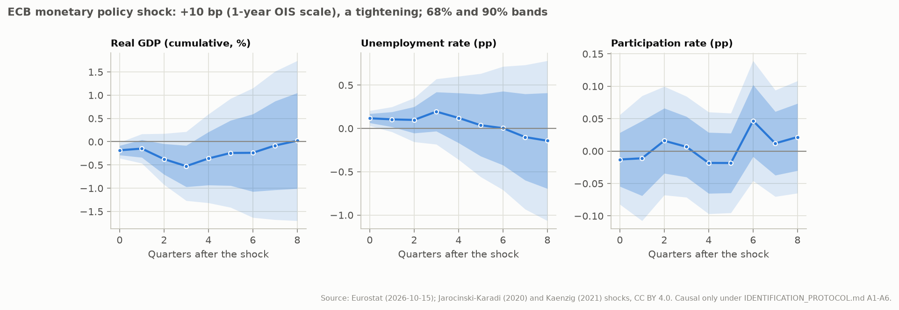
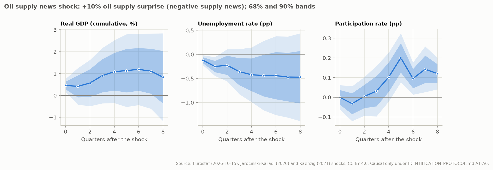
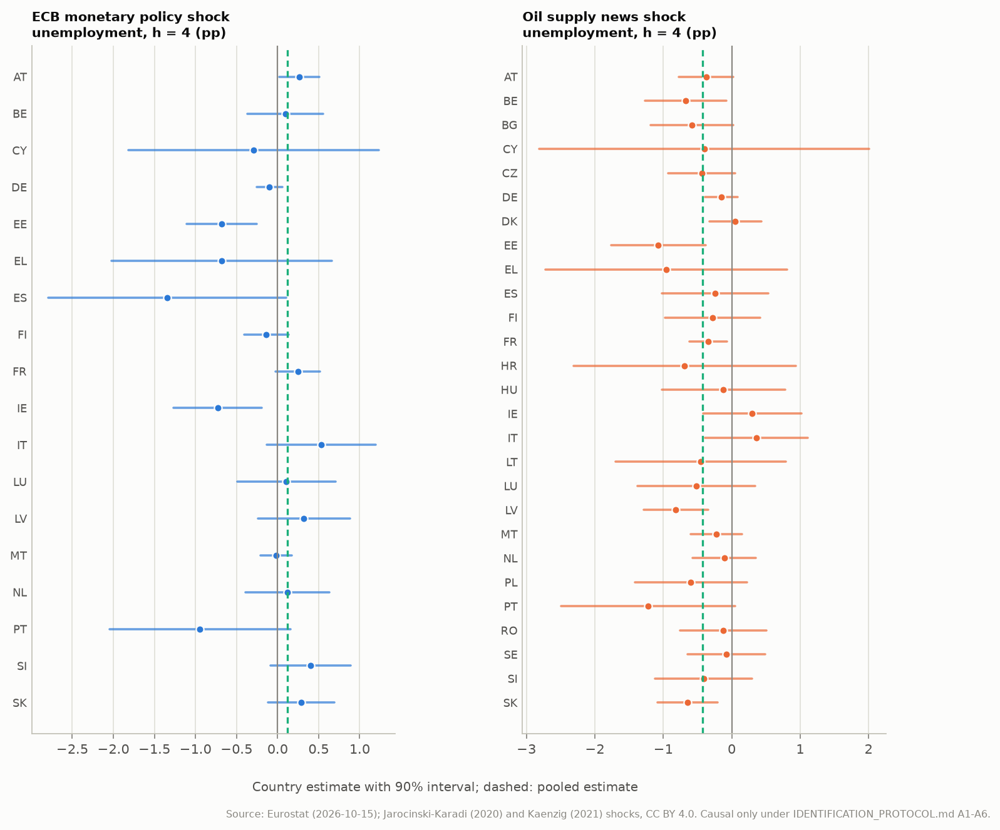

# Identification study: responses to externally identified shocks

Generated by `eu-okun identification` from the frozen snapshots `snapshots/eurostat-2026-10-15` and `snapshots/external-shocks-2026-10-16`. What is estimated and how it is judged was pre-registered in [IDENTIFICATION_PROTOCOL.md](../IDENTIFICATION_PROTOCOL.md); why only this is estimated is argued in [IDENTIFICATION_STUDY.md](IDENTIFICATION_STUDY.md).

**Scope.** Two common shocks identified outside this study: ECB monetary policy surprises (a demand shock, euro-area members) and OPEC oil supply surprises (a supply shock that is not a productivity shock, EU-27). Responses are causal only under the protocol's assumptions A1-A6. Productivity shocks, labour-supply shocks and country-specific GDP shocks are not identified, and every Okun coefficient estimated elsewhere in this study remains a reduced-form association.

## Summary

**ECB monetary policy shock** (+10 bp (1-year OIS scale), a tightening; identified under A1-A6):

- Real GDP (cumulative, %): 90% band excludes zero at horizons 0 (of 0-8).
- Unemployment rate (pp): 90% band excludes zero at horizons 0 (of 0-8).
- Participation rate (pp): 90% band excludes zero at horizons none (of 0-8).
- Shock-conditional Okun coefficient at h = 4: estimate -0.335, 90% Anderson-Rubin set (-inf, +inf) (uninformative); first-stage t -0.64 (weak first stage).
- Shock-conditional Okun coefficient at h = 8: estimate -7.008, 90% Anderson-Rubin set (-inf, -0.574] and [-0.491, +inf) (uninformative); first-stage t +0.02 (weak first stage).
- Predictability from lagged EU data (A3): F = 0.83, p = 0.580.
- Multiplicity: 2 of 27 pointwise 90% bands exclude zero; about 2.7 would by chance if the shock had no effect.

**Oil supply news shock** (+10% oil supply surprise (negative supply news); identification doubtful (shock predictable)):

- Real GDP (cumulative, %): 90% band excludes zero at horizons 0 (of 0-8).
- Unemployment rate (pp): 90% band excludes zero at horizons 0, 1 (of 0-8).
- Participation rate (pp): 90% band excludes zero at horizons 5, 6, 7, 8 (of 0-8).
- Shock-conditional Okun coefficient at h = 4: estimate -0.389, 90% Anderson-Rubin set (-inf, +inf) (uninformative); first-stage t +1.27 (weak first stage).
- Shock-conditional Okun coefficient at h = 8: estimate -0.568, 90% Anderson-Rubin set (-inf, +inf) (uninformative); first-stage t +0.70 (weak first stage).
- Predictability from lagged EU data (A3): F = 3.06, p = 0.006.
- Multiplicity: 7 of 27 pointwise 90% bands exclude zero; about 2.7 would by chance if the shock had no effect.

**Demand against supply.** Under the protocol's rule, at h = 4 no comparison is possible (monetary policy and oil supply uninformative); at h = 8 no comparison is possible (monetary policy and oil supply uninformative).

## 1. Design

Lag-augmented local projections, pooled over countries with country fixed effects; four lags of the shock, the unemployment change, GDP growth and the participation change; standard errors clustered by quarter; horizons 0-8. Observations whose window [t-4, t+h] touches 2020-Q1..2021-Q4 are excluded in the primary sample.

| Shock | Series | Normalisation | Countries | Observations (h = 0 / 8) | Quarters (h = 0 / 8) |
| --- | --- | --- | --- | ---: | ---: |
| ECB monetary policy shock | MP_median | +10 bp (1-year OIS scale), a tightening | euro-area members | 928 / 676 | 54 / 41 |
| Oil supply news shock | oil_surprise | +10% oil supply surprise (negative supply news) | EU-27 | 1385 / 1007 | 55 / 41 |

## 2. Diagnostics

Predictability (A3): the quarterly shock regressed on four lags of the cross-country mean unemployment change and GDP growth; F-test of the eight lag coefficients. A p-value below 0.05 counts against A3.

| Series | Quarters | F | p | Lag-1 autocorrelation |
| --- | ---: | ---: | ---: | ---: |
| MP | 66 | 0.83 | 0.580 | +0.01 |
| OIL | 67 | 3.06 | 0.006 | -0.03 |
| MP_pm | 66 | 0.28 | 0.969 | -0.17 |
| MP_raw | 66 | 0.59 | 0.786 | -0.19 |
| OIL_var | 67 | 0.62 | 0.758 | -0.09 |

Relevance (A4): the t-statistic of the cumulative GDP response (the first stage of the Okun LP-IV); |t| < 3.16 is weak.

| Shock | Horizon | First-stage t | Strength |
| --- | ---: | ---: | --- |
| ECB monetary policy shock | 4 | -0.64 | weak |
| ECB monetary policy shock | 8 | +0.02 | weak |
| Oil supply news shock | 4 | +1.27 | weak |
| Oil supply news shock | 8 | +0.70 | weak |

## 3. Responses

Pointwise 68% and 90% bands. Cumulative GDP is the sum of quarterly growth rates from t to t+h (%); unemployment and participation are changes from t-1 (pp).

**ECB monetary policy shock** (+10 bp (1-year OIS scale), a tightening):

| h | Real GDP (cumulative, %) [90%] | Unemployment rate (pp) [90%] | Participation rate (pp) [90%] |
| --- | ---: | ---: | ---: |
| 0 | -0.185 [-0.355, -0.015] | +0.117 [+0.029, +0.205] | -0.013 [-0.082, +0.056] |
| 2 | -0.374 [-0.923, +0.174] | +0.098 [-0.156, +0.351] | +0.016 [-0.068, +0.100] |
| 4 | -0.361 [-1.314, +0.592] | +0.121 [-0.360, +0.601] | -0.018 [-0.097, +0.060] |
| 6 | -0.239 [-1.630, +1.152] | +0.003 [-0.709, +0.714] | +0.047 [-0.046, +0.139] |
| 8 | +0.020 [-1.699, +1.740] | -0.142 [-1.066, +0.781] | +0.022 [-0.065, +0.108] |



**Oil supply news shock** (+10% oil supply surprise (negative supply news)):

| h | Real GDP (cumulative, %) [90%] | Unemployment rate (pp) [90%] | Participation rate (pp) [90%] |
| --- | ---: | ---: | ---: |
| 0 | +0.460 [+0.164, +0.757] | -0.119 [-0.221, -0.017] | -0.001 [-0.063, +0.062] |
| 2 | +0.567 [-0.489, +1.623] | -0.225 [-0.557, +0.107] | +0.004 [-0.094, +0.102] |
| 4 | +1.086 [-0.347, +2.518] | -0.422 [-0.989, +0.145] | +0.102 [-0.022, +0.226] |
| 6 | +1.190 [-0.438, +2.819] | -0.441 [-1.260, +0.377] | +0.095 [+0.013, +0.177] |
| 8 | +0.834 [-1.170, +2.837] | -0.474 [-1.386, +0.438] | +0.120 [+0.040, +0.201] |



## 4. Shock-conditional Okun coefficients

kappa = response of the unemployment change / response of cumulative GDP (pp per %), estimated by LP-IV with the shock as instrument. The Anderson-Rubin (Fieller) set is valid however weak the instrument; an unbounded set means the data do not determine kappa.

| Shock | Horizon | Estimate | 90% AR set | Verdict |
| --- | ---: | ---: | --- | --- |
| ECB monetary policy shock | 4 | -0.335 | (-inf, +inf) | uninformative |
| ECB monetary policy shock | 8 | -7.008 | (-inf, -0.574] and [-0.491, +inf) | uninformative |
| Oil supply news shock | 4 | -0.389 | (-inf, +inf) | uninformative |
| Oil supply news shock | 8 | -0.568 | (-inf, +inf) | uninformative |

**Demand against supply.** Under the protocol's rule, at h = 4 no comparison is possible (monetary policy and oil supply uninformative); at h = 8 no comparison is possible (monetary policy and oil supply uninformative).

## 5. Robustness (pre-registered)

| Variant | Status | GDP h=4 [90%] | GDP h=8 [90%] | Unemployment h=4 [90%] | Unemployment h=8 [90%] | Okun h=4 AR set | Okun h=8 AR set |
| --- | --- | ---: | ---: | ---: | ---: | --- | --- |
| MP_pm | identified under A1-A6 | -0.077 [-1.340, +1.186] | +0.201 [-2.618, +3.020] | -0.033 [-0.697, +0.630] | -0.278 [-1.845, +1.290] | (-inf, +inf) | (-inf, -0.581] and [-0.518, +inf) |
| MP_raw | contrast only (not an identified shock) | +0.504 [-0.393, +1.401] | +0.801 [-0.803, +2.406] | -0.241 [-0.693, +0.210] | -0.385 [-1.251, +0.482] | (-inf, +inf) | (-inf, +inf) |
| OIL_var | identified under A1-A6 | -0.191 [-0.469, +0.087] | -0.485 [-0.950, -0.020] | +0.123 [+0.005, +0.240] | +0.228 [+0.003, +0.454] | (-inf, -0.260] and [+0.120, +inf) | [-2.645, -0.031] |
| MP: pandemic included | identified under A1-A6 | -1.705 [-2.645, -0.765] | -0.445 [-1.845, +0.955] | +0.653 [+0.302, +1.004] | +0.453 [-0.096, +1.003] | [-0.533, -0.281] | (-inf, -0.336] and [-0.163, +inf) |
| MP: two lags | identified under A1-A6 | -0.600 [-1.519, +0.319] | -0.046 [-1.606, +1.515] | +0.157 [-0.272, +0.586] | -0.187 [-0.992, +0.619] | (-inf, +inf) | (-inf, -0.579] and [-0.436, +inf) |
| MP: Driscoll-Kraay | identified under A1-A6 | -0.361 [-0.977, +0.254] | +0.020 [-0.754, +0.795] | +0.121 [-0.181, +0.423] | -0.142 [-0.579, +0.294] | (-inf, +inf) | (-inf, -0.658] and [-0.432, +inf) |
| OIL: pandemic included | identification doubtful (shock predictable) | +1.798 [+0.154, +3.442] | +0.578 [-1.077, +2.233] | -0.707 [-1.327, -0.088] | -0.235 [-0.982, +0.513] | [-1.232, -0.180] | (-inf, +inf) |
| OIL: two lags | identification doubtful (shock predictable) | +1.185 [-0.328, +2.697] | +0.891 [-1.285, +3.067] | -0.409 [-1.009, +0.192] | -0.469 [-1.495, +0.556] | (-inf, +inf) | (-inf, +inf) |
| OIL: Driscoll-Kraay | identification doubtful (shock predictable) | +1.086 [-0.150, +2.321] | +0.834 [-0.652, +2.319] | -0.422 [-0.876, +0.032] | -0.474 [-1.143, +0.195] | (-inf, +inf) | (-inf, +inf) |

Variants with a bounded Okun set at h = 4 or 8: OIL_var, MP: pandemic included, OIL: pandemic included. Variants that include 2020-2021 rest on quarters in which the identified surprises coincided with the pandemic collapse; the protocol excludes those windows because the exclusion restriction (A3) is least credible there.

## 6. Countries (descriptive)

Country-by-country local projections at h = 4 (Newey-West, h + 1 lags in calendar quarters), alphabetical. Individual country series are short; no ranking and no per-country significance claims.

**ECB monetary policy shock**:

| Country | Observations | GDP h=4 [90%] | Unemployment h=4 [90%] |
| --- | ---: | ---: | ---: |
| AT | 45 | -0.621 [-1.425, +0.183] | +0.264 [+0.021, +0.507] |
| BE | 45 | -0.294 [-0.660, +0.072] | +0.093 [-0.370, +0.556] |
| CY | 45 | +0.522 [-1.762, +2.807] | -0.291 [-1.813, +1.231] |
| DE | 45 | +0.248 [-0.215, +0.710] | -0.098 [-0.254, +0.057] |
| EE | 42 | -0.358 [-1.268, +0.552] | -0.681 [-1.111, -0.251] |
| EL | 45 | +1.696 [-0.398, +3.790] | -0.680 [-2.021, +0.661] |
| ES | 45 | +0.566 [-1.264, +2.396] | -1.342 [-2.792, +0.107] |
| FI | 45 | -0.557 [-1.433, +0.319] | -0.137 [-0.406, +0.133] |
| FR | 49 | -0.273 [-0.699, +0.152] | +0.245 [-0.024, +0.515] |
| IE | 45 | -1.842 [-4.726, +1.042] | -0.730 [-1.265, -0.196] |
| IT | 45 | +0.208 [-0.512, +0.927] | +0.533 [-0.128, +1.194] |
| LU | 45 | +1.434 [+0.751, +2.117] | +0.105 [-0.493, +0.703] |
| LV | 30 | -0.344 [-1.267, +0.578] | +0.320 [-0.240, +0.880] |
| MT | 45 | -0.209 [-1.456, +1.039] | -0.020 [-0.211, +0.171] |
| NL | 45 | +0.130 [-0.656, +0.916] | +0.118 [-0.394, +0.629] |
| PT | 45 | +1.375 [-0.026, +2.776] | -0.945 [-2.044, +0.154] |
| SI | 45 | -0.885 [-2.441, +0.672] | +0.400 [-0.088, +0.888] |
| SK | 45 | -0.608 [-1.273, +0.058] | +0.286 [-0.116, +0.688] |

**Oil supply news shock**:

| Country | Observations | GDP h=4 [90%] | Unemployment h=4 [90%] |
| --- | ---: | ---: | ---: |
| AT | 45 | +0.722 [-0.322, +1.766] | -0.371 [-0.769, +0.026] |
| BE | 45 | +0.490 [-0.092, +1.073] | -0.676 [-1.270, -0.082] |
| BG | 45 | -0.361 [-1.559, +0.837] | -0.581 [-1.183, +0.021] |
| CY | 45 | +1.530 [-1.587, +4.647] | -0.402 [-2.816, +2.012] |
| CZ | 45 | +0.728 [-0.890, +2.346] | -0.439 [-0.925, +0.047] |
| DE | 45 | +1.459 [+0.129, +2.789] | -0.151 [-0.386, +0.084] |
| DK | 45 | -0.734 [-1.834, +0.366] | +0.051 [-0.329, +0.431] |
| EE | 45 | +2.361 [+1.346, +3.376] | -1.072 [-1.764, -0.380] |
| EL | 45 | +0.720 [-1.759, +3.199] | -0.958 [-2.725, +0.808] |
| ES | 45 | -0.902 [-2.066, +0.262] | -0.242 [-1.016, +0.532] |
| FI | 45 | +1.941 [+0.343, +3.540] | -0.279 [-0.971, +0.413] |
| FR | 49 | +1.174 [+0.605, +1.742] | -0.346 [-0.620, -0.073] |
| HR | 45 | +1.669 [-0.102, +3.440] | -0.689 [-2.314, +0.937] |
| HU | 45 | +2.389 [+1.076, +3.702] | -0.119 [-1.024, +0.785] |
| IE | 45 | -1.203 [-9.673, +7.266] | +0.301 [-0.419, +1.021] |
| IT | 45 | +0.121 [-0.973, +1.214] | +0.359 [-0.389, +1.107] |
| LT | 45 | +1.589 [+0.498, +2.681] | -0.454 [-1.698, +0.791] |
| LU | 45 | +0.677 [-0.777, +2.131] | -0.516 [-1.377, +0.345] |
| LV | 45 | +0.579 [-1.142, +2.300] | -0.816 [-1.289, -0.342] |
| MT | 45 | +1.272 [-2.715, +5.259] | -0.227 [-0.601, +0.147] |
| NL | 45 | -0.159 [-0.619, +0.301] | -0.107 [-0.568, +0.354] |
| PL | 45 | +2.113 [+1.144, +3.083] | -0.596 [-1.411, +0.220] |
| PT | 45 | +0.887 [-0.858, +2.633] | -1.221 [-2.492, +0.050] |
| RO | 45 | +2.580 [+1.089, +4.071] | -0.123 [-0.751, +0.505] |
| SE | 49 | +0.015 [-1.740, +1.770] | -0.074 [-0.641, +0.493] |
| SI | 45 | +1.878 [+0.267, +3.488] | -0.410 [-1.117, +0.297] |
| SK | 45 | +0.917 [-0.148, +1.981] | -0.645 [-1.082, -0.208] |



## 7. What these results do and do not establish

- They describe the average responses of euro-area members (monetary policy) and of EU countries (oil supply news) to common shocks, causal under A1-A6 and only where bands exclude zero or AR sets are bounded.
- They do not compare demand-driven with *productivity*-driven GDP changes: no productivity shock is identified.
- They do not separate labour-supply from demand shocks, and they do not identify country-specific GDP shocks.
- The reduced-form Okun coefficients of the rest of this study are weighted averages of shock-conditional coefficients with unknown weights (IDENTIFICATION_STUDY.md, section 1); nothing here turns them into causal effects.

## 8. Provenance and reproduction

Eurostat snapshot manifest SHA-256 `8a8c8a107d584ba91b61584fd29397e68ff83d82982371a35db253c0803a0464`; quarterly shocks SHA-256 `a68ad133d19cef0d94c69202005f412bab4ebb26c811e033c3262902287888a6`; raw shock files and commits in `provenance.json`.

```bash
poetry install --extras "bayes report structural"
poetry run eu-okun identification --data-dir snapshots/eurostat-2026-10-15 --shocks-dir snapshots/external-shocks-2026-10-16 --output-dir docs/identification --report docs/IDENTIFICATION_RESULTS.md
```
