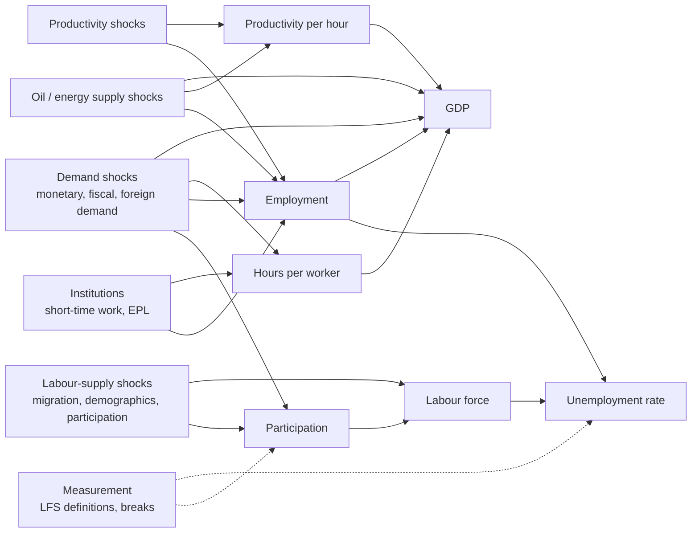

# Can the GDP-unemployment relationship be given a structural interpretation?

Methodological decision document for the EU-27 Okun's-law study. It evaluates whether,
and under which assumptions, the association between GDP growth and unemployment changes
can be read causally. It is written before any structural estimate. What is then
estimated, and how it is judged, is pre-registered in
[IDENTIFICATION_PROTOCOL.md](../IDENTIFICATION_PROTOCOL.md). The empirical results are
generated in [IDENTIFICATION_RESULTS.md](IDENTIFICATION_RESULTS.md).

## Decisions in brief

| Question | Decision |
| --- | --- |
| Do demand-driven and productivity-driven changes in GDP have different employment effects? | **Only half answerable.** A common euro-area *demand* shock (ECB policy surprises) and a common *oil supply* shock (OPEC announcement surprises) are identified. No credible quarterly instrument exists for *productivity* shocks in EU countries. |
| Can labour-supply shocks be distinguished from aggregate-demand shocks? | **No, with public data.** There is no defensible instrument for labour-supply shocks. Sign restrictions would give prior-dominated identified sets. |
| Under which assumptions are country-specific GDP shocks identifiable? | **With an instrument that moves one country's GDP and affects its unemployment only through GDP. None exists for the EU-27.** Only the heterogeneous responses of countries to common, externally identified shocks are estimable. |
| Do the data justify causal claims? | **Not about the GDP-unemployment relationship.** Identification of the two common shocks is defensible, but on 2009-2025 quarterly data the shock-conditional Okun coefficients are not determined (unbounded Anderson-Rubin sets), and the primary oil series fails its predictability test (section 7.1). A pre-registered monthly amendment with industrial production and monthly unemployment does not change this: its first stages are no stronger, and every primary ratio set is unbounded (section 7.2). Every Okun coefficient estimated in this study remains a reduced-form association. |

## 1. The identification problem

For country *i* and quarter *t*, let `x[i,t]` collect GDP growth `g`, the change in
unemployment `du`, the change in participation `dp` and, where available, hours and
productivity. Let the reduced-form dynamics be

```text
x[i,t] = c_i + sum_{l=1..p} A_l x[i,t-l] + eta[i,t],    E[eta eta'] = Sigma.
```

The innovations `eta` are one-step forecast errors. A structural model posits
`eta[i,t] = B eps[i,t]`, where `eps` are mutually uncorrelated economic shocks (demand,
productivity, labour supply, energy, ...) with unit variance. Then `Sigma = B B'`.

**The rotation problem.** For any orthogonal matrix `Q`, `B Q` gives the same `Sigma`. The
data therefore pin down `B` only up to `n(n-1)/2` free parameters, which identifying
information must supply.

**What the Okun regression measures.** Suppose, for illustration, that only impact
effects matter, with `g = sum_k a_k eps_k` and `du = sum_k b_k eps_k`. Then the
reduced-form Okun coefficient is

```text
beta_Okun = Cov(du, g) / Var(g) = sum_k w_k kappa_k,
w_k = a_k^2 / sum_j a_j^2,      kappa_k = b_k / a_k.
```

It is a **weighted average of shock-conditional Okun coefficients** `kappa_k`. The weights
are each shock's share of GDP variance, and the same algebra holds horizon by horizon for
cumulative responses. Differences in Okun coefficients across countries or periods can
therefore come from two sources:

- different `kappa_k`, i.e. labour markets responding differently to the same kind of
  shock;
- different shock mixes `w_k`.

The data cannot separate the two without identifying the shocks. This is why the
classical and Bayesian estimates of this study are descriptive.

**Country-specific GDP shocks.** A "GDP shock" of country *i* would be the component of
`eps[i,t]` that moves its GDP. Identifying its effect on unemployment needs variation in
GDP that is unrelated to every other shock affecting unemployment.

## 2. Reduced-form innovations are not structural shocks

The GDP growth regressor of the Okun regressions, and any VAR innovation in GDP, mixes all
the shocks of the period. The direction of the GDP-unemployment co-movement depends on the
shock:

| Shock | GDP | Unemployment | Mechanism |
| --- | --- | --- | --- |
| Aggregate demand (e.g. monetary easing) | up | down | Firms hire to meet demand. |
| Productivity improvement | up | ambiguous; can rise on impact | Output per worker rises; hiring need not. |
| Labour supply (e.g. immigration, participation) | up (lagged) | up on impact | The labour force grows before employment catches up. |
| Oil supply disruption | down | up | Costs rise; demand for energy-intensive output falls. |

**Consequence.** A reduced-form coefficient near zero for a country (e.g. Luxembourg) is
compatible with a weak labour-market response *or* with a shock mix in which
labour-supply shocks offset demand shocks. Generalised or orthogonalised impulse
responses from a reduced-form model inherit the same ambiguity. **They are not labelled
causal anywhere in this study.**

## 3. Causal graph

**Accounting identities.** These hold by definition: `Y = (Y/H) * (H/E) * E`,
`E = L * (1 - u)` and `L = p * Pop`. With `h = H/E` hours per worker, `l` the labour force
and lower case denoting log changes:

```text
g  ~=  d(Y/H) + d h + d E,          du  ~=  -(dE - dl)   (rate approximation)
=>   du  ~=  -g + d(Y/H) + d h + dl
```

An Okun coefficient of -1 therefore requires productivity per hour, hours per worker and
the labour force to stay put. The observed values, around -0.2 to -0.5, reflect how each
shock is absorbed through these margins:

- productivity: labour hoarding;
- hours: short-time work schemes such as German *Kurzarbeit*;
- participation: discouraged or added workers.

**Assumed causal structure.** Arrows are causal effects within and across quarters;
structural shocks are exogenous.



**Implications for identification.**

- GDP and unemployment are jointly determined within the quarter by every shock. No
  contemporaneous zero restriction between them is credible at quarterly frequency.
- To answer the research questions, exogenous variation is needed in a specific shock
  node (D, A, S or O). Variation in GDP itself is not enough.
- Institutions (I) modify the response of employment and hours to every shock, so
  shock-conditional Okun coefficients are expected to differ across countries even for a
  common shock.

## 4. Strategies evaluated

### 4.1 Recursive (Cholesky) ordering: rejected

It assumes a lower-triangular `B`: a variable ordered first does not respond within the
quarter to shocks ordered later. GDP and unemployment both respond within the quarter to
every shock in the graph, so any ordering is arbitrary. Results change with the ordering,
and no ordering identifies an economic shock. **Not implemented.**

### 4.2 Long-run restrictions (Blanchard and Quah 1989): rejected

The classic application uses exactly GDP growth and unemployment. A "demand" shock has no
long-run effect on the level of GDP, and a "supply" shock does.

**Untestable assumptions.**

- There are exactly two orthogonal shocks.
- Demand shocks have no permanent effect on output.
- The shocks are fundamental for the two variables, i.e. recoverable from their past
  (Lippi and Reichlin 1993).

**Known weaknesses.**

- Long-run restrictions are unreliable in finite samples (Faust and Leeper 1997). This
  panel has 2009-2026, about 65 quarters per country.
- Productivity and labour-supply shocks both move output permanently, so the "supply"
  shock mixes them. It cannot answer question 2, and it labels as "supply" whatever is
  permanent.

**Not implemented.**

### 4.3 Sign restrictions: feasible but not defensible here

**The restrictions.** Plausible patterns could separate the shocks:

- demand: GDP up, prices up;
- supply or productivity: GDP up, prices down;
- labour supply: GDP up, wages down, participation up, unemployment up on impact.

The data exist on Eurostat (GDP deflator or HICP, compensation per employee,
participation).

**Problems.**

- *Set identification.* Sign restrictions identify a set, not a point. Its width is
  large with about 65 quarters.
- *Prior dominance.* The usual uniform (Haar) prior over rotations is informative about
  the responses (Baumeister and Hamilton 2015), so reported "median" responses are partly
  prior-driven.
- *Debatable signs.* Demand shocks can raise participation, and productivity shocks can
  raise prices with nominal rigidities.

None of these assumptions is testable. **Not implemented.** A Baumeister-Hamilton
analysis with explicit, defended priors is listed under further work.

### 4.4 External instruments (proxy-SVAR, local projections)

A series correlated with one structural shock and uncorrelated with all others at all
leads and lags identifies that shock's effects (Stock and Watson 2018).

| Candidate | Source and availability | Main assumptions | Verdict |
| --- | --- | --- | --- |
| **ECB monetary policy surprises** | Jarociński and Karadi (2020), updated (GitHub `marekjarocinski/jkshocks_update_ecb`). Built from high-frequency OIS changes around ECB announcements (Altavilla et al. 2019, EA-MPD). Monthly 1999M01-2025M10. CC BY 4.0. | Event-window exogeneity. Information effects removed by sign restrictions on rates against stocks. No predictability from past macro data. | **Defensible** for the average response of euro-area countries to a common demand shock. Its relevance for quarterly EU outcomes is an empirical question. |
| **OPEC oil supply news** | Känzig (2021), updated (GitHub `dkaenzig/oilsupplynews`). Brent futures surprises around OPEC announcements. Monthly 1975M01-2025M12. CC BY 4.0. | Event-window exogeneity. OPEC decisions are not reactions to EU demand news within the window. | **Defensible** as an oil supply shock. It is **not** a productivity shock. |
| Fiscal shocks (narrative) | Action-based consolidation datasets (e.g. Devries et al. 2011) are annual, cover a subset of EU countries and end in the early 2010s. | Narrative exogeneity. | **Not usable** for 2009-2026 at quarterly frequency for the EU-27. |
| Productivity shocks | Utilisation-adjusted quarterly TFP exists for the United States (Fernald 2014). For EU countries, growth-accounting data (EU KLEMS) are annual and not adjusted for utilisation. | Exogeneity of measured technology. | **No credible quarterly instrument.** Productivity-driven GDP changes are not identifiable. |
| Labour-supply shocks | Migration episodes (2015-16 asylum inflows, 2022 displacement from Ukraine) are dated. | Destination choices and timing respond to labour demand, which violates exclusion. No harmonised quarterly series of exogenous inflows exists. | **Not identifiable** with defensible assumptions. |
| Country-specific GDP shocks | They would need an instrument per country, e.g. foreign demand weighted by export shares (shift-share). | Shares and foreign shocks exogenous. Foreign demand affects unemployment only through domestic GDP; violated by sectoral composition and import competition. | **Not identifiable** for the EU-27 with the available information. A shift-share design is listed under further work. |

### 4.5 Local projections: an estimator, not an identification strategy

Local projections (Jordà 2005) estimate dynamic responses horizon by horizon. They
identify nothing by themselves.

- With an *identified* external shock as a regressor, they estimate causal responses
  under that shock's assumptions.
- With a reduced-form regressor, such as GDP growth, they estimate reduced-form
  associations.

With lagged controls ("lag augmentation"), their inference is robust and simple (Montiel
Olea and Plagborg-Møller 2021). In population they estimate the same responses as VARs
(Plagborg-Møller and Wolf 2021).

**The shock-conditional Okun coefficient.** The coefficient `kappa_k` of section 1 for an
identified shock *k* is the ratio of the unemployment response to the GDP response. It is
estimated by LP-IV, with the shock as instrument for GDP.

- When the shock moves GDP only weakly, the ratio is weakly identified.
- The **Anderson-Rubin** confidence set (Anderson and Rubin 1949) stays valid in that case
  and is reported. It can be unbounded, which then states honestly that the data are
  uninformative.

## 5. Which assumptions are testable

| Assumption | Testable? | How |
| --- | --- | --- |
| Event-window exogeneity of the surprises | No | Defended by the narrow windows and the literature |
| Purity of the monetary shock (no information effect) | No | Sign-restriction decomposition; the raw surprise is reported as a contrast |
| No predictability of the shock from past EU macro data | **Yes (partly)** | Regression of the quarterly shock on lagged EU means (protocol, A3) |
| Relevance for GDP at the quarterly horizon | **Yes** | First-stage t-statistic of the GDP response |
| Lead-lag exogeneity with respect to other shocks | No (only partly via predictability) | — |
| Linearity, homogeneity of responses | Partly | Country-by-country responses (descriptive) |
| Monthly-to-quarterly aggregation | No (choice) | — (not needed in the monthly amendment) |
| Outcome timing of monthly series (A7, monthly amendment) | **Yes (partly)** | Pre-shock placebo; trend, moving-average and interpolated unemployment series excluded a priori from Eurostat's metadata |
| Two-shock world, long-run neutrality (Blanchard-Quah) | No | Not used |
| Rotation prior (sign restrictions) | No | Not used |

## 6. Data available for each element

| Element | Public source | Coverage used | Notes |
| --- | --- | --- | --- |
| GDP, unemployment, participation | Eurostat `namq_10_gdp`, `une_rt_q`, `lfsi_emp_q` (frozen snapshot 2026-10-15) | 2009-Q2 to 2026-Q2 | Labour-force series start in 2009 (2021 survey change back-cast); flags as documented in the classical review |
| Hours worked, employment (national accounts) | Eurostat `namq_10_a10_e`, `namq_10_pe` | Available, quarterly | Not used in estimation here. Needed to decompose Okun's law along section 3. |
| Monthly unemployment, industrial production | Eurostat `une_rt_m`, `sts_inpr_m` (frozen snapshot 2026-10-18) | 2000-01 to 2026-08 | Used in the monthly amendment. Monthly unemployment is a direct survey estimate in only 8 countries; elsewhere it is a trend, a moving average or interpolated |
| Short-term interest rates | Eurostat `ei_mfir_m` | Available, monthly | Not needed: shocks are normalised on their own scale |
| ECB monetary policy shocks | Jarociński and Karadi (2020), updated | 1999M01-2025M10 | CC BY 4.0; frozen with SHA-256 |
| Oil supply news | Känzig (2021), updated | 1975M01-2025M12 | CC BY 4.0; frozen with SHA-256 |
| Productivity instrument, labour-supply instrument, country-specific GDP instrument | None found that is quarterly, EU-wide and defensible | — | See section 4.4 |

## 7. Decision

**Estimated.** The protocol estimates only lag-augmented local projections of GDP,
unemployment and participation on the two identified common shocks. It also estimates
shock-conditional Okun coefficients with Anderson-Rubin sets.

**Reading the results.** They are causal *under the stated assumptions* (A1-A6 of the
protocol), and informative only where the data allow.

- The monetary policy responses are averages over euro-area members.
- The oil responses are averages over the EU-27.
- Neither speaks to productivity or labour-supply shocks, and neither identifies a
  country-specific GDP shock.

**Unchanged.** All previous estimates of this study remain descriptive. That covers the
classical, hierarchical Bayesian and predictive analyses.

The outcome of the estimation, with its diagnostics, is reported in
[IDENTIFICATION_RESULTS.md](IDENTIFICATION_RESULTS.md).

### 7.1 Outcome of the estimation (snapshot 2026-10-15)

Every number below comes from the generated results report and its tables in
`docs/identification/`.

- **Monetary policy (demand).** The shock is not predictable from lagged EU data
  (p = 0.580), so A3 survives its only test. A +10 bp tightening lowers GDP and raises
  unemployment **on impact only** (h = 0). At no later horizon does the 90% band exclude
  zero. That is 2 of 27 pointwise bands, about what chance alone would produce (2.7).
- **Oil supply (primary series).** The raw OPEC surprise, summed to quarters, **fails the
  predictability test** (p = 0.006) and is labelled "identification doubtful". Its
  responses (GDP *rising* after negative supply news) contradict theory and Känzig's
  evidence. This is consistent with the quarterly sum picking up global demand news, but
  that is an interpretation; the test only shows that A3 fails.
- **Oil supply (VAR-based variant, pre-registered robustness).** It is not predictable
  (p = 0.758). It gives theory-consistent responses: GDP falls and unemployment rises,
  with bands excluding zero at h = 8 for both.
- **Shock-conditional Okun coefficients are not determined by the data.**
  - The first stages are weak: |t| at most 1.27 at h = 4 and 8.
  - Every Anderson-Rubin set of the primary specifications is unbounded, so demand and
    supply cannot be compared under the protocol's rule.
  - The only bounded sets come from the VAR-based oil variant at h = 8, [-2.65, -0.03],
    which is too wide to be useful, and from variants that include 2020-2021. The
    protocol excluded 2020-2021 because the identified surprises coincide with the
    pandemic collapse.

### 7.2 Monthly outcomes (pre-registered amendment, snapshot 2026-10-18)

Section 8 named monthly outcomes as the next step: the shocks keep their native
frequency, the time dimension triples, and no aggregation assumption is needed. The
amendment was registered in
[MONTHLY_IDENTIFICATION_PROTOCOL.md](../MONTHLY_IDENTIFICATION_PROTOCOL.md) before any
estimate. Its results are generated in
[MONTHLY_IDENTIFICATION_RESULTS.md](MONTHLY_IDENTIFICATION_RESULTS.md).

**Design.**

- **Outcomes.** Monthly unemployment and industrial production (NACE B-D). No monthly GDP
  exists for the EU-27, so the ratio estimated is `kappa_IP`, pp of unemployment per 1%
  of industrial production. It is **not** the GDP-based Okun coefficient.
- **New assumption A7 (outcome timing).** A month's published value must not contain
  later months.
  - Eurostat's metadata show that it fails by construction for 15 countries: trends (DE,
    NL), centred moving averages (EE, PT), interpolation between quarterly survey results
    (nine countries) and benchmarking to annual averages (HR, LU).
  - It is uncertain for four more: DK is ambiguous, and IE, MT and SI have no stated
    method.
  - The primary sample therefore keeps the eight countries with direct monthly survey
    estimates: AT, CZ, EL, FI, HU, IT, RO and SE.
  - For monetary policy, only four of these are euro-area members.

**Outcome.** Every number comes from the generated report.

- **Relevance did not improve.**
  - The largest primary first-stage |t| is 1.21 with monthly industrial production,
    against 1.27 with quarterly GDP.
  - All four primary `kappa_IP` sets are unbounded, so demand and supply cannot be
    compared under the protocol's rule.
- **Responses.**
  - Industrial production falls after a monetary tightening, but its band excludes zero
    at month 3 only.
  - After negative oil supply news, the primary oil series gives industrial production
    *rising* (bands exclude zero at months 13, 15, 16 and 18), which is against theory, as with
    quarterly GDP.
  - Unemployment is not distinguishable from zero at any horizon for either shock.
  - In total, 1 and 4 of 50 bands exclude zero, at or below the roughly 5 expected by
    chance.
- **Assumptions that could be tested survive.**
  - Neither shock is predictable from lagged monthly EU data. Notably, the oil surprise is
    not predictable at its native frequency (p = 0.567), whereas its quarterly sum was
    (p = 0.006).
  - None of the eight placebo tests rejects, even in the sample that includes the smoothed
    and interpolated series. The placebo has limited power.
- **Robustness.**
  - Two variants give bounded sets. The VAR-based oil news shock at 24 months gives
    [-0.718, +0.161], and the long sample (origins from 2001) for monetary policy at
    12 months gives [-2.656, +0.126].
  - Both contain zero and both rest on weak first stages (|t| of 1.86 and 1.67).

**Conclusion of the amendment.** The quarterly study failed to bound the ratio because
the instruments are weak for real activity, not because of the frequency of the data.
With monthly outcomes the shocks are still weak instruments for industrial production in
2009-2025. Answering the question needs stronger or longer instrument variation, not
higher-frequency outcomes alone.

### 7.3 Final decision

- **Identification.** Causal identification of *country-specific* GDP shocks, of
  *productivity* shocks and of *labour-supply* shocks is **not available** with public
  data for the EU-27.
- **Common shocks.** For two common shocks, identification is defensible in principle.
  With 2009-2025 quarterly data, however, it **does not deliver informative
  shock-conditional Okun coefficients**. Monthly outcomes do not deliver informative
  ratios either (section 7.2).
- **No causal claims.** The data therefore do not justify a causal claim about how
  unemployment responds to GDP, for any type of shock.
- **Status of earlier results.** The Okun coefficients of this study stay descriptive,
  reduced-form associations. That is a justified scientific result, not a gap to paper
  over.

## 8. What additional information would be required

- **Productivity.** A quarterly, utilisation-adjusted TFP series for EU countries, or
  credible technology-news instruments.
- **Labour supply.** Quasi-experimental variation, such as policy-driven changes in
  migration or pension rules with documented timing unrelated to labour demand.
- **Country-specific GDP.** A defended shift-share foreign-demand instrument (trade
  weights from Comext, partner GDP), with tests of exclusion through sectoral
  composition.
- **Fiscal policy.** Updated quarterly narrative fiscal shocks for EU countries after 2014.
- **Hours and productivity data.** Integration of national-accounts hours and employment,
  to decompose shock responses into the productivity, hours and labour-force margins of
  section 3.
- **Longer, break-free samples.** These would improve power: the labour-force series
  start in 2009, and 2020-2021 must be excluded or modelled.
- **Monthly outcomes.** These are done (section 7.2) and do not raise the first-stage
  strength. Two further monthly steps remain:
  - Monthly unemployment that satisfies A7 in more countries, such as national monthly
    survey microdata or registered unemployment as a separate outcome. This would need a
    defended link to the survey concept.
  - An identified mapping from industrial production to GDP.
- **Stronger or longer instrument variation.** The long-sample monetary variant (from
  2001) is the only primary-shock variant with a bounded ratio. A study frame that
  starts before 2009 needs break-corrected labour-market series for those years.

## References

- Altavilla, C., Brugnolini, L., Gürkaynak, R., Motto, R. and Ragusa, G. (2019). Measuring
  euro area monetary policy. *Journal of Monetary Economics* 108.
- Anderson, T. W. and Rubin, H. (1949). Estimation of the parameters of a single equation
  in a complete system of stochastic equations. *Annals of Mathematical Statistics* 20(1).
- Baumeister, C. and Hamilton, J. D. (2015). Sign restrictions, structural vector
  autoregressions, and useful prior information. *Econometrica* 83(5).
- Blanchard, O. and Quah, D. (1989). The dynamic effects of aggregate demand and supply
  disturbances. *American Economic Review* 79(4).
- Devries, P., Guajardo, J., Leigh, D. and Pescatori, A. (2011). A new action-based
  dataset of fiscal consolidation. IMF Working Paper 11/128.
- Faust, J. and Leeper, E. M. (1997). When do long-run identifying restrictions give
  reliable results? *Journal of Business and Economic Statistics* 15(3).
- Fernald, J. (2014). A quarterly, utilization-adjusted series on total factor
  productivity. Federal Reserve Bank of San Francisco Working Paper 2012-19.
- Jarociński, M. and Karadi, P. (2020). Deconstructing monetary policy surprises: the role
  of information shocks. *American Economic Journal: Macroeconomics* 12(2).
- Jordà, Ò. (2005). Estimation and inference of impulse responses by local projections.
  *American Economic Review* 95(1).
- Känzig, D. R. (2021). The macroeconomic effects of oil supply news: evidence from OPEC
  announcements. *American Economic Review* 111(4).
- Lippi, M. and Reichlin, L. (1993). The dynamic effects of aggregate demand and supply
  disturbances: comment. *American Economic Review* 83(3).
- Montiel Olea, J. L. and Plagborg-Møller, M. (2021). Local projection inference is
  simpler and more robust than you think. *Econometrica* 89(4).
- Plagborg-Møller, M. and Wolf, C. K. (2021). Local projections and VARs estimate the same
  impulse responses. *Econometrica* 89(2).
- Stock, J. H. and Watson, M. W. (2018). Identification and estimation of dynamic causal
  effects in macroeconomics using external instruments. *Economic Journal* 128(610).
