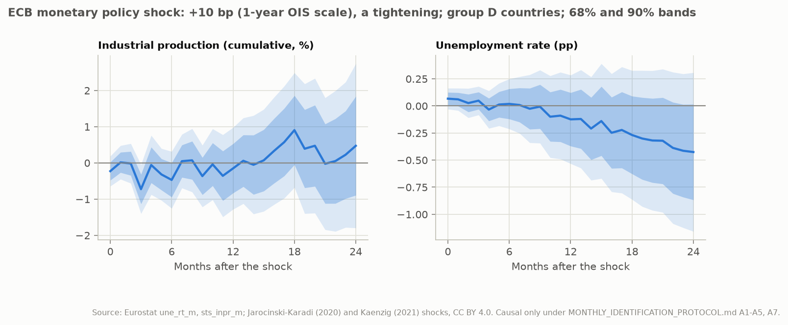
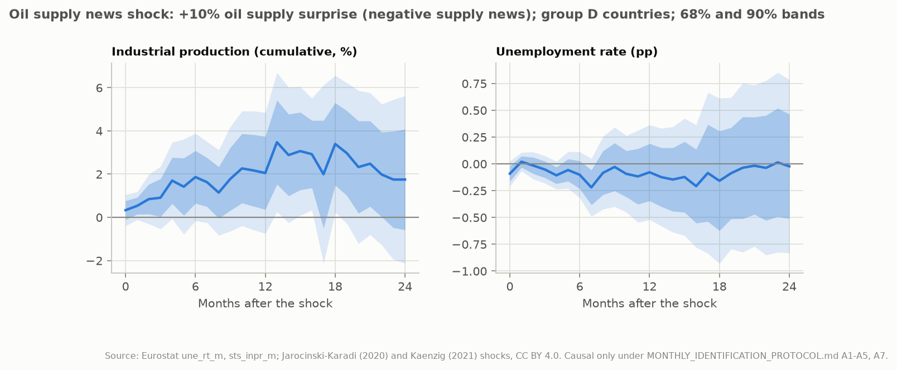
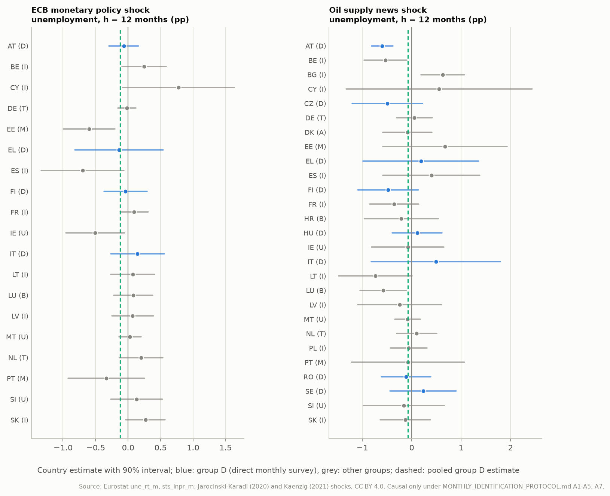

# Identification with monthly outcomes: responses to the identified common shocks

Generated by `eu-okun monthly-identification` from the frozen monthly Eurostat snapshot and the frozen external-shock snapshot. What is estimated and how it is judged was pre-registered in [MONTHLY_IDENTIFICATION_PROTOCOL.md](../MONTHLY_IDENTIFICATION_PROTOCOL.md), an amendment to the quarterly study ([IDENTIFICATION_RESULTS.md](IDENTIFICATION_RESULTS.md)).

**Scope.** The two common shocks of the quarterly study, at their native monthly frequency: ECB monetary policy surprises (demand; euro-area members) and OPEC oil supply surprises (supply, not productivity; EU countries). Outcomes are the monthly unemployment rate and industrial production (NACE B-D). The primary sample keeps only countries whose monthly unemployment figure is a direct monthly survey estimate (group D), because trends, moving averages and interpolation put later months into a month's value (assumption A7). The ratio `kappa_IP` is pp of unemployment per 1% of industrial production: it is **not** the GDP-based Okun coefficient. Responses are causal only under A1-A5 and A7.

## Summary

**ECB monetary policy shock** (+10 bp (1-year OIS scale), a tightening; identified under A1-A5, A7):

- Industrial production (cumulative, %): 90% band excludes zero at months 3 (of 0-24).
- Unemployment rate (pp): 90% band excludes zero at months none (of 0-24).
- `kappa_IP` at h = 12: estimate +0.809, 90% Anderson-Rubin set (-inf, +inf) (uninformative); first-stage t -0.22 (weak first stage).
- `kappa_IP` at h = 24: estimate -0.902, 90% Anderson-Rubin set (-inf, +inf) (uninformative); first-stage t +0.34 (weak first stage).
- Predictability from lagged EU data (A3): F = 1.00, p = 0.469.
- Placebo, pre-shock change (A7): industrial production t = +1.44, p = 0.153; unemployment rate t = +0.47, p = 0.642.
- Multiplicity: 1 of 50 pointwise 90% bands exclude zero; about 5 would by chance if the shock had no effect (bands are correlated across horizons).

**Oil supply news shock** (+10% oil supply surprise (negative supply news); identified under A1-A5, A7):

- Industrial production (cumulative, %): 90% band excludes zero at months 13, 15, 16, 18 (of 0-24).
- Unemployment rate (pp): 90% band excludes zero at months none (of 0-24).
- `kappa_IP` at h = 12: estimate -0.038, 90% Anderson-Rubin set (-inf, +inf) (uninformative); first-stage t +1.21 (weak first stage).
- `kappa_IP` at h = 24: estimate -0.013, 90% Anderson-Rubin set (-inf, +inf) (uninformative); first-stage t +0.75 (weak first stage).
- Predictability from lagged EU data (A3): F = 0.93, p = 0.567.
- Placebo, pre-shock change (A7): industrial production t = +1.07, p = 0.286; unemployment rate t = +1.02, p = 0.312.
- Multiplicity: 4 of 50 pointwise 90% bands exclude zero; about 5 would by chance if the shock had no effect (bands are correlated across horizons).

**Demand against supply.** Under the protocol's rule, at h = 12 no comparison is possible (monetary policy and oil supply uninformative); at h = 24 no comparison is possible (monetary policy and oil supply uninformative).

**Relevance.** First-stage t of cumulative industrial production: ECB monetary policy shock at 12 months t = -0.22 (quarterly GDP -0.64 (h = 4)); ECB monetary policy shock at 24 months t = +0.34 (quarterly GDP +0.02 (h = 8)); Oil supply news shock at 12 months t = +1.21 (quarterly GDP +1.27 (h = 4)); Oil supply news shock at 24 months t = +0.75 (quarterly GDP +0.70 (h = 8)).

## 1. Data and design

Monthly Eurostat snapshot: 2000-01 to 2026-08. Lag-augmented local projections pooled over countries with country fixed effects; 12 lags of the shock, of the monthly unemployment change and of industrial-production growth; standard errors clustered by month; horizons 0-24 months; origins from 2009-01. Observations whose window [t-12, t+h] touches 2020-01..2021-12 are excluded.

Eurostat flags (stored, not used in estimation), group D countries from 2009-01: unemployment: 4 'b'; production: 218 'p'. All countries from 2009-01: unemployment: 14 'b', 3 'd'; production: 509 'p'. Group D from 2000-01 (long sample): unemployment: 8 'b', 4 'd'; production: 326 'p'. 'b' marks a break in series, 'd' a different definition, 'p' a provisional value.

Monthly unemployment by production method (Eurostat reference metadata for `une_rt_m`, fixed in the protocol before estimation):

| Group | Method | Countries | Use |
| --- | --- | --- | --- |
| D | monthly Labour Force Survey estimates, seasonally adjusted | AT, CZ, EL, FI, HU, IT, RO, SE | primary |
| T | trend published instead of seasonally adjusted data | DE, NL | sensitivity only |
| A | listed as direct, but the last of three months is nowcast (ambiguous) | DK | sensitivity only |
| M | three-month moving average published under the middle month | EE, PT | sensitivity only |
| I | quarterly survey results interpolated with registered unemployment | BE, BG, CY, ES, FR, LT, LV, PL, SK | sensitivity only |
| B | benchmarking to moving annual averages of survey results | HR, LU | sensitivity only |
| U | method not stated | IE, MT, SI | sensitivity only |

| Shock | Series | Normalisation | Countries (group D) | Observations (h = 0 / 24) | Months (h = 0 / 24) |
| --- | --- | --- | --- | ---: | ---: |
| ECB monetary policy shock | MP_median | +10 bp (1-year OIS scale), a tightening | AT, EL, FI, IT | 664 / 512 | 166 / 128 |
| Oil supply news shock | oil_surprise | +10% oil supply surprise (negative supply news) | AT, CZ, EL, FI, HU, IT, RO, SE | 1344 / 1024 | 168 / 128 |

## 2. Diagnostics

Predictability (A3): the monthly shock regressed on 12 lags of the cross-country means of the unemployment change and of industrial-production growth over the shock's group D countries; classical F-test of the 24 lag coefficients. p < 0.05 counts against A3.

| Series | Months | F | p | Lag-1 autocorrelation |
| --- | ---: | ---: | ---: | ---: |
| MP | 166 | 1.00 | 0.469 | -0.10 |
| OIL | 168 | 0.93 | 0.567 | -0.02 |
| MP_pm | 166 | 1.28 | 0.187 | -0.21 |
| MP_raw | 166 | 1.17 | 0.283 | -0.19 |
| OIL_var | 168 | 1.02 | 0.441 | +0.00 |

Placebo (A7, A3): the change from t-2 to t-1 regressed on the shock at t, every control shifted one month back; normalised as the shock, month-clustered. Under A3 and A7 the coefficient is zero. Only the primary sample decides the label; the all-members sample shows what smoothing and interpolation do.

| Shock | Sample | Outcome | Pre-shock response | t | p | Observations | At 5% |
| --- | --- | --- | ---: | ---: | ---: | ---: | --- |
| MP | primary | Industrial production (cumulative, %) | +0.4586 | +1.44 | 0.153 | 660 | does not reject |
| MP | primary | Unemployment rate (pp) | +0.0243 | +0.47 | 0.642 | 660 | does not reject |
| MP | all | Industrial production (cumulative, %) | -0.1588 | -0.61 | 0.542 | 3012 | does not reject |
| MP | all | Unemployment rate (pp) | +0.0331 | +1.41 | 0.160 | 3012 | does not reject |
| OIL | primary | Industrial production (cumulative, %) | +0.4246 | +1.07 | 0.286 | 1336 | does not reject |
| OIL | primary | Unemployment rate (pp) | +0.0650 | +1.02 | 0.312 | 1336 | does not reject |
| OIL | all | Industrial production (cumulative, %) | +0.3056 | +0.81 | 0.421 | 4509 | does not reject |
| OIL | all | Unemployment rate (pp) | -0.0025 | -0.11 | 0.916 | 4509 | does not reject |

Relevance (A4): t-statistic of the cumulative industrial-production response, the first stage of the ratio; |t| < 3.16 is weak. For context, the secondary all-members production response and the quarterly GDP first stage of the identification study.

| Shock | Months | First-stage t (group D) | Strength | IP t, all members | Quarterly GDP first-stage t |
| --- | ---: | ---: | --- | ---: | ---: |
| ECB monetary policy shock | 12 | -0.22 | weak | -0.68 | -0.64 (h = 4) |
| ECB monetary policy shock | 24 | +0.34 | weak | -0.13 | +0.02 (h = 8) |
| Oil supply news shock | 12 | +1.21 | weak | +1.35 | +1.27 (h = 4) |
| Oil supply news shock | 24 | +0.75 | weak | +0.50 | +0.70 (h = 8) |

## 3. Responses

Pointwise 68% and 90% bands (figures) and 90% bands (tables). Industrial production is the cumulative log change from t-1 (%); unemployment is the change from t-1 (pp).

**ECB monetary policy shock** (+10 bp (1-year OIS scale), a tightening; identified under A1-A5, A7):

| Months | Industrial production (cumulative, %) [90%] | Unemployment rate (pp) [90%] |
| --- | ---: | ---: |
| 0 | -0.228 [-0.644, +0.187] | +0.067 [-0.030, +0.163] |
| 3 | -0.726 [-1.402, -0.050] | +0.048 [-0.083, +0.180] |
| 6 | -0.471 [-1.256, +0.314] | +0.019 [-0.212, +0.249] |
| 9 | -0.366 [-1.218, +0.487] | -0.006 [-0.344, +0.331] |
| 12 | -0.153 [-1.282, +0.976] | -0.124 [-0.533, +0.285] |
| 18 | +0.904 [-0.679, +2.487] | -0.268 [-0.863, +0.327] |
| 24 | +0.472 [-1.796, +2.739] | -0.426 [-1.158, +0.307] |



**Oil supply news shock** (+10% oil supply surprise (negative supply news); identified under A1-A5, A7):

| Months | Industrial production (cumulative, %) [90%] | Unemployment rate (pp) [90%] |
| --- | ---: | ---: |
| 0 | +0.332 [-0.391, +1.055] | -0.091 [-0.209, +0.026] |
| 3 | +0.907 [-0.539, +2.353] | -0.052 [-0.180, +0.076] |
| 6 | +1.865 [-0.154, +3.885] | -0.102 [-0.317, +0.113] |
| 9 | +1.780 [-0.637, +4.198] | -0.029 [-0.399, +0.342] |
| 12 | +2.053 [-0.745, +4.851] | -0.078 [-0.520, +0.364] |
| 18 | +3.395 [+0.230, +6.560] | -0.158 [-0.929, +0.613] |
| 24 | +1.749 [-2.118, +5.616] | -0.023 [-0.831, +0.785] |



Secondary: industrial production over all members (euro-area members for monetary policy, EU-27 for oil), controls the lags of the shock and of production growth only. Industrial production has no timing problem, so this uses every country.

| Shock | h = 0 | h = 6 | h = 12 | h = 24 |
| --- | ---: | ---: | ---: | ---: |
| ECB monetary policy shock | -0.317 [-0.826, +0.192] | -0.850 [-1.639, -0.061] | -0.457 [-1.567, +0.654] | -0.178 [-2.431, +2.075] |
| Oil supply news shock | +0.517 [-0.030, +1.064] | +0.987 [-0.943, +2.916] | +2.254 [-0.499, +5.007] | +1.148 [-2.646, +4.942] |

## 4. Shock-conditional ratio `kappa_IP`

`kappa_IP(h)` = response of the unemployment change / response of cumulative industrial production (pp per 1%), estimated by LP-IV with the shock as instrument. The Anderson-Rubin (Fieller) set is valid however weak the instrument; an unbounded set means the data do not determine the ratio. `kappa_GDP = kappa_IP * (IP response / GDP response)`; that factor is not identified here, so no GDP-based Okun coefficient follows.

| Shock | Months | Estimate | 90% AR set | First-stage t | Verdict |
| --- | ---: | ---: | --- | ---: | --- |
| ECB monetary policy shock | 12 | +0.809 | (-inf, +inf) | -0.22 | uninformative |
| ECB monetary policy shock | 24 | -0.902 | (-inf, +inf) | +0.34 | uninformative |
| Oil supply news shock | 12 | -0.038 | (-inf, +inf) | +1.21 | uninformative |
| Oil supply news shock | 24 | -0.013 | (-inf, +inf) | +0.75 | uninformative |

**Demand against supply.** Under the protocol's rule, at h = 12 no comparison is possible (monetary policy and oil supply uninformative); at h = 24 no comparison is possible (monetary policy and oil supply uninformative).

## 5. Robustness (pre-registered)

| Variant | Status | IP h=12 [90%] | IP h=24 [90%] | Unemployment h=12 [90%] | Unemployment h=24 [90%] | Ratio h=12 AR set (first-stage t) | Ratio h=24 AR set (first-stage t) |
| --- | --- | ---: | ---: | ---: | ---: | --- | --- |
| MP: all members as published | A7 doubtful by construction outside group D | -0.108 [-1.119, +0.904] | +0.395 [-1.526, +2.316] | +0.044 [-0.254, +0.342] | -0.167 [-0.755, +0.420] | (-inf, +inf) (t -0.18) | (-inf, +inf) (t +0.34) |
| OIL: all members as published | A7 doubtful by construction outside group D | +2.268 [-0.427, +4.962] | +1.204 [-2.515, +4.923] | -0.146 [-0.617, +0.325] | -0.081 [-1.036, +0.873] | (-inf, -0.512] and [-0.185, +inf) (t +1.39) | (-inf, +inf) (t +0.54) |
| MP_pm | identified under A1-A5, A7 | -0.153 [-1.449, +1.142] | +0.688 [-1.695, +3.071] | -0.089 [-0.767, +0.588] | -0.274 [-1.506, +0.957] | (-inf, +inf) (t -0.20) | (-inf, +inf) (t +0.48) |
| MP_raw | contrast only (not an identified shock) | -0.432 [-1.469, +0.605] | +0.698 [-0.968, +2.365] | -0.195 [-0.639, +0.250] | -0.412 [-1.209, +0.386] | (-inf, +inf) (t -0.69) | (-inf, +inf) (t +0.69) |
| OIL_var | identified under A1-A5, A7 | -0.247 [-0.632, +0.138] | -0.554 [-1.049, -0.059] | +0.056 [-0.007, +0.120] | +0.106 [-0.030, +0.241] | (-inf, +inf) (t -1.06) | [-0.718, +0.161] (t -1.86) |
| MP: pandemic included | identified under A1-A5, A7 | -1.031 [-2.191, +0.130] | +0.436 [-1.522, +2.394] | +0.525 [+0.150, +0.901] | +0.101 [-0.458, +0.660] | (-inf, -0.179] and [+2.656, +inf) (t -1.47) | (-inf, +inf) (t +0.37) |
| MP: six lags | identified under A1-A5, A7 | -0.323 [-1.499, +0.852] | +0.172 [-2.105, +2.448] | -0.099 [-0.512, +0.315] | -0.467 [-1.167, +0.234] | (-inf, +inf) (t -0.46) | (-inf, +inf) (t +0.13) |
| MP: Driscoll-Kraay | identified under A1-A5, A7 | -0.153 [-1.250, +0.944] | +0.472 [-1.211, +2.154] | -0.124 [-0.418, +0.170] | -0.426 [-0.874, +0.023] | (-inf, +inf) (t -0.23) | (-inf, +inf) (t +0.46) |
| MP: long sample | identified under A1-A5, A7 | -2.186 [-4.351, -0.021] | -1.045 [-3.412, +1.321] | +0.283 [-0.049, +0.615] | +0.247 [-0.282, +0.775] | [-2.656, +0.126] (t -1.67) | (-inf, +inf) (t -0.73) |
| OIL: pandemic included | identified under A1-A5, A7 | +1.864 [-0.624, +4.353] | +0.902 [-1.998, +3.801] | -0.389 [-0.989, +0.211] | +0.016 [-0.691, +0.724] | (-inf, +inf) (t +1.24) | (-inf, +inf) (t +0.51) |
| OIL: six lags | identified under A1-A5, A7 | +2.002 [-0.708, +4.712] | +2.341 [-1.546, +6.227] | -0.141 [-0.653, +0.371] | -0.152 [-1.045, +0.742] | (-inf, +inf) (t +1.22) | (-inf, +inf) (t +1.00) |
| OIL: Driscoll-Kraay | identified under A1-A5, A7 | +2.053 [-0.834, +4.940] | +1.749 [-1.911, +5.410] | -0.078 [-0.484, +0.327] | -0.023 [-0.825, +0.780] | (-inf, -0.243] and [-0.159, +inf) (t +1.18) | (-inf, +inf) (t +0.79) |
| OIL: long sample | identified under A1-A5, A7 | +2.930 [-1.960, +7.820] | +2.728 [-2.973, +8.430] | -0.108 [-0.680, +0.463] | -0.225 [-1.269, +0.819] | (-inf, -0.156] and [-0.131, +inf) (t +0.99) | (-inf, +inf) (t +0.79) |

Bounded ratio sets among the variants: OIL_var at h = 24, [-0.718, +0.161] (contains zero); MP: long sample at h = 12, [-2.656, +0.126] (contains zero).

## 6. Countries (descriptive)

Country-by-country local projections at h = 12 (Newey-West, 13 lags), alphabetical. Unemployment estimates outside group D rest on smoothed or interpolated series (A7 doubtful by construction). Individual country series are short; no ranking and no per-country significance claims.

**ECB monetary policy shock**:

| Country | Group | Observations | IP h=12 [90%] | Unemployment h=12 [90%] |
| --- | --- | ---: | ---: | ---: |
| AT | D | 152 | +0.992 [-0.607, +2.590] | -0.067 [-0.293, +0.160] |
| BE | I | 152 | -0.643 [-2.723, +1.437] | +0.246 [-0.095, +0.587] |
| CY | I | 152 | -1.093 [-2.911, +0.725] | +0.777 [-0.081, +1.635] |
| DE | T | 152 | +0.456 [-1.181, +2.094] | -0.020 [-0.157, +0.118] |
| EE | M | 128 | +1.491 [+0.057, +2.925] | -0.600 [-0.996, -0.203] |
| EL | D | 152 | +0.292 [-1.024, +1.609] | -0.139 [-0.817, +0.540] |
| ES | I | 152 | +0.959 [-0.086, +2.004] | -0.700 [-1.339, -0.062] |
| FI | D | 152 | -1.137 [-2.654, +0.379] | -0.040 [-0.370, +0.290] |
| FR | I | 152 | +0.141 [-0.735, +1.017] | +0.092 [-0.125, +0.308] |
| IE | U | 152 | -1.425 [-6.112, +3.262] | -0.507 [-0.959, -0.056] |
| IT | D | 152 | +0.391 [-1.312, +2.094] | +0.144 [-0.267, +0.555] |
| LT | I | 80 | -2.617 [-5.005, -0.229] | +0.072 [-0.265, +0.409] |
| LU | B | 152 | +0.046 [-1.746, +1.838] | +0.081 [-0.218, +0.381] |
| LV | I | 92 | +4.495 [+1.329, +7.662] | +0.070 [-0.250, +0.390] |
| MT | U | 152 | +0.907 [-1.981, +3.796] | +0.030 [-0.140, +0.200] |
| NL | T | 152 | +1.258 [+0.122, +2.393] | +0.201 [-0.133, +0.534] |
| PT | M | 152 | +0.073 [-1.333, +1.479] | -0.336 [-0.922, +0.251] |
| SI | U | 152 | +1.108 [-0.650, +2.866] | +0.129 [-0.268, +0.526] |
| SK | I | 152 | -0.563 [-2.870, +1.745] | +0.268 [-0.033, +0.569] |

**Oil supply news shock**:

| Country | Group | Observations | IP h=12 [90%] | Unemployment h=12 [90%] |
| --- | --- | ---: | ---: | ---: |
| AT | D | 152 | +3.862 [+0.903, +6.820] | -0.595 [-0.810, -0.381] |
| BE | I | 152 | +5.342 [+0.916, +9.767] | -0.532 [-0.962, -0.101] |
| BG | I | 152 | +1.371 [-1.608, +4.350] | +0.629 [+0.191, +1.068] |
| CY | I | 152 | -0.553 [-6.536, +5.431] | +0.555 [-1.329, +2.438] |
| CZ | D | 152 | +5.217 [+2.123, +8.311] | -0.493 [-1.208, +0.222] |
| DE | T | 152 | +3.221 [+0.088, +6.355] | +0.056 [-0.305, +0.417] |
| DK | A | 152 | -1.443 [-5.141, +2.255] | -0.087 [-0.580, +0.406] |
| EE | M | 152 | -1.851 [-9.206, +5.504] | +0.671 [-0.585, +1.928] |
| EL | D | 152 | -3.421 [-5.916, -0.925] | +0.186 [-0.983, +1.354] |
| ES | I | 152 | +0.934 [-2.380, +4.248] | +0.398 [-0.583, +1.380] |
| FI | D | 152 | +2.473 [+0.055, +4.892] | -0.480 [-1.093, +0.132] |
| FR | I | 152 | +1.428 [-0.470, +3.326] | -0.354 [-0.850, +0.143] |
| HR | B | 152 | -0.833 [-3.458, +1.792] | -0.210 [-0.954, +0.534] |
| HU | D | 152 | +3.861 [-0.197, +7.919] | +0.110 [-0.394, +0.614] |
| IE | U | 152 | -5.845 [-16.944, +5.254] | -0.079 [-0.807, +0.649] |
| IT | D | 152 | +2.296 [-2.351, +6.943] | +0.488 [-0.815, +1.792] |
| LT | I | 152 | -0.078 [-3.656, +3.501] | -0.735 [-1.475, +0.005] |
| LU | B | 152 | +6.200 [+0.606, +11.793] | -0.578 [-1.048, -0.108] |
| LV | I | 152 | +0.556 [-1.337, +2.449] | -0.244 [-1.091, +0.603] |
| MT | U | 152 | +2.081 [-4.271, +8.432] | -0.083 [-0.340, +0.174] |
| NL | T | 152 | +3.113 [+0.505, +5.721] | +0.100 [-0.305, +0.506] |
| PL | I | 152 | +4.829 [+1.998, +7.659] | -0.062 [-0.432, +0.307] |
| PT | M | 152 | +0.431 [-2.761, +3.623] | -0.076 [-1.221, +1.068] |
| RO | D | 152 | +4.322 [+0.085, +8.558] | -0.114 [-0.617, +0.389] |
| SE | D | 152 | -0.179 [-5.750, +5.392] | +0.233 [-0.437, +0.903] |
| SI | U | 152 | +5.159 [-0.375, +10.692] | -0.160 [-0.981, +0.662] |
| SK | I | 152 | +1.056 [-5.237, +7.348] | -0.131 [-0.638, +0.375] |



## 7. Comparison with the quarterly study (descriptive)

Different outcomes (industrial production against GDP) and horizons (months against quarters): the comparison is about informativeness, not equal numbers.

| Shock | Horizon (quarters / months) | Unemployment, quarterly [90%] | Unemployment, monthly [90%] | First-stage t (GDP / IP) | AR set (Okun GDP / kappa_IP) |
| --- | --- | ---: | ---: | ---: | --- |
| ECB monetary policy shock | 4 / 12 | +0.121 [-0.360, +0.601] | -0.124 [-0.533, +0.285] | -0.64 / -0.22 | (-inf, +inf) / (-inf, +inf) |
| ECB monetary policy shock | 8 / 24 | -0.142 [-1.066, +0.781] | -0.426 [-1.158, +0.307] | +0.02 / +0.34 | (-inf, -0.574] and [-0.491, +inf) / (-inf, +inf) |
| Oil supply news shock | 4 / 12 | -0.422 [-0.989, +0.145] | -0.078 [-0.520, +0.364] | +1.27 / +1.21 | (-inf, +inf) / (-inf, +inf) |
| Oil supply news shock | 8 / 24 | -0.474 [-1.386, +0.438] | -0.023 [-0.831, +0.785] | +0.70 / +0.75 | (-inf, +inf) / (-inf, +inf) |

Predictability (A3) at native frequency and after summing to quarters: MP p = 0.469 monthly against 0.580 for the quarterly sum; OIL p = 0.567 monthly against 0.006 for the quarterly sum.

## 8. What these results do and do not establish

- No primary ratio set is bounded: with monthly outcomes too, the data do not determine how much unemployment moves per unit of industrial production moved by either shock.
- Relevance: the largest primary first-stage |t| is 1.21 with monthly industrial production, against 1.27 with quarterly GDP; the weak-instrument threshold is 3.16. Keeping the shocks at their native frequency does not make them strong instruments for these outcomes.
- Responses are causal only under A1-A5 and A7, and only where bands exclude zero; labels above record where a diagnostic counts against an assumption.
- `kappa_IP` is not the GDP-based Okun coefficient; nothing here identifies the GDP response, productivity shocks, labour-supply shocks or country-specific GDP shocks.
- The reduced-form Okun coefficients of the rest of this study remain weighted averages of shock-conditional coefficients with unknown weights (IDENTIFICATION_STUDY.md, section 1).

## 9. Provenance and reproduction

Monthly Eurostat snapshot manifest SHA-256 `ec2e65b6cbe8831fb99fe791702d37913c142c6e6e2cea0704faab8cc70f2e5c`; processed CSV `7884d2f2a7a89df2cbefa159d074e8b91729b64e277d517b068291e09e462dbd`; `sts_inpr_m` updated 2026-10-15T11:00:00+0200; `une_rt_m` updated 2026-10-16T23:00:00+0200. Shock files, commits and the quarterly comparison file are hashed in `provenance.json`.

```bash
poetry install --extras "bayes report structural"
poetry run eu-okun monthly-identification --data-dir snapshots/eurostat-monthly-2026-10-18 --shocks-dir snapshots/external-shocks-2026-10-16 --quarterly-dir docs/identification --output-dir docs/monthly-identification --report docs/MONTHLY_IDENTIFICATION_RESULTS.md
```
