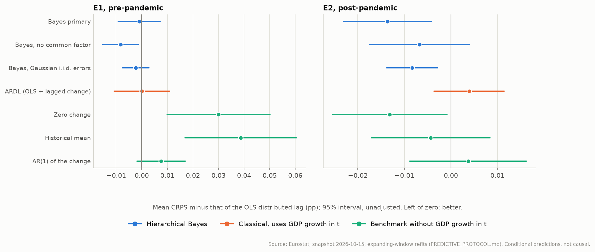
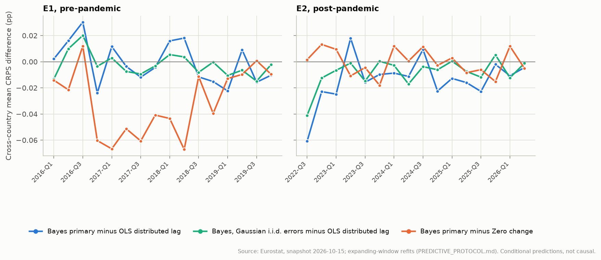
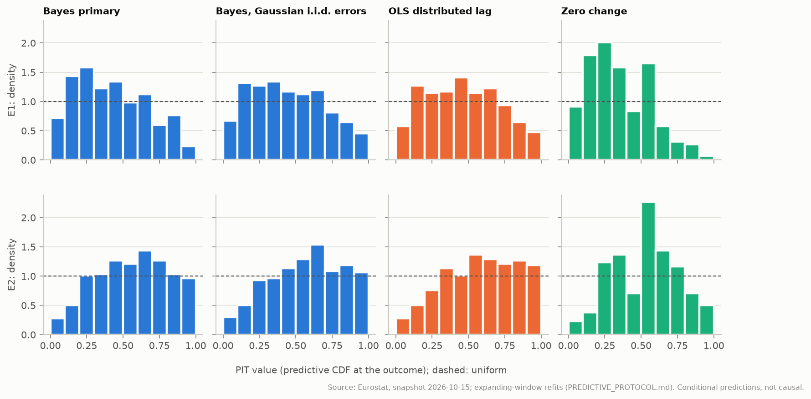

# Predictive comparison: hierarchical Bayes against classical models

Generated by `eu-okun predictive-report` from the frozen snapshot `snapshots/eurostat-2026-10-15` and the expanding-window refits. The design, models, scores and decision rules were pre-registered in [PREDICTIVE_PROTOCOL.md](../PREDICTIVE_PROTOCOL.md) before any held-out prediction was computed.

Each prediction for quarter t uses data up to t-1 **plus GDP growth in quarter t**: it is a conditional prediction on revised data, not a real-time forecast. Better prediction is not evidence of a causal effect.

## Summary

**E1, pre-pandemic** (targets 2016-Q1 to 2019-Q4, 418 scored cells):

- Bayes primary vs OLS distributed lag: mean CRPS -0.5% (Holm p = 1.000), not distinguishable.
- Bayes, Gaussian i.i.d. errors vs OLS distributed lag: mean CRPS -1.2% (Holm p = 1.000), not distinguishable.
- Bayes primary vs Bayes, Gaussian i.i.d. errors: mean CRPS +0.7% (Holm p = 1.000), not distinguishable.
- Bayes primary vs ARDL (OLS + lagged change): mean CRPS -0.5% (Holm p = 1.000), not distinguishable.
- Bayes primary vs Zero change: mean CRPS -13.5% (Holm p = 0.018), **Bayes primary better**.

**E2, post-pandemic** (targets 2022-Q3 to 2026-Q2, 396 scored cells):

- Bayes primary vs OLS distributed lag: mean CRPS -6.7% (Holm p = 0.061), not distinguishable.
- Bayes, Gaussian i.i.d. errors vs OLS distributed lag: mean CRPS -4.1% (Holm p = 0.051), not distinguishable.
- Bayes primary vs Bayes, Gaussian i.i.d. errors: mean CRPS -2.8% (Holm p = 0.331), not distinguishable.
- Bayes primary vs ARDL (OLS + lagged change): mean CRPS -8.5% (Holm p = 0.131), not distinguishable.
- Bayes primary vs Zero change: mean CRPS -0.3% (Holm p = 1.000), not distinguishable.

1 of the 10 pre-registered comparisons is decided at the 5% familywise level; the others are not distinguishable, which with 16 target quarters per set does not mean equal accuracy.

Without the target quarters in which a Bayesian refit failed after the retry, 0 of 10 comparisons are decided; the verdict changes for E1 Bayes primary vs Zero change. See section 8.

- E1: 5 of 5 models that use GDP growth in the target quarter have a lower mean CRPS than zero change (Bayes primary; Bayes, no common factor; Bayes, Gaussian i.i.d. errors; OLS distributed lag; ARDL (OLS + lagged change)).
- E2: 1 of 5 models that use GDP growth in the target quarter has a lower mean CRPS than zero change (Bayes primary).

An independent run (Linux replication, GitHub Actions run 38879823246) gives the same verdicts except for E2 Bayes, Gaussian i.i.d. errors vs OLS distributed lag (Holm p 0.051 here, 0.048 there). See section 9.

Empirical coverage of the central 50% and 90% predictive intervals: Bayes primary in E1: 57% and 95%; OLS distributed lag in E1: 61% and 96%; Bayes primary in E2: 60% and 94%; OLS distributed lag in E2: 58% and 93%.

## 1. Design

| Set | Targets | Training data for target t | Scored cells |
| --- | --- | --- | ---: |
| E1 (pre-pandemic) | 2016-Q1 to 2019-Q4 | 2009-Q2 to t-1 | 418 of 432 |
| E2 (post-pandemic) | 2022-Q3 to 2026-Q2 | 2009-Q2 to 2019-Q4, plus 2022-Q3 to t-1 | 396 of 432 |

Every model is re-estimated at every origin on observations strictly before the target quarter, and every model is scored on the same cells. Cells whose change relies on a flagged Eurostat value are not scored. ES and FR are not scored in E2 (their unemployment series carry 'definition differs' flags from 2021).

| Model | Name in tables | Uses GDP growth in t | Predictive distribution |
| --- | --- | --- | --- |
| `bayes_primary` | Bayes primary | yes | Partial pooling, Student-t AR(1) errors, common factor (integrated out for the target quarter) |
| `bayes_no_common_factor` | Bayes, no common factor | yes | As primary, without the common factor |
| `bayes_gaussian_iid` | Bayes, Gaussian i.i.d. errors | yes | Partial pooling, Gaussian i.i.d. errors |
| `ols_dl` | OLS distributed lag | yes | OLS per country on 1, g[t], g[t-1], g[t-2] |
| `ardl` | ARDL (OLS + lagged change) | yes | OLS per country on 1, y[t-1], g[t], g[t-1], g[t-2] |
| `zero_change` | Zero change | no | No change; scale of past changes |
| `historical_mean` | Historical mean | no | Mean of past changes |
| `unemployment_ar1` | AR(1) of the change | no | OLS per country on 1, y[t-1] |

## 2. Bayesian refits and convergence

Acceptance criteria and the single retry with 3000 warm-up iterations are those of BAYES_PROTOCOL.md, section 6. Predictions from a refit that still fails are scored (section 8 repeats the tests without those quarters).

| Set | Model | Origins | Accepted at first attempt | Accepted after retry | Failed after retry | Worst final R-hat | Sampling minutes |
| --- | --- | ---: | ---: | ---: | --- | ---: | ---: |
| E1 | `bayes_primary` | 16 | 6 | 6 | 2017-Q2, 2018-Q2, 2018-Q3, 2019-Q1 | 1.015 | 79 |
| E1 | `bayes_no_common_factor` | 16 | 15 | 1 | none | 1.007 | 43 |
| E1 | `bayes_gaussian_iid` | 16 | 16 | 0 | none | 1.010 | 16 |
| E2 | `bayes_primary` | 16 | 11 | 3 | 2023-Q2, 2023-Q3 | 1.016 | 73 |
| E2 | `bayes_no_common_factor` | 16 | 16 | 0 | none | 1.010 | 49 |
| E2 | `bayes_gaussian_iid` | 16 | 16 | 0 | none | 1.007 | 18 |

## 3. Pre-registered comparisons

Mean CRPS is the mean over target quarters of the cross-country mean, in percentage points (lower is better). The difference is A minus B; the test is a panel Diebold-Mariano test (Newey-West, 2 lags, Harvey-Leybourne-Newbold correction, t with 15 df), Holm-adjusted over the ten comparisons at 5%.

| Set | A | B | CRPS A | CRPS B | A vs B | Difference | Statistic | p | Holm p | Verdict |
| --- | --- | --- | ---: | ---: | ---: | ---: | ---: | ---: | ---: | --- |
| E1 | Bayes primary | OLS distributed lag | 0.1990 | 0.2000 | -0.5% | -0.0010 | -0.26 | 0.796 | 1.000 | not distinguishable |
| E1 | Bayes, Gaussian i.i.d. errors | OLS distributed lag | 0.1976 | 0.2000 | -1.2% | -0.0024 | -0.97 | 0.346 | 1.000 | not distinguishable |
| E1 | Bayes primary | Bayes, Gaussian i.i.d. errors | 0.1990 | 0.1976 | +0.7% | +0.0013 | +0.57 | 0.576 | 1.000 | not distinguishable |
| E1 | Bayes primary | ARDL (OLS + lagged change) | 0.1990 | 0.2001 | -0.5% | -0.0011 | -0.18 | 0.860 | 1.000 | not distinguishable |
| E1 | Bayes primary | Zero change | 0.1990 | 0.2300 | -13.5% | -0.0311 | -3.79 | 0.002 | 0.018 | **Bayes primary better** |
| E2 | Bayes primary | OLS distributed lag | 0.1886 | 0.2022 | -6.7% | -0.0136 | -3.08 | 0.008 | 0.061 | not distinguishable |
| E2 | Bayes, Gaussian i.i.d. errors | OLS distributed lag | 0.1939 | 0.2022 | -4.1% | -0.0083 | -3.23 | 0.006 | 0.051 | not distinguishable |
| E2 | Bayes primary | Bayes, Gaussian i.i.d. errors | 0.1886 | 0.1939 | -2.8% | -0.0053 | -2.08 | 0.055 | 0.331 | not distinguishable |
| E2 | Bayes primary | ARDL (OLS + lagged change) | 0.1886 | 0.2061 | -8.5% | -0.0176 | -2.63 | 0.019 | 0.131 | not distinguishable |
| E2 | Bayes primary | Zero change | 0.1886 | 0.1891 | -0.3% | -0.0005 | -0.21 | 0.836 | 1.000 | not distinguishable |

*E1.* Hierarchical model against classical regressions: -0.5% mean CRPS, not distinguishable. Pooling alone: -1.2%, not distinguishable; error model: +0.7%, not distinguishable. Okun relation against no change: -13.5%, bayes_primary better.

*E2.* Hierarchical model against classical regressions: -6.7% mean CRPS, not distinguishable. Pooling alone: -4.1%, not distinguishable; error model: -2.8%, not distinguishable. Okun relation against no change: -0.3%, not distinguishable.

## 4. All models and scores

Descriptive. Ratios are relative to the OLS distributed lag; p-values (unadjusted) test each model against it with the same panel test.

**E1, pre-pandemic**

| Model | CRPS | vs OLS-DL | p vs OLS-DL | Neg. log score | RMSE | MAE | 50% cover | 90% cover |
| --- | ---: | ---: | ---: | ---: | ---: | ---: | ---: | ---: |
| Bayes primary | 0.1990 | -0.5% | 0.796 | 0.315 | 0.3818 | 0.2762 | 57% | 95% |
| Bayes, no common factor | 0.1917 | -4.1% | 0.023 | 0.270 | 0.3726 | 0.2663 | 58% | 94% |
| Bayes, Gaussian i.i.d. errors | 0.1976 | -1.2% | 0.346 | 0.313 | 0.3768 | 0.2743 | 59% | 96% |
| OLS distributed lag | 0.2000 | +0.0% |  | 0.323 | 0.3851 | 0.2745 | 61% | 96% |
| ARDL (OLS + lagged change) | 0.2001 | +0.0% | 0.987 | 0.297 | 0.3968 | 0.2765 | 60% | 94% |
| Zero change | 0.2300 | +15.0% | 0.006 | 0.478 | 0.4240 | 0.3138 | 58% | 98% |
| Historical mean | 0.2387 | +19.3% | 0.002 | 0.488 | 0.4541 | 0.3262 | 59% | 96% |
| AR(1) of the change | 0.2076 | +3.8% | 0.110 | 0.336 | 0.4119 | 0.2869 | 59% | 95% |

**E2, post-pandemic**

| Model | CRPS | vs OLS-DL | p vs OLS-DL | Neg. log score | RMSE | MAE | 50% cover | 90% cover |
| --- | ---: | ---: | ---: | ---: | ---: | ---: | ---: | ---: |
| Bayes primary | 0.1886 | -6.7% | 0.008 | 0.294 | 0.3499 | 0.2590 | 60% | 94% |
| Bayes, no common factor | 0.1954 | -3.3% | 0.198 | 0.311 | 0.3665 | 0.2708 | 57% | 92% |
| Bayes, Gaussian i.i.d. errors | 0.1939 | -4.1% | 0.006 | 0.326 | 0.3571 | 0.2658 | 61% | 93% |
| OLS distributed lag | 0.2022 | +0.0% |  | 0.368 | 0.3732 | 0.2793 | 58% | 93% |
| ARDL (OLS + lagged change) | 0.2061 | +1.9% | 0.284 | 0.370 | 0.3881 | 0.2861 | 56% | 90% |
| Zero change | 0.1891 | -6.5% | 0.037 | 0.321 | 0.3413 | 0.2451 | 67% | 97% |
| Historical mean | 0.1979 | -2.1% | 0.479 | 0.363 | 0.3588 | 0.2630 | 66% | 96% |
| AR(1) of the change | 0.2059 | +1.8% | 0.538 | 0.350 | 0.3926 | 0.2849 | 56% | 93% |



## 5. Loss differentials over time

Cross-country mean CRPS differential in each target quarter (negative: the first model predicted better). One or two quarters can dominate a mean over 16.



- E1, Bayes primary minus OLS distributed lag: negative in 9 of 16 quarters; largest absolute differentials 2016-Q3 (+0.0303) and 2016-Q4 (-0.0240).
- E2, Bayes primary minus OLS distributed lag: negative in 14 of 16 quarters; largest absolute differentials 2022-Q3 (-0.0608) and 2023-Q1 (-0.0248).

## 6. Calibration

A calibrated predictive distribution has a flat PIT histogram and covers the outcome 50% and 90% of the time with its central 50% and 90% intervals (coverage in the tables of section 4).



- E1: across the eight models the central 50% intervals cover 57%-61% of outcomes and the 90% intervals 94%-98%; mean PIT 0.35-0.49, so every model's mean PIT is below 0.5: outcomes tended to fall below the predictions (unemployment fell faster than predicted).
- E2: across the eight models the central 50% intervals cover 56%-67% of outcomes and the 90% intervals 90%-97%; mean PIT 0.52-0.58, so every model's mean PIT is above 0.5: outcomes tended to lie above the predictions (unemployment fell less or rose more than predicted).

## 7. Countries (descriptive)

Mean CRPS by country over its scored target quarters, alphabetical. Not a ranking, and no per-country significance is claimed: each country has at most 16 target quarters.

| Country | E1 Bayes primary | E1 OLS-DL | E1 zero change | E2 Bayes primary | E2 OLS-DL | E2 zero change |
| --- | ---: | ---: | ---: | ---: | ---: | ---: |
| AT | 0.140 | 0.145 | 0.137 | 0.131 | 0.134 | 0.116 |
| BE | 0.178 | 0.182 | 0.187 | 0.145 | 0.150 | 0.146 |
| BG | 0.177 | 0.169 | 0.203 | 0.178 | 0.182 | 0.187 |
| CY | 0.363 | 0.368 | 0.395 | 0.167 | 0.171 | 0.210 |
| CZ | 0.087 | 0.101 | 0.128 | 0.084 | 0.089 | 0.087 |
| DE | 0.058 | 0.054 | 0.073 | 0.081 | 0.087 | 0.070 |
| DK | 0.143 | 0.157 | 0.152 | 0.173 | 0.207 | 0.139 |
| EE | 0.504 | 0.559 | 0.533 | 0.393 | 0.426 | 0.417 |
| EL | 0.243 | 0.187 | 0.346 | 0.324 | 0.314 | 0.336 |
| ES | 0.153 | 0.111 | 0.297 | not scored | not scored | not scored |
| FI | 0.196 | 0.192 | 0.189 | 0.222 | 0.221 | 0.219 |
| FR | 0.118 | 0.120 | 0.124 | not scored | not scored | not scored |
| HR | 0.439 | 0.392 | 0.471 | 0.242 | 0.286 | 0.258 |
| HU | 0.155 | 0.175 | 0.164 | 0.132 | 0.148 | 0.131 |
| IE | 0.164 | 0.174 | 0.206 | 0.135 | 0.157 | 0.126 |
| IT | 0.197 | 0.213 | 0.194 | 0.243 | 0.245 | 0.238 |
| LT | 0.225 | 0.274 | 0.241 | 0.416 | 0.383 | 0.402 |
| LU | 0.293 | 0.331 | 0.295 | 0.283 | 0.313 | 0.277 |
| LV | 0.204 | 0.213 | 0.268 | 0.198 | 0.216 | 0.231 |
| MT | 0.212 | 0.206 | 0.179 | 0.160 | 0.163 | 0.159 |
| NL | 0.093 | 0.103 | 0.142 | 0.075 | 0.107 | 0.064 |
| PL | 0.133 | 0.138 | 0.185 | 0.128 | 0.142 | 0.109 |
| PT | 0.207 | 0.186 | 0.276 | 0.148 | 0.203 | 0.154 |
| RO | 0.119 | 0.115 | 0.146 | 0.133 | 0.137 | 0.133 |
| SE | 0.125 | 0.117 | 0.134 | 0.186 | 0.203 | 0.170 |
| SI | 0.228 | 0.223 | 0.271 | 0.223 | 0.239 | 0.219 |
| SK | 0.175 | 0.166 | 0.213 | 0.110 | 0.132 | 0.123 |

Bayes primary has a lower mean CRPS than the OLS distributed lag in 15 of 27 countries in E1; 22 of 25 countries in E2.

## 8. Sensitivity and secondary losses

Without the target quarters in which any Bayesian refit failed after the retry (E1: 2017-Q2, 2018-Q2, 2018-Q3, 2019-Q1; E2: 2023-Q2, 2023-Q3), Holm-adjusted again over the ten comparisons:

| Set | A | B | Quarters | A vs B | Holm p | Verdict |
| --- | --- | --- | ---: | ---: | ---: | --- |
| E1 | Bayes primary | OLS distributed lag | 12 | +0.1% | 1.000 | not distinguishable |
| E1 | Bayes, Gaussian i.i.d. errors | OLS distributed lag | 12 | -0.7% | 1.000 | not distinguishable |
| E1 | Bayes primary | Bayes, Gaussian i.i.d. errors | 12 | +0.8% | 1.000 | not distinguishable |
| E1 | Bayes primary | ARDL (OLS + lagged change) | 12 | -0.5% | 1.000 | not distinguishable |
| E1 | Bayes primary | Zero change | 12 | -13.1% | 0.092 | not distinguishable |
| E2 | Bayes primary | OLS distributed lag | 14 | -7.6% | 0.062 | not distinguishable |
| E2 | Bayes, Gaussian i.i.d. errors | OLS distributed lag | 14 | -4.0% | 0.123 | not distinguishable |
| E2 | Bayes primary | Bayes, Gaussian i.i.d. errors | 14 | -3.7% | 0.145 | not distinguishable |
| E2 | Bayes primary | ARDL (OLS + lagged change) | 14 | -8.8% | 0.198 | not distinguishable |
| E2 | Bayes primary | Zero change | 14 | +0.3% | 1.000 | not distinguishable |

The family comparisons under the secondary losses (unadjusted p-values, descriptive):

| Set | A | B | Neg. log score diff. | Squared error diff. | Absolute error diff. |
| --- | --- | --- | ---: | ---: | ---: |
| E1 | Bayes primary | OLS distributed lag | -0.0079 (p 0.474) | -0.0025 (p 0.774) | +0.0017 (p 0.828) |
| E1 | Bayes, Gaussian i.i.d. errors | OLS distributed lag | -0.0100 (p 0.126) | -0.0063 (p 0.298) | -0.0003 (p 0.957) |
| E1 | Bayes primary | Bayes, Gaussian i.i.d. errors | +0.0021 (p 0.810) | +0.0038 (p 0.477) | +0.0020 (p 0.737) |
| E1 | Bayes primary | ARDL (OLS + lagged change) | +0.0187 (p 0.489) | -0.0117 (p 0.377) | -0.0003 (p 0.975) |
| E1 | Bayes primary | Zero change | -0.1629 (p <0.001) | -0.0340 (p 0.044) | -0.0376 (p 0.048) |
| E2 | Bayes primary | OLS distributed lag | -0.0732 (p 0.001) | -0.0169 (p 0.068) | -0.0203 (p 0.029) |
| E2 | Bayes, Gaussian i.i.d. errors | OLS distributed lag | -0.0421 (p <0.001) | -0.0117 (p 0.061) | -0.0135 (p 0.018) |
| E2 | Bayes primary | Bayes, Gaussian i.i.d. errors | -0.0311 (p 0.024) | -0.0051 (p 0.271) | -0.0069 (p 0.187) |
| E2 | Bayes primary | ARDL (OLS + lagged change) | -0.0752 (p 0.039) | -0.0282 (p 0.059) | -0.0271 (p 0.016) |
| E2 | Bayes primary | Zero change | -0.0271 (p 0.061) | +0.0059 (p 0.201) | +0.0139 (p 0.042) |

## 9. Replication on a second platform

Linux replication, GitHub Actions run 38879823246: the same snapshot, lock file, seeds, sampler settings and single retry. Its tables are in `replication-linux/`. MCMC output differs between platforms in floating-point detail, so borderline convergence decisions and borderline p-values can differ.

| Set | A | B | A vs B (this run) | Holm p | Verdict | A vs B (replication) | Holm p | Verdict |
| --- | --- | --- | ---: | ---: | --- | ---: | ---: | --- |
| E1 | Bayes primary | OLS distributed lag | -0.5% | 1.000 | not distinguishable | -0.6% | 1.000 | not distinguishable |
| E1 | Bayes, Gaussian i.i.d. errors | OLS distributed lag | -1.2% | 1.000 | not distinguishable | -1.2% | 1.000 | not distinguishable |
| E1 | Bayes primary | Bayes, Gaussian i.i.d. errors | +0.7% | 1.000 | not distinguishable | +0.6% | 1.000 | not distinguishable |
| E1 | Bayes primary | ARDL (OLS + lagged change) | -0.5% | 1.000 | not distinguishable | -0.6% | 1.000 | not distinguishable |
| E1 | Bayes primary | Zero change | -13.5% | 0.018 | bayes_primary better | -13.6% | 0.016 | bayes_primary better |
| E2 | Bayes primary | OLS distributed lag | -6.7% | 0.061 | not distinguishable | -6.7% | 0.057 | not distinguishable |
| E2 | Bayes, Gaussian i.i.d. errors | OLS distributed lag | -4.1% | 0.051 | not distinguishable | -4.1% | 0.048 | bayes_gaussian_iid better |
| E2 | Bayes primary | Bayes, Gaussian i.i.d. errors | -2.8% | 0.331 | not distinguishable | -2.7% | 0.315 | not distinguishable |
| E2 | Bayes primary | ARDL (OLS + lagged change) | -8.5% | 0.131 | not distinguishable | -8.5% | 0.126 | not distinguishable |
| E2 | Bayes primary | Zero change | -0.3% | 1.000 | not distinguishable | -0.2% | 1.000 | not distinguishable |

- Bayesian predictions: the CRPS of the 2442 Bayesian cells differs by 0.0013 on average and at most 0.0216 between the runs.
- Target quarters with a failed refit: this run E1: 2017-Q2, 2018-Q2, 2018-Q3, 2019-Q1; E2: 2023-Q2, 2023-Q3; replication E1: 2017-Q1, 2017-Q2, 2017-Q3, 2017-Q4, 2018-Q2, 2018-Q3, 2019-Q1; E2: 2023-Q1, 2023-Q2, 2023-Q3.
- Verdicts: identical except E2 Bayes, Gaussian i.i.d. errors vs OLS distributed lag (Holm p 0.051 here, 0.048 there). A verdict that changes between runs rests on a p-value at the threshold and is not robust.

## 10. Interpretation and limitations

- **What is tested.** Conditional predictive accuracy given the quarter's GDP growth, on revised data. It is neither a real-time forecast nor a causal test: a model that predicts better is not shown to have structural coefficients.
- **Power.** 16 target quarters per set; averaging within quarters guards against cross-country dependence but leaves little information. Non-rejection is not evidence of equal accuracy.
- **Pseudo-out-of-sample.** The model structure and priors were chosen with the full-sample classical results in view (BAYES_PROTOCOL.md), so E1 is not a blind test of the model choice; E2 lies after the period the model was designed on.
- **The common factor** is unknown in a target quarter and integrated out. The posterior predictive checks showed it to be autocorrelated and correlated with average GDP growth (docs/HIERARCHICAL_BAYES.md); a dynamic factor could predict it, which is a separate milestone on the roadmap.
- **Not covered:** joint (multivariate) scores, real-time vintages, time-varying coefficients.

## 11. Reproduction

```bash
poetry install --extras "bayes report"
poetry run eu-okun predictive-fit --data-dir snapshots/eurostat-2026-10-15 --output-dir results/predictive
poetry run eu-okun predictive-report --data-dir snapshots/eurostat-2026-10-15 --fits-dir results/predictive --output-dir docs/predictive --report docs/PREDICTIVE_COMPARISON.md --replication-dir docs/predictive/replication-linux
```

Snapshot manifest SHA-256 `8a8c8a107d584ba91b61584fd29397e68ff83d82982371a35db253c0803a0464`. The refits run in the separate *EU Okun predictive comparison* workflow; ordinary pull-request checks never sample. `predictions.csv` holds every scored prediction of every model, `refits.json` the diagnostics of every refit.
