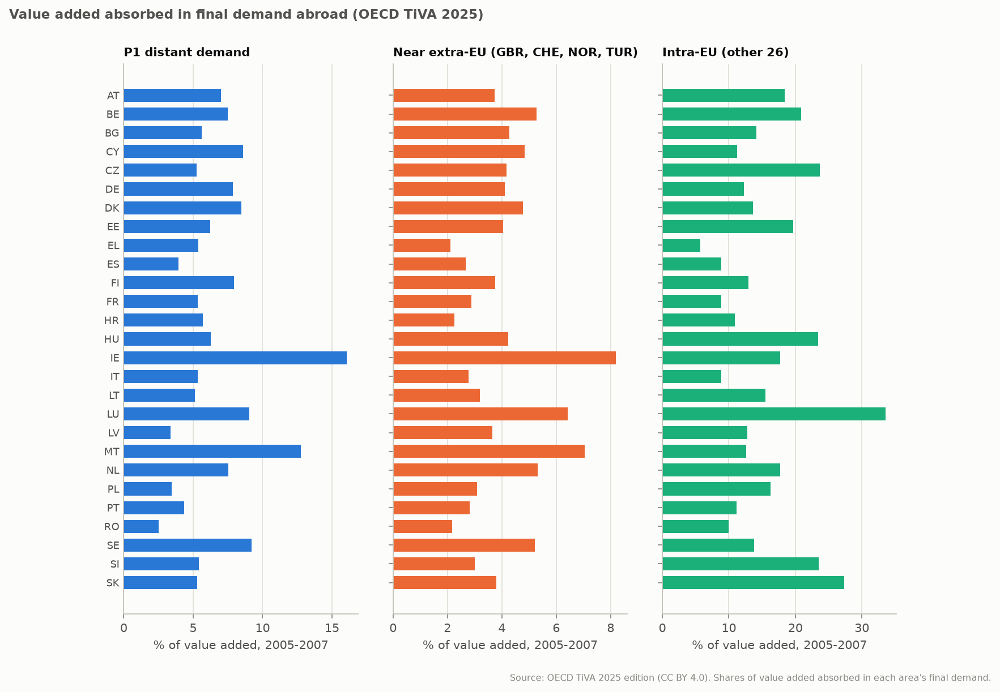

# Shift-share foreign-demand instrument: feasibility

Generated by `eu-okun shift-share` from the frozen OECD snapshot (TiVA 2025 value added in final demand; quarterly national accounts) and the frozen Eurostat quarterly snapshot. Design, calibration and the go/no-go rule were pre-registered in [SHIFT_SHARE_PROTOCOL.md](../SHIFT_SHARE_PROTOCOL.md) before any number was computed. No unemployment series is used; the only domestic quantity is the residual standard deviation of GDP growth.

`Z[i,t] = sum_p e[i,p] g[p,t]`: `e[i,p]` is the share of country i's value added absorbed in partner p's final demand (2005-2007), `g[p,t]` partner p's quarterly real GDP growth. `Z` is the predicted contribution of foreign demand to i's GDP growth (pp).

## Decision

**No go.** For P1 (distant demand, the only set whose exclusion restriction the protocol judges defensible), the benchmark expected first-stage t at the central calibration is **0.19**, against the registered threshold 3.16 (F = 10). The probability that a 90% Anderson-Rubin set would be bounded is about 11%.

- Reaching |t| = 3.16 would need a pass-through of 16.5 pp of GDP growth per pp of predicted foreign demand (central: 1, by construction of value-added shares), or about 12480 quarters (3120 years) at the central calibration instead of the 46 usable quarters.
- Under the protocol, no shift-share IV is estimated. Country-specific GDP shocks remain unidentified in this study.

## 1. Exposure

Share of each country's value added absorbed in final demand abroad and at home, 2005-2007 averages (%). Near extra-EU is GBR, CHE, NOR and TUR (P2 adds them to P1). Alphabetical.

| Country | P1 distant | Near extra-EU | Intra-EU (other 26) | Domestic | Industry (B-E) share of VA | Gross exports / VA |
| --- | ---: | ---: | ---: | ---: | ---: | ---: |
| AT | 7.0 | 3.7 | 18.4 | 66.1 | 24.4 | 46.5 |
| BE | 7.5 | 5.3 | 20.9 | 61.7 | 20.2 | 58.8 |
| BG | 5.6 | 4.3 | 14.2 | 68.9 | 25.2 | 47.2 |
| CY | 8.6 | 4.8 | 11.2 | 64.5 | 9.4 | 45.5 |
| CZ | 5.3 | 4.2 | 23.7 | 62.1 | 32.0 | 61.2 |
| DE | 7.8 | 4.1 | 12.3 | 71.7 | 25.9 | 37.4 |
| DK | 8.5 | 4.8 | 13.6 | 68.4 | 20.6 | 47.4 |
| EE | 6.2 | 4.0 | 19.7 | 63.4 | 21.0 | 55.8 |
| EL | 5.4 | 2.1 | 5.7 | 83.4 | 14.0 | 21.8 |
| ES | 4.0 | 2.7 | 8.9 | 81.4 | 18.0 | 25.4 |
| FI | 7.9 | 3.8 | 12.9 | 69.0 | 28.4 | 44.0 |
| FR | 5.3 | 2.9 | 8.9 | 79.2 | 16.1 | 27.1 |
| HR | 5.7 | 2.3 | 10.9 | 73.6 | 21.4 | 34.0 |
| HU | 6.3 | 4.2 | 23.5 | 60.7 | 27.3 | 71.6 |
| IE | 16.1 | 8.2 | 17.7 | 52.6 | 24.3 | 76.0 |
| IT | 5.3 | 2.8 | 8.8 | 79.3 | 20.7 | 27.0 |
| LT | 5.1 | 3.2 | 15.5 | 69.9 | 25.7 | 42.7 |
| LU | 9.1 | 6.4 | 33.5 | 36.7 | 10.3 | 153.8 |
| LV | 3.4 | 3.6 | 12.8 | 74.1 | 16.4 | 33.4 |
| MT | 12.8 | 7.0 | 12.6 | 59.5 | 15.4 | 64.4 |
| NL | 7.5 | 5.3 | 17.7 | 64.2 | 18.2 | 51.3 |
| PL | 3.5 | 3.1 | 16.2 | 73.1 | 26.0 | 37.0 |
| PT | 4.3 | 2.8 | 11.1 | 78.5 | 17.9 | 30.3 |
| RO | 2.5 | 2.2 | 9.9 | 82.9 | 28.6 | 21.7 |
| SE | 9.2 | 5.2 | 13.8 | 66.6 | 23.4 | 45.8 |
| SI | 5.4 | 3.0 | 23.5 | 60.4 | 27.5 | 62.6 |
| SK | 5.3 | 3.8 | 27.3 | 58.5 | 31.8 | 74.8 |

P1 exposure ranges from 2.5% to 16.1% of value added (cross-country standard deviation 2.9 pp). Balance: its correlation across the 27 countries is -0.20 with the industry share and +0.47 with gross exports / value added. Exposure is correlated with economic structure, so exclusion needs shocks specific to industry or to open economies to be absent or absorbed by the quarter effects.



## 2. Identifying variation and benchmark power

`Z~` is `Z` after country effects, quarter effects and four lags of `Z`; `S = sum Z~^2`. Benchmark expected first-stage t = `beta sqrt(S) / sigma_u` with independent, homoskedastic errors; `sigma_u` is the residual standard deviation of quarterly GDP growth after country and quarter effects and four lags of GDP growth, the unemployment change and the participation change (1242 country-quarters, origins 2012-Q1 to 2026-Q2 without windows touching 2020-2021). P(bounded) approximates the probability that a 90% Anderson-Rubin set is bounded.

| Partner set | Country-quarters | Quarters | sd of Z~ (pp) | sigma_u (pp) | Expected t (central) | P(bounded) | beta needed for t = 3.16 | Quarters needed at beta = 1 |
| --- | ---: | ---: | ---: | ---: | ---: | ---: | ---: | ---: |
| P1, distant demand (primary) | 1242 | 46 | 0.0064 | 1.179 | 0.19 | 11% | 16.5 | 12480 |
| P2, P1 + near extra-EU | 1242 | 46 | 0.0105 | 1.179 | 0.31 | 12% | 10.1 | 4675 |
| P3, intra-EU leave-one-out | 1242 | 46 | 0.0220 | 1.179 | 0.66 | 17% | 4.8 | 1058 |

Calibrations for P1:

| Calibration | beta | sigma_u (pp) | Expected t | P(bounded) |
| --- | ---: | ---: | ---: | ---: |
| beta 0.5, sigma_u estimated | 0.5 | 1.179 | 0.10 | 10% |
| beta 0.5, sigma_u halved | 0.5 | 0.589 | 0.19 | 11% |
| central | 1 | 1.179 | 0.19 | 11% |
| beta 1, sigma_u halved | 1 | 0.589 | 0.38 | 12% |
| beta 2, sigma_u estimated | 2 | 1.179 | 0.38 | 12% |
| beta 2, sigma_u halved | 2 | 0.589 | 0.77 | 20% |

Even the most favourable P1 calibration (beta 2, sigma_u halved) gives an expected t of 0.77. The benchmark ignores the cross-country correlation of errors within a quarter, which quarter-clustered inference would have to respect.

Adding the near extra-EU partners (P2) changes the central expected t to 0.31; the intra-EU leave-one-out instrument (P3) gives 0.66. Relevance rises only with partners whose exclusion restriction the protocol judges not defensible (section 3).

## 3. Where the variation comes from

Rotemberg-type weights: each partner's share of `S` (`(M Z_p)'(M Z) / S`, summing to one; negative weights are possible) and each country's share of `S`. Alphabetical.

| Partner | P1 weight |
| --- | ---: |
| ARG | +0.005 |
| AUS | +0.005 |
| BRA | +0.001 |
| CAN | +0.048 |
| CHN | +0.035 |
| IDN | +0.001 |
| IND | +0.016 |
| JPN | +0.167 |
| KOR | +0.009 |
| MEX | +0.009 |
| USA | +0.697 |
| ZAF | +0.006 |

| Country | Share of S (P1) |
| --- | ---: |
| AT | 0.001 |
| BE | 0.004 |
| BG | 0.005 |
| CY | 0.025 |
| CZ | 0.009 |
| DE | 0.006 |
| DK | 0.017 |
| EE | 0.002 |
| EL | 0.008 |
| ES | 0.032 |
| FI | 0.013 |
| FR | 0.008 |
| HR | 0.006 |
| HU | 0.004 |
| IE | 0.453 |
| IT | 0.007 |
| LT | 0.012 |
| LU | 0.020 |
| LV | 0.036 |
| MT | 0.163 |
| NL | 0.007 |
| PL | 0.040 |
| PT | 0.028 |
| RO | 0.061 |
| SE | 0.020 |
| SI | 0.007 |
| SK | 0.008 |

The largest partner weight is USA (+0.70) and the largest country share IE (0.45).

## 4. What this means

- The defensible instrument moves predicted GDP growth by 0.0064 pp (standard deviation after effects and lags), against residual GDP growth noise of 1.179 pp: distant foreign demand differs too little across EU countries, net of the common EU cycle, to identify country-specific GDP shocks.
- *Under which assumptions are country-specific GDP shocks identifiable?* With an exogenous, strong, country-specific shifter. The distant-demand shift-share is the most defensible public candidate, and it is not strong enough in this sample.
- Nothing here is a causal estimate, and no outcome was examined.

## 5. Provenance and reproduction

OECD snapshot downloaded 2026-10-18T10:10:19.593407+00:00: `tiva_fdva.csv` `ceab424fa3906f29...`; `tiva_mainlv.csv` `a63e98bd5678444e...`; `oecd_qna.csv` `afa0e96feddc692b...` (full hashes and URLs in `provenance.json`; OECD data, CC BY 4.0). Eurostat snapshot manifest SHA-256 `8a8c8a107d584ba91b61584fd29397e68ff83d82982371a35db253c0803a0464`.

```bash
poetry install --extras "bayes report"
poetry run eu-okun shift-share --data-dir snapshots/shift-share-2026-10-18 --eurostat-dir snapshots/eurostat-2026-10-15 --output-dir docs/shift-share --report docs/SHIFT_SHARE_FEASIBILITY.md
```
