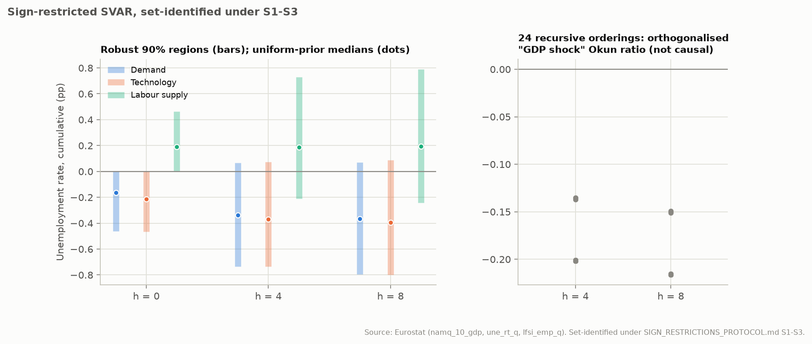

# Sign-restricted structural VAR: demand, technology and labour-supply shocks

Generated by `eu-okun sign-restrictions` from the frozen Eurostat snapshot and the frozen GDP-deflator snapshot. What is estimated and how it is judged was pre-registered in [SIGN_RESTRICTIONS_PROTOCOL.md](../SIGN_RESTRICTIONS_PROTOCOL.md); why this strategy was previously not estimated is argued in [IDENTIFICATION_STUDY.md](IDENTIFICATION_STUDY.md), section 4.3.

**Scope.** Shocks are **set-identified** by impact sign restrictions (S1-S3). Every result below is the identified set: the range over all rotations consistent with the restrictions, summarised without a prior over rotations (Giacomini and Kitagawa 2021). Results are labelled "set-identified under S1-S3" and are causal only under those untestable restrictions. Recursive orderings are reported only as **orthogonalised, not causal** responses.

## Summary

- **Plausibility.** 100.0% of draws admit the restrictions; on average 12269 admissible rotations (with their assignments) per draw out of 20000.
- **Demand against technology, h = 4.** Okun ratio robust 90% region: demand [-inf, +inf], technology [-inf, +inf]: not distinguishable (demand and technology region unbounded).
- **Demand against technology, h = 8.** Okun ratio robust 90% region: demand [-inf, +inf], technology [-inf, +inf]: not distinguishable (demand and technology region unbounded).
- **Labour supply against demand.** Imposed on impact; the distinction does not persist at h = 8 (demand and labour supply region includes zero). Share of the forecast-error variance of the unemployment change at h = 8 (robust region): demand [+0.00, +0.96]; technology [+0.00, +0.97]; labour supply [+0.00, +0.96].
- **Recursive orderings (orthogonalised, not causal), h = 4.** The posterior-median Okun ratio of the "GDP shock" ranges from -0.202 to -0.135 across the 24 orderings.
- **Recursive orderings (orthogonalised, not causal), h = 8.** The posterior-median Okun ratio of the "GDP shock" ranges from -0.216 to -0.149 across the 24 orderings.
- **Inner approximation.** Doubling the rotations on the first draws widens the sets by 0.1% (median), at most 5.7%.

## 1. Design

Pooled panel VAR(2) in (g, pi, du, dp) with country fixed effects; 1547 country-quarters from 27 countries; windows touching 2020-2021 excluded. Flat-prior Normal-inverse-Wishart posterior: 1000 stable draws (0 explosive draws discarded); 20000 Haar rotations per draw. One-standard-deviation shocks; GDP, unemployment and participation responses are cumulative (levels, % and pp).

| Shock (S1-S3, impact) | g | pi | du | dp |
| --- | --- | --- | --- | --- |
| Demand | + | + | − | free |
| Technology | + | − | − | free |
| Labour supply | free | − | + | + |

## 2. Plausibility of the restrictions

Share of posterior draws for which at least one rotation satisfies every restriction (the posterior probability that the identified set is non-empty), and the mean number of admissible rotations per draw.

| Specification | Non-empty | Admissible per draw | Draws discarded | Reading |
| --- | ---: | ---: | ---: | --- |
| Primary | 100.0% | 12269 | 0 | compatible with the reduced form |
| Technology without the unemployment sign | 100.0% | 16235 | 0 | compatible with the reduced form |
| Labour supply with output up | 100.0% | 9517 | 0 | compatible with the reduced form |
| Restrictions at h = 0 and 1 | 1.0% | 2 | 0 | contradicted by the data for most reduced forms |
| Four lags | 100.0% | 12320 | 0 | compatible with the reduced form |
| Without Ireland | 100.0% | 13018 | 0 | compatible with the reduced form |
| Pandemic included | 100.0% | 14511 | 0 | compatible with the reduced form |

## 3. Demand against technology

Set of posterior means and robust 90% credible region (prior-free over rotations), and, for contrast, the uniform-rotation posterior median with its 90% band (**prior-dependent**).

| Shock | Target | h | Set of posterior means | Robust 90% region | Uniform prior: median [90%] |
| --- | --- | --- | ---: | ---: | ---: |
| Demand | GDP (cumulative, %) | 0 | [+0.000, +1.203] | [+0.000, +1.239] | +0.584 [+0.069, +1.088] |
| Demand | GDP (cumulative, %) | 4 | [-0.002, +1.368] | [-0.047, +1.458] | +0.832 [+0.234, +1.275] |
| Demand | GDP (cumulative, %) | 8 | [-0.004, +1.427] | [-0.057, +1.536] | +0.879 [+0.254, +1.329] |
| Demand | Unemployment (pp) | 0 | [-0.449, -0.000] | [-0.463, -0.000] | -0.164 [-0.386, -0.017] |
| Demand | Unemployment (pp) | 4 | [-0.689, +0.035] | [-0.735, +0.065] | -0.339 [-0.622, -0.107] |
| Demand | Unemployment (pp) | 8 | [-0.734, +0.038] | [-0.796, +0.072] | -0.365 [-0.667, -0.120] |
| Demand | Okun ratio (pp per %) | 4 | [-inf, +inf] | [-inf, +inf] | -0.427 [-1.155, -0.164] |
| Demand | Okun ratio (pp per %) | 8 | [-inf, +inf] | [-inf, +inf] | -0.438 [-1.085, -0.178] |
| Technology | GDP (cumulative, %) | 0 | [+0.000, +1.217] | [+0.000, +1.253] | +0.475 [+0.062, +1.048] |
| Technology | GDP (cumulative, %) | 4 | [-0.071, +1.370] | [-0.149, +1.461] | +0.672 [+0.179, +1.213] |
| Technology | GDP (cumulative, %) | 8 | [-0.081, +1.428] | [-0.168, +1.542] | +0.709 [+0.191, +1.263] |
| Technology | Unemployment (pp) | 0 | [-0.451, -0.000] | [-0.464, -0.000] | -0.213 [-0.414, -0.027] |
| Technology | Unemployment (pp) | 4 | [-0.690, +0.044] | [-0.737, +0.073] | -0.369 [-0.640, -0.096] |
| Technology | Unemployment (pp) | 8 | [-0.734, +0.051] | [-0.799, +0.086] | -0.396 [-0.681, -0.100] |
| Technology | Okun ratio (pp per %) | 4 | [-inf, +inf] | [-inf, +inf] | -0.546 [-1.448, -0.165] |
| Technology | Okun ratio (pp per %) | 8 | [-inf, +inf] | [-inf, +inf] | -0.552 [-1.368, -0.178] |

Verdicts: h = 4: not distinguishable (demand and technology region unbounded).
Verdicts: h = 8: not distinguishable (demand and technology region unbounded).

## 4. Labour supply against demand

The impact signs of unemployment differ by assumption. Beyond impact:

| Shock | Target | h | Set of posterior means | Robust 90% region | Uniform prior: median [90%] |
| --- | --- | --- | ---: | ---: | ---: |
| Labour supply | GDP (cumulative, %) | 0 | [-1.196, +1.202] | [-1.233, +1.238] | +0.443 [-0.490, +1.063] |
| Labour supply | GDP (cumulative, %) | 4 | [-1.340, +1.237] | [-1.429, +1.318] | +0.254 [-0.691, +1.007] |
| Labour supply | GDP (cumulative, %) | 8 | [-1.396, +1.273] | [-1.502, +1.363] | +0.238 [-0.728, +1.027] |
| Labour supply | Unemployment (pp) | 0 | [+0.000, +0.450] | [+0.000, +0.463] | +0.189 [+0.017, +0.398] |
| Labour supply | Unemployment (pp) | 4 | [-0.174, +0.682] | [-0.209, +0.729] | +0.188 [-0.088, +0.554] |
| Labour supply | Unemployment (pp) | 8 | [-0.198, +0.725] | [-0.241, +0.790] | +0.194 [-0.104, +0.582] |
| Labour supply | Participation (pp) | 0 | [+0.000, +0.406] | [+0.000, +0.419] | +0.210 [+0.026, +0.376] |
| Labour supply | Participation (pp) | 4 | [-0.043, +0.305] | [-0.063, +0.321] | +0.142 [+0.005, +0.276] |
| Labour supply | Participation (pp) | 8 | [-0.047, +0.301] | [-0.070, +0.318] | +0.140 [+0.002, +0.270] |
| Demand | GDP (cumulative, %) | 0 | [+0.000, +1.203] | [+0.000, +1.239] | +0.584 [+0.069, +1.088] |
| Demand | GDP (cumulative, %) | 4 | [-0.002, +1.368] | [-0.047, +1.458] | +0.832 [+0.234, +1.275] |
| Demand | GDP (cumulative, %) | 8 | [-0.004, +1.427] | [-0.057, +1.536] | +0.879 [+0.254, +1.329] |
| Demand | Unemployment (pp) | 0 | [-0.449, -0.000] | [-0.463, -0.000] | -0.164 [-0.386, -0.017] |
| Demand | Unemployment (pp) | 4 | [-0.689, +0.035] | [-0.735, +0.065] | -0.339 [-0.622, -0.107] |
| Demand | Unemployment (pp) | 8 | [-0.734, +0.038] | [-0.796, +0.072] | -0.365 [-0.667, -0.120] |
| Demand | Participation (pp) | 0 | [-0.406, +0.399] | [-0.418, +0.413] | +0.076 [-0.264, +0.308] |
| Demand | Participation (pp) | 4 | [-0.303, +0.305] | [-0.318, +0.321] | +0.096 [-0.171, +0.261] |
| Demand | Participation (pp) | 8 | [-0.298, +0.302] | [-0.315, +0.318] | +0.099 [-0.166, +0.261] |

Share of the forecast-error variance of the unemployment change (the VAR variable, not the level) at h = 8:

| Shock | Set of posterior means | Robust 90% region | Uniform prior: median [90%] |
| --- | ---: | ---: | ---: |
| Demand | [+0.00, +0.95] | [+0.00, +0.96] | +0.16 [+0.02, +0.71] |
| Technology | [+0.00, +0.95] | [+0.00, +0.97] | +0.24 [+0.01, +0.82] |
| Labour supply | [+0.00, +0.94] | [+0.00, +0.96] | +0.16 [+0.01, +0.74] |

Verdict: the distinction does not persist at h = 8 (demand and labour supply region includes zero).

## 5. Robustness (pre-registered)

| Specification | Non-empty | Demand Okun h=8 | Technology Okun h=8 | Question 1 (h = 8) | Labour supply du h=8 | Demand du h=8 | Question 2 |
| --- | ---: | ---: | ---: | --- | ---: | ---: | --- |
| Primary | 100.0% | [-inf, +inf] | [-inf, +inf] | not distinguishable (demand and technology region unbounded) | [-0.241, +0.790] | [-0.796, +0.072] | the distinction does not persist at h = 8 (demand and labour supply region includes zero) |
| Technology without the unemployment sign | 100.0% | [-inf, +inf] | [-inf, +inf] | not distinguishable (demand and technology region unbounded) | [-0.241, +0.793] | [-0.798, +0.073] | the distinction does not persist at h = 8 (demand and labour supply region includes zero) |
| Labour supply with output up | 100.0% | [-inf, +inf] | [-inf, +inf] | not distinguishable (demand and technology region unbounded) | [-0.241, +0.730] | [-0.796, +0.070] | the distinction does not persist at h = 8 (demand and labour supply region includes zero) |
| Restrictions at h = 0 and 1 | 1.0% | [-1.578, -0.511] | [-1.834, -0.528] | not distinguishable (regions overlap) (conditional on the 1.0% of draws that admit the restrictions) | [+0.185, +0.318] | [-0.626, -0.045] | the distinction persists at h = 8 for both shocks (conditional on the 1.0% of draws that admit the restrictions) |
| Four lags | 100.0% | [-inf, +inf] | [-inf, +inf] | not distinguishable (demand and technology region unbounded) | [-0.295, +0.825] | [-0.838, +0.148] | the distinction does not persist at h = 8 (demand and labour supply region includes zero) |
| Without Ireland | 100.0% | [-inf, +inf] | [-inf, +inf] | not distinguishable (demand and technology region unbounded) | [-0.303, +0.788] | [-0.801, +0.042] | the distinction does not persist at h = 8 (demand and labour supply region includes zero) |
| Pandemic included | 100.0% | [-inf, +inf] | [-inf, +inf] | not distinguishable (demand and technology region unbounded) | [-0.242, +0.770] | [-0.789, +0.057] | the distinction does not persist at h = 8 (demand and labour supply region includes zero) |

## 6. Recursive orderings (orthogonalised, not causal)

Posterior median of the Okun ratio of the orthogonalised innovation to the g equation, for each Cholesky ordering. No ordering is defended: the spread measures how much an arbitrary choice moves the answer.

| Ordering | Okun ratio h = 4 | Okun ratio h = 8 |
| --- | ---: | ---: |
| g > pi > du > dp | -0.202 | -0.216 |
| g > pi > dp > du | -0.202 | -0.216 |
| g > du > pi > dp | -0.202 | -0.216 |
| g > du > dp > pi | -0.202 | -0.216 |
| g > dp > pi > du | -0.202 | -0.216 |
| g > dp > du > pi | -0.202 | -0.216 |
| pi > g > du > dp | -0.201 | -0.215 |
| pi > g > dp > du | -0.201 | -0.215 |
| pi > du > g > dp | -0.137 | -0.151 |
| pi > du > dp > g | -0.136 | -0.150 |
| pi > dp > g > du | -0.201 | -0.215 |
| pi > dp > du > g | -0.136 | -0.150 |
| du > g > pi > dp | -0.137 | -0.150 |
| du > g > dp > pi | -0.137 | -0.150 |
| du > pi > g > dp | -0.137 | -0.151 |
| du > pi > dp > g | -0.136 | -0.150 |
| du > dp > g > pi | -0.135 | -0.149 |
| du > dp > pi > g | -0.136 | -0.150 |
| dp > g > pi > du | -0.202 | -0.216 |
| dp > g > du > pi | -0.202 | -0.216 |
| dp > pi > g > du | -0.201 | -0.215 |
| dp > pi > du > g | -0.136 | -0.150 |
| dp > du > g > pi | -0.135 | -0.149 |
| dp > du > pi > g | -0.136 | -0.150 |



## 7. What these results do and do not establish

- Even under sign restrictions, the data do not distinguish demand- from technology-driven Okun ratios: the identified sets are too wide.
- Labour supply against demand: the distinction does not persist at h = 8 (demand and labour supply region includes zero); at impact the difference is assumed, not learned.
- The uniform-rotation posterior looks sharper than the identified sets because it adds a prior over rotations; that sharpness is not evidence.
- The recursive orderings give different "GDP shock" Okun ratios; none is causal.
- Everything rests on the homogeneous pooled VAR and on S1-S3, which are not testable beyond their joint compatibility with the reduced form.

## 8. Provenance and reproduction

Eurostat snapshot manifest SHA-256 `8a8c8a107d584ba91b61584fd29397e68ff83d82982371a35db253c0803a0464`; deflator raw `8a3ab55cad92a85037333c0928e9e31e76de06be66875fff751ee0a929524e2a` (`namq_10_gdp`, updated 2026-10-16T23:00:00+0200). Seed and settings are in SIGN_RESTRICTIONS_PROTOCOL.md.

```bash
poetry install --extras "bayes report"
poetry run eu-okun sign-restrictions --data-dir snapshots/eurostat-2026-10-15 --deflator-dir snapshots/eurostat-deflator-2026-10-18 --output-dir docs/sign-restrictions --report docs/SIGN_RESTRICTIONS_RESULTS.md
```
