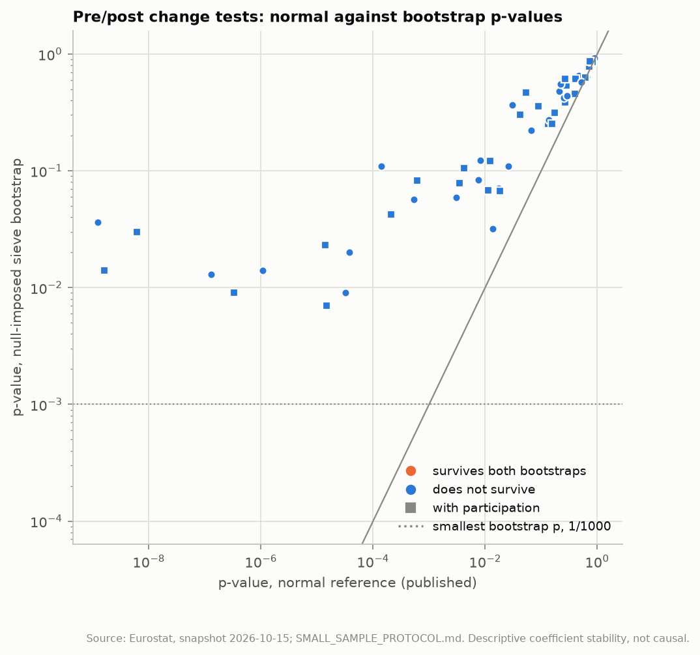
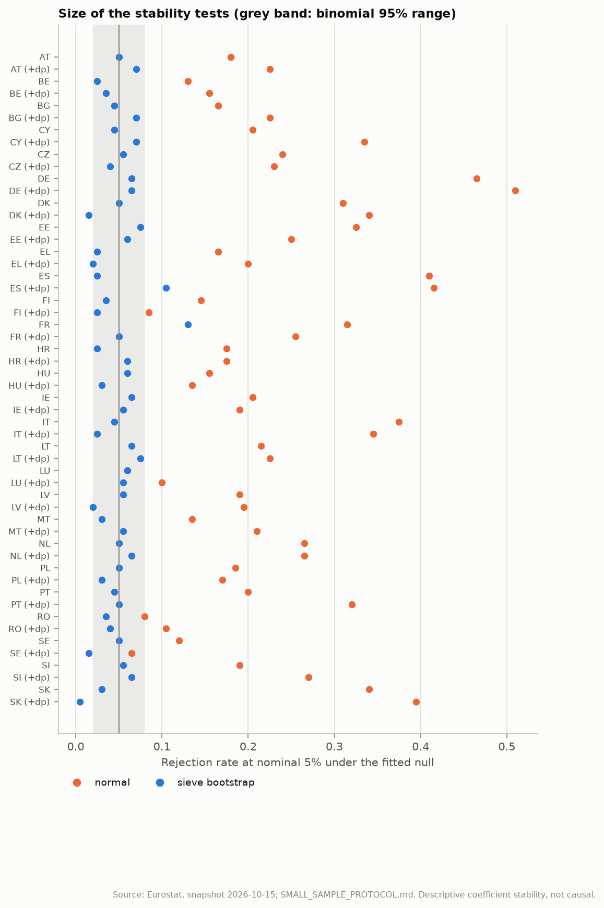
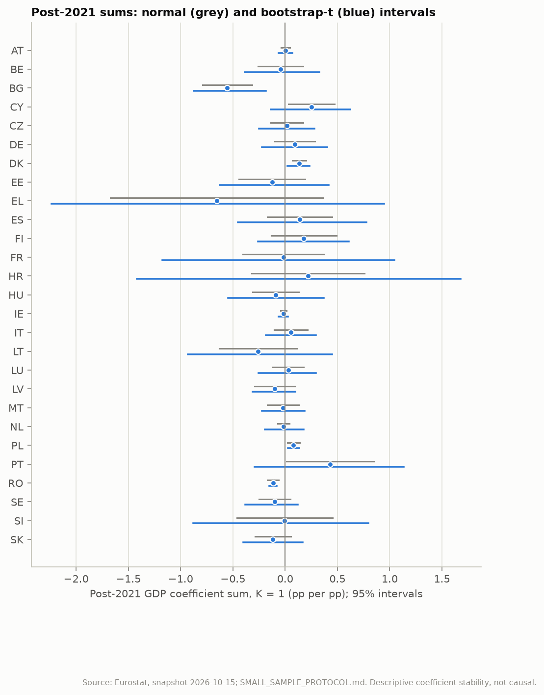

# Small-sample inference for the post-2021 window

Generated by `eu-okun small-sample` from the frozen snapshot `snapshots/eurostat-2026-10-15`, following [SMALL_SAMPLE_PROTOCOL.md](../SMALL_SAMPLE_PROTOCOL.md), which was registered before any bootstrap was computed. Data, samples, design, statistic and multiplicity family are those of the published stability tests (`eu-okun infer`): 2009-Q2..2019-Q4 against 2022-Q2..2026-Q2, one GDP lag, a calendar-aware Newey-West t-statistic for the change in the GDP coefficient sum, Holm over 54 tests. Only the reference distribution changes. Every result is descriptive coefficient stability, not causal evidence.

## Summary

- Holm-significant changes (bandwidth 4): 14 with the published normal reference, 0 with the null-imposed sieve bootstrap, 0 with the moving-block bootstrap. **0 survive both bootstraps** (none); 0 depend on the scheme.
- Resolution: with B = 999 the smallest attainable p-value is 0.001, while Holm over 54 tests needs the smallest p at or below 0.00093. The smallest observed sieve p-value is 0.007. A repeat with B = 9999 (not pre-registered, section 1.1) gives 0 surviving changes (sieve Holm: 0, block Holm: 0).
- Size under the fitted null DGPs (200 simulated data sets per test, 10800 in all): the nominal 5% normal test rejects 22.8% of the time overall and exceeds the binomial upper bound (0.080) in 51 of 54 tests; the sieve bootstrap test rejects 4.8% (binomial 95% range for the pooled rate 0.046-0.054): **adequate size**.
- Post-2021 sums (bootstrap-t 95% intervals, 17 quarters): the sign is reportable in 7 of 54 specifications (BG, BG (+dp), DK, PL, PL (+dp), RO and RO (+dp)); chance alone would give about 2.7. Without the participation variants, which are not independent of them: 4 of 27 countries (BG negative, DK positive, PL positive and RO negative), against about 1.4 by chance.

## 1. Pre/post change tests

Change = post-minus-pre GDP coefficient sum (pp per pp). p-values: normal (published), null-imposed sieve bootstrap and moving-block bootstrap (B = 999); Holm over the 54 tests. 'Null size' is the share of the sieve bootstrap draws in which the normal test would reject at 5%: the size of the published test under that test's own fitted null. Flags: post-2021 definition change (d) and share of provisional GDP.

| Test | Change | HAC s.e. | p normal | Holm | p sieve | Holm | p block | Holm | Null size | Survives | Flags |
| --- | ---: | ---: | ---: | ---: | ---: | ---: | ---: | ---: | ---: | --- | --- |
| AT | +0.247 | 0.093 | 0.008 | 0.278 | 0.083 | 1.000 | 0.049 | 1.000 | 0.172 | - | - |
| AT (+dp) | +0.295 | 0.068 | < 0.001 | < 0.001 | 0.023 | 1.000 | 0.005 | 0.260 | 0.225 | - | - |
| BE | +0.064 | 0.275 | 0.817 | 1.000 | 0.853 | 1.000 | 0.866 | 1.000 | 0.123 | - | p 59% |
| BE (+dp) | +0.101 | 0.279 | 0.717 | 1.000 | 0.778 | 1.000 | 0.767 | 1.000 | 0.150 | - | p 59% |
| BG | -0.267 | 0.146 | 0.067 | 1.000 | 0.222 | 1.000 | 0.135 | 1.000 | 0.193 | - | p 35% |
| BG (+dp) | -0.285 | 0.167 | 0.089 | 1.000 | 0.358 | 1.000 | 0.230 | 1.000 | 0.280 | - | p 35% |
| CY | +0.698 | 0.132 | < 0.001 | < 0.001 | 0.013 | 0.663 | 0.013 | 0.611 | 0.218 | - | - |
| CY (+dp) | +0.688 | 0.114 | < 0.001 | < 0.001 | 0.014 | 0.700 | 0.010 | 0.500 | 0.299 | - | - |
| CZ | +0.261 | 0.088 | 0.003 | 0.122 | 0.059 | 1.000 | 0.098 | 1.000 | 0.189 | - | - |
| CZ (+dp) | +0.269 | 0.092 | 0.003 | 0.134 | 0.078 | 1.000 | 0.119 | 1.000 | 0.206 | - | - |
| DE | +0.240 | 0.111 | 0.030 | 0.879 | 0.366 | 1.000 | 0.229 | 1.000 | 0.405 | - | p 82% |
| DE (+dp) | +0.220 | 0.114 | 0.053 | 1.000 | 0.466 | 1.000 | 0.330 | 1.000 | 0.460 | - | p 82% |
| DK | +0.448 | 0.092 | < 0.001 | < 0.001 | 0.014 | 0.700 | 0.002 | 0.108 | 0.335 | - | - |
| DK (+dp) | +0.435 | 0.085 | < 0.001 | < 0.001 | 0.009 | 0.477 | 0.003 | 0.159 | 0.343 | - | - |
| EE | +0.469 | 0.178 | 0.008 | 0.298 | 0.122 | 1.000 | 0.060 | 1.000 | 0.259 | - | - |
| EE (+dp) | +0.525 | 0.184 | 0.004 | 0.159 | 0.105 | 1.000 | 0.064 | 1.000 | 0.245 | - | - |
| EL | -0.090 | 0.527 | 0.864 | 1.000 | 0.911 | 1.000 | 0.905 | 1.000 | 0.182 | - | p 82% |
| EL (+dp) | +0.435 | 0.171 | 0.011 | 0.395 | 0.068 | 1.000 | 0.149 | 1.000 | 0.139 | - | p 82% |
| ES | +1.070 | 0.176 | < 0.001 | < 0.001 | 0.036 | 1.000 | 0.010 | 0.500 | 0.463 | - | d p 59% |
| ES (+dp) | +1.026 | 0.177 | < 0.001 | < 0.001 | 0.030 | 1.000 | 0.011 | 0.528 | 0.417 | - | d p 59% |
| FI | +0.405 | 0.170 | 0.017 | 0.552 | 0.071 | 1.000 | 0.134 | 1.000 | 0.131 | - | - |
| FI (+dp) | +0.391 | 0.166 | 0.019 | 0.574 | 0.067 | 1.000 | 0.150 | 1.000 | 0.156 | - | - |
| FR | +0.266 | 0.212 | 0.210 | 1.000 | 0.478 | 1.000 | 0.378 | 1.000 | 0.276 | - | d |
| FR (+dp) | +0.237 | 0.218 | 0.278 | 1.000 | 0.540 | 1.000 | 0.462 | 1.000 | 0.295 | - | d |
| HR | +0.665 | 0.299 | 0.026 | 0.786 | 0.110 | 1.000 | 0.149 | 1.000 | 0.183 | - | p 59% |
| HR (+dp) | +0.355 | 0.235 | 0.131 | 1.000 | 0.251 | 1.000 | 0.288 | 1.000 | 0.152 | - | p 59% |
| HU | +0.096 | 0.137 | 0.481 | 1.000 | 0.596 | 1.000 | 0.624 | 1.000 | 0.154 | - | p 35% |
| HU (+dp) | +0.111 | 0.100 | 0.265 | 1.000 | 0.384 | 1.000 | 0.440 | 1.000 | 0.127 | - | p 35% |
| IE | +0.029 | 0.025 | 0.253 | 1.000 | 0.423 | 1.000 | 0.394 | 1.000 | 0.197 | - | - |
| IE (+dp) | +0.032 | 0.023 | 0.173 | 1.000 | 0.313 | 1.000 | 0.351 | 1.000 | 0.154 | - | - |
| IT | +0.539 | 0.141 | < 0.001 | 0.006 | 0.109 | 1.000 | 0.108 | 1.000 | 0.421 | - | - |
| IT (+dp) | +0.351 | 0.173 | 0.042 | 1.000 | 0.303 | 1.000 | 0.320 | 1.000 | 0.318 | - | - |
| LT | +0.178 | 0.247 | 0.472 | 1.000 | 0.654 | 1.000 | 0.603 | 1.000 | 0.230 | - | - |
| LT (+dp) | +0.189 | 0.226 | 0.404 | 1.000 | 0.614 | 1.000 | 0.605 | 1.000 | 0.264 | - | - |
| LU | +0.061 | 0.131 | 0.639 | 1.000 | 0.638 | 1.000 | 0.687 | 1.000 | 0.061 | - | p 59% |
| LU (+dp) | +0.068 | 0.133 | 0.609 | 1.000 | 0.625 | 1.000 | 0.662 | 1.000 | 0.077 | - | p 59% |
| LV | +0.222 | 0.149 | 0.137 | 1.000 | 0.273 | 1.000 | 0.416 | 1.000 | 0.145 | - | - |
| LV (+dp) | +0.368 | 0.147 | 0.012 | 0.415 | 0.121 | 1.000 | 0.159 | 1.000 | 0.204 | - | - |
| MT | -0.011 | 0.086 | 0.895 | 1.000 | 0.920 | 1.000 | 0.925 | 1.000 | 0.128 | - | - |
| MT (+dp) | -0.022 | 0.100 | 0.826 | 1.000 | 0.858 | 1.000 | 0.866 | 1.000 | 0.230 | - | - |
| NL | +0.291 | 0.084 | < 0.001 | 0.022 | 0.057 | 1.000 | 0.069 | 1.000 | 0.239 | - | p 59% |
| NL (+dp) | +0.294 | 0.086 | < 0.001 | 0.025 | 0.082 | 1.000 | 0.057 | 1.000 | 0.296 | - | p 59% |
| PL | +0.328 | 0.079 | < 0.001 | 0.001 | 0.009 | 0.477 | 0.009 | 0.459 | 0.183 | - | - |
| PL (+dp) | +0.336 | 0.078 | < 0.001 | < 0.001 | 0.007 | 0.378 | 0.014 | 0.644 | 0.207 | - | - |
| PT | +0.960 | 0.233 | < 0.001 | 0.002 | 0.020 | 0.960 | 0.028 | 1.000 | 0.229 | - | p 35% |
| PT (+dp) | +0.913 | 0.246 | < 0.001 | 0.009 | 0.042 | 1.000 | 0.042 | 1.000 | 0.292 | - | p 35% |
| RO | -0.077 | 0.031 | 0.014 | 0.451 | 0.032 | 1.000 | 0.115 | 1.000 | 0.096 | - | p 35% |
| RO (+dp) | -0.052 | 0.037 | 0.157 | 1.000 | 0.252 | 1.000 | 0.379 | 1.000 | 0.101 | - | p 35% |
| SE | +0.063 | 0.098 | 0.521 | 1.000 | 0.571 | 1.000 | 0.659 | 1.000 | 0.116 | - | - |
| SE (+dp) | +0.081 | 0.095 | 0.393 | 1.000 | 0.454 | 1.000 | 0.585 | 1.000 | 0.091 | - | - |
| SI | +0.259 | 0.244 | 0.290 | 1.000 | 0.439 | 1.000 | 0.407 | 1.000 | 0.218 | - | - |
| SI (+dp) | +0.070 | 0.217 | 0.746 | 1.000 | 0.862 | 1.000 | 0.783 | 1.000 | 0.245 | - | - |
| SK | -0.355 | 0.290 | 0.221 | 1.000 | 0.553 | 1.000 | 0.440 | 1.000 | 0.358 | - | - |
| SK (+dp) | -0.321 | 0.289 | 0.268 | 1.000 | 0.611 | 1.000 | 0.517 | 1.000 | 0.396 | - | - |



Holm-significant counts by HAC bandwidth (normal reference as published; sieve bootstrap with the same bandwidth):

| Bandwidth | Normal | Sieve bootstrap |
| --- | ---: | ---: |
| 0 | 12 | 0 |
| 2 | 13 | 0 |
| 4 | 14 | 0 |
| 8 | 14 | 0 |

- The review's descriptive weaker-after-2021 set (CY, CZ, DE, DK, EE, ES, FI, HR, IT, NL, PL, PT and SI) and the countries with a surviving change (none) overlap in none.
- A surviving change says the GDP sum differs between the two periods under a valid reference distribution; it does not say why. The post-2021 window contains the energy shock, high inflation, a definition change in ES and FR and provisional GDP.

### 1.1 Resolution of the bootstrap p-values (not pre-registered)

The registered B = 999 cannot produce a p-value below 0.001, yet Holm over 54 tests rejects the smallest p only at or below 0.00093: a test at the resolution floor could never survive. Both schemes were therefore repeated with B = 9999 and fresh seeds. This check was added after the registered run and is labelled as such in the protocol change log.

The eight smallest sieve p-values:

| Test | p sieve, B = 999 | p sieve, B = 9999 | Holm | p block, B = 999 | p block, B = 9999 | Holm |
| --- | ---: | ---: | ---: | ---: | ---: | ---: |
| PL (+dp) | 0.007 | 0.0072 | 0.389 | 0.014 | 0.0070 | 0.357 |
| DK (+dp) | 0.009 | 0.0104 | 0.520 | 0.003 | 0.0014 | 0.076 |
| PL | 0.009 | 0.0078 | 0.413 | 0.009 | 0.0079 | 0.395 |
| CY | 0.013 | 0.0095 | 0.494 | 0.013 | 0.0141 | 0.677 |
| CY (+dp) | 0.014 | 0.0104 | 0.520 | 0.010 | 0.0122 | 0.598 |
| DK | 0.014 | 0.0100 | 0.510 | 0.002 | 0.0030 | 0.159 |
| PT | 0.020 | 0.0175 | 0.823 | 0.028 | 0.0238 | 1.000 |
| AT (+dp) | 0.023 | 0.0157 | 0.754 | 0.005 | 0.0055 | 0.286 |

- Surviving changes with B = 9999: 0.

## 2. Size of the tests

For each test, 200 data sets are simulated from its fitted null sieve DGP (restricted coefficients, AR(1) errors per period, wild innovations); on each, the normal test and the full bootstrap test (B = 199, everything re-estimated) are applied at 5%. With 200 replications a correctly sized test lies in 0.020-0.080 95% of the time.

| Test | Median rate | Min | Max | Pooled | Tests above 0.080 |
| --- | ---: | ---: | ---: | ---: | ---: |
| Normal (published) | 0.205 | 0.060 | 0.510 | 0.228 | 51 |
| Sieve bootstrap | 0.050 | 0.005 | 0.130 | 0.048 | 2 |



## 3. Post-2021 sums

Post-only regression on the 17 quarters, GDP sum with a normal 95% interval and a bootstrap-t 95% interval (unrestricted sieve, B = 999). The sign is reportable when the bootstrap-t interval excludes zero (no multiplicity adjustment).

| Specification | Post-2021 sum | Normal 95% | Bootstrap-t 95% | Sign |
| --- | ---: | ---: | ---: | --- |
| AT | +0.003 | [-0.039, +0.045] | [-0.063, +0.071] | not reportable |
| AT (+dp) | +0.029 | [-0.019, +0.077] | [-0.040, +0.118] | not reportable |
| BE | -0.046 | [-0.261, +0.170] | [-0.386, +0.329] | not reportable |
| BE (+dp) | -0.009 | [-0.251, +0.234] | [-0.466, +0.445] | not reportable |
| BG | -0.554 | [-0.790, -0.318] | [-0.877, -0.183] | negative |
| BG (+dp) | -0.598 | [-0.864, -0.332] | [-1.136, -0.024] | negative |
| CY | +0.250 | [+0.029, +0.470] | [-0.136, +0.624] | not reportable |
| CY (+dp) | +0.230 | [+0.044, +0.417] | [-0.057, +0.519] | not reportable |
| CZ | +0.017 | [-0.137, +0.171] | [-0.250, +0.281] | not reportable |
| CZ (+dp) | +0.021 | [-0.140, +0.182] | [-0.255, +0.306] | not reportable |
| DE | +0.093 | [-0.100, +0.286] | [-0.223, +0.404] | not reportable |
| DE (+dp) | +0.073 | [-0.127, +0.274] | [-0.295, +0.437] | not reportable |
| DK | +0.136 | [+0.070, +0.201] | [+0.020, +0.234] | positive |
| DK (+dp) | +0.106 | [+0.030, +0.181] | [-0.009, +0.217] | not reportable |
| EE | -0.125 | [-0.442, +0.191] | [-0.624, +0.415] | not reportable |
| EE (+dp) | -0.075 | [-0.406, +0.255] | [-0.551, +0.411] | not reportable |
| EL | -0.654 | [-1.670, +0.362] | [-2.234, +0.946] | not reportable |
| EL (+dp) | -0.128 | [-0.412, +0.157] | [-0.594, +0.404] | not reportable |
| ES | +0.139 | [-0.172, +0.451] | [-0.453, +0.778] | not reportable |
| ES (+dp) | +0.111 | [-0.210, +0.433] | [-0.452, +0.660] | not reportable |
| FI | +0.179 | [-0.132, +0.489] | [-0.258, +0.608] | not reportable |
| FI (+dp) | +0.163 | [-0.140, +0.467] | [-0.323, +0.648] | not reportable |
| FR | -0.018 | [-0.405, +0.370] | [-1.174, +1.043] | not reportable |
| FR (+dp) | -0.009 | [-0.406, +0.387] | [-1.141, +1.314] | not reportable |
| HR | +0.219 | [-0.320, +0.757] | [-1.418, +1.680] | not reportable |
| HR (+dp) | -0.050 | [-0.420, +0.321] | [-0.991, +0.799] | not reportable |
| HU | -0.089 | [-0.309, +0.131] | [-0.544, +0.369] | not reportable |
| HU (+dp) | -0.049 | [-0.199, +0.100] | [-0.292, +0.179] | not reportable |
| IE | -0.017 | [-0.046, +0.012] | [-0.060, +0.028] | not reportable |
| IE (+dp) | -0.017 | [-0.047, +0.014] | [-0.076, +0.038] | not reportable |
| IT | +0.055 | [-0.103, +0.214] | [-0.183, +0.292] | not reportable |
| IT (+dp) | -0.092 | [-0.378, +0.194] | [-0.456, +0.282] | not reportable |
| LT | -0.260 | [-0.632, +0.112] | [-0.933, +0.450] | not reportable |
| LT (+dp) | -0.263 | [-0.657, +0.131] | [-1.144, +0.489] | not reportable |
| LU | +0.030 | [-0.117, +0.177] | [-0.254, +0.295] | not reportable |
| LU (+dp) | +0.022 | [-0.122, +0.165] | [-0.233, +0.266] | not reportable |
| LV | -0.099 | [-0.292, +0.093] | [-0.309, +0.099] | not reportable |
| LV (+dp) | -0.098 | [-0.273, +0.077] | [-0.306, +0.108] | not reportable |
| MT | -0.021 | [-0.172, +0.130] | [-0.221, +0.187] | not reportable |
| MT (+dp) | -0.030 | [-0.212, +0.151] | [-0.414, +0.280] | not reportable |
| NL | -0.015 | [-0.073, +0.043] | [-0.196, +0.176] | not reportable |
| NL (+dp) | -0.010 | [-0.053, +0.032] | [-0.108, +0.089] | not reportable |
| PL | +0.080 | [+0.020, +0.139] | [+0.025, +0.136] | positive |
| PL (+dp) | +0.088 | [+0.034, +0.142] | [+0.025, +0.145] | positive |
| PT | +0.428 | [+0.011, +0.846] | [-0.294, +1.132] | not reportable |
| PT (+dp) | +0.431 | [+0.001, +0.861] | [-0.304, +1.152] | not reportable |
| RO | -0.117 | [-0.170, -0.063] | [-0.153, -0.080] | negative |
| RO (+dp) | -0.091 | [-0.156, -0.025] | [-0.170, -0.019] | negative |
| SE | -0.101 | [-0.251, +0.049] | [-0.381, +0.120] | not reportable |
| SE (+dp) | -0.084 | [-0.228, +0.060] | [-0.257, +0.105] | not reportable |
| SI | -0.005 | [-0.462, +0.452] | [-0.877, +0.794] | not reportable |
| SI (+dp) | -0.192 | [-0.595, +0.212] | [-0.878, +0.500] | not reportable |
| SK | -0.117 | [-0.290, +0.055] | [-0.402, +0.169] | not reportable |
| SK (+dp) | -0.106 | [-0.318, +0.106] | [-0.693, +0.478] | not reportable |



## 4. Limitations

- The bootstraps condition on the GDP regressors and model the errors as AR(1) (sieve) or short-range dependent (blocks of 4) within each period; dependence beyond that is not reproduced.
- The size study uses the same sieve DGP family as the bootstrap, so it checks the bootstrap test where its own assumptions hold, and the normal test under realistic nulls; it is not a check against every alternative error process.
- The post-2021 window is 17 quarters of one snapshot; the roadmap's re-test with more quarters needs a new snapshot.

## Reproduce

```bash
poetry run eu-okun small-sample --data-dir snapshots/eurostat-2026-10-15 --output-dir docs/small-sample --report docs/SMALL_SAMPLE_INFERENCE.md --review-dir docs/review
```
