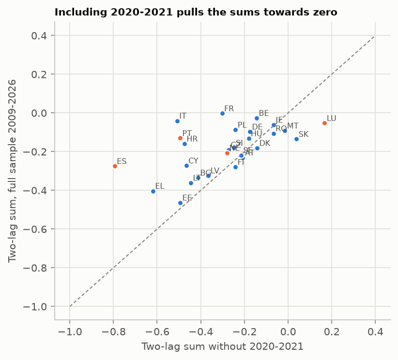
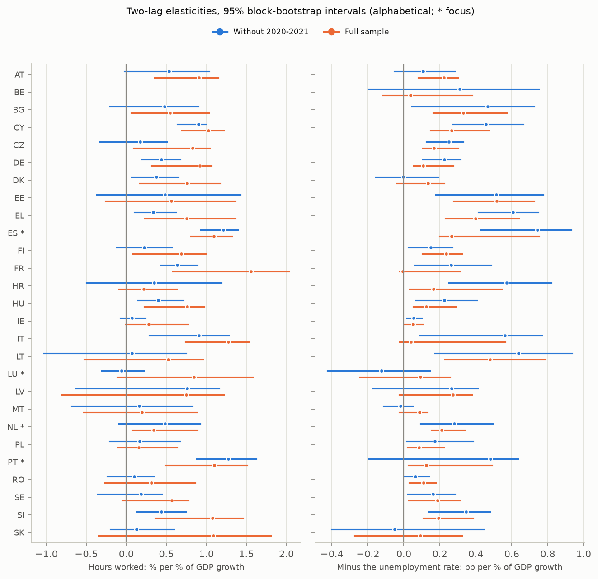
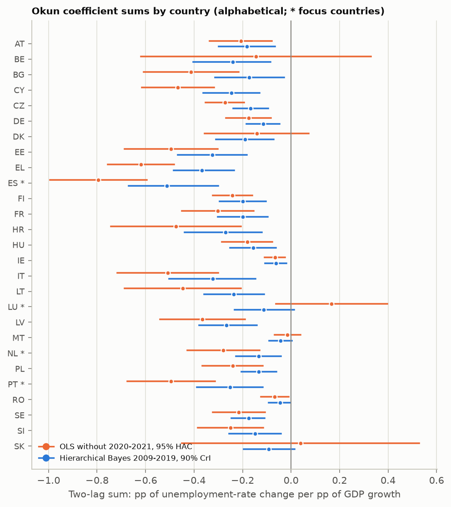
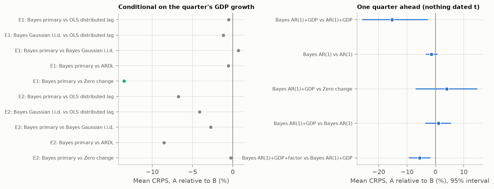
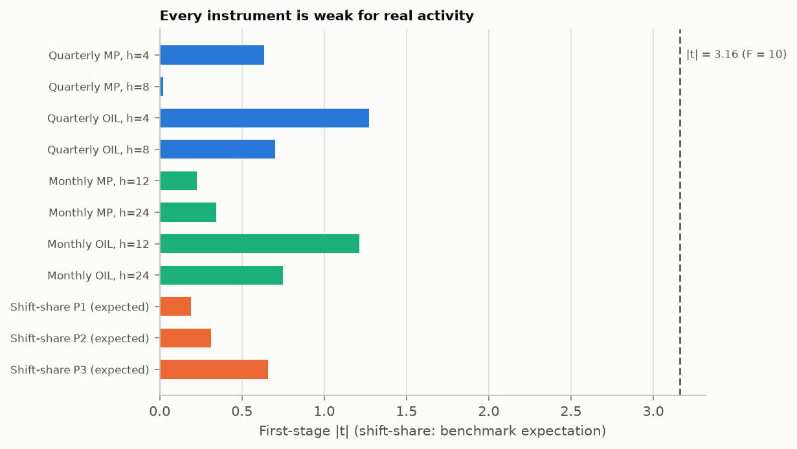
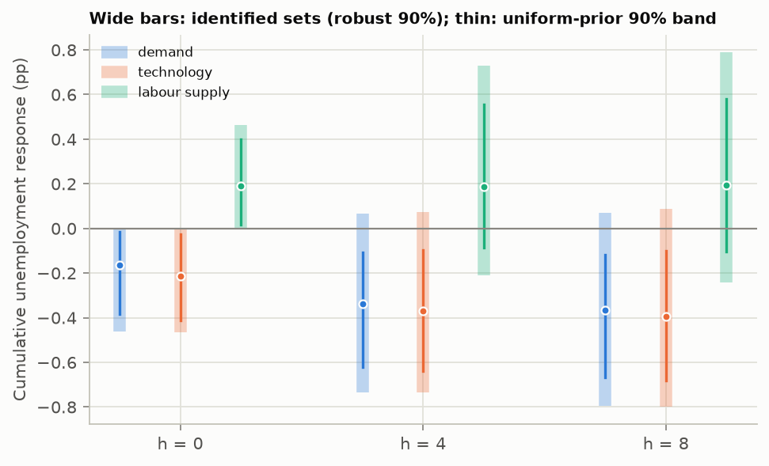
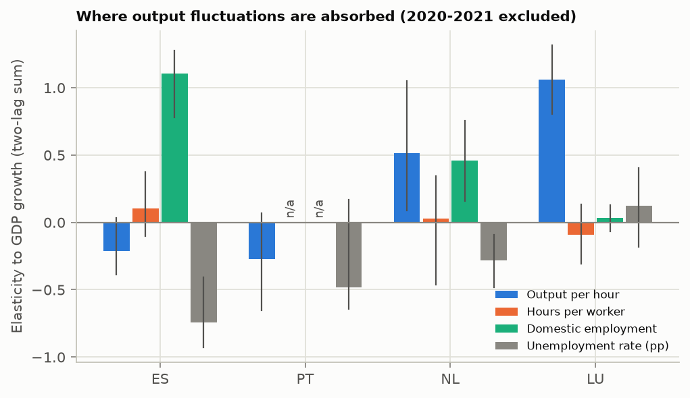

# Okun's Law Across the EU, 2009–2026

*How closely unemployment follows growth in 27 countries, what that predicts, and what it cannot tell us about cause*

When an economy grows faster than usual, unemployment tends to fall, and when growth stalls, unemployment rises. Arthur Okun put a number on this in 1962. In the form I use here, which relates the quarterly change in the unemployment rate to quarterly growth of real output, his estimate for the United States was about −0.3. He measured output by GNP, which was standard then; I use GDP. The relation has carried his name ever since, and it is quoted as if it were a constant of nature. It is not. Its size varies from country to country and from decade to decade, and what it means depends on what moved output in the first place.

This piece reports what a reproducible study of the 27 member states of the European Union found about that relation between 2009 and 2026. The full manuscript, with the mathematics, every table and the bibliography, is in the project repository. Every number below is read by code from the same result tables as the manuscript, so the two cannot drift apart.

## Where this started

The study began with an earlier hierarchical Bayesian analysis of the same countries and period. It described Spain as having a large association between growth and unemployment, the Netherlands as having a delayed response and Luxembourg as having a weak one, and it suggested measurement and institutional explanations. I never had that analysis's code, data vintage or estimates, so I treated its statements as hypotheses to examine rather than results to reproduce. I also tested two explanations of the kind it suggested: that cross-border commuters distort Luxembourg's numbers, and that employment protection weakens the response. Portugal was added as a comparison for Spain, two economies hit by the same crises with different labour markets. No claim about Portugal was ever made.

Three questions are easy to blur and are kept apart throughout. How strongly do growth and unemployment move together? Does that help anyone forecast unemployment? And is any of it the causal effect of something that moves output? A strong association need not forecast well, a useful forecast need not be causal, and an Okun coefficient averages over every kind of shock that hit the economy in the period, so it need not equal the effect of any one of them.

The data are official Eurostat and OECD series, downloaded in October 2026 and frozen, with every raw file hashed so that anyone can check they have the same inputs. Each stage of the analysis had a written protocol, committed to the repository before that stage was run. That protects each stage's decision rules against its own results. It does not protect them against what earlier stages had already shown, because the stages were designed one after another on the same data, and I say so wherever it matters.

## The association holds, outside the pandemic

The headline measure adds up the coefficients on current growth and two lags. It is the total change in the unemployment rate, in percentage points, that goes with one extra percentage point of quarterly GDP growth.

Leave out 2020 and 2021 and the sum is negative in 25 of 27 countries. How many of those are statistically clear depends on how carefully you ask.

The textbook interval, with normal critical values, lies below zero in 22. But each country has only 57 quarters, and with so few the textbook test is too eager. In simulations from each country's own fitted data, it rejects a true zero far more often than the nominal 5%: 22.0% of the time, or 16.6% when the simulated data are made less persistent. Bootstraps built to hold their size find 20 significantly negative sums.

The harder part is allowing for having tested 27 countries at once, and here the answer depends on what you want to control. The adjustment I registered, Holm's, guards against even one false positive among the 27, and under it only 1 sum survives. But the question "how many countries?" is better served by controlling the share of false positives among those declared. That adjustment, Benjamini–Hochberg, which I added after seeing the result, keeps 19. Its guarantee rests on an assumption about how the countries' tests depend on each other. A stricter version that needs no such assumption keeps only 1. The fair summary is that the negative sign is widespread, while how many individual countries' sums are nailed down depends on the error rate you choose to control.

With textbook intervals again, in 18 countries every one of the 12 core specifications agrees in sign and excludes zero. These specifications leave out the change in participation as a control, because participation is itself a response to output.

The pandemic changes the picture. Including those eight quarters moves the sum towards zero in 20 countries. They hold a median 78% of all the variation in GDP growth in the sample, so a coefficient estimated over the whole period mostly describes the pandemic. Leaving it out of the headline was my choice, made after seeing the full-sample estimates, although the plan had listed that comparison from the start.

*Classical two-lag sums: full sample against the sample without 2020–2021. For negative sums, a point above the diagonal is closer to zero once the pandemic is included.*

The usual explanation is job retention: schemes like Germany's Kurzarbeit kept people on the payroll while their hours fell. If that is right, hours worked should have kept following output in 2020 and 2021 while unemployment did not. I registered a test of this and ran it on the 26 countries that publish hours. The estimates point that way. With the pandemic included, the average hours elasticity rises from +0.43 to +0.74, while the unemployment one shrinks from −0.29 to −0.19. Hours per worker took up more of the adjustment (+0.34). Output per hour took up less (−0.30), and the number of workers responded about as it normally does (−0.04).

Even so, the test I registered came back undecided, and it could not have come back any other way. In about 3.3% of the bootstrap resamples no pandemic quarter is drawn at all, and those make the difference exactly zero. That puts a floor of 0.067 under the p-value, above the 5% threshold. I only noticed after seeing the result. I then registered a corrected test that keeps the pandemic quarters in every resample, before running it. It supports the hours pattern (Holm p 0.004) and the shift to hours per worker (0.024). Because it was written after the first result, it counts as secondary evidence. Paid sick leave and closures with continued pay would leave the same trace, and the 2021 survey redesign falls in the same window.

*Two-lag elasticities to GDP growth of hours worked (left) and of minus the unemployment rate (right), without 2020–2021 (blue) and on the full sample (orange). Belgium publishes no hours.*

## How large is it?

A hierarchical Bayesian model lets countries borrow strength from one another. It also models what the simple regressions leave behind: heavy-tailed shocks, persistence in unemployment and a common European factor that moves every country at once. Removing that factor changes the question. The model measures the association with each country's own growth beyond the common European cycle, and the factor itself tracks average GDP growth closely (a correlation of −0.60).

In the main specification, the average country sum is −0.198. In plain terms, one extra percentage point of growth in a single quarter, which leaves output about one per cent higher, goes with an unemployment rate about 0.20 points lower by the end of the second following quarter. That is smaller than Okun's original figure, partly because the common European cycle has been taken out.

That number should not be read as the answer. The main model fails one of its own checks: it understates how persistent changes in unemployment are. Across the accepted specifications the average two-lag sum runs from −0.30 to −0.18. The amended model that does reproduce the persistence, and fits better, gives −0.17 for the long-run sum, which is a different quantity: it adds up the response over all future quarters, not just the next two. The honest summary is a range of two-lag sums, with the long-run figure beside it rather than inside it.

*Two-lag sums for 2009–2019 on the same quarters, both with 90% intervals. Orange: ordinary least squares. Blue: the hierarchical model, which excludes the common European factor, so the two are not expected to coincide. Alphabetical; no ranking implied.*

Counting countries is just as fragile. 22 countries are credibly negative in every accepted specification. That count depends on whether one unpooled fit is accepted, and it narrowly missed the convergence threshold (1.0106 against 1.01) on Slovakia's persistence coefficient. A replication run on another platform accepted it, and with it the count falls to 15. For 5 of the 7 countries in between (HU, IE, NL, PL and RO), plain regressions on the same quarters exclude zero, so they fall short only in the model without pooling. For Belgium and Germany, the plain regressions do not exclude zero either.

Ranking countries is not possible either. The median 90% interval for a country's rank spans 15 of 27 places. Of 351 country pairs, 99 differ credibly in the main model, but only 59 do so in every accepted specification.

## A small gain in forecasting, hidden by the pandemic

Two comparisons, both registered in advance, asked whether any of this helps predict unemployment. They scored whole predictive distributions and refitted every model at every forecast origin, using only data from before each target quarter, though in today's revised vintages rather than the data forecasters actually had.

Over all 34 target quarters of the genuine one-quarter-ahead forecasts, none of the registered comparisons is decided, and the pandemic targets dominate the loss differences. Leave them out, as a descriptive analysis named in the protocol did, and a pattern appears. Pooling countries, adding lagged GDP growth and adding the common factor each improve forecasts by 2.5% to 3.1%, and 4 of the 5 comparisons are decided. The remaining one also favours the richer model (−3.5%) but is not decided.

What nothing reliably beats is the simplest forecast of all: that the unemployment rate next quarter will be what it is now. The classical model that extrapolates recent changes does worse than that benchmark (+4.4% over all targets). Even when this quarter's GDP growth is known, the single decided gain over "no change" (−13.5% before the pandemic) loses its significance once quarters with a failed model refit are dropped.

*Mean score of model A relative to model B; negative means A is better. Left: given the quarter's GDP growth. Right: one-quarter-ahead forecasts with bootstrap intervals.*

## No causal reading with public data

A causal Okun coefficient has to refer to a specific shock: how much a given kind of disturbance moves unemployment relative to how much it moves output. A demand shock, a productivity shock and a migration-driven rise in labour supply can all raise output while moving unemployment in different directions.

I tried the defensible routes. The first was two shock series identified elsewhere from market reactions to announcements: ECB monetary policy surprises and OPEC oil supply news. For European real activity both are weak. The largest first-stage t-statistic is 1.27 with quarterly GDP and 1.21 with monthly industrial production, far below the conventional threshold of 3.16, and every confidence set for the Okun ratio that remains valid under weak instruments is unbounded. There is a warning sign too: a 10 basis point tightening coincides with unemployment +0.12 points higher within the same quarter, which is implausibly fast and suggests timing or aggregation problems.

The second route was a shift-share of foreign demand. It would have identified each country's own GDP shocks, but a feasibility rule set in advance stopped it, with an expected first-stage t-statistic of 0.19. The third was sign restrictions on demand, technology and labour-supply shocks. The usual practice of drawing rotations uniformly gives sharp-looking ratios, −0.43 for demand and −0.55 for technology. The identified sets, which do not depend on that arbitrary prior, are both unbounded.

That last result says less than it seems. Restrictions that apply only on impact, to a ratio whose denominator can be close to zero, will produce unbounded sets almost by construction. The right conclusion is that these instruments and restrictions are uninformative, not that the causal effect is small or large. Every coefficient in this study is a description of how two series moved together.

*First-stage strength of every instrument; the dashed line is the conventional threshold.*

*Wide bars: identified sets. Thin lines and dots: the usual uniform-prior posterior.*

## Four countries

The case study asked where output fluctuations go. GDP growth splits exactly into growth in output per hour, hours per worker and employment, so each country's adjustment can be traced through those margins. Every prediction was written down first and checked by the same rule in the comparison countries. Of 14 predictions, 1 is supported, 0 are contradicted and the rest are not determined.

*Elasticities to GDP growth, 2020–2021 excluded, with 95% bootstrap intervals. Eurostat publishes no quarterly employment in persons for Portugal.*

**Spain** is the clearest case. On the same 2009–2019 quarters, a plain regression gives −0.93 and the hierarchical model −0.51; the gap comes from pooling and from removing the common cycle. Spain sits below the European average with probability 0.996, in 8 of 8 accepted specifications. Its output fluctuations are absorbed through employment, with an elasticity of +1.11, while output per hour barely responds (−0.21, an interval that includes zero). Spain's two-tier labour market, with its many temporary contracts, is the obvious suspect, but the registered test of that mechanism is not decided.

**Portugal** has a negative association whose significance depends on the sample: −0.13 over the whole period and −0.49 without the pandemic. Total hours respond to growth about as strongly as in Spain (+1.27 against +1.21), so the Spain–Portugal difference disappears when labour input is measured in hours. One thing I did not predict in advance: participation rises with growth in Portugal (+0.18), which offsets part of the fall in unemployment.

**The Netherlands** has a large lagged share in its response (0.94 in the main model), and the registered rule for a "delayed" response holds there, but only in 6 of 8 accepted specifications. The one supported prediction of the whole case study is Dutch: output per hour responds more to growth than in Spain, by +0.73. That fits labour hoarding, though hoarding cannot be told apart from unmeasured effort.

**Luxembourg** has a weak and sign-unstable association in the plain regressions (−0.05 over the whole period, +0.17 without the pandemic). The registered Bayesian rule for "weak" holds in 0 of the registered fits. The commuter story predicts that employment counted where people work would move more than employment counted where they live. It does not: the gap is +0.01, and both barely move with growth. Instead, measured output per hour moves almost one for one with measured GDP (+1.06).

It is tempting to read that as a fact about how Luxembourg's economy adjusts, but output per hour is computed as output growth minus hours growth, so the data themselves could be the cause. I registered a further test of two rival explanations and ran it on value added and hours by industry.

The first explanation is noise in quarterly output. Noise unrelated to labour input would push the output-per-hour elasticity towards one and the labour elasticities towards zero, which is Luxembourg's pattern. It would also leave two fingerprints. Measured growth would be negatively autocorrelated, and the link between hours and output would strengthen once both are measured year on year, because the noise averages out. Luxembourg's growth autocorrelation is −0.17 against a typical +0.19. Before any adjustment for multiple testing, that first fingerprint points towards noise (a difference of −0.36, interval [−0.61, −0.02]), though not after it. The second points the other way: its hours-output correlation is +0.18 quarter on quarter and +0.12 year on year, while elsewhere it rises by a median +0.36.

The second explanation is the financial sector, which is 28% of Luxembourg's value added and whose output moves with markets rather than with hours worked. Taking finance out of both output and hours changes almost nothing: output per hour still moves +0.95 for one with output outside finance.

So commuters and finance fail their tests, noise is not established either way, and Luxembourg's weak link remains unexplained. The test did find a supported prediction about Ireland, whose quarterly growth shows the negative autocorrelation that noise would leave (−0.31). That does not single Ireland out, though: Sweden, one of the comparison countries, is lower (−0.35), and Estonia and Denmark are close (−0.25, −0.22). Ireland's statistical office publishes an alternative to GDP because multinational accounting distorts it; that measure was not tested here.

What about the unemployment side? Luxembourg's monthly unemployment rate is benchmarked to moving annual averages, which would smooth any quarterly series built from it. But Eurostat's own documentation says the benchmarking runs the other way: the monthly series are adjusted to match the quarterly survey figures, not the reverse. So the quarterly rate used here does not inherit that smoothing, and its changes correlate only 0.13 with the averaged monthly ones.

Instead, Luxembourg's quarterly unemployment changes swing back and forth (an autocorrelation of −0.51), the mark of sampling noise in a small country's survey. That noise widens the uncertainty around Luxembourg's two-lag sum, which helps explain why its sign is unstable, without pushing it towards zero. It cannot explain why employment and hours barely move. It does distort the dynamic models, though. There it shows up as a negative coefficient on last quarter's change, which shrinks the long-run sum towards zero, and that alone is why the "weak" rule holds on the long-run sum. I treat that result as an artefact.

A registered check of smoothed monthly series elsewhere found no evidence that they drive the study's other results. With 6 smoothed countries against 8 direct ones, it had little power to find any.

**Institutions.** The employment-protection explanation predicted that stricter rules would weaken the unemployment response. It was tested with 6 correlations: two measures of protection, each against three versions of the country sums. All 6 have the opposite sign to the prediction. In the main version neither is decided (Holm p 0.940 and 0.095); only two non-primary variants are decided (−0.60 and −0.67). These correlations sit outside the 14 predictions, use at most 20 countries and indicators from a single year, and say nothing about what employment protection does.

## The earlier claims, judged

- **Spain has a large association:** supported, in every accepted specification.
- **The Netherlands responds with a delay:** qualified. It holds in the main model but not in every accepted specification.
- **Luxembourg's association is weak:** qualified. It is weak in the plain regressions, but not under the registered Bayesian rule.
- **Commuters explain Luxembourg:** not supported. Of the two explanations I tested afterwards, the financial sector fails its test, and transitory noise in quarterly output is not established.
- **Employment protection weakens the response:** not supported. The cross-country correlations all go the other way, but none is decided in the main version.

## What remains open

The biggest open question is why countries differ. They may differ because their labour markets respond differently to the same shock, or because they face different mixes of shocks, and only shock-specific identification can separate the two. Answering the causal question for productivity or labour-supply shocks would need data the public statistics do not provide: productivity adjusted for capacity utilisation, and natural experiments in labour supply. Luxembourg's weak link is still a puzzle: two explanations have failed, and a third is not established. And whether the relation weakened after 2021 needs more quarters. The first classical pass reported 14 significant post-2021 changes, but a size study showed that its test rejected a true null 22.8% of the time; with a bootstrap that held its size, 0 survive, and that does not change when the bootstrap is made less conservative.

There are also standard analyses this study does not include. It has no gap-form Okun's law to set against the international literature, no test of asymmetry between booms and busts and no labour-force-weighted EU aggregate. Those would be the next things to add.

## The takeaway

An Okun coefficient estimated from aggregate data summarises how output and unemployment moved together over a particular period. In the EU from 2009 to 2026 that summary is clearly negative outside the pandemic. Once the common cycle is removed, the average two-lag sum lies between −0.30 and −0.18, depending on the model, and some countries differ enough to matter. It adds a few per cent to forecasts in normal times, and none of the designs available with public data can give it a causal reading.

## Reproduce it

Everything is in the repository [DiogoRibeiro7/Medium-Blog](https://github.com/DiogoRibeiro7/Medium-Blog/tree/main/eu-okun-law), directory `eu-okun-law`: the frozen data with hashes, the protocols, the code, the result tables, the LaTeX manuscript and this article's source. The file `publication/README.md` lists the reproduction steps. The quarterly data snapshot's manifest hash begins `8a8c8a107d584ba9`.
