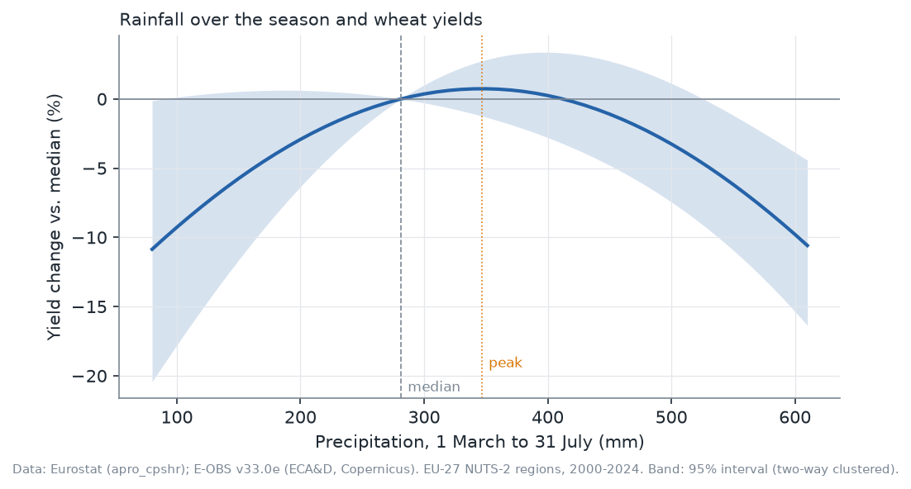
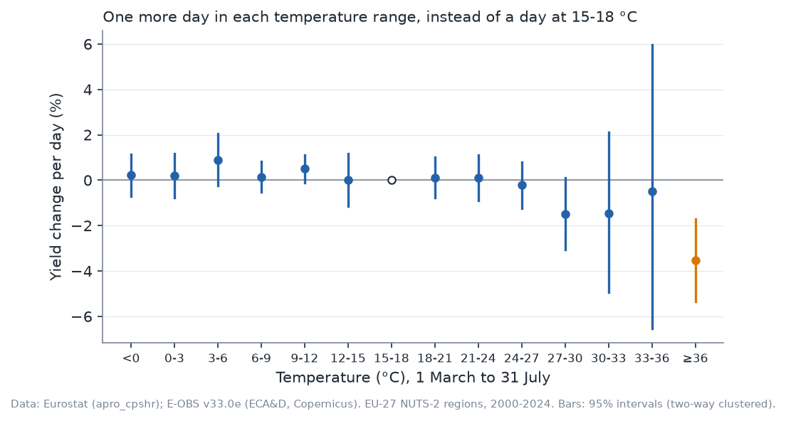
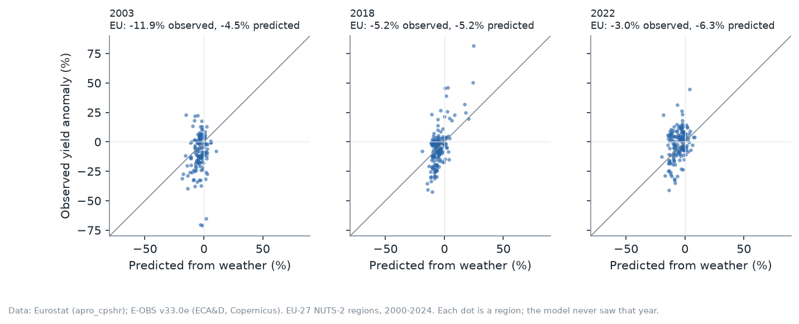
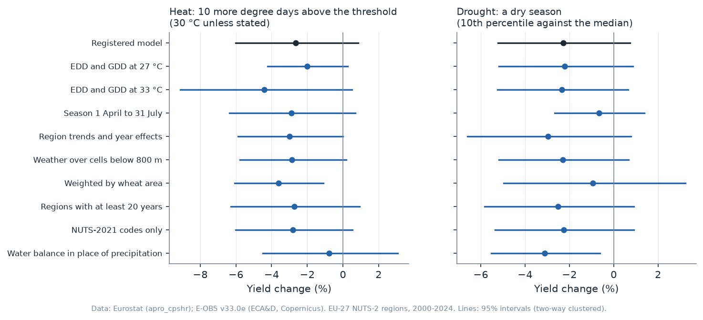
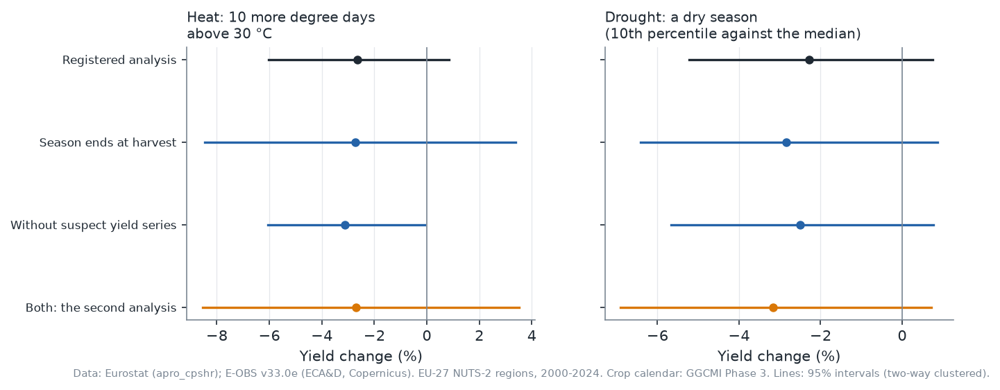

# Heat, Drought and Europe's Wheat

*What {{n_harvests}} harvests in {{n_regions}} regions say about the cost of a hot or dry spring*

*Wheat statistics © European Union, Eurostat. Weather: E-OBS v33.0e (ECA&D and the Copernicus Climate Change Service), for non-commercial research and education. Regional boundaries © EuroGeographics for the administrative boundaries, from GISCO, for non-commercial use.*

Wheat is the most widely grown crop in the European Union, and its harvest depends on a few months of weather. In 2003, 2018 and 2022, heat and drought hit much of the continent in spring and summer, and each time the question came back: how much does a bad season cost, and are farms getting better at riding it out?

This piece reports what a reproducible study of the EU's regions found, where it falls short, and what a second, registered analysis found when it fixed the main problems. The full analysis, with every table, test and line of code, is in the [project repository](https://github.com/DiogoRibeiro7/Medium-Blog/tree/main/eu-wheat-weather), along with a critical review written before publication. Every number below is read by code from the same result files, so the article and the analysis cannot drift apart.

## The data

Eurostat publishes, region by region, the area sown with common wheat and the harvest it produced. Dividing one by the other gives the yield. The weather comes from E-OBS, a daily European grid of temperature and rainfall built from thousands of weather stations. I averaged it over each region, counting only the part of each grid cell that lies inside the region.

I fixed the rules for the sample before looking at any result: enough wheat to measure, a plausible yield, complete weather and at least ten years per region. What remains is {{n_obs}} regional harvests in {{n_regions}} regions of {{n_countries}} countries, from {{year_first}} to {{year_last}}. A further {{single_region_countries}} countries have only one wheat region each, so they cannot take part in a comparison that needs two regions of the same country.

## How the comparison works

Yields drift upward with better varieties and farming, and they move with prices and policies that differ from country to country. To separate the weather from all of that, the model compares regions of the same country in the same year, each against its own usual yield. If one region has a dry spring and another region of the same country does not, the difference in how their harvests depart from normal is what the model attributes to the weather.

This is one of the rare economic questions where the answer can be read as a cause. Once a region's normal climate is taken into account, the weather in a given spring is close to random: no farmer and no policy chooses it. So the estimates say what a hot or dry season does to that year's harvest. Two cautions apply. The cause is the weather as a bundle: a hot spell comes with sun, dry air and its own timing, and the model does not separate them. And the estimates do not say what climate change will do, because farmers adapt to a climate that shifts over decades in ways they cannot adapt to a single bad year.

Heat is measured in degree days above 30 °C between 1 March and 31 July: every hour above 30 °C counts, weighted by how far above 30 °C it is. A typical region has {{edd_median}} such degree days in a season, and half of all seasons have between {{edd_p25}} and {{edd_p75}}, so the "ten more degree days" used below is a large step. Rainfall is the total over the same months.

Everything, from the measures and models to the tests and what would count as a result, was written down and published before I fitted any model. Two rules for matching old region codes to today's regions were revised after that, still before any estimate, and the plan's change log records both. A result counts only if it survives a correction for asking three questions at once, and holds under two different ways of measuring the uncertainty. After a critical review of the results, I registered a second analysis in the same way, before computing any of it; its results stand beside the first ones, not in their place.

## A check first: weather after the harvest

If the comparison works, the weather in August and September, after most of the wheat is in, should have nothing to do with that year's yield. The test finds no detectable link: p = {{e5_p_twoway}} and {{e5_p_boot}} under the two methods. In the north some wheat is still in the field in August, so the check is not perfectly clean, but had it failed, everything below would have been in doubt.

## Drought: rain matters, but the cost of a dry spring is not established

Rainfall as a whole matters: the test of the rainfall terms is significant under both methods (corrected p = {{e2_holm_twoway}} and {{e2_holm_boot}}). Yields are highest at around {{optimum_mm}} mm between March and July, but that peak is uncertain: its interval runs from {{optimum_low}} to {{optimum_high}} mm, and it includes the {{median_mm}} mm of a typical season.

*Change in yield when a region's rainfall moves from the median to each total, under a fitted curve. It compares seasons within regions, not dry regions with wet ones. The band is a 95% interval; the shading marks the peak's interval.*

A dry season, the driest one in ten for that region and on average {{dry_mm}} mm below its median, changes yield by {{dry_pct}}, with an interval from {{dry_low}} to {{dry_high}}: a loss or a small gain. The rule I fixed in advance called this an established negative effect, because it took its significance from the test of rainfall as a whole and only its sign from the dry-season estimate. That rule was flawed: the test of rainfall as a whole asks whether rain matters anywhere in its range, and the curve differs from the median only at the extremes, mostly at the wet end, not where a typical dry season falls. Tested directly, after the fact, the dry-season effect gives p = {{e2_direct_twoway}} and {{e2_direct_boot}}, or {{e2_direct_holm_twoway}} and {{e2_direct_holm_boot}} after the correction for three questions. So the cost of a dry spring is not established. The registered verdict stays on record, and the plan's change log explains the flaw and records this check.

Measuring drought by the water balance instead, rain minus what evaporation would take, the change is {{wb_pct}} ({{wb_low}} to {{wb_high}}). That was one of the checks fixed in advance, though not one that decides anything, and evaporation is computed here from temperature, so this measure partly counts heat.

## Heat: an average effect not established

Ten more degree days above 30 °C go with a change in yield of {{e1_pct}} (interval {{e1_low}} to {{e1_high}}). After the correction for three questions, that is not established (p = {{e1_holm_twoway}} and {{e1_holm_boot}}). The comparison also leans on a few countries: of the variation in heat that it uses, Spain supplies {{edd_share_es}}, Italy {{edd_share_it}} and Romania {{edd_share_ro}}. Without Spain the estimate is {{e1_no_spain_pct}} (interval {{e1_no_spain_low}} to {{e1_no_spain_high}}).

Splitting temperature into three-degree bands gives a sharper picture, which does not hold up. Time at 36 °C and above is the only band whose interval lies wholly below zero: {{ge36_hour_pct}} per hour (interval {{ge36_hour_low}} to {{ge36_hour_high}}) compared with an hour at 15–18 °C, while the average season has {{ge36_hours}} hours that hot. But the bands were a descriptive check, with no correction for looking at many bands at once, and four things undercut the reading that only the hottest time does harm:

- **One country.** Spain supplies {{ge36_share_es}} of the variation in that band.
- **One way of measuring uncertainty.** Its interval is narrow only under the two-way clustering the study uses; clustering by country, by year or by country and year alone gives a larger error every time.
- **The timing.** {{jul_edd_share}} of the degree days above 30 °C and {{jul_ge36_share}} of the time at 36 °C and above fall in July, and {{jul_south_share}} of all the time that hot is July time in the regions south of 40°N, where much of the wheat is harvested in June. Heat after the harvest cannot lower that harvest, so the band may stand in for a hot, dry season rather than measure heat damage. In the second analysis below, where each region's season ends at its harvest, the band no longer differs from zero.
- **The second method.** Under the wild bootstrap, time at 36 °C and above also differs from zero (p = {{ge36_boot_p}}), but so does time at {{boot_other_bins}}: with many bands and no correction, it is not alone.

*Each point compares one more hour in that range with an hour at 15–18 °C. Bars are 95% intervals (two-way clustered); the orange one excludes zero. The bands are descriptive, with no correction for multiple comparisons.*

## Has wheat become less sensitive to heat?

Comparing 2012–2024 with 2000–2011, there is no detectable change (p = {{e3_holm_twoway}} and {{e3_holm_boot}}). That is not evidence that nothing changed. Even before the correction for three questions, the design could reliably detect only a change of {{e3_mde_pct}} or more per ten degree days above 30 °C, which is larger than the average heat effect itself; after the correction, {{e3_mde_holm_pct}}. Whether European wheat has adapted to heat is a question these data cannot answer.

## Can the weather predict a bad year?

I fitted a version of the model without one year and asked it to predict that year from the weather alone. The numbers below are for the study's regions, weighted by their wheat area, against each region's normal yield:

- **2003:** {{e4_2003_obs}} observed, {{e4_2003_pred}} predicted.
- **2018:** {{e4_2018_obs}} observed, {{e4_2018_pred}} predicted.
- **2022:** {{e4_2022_obs}} observed, {{e4_2022_pred}} predicted.

Region by region the fit is loose: the correlations between predicted and observed departures from normal are {{e4_2003_corr}}, {{e4_2018_corr}} and {{e4_2022_corr}} for the three years.

The model missed 2003 badly, and not only because of the heat. France, the largest single part of the miss, was hot that year: averaged over its wheat regions, {{fr_2003_edd}} degree days above 30 °C, against {{fr_other_edd}} in its other years. But Romania and Hungary together account for more of the miss than France, and Romania was cooler than usual ({{ro_2003_edd}} against {{ro_other_edd}}) and Hungary only a little hotter ({{hu_2003_edd}} against {{hu_other_edd}}). In Romania's three worst-hit regions, yields fell {{worst_2003_least}} to {{worst_2003_most}} below normal while the model predicted almost no change, and in two of them the area harvested also fell by about a third that year and recovered the next. That points to damage before March, such as a hard winter, which a March-to-July window cannot see; these data cannot say what it was.

*Each dot is a region in a year the model never saw. On the diagonal, the prediction is exact.*

## How robust is this?

I fixed {{n_sensitivity}} variations in advance. They include other heat thresholds, a season starting in April, weather measured only below 800 m, regions weighted by their wheat area, and the water balance in place of rainfall. None reverses the sign of a main estimate, which is the test the plan set. But the sizes move. The heat estimate's interval excludes zero in only {{e1_variants_clear}} of them: region trends with year effects, and regions weighted by their wheat area ({{e1_area_weighted}}). The heat estimate is smallest with the water balance in place of rainfall ({{e1_water_balance}}), which partly counts heat. The dry-season effect shrinks to {{dry_apr_jul}} with a season starting in April and to {{dry_area_weighted}} with area weights.

## A second analysis that fixes the main problems

The critical review found three problems that none of those variations addressed: the season counted heat after the harvest, some regional yields are not measurements at all, and the second way of measuring uncertainty ignored countries that move together within a year. Before computing anything, I registered a second analysis that fixes all three, and tests the dry-season effect directly.

- **The season ends at harvest.** Each region's season now runs from 1 March to its usual wheat maturity date, taken from a global crop calendar: {{maturity_first}} in the earliest region, {{maturity_last}} in the latest.
- **Suspect yields are dropped.** A rule fixed in advance removes series that are not regional measurements: {{a1_excluded}} regional harvests, among them Greece's pro-rated early years and what look like pro-rated series in Czechia.
- **Countries can move together.** The second way of measuring uncertainty now allows for dependence across countries within a year.

The estimates change little, and none is established:

- **Heat:** {{a1_e1_pct}} per ten degree days (interval {{a1_e1_low}} to {{a1_e1_high}}); corrected p = {{a1_e1_holm_twoway}} and {{a1_e1_holm_boot}}.
- **Drought:** {{a1_e2_pct}} in a dry season (interval {{a1_e2_low}} to {{a1_e2_high}}); corrected p = {{a1_e2_holm_twoway}} and {{a1_e2_holm_boot}}.
- **Change since 2012:** no detectable change (corrected p = {{a1_e3_holm_twoway}} and {{a1_e3_holm_boot}}).
- **The placebo,** now the two months after each region's maturity date, still finds no detectable link (p = {{a1_e5_p_twoway}} and {{a1_e5_p_boot}}).

Two details shift. Time at 36 °C and above no longer differs from zero once the season ends at harvest: {{a1_ge36_hour_pct}} per hour (interval {{a1_ge36_hour_low}} to {{a1_ge36_hour_high}}). And Spain now pulls the heat estimate the other way: without it, the estimate is {{a1_e1_no_spain_pct}}, larger rather than smaller.

One combination comes close. Dropping the suspect yields on its own gives heat an interval that only just excludes zero ({{a1_data_e1_low}} to {{a1_data_e1_high}}). But the second way of measuring uncertainty does not confirm it (p = {{a1_data_e1_boot}}), and the interval widens again once the season also ends at harvest.

*Each change on its own, and both together. Lines are 95% intervals (two-way clustered).*

## What this does not say

- **Not climate change.** These are effects of one season's weather on that season's harvest. Farmers adapt to a changing climate in ways they cannot adapt to a single bad year.
- **Not the mechanism.** Heat, sun, dry air and their timing come together, and the model does not separate them.
- **Not nationwide shocks.** By design, the main comparison ignores whatever hits a whole country at once, and a continental heatwave does exactly that. The heat and drought effects above leave out the part of such a year that every region of a country shares; only the prediction test counts it.
- **Probably too small.** Once the comparison removes what the regions of a country share, little variation in weather is left, and errors in the weather data are a larger part of what remains. That pulls the estimates toward zero.
- **Not every country equally.** Spain, Italy and Romania supply most of the variation in heat, so the estimates say most about them.
- **Not the fields themselves.** The weather is averaged over whole regions, including forests and mountains, and E-OBS is interpolated from stations, which are sparse in places and smooth out the hottest days: 36 °C on the grid is not 36 °C in a field.
- **Not perfect yields.** The first analysis keeps regional yield series that look pro-rated from national figures or carried forward from one year to the next. The second analysis removes them by a rule, but it misses at least one case the review found: two Dutch regions whose production figures look swapped in one year.
- **One crop calendar.** The second analysis ends every region's season at the maturity date of winter wheat, though in Finland and Sweden much of the wheat is sown in spring.

## Data, code and acknowledgements

The data, the code, the research plan with every change made to it, the full results and the critical review are in the [project repository](https://github.com/DiogoRibeiro7/Medium-Blog/tree/main/eu-wheat-weather). Wheat statistics: © European Union, Eurostat. Regional boundaries: © EuroGeographics for the administrative boundaries, from GISCO, for non-commercial use. Weather: E-OBS v33.0e, for non-commercial research and education. Crop calendar (second analysis): GGCMI Phase 3 crop calendar v1.01, CC BY 4.0, from Jägermeyr, J., C. Müller, A. C. Ruane, et al. 2021: Climate impacts on global agriculture emerge earlier in new generation of climate and crop models, Nature Food, 2, 873-885. doi:10.1038/s43016-021-00400-y; data doi:10.5281/zenodo.5062513.

We acknowledge the E-OBS dataset from the EU-FP6 project UERRA (https://www.uerra.eu) and the Copernicus Climate Change Service, and the data providers in the ECA&D project (https://www.ecad.eu).

Cornes, R., G. van der Schrier, E.J.M. van den Besselaar, and P.D. Jones. 2018: An Ensemble Version of the E-OBS Temperature and Precipitation Datasets, J. Geophys. Res. Atmos., 123. doi:10.1029/2017JD028200
