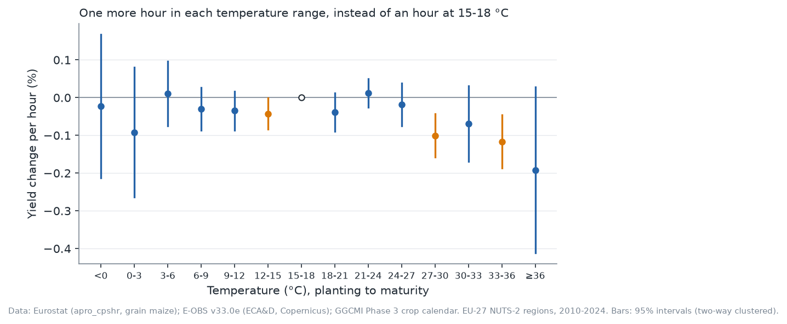
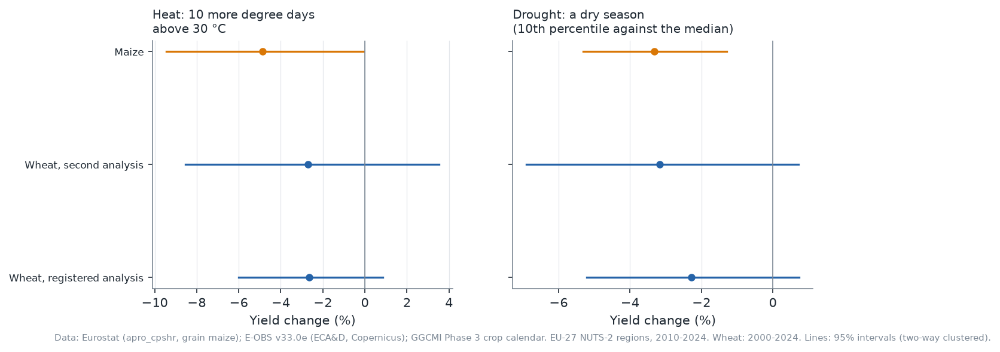
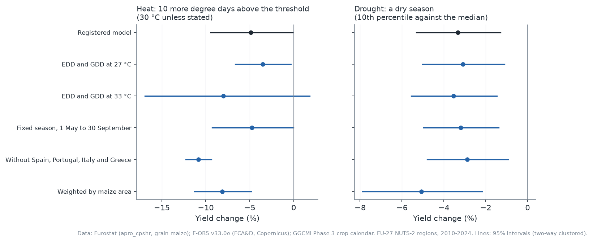
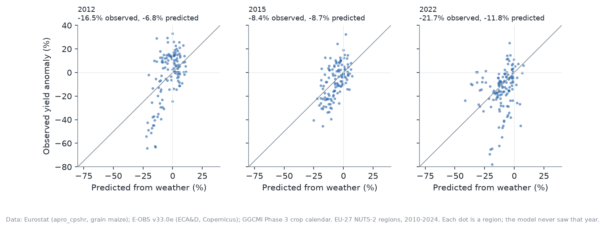

<!-- Generated by eu-wheat publication from article.template.md and the committed results. Do not edit. -->
# Heat, Drought and Europe's Maize

*What 15 harvests in 132 regions say about a hot or dry summer*

*Maize statistics © European Union, Eurostat. Weather: E-OBS v33.0e (ECA&D and the Copernicus Climate Change Service), for non-commercial research and education. Regional boundaries © EuroGeographics for the administrative boundaries, from GISCO, for non-commercial use. Crop calendar: GGCMI, under a Creative Commons Attribution licence (details below).*

Grain maize is one of the European Union's main cereals, and unlike wheat it grows through the hottest weeks of the summer. A companion study of wheat, with the same design, found no established effect of heat or drought on wheat yields once its flawed drought test was corrected. This piece asks the same questions of maize. The plan was registered before any maize yield was looked at, and every number below is read by code from the result files in the [project repository](https://github.com/DiogoRibeiro7/Medium-Blog/tree/main/eu-wheat-weather).

## The data

Eurostat publishes, region by region, the area of grain maize and the harvest it produced; dividing one by the other gives the yield. Regional figures cover most of the EU's maize only from 2010, so the study starts there. The weather comes from E-OBS, a daily European grid of temperature and rainfall built from weather stations, averaged over each region.

Each region's season runs from its usual planting date to its usual maturity date, taken from a global crop calendar: planting falls between 29 March and 12 May, and maturity between 31 August and 7 October, depending on the region.

The rules for the sample were fixed in advance: enough maize to measure, a plausible yield, a rule that removes regional figures that are not real measurements (it removed 39 regional harvests, mostly pro-rated or carried forward), complete weather and at least ten years per region. What remains is 1,893 regional harvests in 132 regions of 19 countries, from 2010 to 2024.

## How the comparison works

Yields drift with varieties, farming, prices and policies. To separate the weather from all of that, the model compares regions of the same country in the same year, each against its own usual yield. Once a region's normal climate is taken into account, the weather in a given summer is close to random, so the estimates say what a hot or dry season does to that year's harvest. Two cautions apply: the cause is the weather as a bundle, heat with sun, dry air and its timing; and these are effects of one season, not of a changing climate, to which farmers adapt.

Heat is measured in degree days above 30 °C over the season: every hour above 30 °C counts, weighted by how far above it is. A typical region has 7.5 such degree days in a season, and half of all seasons have between 2.7 and 18.8, so ten more is well within the usual swing from one season to the next.

Every rule was written down and published before any maize yield was looked at, after the wheat study and its critical review. Maize uses the fixes that review called for: the drought effect is tested directly, regional figures that are not measurements are removed, and the uncertainty allows for countries that move together within a year. A result counts only if it survives a correction for asking two questions at once, under two ways of measuring the uncertainty.

## A check first, which only just passes

If the comparison works, the weather in the two months after each region's maturity date should have nothing to do with that year's yield. One of the two methods finds a link (p = 0.043); the other does not (p = 0.158). By the rule fixed in advance, both would have to find it for the check to fail, so it passes, but only narrowly. Part of the reason may be agronomic: grain maize often stands in the field for weeks after it matures, so the weather then can affect what is harvested.

## Heat: established, by a narrow margin

Ten more degree days above 30 °C go with a change in yield of −4.9% (interval −9.5% to −0.1%). After the correction for two questions, that is established, but only just: corrected p = 0.048 and 0.036.

Splitting temperature into three-degree bands shows where the harm starts. Under both methods, only time at 27–30 °C and at 33–36 °C differs from zero: −0.10% and −0.12% per hour, against an hour at 15–18 °C. One cool band, 12–15 °C, differs under the first method only. Time at 36 °C and above has the largest estimate, −0.19% per hour, but its interval is wide (−0.41% to +0.03%) and the second method puts it right at the line (p = 0.050). The bands are a descriptive check, with no correction for looking at many at once.

*Each point compares one more hour in that range with an hour at 15–18 °C. Bars are 95% intervals (two-way clustered); orange ones exclude zero.*

## Drought: established

A dry season, the driest one in ten for that region and on average 73 mm below its median, changes yield by −3.3% (interval −5.3% to −1.3%). After the correction for two questions, that is established: corrected p = 0.007 and 0.027. Unlike the first wheat analysis, this tests the dry-season effect itself, not rainfall as a whole.

## Maize beside wheat

Wheat, under the same design, gave −2.7% for heat and −3.2% for a dry season, and neither is established; its first, registered analysis gave −2.6% and −2.3%. The drought estimates are close, but only maize's is precise enough to count, and maize's heat estimate is larger. The two crops differ in their seasons, regions and years, so this is a comparison, not a test of a difference.

*Lines are 95% intervals (two-way clustered).*

## How robust is this?

I fixed 5 variations in advance: other heat thresholds, a fixed season from May to September, leaving out the four southern countries where much maize is irrigated, and weighting regions by their maize area. None reverses a sign, and the effects grow in two of them: without the irrigated south, heat is −10.8%; with area weights, heat is −8.1% and drought −5.1%. That fits irrigation blunting the damage in the south, though it does not prove it.

## Can the weather predict a bad year?

A version of the model fitted without one year predicted that year from the weather alone, for the study's regions weighted by their maize area:

- **2012:** −16.5% observed, −6.8% predicted.
- **2015:** −8.4% observed, −8.7% predicted.
- **2022:** −21.7% observed, −11.8% predicted.

2015 is predicted well, but in 2012 and 2022 the losses were far larger than the season's weather predicts. Region by region, the correlations between predicted and observed departures from normal are 0.64, 0.58 and 0.20.

*Each dot is a region in a year the model never saw. On the diagonal, the prediction is exact.*

## What this does not say

- **Not climate change.** These are effects of one season's weather on that season's harvest.
- **Not irrigated and rainfed maize apart.** Much of southern Europe's maize is irrigated; the estimates average over both, and one rainfed crop calendar is used everywhere.
- **Not nationwide shocks.** The comparison ignores whatever hits a whole country at once; only the prediction test counts it.
- **Probably too small.** Little variation in weather is left once regions of a country are compared, and errors in the weather data pull the estimates toward zero.
- **Not a trend.** Fifteen harvests are too few to test whether maize has become more or less sensitive.
- **Not silage maize.** Only grain maize is covered.

## Data, code and acknowledgements

The data, the code, the research plan with every change made to it, and the full results are in the [project repository](https://github.com/DiogoRibeiro7/Medium-Blog/tree/main/eu-wheat-weather). Maize statistics: © European Union, Eurostat. Regional boundaries: © EuroGeographics for the administrative boundaries, from GISCO, for non-commercial use. Weather: E-OBS v33.0e, for non-commercial research and education. Crop calendar: GGCMI Phase 3 crop calendar v1.01, CC BY 4.0, from Jägermeyr, J., C. Müller, A. C. Ruane, et al. 2021: Climate impacts on global agriculture emerge earlier in new generation of climate and crop models, Nature Food, 2, 873-885. doi:10.1038/s43016-021-00400-y; data doi:10.5281/zenodo.5062513.

We acknowledge the E-OBS dataset from the EU-FP6 project UERRA (https://www.uerra.eu) and the Copernicus Climate Change Service, and the data providers in the ECA&D project (https://www.ecad.eu).

Cornes, R., G. van der Schrier, E.J.M. van den Besselaar, and P.D. Jones. 2018: An Ensemble Version of the E-OBS Temperature and Precipitation Datasets, J. Geophys. Res. Atmos., 123. doi:10.1029/2017JD028200
