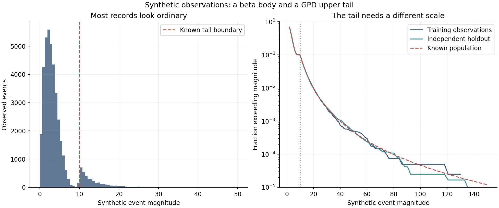
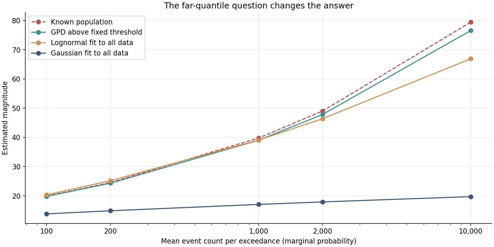
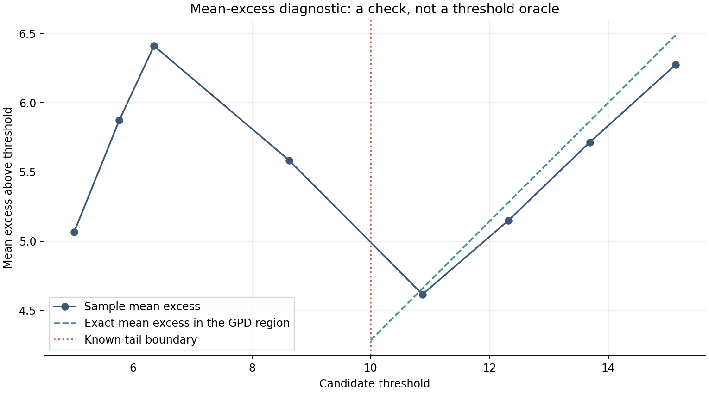
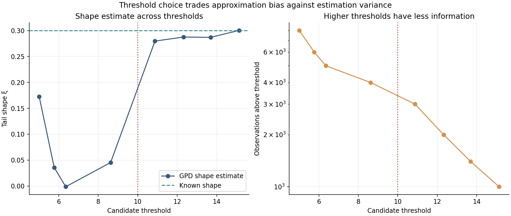
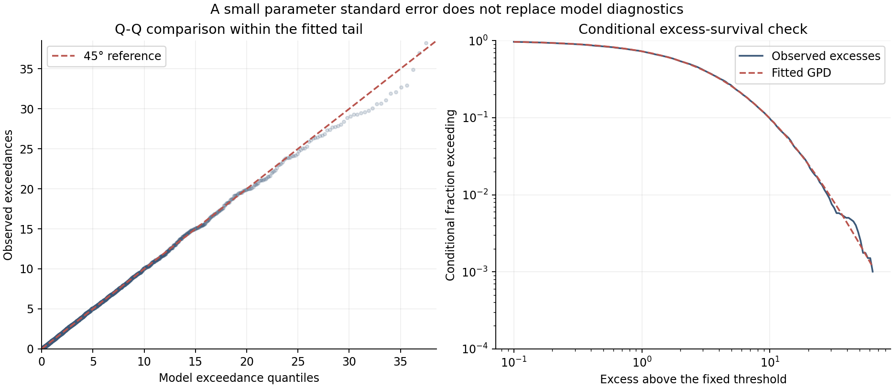
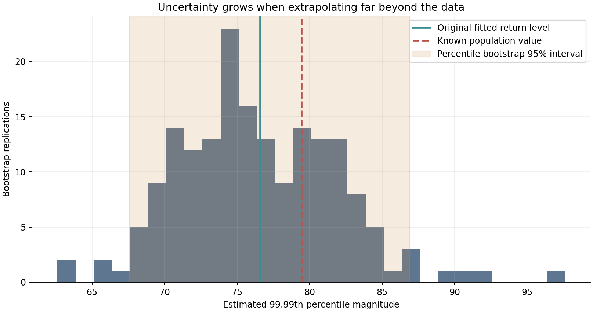
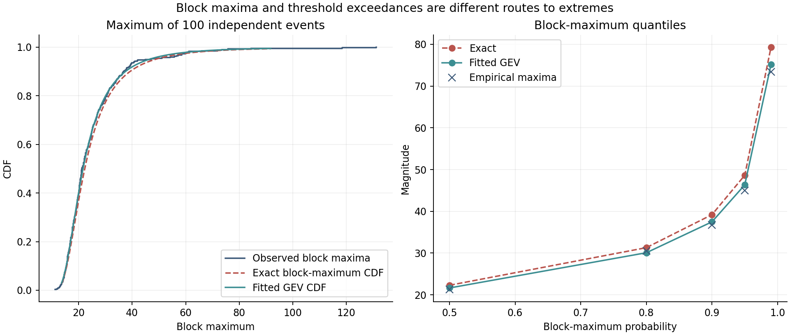
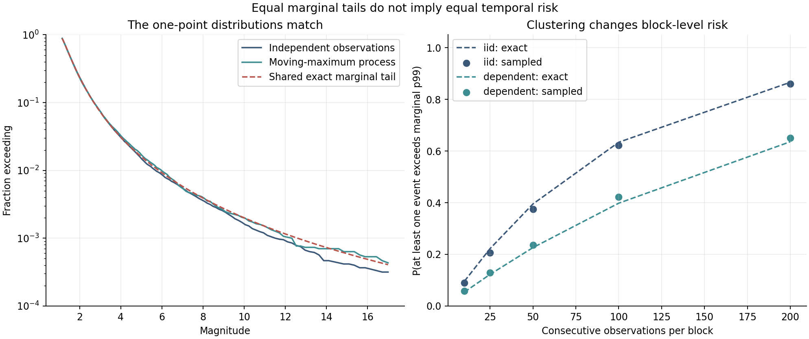

# The Tail Is Not a Rounding Error: Extreme Value Theory for Data Scientists

*Why a good model of ordinary events may be a poor model of rare ones — and how to estimate extreme quantiles, return levels, and the uncertainty that comes with them.*

A data scientist can build an accurate forecast of tomorrow's average traffic, model the median duration of an operation, and predict a surprisingly large share of normal outcomes. Then a rare event arrives, consumes a month's error budget in an hour, or overwhelms a system whose typical conditions had been forecast correctly. The common reaction is to ask for a more accurate model. But more accuracy according to which loss function, on which observations, and for which decision?

There is a mathematical distinction between predicting the centre of a distribution and describing its extreme tail. Standard forecasting and regression tools often try to minimize a loss dominated by the abundant ordinary cases. Even when a sophisticated model is well calibrated in aggregate, a far-tail quantity may be identified by only a handful of observations. Moving from the 90th percentile to the 99.9th is not a small change in a performance target. It may be a change in which statistical structure is relevant.

Extreme Value Theory (EVT) approaches this problem from the distribution of extremes. It studies how maxima behave, how exceedances above high thresholds can be approximated, and what follows when rare observations cluster. It does not claim that a mathematical limit can manufacture information about events that have never been seen. It provides a disciplined language for making the extrapolation explicit — and for discovering when the extrapolation is not credible.

In this article we will derive the basic results, construct a known synthetic population, compare three fitted tail predictions against exact values, assess a threshold, quantify one source of uncertainty, fit a block-maxima model, and end with a deliberately counterintuitive dependence experiment. Every numerical result comes from the reproducible Python analysis in [the companion directory](README.md). The manuscript contains eight figures, an executable notebook, versioned output tables, and mathematical checks.

The experiments are **synthetic and stationary by design**. No numbers below represent a real cloud provider, hospital, retail business, financial market, or municipality. This distinction matters. A controlled example can establish that one method behaves differently from another under known assumptions; it cannot establish the causal mechanism of a real outage or the future risk faced by a particular organization.

## A model of the ordinary event is not automatically a model of the exceptional one

Imagine a service that receives millions of small tasks. A dashboard reports the average response time, the median, and perhaps the 95th percentile. An operational decision concerns the probability that a response lasts longer than a contractual limit. Those quantities are related, but they are not interchangeable. An intervention can improve the median while leaving a rare failure mode untouched; another can barely affect typical latency and substantially reduce the chance of a prolonged incident. Queueing theory explains part of this interaction through congestion and temporal accumulation. EVT asks a complementary question: given a sequence of observed magnitudes, what can be inferred about the very largest magnitudes?

The same logic appears in flood protection, insurance losses, electrical grid demand, credit risk, equipment damage, and clinical monitoring. A river may remain within an ordinary range almost every day, while the required height of a protective structure depends on events in the far upper tail. A predictive-maintenance system can correctly label most machine cycles while underestimating the chance of the large vibration that matters for mechanical damage. A financial risk model can achieve a low average prediction error and still underestimate a loss quantile. None of these statements tells us the right tail model; each tells us why a central tendency statistic alone does not answer the operational question.

There are at least four different estimands worth separating:

1. **Tail probability:** the probability that a variable exceeds a specified level, \(P(X>x)\).
2. **Extreme quantile:** the magnitude \(x_p=F^{-1}(p)\), for a high probability \(p\).
3. **Excess severity:** the distribution of \(X-x\) conditional on \(X>x\), or its expectation when that exists.
4. **Temporal occurrence:** the probability of one or more exceedances, or a cluster, during a specified number of future events or units of time.

The first three involve the marginal distribution of an individual observation. The fourth also depends on the observation process, event rate, dependence, and perhaps changing environmental conditions. This distinction will become central in the final experiment.

The very first practical decision is the unit of analysis. Is one observation a request, a minute, a trading day, a patient-day, or a storm event? If we sample response times only for successful requests, the observed tail can exclude the failures we most need to understand. If a monitoring system changes its sampling frequency during an incident, observations are not comparable over time. If events are censored at a timeout, treating the timeout as the actual duration understates the unobserved tail. EVT does not correct these data-definition problems automatically; it inherits them.

## Begin with the mathematics of the maximum

Let \(X_1,\ldots,X_n\) be independent and identically distributed observations with cumulative distribution function \(F\). Define their maximum by

\[
M_n=\max(X_1,\ldots,X_n).
\]

For any real \(x\), the event \(M_n\leq x\) occurs exactly when every observation is at most \(x\). Under independence,

\[
P(M_n\leq x)
=P(X_1\leq x,\ldots,X_n\leq x)
=F(x)^n.
\]

This identity is elementary, but it reveals why extreme values require different scaling. Suppose an individual observation has a 1% chance of exceeding a threshold. The chance that at least one of 100 independent observations exceeds it is

\[
1-(1-0.01)^{100}\approx 0.634,
\]

not 1%, and certainly not \(100\times1\%=100\%\). As the number of opportunities increases, the maximum explores regions of the distribution that a typical observation almost never reaches. The question becomes how that maximum behaves after an appropriate change of location and scale.

Classical extreme-value results identify a limited family of possible nondegenerate limiting laws for normalized maxima, under conditions on the underlying distribution. The early analysis of Fisher and Tippett (1928) and the characterization associated with Gnedenko (1943) provide the foundation. In a common parameterization, the generalized extreme-value (GEV) cumulative distribution is

\[
G_\xi(z)
=\exp\left\{-\left(1+\xi z\right)^{-1/\xi}\right\},
\qquad 1+\xi z>0,
\]

with the continuous Gumbel limit \(G_0(z)=\exp\{-e^{-z}\}\). In applications, \(z=(x-\mu)/\sigma\), where \(\mu\) is a location parameter and \(\sigma>0\) a scale parameter. The shape \(\xi\) controls the qualitative tail regime:

- \(\xi>0\): the Fréchet-type case, associated with regularly varying, heavy right tails.
- \(\xi=0\): the Gumbel-type case, which includes many light-tailed parent distributions.
- \(\xi<0\): the Weibull-type case, whose upper end point is finite.

These names denote asymptotic domains of attraction, not a declaration that every finite sample is well described by its limiting GEV. Convergence can be slow. The distribution of block maxima also depends on how blocks are defined, whether events are sufficiently comparable, and whether dependence violates an iid argument. Asymptotic theory tells us what can emerge when the required conditions hold; it does not tell us at what sample size the approximation is accurate enough for a specific decision.

For a data scientist, the GEV route suggests one strategy: divide observations into equal-sized, nonoverlapping blocks, retain their maxima, fit a GEV to those maxima, and evaluate return levels of the block maximum. A calendar year is a possible block only when observations are naturally understood in calendar time. For our constructed experiment, we will use 100 events per block. That is a block of 100 observations, not 100 minutes, 100 requests per second, or a year.

There is a cost. Taking only the largest observation from each block discards many near-extreme observations. A training sample of 40,000 events becomes 400 block maxima at a block size of 100. Depending on the inferential question and dependence structure, this reduction may be sensible, but it motivates the second major approach.

## Peaks over threshold: retain the information above a high level

Instead of recording only one maximum per block, choose a threshold \(u\) and examine the excess \(Y=X-u\) conditional on \(X>u\). The peaks-over-threshold (POT) perspective models the size of each exceedance. For a sufficiently high threshold and a distribution satisfying appropriate tail conditions, the conditional excess distribution is approximated by a generalized Pareto distribution (GPD). The results of Balkema and de Haan (1974) and Pickands (1975) motivate this connection; Davison and Smith (1990) developed the modelling and diagnostics approach for statistical practice.

The GPD survival function for an excess \(y\geq0\) is

\[
P(Y>y\mid X>u)
\approx
\left(1+\frac{\xi y}{\beta_u}\right)^{-1/\xi},
\qquad 1+\frac{\xi y}{\beta_u}>0,
\]

where \(\beta_u>0\) is a threshold-dependent scale and \(\xi\) is the shape. When \(\xi\to0\), the limit is exponential, \(\exp(-y/\beta_u)\). A positive \(\xi\) produces a power-law tail; a negative \(\xi\) implies a finite upper end point. The shape parameter deserves attention because it determines which moments exist. For a GPD with \(\xi>0\), the conditional excess mean is finite only if \(\xi<1\), and its variance is finite only if \(\xi<1/2\).

The word *conditional* carries much of the statistical work. A fitted GPD for \(Y\) describes observations **given that they already exceeded \(u\)**. If we want an unconditional exceedance probability, we also need the probability that an observation crosses the threshold in the first place. Denote it by \(p_u=P(X>u)\). Then, for \(x\geq u\),

\[
P(X>x)
\approx
p_u\left(1+\frac{\xi(x-u)}{\beta_u}\right)^{-1/\xi}.
\]

In data, a basic estimate of \(p_u\) is the number of observations above the threshold divided by the total number of eligible observations. This is why a POT model is not merely a call to fit a distribution on a sliced dataframe. It combines an exceedance frequency and an excess-size distribution.

For a target quantile \(x_p\) with \(p>1-p_u\), solving \(P(X>x_p)=1-p\) gives

\[
x_p
\approx
u+\frac{\beta_u}{\xi}
\left[
\left(\frac{p_u}{1-p}\right)^\xi-1
\right],
\qquad \xi\ne0.
\]

At \(\xi=0\), the continuous limit is

\[
x_p\approx u+\beta_u\log\frac{p_u}{1-p}.
\]

These equations show precisely which parts of an extreme-quantile estimate can be uncertain: the threshold \(u\), exceedance fraction \(p_u\), shape \(\xi\), scale \(\beta_u\), and assumption that the fitted form continues to describe observations at the target rarity. The last assumption is not covered by a small numerical optimization error.

Two practical cautions follow. First, the GPD approximation concerns the upper tail under conditions, not arbitrary thresholds in arbitrary distributions. Second, if data are time dependent, the marginal excess distribution can still be a relevant target, but its likelihood uncertainty and its interpretation over a sequence of events need additional treatment. We will first keep the training observations iid so that we can isolate tail estimation; dependence returns later as a separate experiment.

## A controlled population where we actually know the answer

Many applied articles compare fitted curves with an observed histogram and stop there. If a tail estimate differs from a far-out empirical quantile, what did we learn? Perhaps the model is wrong. Perhaps the empirical quantile is noisy. Perhaps both are wrong. With rare data, the distinction is difficult because the number of observations informative about the target is small.

For this article we construct a population with a known distribution. In 90% of observations, the magnitude is \(10B\), with \(B\sim\operatorname{Beta}(2,5)\). These ordinary observations lie strictly below 10. In the remaining 10%, the magnitude is \(10+Y\), where \(Y\) follows a GPD with \(\xi=0.30\) and \(\beta=3\). Every draw is independent. We deliberately set the true threshold to

\[
u=10,\qquad p_u=0.10,\qquad \xi=0.30,\qquad \beta_u=3.
\]

The exact upper survival function is therefore

\[
P(X>x)
=0.10\left(1+\frac{0.30(x-10)}{3}\right)^{-1/0.30},
\qquad x\geq10.
\]

This is not an approximation for our artificial population. Above 10, it is how the data were generated. That makes the experiment an assessment of finite-sample estimation and model choice, rather than an empirical claim that a real tail has already been identified. The body-tail splice is visibly artificial. The beta body's density tends to zero near its upper end; in a finite sample there can be a noticeable gap around the boundary. We do **not** expect such a conveniently known transition in operational records.

The full experiment generates 40,000 training observations and an independent holdout of 120,000. The training sample contains 3,982 exceedances above 10, giving \(\widehat p_u=0.09955\). We fit a GPD to those excesses with location fixed at zero, as appropriate for excesses measured relative to a fixed threshold. The estimated shape is \(\widehat\xi=0.2905\), and the estimated scale is \(\widehat\beta_u=3.0073\). Both are near their known generating values, but their agreement is a result of this simulation, not a general guarantee of unbiased estimation.

*Figure 1. Left: the ordinary beta body dominates a conventional histogram. Right: a logarithmic survival axis exposes the upper tail, comparing independent observed samples with the exact generating law. All curves describe synthetic event magnitudes, not a real organization.*

The left panel is a useful warning about visualization. A histogram on a linear count axis can be a faithful picture of what happened most often, yet nearly invisible at the magnitudes that matter for a rare-event decision. The right panel gives weight to the tail by using a logarithmic probability axis. Far out, an empirical survival curve necessarily becomes jagged: the change caused by one event is large relative to the small number of remaining exceedances. The red curve is not fitted to the holdout; it is the exact theoretical population.

If an analyst observes a large mismatch between the holdout survival and a fitted tail, it may be evidence of misspecification. But agreement in a picture over the observed range is weaker evidence about a quantile ten or a hundred times rarer than the data frequently contain. The sample's extreme end is precisely where visual comparisons are least stable.

## What happens when we ask each model for a rare quantile?

We compare three estimators applied to the **same 40,000 training observations**:

1. A Gaussian fitted to every magnitude using its training mean and standard deviation.
2. A lognormal fitted to every positive magnitude, with location fixed at zero.
3. A generalized Pareto model fitted only to excesses above the known threshold 10, combined with the empirical exceedance fraction.

The first two are intentionally simple whole-distribution benchmarks. They are not the strongest possible competitors. A flexible mixture, a carefully selected parametric family, or a calibrated predictive distribution could perform better; the point here is to show why an adequate-looking overall fit need not make far-tail extrapolation trustworthy. The POT model has a deliberate advantage: its parametric family matches the artificial generating tail exactly, and its threshold is known. The comparison is transparent about that asymmetry.

For the target probability \(p=0.9999\), the exact population quantile is approximately 79.43 units. In a sample of 40,000 independent observations, only four exceedances would be expected above that level. The observed count can be zero, one, or several. Thus the question cannot be resolved by saying that 40,000 rows constitute a large dataset. The relevant effective information is the frequency and nature of observations in the region of interest.

The reproducible model comparison yields the following values:

| Target quantile | Exact population | Fitted POT/GPD | All-data lognormal | All-data Gaussian |
| --- | ---: | ---: | ---: | ---: |
| 99% | 19.95 | 19.83 | 20.37 | 13.85 |
| 99.5% | 24.56 | 24.33 | 25.20 | 14.91 |
| 99.9% | 39.81 | 39.05 | 39.10 | 17.08 |
| 99.95% | 49.01 | 47.84 | 46.40 | 17.93 |
| 99.99% | 79.43 | 76.57 | 66.90 | 19.75 |

These numbers are not hypothetical placeholders: they come from [the seeded model-quantile table](results/model_quantiles.csv). In particular, the Gaussian's 99.99th-percentile estimate is approximately one quarter of the true value in this constructed population. The lognormal approaches the truth around the 99.9th percentile but increasingly underestimates it at the farthest probability shown. The POT estimate is closer because this experiment has a genuine GPD tail. None of those outcomes proves that the same ranking would hold in another population.

*Figure 2. Marginal return levels indexed by the mean number of independent events between exceedances. The increasing divergence between models demonstrates sensitivity to tail assumptions. The x-axis is an event count, not a calendar-time promise.*

One consequence is easily missed: good numerical fit near a percentile does not establish correct behaviour beyond it. A lognormal fit and the GPD fit produce very similar answers at 99.9% here, but that agreement does not persist at 99.99%. The target drives the model evaluation. An algorithm selected on average log likelihood may be reasonable for broad density estimation while being unsuitable for a policy determined by a far-out loss quantile.

The difference also cuts the other way. A high-variance or heavy-tailed model may be unnecessarily conservative for an intervention sensitive only to typical events. There is no mathematical reason to treat EVT as a replacement for ordinary modelling. It is a specialized part of a decision system, and its usefulness depends on how the decision weights rare consequences.

## Return levels are probabilities expressed as event counts, not prophecies

An extreme quantile is often converted into a *return period*. In iid observations, a level exceeded with probability \(1/T\) on each observation has a mean count of \(T\) observations between exceedances. This does **not** say that one exceedance arrives regularly every \(T\) events. The waiting time in event counts is geometric, with substantial variation. Nor does it say that there will be exactly one exceedance in the next \(T\) observations.

If the observations really are independent with constant exceedance probability \(1/T\), the probability of at least one exceedance in the next \(n\) observations is

\[
P(\text{at least one exceedance in }n)
=1-\left(1-\frac1T\right)^n.
\]

For \(n=T\) and large \(T\), the expression is approximately \(1-e^{-1}\), or 63.2%. Even a so-called one-in-\(T\) event does not become due after \(T\) observations, and observing one today does not automatically protect tomorrow. The term describes a probability scale under assumptions, not a regular recurrence schedule.

Calendar language requires more care. If the data are one annual maximum per year and the process is stationary, a return-period interpretation in years may be natural. If the data are irregular incident records or billions of transactions per day, converting a return level into days, months, or years needs an event rate and an occurrence model. A change in rate changes calendar exposure without necessarily changing the distribution of one event. Dependence further changes the probability of at least one event in a window; the iid formula above must not be reused without justification.

For capacity planning, the distinction between return periods and actual reliability is actionable. A threshold set at a 1-in-10,000 marginal quantile may be exceeded many times during a long high-volume day, while an application recording only a handful of events per month may not see such a magnitude for years. What is the intended protection horizon? How many opportunities arise within it? What constitutes an independent opportunity? Those questions belong in the model specification, not as fine print after the estimate is communicated.

## The threshold is a modelling decision, not a magic number

The most uncomfortable step in peaks-over-threshold analysis is choosing \(u\). If it is too low, the approximation by a GPD may be invalid because the ordinary body of the distribution still influences the excesses. If it is too high, only a small number of observations remain, and the shape estimate becomes noisy. The mathematical convergence result does not supply a universally optimal threshold in a finite dataset. Statistical practice therefore combines threshold diagnostics, application knowledge, model checking, and sensitivity analysis.

Our deliberately convenient population makes this tension visible. We know that the upper tail is exactly GPD above \(u=10\). A real analyst does not get that fact from the data-generation specification. An exploratory procedure might try thresholds at the 80th, 85th, 90th, 95th, and 97.5th sample percentiles, compare parameters, and check how estimated return levels vary. That is a reasonable exploration, but it is not a warrant to select whichever threshold yields the most attractive business result.

One classic diagnostic is the *mean residual life* or *mean-excess* plot. At a candidate threshold \(v\), consider

\[
e(v)=E[X-v\mid X>v].
\]

For an exact GPD tail with shape \(\xi<1\), and for thresholds \(v\) above a valid starting threshold \(u\), the mean excess satisfies

\[
e(v)=\frac{\beta_u+\xi(v-u)}{1-\xi}.
\]

Thus it is a linear function of \(v\), provided the expectation exists. In our simulation, \(\xi=0.30\), so the theoretical curve starts at \(3/(1-0.30)\approx4.29\) when \(v=10\) and increases with slope \(0.30/0.70\approx0.43\). Above the true threshold, a mean-excess plot should roughly follow that line in a sufficiently large sample. Below it, where the beta body contributes observations, that formula need not hold.

*Figure 3. The sample mean excess is nonlinear below the artificial boundary and approximately linear above it. The dashed theoretical segment is drawn only where the exact GPD model applies. The visual pattern is a diagnostic, not an algorithm that proves the boundary's location.*

Figure 3 displays precisely that relationship, but it also shows why plotting a curve is not the same as establishing a stable model. Only eight candidate thresholds are examined. Their estimates are highly dependent because every high-threshold sample is nested inside every lower-threshold sample. A near-linear segment can appear by chance, especially with a few observations. A different mixture can produce a convincing-looking segment that is not yet in its asymptotic tail regime.

The second diagnostic concerns parameter stability. If the excess distribution is exactly GPD above \(u\), increasing the threshold to \(v>u\) preserves the shape and changes the scale according to

\[
\xi_v=\xi_u,\qquad
\beta_v=\beta_u+\xi_u(v-u).
\]

The shape should therefore stay approximately constant over a suitable threshold range. The scale itself should *not* be expected to stay constant when \(\xi\ne0\). A common mistake is to treat rising fitted scale as evidence that the model is failing; a rising scale is exactly what threshold stability predicts for a positive GPD shape. Comparing appropriately adjusted scales can be more informative than comparing raw scales.

*Figure 4. Left: the fitted GPD shape approaches the known value of 0.30 as candidate thresholds enter the true tail. Right: the number of informative exceedances falls as the threshold rises. The red vertical line marks the generating threshold, which an empirical analyst would not know.*

The full data make the trade-off concrete. At the empirical 80th-percentile threshold, approximately 8,000 observations remain, but the fitted shape is about 0.173, far from the true tail shape 0.30. At a higher threshold of roughly 12.32, about 2,000 observations remain and the fitted shape is about 0.288. At a threshold near 15.14, only 1,000 observations remain and the estimate is about 0.300. In this particular sample, higher thresholds reduce the obvious lower-threshold bias. Keep raising the threshold indefinitely, however, and the estimate would eventually be based on too little information.

The sample's empirical 90th-percentile cutoff is around 8.63, **not** exactly 10. This is not a contradiction. The generating distribution was deliberately spliced: all body observations fall below 10 and all tail observations above it. With finite sampling, a gap may separate the highest body observations from the smallest tail observations, and a sample quantile near the mixture boundary can land inside the body. This artefact makes our example especially convenient for illustration but less like a smoothly varying real phenomenon. It is one reason that successful threshold recovery in this study should not be presented as a practical theorem.

Threshold selection has a statistical cost beyond its effect on the point estimate. If the analyst chooses \(u\) after inspecting the same tail quantiles they want to report, a confidence interval conditional on the selected \(u\) may ignore that selection process. The distribution of the final estimator includes uncertainty about which threshold was selected. Scarrott and MacDonald (2012) survey this problem and the range of methods proposed to address it. For a high-stakes application, report results across a credible threshold range or adopt an approach that explicitly accounts for selection, rather than presenting one threshold with unjustified precision.

If the true distribution is not stationary, there may be no single threshold that works uniformly across conditions. A temperature sensor operating in several regimes, or a financial series whose volatility changes markedly, can mix different conditional tails in one marginal sample. The observed shape may shift with the covariate regime. Higher thresholds alone do not restore the relevance of old observations to a new operating environment.

## A fitted GPD is a hypothesis that needs to survive diagnostics

A numerical optimizer returns parameters even when the assumed distribution is wrong. SciPy's GPD maximum-likelihood fitting routine supplies a shape and scale for any sample that satisfies its numerical requirements; the presence of decimal places is not evidence that the GPD represents the physical process. The model should face internal checks before its far-tail quantile is used.

One check is a Q–Q plot: sort the observed exceedances, compute the fitted GPD quantiles at corresponding probabilities, and compare the points with the 45-degree line. If the model is appropriate, the relationship should be reasonably close over the fitted range. A bend in the upper right may indicate underestimation or overestimation of the largest excesses. Extreme order statistics are noisy, so a single endpoint discrepancy is weak evidence on its own, but a systematic pattern deserves investigation.

A second check compares the empirical conditional survival of the excesses with the fitted GPD survival function, preferably on a log-probability axis. The same visually close fit on an ordinary axis can conceal systematic differences at rare probabilities. For a real dataset, these diagnostics should be accompanied by threshold sensitivity, dependence analysis, and uncertainty quantification, not treated as pass/fail screenshots.

*Figure 5. The correctly specified synthetic GPD fits its generated excesses reasonably well over the observed range. That observation is necessary but not sufficient evidence for credible extrapolation to arbitrarily rare events.*

In Figure 5, the theoretical and empirical excesses largely align. This is unsurprising because the experiment was built from an exact GPD tail. Near the far upper end, the observations spread out from the reference: a finite sample of approximately 4,000 exceedances does not eliminate extreme-order variability. The right-hand log-survival panel shows similar agreement while the sample contains enough observations to resolve the curve. Neither panel directly validates the model at a probability of one in a million. Such validation would require information about outcomes rarer than those predominantly seen in this study, or a strong and independently justified structural model.

Diagnostics should also respect how observations were recorded. A hard cap on observed values can create the appearance of a bounded tail even when the underlying event continues beyond the cap. A monitoring timeout can produce a pile-up at the timeout limit. Discretized losses with many ties, rounding at fixed units, and selective omission of unsuccessful records can distort standard continuous-model diagnostics. These are not exotic EVT issues. They are data-engineering and measurement issues that determine what distribution is actually identifiable.

The most useful way to read a Q–Q plot is as a question: *which tail departures are the data sufficiently informative to detect?* It is not a certificate that the line will remain straight forever. An apparently excellent model on 4,000 exceedances may fail at the target that corresponds to only a few events in the complete training sample.

## The point estimate is only one part of the tail prediction

At the 99.99th percentile, our fitted POT value is 76.57 while the exact synthetic value is 79.43. A reader might conclude that the estimation error is approximately 3.6% and the problem is solved. That conclusion uses information available only because we created the population. In a real study, the exact target would not be printed alongside the estimate. We would need to represent how variable the estimator could be across plausible samples.

We use a nonparametric bootstrap to illustrate one source of this uncertainty. Keep the threshold \(u=10\) fixed. Draw 180 samples of 40,000 observations each, with replacement from the training observations. For each resample, recompute the proportion exceeding the threshold, fit the excess GPD with the location fixed at zero, and calculate the implied unconditional 99.99th percentile. The collection of those 180 estimates is an approximation to the estimator's sampling distribution under an iid empirical-population bootstrap.

For this particular sample, the ordinary percentile bootstrap's central 95% interval is approximately **[67.56, 86.91]**, around a point estimate of 76.57. The known value 79.43 lies within it. This is reassuring only in a narrow sense: it shows that the observed estimate is not wildly inconsistent with the known value under the chosen construction and bootstrap procedure. One interval covering the truth does not establish that the procedure achieves 95% coverage across repeated datasets. Assessing coverage would require an outer simulation that repeats the training experiment many times.

*Figure 6. A fixed-threshold iid bootstrap with 180 resamples. The shaded range is a 95% percentile interval conditional on the training sample and chosen model. The known population value is available here only because the data-generating distribution was specified.*

The interval is not a licence to announce that the true return level lies between 67.56 and 86.91 with 95% subjective probability. Frequentist coverage refers to the repeated-sampling procedure under its assumptions. Moreover, this bootstrap does not represent every important source of uncertainty. It conditions on the threshold, assumes the GPD family is appropriate, and resamples individual observations as if they were exchangeable. It does not account for an unobserved regime change, censoring, a different tail family, temporal clustering, or uncertainty in the number of future opportunities for an event.

For dependent observations, blindly resampling individual rows destroys the dependence structure. If extremes arrive in clusters, the number of independent clusters can be much smaller than the number of exceedance records. Bootstrap intervals obtained from individual rows may then be too narrow. Depending on the process, cluster resampling, block bootstrap methods, or a likelihood model for the occurrence and severity process may be more defensible. The independence assumption must be defended from the system that produced the events, not assumed because it makes statistical software easier to use.

Extrapolation itself expands sensitivity to parameters. Differentiate the formula for \(x_p\) with respect to \(\xi\) and the threshold ratio \(p_u/(1-p)\): as the target probability approaches one, the exponent amplifies small differences in the estimated shape. A shape difference of a few hundredths can have little visible effect around the 95th percentile but a substantial effect at the 99.99th. This is a mathematical reason to inspect shape stability before communicating extreme return levels with too many significant digits.

It also matters what kind of interval is being reported. A confidence interval for a model parameter is not automatically an interval for a return level. A confidence interval for an extreme quantile is not a prediction interval for the largest observation in a future month. A prediction interval for one future event is not the same as the probability that a service-level threshold will be breached at least once in the next million operations. A useful report begins by writing down the random quantity that the interval is intended to cover.

## Extreme quantiles and expected shortfall answer different questions

A 99.9th-percentile threshold can be useful when a decision is based on whether an event exceeds a limit. But what if the cost continues to grow after the threshold is crossed? Then the severity of exceedances matters. In finance this distinction appears between Value at Risk — a quantile of loss — and Expected Shortfall — the expected loss conditional on being beyond a high quantile. Similar logic applies to insurance losses and to operational incident costs when the conditional expected cost exists and when magnitude is an informative proxy for damage.

For a GPD excess model at threshold \(u\), with \(\xi<1\), the expected excess above a higher level \(x\geq u\) is

\[
E[X-x\mid X>x]
=\frac{\beta_u+\xi(x-u)}{1-\xi}.
\]

Consequently, when the relevant expectation is finite,

\[
E[X\mid X>x]
=x+\frac{\beta_u+\xi(x-u)}{1-\xi}.
\]

For our exact population and its 99.99th percentile \(x\approx79.43\), this conditional mean is approximately 113.48 units. The magnitude of an event once it crosses 79.43 can be materially larger than 79.43 on average. This extra quantity is lost if the analysis reports only how often the threshold is reached. For \(\xi\geq1\), the GPD's theoretical mean is not finite, so a naive expected-shortfall number is not mathematically defined; in practice, physical caps or economic loss limits may change the model, but those limits must be established rather than silently assumed.

The value 113.48 is not a plausible cost estimate for any particular system. Our synthetic magnitudes have arbitrary units, and no loss function has been specified. In a real decision, the transformation from event magnitude to consequence is as important as the probability model. If an outage lasts twice as long, is the damage twice as large, or does the relationship accelerate? If a flood reaches a higher level, does damage begin only after crossing a structural barrier? The expected cost depends on the response function, not just the tail of the exposure.

McNeil and Frey (2000) used EVT within a framework for conditional financial tail risk, emphasizing the need to address changes in volatility before modelling extreme innovations. The broader lesson is relevant outside finance: a heavy-tail fit to pooled observations may hide dynamic conditional structure. A risk system should distinguish predictions conditional on today's regime from an unconditional historical distribution.

## Return to the maximum: the GEV route has different data requirements

We have used a fixed threshold and retained every event above it. The alternative introduced earlier retains only one maximum per block. For a sample of 40,000 independent events, choose 400 nonoverlapping groups of 100 events and record their maxima. Fit a GEV distribution to those 400 values, then compare it with the known exact distribution of a 100-event maximum.

Because our individual events are iid, the exact CDF of each block maximum is \(F(x)^{100}\). No asymptotic approximation is necessary to calculate that reference for the artificial population. We can therefore separate two questions: whether a GEV is a reasonable *finite-block* approximation, and whether the optimizer estimates parameters adequately from 400 blocks. The GEV theory motivates the model family, but the comparison with \(F(x)^{100}\) is what gives this experiment an explicit ground truth.

The fitted GEV shape is about 0.302 on the standard theoretical \(\xi\) scale, close to the true parent-tail shape 0.30. There is a software convention worth recording: SciPy's genextreme parameter \(c\) has the **opposite sign** of the commonly written theoretical GEV shape \(\xi\). In our reproducible code, the reported \(\xi\) is \(-c\). Confusing those conventions could lead an analyst to interpret a heavy unbounded tail as a bounded tail, which is not a minor labeling error.

*Figure 7. Left: the exact CDF of a 100-event maximum is compared with the observed nonoverlapping maxima and a fitted GEV. Right: block-maximum quantiles highlight increasing extrapolation uncertainty. The 99th-percentile estimate is based on only 400 training blocks.*

The fitted model follows the exact block-maxima curve reasonably well in the observed range, with visible differences near its upper end. The 99th percentile of 400 block maxima is informed by approximately four of those maxima, which makes the far upper quantile uncertain even though the original event sample contained 40,000 observations. Choosing smaller blocks would give more maxima but may worsen the approximation to the limiting GEV. Choosing larger blocks would give fewer maxima and greater finite-sample uncertainty. That is the block-maxima version of the bias–variance problem encountered in threshold selection.

Neither the GEV nor the POT method is unconditionally superior. Their trade-offs depend on what counts as an independent block or exceedance cluster, how the available data are organized, whether events are dependent, and which return level is being estimated. A block-maxima model may align naturally with annual maxima in environmental data. POT may use more of the upper-tail observations when events are recorded individually and dependence can be handled. Some applications benefit from fitting both approaches as a robustness check, while remembering that their estimates may share underlying data and are not independent confirmations.

The event-versus-block distinction should be retained in communication. A 99th-percentile block maximum over 100 events is not the same quantity as the 99th percentile of one event. The former is related to the latter through \(F(x)^{100}\) only when the required independence and identical-distribution assumptions are credible. If the process has time-varying intensity or serial dependence, that identity no longer applies in general.

## Equal marginal tails can hide completely different temporal risks

So far, individual events were independent. Real extremes frequently have temporal structure: periods of equipment stress, successive unusually hot days, repeated retried requests, correlated financial losses, or related incidents generated by a shared underlying fault. When events cluster, treating each exceedance as an independent realization overstates the amount of independent tail information.

To isolate dependence from marginal severity, we construct a second synthetic experiment. Let \(Z_t\) be independent Pareto random variables with

\[
P(Z_t>z)=z^{-3},\qquad z\geq1.
\]

Create a dependent process by taking the maximum of neighbouring latent observations,

\[
X_t^{\mathrm{dep}}=\max(Z_t,Z_{t-1}).
\]

Create an independent comparison \(X_t^{\mathrm{iid}}\) by taking maxima of **disjoint** independent pairs of the same Pareto-distributed latent values. Every observation in both resulting processes has exactly the same marginal CDF:

\[
F_X(x)=\left(1-x^{-3}\right)^2,\qquad x\geq1.
\]

The marginal survival curves therefore cannot distinguish them in principle. A histogram, a marginal tail index, or a quantile fitted to individual observations could look the same. Yet consecutive dependent observations share a latent shock. If one latent \(Z_t\) is very large, it contributes to both \(X_t^{\mathrm{dep}}\) and \(X_{t+1}^{\mathrm{dep}}\). Extremes tend to arrive in pairs.

Consider the marginal 99th-percentile threshold \(v\), defined by \(F_X(v)=0.99\). It is approximately 5.84 in this constructed process. For a block of \(n\) independent marginal observations, the probability of at least one exceedance is

\[
P\left(\max_{1\leq t\leq n} X_t^{\mathrm{iid}}>v\right)
=1-(0.99)^n.
\]

For the dependent moving-maximum process, a block of \(n\) observed values depends on only \(n+1\) underlying latent Pareto shocks. Because \(P(Z_t\leq v)=\sqrt{0.99}\), the exact probability is

\[
P\left(\max_{1\leq t\leq n} X_t^{\mathrm{dep}}>v\right)
=1-(0.99)^{(n+1)/2}.
\]

At \(n=100\), those probabilities are approximately **63.4% for the iid sequence** and **39.8% for the dependent sequence**. The sampled proportions from 60,000 observations per process are approximately 62.2% and 42.2%, respectively. The differences between observed and exact percentages are ordinary Monte Carlo variation; the structural contrast is given by the exact formulas.

*Figure 8. Left: independent and moving-maximum observations share the exact same one-point tail. Right: their block-level exceedance probabilities differ because the dependent process reuses latent shocks. Dashed lines are exact probabilities; points are seeded sample estimates.*

This may seem paradoxical. If the dependent process creates bursts of extremes, why is it **less likely** to produce at least one exceedance within a fixed block? Because clustering spends several observations on the same underlying shock. For a given marginal exceedance probability, it reduces the number of effectively distinct opportunities for a cluster to start. Conditional on an extreme occurring, additional extremes nearby become more likely; unconditionally, the chance of at least one extreme in the block can be smaller. These are different questions.

A simple consecutive-run diagnostic counts contiguous groups of threshold exceedances and divides by the total number of exceedances. In the full simulation, this descriptive ratio is about 0.989 for the independent sample and 0.497 for the dependent moving-maximum sample. The underlying moving-maximum process has asymptotic extremal index \(\theta=1/2\), whereas the iid comparator has \(\theta=1\). The run ratio is suggestive in this controlled example, but it is **not** presented as a general-purpose statistically consistent estimator of the extremal index. Real inference requires suitable assumptions and methods, including attention to how clusters are defined (Ferro and Segers, 2003; Northrop, 2015).

The extremal index appears in the limiting approximation for maxima of certain stationary dependent sequences. If thresholds \(u_n\) satisfy \(nP(X>u_n)\to\tau\), then under suitable dependence conditions,

\[
P(M_n\leq u_n)\longrightarrow\exp(-\theta\tau),
\qquad 0\leq\theta\leq1.
\]

For independent observations, \(\theta=1\). For clustered extremes, \(\theta\) can be smaller. Informally, its reciprocal is related to mean cluster size under appropriate definitions and asymptotic assumptions. But it should not be estimated from one arbitrary threshold and used as a universal correction factor without validation.

The engineering implications are subtle. If a system has a service-level objective defined as *at least one severe incident during a day*, cluster structure matters one way. If the objective is *how many minutes of severe degradation occur once an incident starts*, the same cluster structure matters another way. A team counting only total exceedances might miss the difference. A model of marginal tail size alone cannot answer both objectives.

This example also explains a common failure in time-series machine learning evaluations. Randomly splitting adjacent observations into training and test sets can leak almost identical extreme episodes across the split. The resulting predictive score may appear excellent even if the model has never faced a genuinely new incident cluster. A rolling or blocked validation design, with a gap when appropriate, is closer to the actual forecasting question. In high-frequency processes, a cluster definition can be more useful than treating every extreme timestamp as a separate event.

## Where machine learning helps — and where it does not replace an extreme-value model

EVT and modern predictive modelling should not be framed as competitors for every task. A supervised model can estimate conditional demand, workload, volatility, state, or a location-specific risk factor. It can identify whether the distribution changes across covariates. It can predict a latent regime or construct features describing seasonality and dependence. EVT can then model the extremes of a conditional residual, of a standardized innovation, or of an appropriately defined block statistic, provided the resulting assumptions are assessed.

One possible architecture begins with a conditional model for \(X_t\) using known predictors \(Z_t\). It estimates a conditional location \(m(Z_t)\) and scale \(s(Z_t)>0\), then examines residual innovations \(R_t=(X_t-m(Z_t))/s(Z_t)\). If those innovations have a stable tail and weak enough remaining dependence, a GPD model of their excesses may provide conditional extreme quantiles after transformation back to the original scale. This is only a template. Removing conditional variance from a financial return series and removing time-of-day effects from a latency process are different scientific problems, and neither guarantees iid residuals.

Another possibility is to estimate threshold exceedance probability and excess severity separately. A classifier predicts whether \(X>u\) under current covariates, while an excess model estimates how large \(X-u\) could be if the threshold is crossed. The unconditional conditional-on-features survival then combines the two parts. The method is attractive when occurrence and severity respond differently to predictors. It needs careful calibration, because multiplying two inaccurate estimates does not make their product reliable.

For streaming data, change-point detection and drift monitoring are especially relevant. If the arrival process, equipment condition, or weather regime changes, a stationary tail model trained on the past may no longer be appropriate. A distribution shift does not always mean that the tail shape changed — it could be a change in event rate, scale, mixture proportions, or censoring — but it is a reason to re-examine the assumptions. Drift alarms should prompt investigation rather than automatic refitting on a tiny set of the newest extreme observations.

Deep neural networks can estimate flexible conditional distributions, but flexibility is not the same as identifiable tail behaviour. If a training loss rarely sees extreme observations, a network may obtain excellent average performance while learning little about the distribution beyond its largest observations. Conversely, an EVT layer is not guaranteed to repair misspecified features or an unsuitable event definition. The useful question is what structural assumptions are defensible and how they can be tested out of sample.

## A decision-oriented workflow for rare-event modelling

The following sequence is what I would require before treating an extreme-value estimate as evidence for a consequential decision:

1. **Define the event and the decision.** Specify the physical unit, observation window, exceedance condition, and loss or service metric. A conditional tail severity, an annual maximum, and the probability of any breach in a week are different targets.
2. **Audit what is observable.** Inspect censoring, timeout caps, missing intervals, duplicate events, changes in instrumentation, units, and selective retention of successful records. Without that audit, the statistical tail may describe only a biased recording mechanism.
3. **Study time structure before modelling extremes.** Plot event frequency, conditional scale, seasonality, and autocorrelation, particularly of threshold exceedance indicators. Decide whether the iid approximation is credible, or whether declustering, covariates, or a different process model is necessary.
4. **Establish a modest baseline.** Compare empirical exceedance frequencies and simple parametric alternatives with POT or GEV. A model should earn its complexity through the target decision, not through a prestigious mathematical name.
5. **Select and examine thresholds or blocks.** Report candidate thresholds, exceedance counts, mean-excess behaviour, parameter stability, and return-level sensitivity. For block maxima, study block size and whether maxima can reasonably be compared across blocks.
6. **Test calibration in time-respecting holdouts.** Use data untouched by model selection and preserve temporal separation when episodes cluster. Compare predicted exceedance frequencies with realized counts over a range where the holdout has meaningful information.
7. **Quantify multiple uncertainties.** Separate numerical optimization error from sampling variability, threshold choice, dependence, nonstationarity, and model-family uncertainty. Report which of these the interval actually represents.
8. **Connect estimates to actions.** Translate the model into a policy comparison with consequences and exposure. Test decisions under alternative plausible tails instead of optimizing a single fitted return level to two decimal places.

That workflow often leads to an uncomfortable outcome: the data are insufficient for the requested return period. This is a legitimate scientific conclusion. A company may have three years of usable incident history and ask for the 100-year level. A modeller can produce a number from a fitted distribution, but no amount of plotting converts a remote extrapolation into strong empirical evidence. The value of a rigorous analysis may be to document the assumptions and recommend a conservative engineering envelope or additional monitoring, not to provide false certainty.

It is also useful to distinguish *tail-risk governance* from model selection. An estimate can be statistically respectable while the accepted risk remains a policy choice. If a hospital, public service, or utility must set a safety margin, stakeholders need to know what uncertainty is unresolved and what happens if the tail is heavier than assumed. The role of the data scientist is to make those trade-offs legible. It is not to decide unilaterally which rare losses society should tolerate.

## Where the present experiment stops

This article has eight figures and several exact results, but its validity is deliberately narrow. The main training and holdout observations are iid. The upper tail was created as an exact GPD beyond a known threshold. The body and tail were artificially spliced. The iid bootstrap fixes both threshold and model family. The GEV experiment has 400 block maxima, which is far from an asymptotic infinity. The dependence demonstration is a separate moving-maximum process with a known mathematical form and no changing regimes.

The experiment does not model multivariate tail dependence, competition between failure modes, evolving event rates, regression covariates, spatial pooling, informative censoring, self-exciting event processes, or changes in the data-generating mechanism. It does not solve the difficult problem of validating a very long return period against a short historical record. Nor does it claim that the estimates from this example would transfer to rainfall, industrial losses, financial returns, or clinical events.

Even the good GPD fit is not independent external evidence. It is a consequence of studying a population constructed to satisfy its assumptions and of estimating its parameters with enough exceedances. The scientific contribution of the experiment is more modest: we can distinguish the effect of the correct tail family, the bias–variance trade-off of threshold choice, the uncertainty of remote quantiles, and the role of dependence because their truth is known or analytically derivable.

Readers intending to extend the work should consider an explicit threshold-selection uncertainty analysis, a repeated-outer-simulation coverage study, a genuinely misspecified population with gradual tail transition, and temporal nonstationarity. Those experiments could reveal situations in which a threshold fit is systematically misleading despite apparently clean diagnostics. They would constitute a further study rather than extra unvalidated claims inserted into this one.

## Reproducing the evidence

The companion directory contains the Medium-ready manuscript, a typed Python 3.12 analysis, an executable notebook, a project-specific dependency list, test cases, a workflow, five full-study CSV tables, and all eight figures. Use the following commands from that directory:

    python -m pip install -r requirements.txt
    python -m unittest discover -s tests -v
    python analysis.py

The full command reproduces the 40,000-observation study and writes the figures under figures/ and numeric evidence under results/. A separate command, python analysis.py --quick, executes a smaller smoke test and appends _quick to output names, leaving publication data untouched. Seeds are fixed and separated by experiment to make independent draws reproducible. Different numerical platforms may exhibit tiny floating-point differences, especially in fitted tail parameters; the conclusions should not depend on exact last digits.

The notebook [extreme_value_theory.ipynb](extreme_value_theory.ipynb) offers a short executable walk-through. The code includes exact distribution identities, input validation, simulation checks, figure tests, and a fresh-kernel notebook check in GitHub Actions. The five tables contain the model comparison, threshold diagnostics, bootstrap return levels, dependence probabilities, and summary of fitted parameters. The [README](README.md) lists the artifact contract and limitations.

No real operational observations were used. No external commercial dataset is required. The choices of distribution, block length, training size, bootstrap repetitions, and seed are visible in the code rather than hidden behind a presentation figure. Reproducibility does not guarantee that the model is correct for a new domain, but it gives another analyst a way to challenge every numerical step before considering such a transfer.

## The point of extreme-value modelling

Extreme-value theory is sometimes presented as a technique for predicting black swans. That phrase invites the wrong expectation. The mathematical theory does not predict the date of a rare event, and the GPD does not identify an unknown future distribution by magic. Its real value is in forcing the analyst to say what is being extrapolated, under which assumptions, from how much information, and with what uncertainty.

Three lessons from this controlled experiment are worth carrying into ordinary data-science practice. First, a model that fits the body of a distribution need not fit the far tail: we saw large differences at the same nominal quantile. Second, selecting the threshold and quantifying uncertainty are part of the model, not optional decorative plots. Third, the marginal distribution of one event does not determine the temporal probability of an incident cluster or an extreme within a block.

Once those distinctions are explicit, the conversation with decision-makers changes. Instead of announcing a single 100-year number, the analyst can show a family of return levels under plausible thresholds and occurrence models. Instead of reporting that a rare incident happens with a given marginal rate, the team can ask whether incidents cluster and how many consecutive failures they create. Instead of celebrating a low average loss, it can estimate the tail consequence that the policy actually seeks to prevent.

That is what mathematical modelling adds to predictive analytics: not certainty about the exceptional event, but a disciplined understanding of the assumptions under which a decision about it can be defended.

## References

- Balkema, A. A. and de Haan, L. (1974). Residual Life Time at Great Age. *The Annals of Probability*, 2(5), 792–804. [doi:10.1214/aop/1176996548](https://doi.org/10.1214/aop/1176996548).
- Coles, S. (2001). *An Introduction to Statistical Modeling of Extreme Values*. Springer Series in Statistics. [doi:10.1007/978-1-4471-3675-0](https://doi.org/10.1007/978-1-4471-3675-0).
- Davison, A. C. and Smith, R. L. (1990). Models for Exceedances Over High Thresholds. *Journal of the Royal Statistical Society, Series B*, 52(3), 393–425. [doi:10.1111/j.2517-6161.1990.tb01796.x](https://doi.org/10.1111/j.2517-6161.1990.tb01796.x).
- Ferro, C. A. T. and Segers, J. (2003). Inference for Clusters of Extreme Values. *Journal of the Royal Statistical Society, Series B*, 65(2), 545–556. [doi:10.1111/1467-9868.00401](https://doi.org/10.1111/1467-9868.00401).
- Fisher, R. A. and Tippett, L. H. C. (1928). Limiting Forms of the Frequency Distribution of the Largest or Smallest Member of a Sample. *Proceedings of the Cambridge Philosophical Society*, 24(2), 180–190. [doi:10.1017/S0305004100015681](https://doi.org/10.1017/S0305004100015681).
- Gilleland, E. and Katz, R. W. (2016). extRemes 2.0: An Extreme Value Analysis Package in R. *Journal of Statistical Software*, 72(8), 1–39. [doi:10.18637/jss.v072.i08](https://doi.org/10.18637/jss.v072.i08).
- Gnedenko, B. V. (1943). Sur la distribution limite du terme maximum d'une série aléatoire. *Annals of Mathematics*, 44(3), 423–453. [doi:10.2307/1968974](https://doi.org/10.2307/1968974).
- Leadbetter, M. R., Lindgren, G. and Rootzén, H. (1983). *Extremes and Related Properties of Random Sequences and Processes*. Springer Series in Statistics. [doi:10.1007/978-1-4612-5449-2](https://doi.org/10.1007/978-1-4612-5449-2).
- McNeil, A. J. and Frey, R. (2000). Estimation of Tail-Related Risk Measures for Heteroscedastic Financial Time Series: An Extreme Value Approach. *Journal of Empirical Finance*, 7(3–4), 271–300. [doi:10.1016/S0927-5398(00)00012-8](https://doi.org/10.1016/S0927-5398(00)00012-8).
- Northrop, P. J. (2015). An Efficient Semiparametric Maxima Estimator of the Extremal Index. *Extremes*, 18(4), 585–603. [doi:10.1007/s10687-015-0221-5](https://doi.org/10.1007/s10687-015-0221-5).
- Pickands, J., III (1975). Statistical Inference Using Extreme Order Statistics. *The Annals of Statistics*, 3(1), 119–131. [doi:10.1214/aos/1176343003](https://doi.org/10.1214/aos/1176343003).
- Scarrott, C. and MacDonald, A. (2012). A Review of Extreme Value Threshold Estimation and Uncertainty Quantification. *REVSTAT — Statistical Journal*, 10(1), 33–60. [doi:10.57805/revstat.v10i1.110](https://doi.org/10.57805/revstat.v10i1.110).
- SciPy Developers. Generalized Pareto Distribution and generalized extreme-value distribution documentation, including the sign convention for genextreme. [GPD reference](https://docs.scipy.org/doc/scipy/reference/generated/scipy.stats.genpareto.html), [GEV reference](https://docs.scipy.org/doc/scipy/reference/generated/scipy.stats.genextreme.html).
