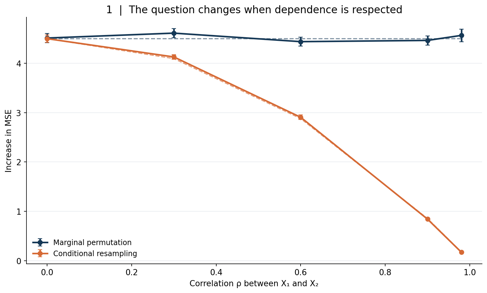
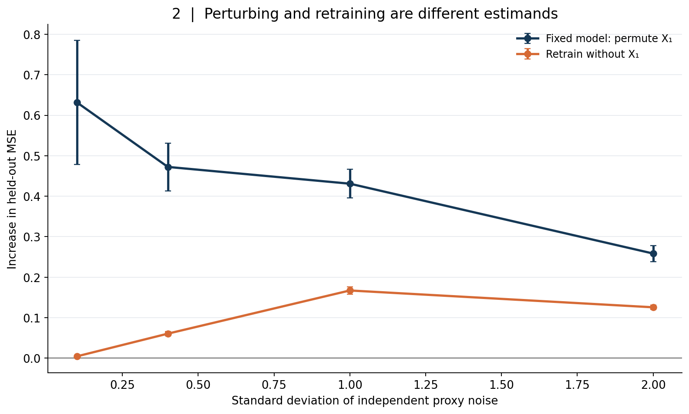
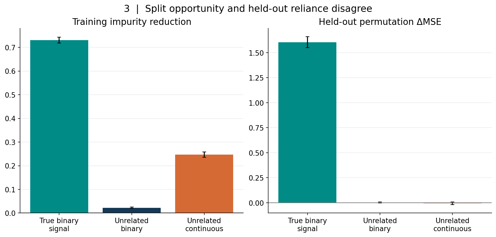
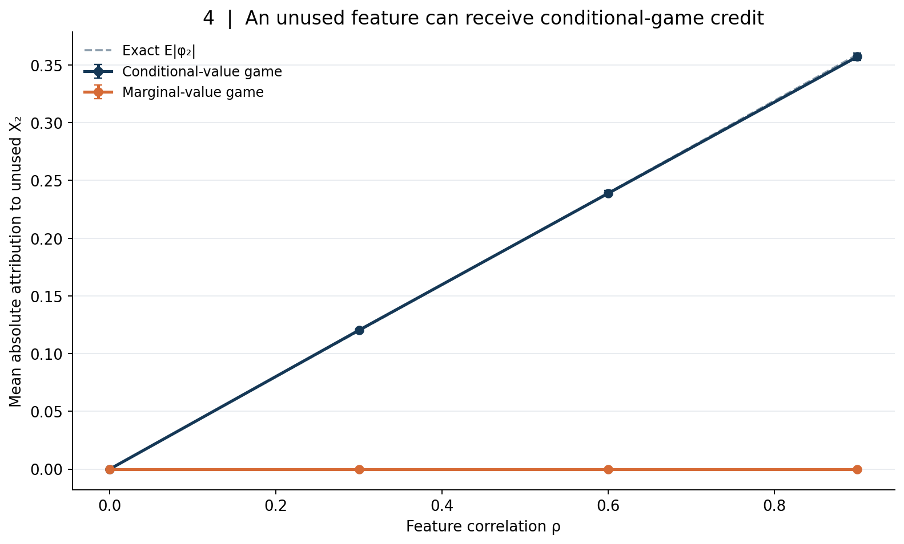
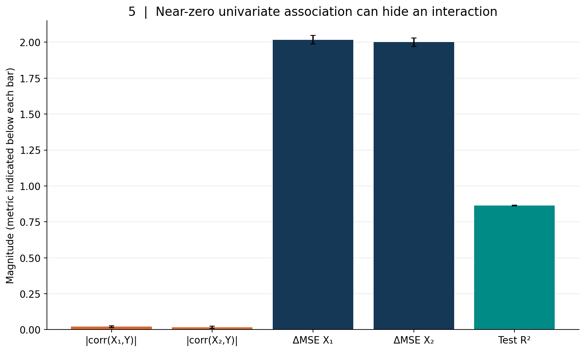
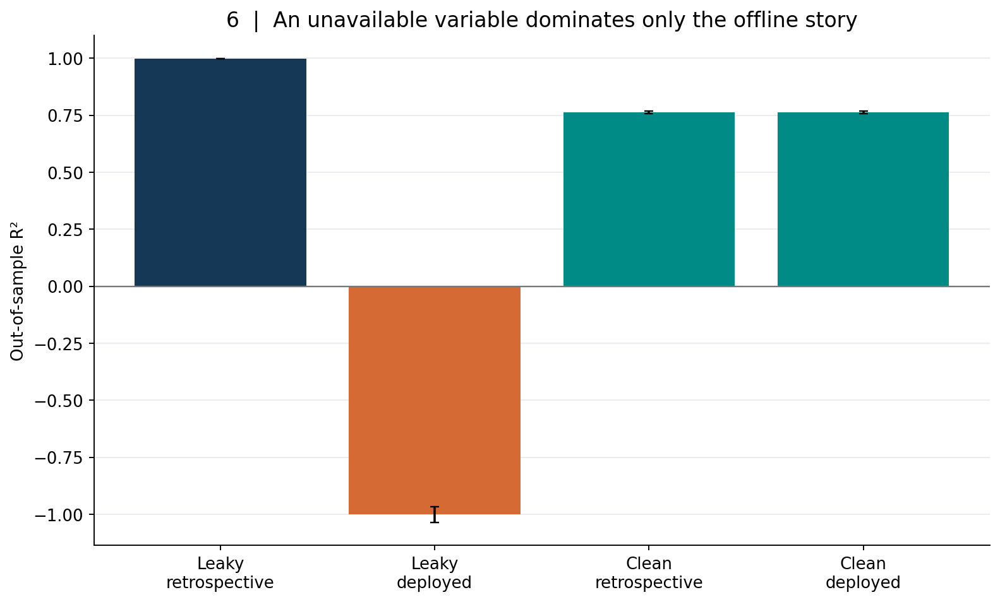
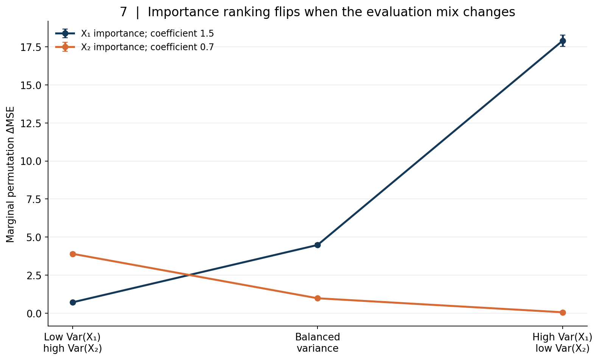
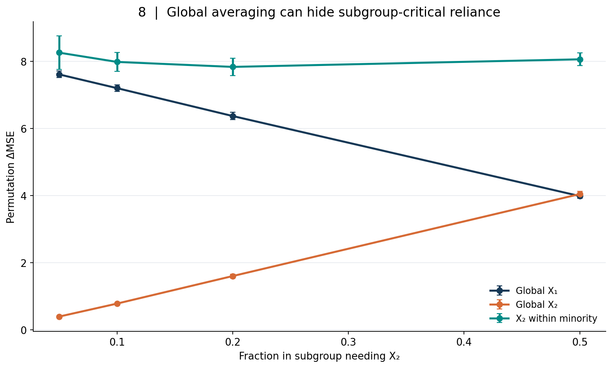
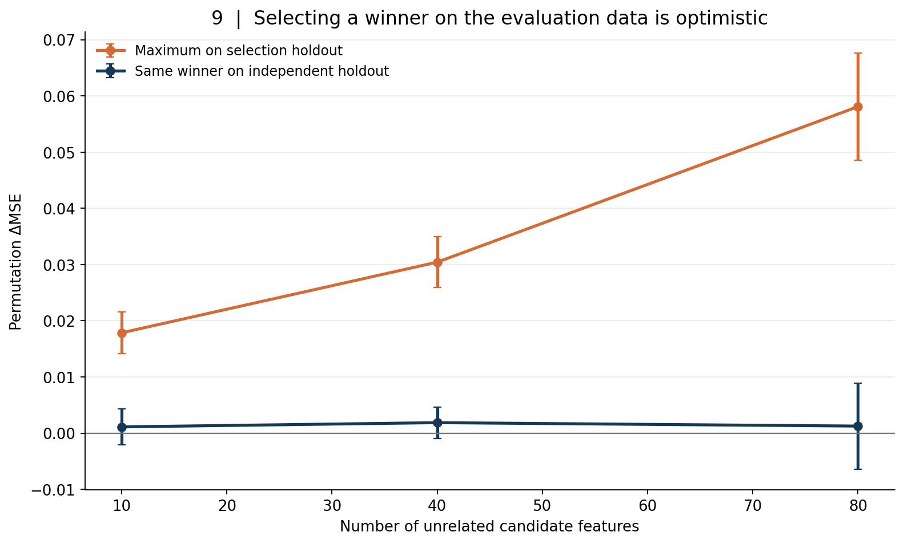

# A Feature Importance Score Is Not a Causal Effect: Permutation, Dependence, and the Limits of Model Explanations

*Article #29 · Predictive modeling, mathematical derivations, and reproducible synthetic experiments · 1 November 2026*

> **Abstract.** A high feature-importance score is often presented as evidence that a variable “drives” an outcome. That language silently crosses at least three boundaries: from a trained prediction rule to a population distribution, from a statistical association to an intervention, and from a particular explanation convention to a property of the world. We distinguish prediction relevance, fixed-model reliance, retraining ablation, coalitional attribution, and causal effects, making their assumptions and targets explicit. Nine independent, seeded synthetic experiments yield nine original publication figures and eighteen versioned CSV tables. They illustrate the contrast between marginal permutation and conditional replacement under correlated predictors; fixed-model permutation versus refitting with redundant proxies; random-forest impurity bias; two mathematically exact Shapley games; pure interactions invisible to marginal correlations; offline leakage that collapses in deployment; shifts in importance under a fixed oracle predictor; global averages hiding subgroup dependence; and optimism when the “most important” null feature is selected using its own validation data. The examples are conditional mathematical demonstrations, not empirical prevalence estimates or causal discoveries. We conclude with a practical protocol for reporting importance without overstating what it measures.

## 1. The moment an explanation becomes an unsupported causal story

Imagine a hospital risk-prediction team presenting a model for readmission. A dashboard orders variables by importance: number of consultations, discharge medication count, age, recent laboratory measurements, and a billing code. The team concludes that increasing consultations “causes” readmissions because consultations sit at the top of the plot. A manager proposes reducing visits. A clinician notices that complex patients require more consultations in the first place. A data engineer notices that the billing code is finalized after the clinical decision. All three are looking at the same model but asking different questions.

The model may predict accurately. Its variable rankings may be calculated exactly as documented. The dashboard may even be exceptionally useful for debugging. None of those facts identifies what would happen if the hospital changed a patient's consultation schedule. Severity could affect both consultations and readmissions; the final billing code could contain later information; and a policy changing visits could shift the patient population seen by the model. An algorithm that recognizes patterns in historical records has not thereby learned a policy experiment.

The phrase “the model thinks X is important” can mean something defensible if it is unpacked. Important **for which trained model**, under **which loss**, evaluated on **which cases**, when **which substitute values** replace X, and with **which other variables** available? Those qualifiers are not bureaucratic detail. They define the mathematical quantity. Removing them can turn a useful answer into a category mistake.

The temptation is understandable. Modern systems output a single neat chart, sometimes labeled “drivers.” Some explanations allocate additive contributions to each input. Others calculate the loss increase when a column is shuffled, or summarize how often a tree split uses a feature. These quantities are related but are not interchangeable. They can rank the same variables differently without either calculation being wrong.

This article develops a more rigorous vocabulary. **Predictive reliance** concerns a fitted function's dependence on input coordinates in a stated evaluation regime. **Predictive information** concerns what can be inferred from variables when an appropriate model is trained. **Attribution** assigns parts of a prediction to features under a defined coalition game. **Causal effect** compares outcomes under hypothetical or real interventions. Once those targets are separated, apparently paradoxical results become predictable consequences of the definitions.

Our experiments are deliberately synthetic. We know the complete data-generating equations and can compare computed quantities against exact answers. That is a strength for illustrating mechanisms and a limit for drawing conclusions about real health, economic, or industrial data. We never claim that the frequency or magnitude of a synthetic failure is the corresponding frequency or magnitude in practice. The empirical question for a particular deployment must be answered with its own population, measurement timeline, and evaluation protocol.

The literature motivating these distinctions includes Breiman's random-forest framework [1], Strobl and colleagues on variable-importance bias [2], Fisher, Rudin, and Dominici on model reliance and alternative good models [3], Lundberg and Lee on Shapley-based explanations [4], Aas and colleagues on dependent features [5], Janzing and colleagues on causal aspects of feature relevance [6], Hooker, Mentch, and Zhou on extrapolation from unrestricted permutation [7], and Kaufman and colleagues on leakage [8]. We cite the original papers rather than treating an implementation's default settings as a scientific definition.

## 2. Five distinct questions that an “importance” plot may answer

Let \(X=(X_1,\ldots,X_p)\) be measured features and \(Y\) an outcome. Let \(P\) denote the joint distribution relevant to evaluation. We train a prediction rule \(\hat f\) using a designated training sample, choose a loss \(\ell(y,\hat y)\), and evaluate on observations not used to fit that rule. Even here, there are several possible targets.

**Question A: fixed-model reliance.** If we keep \(\hat f\) fixed but replace one coordinate of its evaluation data, how much does the expected loss change? Classical held-out permutation importance approximates a version of this question. It can be useful for explaining an existing deployed model, and its units are units of loss. It does not ask what another model could learn after the variable is removed.

**Question B: predictive information after retraining.** If an organization stops collecting \(X_j\) and retrains an otherwise comparable learning procedure, how much predictive performance is lost? This is a different operational question. Other correlated variables can compensate, hyperparameters may change, and a new model can reorganize its representation. Sometimes the performance cost is almost zero although the old model appears highly reliant on that feature.

**Question C: within-model split credit or coefficient magnitude.** A random forest can aggregate decreases in node impurity attributable to splits, and a linear model exposes fitted coefficients. These are measurements of particular model structures and fitting procedures. A coefficient's magnitude also depends on variable units, regularization, and other regressors. A split statistic is not a universal measure of marginal information.

**Question D: an allocated explanation of a particular prediction.** An additive Shapley explanation distributes a difference between a prediction and a chosen reference value across features. Its answer depends on a coalition value function: for a missing variable, do we average independently, condition on the observed variables, sample from a structural model, or use another semantics? Different games can assign different credit while each satisfies its own mathematical rules.

**Question E: a causal effect of intervention.** Would the outcome change if an action set \(X_j\) to a different value, all other relevant mechanisms responding as they would under that intervention? This target requires a well-defined action and identification assumptions, typically knowledge about confounding, time order, sampling, consistency, and interference. It is not generally recoverable from a predictor's importance.

Consider a bank that predicts loan default using monthly income, debt payments, and an internal risk flag. The flag may be highly important to the existing scoring program, yet redundant with detailed repayment history if the program were rebuilt. It may also reflect a prior underwriting decision rather than a cause of default. A credit decision that changes the flag in a database without changing the borrower's obligations may have no direct effect on repayment. Altering borrowing costs is a different intervention altogether.

One output cannot safely answer all five questions. The first practical step is to select one question and write its estimand before running an explanation package. The second is to state whether the evaluation target is a model, a learning process, a sampling population, an operational decision, or a causal intervention. The third is to use language that does not cross the selected boundary.

## 3. Define the loss, population, model, and replacement operation

For squared-error regression, define the population risk of a fixed predictor \(f\) as

\[
R_P(f)=\mathbb E_P[(Y-f(X))^2].
\]

For binary classification, the same structure might use log loss, Brier score, or another decision-relevant loss. Different losses value errors differently. If a costly false negative matters far more than a false positive, a thresholded business loss may tell a different importance story from accuracy. An importance ranking without the loss is incomplete.

Let \(X'_j\) be an independent draw from the marginal distribution \(P(X_j)\), independent of the evaluation pair \((X,Y)\). Define the perturbed vector

\[
X^{\pi(j)}=(X_1,\ldots,X_{j-1},X'_j,X_{j+1},\ldots,X_p).
\]

For a fixed fitted function, marginal replacement reliance is

\[
\Delta^{\mathrm{marg}}_j(f;P)
=\mathbb E\left[\ell\{Y,f(X^{\pi(j)})\}
                 -\ell\{Y,f(X)\}\right].
\tag{1}
\]

The expectation is over the original evaluation observation and the independent replacement. In finite data, randomly shuffling a column approximates this construction. With no replacement, sampling variability, or implementation error, the formula is a well-defined property of the triple \((f,P,\ell)\) and the replacement convention. It is not an intrinsic, model-independent property of \(X_j\).

Equation (1) can be negative. A maladapted model may do better after a feature is perturbed, particularly under distribution shift. A negative estimated increase can also arise from sampling variation. It is therefore unsafe to clip every negative value to zero and report it as a statement that the variable is intrinsically useless. The sign itself can be diagnostic.

Dependence complicates the interpretation. If \(X_1\) and \(X_2\) are strongly correlated, replacing \(X_1\) with an unrelated draw can generate combinations the original population almost never produces. A model is then queried off its usual support. The resulting risk may mix information about reliance with its extrapolation behavior. Hooker, Mentch, and Zhou make this issue central in their analysis of unrestricted permutation [7].

An alternative is conditional replacement. Draw \(\widetilde X_j\) from the conditional distribution \(P(X_j\mid X_{-j})\), independently of the original \(X_j\) and \(Y\) given \(X_{-j}\). Then define

\[
\Delta^{\mathrm{cond}}_j(f;P)
=\mathbb E\left[\ell\{Y,f(X_{-j},\widetilde X_j)\}
                 -\ell\{Y,f(X)\}\right].
\tag{2}
\]

This keeps the replacement statistically compatible with the other observed coordinates if the conditional distribution is correctly specified. But it answers a different question. As \(X_j\) becomes almost deterministically recoverable from the remaining features, conditional replacement changes very little. Conditional reliance can approach zero even when the model explicitly uses \(X_j\) and its underlying physical quantity is crucial to predicting \(Y\).

Neither operation is automatically a causal intervention. An independent marginal draw is an artificial operation on a feature vector; a conditional draw is a statistically compatible artificial operation. A real intervention may also change downstream variables, constraints, and the distribution of people or units who receive it. We will return to those differences after examining the mathematical experiments.

## 4. Experiment 1: when marginal and conditional importance diverge

Take standardized Gaussian variables \((X_1,X_2)\) with correlation \(\rho\), and define an oracle response

\[
Y=\beta X_1+\varepsilon,\qquad
\varepsilon\perp (X_1,X_2),\quad
\mathbb E\varepsilon=0.
\]

Use the oracle prediction function \(f(x_1,x_2)=\beta x_1\). There is no parameter estimation issue: the model is precisely correct under this artificial generator. For squared error, the baseline risk is \(\mathbb E\varepsilon^2\). If we independently replace \(X_1\) with \(X'_1\),

\[
Y-f(X'_1,X_2)=\beta(X_1-X'_1)+\varepsilon.
\]

The cross terms vanish by construction, and the variance of a difference of independent standard normals is two. Therefore,

\[
\Delta^{\mathrm{marg}}_1=2\beta^2.
\tag{3}
\]

This expression does not contain \(\rho\). The fixed oracle rule relies on the coordinate \(X_1\), and the unrestricted replacement destroys its value regardless of how strongly another feature could predict it.

For a Gaussian pair, the conditional distribution is

\[
X_1\mid X_2=x_2
\sim \mathcal N(\rho x_2,\,1-\rho^2).
\]

Two independent conditional draws given \(X_2\) differ with variance \(2(1-\rho^2)\). Keeping the original outcome unchanged and inserting a fresh conditional draw into the same oracle therefore gives

\[
\Delta^{\mathrm{cond}}_1=2\beta^2(1-\rho^2).
\tag{4}
\]

The two formulas agree at zero correlation and diverge as \(|\rho|\) increases. The conditional target tends to zero as the redundant measurement becomes nearly deterministic. The marginal target remains \(2\beta^2\). Neither result contradicts the other. They ask how much the fixed rule suffers under *different replacements*.

*Figure 1. Oracle squared-error risk increase under two replacement games. Solid points show means across 24 independent outer simulations; error bars represent ±1.96 Monte Carlo standard errors. Dashed curves are exact Gaussian identities, not fitted trends. The features and outcomes are synthetic.*

Our canonical experiment sets \(\beta=1.5\), noise standard deviation \(0.8\), 1,500 observations per replicate, and five correlations from zero to \(0.98\). At \(\rho=0.98\), the recorded mean marginal increase is **4.565**, versus the exact **4.5**. The conditional increase is **0.173**, versus **0.1782**. The marginal score is more than twenty-six times the conditional one in this setting. That ratio is not a universal property of high correlations; it follows from the particular oracle, Gaussian distribution, and two replacements.

There is an additional subtlety. Because \(X_2\) is a proxy for \(X_1\), a new model trained without \(X_1\) might still predict much of \(Y\). That would answer Question B, not Equation (1) or (2). We should not move from “conditional replacement changes little” to “the feature has no practical or causal role,” or from “unrestricted permutation changes much” to “intervening on the feature will change the outcome by this amount.”

The term *conditional permutation importance* is sometimes used for implementations that approximate the conditional distribution through partitions, permutations within strata, or sampling models. Approximation quality matters: a misspecified conditional sampler may reintroduce off-support combinations or remove variation that truly exists. In a real dataset, neither the Gaussian conditional formula nor our exact generator is usually given. The harder problem is estimating the target reliably, not merely writing Equation (2).

## 5. Experiment 2: redundancy separates model reliance from necessity

Now create a latent standardized signal \(Z\) and two noisy measurements:

\[
X_1=Z+\eta_1,\quad X_2=Z+\eta_2,\quad
Y=Z+\varepsilon,
\]

where \(\eta_1,\eta_2\) are independent measurement noises with common standard deviation \(s\), and \(\varepsilon\) is independent outcome noise. The two proxy measurements have population correlation \(1/(1+s^2)\). We fit ridge regression to both measurements and assess it on independently generated test observations.

We compare two operationally distinct experiments. In the first, hold the full-model coefficients fixed and shuffle \(X_1\) on the test data. In the second, delete \(X_1\), refit ridge to \(X_2\) alone on the original training observations, and evaluate the reduced model on the same test outcomes. Both report an increase in test mean squared error relative to the original full model, but one damages an existing rule while the other allows adaptation.

*Figure 2. Two interventions on the modeling workflow, not interventions on the latent outcome mechanism. Lines are 24-replication means; bars are Monte Carlo error intervals. The noisy measurements and outcomes are synthetic.*

At \(s=0.1\), the observed proxy correlation averages **0.9904**. Permuting \(X_1\) increases MSE by **0.632** on average, but retraining without it increases MSE by only **0.00434**. The second proxy almost entirely compensates in this design. At \(s=1.0\), correlation falls to about **0.505**, and the two increases are **0.431** and **0.167**. The consequences of removing a measurement now become more substantive.

This is not a trick that makes importance meaningless. Rather, it reveals that **model reliance** and **feature indispensability to a learning process** are different quantities. A clinician might care about dependence of a currently deployed program on a laboratory result. A hospital procurement team might care about the incremental cost of dropping that test and rebuilding a classifier. Both are legitimate, but the required analyses differ.

The refit experiment also depends on the learning protocol. We fixed the ridge penalty at 2.0 and used the same training sample for the full and reduced models. If we retuned regularization separately, changed the model class, collected more training observations, or allowed a new proxy, the ablation answer could change. Inference about the availability of a variable should model the actual retraining process, not an idealized ability to readjust everything for free.

With perfectly redundant predictors, importance allocation becomes a coordination problem. A fitting algorithm can distribute weight across identical columns according to regularization, initialization, numerical details, or parametrization. A feature may look dispensable after retraining precisely because the data contain a replacement. From that statement one cannot infer that changing the physical quantity represented by both measurements has no effect on an outcome.

## 6. A coefficient, an impurity score, and a loss increase have different units

A linear model \(f(x)=\beta_0+\sum_j\beta_jx_j\) exposes coefficients. A one-unit increase in \(x_j\) while other coordinates are algebraically held fixed changes the model prediction by \(\beta_j\). This is a property of the function. It is not a claim that such a one-unit change can occur without changing other variables, or that the observed coefficient identifies a structural response.

Rescale a feature from meters to centimeters. The coefficient changes by a factor of 100 even though the model's predictions do not. Standardizing variables can make magnitudes more comparable, but the standardized coefficient still depends on the population variance, correlations, fitting objective, and regularization. It is not an intervention effect merely because it has become dimensionless.

In a regression tree, split importance often starts from a reduction in within-node squared-error impurity. Suppose a node \(t\) contains weighted observations and a split into children \(t_L,t_R\). Its unnormalized reduction has the form

\[
I(t,j)=w_t\,H(t)-w_{t_L}H(t_L)-w_{t_R}H(t_R),
\]

for impurity \(H\) and split feature \(j\). Summing \(I(t,j)\) across trees and normalizing gives a mean-decrease-in-impurity style importance. For random forests, the exact implementation details depend on the tree-learning procedure and weighting, but the statistic fundamentally allocates *training split reductions* [1].

Variables with many possible split points can receive a different kind of opportunity to fit accidental sample variation than binary variables with few splits. Training impurity is also optimized by the same algorithm that reports its reduction. These concerns motivate the bias analysis by Strobl and colleagues [2]. A normalized impurity score adding to one cannot be directly compared numerically to a change in test MSE; the two are in different units.

## 7. Experiment 3: a continuous noise variable wins training split credit

We create three independent columns: a genuinely informative binary signal, an unrelated binary noise feature, and an unrelated continuous Gaussian feature. The outcome is a multiple of the binary signal plus independent noise. There is no hidden relationship between either nuisance feature and the outcome in the generator. A random-forest regressor is trained on 440 observations and tested on a separate 850, with 90 trees, a controlled depth and minimum leaf size, and independent seeds for each of 18 outer replications.

The design permits a clean comparison. One part of the figure reports the trained forest's normalized impurity importance. The other reports the test MSE change after shuffling the feature in a fixed trained forest. The bars must be read **within** their panels, not against each other on an imagined common scale.

*Figure 3. Training split-credit and held-out risk have different units. The unrelated continuous feature receives much more impurity credit than the unrelated binary feature, while both have near-zero average held-out permutation value. All three columns are synthetic, and the informative variable is binary.*

The average impurity fractions are **0.731** for the true signal, **0.0225** for binary noise, and **0.247** for continuous noise. Despite having no predictive relationship in the population, the continuous noise column receives more than ten times the split credit of the binary noise column. Its mean held-out permutation MSE change is **−0.0059**, while binary noise has **0.0018**. The signal's held-out change is **1.605**.

The negative nuisance score does not show that changing the noise column would improve the world. It shows that, under this sample and fixed fitted forest, replacing that column in an independent test set produces an average error difference slightly below zero. Both nuisance values are small relative to the signal; their Monte Carlo intervals include zero. If we made the forest shallower, used a different split criterion, changed sample size, or evaluated in another distribution, the observed magnitudes could differ.

A practical lesson follows: do not infer data-generating importance from split frequency or impurity credit alone. Audit the feature type and cardinality, training selection behavior, independent test error, and conditional dependence. Conversely, don't declare held-out permutation infallible: it has its own perturbation and distribution assumptions. A model can be harmed by unrealistic input combinations even when a feature is not causally operative.

## 8. Shapley attribution answers a coalition game, not every explanation question

Shapley values originate in cooperative game theory [9]. A coalition \(S\) is a subset of the feature indices, and a value function \(v(S)\) assigns a number to the available subset. The Shapley value for coordinate \(j\) is

\[
\phi_j=\sum_{S\subseteq N\setminus\{j\}}
\frac{|S|!(p-|S|-1)!}{p!}
\left[v(S\cup\{j\})-v(S)\right],
\tag{5}
\]

where \(N=\{1,\ldots,p\}\). The weights average a feature's incremental contribution over permutations of the feature ordering. Under a given value function, the allocation obeys familiar efficiency and symmetry properties. Lundberg and Lee gave a highly influential unified framework for additive model explanations [4].

Equation (5) alone does not identify the value function. For an explanation of \(f(x)\), what prediction should we assign to a subset \(S\) that reveals only \(x_S\)? The unknown coordinates are not actually unknown to the fitted model, which expects all its inputs. We must construct a reference operation.

An *interventional* or marginal-value game is often defined as

\[
v_{\mathrm{marg}}(S)
=\mathbb E_{X_{\bar S}}[f(x_S,X_{\bar S})].
\tag{6}
\]

The missing coordinates are sampled from their unconditional joint marginal distribution, ignoring the statistical link between the present \(x_S\) and missing \(X_{\bar S}\). An *observational* or conditional-value game uses

\[
v_{\mathrm{cond}}(S)
=\mathbb E[f(X)\mid X_S=x_S].
\tag{7}
\]

These are not synonymous. The latter can allocate credit to a feature because it predicts another feature that the model actually reads. The former can query combinations that are rare under a dependent joint distribution. Aas, Jullum, and Løland analyze the importance of dependence assumptions for individual predictions [5], while Janzing, Minorics, and Blöbaum directly examine the causal choices implicit in feature-relevance constructions [6].

The common term *interventional SHAP* does not magically convert Equation (6) into a causal effect of doing something in the world. Its intervention concerns a reference distribution used to evaluate a fitted function, unless a separately justified structural causal interpretation is supplied. An explanatory coalition is not the same as a physically feasible treatment assignment.

## 9. Experiment 4: two exact games disagree about a feature the model never reads

Consider the simplest possible black-box predictor:

\[
f(x_1,x_2)=x_1.
\]

The function never consults \(x_2\). The two features are centered, standardized jointly Gaussian variables with correlation \(\rho\). For the marginal-value game, \(v(\varnothing)=0\), \(v(\{1\})=x_1\), \(v(\{2\})=0\), and \(v(\{1,2\})=x_1\). The two-feature Shapley formula gives

\[
(\phi_1^{\mathrm{marg}},\phi_2^{\mathrm{marg}})=(x_1,0).
\tag{8}
\]

For the conditional-value game, knowing \(x_2\) alone predicts the conditional mean of \(X_1\): \(v(\{2\})=\rho x_2\). The other coalition values are unchanged, so

\[
(\phi_1^{\mathrm{cond}},\phi_2^{\mathrm{cond}})
=\left(x_1-\frac{\rho x_2}{2},\frac{\rho x_2}{2}\right).
\tag{9}
\]

Each pair adds up to the same prediction difference from the zero reference value. Each is the exact result of the specified game. Yet the second gives a nonzero attribution to a feature absent from the model's functional formula. This is not a coding defect and not evidence that \(x_2\) causes the output. It reflects that, in the observational game, \(x_2\) carries information about \(x_1\).

Since \(X_2\) is standard normal, the mean absolute conditional attribution to the unused feature is

\[
\mathbb E|\phi_2^{\mathrm{cond}}|
=\frac{|\rho|}{2}\sqrt{\frac{2}{\pi}}
=\frac{|\rho|}{\sqrt{2\pi}}.
\tag{10}
\]

*Figure 4. Means across 24 independent Gaussian replicates, compared with the exact Equation (10). The model is f(x)=x₁ and has no direct functional dependence on x₂. The attribution difference is caused solely by the value function.*

At correlation \(0.9\), the recorded mean absolute observational attribution to \(X_2\) is **0.357**, close to the exact **0.359**. Marginal-game attribution is identically zero in every replication. The maximum numerical violation of additivity is at floating-point roundoff. We did not need to install a particular SHAP package: a two-feature game can be enumerated exactly, which makes the semantic difference transparent.

Which answer is “right”? If we ask which coordinate the implemented function actually reads, Equation (8) aligns with that functional notion. If we ask how observed features convey information about a prediction under the empirical joint distribution, Equation (9) has a meaningful interpretation. If we ask what changing \(X_2\) would do to \(Y\) or even to \(X_1\), neither gives the answer without a causal model. The dispute dissolves once the question is explicit.

## 10. Interaction: a feature may matter jointly while looking irrelevant alone

Many importance screens begin with separate correlations between each feature and the outcome. That is tempting because correlations are cheap, familiar, and easy to visualize. A zero Pearson correlation is a statement about linear marginal association under a distribution; it is not a guarantee that the feature is irrelevant to predicting an outcome jointly with other variables.

Let \(X_1,X_2\) be independent Rademacher variables, each taking \(-1\) and \(+1\) with equal probabilities. Define

\[
Y=X_1X_2+\varepsilon,
\]

where \(\varepsilon\) is independent, centered Gaussian noise. Then

\[
\operatorname{Cov}(X_1,Y)
=\mathbb E[X_1^2X_2]
=\mathbb E[X_2]=0,
\]

and symmetrically \(\operatorname{Cov}(X_2,Y)=0\). Knowing either feature by itself does not change the conditional mean of the outcome. Knowing both recovers the interaction term exactly except for noise. The same logic appears in XOR-style classification problems.

For a fixed oracle \(f(x)=x_1x_2\), independently replacing one balanced feature changes the product on roughly half the observations. The squared-error risk increase is two in the population when each feature takes values \(\pm1\). A depth-two decision tree can represent the four interaction cells and recover much of the signal even though a screening rule based on marginal correlations would reject both features.

*Figure 5. A depth-two regression tree learns a pure interaction from independent binary inputs. Bars display different statistics by explicit label and should not be treated as a single common estimand. Error bars show 24-replication Monte Carlo variation.*

In the canonical experiment, each replicate uses 850 training and 1,200 test observations, with noise standard deviation \(0.4\). The average absolute test correlations are approximately **0.0205** for \(X_1\) and **0.0162** for \(X_2\). Yet the test permutation MSE increases are **2.017** and **2.000**, and the average test \(R^2\) is **0.863**. The tree has learned a useful joint mapping in a case where each single-variable linear relationship is absent by construction.

There is an interpretive distinction here too. Importance of \(X_1\) is conditional on the model having \(X_2\). Without the second input, the interaction has no predictable conditional mean. Feature selection is therefore not always a sequence of independent yes/no judgments. It can involve groups, interactions, transformations, and measurement bundles. A global top-ten bar chart can fail to reveal these structural dependencies even when its individual computations are correct.

The interaction experiment does not demonstrate that both physical inputs are manipulable causes. In our synthetic equation they enter the constructed outcome mechanism, but a similar statistical pattern in observational data could be generated by an unmeasured variable, a recording convention, or selection. The correct conclusion is about model capacity and marginal screening, not causal identification.

## 11. Leakage is a timeline error masquerading as explanatory power

Suppose a company wishes to predict whether an order will be canceled before it ships. Its historical table includes a customer profile, order attributes, and a final customer-service resolution code. The resolution code is predictive because it was created after the cancellation decision. Randomly splitting historical rows into train and test sets does not repair the error; both sets still contain the future code. The model could achieve nearly perfect retrospective scores and fail the moment it is used at the intended decision time.

Kaufman, Rosset, Perlich, and Stitelman formalize leakage as a serious issue in data mining [8]. In a deployed system, the important question is whether a value could have been observed, computed, or legally used **as of prediction time**. Temporal order alone is not sufficient: a column can be stored with an old date yet derive from a later correction; a training process can inadvertently use aggregate statistics computed using future records; a label proxy can be created by a downstream decision. The origin, timestamp, and access path of each feature matter.

Leakage interacts with interpretation in a dangerous way. An explanation method is usually faithful to the trained program's behavior. If the program relies heavily on leaked information, importance can correctly highlight the leaked column. The mistake is to treat that faithful diagnosis as evidence that a pre-decision intervention on the variable would change the outcome. The variable may encode the outcome itself.

We construct a stable signal \(X\sim\mathcal N(0,1)\) and a response

\[
Y=1.8X+\varepsilon,\qquad \varepsilon\sim\mathcal N(0,1).
\]

Create a leaky measurement \(L=Y+\nu\), where \(\nu\sim\mathcal N(0,0.1^2)\). In retrospective tables, \(L\) is nearly a copy of the target. Fit a ridge model using \((X,L)\) on training data. Independently fit a clean ridge model using only \(X\). Both are evaluated first on held-out retrospective rows. For the deployment scenario, keep \(X\) and \(Y\) unchanged but replace the no-longer-available \(L\) with independent noise of comparable broad scale. The leaky model is still fixed, as it would be before an unanticipated deployment failure.

*Figure 6. Twenty-four independent synthetic train/test replicates. The leaky program works on retrospective rows containing an outcome-derived feature, then is evaluated in a setting where that feature is not available. The clean program uses only pre-outcome signal. No actual patients, orders, or policy outcomes are involved.*

The average retrospective \(R^2\) of the leaky model is **0.9976**. In the synthetic deployment scenario it drops to approximately **−1.001**. Negative \(R^2\) is possible because squared error can exceed the error of predicting a constant test-set mean. By comparison, the clean model averages **0.7629** both retrospectively and in the synthetic deployment scenario. Those outcomes follow directly from what the models are allowed to observe.

This does not mean a deployed feature will always be replaced by random noise; often it will be missing, stale, imputed, or available only for some units. The particular replacement is a diagnostic stress test, not a realistic availability model for every industry. In practice one must specify the actual fallback behavior and assess it with a representative prospective or time-respecting evaluation. A model that errors on missing values may fail in an even more obvious way.

A useful review asks five timing questions. When is the prediction issued? When did each feature become available? Was its value revised after the fact? Could its calculation see any target-window data? Would an online service produce the same feature version as the offline training pipeline? A lineage graph with “as-of” joins can answer these questions more reliably than a variable-name inspection.

Feature importance can help catch leakage, because an implausibly dominant variable invites scrutiny. But passing an explanation audit does not certify that the pipeline is temporally valid. One must test data provenance independently, and performance must be assessed under actual information constraints. The best importance method in the world cannot rescue a model trained on information it will never possess.

## 12. Experiment 7: the same model changes its importance ranking without changing its coefficients

Feature importance is not solely a property of the coefficients or the program. It also depends on the distribution of cases on which the program is interrogated. To isolate this, we use another exact oracle:

\[
f(x_1,x_2)=1.5x_1+0.7x_2,\qquad
Y=f(X)+\varepsilon.
\]

The coefficients, noise law, loss function, and functional form remain fixed. We change only the marginal standard deviations \(s_1,s_2\) of two independent Gaussian inputs. Applying the same derivation as Equation (3), for \(j=1,2\),

\[
\Delta^{\mathrm{marg}}_j
=2\beta_j^2\,\operatorname{Var}(X_j)
=2(\beta_js_j)^2.
\tag{11}
\]

Importance depends on both sensitivity per unit and the amount of variation encountered in the evaluation distribution. A relatively small coefficient can dominate the importance ranking if its feature varies over a sufficiently wide range; a large coefficient can contribute little measured risk in a nearly constant population.

Our three environments use standard deviations \((s_1,s_2)=(0.4,2.0)\), \((1.0,1.0)\), and \((2.0,0.25)\). The corresponding exact marginal risk increases are:

| Evaluation environment | X₁ theoretical ΔMSE | X₂ theoretical ΔMSE | Higher reliance |
| --- | ---: | ---: | --- |
| Low X₁, high X₂ variance | 0.720 | 3.920 | X₂ |
| Balanced variances | 4.500 | 0.980 | X₁ |
| High X₁, low X₂ variance | 18.000 | 0.0613 | X₁ |

*Figure 7. The same oracle prediction rule and noise mechanism in all three environments. Only evaluation covariate scales change. Error bars show 24 outer-replication Monte Carlo uncertainty around observed loss increases.*

The observed means align with the derivation: **0.715** versus **3.903** in the first environment, and **17.898** versus **0.0609** in the last. The order reverses even though the larger coefficient remains 1.5 in every experiment. This is a distributional statement, not evidence that the model's structural “reasoning” changed.

Consider a logistics model trained on shipment weight and travel distance. In a local delivery sample, distance barely varies; among intercontinental routes it varies enormously. A feature ranking from one sample may not transfer to the other, even if the model's mapping is identical and calibrated in both. Similarly, global importance estimated over a large customer population is not necessarily the importance for a small, safety-critical subgroup.

There are several kinds of shift. **Covariate shift** changes the input distribution, possibly without changing the conditional outcome law. **Concept or mechanism shift** changes the outcome relationship itself. **Label shift** changes outcome proportions under further conditions. Our experiment isolates a change in input variances under a fixed correct oracle. It does not establish how performance or ranking behaves under every other form of shift. In an actual deployment, importance may change because of a new population, a changed relationship, an altered measurement process, or a degraded model. Those causes require different responses.

It is often useful to report importance on more than one explicitly defined evaluation population: the full target population, a recent time window, relevant geographic or equipment strata, and anticipated stress scenarios. If a model serves multiple decisions, weights can be chosen to reflect each decision's case mix. An unweighted average over a convenience dataset is not a neutral default.

## 13. Experiment 8: a minority-critical feature can look globally unimportant

Now suppose there are two groups \(G\in\{0,1\}\). In group 0 the outcome depends on \(X_1\); in group 1 it depends on \(X_2\). Let \(q=P(G=1)\), let both features be independent standard normals, and define

\[
f(X,G)=2(1-G)X_1+2GX_2,\qquad
Y=f(X,G)+\varepsilon.
\]

Again, the model is an oracle, so fitting error cannot explain what follows. Under independent marginal replacement, the global reliance on \(X_2\) is

\[
\Delta^{\mathrm{global}}_2=8q,
\tag{12}
\]

because only the fraction \(q\) of cases uses that input, and the within-group increase is eight. Evaluating solely among group-1 observations yields

\[
\Delta^{G=1}_2=8.
\tag{13}
\]

Likewise, global reliance on \(X_1\) is \(8(1-q)\). When the minority group is 5% of cases, the globally averaged relevance of \(X_2\) is only \(0.4\), whereas its subgroup-specific relevance is eight. A global chart can make a feature seem marginal even though the relevant subgroup is severely harmed when it is perturbed.

*Figure 8. Subgroup share varies from 5% to 50%; all coefficients and feature distributions are fixed. The plot separates a population-weighted average from conditional subgroup risk, using 24 seeded synthetic replicates.*

At \(q=0.05\), mean global importance of \(X_2\) is **0.392** while its mean importance among group-1 cases is **8.258**. The latter is more variable across replications because only about 125 of 2,500 observations belong to that subgroup. At equal group proportions, global importances of the two features are about four each, while the subgroup-specific \(X_2\) value stays close to eight.

These results do not prove a fairness violation or quantify real-world harm. A feature's importance is not the same as an error rate, access disparity, or utility loss. But they show why global aggregates can be insufficient for evaluating systems used by heterogeneous populations. When the cost of failure varies across groups, an unweighted global MSE average can understate the relevance of a rare but costly scenario.

The remedy is not merely to compute more plots. First define the groups relevant to the deployment decision; then ask whether group membership is legitimately observed at prediction time; then report subgroup sample sizes, uncertainty, model performance, and importance under a documented replacement. Avoid selecting groups after seeing a favorable explanation. When a group is genuinely tiny, uncertainty may be large and privacy restrictions may limit reporting. The correct result may be “not enough information to estimate subgroup reliance reliably.”

If importance is used to decide which sensors to remove, a procurement committee should consider the worst credible subgroup losses and the operational coverage of each sensor. A sensor that matters on only one percent of days may be essential on exactly those days. The same principle applies to seasonal weather variables, rare medical presentations, financial crises, and safety interlocks. Average predictive reliance is an average over a *specified* case mix, not a warranty for every scenario.

## 14. Experiment 9: choosing an importance winner on its own holdout is optimistic

Even a perfectly independent test set can be misused. Suppose a model is fitted on one sample, and an analyst evaluates dozens of nuisance variables on a second sample. The analyst publishes the variable with the largest positive permutation score and treats that score as an unbiased measure of its importance. But the same second sample was used for **selection** and **reporting**. The reported winner has benefited from random estimation noise.

Formally, write the estimated score for feature \(j\) as

\[
\widehat\Delta_j=\Delta_j+\epsilon_j,
\]

where \(\epsilon_j\) represents finite-sample noise. If all true scores are zero and the errors are roughly centered, the maximum

\[
\max_{1\le j\le p}\widehat\Delta_j
\]

typically exceeds zero. The exact expectation depends on the dependence and distribution of estimation errors. Under an idealized independent Gaussian approximation, the maximum tends to increase on the order of \(\sigma\sqrt{2\log p}\), but our ridge-permutation experiment does not assume those errors are independent Gaussian variables. We use the analogy only to explain why more opportunities create more apparent winners.

In the simulation, the training outcome is independent standard-normal noise, and every candidate feature is independent normal noise. We fit ridge regression to 180 training observations with \(p=10,40,\) or \(80\) nuisance columns. On 250 held-out observations, we compute each variable's permutation MSE change and choose the maximum. Then we take **that same fitted model and chosen feature**, evaluate its permutation effect on a new independent set of 800 observations, and compare the two estimates. Each scenario is independently repeated 24 times.

*Figure 9. The reported winner was selected using one evaluation sample and then checked, without re-selection, on another. The outcome has no population association with any feature. Error bars are across independent outer repetitions.*

The average selected-holdout score rises from **0.0179** with ten candidates to **0.0304** with forty and **0.0581** with eighty. On the independent verification set, the corresponding means are **0.0011**, **0.0019**, and **0.0013**. The apparent winner's value largely vanishes. These magnitudes are tied to our ridge penalty, sample sizes, noise scale, and perturbation scheme; the mechanism, not the numeric size, is the general lesson.

This example is especially important for exploratory dashboards where analysts repeatedly sort, filter, and inspect importance plots. Each round of human or automated selection may consume part of the evaluation sample's independence. If the feature choice informs publication, product decisions, or compliance claims, an untouched verification sample or a properly nested resampling protocol is needed. A bootstrap interval computed after selecting the winner on the same data will not automatically correct the selection event.

There is also a distinction between **screening** and **confirmatory evidence**. Screening can be broad and exploratory, provided it is labeled as such. Confirmation requires a predeclared score, population, model-fitting procedure, feature selection rule, and appropriate uncertainty handling. One might screen on a development set, freeze a feature shortlist and model, then estimate importances with uncertainty on a new test set. For high-dimensional correlated candidates, permutation-based p-values and multiple-testing adjustments require assumptions beyond a sorted bar chart; merely repeating random shuffles is not an independent replication.

Under the null generator, ridge can fit accidental training coefficients, so a fixed fitted model can react to noise variables. The key point is that such reactions do not create population predictive information about \(Y\). The first holdout's maximum overstates the quality of the particular chosen explanation. A feature's score can also drift with new data simply because the estimated function changes. A careful protocol separates model-selection variation, evaluation-sample variation, and population drift instead of calling all three “feature importance uncertainty.”

## 15. A causal effect is an intervention on a system, not a column shuffle

We can now formulate the central distinction without metaphor. Suppose \(A\) is an action, treatment, policy, or controllable exposure, and \(Y(a)\) denotes the potential outcome that a unit would exhibit under a well-defined assignment \(A=a\). A common causal estimand is the average treatment effect

\[
\tau=\mathbb E[Y(1)-Y(0)].
\tag{14}
\]

Equation (14) concerns a contrast between potential outcomes of a system under two interventions. It is not, in general, a coefficient, impurity score, permutation MSE change, or Shapley allocation. The causal question must specify the intervention: changing a value in a database, administering a treatment, moving a sensor, altering a price, and modifying a person's underlying state are different actions even if they are all recorded in the same column.

The potential-outcomes formulation needs assumptions before observations identify \(\tau\). One common route uses consistency of observed outcomes with assigned treatments, conditional exchangeability given appropriately measured pre-treatment covariates, positivity of treatment assignment within those covariate strata, and suitable handling of interference. Under these conditions,

\[
\tau=
\mathbb E_C\!\left[
  \mathbb E(Y\mid A=1,C)
 -\mathbb E(Y\mid A=0,C)
\right],
\tag{15}
\]

where \(C\) is a justified sufficient adjustment set. The adjustment formula involves *outcome contrasts under treatment status* and a covariate distribution; it is not derived by perturbing a trained predictor's feature column independently of its causal relations. If the assumptions fail, the formula does not identify the intended effect.

In structural causal language, consider independent exogenous disturbances \(U_A,U_Y\), pre-treatment covariates \(C\), and equations

\[
A=g(C,U_A),\qquad Y=h(A,C,U_Y).
\]

The intervention \(\mathrm{do}(A=a)\) replaces the first assignment with \(A=a\) while preserving the relevant remaining structural mechanisms. It may change downstream mediators and selection mechanisms. A standard permutation of the recorded \(A\) column while holding every other predictor column fixed does not necessarily implement that operation. In a black-box model containing post-treatment variables, the difference can be especially pronounced.

There is no universal mathematical mapping from \(\Delta^{\mathrm{marg}}_j\) to \(\tau\). The importance score is on a loss scale and often nonnegative for a correct oracle under squared error; the treatment effect is on an outcome scale and can be positive, negative, or heterogeneous. A positive causal effect could have a small importance under rare treatment variation. A variable with zero causal effect could have high importance because it proxies a cause, captures selection, or leaks outcome information.

## 16. Two observational worlds with the same associations but different interventions

To see why prediction cannot settle the question, consider a simple observational association between an exposure \(A\) and outcome \(Y\). In World I, \(A\) is randomly assigned and \(Y=A+U\), with \(U\) independent noise. An intervention that increases \(A\) by one unit increases the expected outcome by one. A regression of \(Y\) on \(A\) also has slope one.

In World II, let \(U\) be a common cause, set \(A=U+\eta_A\), and \(Y=\gamma U+\eta_Y\), with independent noises. There is **no arrow from \(A\) to \(Y\)**. By choosing \(\gamma\) and the noise variances, the observational regression slope and other low-order associations can imitate World I. A predictor can rank \(A\) highly in both worlds. But an intervention that changes \(A\) without changing \(U\) has zero effect on \(Y\) in World II.

For example, let \(\operatorname{Var}(U)=1\), \(\operatorname{Var}(\eta_A)=1\), and \(\gamma=2\). Then \(\operatorname{Cov}(A,Y)=2\), \(\operatorname{Var}(A)=2\), and the population regression slope of \(Y\) on \(A\) is one. The same fitted linear relation can be read as causal in World I only because randomized assignment or another identification strategy has supplied information absent in World II. Merely fitting a more powerful prediction algorithm does not resolve this ambiguity.

The issue is not that machine learning cannot contribute to causal inference. It can estimate nuisance functions, heterogeneous treatment effects, propensities, and other components when embedded in an identified design. The issue is that fitting \(Y\) from historical \(X\), then sorting its features, is not by itself such a design. Causal interpretation requires an additional layer of assumptions and often different data.

The distinction also changes what makes a good feature. A variable measured after treatment may substantially improve outcome prediction but be inappropriate to control for when estimating the total treatment effect. Conditioning on a collider can introduce association that was absent before conditioning. A mediator can encode part of a treatment pathway. A confounder may be indispensable for identification even if it has only modest incremental predictive contribution. Predictive feature selection and causal adjustment-set selection optimize different targets.

This is why “we controlled for the most important variables” is not a credible identification argument. High importance does not prove confounding; low importance does not prove the absence of confounding; and a list chosen by predictive accuracy may omit variables needed to block backdoor paths. Domain knowledge, temporal ordering, measurement validity, and explicit causal assumptions must carry that part of the analysis.

## 17. Dependence and off-manifold inputs: diagnose what your perturbation invents

Return to the correlated Gaussian experiment. A sample from the original joint distribution lies mostly along an ellipse whose orientation reflects \(\rho\). Independently shuffling one column removes the dependence. When \(\rho\) is near one, the resulting pairs often lie far from the high-density diagonal. The importance score tests a trained function on combinations it might never encounter naturally.

This is not always inappropriate. If a robustness specification asks how a program reacts to arbitrary, adversarial, or sensor-corrupted inputs, a break in dependence may be exactly the intended stress test. But if the question is “how much unique predictive information is present beyond other measurements in normal operation,” a conditional replacement may be more aligned with that target. The correct method is determined by the question, not by a universal ranking of explanation algorithms.

For dependent real-world features, conditional simulation can be difficult. A Gaussian conditional approximation may fail for multimodal, bounded, categorical, censored, or structurally constrained variables. A patient cannot be both recorded as pregnant and assigned an incompatible biological code under a valid schema; a machine's rotational speed and torque may occupy a physically constrained region; a basket of financial prices may be tied by accounting identities. Replacing one input independently can create impossible records.

There are several mitigation strategies, each with costs. Conditional sampling can preserve estimated dependencies but is vulnerable to density-model misspecification. Grouped permutation can jointly perturb redundant feature bundles, changing the question from one coordinate to a collection. Retrain-on-removal can quantify incremental predictive opportunity but requires a fair and computationally expensive learning protocol. Masking to a meaningful reference value may be appropriate for certain sparse modalities, but “missing” must have a documented meaning in the model. Model-specific exact analyses can help when the prediction function has a tractable form.

One should also quantify the amount of extrapolation a perturbation creates. For example, compare distances, constraint violations, or density diagnostics between unperturbed and perturbed feature vectors. In our Gaussian experiment the conditional law is known by construction; in real data this is a modeling claim that should be checked. Reporting “permutation importance” with no description of the replacement distribution hides a substantive design decision.

## 18. Importance is conditional on the model you chose

Suppose several very different predictors achieve almost the same held-out risk. One relies on income, another on spending history, and a third on a compressed interaction embedding. Their explanations can legitimately differ because they implement different functions. A single fitted model's chart does not establish that the chosen feature allocation is necessary for good prediction.

Fisher, Rudin, and Dominici develop **model class reliance** to reason about the range of reliance scores across a specified set of well-performing models [3]. The conceptual move is powerful: instead of asking only how one selected rule uses a variable, ask how much that reliance can vary among models whose predictive performance is considered acceptable. This is sometimes called a Rashomon-style perspective, because multiple explanations can fit the evidence similarly well.

Define a candidate model class \(\mathcal F\), an acceptable excess-risk tolerance \(\epsilon\), and

\[
\mathcal F_{\epsilon}
=\{f\in\mathcal F:R_P(f)\le R_P^*+\epsilon\},
\]

where \(R_P^*\) is the best risk over the stated class. Then a reliance interval could examine

\[
\left[
\inf_{f\in\mathcal F_{\epsilon}}\Delta_j(f;P),\,
\sup_{f\in\mathcal F_{\epsilon}}\Delta_j(f;P)
\right].
\tag{16}
\]

This schematic formulation uses our risk-difference convention; the original literature also develops model reliance using alternative normalizations. The important discipline is to define the acceptable class and loss explicitly. A narrow interval may strengthen a claim about robustness across good models. A wide interval indicates that one model's high importance does not settle how other similarly accurate models use the feature.

The approach does not convert predictive reliance into causality. It instead sharpens the predictive statement. It may also reveal why retraining ablations differ from fixed-model perturbations: a reduced feature set may still contain a well-performing model even though the original full model has high reliance on a removed coordinate.

For scientific communication, it is useful to report not only “top features” but also how stable the ranking is over training seeds, bootstrap samples, model classes, hyperparameter settings, and plausible population shifts. Those sensitivity analyses are not independent proof of truth. They are evidence about how much a conclusion depends on analyst choices.

## 19. Monte Carlo uncertainty is not a substitute for deployment uncertainty

Every figure in this article uses independent outer replications, not just multiple permutations of one fixed dataset. For a condition \(c\), let \(D_{cr}\) be a score in outer replicate \(r\), computed after drawing the appropriate training and evaluation observations and executing the defined algorithm. We report

\[
\overline D_c=\frac1{m_c}\sum_{r=1}^{m_c}D_{cr},
\qquad
\operatorname{MCSE}(\overline D_c)
=\frac{s_c}{\sqrt{m_c}},
\tag{17}
\]

where \(s_c\) is the sample standard deviation across independent replicates. Figure error bars are \(\overline D_c\pm1.96\,\operatorname{MCSE}\). They indicate numerical sampling uncertainty for the synthetic experiment design; they are not universal causal confidence intervals or uncertainty bounds for a real deployment.

Several scenarios are paired within each outer replicate. For example, the same latent Gaussian draws may be reused across covariance-scale conditions, or the same clean test outcomes may be used to assess both retrospective and deployed availability. If one wants a formal contrast between conditions A and B, the appropriate Monte Carlo analysis uses replicate-level differences \(D_{Ar}-D_{Br}\), not the square root of a naive sum of independent standard errors. Our plots display marginal Monte Carlo errors for transparency; the archived replicate CSVs permit paired analyses.

Random permutation adds another source of variation. For each outer replicate, the canonical analysis makes one random replacement per feature/condition. One could average many replacement draws to reduce conditional Monte Carlo noise while preserving the outer sampling hierarchy. That would improve estimation precision of a given importance target, but it would not remove bias from a misspecified model, a poorly chosen evaluation population, or an inappropriate causal interpretation.

Statistical intervals based on resampling observations need still more assumptions. If observations are grouped by patient, device, company, time period, or location, naive row-level independence can substantially understate uncertainty. A block bootstrap, cluster-respecting split, or time-series evaluation may be necessary. If a feature's importance is selected because it looked large in the same data, ordinary post-selection intervals can be misleading even when rows are independent.

One should distinguish **Monte Carlo error** from **uncertainty about the target distribution** and **uncertainty about the correctness of the estimand**. A million permutations can estimate the wrong question with remarkable precision. A narrow confidence interval around a score on leaked data does not make the deployment valid. Numerical reproducibility is necessary for an auditable scientific argument, but it does not supply identification.

## 20. A worked example of language that survives scrutiny

Imagine a manufacturing team using a gradient-boosted risk model to forecast whether a machine will fail in the next week. The candidate inputs include recent temperature, vibration, age, an operator-maintenance note, and a spare-part order flag. The team has good reasons to understand the model: it must monitor drift, reduce sensor costs, and explain alarms to technicians. The error arises if it asks a single feature-importance method to answer all those questions at once.

First, define a prediction time: every Monday at 06:00. A vibration summary ending on Sunday may be available; a repair note entered Wednesday cannot be a valid Monday feature. An order flag might be a response to a previously raised alarm and therefore a post-decision artifact. The training table must be reconstructed using values genuinely available at 06:00, with late corrections excluded or explicitly versioned.

Second, define loss. A raw accuracy score could be poor for a rare-event problem; a probability-based loss or an expected maintenance-cost function may better reflect the decision. The explanation then reports the change in **that** loss on a held-out sequence of machines and weeks, not a generic dimensionless statement of “importance.” If equipment histories are correlated within plants, the evaluation split should respect that grouping.

Third, decide whether the team is auditing the *existing predictor* or *a sensor-decommissioning decision*. For an existing-model audit, a fixed-model perturbation is informative. For decommissioning, the team should estimate the performance of a model retrained without the sensor, including any operational changes to preprocessing, data collection, and fallback procedures. If two temperature sensors are near-duplicates, the old model may rely on one while a retrained system performs well using the other. The distinction affects procurement, not just academic nomenclature.

Fourth, inspect dependence. Temperature and pressure can have known physical relationships; a blind shuffle may create combinations beyond safe operating regimes. The team could compute a marginal stress-test importance for robustness purposes and a conditional or grouped importance for normal operation, labeling them separately. Agreement across methods is supporting evidence of robustness, not proof of a causal pathway.

Fifth, evaluate the intended populations. A fleet-wide score may overlook a minority machine type that runs at much higher temperature or a rare mode that depends on a particular vibration band. The team should inspect error and reliance by equipment class and operating regime, with appropriate uncertainty. The necessary number of observations may be much larger for rare modes than for the average machine.

Sixth, if the manager asks whether **reducing temperature will prevent failures**, the team has crossed into a causal question. A predictive relation could arise because overheating causes damage, because damage causes overheating, or because another load variable drives both. Engineering theory, a validated physical model, a randomized set-point experiment where safe, or a defensible observational identification strategy is needed. The importance plot is useful context but is not the intervention estimate.

A defensible caption might read:

> On 2026 equipment-week evaluation records, permuting the temperature-summary feature independently increased the fixed model's mean weighted prediction loss by an estimated amount, with uncertainty computed across independent equipment clusters. The perturbation may create out-of-distribution combinations and measures model reliance, not the expected change in failures from lowering temperature. A separate sensor-removal retraining test and a controlled thermal intervention would answer different questions.

We deliberately leave the numerical amount blank: there is no actual manufacturing dataset in this article. Inventing a plant-wide effect would betray the same evidence discipline we are advocating. The template illustrates how to write a claim that includes its model, time, loss, population, replacement, uncertainty, and causal boundary.

## 21. A reporting protocol for importance analyses

An auditable importance report should behave like a small preregistered experiment, even when the broader project is exploratory. The following sequence distinguishes design decisions from computations.

**1. Declare the question.** Is the purpose model debugging, feature acquisition, scientific interpretation, subgroup safety, model comparison, or policy intervention? If the question is causal, specify the action and causal estimand before discussing predictive rankings. Do not silently change objectives after seeing a plot.

**2. Freeze the evaluation regime.** Record the test population, sampling frame, calendar window, unit of independence, available feature versions, and target definition. Describe whether cases were weighted and what the weights mean. A risk score on recent customers may not answer a question about next year's customers.

**3. State the fitted object.** Identify the trained model, feature engineering, hyperparameter selection, random seeds, and any preprocessing fitted using training data. Distinguish an explanation of a frozen program from a claim about the stability of an algorithm over retraining. If there are many similarly accurate models, acknowledge potential explanation variability.

**4. State the loss and its units.** A change in squared error has squared-outcome units; a change in log loss is measured in log-loss units; a change in decision cost can be denominated in money. Normalize only if the denominator is meaningful and documented. A “15% importance” label without a defined baseline or metric is not interpretable.

**5. Specify replacement semantics.** Say whether the value is independently permuted, sampled conditionally, masked to a reference, replaced by a feasible alternative, removed followed by retraining, or attributed through a coalition value function. The label *permutation* should not conceal the sampling law. If perturbations break constraints, report that fact.

**6. Separate exploration and confirmation.** If the most impressive feature was selected from many scores on the same holdout, it needs independent verification. Preserve an untouched test sample or use an appropriate nested procedure. Report the number of candidates and the selection path, not only the winning chart.

**7. Quantify uncertainty at the correct level.** Repeat training when the claim is about the learning process; repeat replacement draws when estimating an expectation conditional on a fixed model; resample independent units when assessing population sampling error; use time or group structure when appropriate. These uncertainty layers answer different questions.

**8. Inspect sensitivity.** Check correlated feature groups, alternative valid losses, reasonable model classes, subgroup performance, and deployment shifts. A rank that is stable only under one arbitrary standardization or replacement rule deserves narrower language. Sensitivity does not prove validity, but fragility makes blanket claims suspect.

**9. Trace data lineage.** Verify that each feature exists at decision time and that aggregate encoders, imputers, labels, and cross-validation folds do not see future or test outcomes. A robust leakage review is upstream of an interpretation report.

**10. Write an evidence-boundary sentence.** The final paragraph should explicitly say what the analysis does *not* identify: a physical cause, a feasible intervention effect, a stable ranking across populations, or a uniquely necessary measurement, unless additional evidence establishes it. A clear boundary is part of the result, not a disclaimer hiding in supplementary material.

This protocol is not meant to forbid intuitive explanations. It makes them useful. “The model relies on vibration in the held-out night-shift records” is a concrete statement that another analyst can test. “Vibration is the cause of breakdowns” is a different claim, and the additional work required to support it becomes visible.

## 22. What the nine experiments establish—and what they do not

It is worth gathering the evidence into one compact map. Each simulation isolates one failure of an overly broad interpretation. The exact or known-generating answer provides a benchmark for the computation, while Monte Carlo repetition shows the finite-sample behavior under our fixed design.

| Figure | Controlled distinction | Canonical observation | Boundary |
| --- | --- | --- | --- |
| 1 | Marginal vs conditional replacement | At ρ=0.98, ΔMSE ≈4.565 vs 0.173 | Two replacement estimands, not two causal effects |
| 2 | Fixed-model perturbation vs retraining | With proxy corr≈0.990, ΔMSE ≈0.632 vs 0.00434 | Retraining opportunity depends on learning protocol |
| 3 | RF impurity credit vs held-out relevance | Continuous nuisance MDI≈0.247, held-out ΔMSE≈−0.0059 | Split selection and test loss differ |
| 4 | Marginal vs conditional Shapley game | Unused X₂ gets mean absolute attribution ≈0 vs 0.357 at ρ=0.9 | Attribution convention, not structural effect |
| 5 | Marginal linear screening vs interaction | Absolute correlation ≈0.02, test R²≈0.863 | Joint predictability is not marginal association |
| 6 | Retrospective leakage vs available inputs | Leaky R²≈0.9976 offline, ≈−1.001 deployed | Synthetic availability failure, not a measured rollout |
| 7 | Fixed coefficients vs shifted evaluation variance | X₂ outranks X₁ in one environment and reverses in another | Importance depends on population distribution |
| 8 | Global vs subgroup reliance | At 5% share, X₂ global Δ≈0.392, subgroup Δ≈8.258 | Averages do not guarantee subgroup performance |
| 9 | Selected vs independent importance estimate | With 80 null candidates, selected Δ≈0.0581, new-test Δ≈0.0013 | Selection optimism, not discovered predictive signal |

The table should not be treated as a cross-study league table. Risk changes are measured under different generators and variances; Shapley contributions and \(R^2\) do not share units with MSE. Even within studies, an error-bar overlap is not a formal hypothesis test of a paired contrast. The point of the controlled suite is to show that several legitimate analysis questions can produce different conclusions.

These are possibility demonstrations. We do not estimate how often production systems suffer each problem. We do not rank machine-learning libraries or claim one importance package is universally superior. We do not use sensitive or personal data. For the exact-oracle studies, the predictor is deliberately chosen to equal the known generating conditional mean, removing model-estimation error so that the replacement mathematics is visible. For the learned-model studies, specified scikit-learn estimators add realistic fitting and finite-sample effects but remain under explicit synthetic assumptions.

The experiments also leave out many complications: missing-not-at-random inputs, categorical encoders with learned vocabularies, strongly nonstationary time series, dependent network observations, adversarial manipulation, genuine treatment assignment, nonlinear physical constraints, and costs of collecting features. These are relevant deployment issues, but adding superficial versions of all of them would make the central analysis less clear. The chosen nine settings let each interpretation failure be attributed to a known mechanism.

## 23. Reproducibility and source audit

Everything needed to regenerate the synthetic evidence resides in the companion directory. The canonical script uses seed **20261101** and independent NumPy SeedSequence streams identified by experiment name and outer-repetition index. The use of a stable CRC32 experiment tag avoids dependence on Python's randomized hash seed. A scenario may reuse paired base draws within a replicate; that pairing is deliberate and documented in the analysis functions.

The full run uses 18 independent repeats for the random-forest impurity experiment and 24 for each other experiment. Each pair of files contains one long-format replicate table and one grouped summary table, for **eighteen CSV files** total. Each summary records the number of replications, mean, sample standard deviation, Monte Carlo standard error, ±1.96-SE interval, and a theoretical benchmark where available. We record a single permutation draw per feature condition per outer replicate, rather than treating repeated shuffles of the same test set as independent experiments.

The nine PNG figures are generated from those same summary objects. No chart in the article depends on an unarchived private dataset or hand-edited numerical output. The companion Jupyter notebook imports the identical analysis functions, executes three shorter independent outer replications into a temporary directory, and displays all nine figures. It does not overwrite the canonical outputs. A deterministic notebook builder generates the committed notebook JSON, and automated checks verify its structure and, in CI, execute it in a fresh kernel.

Python 3.12 and version-bounded NumPy, SciPy, Matplotlib, scikit-learn, nbformat, nbclient, and ipykernel requirements are documented. The source contains typed or documented numerical helpers, input validation, and explicit seed construction. One hundred and seven local unit, mathematical, and artifact checks cover the core contract; the path-scoped GitHub Actions job installs notebook dependencies and performs the additional fresh-kernel execution. The first local run does not replace a true independent replication by a different analyst on a different environment.

The source audit separates *where a concept comes from* from *where a numerical result comes from*. The paper citations below support method definitions, historical claims, and interpretation concerns. Every numerical statistic in the figures and summary table comes from the versioned CSVs generated by this repository—not from an external article and not from a speculative claim about a real population.

| Claim family | Primary source or reproducible evidence | Role |
| --- | --- | --- |
| Random forests and impurity-based tree learning | Breiman [1] | Foundational ensemble method |
| Bias and selection opportunity in forest importance | Strobl et al. [2] | Motivating empirical/methodological research |
| Reliance across a class of competitive models | Fisher, Rudin, Dominici [3] | Model-reliance framework |
| Additive feature attribution | Lundberg, Lee [4]; Shapley [9] | Coalitional mathematical framework |
| Conditional attribution with dependent features | Aas, Jullum, Løland [5] | Dependence-aware explanation analysis |
| Causal semantics of feature relevance | Janzing, Minorics, Blöbaum [6] | Distinguishes probability and causal questions |
| Extrapolation induced by unrestricted permutation | Hooker, Mentch, Zhou [7] | Motivation for conditional/grouped alternatives |
| Prediction-time leakage and its avoidance | Kaufman et al. [8] | Data availability and evaluation discipline |
| Nine figures, reported means, benchmark formulas | analysis.py; results/ and figures/ | This article's original synthetic demonstration |

No cited source is presented as proving our Monte Carlo figures; those were independently produced by the companion code. Conversely, our illustrative figures are not used to claim empirical facts about healthcare, finance, manufacturing, or any other domain. The motivating examples are hypothetical and explicitly distinguished from observations.

## 24. The conclusion: explain the model, but do not promote the chart

An importance plot is a lens, not a verdict. It can show where a fitted program looks, how it reacts to a perturbation, how a coalition game allocates a prediction, and where a system may be fragile. Those are valuable insights. They can help find leakage, prioritize engineering checks, test sensor redundancy, and communicate model behavior. Their value depends on saying exactly which question was answered.

Correlation changes the meaning of a permutation. Redundant proxies make a retrained system behave differently from a damaged fixed model. Tree impurity allocation can reward split opportunity. Shapley attributions inherit the semantics of their reference game. Interactions defeat marginal screening. Leakage makes the future look predictable only because it is already partly known. Distribution shift changes global reliance. Subgroup averaging can conceal critical local behavior. Selecting a winner on the data used to report it makes a small signal look larger.

None of those observations is an argument to abandon interpretation. They are reasons to do it with more discipline. First define the model, loss, population, and replacement. Then decide whether the question requires retraining, conditional sampling, model-class sensitivity, subgroup evaluation, or an actual causal design. Use uncertainty at the level of independent evidence, not just repeated random shuffles. Finally, write a conclusion whose nouns and verbs match the estimand.

If a feature has high importance, the safe next question is **“Important for what, under what intervention on the analysis, and in which population?”** If the desired next sentence contains the word *causes*, the burden of evidence has changed. No amount of elegance in the feature-importance visualization can make that step for us.

## References

1. Breiman, L. (2001). **Random Forests.** *Machine Learning*, 45, 5–32. [Original article, DOI:10.1023/A:1010933404324](https://doi.org/10.1023/A:1010933404324).
2. Strobl, C., Boulesteix, A.-L., Zeileis, A., & Hothorn, T. (2007). **Bias in random forest variable importance measures: illustrations, sources and a solution.** *BMC Bioinformatics*, 8, 25. [Original open-access article](https://doi.org/10.1186/1471-2105-8-25).
3. Fisher, A., Rudin, C., & Dominici, F. (2019). **All Models are Wrong, but Many are Useful: Learning a Variable's Importance by Studying an Entire Class of Prediction Models Simultaneously.** *Journal of Machine Learning Research*, 20(177), 1–81. [Original JMLR article](https://jmlr.org/papers/v20/18-760.html).
4. Lundberg, S. M., & Lee, S.-I. (2017). **A Unified Approach to Interpreting Model Predictions.** *Advances in Neural Information Processing Systems*, 30. [Original conference paper](https://proceedings.neurips.cc/paper_files/paper/2017/hash/8a20a8621978632d76c43dfd28b67767-Abstract.html).
5. Aas, K., Jullum, M., & Løland, A. (2021). **Explaining individual predictions when features are dependent: More accurate approximations to Shapley values.** *Artificial Intelligence*, 298, 103502. [Author-hosted original PDF](https://martinjullum.com/publication/aas-2021-explaining/aas-2021-explaining.pdf).
6. Janzing, D., Minorics, L., & Blöbaum, P. (2020). **Feature relevance quantification in explainable AI: A causal problem.** *Proceedings of Machine Learning Research*, 108, 2907–2916. [Original AISTATS paper](https://proceedings.mlr.press/v108/janzing20a.html).
7. Hooker, G., Mentch, L., & Zhou, S. (2019). **Unrestricted Permutation Forces Extrapolation: Variable Importance Requires at Least One More Model, or There Is No Free Variable Importance.** [Original preprint, arXiv:1905.03151](https://arxiv.org/abs/1905.03151).
8. Kaufman, S., Rosset, S., Perlich, C., & Stitelman, O. (2012). **Leakage in Data Mining: Formulation, Detection, and Avoidance.** *ACM Transactions on Knowledge Discovery from Data*, 6(4). [Original article, DOI:10.1145/2382577.2382579](https://doi.org/10.1145/2382577.2382579).
9. Shapley, L. S. (1953). **A Value for n-Person Games.** In *Contributions to the Theory of Games, Volume II*, pp. 307–318. Princeton University Press. [Original chapter, DOI](https://doi.org/10.1515/9781400881970-018).
