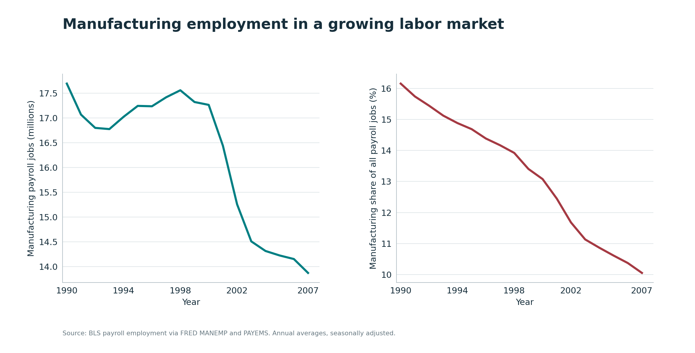
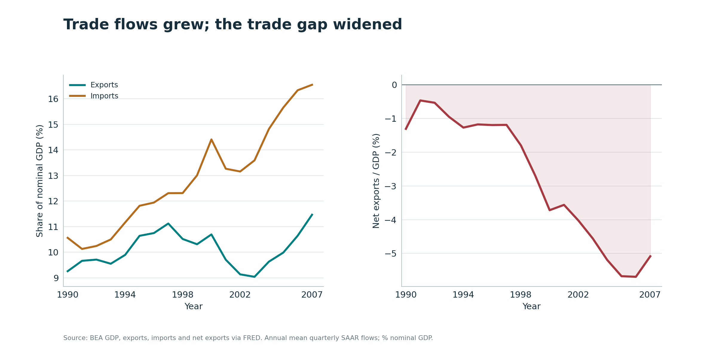
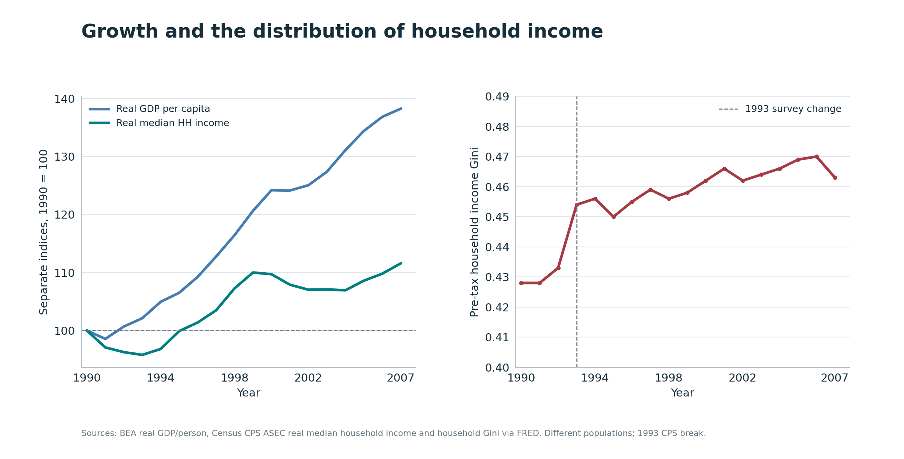
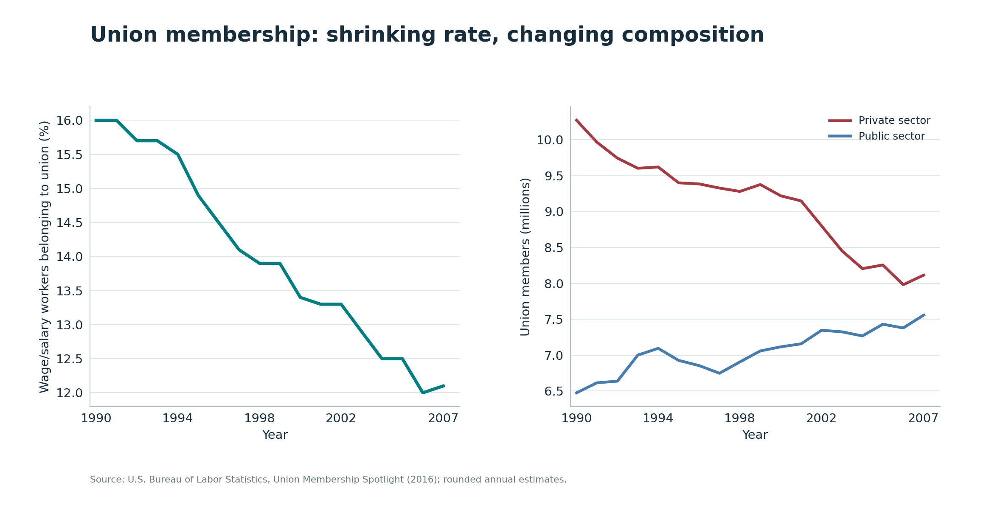
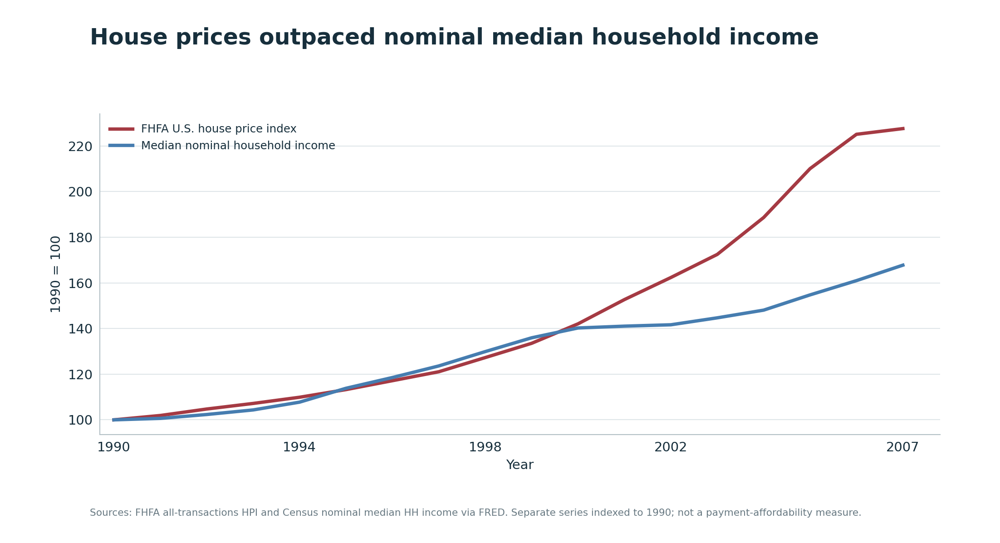
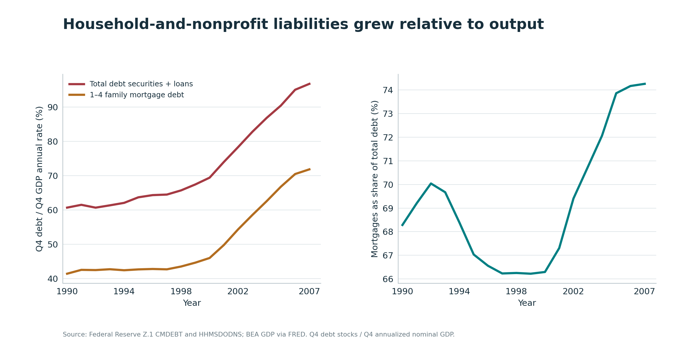
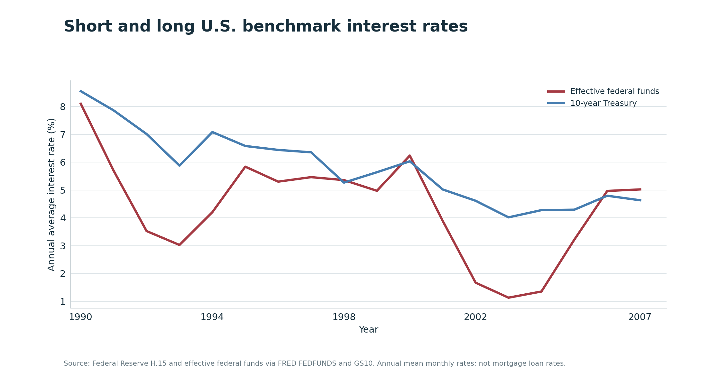
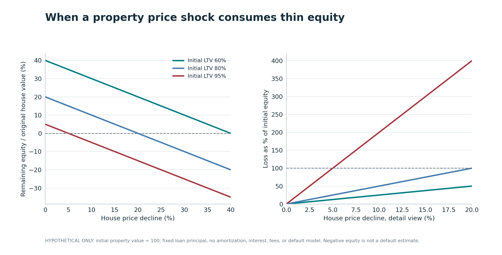

# The Boom Was Not a Balance Sheet

## Globalization, Household Credit, and the Fragile Prosperity Before 2008, 1990–2007

*A quantitative history of an economy that grew richer, reorganized its factories, expanded its financial system, and became increasingly dependent on housing collateral and private credit. Seven figures describe what can be measured. One hypothetical model explains why leverage can turn a modest shock into a large loss of equity.*

---

An economy can grow while becoming more vulnerable. Its national accounts can record more output, its stock market can celebrate new industries, and its banks can find new ways of distributing credit. None of those developments guarantees that the institutions supporting prosperity have become more resilient. Indeed, the same innovations that make borrowing easier today can make a balance sheet less tolerant of losses tomorrow.

This is one of the central problems in understanding the United States between 1990 and 2007. The period contains extraordinary achievements. Computers became cheaper and more powerful. Communication networks lowered the costs of moving information. American firms built global supply chains, and consumers gained access to a widening range of goods. Inflation was comparatively contained, the 1990s eventually produced a long expansion, and productivity grew. It would be false history to describe these seventeen years as nothing but decay.

It would be equally false to treat their growth rates as proof of widely shared security. Manufacturing employment eventually fell sharply even as total payroll employment grew. Real economic output per person rose faster than the real income of the median household, although those are different statistical units and cannot be compared as a decomposition. Union membership became less common. The Census Bureau's measured household income distribution grew more unequal. Home values climbed much faster than the national median household's *nominal* income. Household-and-nonprofit debt grew dramatically relative to economic output. Financial institutions multiplied the links among borrowers, securities, ratings, short-term funding, and investors.

Those observations are related, but the relationships require discipline. A chart of exports and manufacturing jobs does not identify the employment effect of trade. A line chart of interest rates and home prices cannot prove that the Federal Reserve created a bubble. A correlation between the expansion of debt and rising house prices does not prove which caused which; both may have been shaped by credit supply, expectations, income, regulation, international capital, and the changing quality of loans. Serious economic history does not remove those distinctions in order to produce a simpler political slogan.

The preceding essay in this series, [*The Price of Stability Was Not Shared Equally*](../stagflation-market-turn/article.md), examined the stagflation era and America's market-oriented turn through 1990. This essay follows the consequences of an economy more willing to rely on markets, flexible finance, and international integration. It asks three questions. What sort of prosperity did the United States build? How was economic risk distributed? And why did the private balance sheets behind the boom become important when the apparent prosperity began to reverse?

I use public historical series from the Bureau of Labor Statistics, the Bureau of Economic Analysis, the Census Bureau, the Federal Housing Finance Agency, and the Federal Reserve. The downloadable [research companion](README.md) contains a frozen annual panel for 1990–2007, the original data snapshots, transformation code, tests, eight publication figures, and the calculations used below. Seven figures are descriptive. **Figure 8 is explicitly hypothetical.** The distinction matters because an observed time series and an accounting thought experiment answer very different questions.

The argument is not that finance, trade, deregulation, technology, or monetary policy was *the* unique cause of what followed. It is that an increasingly integrated and credit-intensive economy generated large gains alongside vulnerabilities that national averages could conceal. That is a narrower conclusion than a total explanation of the 2008 crisis. It is also one that the evidence can support.

## 1. The choice of unit changes the story

Before asking whether the economy prospered, we must decide what the word means. Gross domestic product measures a flow of value added during a period. Payroll employment counts jobs. Median household income describes a household selected from the middle of an income distribution. A price index follows a basket or class of transactions. Debt is a stock of obligations accumulated from past decisions. Wealth and home equity are balance-sheet quantities, and a household's ability to meet next month's payment is not equivalent to its home's estimated market value.

The danger is not that any of these measures is useless. The danger arises when one is asked to stand in for another. GDP may rise because the economy produces more output; that does not tell us how much of the gain became median household income. A higher house-price index may raise the market value of existing assets; it simultaneously makes entry more expensive for someone without such an asset. A declining trade balance may coincide with more imported intermediate inputs and consumer goods; it does not by itself measure the welfare gained from trade or the employment destroyed by foreign competition. More available credit can smooth consumption and finance investment, but debt is also a contract on future income.

For this analysis, the calendar starts in 1990 and ends in 2007. That gives us eighteen annual observations. Monthly series are averaged across twelve observations, quarterly flows across four, and annual Census series are used as published. For Federal Reserve financial balance sheets, I take the fourth-quarter **stock** and compare it with fourth-quarter nominal GDP at an annualized rate. I do not average debt stocks into an annual debt burden. The difference between a stock and a flow is fundamental, as is the choice of denominator.

The source download was taken on 31 October 2026. Historical data can be revised; these are today's revised readings of the earlier economy, not a claim to have reconstructed what every economist knew at the time. A frozen series makes the charts reproducible, not infallible. The [series definitions and vintage](data/sources.json) are therefore part of the study, not an afterthought.

Nor is the nation one household. In 2007 some workers were employed in expanding professional sectors, others in declining factories. Some families owned homes with substantial equity; others faced high purchase prices, unstable earnings, or mortgages with changing payment terms. A national mean can remain stable while risk moves from one population to another. That observation is a reason to disaggregate, not an excuse to declare that everyone experienced the same decline.

The mathematical problem may be written as a question about distribution. If \(Y_t\) is aggregate income or output, and \(y_{it}\) is resources available to person or household \(i\), the fact that \(Y_{t+1}>Y_t\) cannot establish that \(y_{i,t+1}>y_{it}\) for a typical or particular \(i\). We need a weighting system, a unit of observation, a price adjustment, and an income concept before interpreting the comparison. Equally, financial resilience depends on the joint distribution of assets, liabilities, interest rates and earnings—not merely their separate totals.

This essay keeps those problems visible. It is a history of broad economic changes, but it does not claim an identification strategy where there is only a descriptive series.

## 2. From the early-1990s recession to the long expansion

The decade did not begin with uninterrupted prosperity. The National Bureau of Economic Research dates the recession that began in July 1990 to a trough in March 1991. The subsequent expansion lasted until the March 2001 peak, making it an unusually long uninterrupted expansion in the NBER's chronology. The next recession ran from March to November 2001. These dates matter because national employment and income outcomes differ substantially between expansions and contractions, and because the losses associated with an industry can be obscured by growth elsewhere. The [NBER historical dating table](https://www.nber.org/research/data/us-business-cycle-expansions-and-contractions) is the appropriate reference; a rule based on two quarters of GDP alone is not equivalent to its multi-indicator procedure.

The 1990s also brought different kinds of change. The collapse of the Soviet bloc altered geopolitical expectations. Personal computers and the internet transformed business organization. The North American Free Trade Agreement took effect in 1994, the World Trade Organization began operating in 1995, and China joined the WTO in 2001. These dates are institutional facts, not a regression discontinuity proving that each subsequent factory closure came from a trade agreement. Economies were simultaneously adopting computers, reorganizing production, shifting demand, changing their industrial geography, and responding to exchange rates and relative wages.

The distinction is especially important because the labor-market story itself changes during the period. Manufacturing jobs did not collapse in a straight line from January 1990. They fell during the early-1990s downturn, recovered during much of the expansion, and then declined far more steeply after the late-1990s peak. Aggregate payroll employment, meanwhile, ended the period much higher. Saying that America simply 'stopped working' is inconsistent with the data. Saying that employment growth made the loss of industrial employment unimportant is equally unconvincing.

This was also the age in which the financial architecture moved beyond the traditional image of a local bank taking deposits and retaining a mortgage until repayment. Loans could be originated, pooled, sold, rated, divided into tranches, financed with short-term liabilities, or used as collateral elsewhere in the system. Some innovations diversified risk or expanded access; others made the location of the risk harder to see. To understand the boom, we must keep the production economy and the financial economy in the same narrative without pretending they were identical.

The point of chronology is not to draw a causal arrow from every event to every later change. It is to identify an evolving institutional setting: an economy with increasingly mobile capital, more complex finance, a widening international division of labor, and a household sector increasingly exposed to the price of residential property. The last setting would matter enormously in 2007 and 2008.

## 3. Manufacturing did not disappear. Its place in the economy changed.

Consider two facts, both measured from the same BLS establishment survey. In 1990 the United States averaged about **17.69 million manufacturing payroll jobs**. In 2007, it averaged **13.87 million**. That is a loss of approximately **3.82 million jobs**, or about 21.6% of the original count. Meanwhile, total nonfarm payroll employment rose from approximately **109.53 million to 137.98 million**. The manufacturing share of those payroll jobs therefore fell from **16.16% to 10.05%**—a decline of more than six percentage points.

*Figure 1. BLS `MANEMP` and `PAYEMS`, annual averages. The left panel shows the number of manufacturing employees. The right shows their share of all nonfarm payroll jobs. Neither line identifies the relative effects of technological change, trade, the business cycle or domestic policy.*

The level and the share tell different stories. A sector may lose *share* in a growing economy without losing *jobs*; for much of the 1990s manufacturing employment remained close to its initial level while total payrolls expanded. After about 1998, the level also fell sharply. Treating the gradual change in relative composition as interchangeable with the later absolute employment contraction would erase one of the period's most revealing distinctions.

There are several plausible mechanisms. Productivity in manufacturing may increase output per worker, reducing labor requirements for a given level of production. Domestic demand may shift toward health, education, finance and other services as incomes rise. Firms can outsource formerly internal tasks to establishments that are classified as service businesses. Imported components can be combined with domestic design, logistics and final assembly. Foreign producers may displace certain domestic lines of production. Currency movements, recessions, energy prices and management decisions can all matter. The BLS line identifies none of these channels by itself.

The trade data provide further context, but not a causal decomposition. Using BEA current-dollar exports, imports and GDP, the ratio of imports of goods and services to GDP increased from approximately **10.56% in 1990 to 16.55% in 2007**. Exports also increased relative to GDP, from approximately **9.25% to 11.46%**. Because imports grew more, net exports moved from about **−1.31% to −5.08% of GDP**. These are *nominal flows* relative to *nominal output*. I have not mislabeled the series as physical trade volumes.

*Figure 2. BEA current-dollar trade and GDP series. The first panel distinguishes expanding exports from faster-growing imports; the second displays their accounting difference. The figure is not a bilateral China trade measure, an import-price estimate or a causal measure of manufacturing jobs lost.*

The national trade deficit is useful for describing the configuration of production, absorption and international financing. Yet it combines many goods and services, many trading partners, and a general-equilibrium response to domestic saving, investment, exchange rates, fiscal conditions, and foreign demand. Some imports are final consumer goods; some are intermediate goods used by American producers. A country can export more and import more at the same time. The current-dollar balance may reflect prices as well as quantities. An analyst who explains three million jobs from this aggregate line is making an identification claim that the chart cannot carry.

There is stronger research on a narrower part of the question. In *The China Syndrome*, David Autor, David Dorn and Gordon Hanson studied the effect of increasing Chinese import competition on American local labor markets between 1990 and 2007. Instead of treating the national trade deficit as the treatment variable, they exploited variation in regions' initial industrial composition and instrumented local exposure using changes in Chinese exports to other high-income countries. They found adverse employment, participation and wage effects in more exposed local markets. Their main specification attributes roughly a quarter of the contemporaneous national manufacturing employment decline to this import-competition channel. See the [original NBER paper](https://www.nber.org/papers/w18054) and its [American Economic Review publication](https://www.aeaweb.org/articles?id=10.1257/aer.103.6.2121).

That study illustrates an important difference between the aggregate and causal claims. The result does not imply that all manufacturing losses came from China, or that every region was affected in the same way. It does establish that the dislocation experienced by some communities was not simply a rhetorical invention. In a national account, the value of cheap imports and the output of growing service sectors can coexist with persistent losses in specific industrial locations. The people facing a closed plant do not automatically move into a growing sector at the same wage, in the same town, or with their existing skills intact.

This is a spatial and institutional problem as much as a macroeconomic one. Workers have families, housing, social networks, accumulated experience and imperfect information. A factory closure may reduce the demand for nearby suppliers, retail businesses and municipal services. The opportunity cost of moving is not equal to the price of a train ticket. The potential benefits of trade can be large while the adjustment mechanisms distributing those benefits remain weak. An economy should be judged partly on whether it can insure people through transitions it otherwise welcomes.

The lesson is not to assign moral agency to a trade ratio. It is to resist the idea that a good aggregate performance statistic absolves policy institutions of responsibility for concentrated transition costs. The more geographically uneven the shock, the less meaningful it becomes to describe the average worker as though such a person lives everywhere at once.

## 4. GDP per person, the median household, and bargaining power

The national income data provide another contrast. BEA real GDP per person averaged approximately **$40,192 in 1990** and **$55,560 in 2007**, in chained 2017 dollars: an increase of about **38.2%**. Census real median household income rose from approximately **$67,050 to $74,810**, in the Census's 2025 purchasing-power basis: about **11.6%**. Both statements can be true because they describe different things. They are not an accounting identity and their difference is not a direct measure of the labor share.

To show their relative evolution without mixing dollar scales, Figure 3 sets each series equal to 100 in 1990. The GDP-per-person index reaches about 138 in 2007, while the median-household-income index reaches about 112. The right panel shows the Census household income Gini, which rose from approximately **0.428 to 0.463** across the endpoints. The Gini peaked higher in 2006 and declined in 2007; its trajectory is not monotonic.

*Figure 3. BEA real GDP per capita and Census real median household income, each indexed independently to 1990, with the Census all-household money-income Gini. The vertical marker identifies the 1993 CPS ASEC income collection change. These lines do not form a decomposition of profits, wages or taxes.*

Why do I insist on this caveat? GDP per capita divides output by persons, including those who do not belong to the labor force. Median household income is influenced by household size, number of earners, the distribution of earnings, transfers included in money income, and the way households are constituted. Real GDP uses BEA national accounts and its own price adjustment; the Census income series uses a different price method. It also crosses survey-design and questionnaire changes. The fact that two normalized series diverge is important enough to investigate, but not a license to turn their numerical gap into a statistic it was never designed to be.

Nor does the household Gini measure wealth. It captures dispersion of a particular annual income concept before taxes and excluding many in-kind benefits. The [Census CPS ASEC methodology history](https://www.census.gov/topics/income-poverty/income/guidance/cps-methodology-changes.html) documents a substantial 1993 change to computerized interviewing and income-category limits. The visible rise near 1993 therefore combines possible economic movement with a change in the instrument used to measure it. The [original household Gini series](https://fred.stlouisfed.org/series/GINIALLRH) describes its coverage. A researcher seeking a perfectly homogeneous inequality history would need a sensitivity analysis or harmonized microdata rather than a casual straight line through the break.

Still, a careful interpretation remains possible. The expansion of real GDP per person was not reflected one-for-one in the household median series, and the Census's measured income dispersion was higher at the end of the period than at the beginning. The next question is how the institutions that mediate earnings and bargaining changed while those outcomes evolved.

Union membership is one such institution. According to the [BLS historical Spotlight table](https://www.bls.gov/spotlight/2016/union-membership-in-the-united-states/home.htm), **16.0%** of employed wage and salary workers belonged to a union in 1990, compared with **12.1%** in 2007. The underlying total number of union members moved from about **16.78 million to 15.67 million**. Private-sector union membership fell from approximately **10.27 million to 8.11 million**, while public-sector membership increased from about **6.48 million to 7.56 million**. These sector counts are rounded independently in the BLS table and should not be forced to sum precisely to the rounded aggregate.

*Figure 4. The overall BLS union membership rate is the share of wage and salary workers belonging to unions. The right panel shows **numbers** of members by sector, not the private/public unionization rates. The rates and counts are different denominators.*

The direction is clear without inventing a direct coefficient linking unionization to median income. Unions are bargaining institutions. They influence wage negotiations, workplace conditions, grievance procedures and the ability of workers to coordinate. But a national decline in membership can itself be caused by industrial composition, changes in labor law enforcement, employer strategy, political institutions, employment growth outside unionized sectors, and individual preferences. It is an outcome to explain as well as a potential mechanism in other outcomes.

One should also distinguish employment at a firm from the institutional quality of that employment. A job with uncertain hours, weak benefits, limited voice, and high turnover can contribute to a positive payroll count while producing less personal security than a stable industrial career. This is not an assertion that all manufacturing jobs were good or that service jobs are intrinsically bad. Manufacturing work was often dangerous and unevenly protected; many service occupations provide highly skilled, well-paid work. The relevant question is who possesses bargaining power and who absorbs the risks associated with competition and change.

The causal research agenda would have to address selection into unions, industry and geography, firm productivity, pre-existing wage trends, and broader policy changes. A line graph from 1990 to 2007 is not that design. But the institutional fact is hard to ignore: the decade of technological enthusiasm and growing aggregate output was also a period in which the labor market's most familiar collective bargaining institution continued to lose coverage.

There is a deeper connection here. In a production model, increasing output per worker can support higher compensation, lower prices, more profits, more investment, or some combination. The allocation is determined by markets **and** institutions: competition, governance, bargaining, taxation and policy. Calling the result simply 'productivity' does not solve the distribution problem. A useful account of prosperity asks what was produced, who received the resulting claims, and how securely those claims could be expected to persist.

## 5. Financialization is more than the size of Wall Street

The term *financialization* is frequently used as an accusation and rarely defined carefully. It can refer to the increasing economic importance of financial profits, to the larger scale of financial claims, to the growing role of shareholder value in corporate decisions, or to the extension of borrowing and asset-price dynamics into ordinary household life. Those phenomena overlap but are not identical. A bank's share of corporate profits is not the same measure as mortgage debt, and the growth of a securities market is not by itself evidence of a dangerous lending practice.

For this essay, the important definition is institutional: more economic activity came to depend on the origination, pricing, sale, funding and management of financial claims, with risks dispersed across entities whose interests and information did not always align. This was not simply an expansion of a single industry. It changed how households obtained credit, how financial firms earned fees, and how risks traveled through the economy.

The scale of the change was substantial. The [Financial Crisis Inquiry Commission's final report](https://www.govinfo.gov/content/pkg/GPO-FCIC/pdf/GPO-FCIC.pdf) describes the growth of financial-sector debt from roughly $3 trillion in 1978 to $36 trillion in 2007, and reports that financial-sector profits accounted for about 27% of American corporate profits in 2006, compared with 15% in 1980. Those values are retrospective findings from the commission, **not** series independently recreated in my companion dataset. They serve here as institutional context. The point is not to equate financial-sector profitability with misconduct; it is that finance had become a much more consequential part of the economy's allocation and transmission of risk.

To understand why, consider two stylized methods of lending. Under a traditional retained-loan model, a lender originates a mortgage and keeps its risk on the balance sheet. The lender still can make serious mistakes, but there is an incentive to care about the eventual ability of the borrower to repay. Under an originate-to-distribute model, the initial lender can sell the mortgage to another institution, which may pool it with others and issue securities. Investors purchase claims on payment streams, and specialist firms may provide guarantees, ratings, liquidity facilities or derivatives linked to those streams. The risk is redistributed, but its informational quality depends on underwriting, disclosure and the integrity of incentives across the chain.

That redistribution can have legitimate benefits. Pooling loans can reduce idiosyncratic exposure. Securities can connect long-term borrowers with a wider pool of savings. Risk can move toward institutions with the capital and expertise to bear it. The existence of securitization does not establish that a credit instrument is dangerous. The practical question is whether the transfer actually reduces concentrated exposure or merely makes the exposure harder to locate and price.

The system becomes fragile when several assumptions fail together. An originator might be rewarded for the volume of loans rather than their future performance. An arranger might have better information than the buyer of a security. A credit rating might summarize historical correlations that would not survive a nationwide housing reversal. A fund might hold long-lived mortgage claims while relying on borrowing that has to be renewed tomorrow. A bank might be legally separate from an investment vehicle yet have reputational or contractual reasons to support it when trouble arrives. Each arrangement can look manageable when examined in isolation; the network may be unstable when all institutions attempt to sell or protect their positions simultaneously.

The transition took place in a complex regulatory environment. The [Gramm–Leach–Bliley Act of 1999](https://www.congress.gov/106/plaws/publ102/PLAW-106publ102.pdf) changed restrictions on affiliations among banking, securities and insurance businesses. That institutional change is important to the history of American financial organization. It is not credible, however, to claim that the 1999 statute alone explains the 2008 crisis. Some firms at the center of later events were not conventional banks combining all three activities. Mortgage underwriting, off-balance-sheet funding, derivatives, capital standards, supervisory choices, investor demand and macroeconomic conditions all mattered. The historical analysis must examine the rules and the way institutions operated under them, rather than treating one statutory date as a causal experiment.

The same caution applies to the broader word *deregulation*. Some changes removed formal boundaries, others involved weak enforcement of existing rules, and still others involved activities developing outside the inherited regulatory perimeter. A risk can grow in an already regulated market if supervision is inadequate. Conversely, a rule can remain legally intact while the market finds contractual forms that reproduce the exposure in another institution. Looking only for repealed statutes misses the adaptation of both firms and financial technology.

The FCIC's majority concluded that the crisis was avoidable and emphasized excessive risk-taking, widespread regulatory and supervisory failures, poor governance, deficient mortgage lending, and dangerous reliance on short-term funding. The final publication also contains substantial dissenting views. Those disagreements should be read rather than erased. But the evidence that mortgage quality, leverage, market funding, and institutional incentives matter does not depend on pretending that the commission spoke with one unanimous voice. The [full government report](https://www.govinfo.gov/app/details/GPO-FCIC) provides both the majority account and the dissents.

This is why I do not use a financial-company employment line as the principal quantitative proxy for financialization. An industry can have a relatively small fraction of workers while coordinating very large stocks of assets, liabilities and contingent exposures. The proper units are balance sheets, cash flows, contractual maturities, collateral sensitivity, and the network of claims. The household debt figures later in this article measure one visible part of that system. They cannot by themselves describe all of it.

## 6. Housing moved from shelter toward a central financial asset

For many households, a home is simultaneously a place to live, a large store of wealth, and collateral for a loan. These functions can reinforce one another. A rising house price increases measured owner equity, potentially permitting refinancing or additional borrowing. A wider supply of mortgage credit can raise the amount bidders are able to offer for property. If lenders and borrowers assume that prices will continue rising, those expectations may reinforce the expansion. Yet people who do not own a home face a different set of consequences: the same increase in asset prices makes entry more expensive.

The resulting inequality is not perfectly summarized by a single national affordability ratio. Owners differ by purchase date and leverage. Renters differ by income and local market. A nominal price index is not the price of an identical house available everywhere, and a national median household is not the household applying for a mortgage in a particular city. That is why Figure 5 uses a deliberately modest comparison: the national FHFA all-transactions house-price index and Census nominal median household income, separately rebased to 1990=100.

*Figure 5. The FHFA all-transactions index combines sales and appraisal information. Median household income is a Census survey estimate. Both are nominal and rebased separately. Their divergence is a warning about relative growth rates, **not** a measured national median house-price-to-income ratio or a mortgage payment burden.*

The data reveal a clear change in their relative trajectories. The FHFA index averaged approximately **165.95 in 1990** and **377.70 in 2007**. Independently, Census nominal median household income rose from approximately **$29,940 to $50,230**. In separate 1990-based indices, house prices reached about **227.6**, while median income reached about **167.8**. The two series moved relatively close together during part of the 1990s, then separated more visibly after 2000. Between 2000 and 2007 alone, the FHFA index rose from about **235.75 to 377.70**—roughly 60%—while the nominal median rose from about **$41,990 to $50,230**, or roughly 19.6%.

These values deserve a careful interpretation. The index is not the median purchase price, so dividing its numeric level by the income median would be meaningless. The comparison also ignores mortgage rates, down-payment requirements, taxes, insurance, credit scores, household wealth, loan maturities, local market conditions, and the ability to refinance. A lower interest rate can reduce the initial monthly payment required for a fixed purchase price, even as higher prices offset some or all of the gain. A loan with an introductory rate may appear affordable in the first two years while imposing a very different burden later.

The most troubling aspect of the expansion was not that houses became more valuable in the aggregate. Asset appreciation can reflect genuine changes in location value, amenities, land supply or construction costs. The risk arose when price growth became connected to an expectation that collateral would remain strong enough to support continued borrowing, refinancing and financial securities even if the borrower's income was insufficient under less favorable conditions. Home equity is an important asset, but it is not a guaranteed future cash flow.

The difference is clear if a family with a large mortgage loses employment. The property may still have a high estimated value, yet the household must make a cash payment in the next month. If it sells, it may incur substantial transaction costs and be unable to find an equivalent home in the same area. If it refinances, it depends on the willingness of a lender to accept the collateral and income profile under the prevailing rules. An increase in house prices is not equivalent to a permanent increase in the household's ability to service debt.

The housing market thus linked the labor-market story to the financial story. Workers did not merely earn wages in an economy experiencing technological and trade changes; many also held housing assets and liabilities whose values were sensitive to credit conditions. The specific people receiving the gains from property appreciation were not necessarily those most exposed to future repayment stress. Without household-level matched income, property and credit data, it would be inappropriate to declare that everyone was 'living on borrowed money'. We can, however, measure the aggregate growth of liabilities that made housing finance central to the economic outlook.

## 7. Debt is a stock of promises, not a measure of household happiness

The Federal Reserve's Financial Accounts provide a more direct view of the growth in credit. The relevant sector is labeled *households and nonprofit organizations*. Its debt securities and loans outstanding totaled approximately **$3.65 trillion** in the fourth quarter of 1990 and **$14.24 trillion** in the fourth quarter of 2007, using the data vintage in this study. Its one-to-four-family residential mortgage liabilities rose from about **$2.49 trillion** to **$10.58 trillion** across those same quarter-end observations. These numbers are nominal stocks. They should not be interpreted as inflation-adjusted changes or allocated equally among Americans.

To show scale relative to the economy, I divide each fourth-quarter debt stock by the contemporaneous fourth-quarter nominal GDP, reported at an annualized rate. The total household-and-nonprofit debt ratio increased from approximately **60.7% in 1990 to 96.8% in 2007**. The corresponding residential mortgage ratio increased from **41.5% to 71.9%**. Mortgages represented about **68.3% of the selected total debt stock** in 1990 and **74.3%** in 2007. That last share did not climb smoothly; it changed with the composition of the sector's liabilities.

*Figure 6. Federal Reserve `CMDEBT` and `HHMSDODNS`, with BEA `GDP`. Debt is a **Q4 end-of-period stock**, while GDP is a **Q4 flow at an annual rate**. The chart is a scaling convention and does not measure the debt burden of the median household, the probability of default, or debt service payments.*

The stock-flow distinction is more than a technical objection. A household with debt \(D\), assets \(A\), and periodic income \(Y\) faces at least three different financial questions. Solvency concerns whether the present value of assets and future resources covers obligations. Liquidity concerns whether the household can meet payments when due. Leverage concerns the size of debt relative to asset values or equity. A debt/GDP ratio is a macroeconomic stock-to-flow indicator. It is informative about financial scale, but it does not establish any one household's liquidity or solvency.

Consider two households with the same $200,000 mortgage. One has a stable income, long fixed-rate terms, substantial liquid savings and a low loan-to-value ratio. The other faces an adjustable payment, uncertain employment, and little equity. Their debt levels are identical while their exposures differ substantially. The same is true of financial institutions with different maturities, capital buffers and funding sources. Aggregates conceal the covariance between risks that can make a downturn dangerous: the possibility that incomes, house prices and access to refinancing deteriorate together.

That is one reason the housing debt ratio becomes more relevant when read alongside Figure 5. The growth of mortgage liabilities occurred during a period of rapid appreciation of the assets securing them. Higher collateral values can support more borrowing. More borrowing can support greater demand for housing. The direction of causation is therefore not known from the two plotted lines. Both can respond to common expectations or financial conditions, and a feedback loop can exist without being statistically identified by a pair of national time series.

It would also be incorrect to claim that credit simply replaced wages for all Americans. The median household income data and the aggregate debt stocks do not identify which households borrowed, what their income paths were, whether the credit financed consumption, a first home, an existing mortgage refinance or another asset, or whether the borrower faced distress. A household with more debt may also own more housing wealth; a household with no mortgage may be priced out of ownership altogether. To test a 'borrowed consumption replacing lost earnings' hypothesis, we would need longitudinal household balance sheets and consumption, not a correlation between GDP and debt.

What the aggregate records do establish is a structural fact: the claims attached to the household-and-nonprofit sector grew far faster than contemporaneous output. The economy had more contracts whose performance depended, directly or indirectly, on future household cash flows, property collateral and financing conditions. Even a healthy expansion can become less forgiving when the obligations created during good times cannot adjust as quickly as asset prices and incomes during a downturn.

This distinction also prevents a common rhetorical error. Large debt stocks are not always signs of excessive lending. A developed financial system can support higher sustainable indebtedness when expected income, contract design, collateral quality and institutions warrant it. The question is whether lenders and borrowers had priced adverse states realistically. That requires the distribution of mortgage terms, underwriting quality, systemic funding exposures and actual losses. Fortunately, researchers did not have to rely exclusively on national aggregates to investigate those aspects.

## 8. Low rates were part of the environment, not a complete explanation

Interest rates provide an additional piece of the chronology. Figure 7 plots the annual average effective federal funds rate, a short-term interbank benchmark influenced by Federal Reserve policy, and the yield on ten-year Treasury securities, a longer-term market benchmark. In 1990 the respective annual averages were about **8.10% and 8.55%**. By 2003, they were approximately **1.13% and 4.02%**. In 2007, after monetary tightening, the averages were about **5.02% and 4.63%**.

*Figure 7. Federal Reserve `FEDFUNDS` and `GS10`, averaged from monthly data. The series are benchmark rates, **not** average contractual mortgage rates. Their association with household borrowing or housing prices does not identify the effect of monetary policy.*

The familiar story says that low interest rates made housing finance cheap, encouraging borrowing, increasing prices and creating the crisis. There is a plausible mechanism in that story. The interest rate is part of the user cost of housing and the present-value calculation applied to long-lived assets. Lower financing costs can increase borrowers' purchasing power and encourage lenders or investors to seek additional yield. But a mechanism is not the same thing as an empirically estimated contribution.

Monetary policy is endogenous to economic conditions. Short-term rates were reduced following the collapse of the technology bubble and the 2001 recession. The long-term yield also reflects expected future short rates, inflation expectations, term premia and international demand for safe assets. Neither plotted benchmark is equivalent to the rate paid by a risky borrower with a particular mortgage product. Underwriting conditions, repayment options, down payments, capital markets and regulation can change the quantity and quality of credit even if the benchmark rate is unchanged.

Ben Bernanke's 2005 discussion of the [global saving glut and the U.S. current-account deficit](https://www.federalreserve.gov/boarddocs/speeches/2005/200503102/) offers one influential interpretation. The argument emphasized the movement of savings from parts of the developing and emerging world toward major advanced economies, with consequences for capital flows, long-term interest rates and asset prices. His later [2007 discussion of global imbalances](https://www.federalreserve.gov/newsevents/speech/bernanke20070911a.htm) continued to stress the interaction between saving, investment and international financial flows. These speeches are primary evidence of a policy interpretation, not randomized experiments proving one global source of the housing boom.

International accounts add another complication. A trade deficit is related to a country's saving-investment balance, but the current account is not exactly the goods-and-services balance plotted in Figure 2: it also includes primary income and secondary income transactions. The corresponding financial account records cross-border asset acquisition and financing. It is possible for investment inflows and domestic credit-market developments to reinforce one another, yet the fact that a country imports more than it exports does not reveal the ultimate buyer of a particular mortgage security or the originator's underwriting standards.

The coexistence of domestic credit expansion, global demand for dollar assets and lower long-term yields is historically important. It does not eliminate domestic institutional responsibility. International savings could flow into safe government debt, productive business investment or poorly designed securities depending on the financial architecture that intermediated them. A global capital-flow explanation and a domestic underwriting explanation are not mutually exclusive; they address different layers of the causal chain.

The timing further weakens simple single-variable accounts. The federal funds rate increased substantially between 2003 and 2007, while mortgage-related liabilities and house-price levels remained high, and the market was beginning to reveal distress. The impact of an interest-rate change depends on prior debt stocks, fixed versus adjustable contracts, expectations, and whether borrowers can refinance. A high aggregate stock of liabilities accumulated during earlier years does not disappear when the marginal borrowing rate changes.

This makes macroeconomic policy and microeconomic lending standards complements rather than substitutes. A central bank may manage aggregate demand and inflation, but it does not automatically ensure that each borrower can repay a loan under adverse conditions or that every financial institution has sufficient capital and liquidity. Prudential supervision, disclosure, contract design and consumer protection influence how a given interest-rate environment translates into credit risk. Conversely, excellent underwriting cannot by itself guarantee that the macroeconomy will never face a recession.

We should resist the temptation to select the rate that best fits the story after observing the outcome. The historical evidence demands a model of expectations, term structure, mortgage contracts, risk appetite and institutional change. Figure 7 is a chronology, not that model. The stronger evidence about the dangerous expansion of mortgage supply comes from more disaggregated studies and the records of the lending market itself.

## 9. The first cracks were visible before the spectacular collapse

The summer of 2007 has a familiar retrospective image: sophisticated institutions discovering that securities assumed to be liquid and well rated were harder to sell or value than expected. But the underlying problem had been developing earlier. Mortgage contracts had been written on assumptions about borrowers, collateral and refinancing opportunities that did not always survive adverse conditions. Some products deferred principal repayment, used initial interest-rate discounts, or made affordability dependent on continued price appreciation. The problem was not that every mortgage was bad. It was that a sufficiently important subset could fail in correlated ways, and financial intermediaries had built connections that transmitted those failures across the system.

The Federal Reserve's contemporary [analysis of 2006 Home Mortgage Disclosure Act data](https://www.federalreserve.gov/pubs/bulletin/2007/articles/hmda/) is valuable because it documents the lending market near the end of the boom, before the full severity of the crisis became clear. The study discusses the importance of higher-priced lending, the spread of loans with nontraditional repayment structures, and the geographic pattern of subsequent distress. It reported that roughly one fifth of mortgages in 2006 were classified as subprime by contemporary industry estimates, with another segment categorized as near-prime or alt-A. Such classifications depend on data provider and definition; this is not a homogeneous, nationally representative risk score that I can transplant into every household's probability of default.

The report also described products that reduced initial payments through introductory rates, interest-only periods or other contractual features. These products can be useful for a borrower who understands and can bear the future cash-flow pattern. Their danger rises when the loan is approved on the assumption that the initial payment is the relevant affordability constraint, or when refinancing depends on continued collateral appreciation. Borrowers, brokers, investors and supervisors need not share the same incentives, information or ability to absorb losses.

The Federal Reserve's later [analysis of the 2007 HMDA data](https://www.federalreserve.gov/pubs/bulletin/2008/articles/hmda/default.htm) documented a broad contraction in mortgage activity: reported originations fell roughly one quarter from 2006 to 2007, although coverage changes and institution exits complicate comparison. This is not evidence that everyone stopped borrowing simultaneously. It is evidence that conditions in mortgage origination changed sharply before the 2008 panic. The relevant financial system was already responding to weaker asset values, deteriorating confidence, more restrictive underwriting and the inability of some institutions to continue business as before.

There is also causal research more informative than an aggregate house-price curve. Atif Mian and Amir Sufi examined geographically disaggregated mortgage credit expansion and the mortgage default crisis. Their [original study](https://www.nber.org/papers/w13936) exploited within-county differences across ZIP codes to investigate shifts in mortgage credit supply. They reported that high-risk or high latent-demand areas experienced disproportionately large credit expansion during the early-2000s boom, including places where income and employment trends did not support a simple story of rising fundamental repayment capacity. Their analysis linked those patterns to the increased sale of originated loans and subsequent defaults. This is materially stronger evidence about a credit-supply mechanism than the observation that prices and mortgages rose together at the national level.

Even that result must be read within its design. The study addresses specific local variation and mortgage-market mechanisms. It does not estimate the causal contribution of every regulatory law, the Federal Reserve's complete interest-rate path, global savings, or all subsequent failures in 2008. Nor should the finding that some credit supply was unsound be translated into a claim that broader access to mortgage finance is intrinsically undesirable. The relevant distinction is between sustainable access and credit issued under incentives that neglect repayment risk.

This distinction places responsibility in the institutional chain. A buyer may misunderstand a complex contract; a broker may have incentives to emphasize the opening payment; an originator may be rewarded for loan volume; a securities arranger may have incentives to package and sell; an investor may rely too heavily on a rating; a regulator may underappreciate correlated exposures. Some actors will have more information and bargaining power than others. Saying that borrowers made choices is true, but incomplete. Saying that sophisticated intermediaries and policymakers had no choice is also untenable.

The [Financial Crisis Inquiry Commission](https://www.govinfo.gov/app/details/GPO-FCIC) later reconstructed these mechanisms through documents, hearings, testimony and financial evidence. Its majority identified serious failures of regulation, corporate governance, risk management and accountability. It emphasized risky mortgage lending and securitization, excessive leverage, reliance on short-term funding, and the failure of warning signs to produce adequate preventive action. The report also included dissenting interpretations that assigned different causal weights to housing policies and other forces. The existence of dissent does not require us to suspend judgment about every factual finding; it requires us to distinguish documented mechanisms from contested estimates of relative contribution.

The first cracks were therefore both financial and informational. Prices stopped validating some expectations. Delinquencies exposed the quality of collateral and the contractual details of loans. Securities that appeared diversified could contain mortgages exposed to common local and national shocks. Institutions that relied on rolling over short-term funding became sensitive not only to expected final losses but to the willingness of other institutions to lend against uncertain assets today. Liquidity could vanish before every future loss was known.

The period in this article ends in 2007 deliberately. The failure of Bear Stearns in March 2008, the September collapse of Lehman Brothers, AIG's rescue, government interventions and the global recession belong to the next stage of the historical narrative. To understand those events, however, we need the structures built during the preceding expansion. A financial crisis rarely begins at the moment a television audience first notices it. It becomes visible when obligations that seemed manageable under one set of prices and expectations are suddenly tested under another.

## 10. A small balance-sheet model: why high leverage is unforgiving

The historical data give us an economy with rapidly increasing property values and debt stocks. The next question is mathematical: why does leverage make an adverse change in collateral value so consequential? We do not need a complicated optimization model to understand the first-order accounting effect. We do need to label it correctly.

Assume a property initially worth \(P_0=100\). The owner has a mortgage with balance \(D=L P_0\), where \(L\) is the initial loan-to-value ratio. Initial equity is \(E_0=P_0-D=P_0(1-L)\). Now assume that the property's market value falls by a fraction \(d\), while the mortgage principal remains unchanged. Then the new equity is

\[
E_1 = P_0(1-d)-D = P_0(1-d-L).
\]

The dollar loss is \(E_0-E_1=P_0d\). Expressed as a fraction of **initial equity**, it is

\[
\frac{E_0-E_1}{E_0}=\frac{d}{1-L}.
\]

This simple expression is useful. The denominator \(1-L\) is the original equity share. If the down payment and other existing equity amount to 40% of property value, a 10% price fall consumes one quarter of the original equity. At 80% LTV, the same fall consumes half. At 95% LTV, it consumes twice the original equity: the owner now has *negative* accounting equity equal to 5% of the original property value. The debt balance did not change. What changed was the value of the collateral supporting it.

*Figure 8. **HYPOTHETICAL, NOT HISTORICAL.** The initial property value is 100, mortgage principal is fixed, and the model ignores repayments, interest, transaction costs, default choices, refinancing, insurance, liquidity and legal rules. The right panel enlarges the initial 0–20% property-price decline range. Crossing the zero-equity line is not an estimated probability of foreclosure.*

At first glance this looks like linear arithmetic: the property price falls by ten, and the homeowner loses ten units of equity. Yet measured relative to the initial equity buffer, the loss is amplified by leverage. The multiplier \(1/(1-L)\) grows rapidly as \(L\) approaches one. This is not a mysterious new risk created by a plot; it is the elementary consequence of financing an asset with an obligation that does not reprice downward when the asset does. The same logic explains why a lightly capitalized institution can be very sensitive to a relatively small asset-value shock.

The limitations are as important as the result. Negative equity does not automatically imply that a household defaults. A borrower may continue to service a mortgage despite being underwater, particularly if employment and income remain stable and the loan terms are manageable. Conversely, a borrower with positive home equity can default or be forced to sell because of an immediate liquidity problem. The model does not incorporate lenders' capital, securitization tranches, cross-default provisions, foreclosure laws, mortgage insurance, or the possibility of an emergency refinancing program. It cannot estimate how many Americans faced such a state in 2007.

What it *does* show is the reason financial institutions should care about the distribution of initial loan-to-value ratios and correlated collateral shocks. If losses were independent across regions, one pool of mortgages might offset another. But when many loans depend on the same national refinancing environment and housing expectations, diversifying the names of borrowers is not equivalent to diversifying the underlying macroeconomic risk. A loan portfolio with thin equity buffers can appear safe under a rising-price history and become fragile when that shared condition reverses.

The model also demonstrates why wealth and income must remain separate variables. A borrower can have substantial positive equity and too little current income to make the next payment. A borrower can have negative equity and sufficient current income to continue paying. The joint state \((E_t,Y_t,r_t)\)—equity, earnings and contractual interest terms—matters more than any one marginal quantity. A realistic household stress test would include the joint distribution of those states, the term structure of mortgages, regional house-price shocks, unemployment transitions and the rules governing delinquency and foreclosure.

That is the difference between a toy calculation and a calibrated historical risk model. The toy model gives a mechanism and a counterexample to the claim that rising house prices are innocuous under high leverage. It does not supply a crisis probability. Every parameter used in Figure 8 is invented for illustration, and the chart is visually labeled accordingly. Using its output as though it were a measured 2007 default rate would be a methodological error.

## 11. A good correlation can still be an inadequate explanation

We can use the same annual panel to demonstrate the problem with easy causal narratives. Figure 5 contains a housing price index; Figure 6 contains debt relative to GDP. Across the period, both increased substantially. If we computed a simple correlation between their **levels**, we would obtain a large positive number largely because the two series trend over time. This is the familiar risk of spurious association in nonstationary data. A high coefficient would not distinguish supply-driven credit expansion from demand for housing, expectations, income, interest rates or unrelated common trends.

One modest improvement is to study annual changes rather than levels. In the companion I calculate the percentage log change of the FHFA housing index and the percentage-*point* change of the debt/GDP ratio. I then pair those annual changes at lags from −2 to +2 years, with positive lag meaning that a housing-index change is paired with a **later** debt-ratio change. The estimated Pearson correlations range roughly from **0.53 to 0.82**, with only **15–17 paired observations** depending on lag. The largest is around **0.82 at a one-year positive lag** in this particular finite sample.

Those numbers are diagnostics, not findings of causation. First differencing does not remove every shared disturbance or all serial dependence. A small annual sample makes correlations sensitive to the chosen endpoints. The ratio's GDP denominator responds to recessions and expansions. Debt and housing prices may affect each other simultaneously. The year's measurement windows are not event times. Shifting series by one calendar year is not a natural experiment, and selecting the largest correlation from several lags introduces another form of researcher discretion. The [computed table](results/lead_lag_sensitivity.csv) is provided precisely so that the weakness of the evidence can be examined rather than disguised with a significance star.

The identification problem can be written in the language of causal graphs. Credit supply may influence mortgage borrowing and property prices. Property values can influence collateral capacity and refinancing, feeding back into borrowing. Income expectations affect housing demand and ability to repay. Monetary conditions influence both lenders and borrowers. Regulation and securitization alter underwriting and the distribution of risk. International capital flows influence longer-term funding markets. These are several paths into observed variables, not one clean arrow between two plotted national averages.

To estimate an effect, we need an intervention or a credible source of variation that separates one channel from the others. For example, the Mian–Sufi design exploits local exposure to mortgage supply expansion rather than identifying the effect from a national time trend. Autor, Dorn and Hanson similarly use regional industrial exposure and an instrument based on third-country Chinese import growth rather than regressing manufacturing jobs on the national trade deficit. Both approaches require assumptions, sensitivity analysis and interpretation; neither is immune to criticism. But they ask a more precise causal question than a pair of aggregate curves can answer.

There is a second lesson. The outcome variable should match the claim. To study household financial fragility, one would ideally measure delinquency, debt-service coverage, liquidity and default transition probabilities. A stock of household-and-nonprofit debt divided by GDP is not a direct observation of those outcomes. To study the distributional effect of globalization, one would want individual earnings, labor-force transitions and local labor markets, not only aggregate employment and trade flows. To study a bank's systemic risk, one would need asset maturity, capital, counterparties, collateral and liquidity commitments, not just the number of employees in financial services.

This insistence on the right target is not pedantry. It prevents our moral judgments from masquerading as estimated coefficients. We can argue that governments should insure workers against geographic dislocation, regulate underwriting or improve labor bargaining without pretending to have identified the exact fraction of the 2008 crisis caused by one policy. Evidence is more useful when its limitations are made explicit enough that another researcher could try to overturn the conclusion.

## 12. The serious objections deserve serious answers

One objection is that the period delivered genuine prosperity and innovation. That is correct. The rise in real GDP per capita, the long 1990s expansion, new technology, expanding trade and cheaper access to many goods are important achievements. A narrative that depicts every financial instrument as predatory or every trade agreement as harmful would not fit the evidence. Financial markets can allocate savings productively. Trade can increase real purchasing power. A job in healthcare, research or computing can be as socially valuable as a job in a factory. The criticism is about the **distribution and durability** of gains, not the denial that gains occurred.

A second objection is that technological change rather than trade explains much of the manufacturing employment shift. The proper answer is to reject the false choice. Automation, management, productivity, changing demand, outsourcing, import competition and recessions can all contribute, with different weights across industries and years. The 1990–2007 period includes an especially severe decline in manufacturing employment after 2000, but the country was not subjected to a single treatment called globalization. The local labor-market research on Chinese import exposure provides evidence for a particular mechanism, not an explanation of every job lost.

A third objection is that access to mortgage credit helped millions of families become homeowners. Again, this can be true. New instruments can relax credit constraints for borrowers previously excluded from conventional lending. The relevant counterargument is not that any credit expansion is bad, but that loans should be assessed under realistic payment and adverse-price scenarios, with incentives that reward sustainable performance. An expansion in access is less defensible when it is built on misrepresented terms, inadequate verification, weak capital or assumptions that refinancing will always remain available. Distribution matters here, too: wealthier borrowers and investors may be better positioned to absorb a reversal than families with limited liquid savings.

A fourth objection assigns most responsibility to central-bank rates or global imbalances, rather than domestic financial rules. The mechanisms are related. Low short-term rates can expand credit demand, global savings can affect longer-term yields, and weak underwriting can determine which households receive loans and on what terms. Financial institutions translate those conditions into securities and balance sheets. The total outcome is not necessarily the sum of separate independent effects, because interactions and feedback can dominate. A precise causal decomposition is an empirical project, not something Figure 7 can settle.

A fifth objection is that the national debt ratio includes nonprofit organizations and uses a stock-to-annualized-flow denominator. That is a legitimate methodological warning, and it is why the chart is labeled *household-and-nonprofit* rather than simply *median household debt*. The ratio indicates how large a sector's debt stock is relative to the economy's current output rate. It does not give loan-level leverage, affordability or default. Altering the stock/flow convention or sector definition would change the numbers. The annual panel, field definitions and calculation code are supplied so that the transformation can be audited or replaced.

Finally, one could object that the historical relationship between income inequality, house prices, manufacturing employment and financial fragility is too complicated for a single essay. That objection is also reasonable. The task is not to prove that every variable belongs to one grand mechanism. The task is to show how simultaneous changes in labor, production, distribution and credit created an environment in which some households and institutions were more exposed to shocks than national growth figures implied. The mechanisms have to be studied separately before they can be combined responsibly.

## 13. What follows for institutions and policy

The historical period suggests a more useful policy question than whether markets should be loved or hated. It asks what kinds of institutions permit an economy to benefit from innovation and trade without making its weakest participants carry disproportionate adjustment and financial risk. That question is partly about efficiency and partly about distribution. It is also about time: gains may arrive quickly, while the consequences of a bad financial contract may emerge years later.

First, the benefits of trade and technological change do not eliminate the need for adjustment policy. If an exposed locality loses a major employer, retraining alone may be insufficient when there are few nearby vacancies. Mobility costs, childcare, housing, local tax revenue, health insurance and the portability of skills can shape the feasible set of alternatives. A strong safety net is not a rejection of economic change; it can be a precondition for supporting change without treating displacement as a private failure.

Second, bargaining institutions are part of productivity's distributional environment. The decline in union coverage does not prove a unique causal effect on the median, but it matters to workers' ability to influence wages, working conditions and the terms of economic transition. The appropriate policy debate concerns labor rights, sectoral differences, legal enforcement, collective representation and the quality of work, rather than assuming that aggregate employment automatically describes the security of each job.

Third, credit access requires transparency and discipline. Underwriting should evaluate the ability to service debt beyond an introductory rate or optimistic refinancing scenario. Securities need incentives for accurate loan information, and institutions that depend on very short-term funding must be able to manage liquidity stress. Regulators need information about off-balance-sheet exposures, correlated collateral risk and connections across firms. Greater financial sophistication is useful when it improves the allocation of risk; it becomes dangerous when complexity makes risk impossible for even sophisticated participants to see.

Fourth, housing cannot be analyzed solely as an appreciating financial asset. It is also an essential service and a major household expenditure. When prices rise faster than typical incomes, potential buyers without existing equity face a different problem from incumbents who benefit from appreciation. Credit expansion can increase the purchasing power of bidders without immediately increasing the supply of suitable housing. Policies that affect land availability, construction, transport, rental security and regional opportunity interact with mortgage rules. National price trends do not tell us which local intervention is optimal, but they show why a housing system cannot be reduced to the ease of obtaining a loan.

Fifth, distributional and systemic risk should be tested jointly. A bank stress test that assumes mortgage collateral is independent across regions can miss common exposures. A household analysis that looks only at the median can miss the borrowers with the thinnest equity, most unstable wages or greatest payment resets. Macroprudential supervision needs information about tails and correlations, not only averages. The appropriate mathematical language includes joint distributions, network propagation, contingent claims and scenario analysis, not the comfortable assumption that yesterday's covariance matrix is guaranteed to remain intact.

These observations do not prove that a single alternative policy package would have delivered all the benefits of the 1990–2007 expansion without its vulnerabilities. That would require counterfactual evidence of a kind not produced here. They do, however, challenge the idea that growth, deregulation or cheap credit can be treated as complete economic objectives. A successful society needs gains from production and exchange, but also an institutional design capable of sharing risks and preserving agency when conditions change.

## 14. Conclusion: prosperity needs a loss function

In 1990 the United States was emerging from a period of inflationary and institutional transformation. By 2007 it had completed a long expansion, built new technologies and supply chains, and achieved substantially greater real output per person. It also employed fewer manufacturing workers, had lower union membership coverage, recorded greater measured household income dispersion, and carried much more household-and-nonprofit debt relative to output. National house prices had risen considerably faster than the median household's nominal income, while finance had become central to the architecture of credit and risk. None of these trends means the economy was uniformly poorer or that every institution failed. Together, however, they complicate the idea that the boom was synonymous with durable security.

The central mistake is to substitute one objective for the entire welfare problem. If the policy target is GDP growth alone, a region can be devastated while the national indicator improves. If the target is asset appreciation, an incumbent owner can prosper while a prospective buyer falls behind. If the target is credit availability, more loans can count as success even when the terms expose borrowers and lenders to an avoidable collapse. If the target is inflation stability alone, the distribution of unemployment and financial shocks can disappear from the dashboard. Every target omits something unless its social loss function explicitly acknowledges those consequences.

In mathematical terms, there is no reason to assume that maximizing an aggregate mean automatically minimizes losses in the tails. The function we care about may include employment transitions, repayment stress, the probability of extreme household loss, inequality, housing access and intergenerational opportunity. We must specify those outcomes, observe them, and ask how policies affect them. Financial resilience is about the distribution of joint shocks, not only the mean return in a growing market.

The history of 1990–2007 offers a final warning about time. A mortgage can be originated in a year of rising prices and become impossible to refinance several years later. A factory closure can remain economically consequential long after GDP has recovered. A household may appear richer on paper while becoming more dependent on credit terms it cannot control. Prosperity is therefore not merely an accounting statement about what was produced or owned at a moment. It is also a statement about how people can withstand the next adverse state of the world.

The boom was real. The fragility was real as well. The lesson is not that society should reject markets, technology, trade or finance. It is that none of them substitutes for the institutions that determine who receives gains, who bears losses, and how much room people have to recover when expectations fail.

The next chapter begins where these figures stop: the crisis of 2008, the intervention of the state, the recession that followed, and the unequal recovery. We cannot understand that episode without the balance sheets and institutions formed in the years before it.

---

## Data, calculations and identification notes

The figures and all derived values in this essay are available in the [reproducible companion](README.md). To ensure the argument can be audited, the source panel has eighteen rows (1990–2007) and uses fixed FRED source snapshots downloaded on 31 October 2026, alongside the BLS historical union table. The script `prepare_data.py` reconstructs the annual panel offline; `analysis.py` recreates every chart and three result tables. The notebook and automated tests make the transformations inspectable. Historical data are subject to later revisions and should not be confused with real-time archival vintages.

**Annual aggregation.** BLS payroll employment and benchmark interest rates are twelve-month averages. BEA GDP and trade are averages of four seasonally adjusted annual-rate quarterly observations. The house-price index is a four-quarter average of the FHFA all-transactions series. Census household income and Gini observations are annual values. Debt stocks are **fourth-quarter end-of-period** Federal Reserve Z.1 values, and their GDP denominator is the *fourth-quarter* nominal GDP at an annualized rate. The total debt series includes households **and nonprofit organizations**. The [raw FRED source list](data/sources.json) supplies exact IDs, units and definitions.

**Comparable denominators.** Real GDP per capita and real median household income are normalized separately because they use different units of observation and price conventions. The income series is expressed in **2025 C-CPI-U dollars**, with the pre-2000 part adjusted using R-CPI-U-RS according to the Census description. The all-household Gini is not a wealth Gini, a tax-incidence measure, or a panel estimate. The 1993 CPS ASEC collection change is marked rather than treated as a purely economic discontinuity.

**Causal identification.** National co-movements provide chronology and descriptive constraints, not counterfactual policy effects. The exploratory lead–lag Pearson coefficients use annual differences and small overlapping samples. They do not identify causality, and no p-values or confidence intervals are claimed. The separate loan-to-value model is **HYPOTHETICAL**; its assumptions are fixed collateral, unchanged nominal debt, and no behavioral or legal response. It is an accounting demonstration, not a foreclosure forecast.

**Measurement choice.** The FRED export of the Federal Reserve debt-service ratio `TDSP` contained observations only from 2005 onward at the time of download. I chose not to interpolate a series across the missing years or substitute debt/GDP for debt service. The series is retained in the raw quarterly export for inspection but excluded from the historical panel. This is a material boundary, not a missing-chart oversight.

## Primary sources and original research

The bibliography favors statistical agencies, official reports, and the research papers whose designs support the narrower causal claims. Source descriptions in this list should not be mistaken for endorsements of every interpretation in the article.

1. **U.S. Bureau of Labor Statistics.** [Manufacturing payroll employment, `MANEMP`](https://fred.stlouisfed.org/series/MANEMP) and [all nonfarm payroll employment, `PAYEMS`](https://fred.stlouisfed.org/series/PAYEMS), distributed by FRED. Monthly, seasonally adjusted establishment-survey counts.
2. **U.S. Bureau of Economic Analysis.** [Nominal GDP, `GDP`](https://fred.stlouisfed.org/series/GDP), [exports, `EXPGS`](https://fred.stlouisfed.org/series/EXPGS), [imports, `IMPGS`](https://fred.stlouisfed.org/series/IMPGS), and [net exports, `NETEXP`](https://fred.stlouisfed.org/series/NETEXP), via FRED. Quarterly annualized dollar flows.
3. **U.S. Bureau of Economic Analysis.** [Real GDP per capita, `A939RX0Q048SBEA`](https://fred.stlouisfed.org/series/A939RX0Q048SBEA), via FRED. Chained 2017 dollars; quarterly.
4. **U.S. Census Bureau.** [Real median household income, `MEHOINUSA672N`](https://fred.stlouisfed.org/series/MEHOINUSA672N), [nominal median household income, `MEHOINUSA646N`](https://fred.stlouisfed.org/series/MEHOINUSA646N), and [all-household income Gini, `GINIALLRH`](https://fred.stlouisfed.org/series/GINIALLRH), via FRED.
5. **U.S. Census Bureau.** [CPS ASEC methodology and survey changes](https://www.census.gov/topics/income-poverty/income/guidance/cps-methodology-changes.html), particularly the 1993 change in income reporting and collection.
6. **U.S. Bureau of Labor Statistics.** [Union Membership in the United States, 1983–2015](https://www.bls.gov/spotlight/2016/union-membership-in-the-united-states/home.htm), original historical table, and [2007 union membership release](https://www.bls.gov/news.release/archives/union2_01252008.pdf).
7. **U.S. Federal Housing Finance Agency.** [All-Transactions House Price Index for the United States, `USSTHPI`](https://fred.stlouisfed.org/series/USSTHPI), via FRED. Quarterly national index; combines sales and appraisals.
8. **Board of Governors of the Federal Reserve System.** [Households and nonprofits, debt securities and loans, `CMDEBT`](https://fred.stlouisfed.org/series/CMDEBT) and [one-to-four-family residential mortgages, `HHMSDODNS`](https://fred.stlouisfed.org/series/HHMSDODNS), Z.1 Financial Accounts via FRED.
9. **Board of Governors of the Federal Reserve System.** [Effective federal funds rate, `FEDFUNDS`](https://fred.stlouisfed.org/series/FEDFUNDS), and [ten-year Treasury constant maturity yield, `GS10`](https://fred.stlouisfed.org/series/GS10), via FRED.
10. **National Bureau of Economic Research.** [U.S. Business Cycle Expansions and Contractions](https://www.nber.org/research/data/us-business-cycle-expansions-and-contractions), official recession dates used for chronology.
11. **David H. Autor, David Dorn and Gordon H. Hanson.** [*The China Syndrome: Local Labor Market Effects of Import Competition in the United States*](https://www.nber.org/papers/w18054), NBER Working Paper 18054 (2012); [published in the *American Economic Review*](https://www.aeaweb.org/articles?id=10.1257/aer.103.6.2121) (2013).
12. **Atif Mian and Amir Sufi.** [*The Consequences of Mortgage Credit Expansion: Evidence from the 2007 Mortgage Default Crisis*](https://www.nber.org/papers/w13936), NBER Working Paper 13936 (2008); later published in the *Quarterly Journal of Economics* (2009).
13. **Board of Governors of the Federal Reserve System.** [The 2006 HMDA Data](https://www.federalreserve.gov/pubs/bulletin/2007/articles/hmda/) and [The 2007 HMDA Data](https://www.federalreserve.gov/pubs/bulletin/2008/articles/hmda/default.htm), *Federal Reserve Bulletin* analyses of mortgage lending and market conditions.
14. **Ben S. Bernanke.** [*The Global Saving Glut and the U.S. Current Account Deficit*](https://www.federalreserve.gov/boarddocs/speeches/2005/200503102/) (2005) and [*Global Imbalances: Recent Developments and Prospects*](https://www.federalreserve.gov/newsevents/speech/bernanke20070911a.htm) (2007), Federal Reserve speeches.
15. **U.S. Congress.** [Gramm–Leach–Bliley Act, Public Law 106-102](https://www.congress.gov/106/plaws/publ102/PLAW-106publ102.pdf) (1999), the enacted statute rather than a secondary description.
16. **Financial Crisis Inquiry Commission.** [*The Financial Crisis Inquiry Report*](https://www.govinfo.gov/app/details/GPO-FCIC) (2011), official government publication with commission findings and dissenting views; [full PDF](https://www.govinfo.gov/content/pkg/GPO-FCIC/pdf/GPO-FCIC.pdf).

The strongest conclusion supported by these materials is not that one culprit explains the entire episode. It is that large real economic gains coexisted with concentrated labor-market disruption, widening measured income dispersion, rapid growth of household-linked liabilities, and financial institutions whose contractual design made losses harder to absorb. Reconstructing that coexistence is a necessary step toward understanding why the subsequent shock was so costly—and why its costs were not shared equally.

