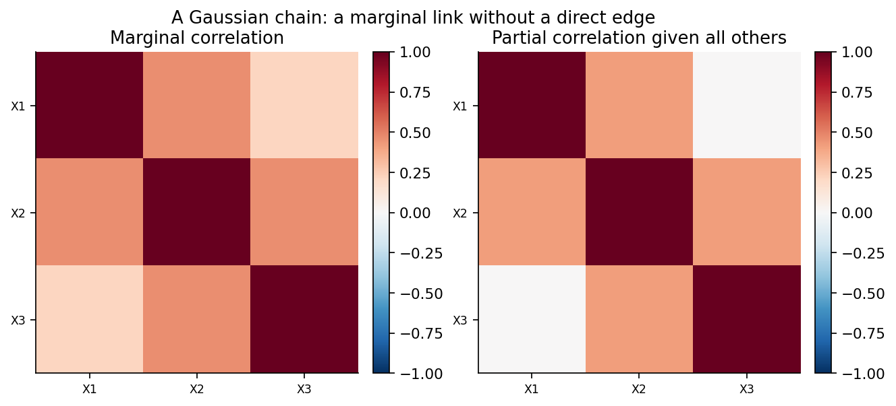
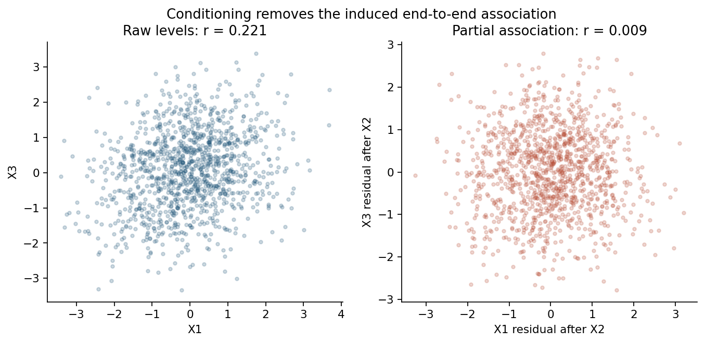
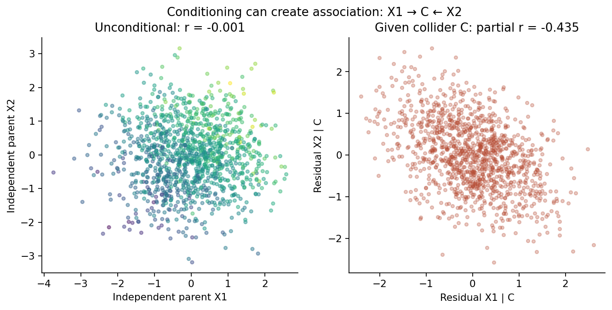
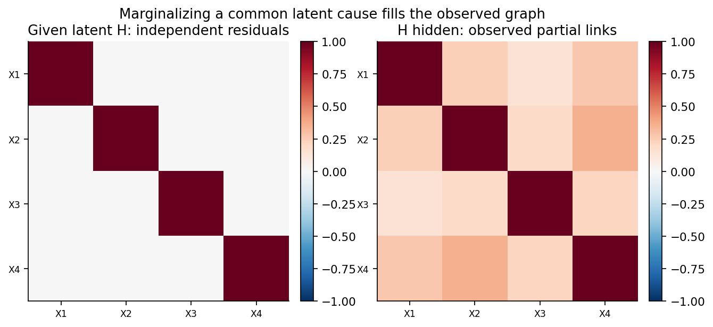
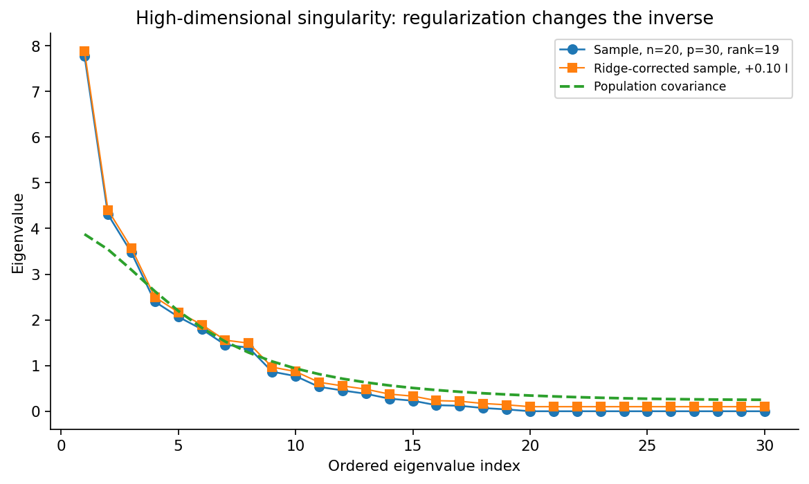
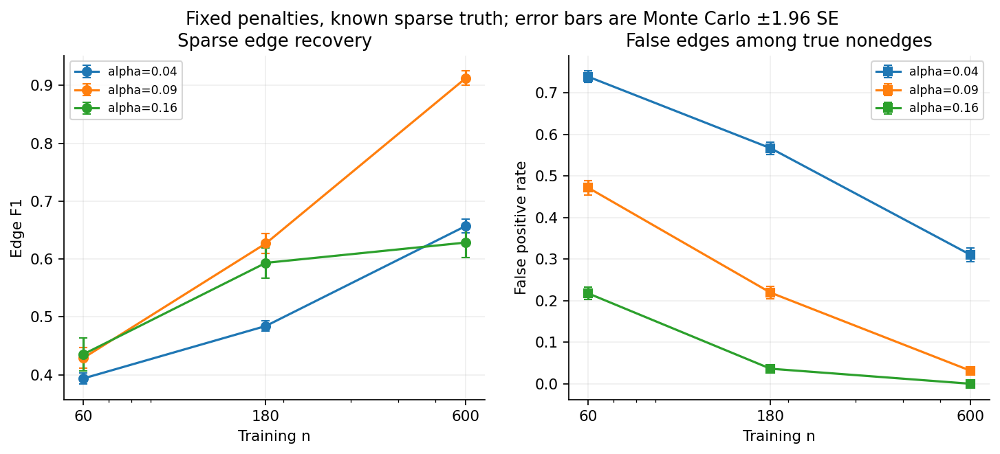
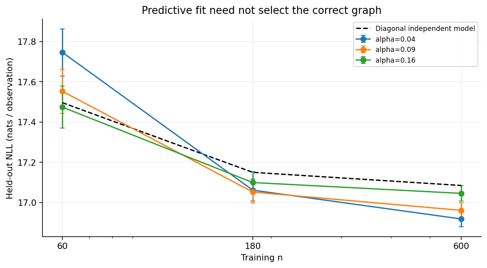
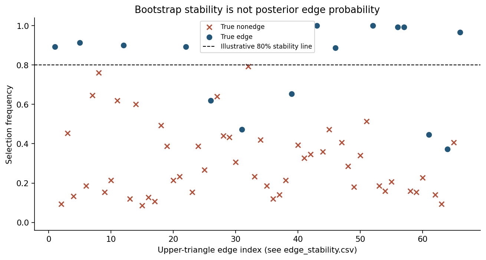
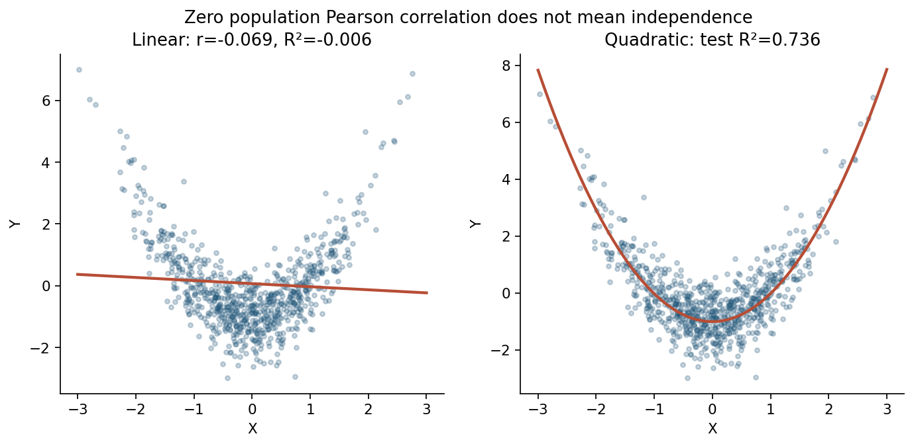

# A Missing Edge Is Not a Missing Relationship: Gaussian Graphical Models and Conditional Independence

*Why a sparse precision matrix can clarify dependence, why its zeros can mislead us, and why an observational network is not a causal diagram*

Diogo Ribeiro | October 2026

*A mathematical and computational essay. All numerical observations and nine figures in this article come from deliberately constructed synthetic distributions, not from a real company, country, patient population, gene network, or sensor deployment. The [reproduction guide](README.md), [typed Python analysis](analysis.py), [executable notebook](gaussian_graphical_models.ipynb), publication figures, CSV evidence, and unit tests accompany the text. Nothing in an undirected graph is interpreted here as an identified causal effect.*

## The promise of a network, and the question it actually answers

Imagine a dashboard containing thirty measurements from an industrial process. A heatmap shows dense correlations: the temperatures rise together, the pressures move with throughput, and several vibration channels anticipate the same production cycles. The engineer asks which variables have a direct relationship. The analyst replaces the correlation matrix with a graph, one node per measurement and a line for every estimated nonzero partial correlation. The dense picture becomes sparse. A few links stand out. Some familiar correlations disappear. The graph looks less like a confused mass of measurements and more like the process itself.

That transformation can be useful, but the last sentence is where an inference often becomes an invention. A Gaussian graphical model does not reconstruct the machine. It describes which pairs of random variables remain associated after conditioning on the others included in the model, assuming the joint distribution is Gaussian and the covariance matrix is sufficiently well behaved. The word *direct* is a convenient graphical shorthand for this particular conditional association. It is not automatically a claim about mechanical coupling, causal influence, or what would happen after an intervention.

The temptation is understandable. Human beings are comfortable with networks. A network of roads represents possible routes. A circuit diagram represents components physically connected by wires. An organizational chart represents prescribed authority. When a statistical method draws two nodes and a connecting line, we instinctively import some of those meanings. We forget that the meaning of an edge is defined by the probability model, not by the pictogram. A statistical edge can exist because of confounding, conditioning on a common consequence, inadequate measurement, or finite-sample regularization. An absent edge can coexist with strong marginal association and substantial indirect predictive information.

This essay develops the distinction from the probability density upward. We begin with a three-variable example in which two nodes are correlated but conditionally independent. We then reverse the intuition with a collider: two independent parents become conditionally associated when we condition on their common effect. A hidden factor shows how marginalizing an unobserved cause changes the observed precision graph. Those simple distributions lead to a practical high-dimensional problem, because the inverse covariance matrix is hard to estimate when observations are scarce relative to variables.

The computational component then studies a known twelve-node sparse Gaussian network. Across independent samples of three sizes and three fixed regularization penalties, it compares edge precision, recall, false positives, structural Hamming distance, and out-of-sample Gaussian likelihood. A separate bootstrap experiment measures selection stability. Finally, a nonlinear construction has zero population Pearson correlation but a strong conditional mean. The resulting nine figures are original, reproducible, and deliberately limited to what their generating mechanisms can establish.

The central claim is modest but important: **conditional independence is a precise statistical concept, whereas the presence or absence of a real-world relationship is a much larger scientific question**. Confusing the two causes errors in medicine, economics, industrial monitoring, and machine learning. Keeping them separate gives graphical methods a valuable, honest role.

## 1. Three different meanings of a relationship

Before deriving anything, distinguish three propositions that are sometimes treated as interchangeable. First, two measurements may be marginally associated: knowing one changes what we expect about the other, without accounting for further variables. In a Gaussian model, a nonzero covariance is sufficient to establish this kind of dependence. Second, two measurements may be conditionally associated given a specified collection of other measurements. This asks whether information remains after the other variables are held fixed in the probabilistic sense. Third, changing one measurement by an intervention may change the distribution of the other. That is a causal claim, requiring a model of interventions, temporal mechanisms, or a design that identifies them.

The first two propositions can be described by an observational joint distribution, at least under suitable modelling assumptions. The third is generally not determined by that distribution alone. Different causal systems can have exactly the same observational covariance. The direction of a relationship does not appear as a direction in an undirected conditional-independence graph. In fact, even the seemingly cautious statement that a missing graph edge means a variable cannot affect another is false: an indirect pathway can transmit information or a causal effect despite conditional independence of its endpoints given intermediates.

There is an additional subtlety. Conditional independence is always *relative to the conditioning set*. Saying that (X_i) and (X_j) are independent given *all the other observed variables* is not the same as saying they are independent given one chosen measurement, given the true latent state, or given all variables that exist in the physical system. A graph depends on the variable set. Add a sensor, remove a feature, aggregate several measurements, or select a subgroup of observations, and the conditional-independence structure can change without any physical connection appearing or disappearing. That is not necessarily instability in nature. It may be a predictable change in the statistical question.

It helps to reserve different language for different conclusions. Use *marginal association* when discussing ordinary correlation, *conditional association* when discussing precision-matrix entries, *statistical edge* when discussing a selected support pattern, and *causal effect* only when identification assumptions justify it. This vocabulary is not pedantry. It prevents a network visualization from smuggling in mechanisms that no calculation established.

## 2. The Gaussian starting point

Let (X=(X_1,\ldots,X_p)^\top) be a (p)-dimensional random vector with a nonsingular multivariate normal distribution,

\[
X\sim N_p(\mu,\Sigma),\qquad\Sigma\succ0.
\]

The mean vector is (\mu\), and the positive-definite covariance (\Sigma\) encodes all second-moment relationships. Its inverse,

\[
\Omega=\Sigma^{-1},
\]

is called the *precision* or *concentration* matrix. For a Gaussian vector, these two matrices describe the same joint distribution, but they emphasize different relationships. (\Sigma_{ij}) is a marginal covariance. (\Omega_{ij}), when (i\ne j), enters the conditional-independence criterion. Replacing one with the other is not a harmless normalization. Inverting a matrix combines information across the complete set of included variables.

The centered Gaussian log density, up to constants not depending on (x), is

\[
\log f(x)=-\frac12\log\det\Sigma
-\frac12(x-\mu)^\top\Omega(x-\mu)+C.
\]

Equivalently, because (\log\det\Sigma=-\log\det\Omega),

\[
\log f(x)=\frac12\log\det\Omega
-\frac12\sum_{i=1}^{p}\sum_{j=1}^{p}
\Omega_{ij}(x_i-\mu_i)(x_j-\mu_j)+C.
\]

The cross-product term for pair (i,j) is controlled by (\Omega_{ij}). If that coefficient is zero, the corresponding conditional factorization has a special structure. Under the multivariate Gaussian assumption, for (i\ne j),

\[
X_i\perp\!\!\!\perp X_j\mid X_{-\{i,j\}}
\quad\Longleftrightarrow\quad \Omega_{ij}=0.
\]

This is the defining local edge rule for a Gaussian concentration graph. It is a statement about the **population precision**, before any estimation, thresholding, or penalty selection. In non-Gaussian distributions, a zero covariance or partial correlation need not imply independence. Later we will construct an elementary example in which the population Pearson correlation is exactly zero while prediction from one variable to another is highly informative.

Arthur Dempster's covariance-selection framework [1], the conditional-independence treatment developed by Dawid [2], and Lauritzen's comprehensive account of graphical models [3] provide important foundations. Their contribution is conceptual as well as computational: they separate a probabilistic set of independence restrictions from the richer interpretation we might wish to attach to a graph.

## 3. Why the inverse covariance detects conditional independence

The zero-entry result is worth deriving rather than memorizing. Reorder the variables so that a pair of interest forms the two-dimensional block (A=(X_i,X_j)^\top), while (B) contains all remaining variables. Partition the covariance and precision consistently:

\[
\Sigma=\begin{pmatrix}
\Sigma_{AA}&\Sigma_{AB}\\
\Sigma_{BA}&\Sigma_{BB}
\end{pmatrix},\qquad
\Omega=\Sigma^{-1}.
\]

The conditional covariance of the pair given (B) is the Schur complement

\[
\operatorname{Var}(A\mid B)=
\Sigma_{AA}-\Sigma_{AB}\Sigma_{BB}^{-1}\Sigma_{BA}.
\]

By the block inverse identity, the inverse of this conditional covariance equals the (AA) block of the full precision matrix, (\Omega_{AA}\). A two-dimensional Gaussian covariance is diagonal exactly when the associated Gaussian variables are independent. A two-by-two positive-definite matrix has a diagonal inverse exactly when its own off-diagonal element is zero. Consequently, (X_i) and (X_j) are conditionally independent given (B) precisely when (\Omega_{ij}=0\). This is an exact population identity, not a large-sample approximation.

The formula also gives a standardized measure of conditional linear association:

\[
\rho_{ij\cdot -\{i,j\}}
=-\frac{\Omega_{ij}}{\sqrt{\Omega_{ii}\Omega_{jj}}}.
\]

This *partial correlation* is bounded between minus one and one because the relevant precision block is positive definite. Its sign is the negative of the precision entry's sign, which frequently surprises readers inspecting a heatmap of raw precision coefficients. Precision values and partial correlations must therefore be labelled explicitly. An off-diagonal precision entry of positive 0.3 does not imply a positive partial correlation; with positive diagonal entries, it implies the opposite sign.

There is an equivalent regression interpretation. Regress (X_i) on the other (p-1) Gaussian coordinates. The population least-squares coefficient of (X_j) is

\[
\beta_{ij\cdot -i}=-\frac{\Omega_{ij}}{\Omega_{ii}}.
\]

Because (\Omega_{ii}>0\), a zero coefficient and a zero precision entry are equivalent. A Gaussian graph can thus be understood through a family of conditional linear projections. This is the basis for neighborhood-selection methods, including the separate lasso regressions studied by Meinshausen and Bühlmann [4]. But the conditional regression coefficients are generally asymmetric as numbers: (\beta_{ij\cdot-i}\ne\beta_{ji\cdot-j}\). The underlying undirected presence or absence of the pairwise edge is symmetric. An algorithm that performs separate regressions must decide how to combine disagreeing neighborhood selections.

Finally, this proof explains the precise role of Gaussianity. The Schur complement calculates a *linear* residual covariance for any finite-variance distribution under suitable conditions. The stronger equivalence between zero residual covariance and conditional independence follows from the Gaussian conditional distribution. Outside that family, an undetected nonlinear association can survive after every linear residual correlation has vanished. That is why a precision graph is not a universal dependence detector.

## 4. A three-node chain: correlated endpoints, missing edge

Consider a zero-mean trivariate Gaussian distribution whose precision is known before any data are drawn:

\[
\Omega_{\mathrm{chain}}=
\begin{pmatrix}
1&-0.42&0\\
-0.42&1&-0.42\\
0&-0.42&1
\end{pmatrix}.
\]

Its eigenvalues are strictly positive. The off-diagonal zeros specify exactly one nonedge: variables 1 and 3 are independent **given variable 2**. Inverting this matrix produces a covariance with positive (\Sigma_{13}\). The endpoints are therefore *not* marginally independent, even though they have no direct edge in the Gaussian concentration graph. There is no contradiction. Information about (X_1) changes our expectations about (X_2), which in turn changes our expectations about (X_3). Once (X_2) is known, the residual Gaussian link between (X_1) and (X_3) vanishes.

*Figure 1.* The population marginal correlation between (X_1\) and (X_3\) is approximately **0.2142**, whereas their all-remaining-variables partial correlation is **exactly zero**. These values come from an explicitly specified precision matrix, not statistical significance testing. The diagonal entries in the partial-correlation display are set to one by convention for plotting; diagonal precision entries themselves are not one in general.

The numerical example makes the distinction visible. We generate 1,200 independent observations from the known covariance. Their sample correlation between endpoints is approximately **0.2213**. Residualizing both endpoints against the middle variable and correlating those residuals gives approximately **0.0095**. Neither sample quantity is guaranteed to equal its population counterpart in a finite dataset. The important feature is that the population condition is exact, while the sample merely illustrates its estimation under the stated law.

*Figure 2.* A cloud with noticeable positive slope can become a cloud with almost no linear trend after conditioning. The residual plot is not a claim that the endpoints have no possible indirect relationship, are physically disconnected, or would not be affected by an intervention propagated through the middle node. It answers a narrower conditional-distribution question.

In applied modelling, the middle node may represent a physical mediator, a common measurement, a latent-state proxy, or simply another jointly distributed variable. The undirected Gaussian graph does not choose among these interpretations. It also does not tell us whether controlling for the middle node is scientifically appropriate for a particular estimand. Conditional independence is a statement we can test or estimate; deciding which variables should be conditioned upon requires separate domain and causal reasoning.

## 5. Local, global, and pairwise Markov statements

A graph with vertex set (V=\{1,\ldots,p\}\) and undirected edge set (E\) is often introduced as a picture, but its statistical content is a family of factorization or separation statements. In a Gaussian concentration graph, pair (i,j\) is not joined when (\Omega_{ij}=0\). This is the *pairwise Markov property* relative to the full observed variable set. A related *local Markov property* says that a node is independent of its non-neighbors when its neighbors are known. A *global Markov property* uses graph separation: if a set (S\) separates sets (A\) and (B\), then (X_A\) and (X_B\) are independent given (X_S\), under the model's Markov assumptions.

For strictly positive distributions with the relevant regularity conditions, these familiar Markov formulations are connected. Multivariate Gaussian densities with positive-definite covariance are positive everywhere, which makes the factorization theory particularly clean. This is one reason Gaussian graphical models became a natural meeting point for graph theory and multivariate statistics. There is no need to impose an ordering of the variables or a direction on each edge to interpret their conditional-independence structure.

Still, a graph is not necessarily a complete representation of every independence present in a distribution. A graph can be an *I-map*: every separation implied by the graph is a valid independence, while some additional independences may exist through parameter cancellation. The stronger notion of *faithfulness* rules out such extra independences relative to the graph. Faithfulness is often invoked in causal discovery, but it is an assumption about the generating distribution, not a feature guaranteed by drawing a graph. In exact finite samples, empirical partial correlations almost never equal zero even when the population zeros are genuine; sparse estimation methods deliberately choose zeros by applying modelling assumptions and regularization.

The three-node chain teaches a related caution about reading paths. It has a path from node 1 to node 3. The path indicates that information can travel through an unconditioned middle node in the probabilistic graph. Once the middle node is conditioned upon, that path is blocked in the undirected separation sense. Neither the existence of the path nor the missing direct edge establishes whether an actual intervention on node 1 changes node 3. The answer depends on a separate causal graph or structural model, which might or might not share the same skeleton.

## 6. The collider: conditioning creates a relationship

The chain is only half the story. Consider two independent standard normal variables (X_1,X_2\) and independent standard normal noise (\varepsilon\). Define a third variable, explicitly as a common effect:

\[
C=0.9X_1+0.9X_2+\varepsilon.
\]

The population marginal covariance of the parents is zero, and since they are jointly Gaussian, the parents are marginally independent. They both help determine (C\). If we now condition on (C\), the parents become negatively associated. Knowing that the total outcome is high, observing a higher value of one parent leaves less of the outcome for the other to explain. This phenomenon is often called *explaining away* or collider conditioning. It matters in selection, epidemiology, hiring data, risk scores, and almost any study in which inclusion depends on a common consequence.

The conditional covariance follows directly from the Schur complement. Here,

\[
\operatorname{Var}(C)=0.9^2+0.9^2+1=2.62,
\]

and the conditional covariance of the parents is (0-0.9^2/2.62\). Each conditional parent variance is (1-0.9^2/2.62\), giving

\[
\operatorname{Corr}(X_1,X_2\mid C)
=-\frac{0.9^2}{1+0.9^2}
\approx-0.4475.
\]

This is an exact population result. The 1,200-observation sample has unconditional parent correlation around **−0.0014** and parent residual correlation after conditioning on (C\) around **−0.4354**. A precision graph on the three observed variables correctly includes an undirected edge between the parents, because they are not conditionally independent given the collider. Yet no arrow from one parent to the other was part of the generating structural equation.

*Figure 3.* The marginal parent scatter is nearly uncorrelated. The regression-residual scatter, after removing the linear information in the common effect, shows a negative partial association. The color of the first panel represents the collider value; it is descriptive and not an intervention. The graph obtained by conditioning on all variables describes a different independence statement than the marginal graph of the two parents.

This example defeats a common shortcut: *conditioning always removes spurious relationships*. Conditioning can remove a common-cause association, but it can also open a collider pathway. Whether adjusting for a variable helps or harms a particular causal analysis is not established by the availability of that variable in a data table. Even with perfect measurements and an infinite sample, the wrong adjustment set can create a real conditional association that is absent marginally.

## 7. A conditional edge is not a causal arrow

The three-node examples can be read together. In the chain, a marginal association disappears after conditioning. In the collider, a marginal independence disappears after conditioning. The same computational operation—adjusting for another observed variable—has opposite qualitative effects because the joint structures differ. A method that reports only the final partial-correlation graph cannot recover those structures uniquely without additional assumptions or design information.

Suppose a public-health team measures physical activity, sleep quality, and a clinical risk score. An estimated precision edge between activity and the score after adjusting for sleep could reflect a direct physiological effect, a common unmeasured health state, a measurement artifact, or selection into the sample. The model does not know which. Conversely, removing an edge after adjusting for sleep could reflect mediation through sleep, successful control of confounding, or cancellation of associations in a particular population. Those interpretations imply different interventions and different policies.

An undirected graph is not entirely uninformative about plausible mechanisms. Conditional independences can constrain the set of compatible causal graphs under causal Markov and faithfulness assumptions, as the broader causal-discovery literature discusses [11,12]. A three-variable collider can, in some circumstances, be oriented by comparing relevant marginal and conditional independences. But orientation algorithms require assumptions about latent variables, selection, sampling, temporal order, and tests of independence. A raw graphical-lasso network does not perform that identification exercise. Its estimated zeros are penalized likelihood decisions, not certified causal separations.

Even when a real-world network is almost surely not Gaussian, one may deliberately fit a Gaussian graphical model as a useful *approximation to second-order conditional structure*. The approximation can organize hypotheses and identify redundant features. The honesty lies in naming the approximation and refusing to equate its arrows-free edges with intervention results. The next example shows how fragile the observed graph can be to a variable that is not even present in the dataset.

## 8. Hidden factors make sparse mechanisms look dense

Consider a latent standard normal factor (H\) that affects four observed measurements:

\[
X_i=\lambda_iH+\varepsilon_i,
\qquad i=1,2,3,4,
\]

where the errors are mutually independent Gaussian variables, also independent of (H\). We choose loadings (\lambda=(0.75,1.0,0.6,1.2)^\top\) and positive error variances (D=\operatorname{diag}(0.8,0.9,0.75,1.1)\). Conditional on the latent factor, the observed variables are independent because their remaining errors are independent. The conditional covariance is diagonal, (\operatorname{Cov}(X\mid H)=D\). If (H\) is unobserved and integrated out, however, the marginal covariance becomes

\[
\Sigma_X=D+\lambda\lambda^\top.
\]

The rank-one factor term has nonzero off-diagonal entries. More subtly, its inverse is generally dense as well. Using the Sherman–Morrison–Woodbury formula,

\[
\Omega_X
=D^{-1}-\frac{D^{-1}\lambda\lambda^\top D^{-1}}
{1+\lambda^\top D^{-1}\lambda}.
\]

Unless loadings happen to vanish or special cancellations occur, every off-diagonal precision entry is nonzero. All six possible undirected edges among four observed variables therefore appear in the exact population concentration graph, even though the observed measurements are conditionally independent given the true factor. Their apparent pairwise conditional associations are consequences of omitting (H\) from the conditioning set. The graph is correct for the observed vector and incomplete as a description of its data-generating mechanism.

*Figure 4.* In the left panel, the correlation matrix of the independent residual errors is diagonal. In the right panel, the four-variable observed partial-correlation matrix is dense. Both panels are exact population calculations from the same generating model, under different conditioning information. No fitted method or sample fluctuation created the difference.

This point matters for sensor systems. A shared operating regime can cause several measurements to move together. If the regime is not observed, the network among sensor channels may be dense even after conditioning on the other channels. It also matters for finance, where common market factors produce residual association, and for biological studies, where unobserved cell states may induce dependencies across measured quantities. A sparse graph of measured variables can be a reasonable descriptive regularization, but its sparsity is an assumption or estimation preference. It need not reveal the sparsity of the underlying mechanisms.

One can investigate low-rank-plus-sparse decompositions, latent-variable graphical models, or domain-specific factors [13], but these introduce their own identification and estimation assumptions. The crucial first step is simpler: record that the observational variable set is incomplete, identify plausible missing common drivers, and avoid interpreting a dense or sparse fitted graph as the unqualified wiring diagram of the world.

## 9. What happens when the dataset changes?

Statistical graphs depend on population, measurement, and conditioning set. The phenomenon is visible without a temporal process. Consider collecting data only from individuals whose composite score (C\) falls within a narrow band. In the collider construction, selection on that score induces a relationship between its originally independent inputs. An estimated graph on the selected population may differ from the graph in the original population even if every structural equation is unchanged. This is selection bias, not evidence of newly created biological or social interactions.

Aggregation creates different problems. Suppose ten sensors are combined into one mean reading. Conditional independence among individual sensors does not automatically survive replacing them with their average. Nor can the average distinguish sensor-specific failures from common process changes. A graph built from averages can be useful for its own monitoring objective, but it is not a lossless projection of the ten-dimensional graph. Similarly, reporting standardized rates or ratios may induce relationships through shared denominators. The variable definitions and transformations are part of the model specification, not merely a preprocessing footnote.

Time can also alter the conditioning statement. A contemporaneous covariance across variables ignores whether one measurement leads another, whether shared trends have been removed, and whether the residual dynamics have been modelled. A zero in a same-time precision matrix is not proof that no delayed relationship exists. Serial dependence, common trends, nonstationary regimes, and feedback introduce additional structure. For time-series applications, the analyst needs a model for temporal dependence or a carefully justified stationary residual representation; static graphical lasso alone is not a substitute for either.

Missing data add another layer. Complete-case selection can change the target population if the chance of being observed depends on measured values or hidden causes. Imputation can also change covariances in ways that depend on the imputation model. If a graph is fit after imputation, the scientific conclusion depends jointly on the imputation assumptions and the graph assumptions. Treating the graph as if it came directly from an uncontaminated random sample erases part of the uncertainty. These problems are not reasons to abandon graphical models, but reasons to describe the data-generating and observation processes before interpreting their edges.

## 10. From the population matrix to an estimated network

So far the matrices were known, and the algebra was exact. In real applications (\Sigma\) is unknown. We observe an (n\times p\) matrix of measurements and estimate covariance by the centered empirical matrix,

\[
S=\frac1n\sum_{t=1}^{n}
(X_t-\overline X)(X_t-\overline X)^\top.
\]

Dividing by (n\) instead of (n-1\) is the usual Gaussian likelihood convention; the choice does not change the central rank argument. Because the centered data matrix has at most (n-1\) linearly independent rows,

\[
\operatorname{rank}(S)\le\min(p,n-1).
\]

If (p\ge n\), (S\) is necessarily singular, even if the true population covariance is perfectly positive definite. One cannot recover a unique unregularized sample precision by simply applying a matrix inverse. Attempting a pseudoinverse does not restore information that is absent from the sample. It selects one generalized solution to an underdetermined numerical problem, and its zeros are not automatically conditional independences of the population law.

Even with (n>p\), an empirical covariance can be poorly conditioned. Small eigenvalues amplify noise when inverted. Perturbations that seem insignificant in covariance space may become substantial precision errors. The issue is especially important when the smallest population eigenvalue is already low, when predictors are nearly redundant, or when units differ by orders of magnitude. A single unstable precision entry may create or remove an apparent graph edge. Covariance estimation is therefore an inferential problem, not merely a call to a linear-algebra routine.

## 11. The high-dimensional singularity experiment

To isolate this issue, we generate (n=20\) independent Gaussian observations of (p=30\) variables whose population covariance has entries (\Sigma_{ij}=0.6^{|i-j|}\). This is a valid positive-definite covariance with decaying marginal association. The sample covariance, after centering, has rank **19** in the seeded run. Eleven of its thirty eigenvalues are zero to numerical precision. A conventional matrix inverse does not exist, even though the generating population covariance is invertible.

We then display the eigenvalues of (S+0.10I\) as a simple ridge correction. Adding (0.10\) to every eigenvalue makes the matrix positive definite, so inversion becomes numerically possible. But numerical invertibility is not the same as recovering the true inverse. The chosen ridge amount changes the estimator, and its bias and variance require assessment. Ledoit and Wolf's covariance-shrinkage framework [5] provides a principled alternative to arbitrary ridge addition for particular covariance losses and asymptotic regimes. Neither arbitrary ridge nor principled shrinkage transforms a small dataset into a large one.

*Figure 5.* Population eigenvalues, sample eigenvalues, and simple ridge-shifted sample eigenvalues are shown in decreasing order. The ridge shift is an illustration of regularization, not a claim that (0.10\) is optimal. The population covariance belongs to the generator and is known only because this is synthetic data. The empirical eigenvalue sequence is not a random-matrix asymptotic theorem; it is one seeded finite-sample realization with an exact rank ceiling.

The deeper lesson is that high-dimensional edge discovery demands structure. Sparsity is one possible structure: most conditional relations are assumed absent, and estimation favors precision matrices with many off-diagonal zeros. Low rank, factor models, banded covariance, known physical topology, or Bayesian priors are other possibilities. They are not interchangeable. Choosing one expresses a scientific belief about the distribution. A graph estimated with an aggressive sparsity assumption may be stable and interpretable while still misrepresenting a dense population precision matrix. Regularization makes an estimation problem soluble by accepting assumptions and bias; it does not certify those assumptions.

## 12. The graphical lasso objective

For independent Gaussian observations, ignoring constants and a factor of (n/2\), the negative log likelihood for a candidate precision (\Omega\succ0\) is

\[
\mathcal L(\Omega;S)=-\log\det\Omega+\operatorname{tr}(S\Omega).
\]

The log determinant enforces the geometry of the positive-definite cone, while the trace term measures agreement with the empirical covariance. When (S\) is singular or precision estimation is noisy, a sparse estimator adds an off-diagonal absolute-value penalty:

\[
\widehat\Omega_\alpha
=\arg\min_{\Omega\succ0}
\left\{-\log\det\Omega+\operatorname{tr}(S\Omega)
+\alpha\sum_{i\ne j}|\Omega_{ij}|\right\}.
\]

Here (\alpha>0\) controls the pressure toward sparsity. We do not penalize diagonal precision entries, which are needed to represent conditional variances. The objective is convex in the positive-definite precision matrix, and under appropriate conditions it has a unique optimizer. Friedman, Hastie, and Tibshirani developed the influential graphical-lasso algorithm [6]. Ravikumar and colleagues established high-dimensional guarantees under conditions on population structure, minimum signal strength, sample size, and regularization [7]. Those guarantees are conditional theorems, not automatic properties of every graph fitted in software.

An (\ell_1\) penalty can set coefficients *exactly* to zero. This is why graphical lasso produces a sparse graph, not merely a heatmap of small coefficients. But the fact that a penalized optimizer chose zero does not mean the unknown population entry was proven zero. The penalty makes a compromise between fidelity to the empirical covariance and model complexity. A coefficient that crosses from nonzero to zero as (\alpha\) increases has not undergone a physical change. The estimator has moved along its regularization path.

The sample is standardized using **training-sample** means and standard deviations before fitting. This keeps one penalty reasonably comparable across variables within each simulated design. It also makes the units of the estimated precision explicit: its entries describe the standardized variables, not necessarily the original physical units. A rescaling of variables changes numerical penalties unless the preprocessing and regularization are adjusted accordingly. Two analysts who choose different units, feature transformations, or penalty rules may produce different graphs from the same raw observations.

The code uses scikit-learn's `GraphicalLasso` with the stated penalties, positive-definite estimates, a declared optimizer tolerance, and no hidden outcome-based tuning. We evaluate its selected upper-triangle support against a known generating precision. The exercise illustrates behavior under one well-specified Gaussian model. It does not attempt to establish universal recovery rates, nor does it replace studies of oracle inequalities, model selection consistency, or more elaborate tuning criteria.

## 13. Why a penalty is a scientific decision

It is tempting to treat (\alpha\) as a nuisance parameter delegated to a default setting. In reality, the value determines which edges survive. Lower penalties usually yield denser graphs. A graph can fit the sample covariance quite well while including numerous edges that are absent in the known population. Higher penalties tend to erase weak empirical associations, which can suppress false edges but also remove true conditional relationships. The balance is not fixed across sample sizes, signal strengths, or dimensional regimes.

There are several possible objectives. If the graph will organize a list of hypotheses for laboratory validation, one might favor recall and tolerate some false links. If every reported edge triggers a costly investigation, precision and control of false connections may matter more. If the goal is predicting a multivariate Gaussian vector, held-out likelihood may be appropriate, even when graph support recovery is not optimal. If the goal is causal intervention, none of these observational graph metrics by itself answers the decision question. A project should state its objective before optimizing an estimator.

Data-driven penalty selection is possible. Cross-validation typically targets predictive or likelihood performance. Information criteria balance fit and complexity under their own assumptions. Stability-based methods such as StARS examine edge-selection variability across subsamples and select regularization to satisfy a stability criterion [8]. These methods optimize different quantities and need not choose the same graph. In particular, a procedure selected for predictive likelihood is not automatically calibrated for testing the presence of every possible conditional-independence edge.

Our experiment intentionally does *not* claim to solve penalty selection. It compares three fixed levels (\alpha\in\{0.04,0.09,0.16\}\) across three sample sizes. The design makes the effect of that choice visible without letting the simulations quietly tune to their own known truth. It is a controlled comparison, not a proposed universal setting. The moderate penalty sometimes performs well, but that does not license copying (0.09\) into a healthcare or industrial project without assessing the data, objective, and assumptions.

## 14. A known sparse network as a computational laboratory

For the main experiment, the population contains twelve standardized-at-fit Gaussian measurements. We construct a symmetric precision matrix whose off-diagonal entries represent a chain of eleven nearest-neighbor connections plus four additional long-range connections. There are exactly **15 true undirected edges** among (\binom{12}{2}=66\) possible pairs. The remaining **51 pairs** are population nonedges. Positive diagonal dominance makes the generating precision strictly positive definite. Its inverse defines the covariance used to draw independent multivariate normal observations. The true support and the strengths of all generated connections are fixed before the sampling starts.

For each of (n\in\{60,180,600\}\), we generate 70 independent training sets and 70 corresponding independent test sets. Each test set contains 400 observations. Within every training/test repetition, we fit three graphical-lasso models with penalties (0.04\), (0.09\), and (0.16\). Sharing the same data across penalties makes their within-repetition comparison paired. It is more efficient and less noisy than assigning entirely different random data to every penalty. Different repetitions, however, use independently seeded random streams. The full design contains **630 fitted models** for recovery and held-out loss, plus a separate **150-fit bootstrap** exercise discussed later.

Feature standardization uses only the training set. The known population covariance is not used to fit the graph, select the penalty, or standardize the held-out observations. It appears only in generating independent data and in evaluating recovered edges against truth. No hyperparameter is chosen after inspecting the true support. The published CSVs include every repetition's edge metrics and held-out loss, not merely summary tables that would hide variability.

These design choices are important because a simulation can be misleading even when every line of code runs. Reusing test data to select a penalty would give an optimistic predictive result. Quietly choosing a convenient random seed would produce a flattering demonstration rather than a sampling experiment. Removing unsuccessful fits without reporting them could bias the reported edge accuracy. Selecting the best of many designs after seeing their outcomes would change the estimand. Our declared design is intentionally small enough to audit and large enough to show nontrivial sensitivity. It does not represent a systematic benchmark over all possible graph topologies, dimensions, signal strengths, and penalty-selection rules.

## 15. What counts as a correct edge?

For an undirected graph, each unordered pair (\{i,j\}\), (i<j\), is one candidate edge. We never count both (i\to j\) and (j\to i\), because the model has no such arrows. We also never include diagonal precision entries as self-edges. Let (TP\) denote true edges selected by the estimator, (FP\) nonexistent edges selected, (FN\) true edges omitted, and (TN\) true nonedges correctly omitted. Then

\[
\operatorname{Precision}=\frac{TP}{TP+FP},\qquad
\operatorname{Recall}=\frac{TP}{TP+FN},
\]

with the usual explicit convention when a denominator is zero, and

\[
F_1=\frac{2PR}{P+R},\qquad
\operatorname{FPR}=\frac{FP}{FP+TN},\qquad
\operatorname{SHD}=FP+FN.
\]

Here the structural Hamming distance is the number of disagreeing undirected edge decisions. In a directed graph, alternative definitions sometimes count reversals and other operations; those conventions do not apply to our undirected support experiment. The false-positive rate is the fraction of population nonedges incorrectly selected. It is *not* the false-discovery rate (\mathbb E[FP/\max(TP+FP,1)]\), and it is not the probability that a particular selected edge is false. Confusing these denominators would overstate or understate what the simulation measures.

Edge precision and recall both depend on the population proportion of true edges. Our graph has 15 true edges and 51 nonedges. A procedure selecting almost every possible edge can achieve high recall while producing poor precision. That is exactly the kind of behavior a likelihood-oriented estimator may exhibit when the penalty is weak and the dataset is small. The graph can look richly informative yet make many incorrect support declarations.

Because this is a controlled synthetic experiment, edge truth is directly observable to the researcher. That luxury almost never exists in observational applications. In a real molecular or industrial system, a fitted graph and a different fitted graph cannot by themselves establish which edges are true. The gap between simulated support evaluation and empirical validation should be stated, not filled with stronger language than the evidence supports.

## 16. What the recovery experiment actually found

The simulated results reveal an interaction among sample size, sparsity pressure, and the metric used to call an estimator successful. With only 60 training observations, a penalty of (0.04\) selects many nonedges. Its mean edge recall is approximately **0.859**, which sounds reassuring until paired with mean edge precision of **0.255** and a false-positive rate of **0.739** among true nonedges. Most estimated edges are wrong under this generating graph. Raising the penalty to (0.16\) substantially reduces the mean false-positive rate to about **0.218**, but also lowers recall to about **0.488**. The sparse fitted graph becomes less contaminated at the expense of more missing genuine connections.

At 180 observations, the pattern changes. For (\alpha=0.09\), mean precision is **0.523**, mean recall is **0.793**, and mean F1 is **0.627**. The mean false-positive rate is still **0.219**, so the selected graph is not a faithful transcription of its population counterpart. At the same sample size, (\alpha=0.16\) reduces the mean false-positive rate to **0.036** and raises precision to **0.806**, but recall falls to **0.480**. A researcher who wanted very few false leads might accept that tradeoff; a researcher trying to find nearly every plausible dependency might not. Neither answer is supplied by the estimator alone.

At 600 observations, the moderate penalty recovers the particular known graph much more accurately. For (\alpha=0.09\), mean precision is **0.901**, recall **0.930**, F1 **0.913**, and false-positive rate **0.032**. Yet even here a larger penalty is not simply better because it creates a visually cleaner graph: (\alpha=0.16\) yields near-perfect precision, about **0.997**, while recall remains below **0.468**. A clean-looking network can be missing more than half its true edges. Sparsity itself is not a performance measure.

*Figure 6.* Each point is the mean of 70 independently generated train/test repetitions under a known twelve-node, fifteen-edge Gaussian precision. Error bars are (\pm1.96\) times the Monte Carlo standard error of the corresponding simulation mean, calculated across repetitions. They quantify simulation estimation noise, not an uncertainty interval for a graph fitted to an arbitrary real dataset. The three models in one repetition share the same data, so a formal comparison of two penalty means should use paired differences rather than treating the plotted error bars as independent.

One should not generalize these specific numbers into a law that 600 observations are sufficient for twelve variables or that the middle penalty is the correct one. The generating edge strengths, covariance spectrum, graph topology, penalty grid, optimizer, and sample distribution were all fixed. A weaker population edge could remain difficult to recover with far more observations. Stronger correlations, different latent structure, or departures from Gaussianity can change the picture. The simulation shows a real mechanism of estimation error under explicit assumptions. It does not provide a sample-size calculator for unknown industrial or biological networks.

For completeness, the [replicate table](results/recovery_replicates.csv) preserves every row's true positives, false positives, false negatives, precision, recall, F1, false-positive rate, structural Hamming distance, and held-out loss. The [summary table](results/recovery_summary.csv) carries means and Monte Carlo standard errors. The article reports rounded values from those files, not numbers transcribed manually from a visual rendering of the charts.

## 17. The graph with the best likelihood is not necessarily the graph with the best edges

Support recovery is not the only sensible objective. Suppose the downstream task is estimating a joint probability distribution or scoring unusual multivariate observations. A model with slightly too many weak edges might approximate the density better than a model that more accurately recovers a discrete support pattern. Conversely, a graph with a high F1 score can have poorly estimated nonzero coefficients and yield weak predictive probabilities. Those are different loss functions applied to different objects.

For each trained Gaussian precision (\widehat\Omega\), we calculate negative log likelihood on 400 independently generated held-out observations, using only training-derived location and scale. Omitting the fitted conditional mean, which is zero on standardized training data, the per-observation score is

\[
\operatorname{NLL}(\widehat\Omega)
=\frac12\left\{p\log(2\pi)-\log\det\widehat\Omega
+\frac1m\sum_{t=1}^{m}z_t^\top\widehat\Omega z_t\right\}.
\]

Lower is better for this precisely specified Gaussian predictive objective. The independent-diagonal baseline uses precision (I\) in the training-standardized coordinates. Held-out data never enter the fitting or standardization step. This comparison concerns joint Gaussian density in those coordinates; the numerical values in nats should not be interpreted as a clinical benefit or an economic cost.

At (n=600\), the weakly penalized (\alpha=0.04\) model has mean held-out NLL approximately **16.918**, while the moderate (\alpha=0.09\) model has mean NLL approximately **16.961**. Yet the latter has substantially better graph-recovery F1: **0.913** versus **0.657**. The model that predicts the joint Gaussian density somewhat better in this design selects many more false edges. At (n=180\), the middle penalty has the lowest mean NLL of the three settings, approximately **17.052**, but that agreement between predictive fit and edge F1 is contingent on the chosen data-generating mechanism. The comparison changes with sample size.

*Figure 7.* Lower scores indicate better held-out fit under the specified Gaussian scoring rule. Error bars are Monte Carlo mean-standard-error intervals. The baseline is an identity precision after training standardization, not a claim that the real process is independent. The graph-recovery objective is deliberately absent from this plot; it is shown separately in Figure 6. Any assertion that two loss means differ reliably should account for their paired design and finite Monte Carlo error, not merely visual spacing.

This is a practical warning for machine learning workflows. Cross-validation is often used to choose a penalty because it is available, familiar, and automatable. It may be excellent for the stated predictive objective. But if a scientific paper turns the resulting nonzero coefficients into a catalogue of discovered conditional-independence relations, the paper has changed objectives after optimization. Predictive calibration is evidence about prediction. It is not an edgewise type-I error guarantee, familywise correction, or causal discovery theorem.

## 18. A stable edge can still be wrong

The bootstrap offers another diagnostic. We draw one independent dataset of 250 observations from the same twelve-variable Gaussian network. At a fixed penalty (\alpha=0.09\), we refit the graph 150 times to nonparametric bootstrap resamples of the rows. For each of the 66 possible unordered pairs, we record how often the fitted precision entry is selected as nonzero. A selection frequency of 0.9 means that 90% of those bootstrap refits included the edge, conditional on this observed sample, estimator, penalty, and resampling scheme. It does **not** mean there is a 90% posterior probability that the edge exists.

The interpretation matters even if one likes bootstrap methods. The bootstrap approximates the estimator's sampling behavior by resampling from the empirical distribution. It does not draw new possible graphs from a Bayesian posterior unless an explicit Bayesian model and appropriate computation are introduced. A highly regularized estimator can choose the same wrong model repeatedly, producing a very stable but incorrect graph. A correct but weak population edge can be omitted across most resamples. Stability describes sensitivity to one kind of perturbation; it is not a guarantee of scientific truth.

The seeded run illustrates both effects. The mean bootstrap selection frequency across true edges is approximately **0.800**. Across true nonedges it is still approximately **0.308**. Some nonedges are selected in a large fraction of the resamples, while some true edges appear much less frequently. These means are descriptive summaries of the **one realized bootstrap dataset**, not Monte Carlo estimates of a universal operating characteristic. We do not convert the frequencies into p-values or uncertainty statements about real networks.

*Figure 8.* Blue circles identify the fifteen true population edges and reddish crosses the 51 true nonedges. The dashed 80% line is an illustrative reference, not a statistically calibrated decision threshold. The x-axis indexes upper-triangle pairs in the order documented by [the edge table](results/edge_stability.csv), which also contains the original fitted precision coefficient and the bootstrap mean coefficient for every pair.

Stability-oriented model-selection procedures can be much more sophisticated than this fixed-penalty diagnostic. For example, StARS [8] evaluates instability along a regularization path and applies a stated selection rule under particular assumptions. Our bootstrap is deliberately narrower. It teaches how to ask whether a conclusion depends strongly on observed rows. It does not implement StARS, estimate Bayesian edge probabilities, or supply false-discovery control. Calling it one of those things would overstate the method and misrepresent the published evidence.

## 19. Uncertainty after model selection is not ordinary regression uncertainty

Once a sparse graph has been selected, analysts often report the nonzero precision entries as if the graph had been fixed in advance. That can be hazardous. Selection was performed using the same noisy covariance that is then used to estimate nonzero coefficients. A conventional confidence interval derived for a coefficient in a prespecified model does not automatically have its advertised coverage after selecting that model from many candidates. The selection event changes the distribution of reported quantities. This is an instance of the broader post-selection inference problem, familiar from variable selection and multiple testing.

Bootstrapping the entire procedure can expose some of that sensitivity, but it does not, by itself, solve selective inference. The distribution of a coefficient conditional on being selected can be asymmetric, truncated, or have a point mass at zero under penalization. Naïvely taking bootstrap quantiles over only the nonzero estimates ignores resamples in which the edge disappears. Taking quantiles over all estimates includes the algorithmic zero mass but still needs a justification for coverage of the population quantity of interest. A practitioner must define the estimand before declaring an interval valid.

One possible research strategy is sample splitting: use part of the observations to select a graph and a separate part to estimate or test specified relationships, with the cost of reduced effective sample size. Another is to use established selective-inference methods or debiased precision-estimation procedures under their technical assumptions. A third is to report exploratory graphs without presenting individual edges as confirmatory discoveries, then design external experiments or new data collection to test the most consequential connections. These strategies address different goals and should not be combined into a vague claim of statistical certainty.

The main article does not attempt to provide edgewise confidence intervals. That omission is deliberate. It reports finite-sample recovery under known simulation truth, Monte Carlo uncertainty about simulation means, and bootstrap selection stability from one dataset. Those quantities have different probability interpretations. A mathematically careful report should keep their denominators, conditioning events, and targets visible, rather than merging them under the generic label *uncertainty*.

## 20. A zero Pearson correlation can hide strong nonlinear dependence

Gaussian graphical models have a beautiful equivalence: zero precision entry and conditional independence. That equivalence is not a universal property of covariance. To see why, leave the jointly Gaussian family and let

\[
X\sim N(0,1),\qquad
Y=X^2-1+\varepsilon,\qquad
\varepsilon\sim N(0,0.7^2),
\]

with independent noise. Then (\mathbb E[X]=0\), (\mathbb E[Y]=0\), and

\[
\operatorname{Cov}(X,Y)
=\mathbb E[X(X^2-1)]
+\mathbb E[X\varepsilon]
=\mathbb E[X^3]-\mathbb E[X]=0.
\]

The equality follows from symmetry of the standard normal distribution. The two variables are plainly not independent. The conditional mean is (\mathbb E[Y\mid X=x]=x^2-1\). For large absolute values of (x\), the expected response is high; values near zero tend to have a lower expected response. A line fitted through the data misses the structure because a quadratic curve is needed. Zero covariance only says that the best population linear slope is zero. It does not say that the entire conditional distribution is unchanged with (X\).

The variance of (X^2-1\) is 2, and the noise variance is (0.49\). Thus the theoretical coefficient of determination of the optimal conditional-mean predictor is

\[
R^2_{\mathrm{optimal}}=\frac{2}{2+0.49}\approx0.8032.
\]

We fit linear and quadratic least-squares models on 800 independent training points, then evaluate on another 800 independently generated test points. In the seeded run, the test Pearson correlation is approximately **−0.069**, the linear model has test (R^2\) approximately **−0.006**, and the quadratic model has test (R^2\) approximately **0.736**. The finite test result differs from the population optimum because the training and test samples are finite, with noise and some influential tail observations. A negative held-out (R^2\) means the linear prediction performed slightly worse than predicting the test sample's own mean as defined in this evaluation; it is not a numerical impossibility.

*Figure 9.* Both panels show the same independent held-out synthetic points. The left line is fitted only on training data; its slope is close to zero. The right curve is a quadratic regression also fitted only on training data. The plotted test (R^2\) values come from held-out predictions. This construction is not jointly Gaussian in ((X,Y)\), even though (X\) and the independent noise are Gaussian individually.

If one fitted a bivariate Gaussian model to these two variables, the population off-diagonal covariance would be zero and the corresponding Gaussian precision graph would contain no edge. As a statement *inside the fitted Gaussian approximation*, that is internally consistent. As a statement that the original random variables are independent, it is false. This is the gap between a useful working model and an empirical claim about a potentially nonlinear system. Checking functional relationships, residual structure, and distributional assumptions remains necessary even when the concentration graph appears sparse.

## 21. Can the direction be recovered from a covariance matrix?

Consider a different bivariate Gaussian example with standardized variables and correlation 0.8. It can be generated in the forward structural form

\[
X=\varepsilon_X,\qquad
Y=0.8X+\varepsilon_Y,
\]

where (\varepsilon_X\sim N(0,1)\), (\varepsilon_Y\sim N(0,0.36)\), and the errors are independent. Then (\operatorname{Var}(X)=1\), (\operatorname{Var}(Y)=0.8^2+0.36=1\), and (\operatorname{Cov}(X,Y)=0.8\). It can also be generated in the reverse structural form

\[
Y=\widetilde\varepsilon_Y,\qquad
X=0.8Y+\widetilde\varepsilon_X,
\]

with independent Gaussian errors having the corresponding variances 1 and 0.36. Both directed stories generate the identical observational joint law,

\[
\Sigma=\begin{pmatrix}1&0.8\\0.8&1\end{pmatrix}.
\]

The [orientation evidence table](results/orientation_covariance.csv) records this exact covariance for both constructions. There is nothing to be gained by simulating two clouds and mistaking their small finite-sample differences for directional information. The observational distributions are the same by algebra, so no estimator using only their joint covariance can distinguish the generating direction in this model class. This is a precise nonidentifiability statement, not merely the slogan that correlation is not causation.

Direction may become identifiable with stronger assumptions, interventions, timing, instrumental variables, non-Gaussian independent-noise structure, or other design information. Each changes the problem. A method that exploits non-Gaussian noise, for example, does not refute the Gaussian observational equivalence just derived; it uses information absent from the restricted Gaussian model. Likewise, a randomized intervention can distinguish the consequences of changing (X\) from the consequences of observing (X\), but that distinction is supplied by the intervention design rather than by drawing an arrow onto an undirected covariance network.

## 22. Markov equivalence and the danger of one privileged graph

In causal discovery, a *Markov equivalence class* groups directed acyclic graphs that imply the same set of conditional-independence restrictions under relevant assumptions. A purely observational conditional-independence pattern may be consistent with multiple orientations. The skeleton of a graph and certain collider structures constrain equivalence, but they do not always identify every arrow. A Gaussian concentration graph gives an undirected view of conditional associations; it is not, in general, the same object as the skeleton of a directed causal graph after arbitrary marginalization or conditioning.

This matters because network visualizations can suggest an authority they have not earned. Suppose an analyst runs graphical lasso, labels nodes as *drivers*, sizes them by estimated centrality, and then identifies the most central node as an intervention target. The first calculation estimated sparse conditional associations. The second described graph topology. The third silently added an intervention interpretation. Without assumptions linking the observed graph to causal influence, neither centrality nor edge weight identifies the response to changing a node. A central common effect can be a poor target; a peripheral variable can be a powerful cause through delayed or nonlinear mechanisms.

For observational causal work, readers should look for a specified causal estimand, identification assumptions, a defensible adjustment strategy, temporal and selection considerations, and sensitivity to unmeasured causes. The structural causal framework of Pearl [12], the causal-search literature of Spirtes and colleagues [11], and the treatment of observational identifiability in Peters, Janzing, and Schölkopf [16] illustrate why those requirements go beyond a covariance graph. Graphical models are powerful ingredients in causal reasoning, but they cannot supply missing design information merely by becoming computationally sophisticated.

## 23. What changes when the measurements are time series?

The experiments above deliberately use IID rows. In a production sensor network, consecutive measurements are rarely independent. Temperature, pressure, vibration, throughput, and power consumption have inertia, operating cycles, autocorrelation, and often common regime changes. Pooling all timestamps into a single covariance may mix within-regime variation with between-regime shifts. A fitted graph can then reflect shared time trends or unmodelled operational states instead of stable contemporaneous conditional relationships.

Suppose two sensors independently respond to an unobserved shift in plant load. Within a fixed load regime they may be nearly independent after accounting for known process variables. Across mixed regimes they may exhibit substantial association. If the model omits the regime, a precision edge may appear. If analysts then add a lagged common response to the feature set, another collection of conditional relations emerges. Neither graph is automatically the physical network. The conditioning set has changed and the observation process has been reorganized.

Temporal graphical models, state-space models, vector autoregressions, dynamic Bayesian networks, and spectral methods can be more appropriate depending on the question. They distinguish contemporaneous dependence from lagged prediction under explicit assumptions. Even a dynamic model does not turn a lagged regression coefficient into a causal effect in the presence of feedback or omitted drivers. The practical first step is to identify whether a graph is intended to describe residual cross-sectional variation, one-step forecast dependencies, a regime-specific network, or a hypothesized intervention system. The term *network* alone is not enough.

An industrial monitoring project might reasonably use a sparse residual precision matrix as a diagnostic feature. After modelling seasonality, operating state, and temporal dependence, the residual graph can flag unusual pairwise associations worth investigating. Its value would be operational and exploratory. It should be assessed against known anomalies, held-out regimes, and the cost of missed or false alerts. A software package that promises to extract the factory's true causal wiring from raw timestamp correlation would be making a much larger claim than the available inference supports.

## 24. Measurement error, proxies, and redundant variables

Even in an IID setting, measured variables are not the underlying physical or social quantities themselves. A sensor can have additive noise, a biomarker can be affected by batch effects, and a survey response can be a noisy proxy for an unobserved construct. Measurement error changes the covariance matrix. Inverting that changed matrix can propagate the distortion to numerous precision entries, creating or suppressing edges. There is no general theorem saying that a little measurement noise produces only a little change in every inferred conditional relationship, especially when the covariance is ill-conditioned.

Adding correlated proxies can also change which nodes are adjacent. Suppose two measurements both reflect the same latent process, while a third measures an outcome related to that process. Depending on relative noise levels, the third variable may connect predominantly to one proxy, both proxies, or neither under a particular penalty. Interpreting the chosen proxy as the unique mechanism would be unwarranted. The model is distributing conditional predictive information among observed variables, while the scientific construct remains only indirectly measured.

Standardizing features helps avoid some unit-driven penalty asymmetry, but does not repair biased sensors or identify latent constructs. Likewise, increasing sample size can reduce estimation variability without eliminating systematic measurement error. A graph built from millions of inaccurate records may appear extraordinarily stable. It is still a graph of the measured distribution. If the practical decision involves an underlying physiological or mechanical variable, the measurement model belongs in the scientific argument.

These concerns suggest a useful audit question: *What would happen to the estimated network if a variable were replaced by a second instrument measuring the same quantity?* If the edge interpretation changes dramatically, the project may be learning properties of the instruments more than properties of the underlying system. Replicate measurements, calibration studies, and sensitivity analysis can be more valuable than trying another penalty setting.

## 25. Regularized zeros are decisions, not p-values

At this stage it is worth returning to the article's title. In the population Gaussian chain, the missing endpoint edge encodes an exact conditional independence. In a fitted graphical-lasso network, a missing edge may instead reflect a penalty that suppressed a small but nonzero precision entry. The two cases produce identical visual absences for different reasons. A network plot rarely distinguishes them unless the analyst explains how edges were chosen.

The numerical optimizer also matters. Coefficients are computed to finite tolerance. A sparse optimization routine intentionally returns exact zeros, whereas a numerical inverse of a noisy covariance usually returns tiny but nonzero off-diagonal entries almost everywhere. Our code uses a fixed tiny threshold to distinguish an optimizer's structural zero from numerical residue; it does not reclassify small scientific effects by an arbitrary substantive cutoff after seeing the results. The interpretation of the selected graph is conditional on both the penalty and the solver's numerical accuracy.

If the aim is formal testing of individual population precision entries, one must use an inferential method with an appropriate null distribution, control for multiple comparisons as needed, and account for selection if a model was searched. An edge selected under (\ell_1\) penalization is not a rejection of (H_0:\Omega_{ij}=0\) at a known significance level. A nonedge is not acceptance of that null. The temptation to describe all selected edges as statistically significant amounts to creating a test that was never performed.

This does not diminish regularization. Sparse models are valuable because they can stabilize estimation, reduce variance, improve computational tractability, and highlight a manageable set of hypotheses. A principled penalty is often preferable to pretending that every small sample-covariance fluctuation has meaning. The correct conclusion is that regularization makes a tradeoff. Its chosen zeros are part of that tradeoff, not proof of the world's exact conditional-independence structure.

## 26. A practical graph audit before publication

For a serious scientific or operational analysis, the following sequence is more defensible than fitting once and admiring a network diagram. First define the population and the unit of observation. A row might be a patient, a production batch, a company, a household, or a timestamp. Those units have different dependence and selection problems. State what missingness, aggregation, and sampling do to the population represented by the data. If the rows are not approximately IID for the intended model, explain how dependence is addressed or why the graph is deliberately descriptive despite it.

Second, define the nodes in measurement terms. Report transformations, standardization, instrument precision, duplicated measurements, and known proxies. A node called *stress* may be a questionnaire score, a heart-rate-derived signal, or a latent variable estimated by a separate model. The edges are not comparable without knowing which. Record the variable set and why important confounders or mediators are included or absent. A graph with ten variables and one with twelve variables answer different conditional questions, even if the ten shared variables have exactly the same marginal joint law.

Third, check the distributional assumptions. Inspect univariate tails, nonlinear bivariate patterns, residual plots, and plausible regime mixtures. A Gaussian copula transformation, mixed graphical model, or nonparametric conditional-independence method may help in particular settings, but each changes the assumptions and inferential target. Do not use Gaussian partial correlation to certify independence when the relationship may be quadratic, thresholded, heteroscedastic, or mixture-driven. The simple nonlinear experiment demonstrates how easily a confident absence can be wrong.

Fourth, assess the numerical problem. Report (n\), (p\), the effective number of independent units where relevant, and the conditioning of the empirical covariance. State the precision estimator, optimizer settings, standardization, penalty grid, and selection criterion. If hyperparameters were tuned, separate tuning from final evaluation; avoid leakage. For each candidate graph, compare held-out predictive loss if prediction is an objective, stability if exploratory reproducibility is an objective, and any external ground truth if available. These metrics should not be silently collapsed into a single ranking.

Fifth, report uncertainty in the form appropriate to the question. Across repeated simulated datasets, Monte Carlo standard errors describe estimated operating characteristics. Across bootstrap resamples of a single empirical dataset, selection frequencies describe perturbation stability. Across independent cohorts or future periods, replication assesses transfer and robustness. Formal edgewise confidence or hypothesis statements require additional inferential work. A 95% interval, a 95% bootstrap selection rate, and 95% predictive coverage are not interchangeable.

Finally, separate exploration from action. If an edge is proposed as an intervention target, specify the intervention, outcome, time horizon, causal assumptions, and evidence beyond the undirected graph. If the network is used only to prioritize investigations, say so. A graph that prevents a team from chasing every marginal correlation may already be useful. It does not need a causal story invented afterward to justify its existence.

## 27. How to read the nine figures together

The first pair of figures demonstrates a *population* algebraic fact and its finite-sample appearance: a chain can have correlated endpoints while the corresponding precision entry is zero. Figure 3 supplies the reverse warning: conditioning can induce an association between previously independent parents. Figure 4 adds an unobserved variable, showing that the graph changes when a latent common cause is integrated out. These four figures establish why the conditioning set and variable set must always be made explicit.

Figure 5 then changes the problem from knowing the population covariance to estimating it. The singular sample covariance is not a failure of linear algebra; it is a rank constraint imposed by the data dimensions. Figures 6 and 7 compare two objectives for a regularized estimator. Recovery of an exact graph support and prediction of held-out Gaussian densities can disagree. Figure 8 shows the limits of inferring truth from resampling stability. Figure 9 leaves the Gaussian family and demonstrates a nonlinear relationship invisible to population Pearson correlation.

Together, they form a logical argument rather than a gallery of attractive networks. Each figure answers one question and announces what it cannot answer. The evidence tables are provided so the conclusions need not rely on visual impressions. A reader can change a penalty, regenerate the experiment, examine every replicate, and check whether a numerical claim in this text was rounded correctly. That reproducibility is especially important when graphs are used rhetorically: a line, a missing line, or a cluster can look far more decisive than the underlying statistical evidence.

The argument also has limits. All graph-recovery simulations use the same Gaussian topology and three chosen penalties. The bootstrap is one realized sample, not a repeated-sampling calibration of stability thresholds. The nonlinear example is a deliberately strong quadratic pattern. We do not simulate hidden confounders in the main twelve-node recovery experiment, so its encouraging large-sample F1 values do not demonstrate robustness to confounding. Nor do these simulations measure real industrial alarm performance, health outcomes, or economic effects. The figures are numerical explanations of methods and failure modes, not evidence about any external population.

## 28. The minimum scientific claim worth making

What, then, can an analyst legitimately say after fitting a sparse Gaussian precision matrix? A careful statement might be: *Under the assumed Gaussian model, with the listed variables and preprocessing, this penalty selected these conditional-association edges. Their stability under the declared resampling procedure is reported. Predictive density was evaluated on held-out observations. The selected zeros are not presented as confirmed population independences or causal absences.* That sentence sounds less dramatic than saying the machine's hidden network has been discovered. It is also more informative.

The statement can become stronger when evidence becomes stronger. With a defensible Gaussian law, enough independent data, credible sparsity assumptions, a transparent tuning criterion, and mathematical conditions for support recovery, a precision estimator may consistently recover a population graph in an appropriate asymptotic regime. With independent datasets, the robustness of selected relationships can be examined. With interventions or validated causal assumptions, some directional and decision-relevant questions may be answered. Each addition requires new reasoning or data; none is a free consequence of drawing edges.

This distinction is particularly valuable when the audience is not statistically trained. A network plot is an efficient communication device. It reduces a complicated covariance structure to a set of visual relationships. The danger is that the simplification becomes a different scientific claim. A reader can easily understand that a missing direct edge does not mean two variables have no relation at all, just as a missing road between two towns does not imply that travel is impossible. The analogy has limits, but it makes the central caution accessible without weakening the mathematics.

## 29. Conclusion: the structure in the data is not automatically the structure of the world

Gaussian graphical models do something valuable. Under a nonsingular multivariate normal distribution, zeros of the population precision matrix encode exact conditional independences given the other included variables. This fact can simplify multivariate reasoning and guide sparse estimation. It allows a complex set of marginal correlations to be organized around conditional information. For exploratory statistics, high-dimensional prediction, and some scientific hypothesis-generation tasks, that is a substantial achievement.

Yet the meaning of a nonedge has boundaries. A missing direct link can coexist with strong marginal association through a chain. A newly observed edge can arise from conditioning on a collider. Hidden factors can make a set of conditionally independent measurements appear densely connected when the factor is omitted. Sample covariance becomes singular when variables outnumber independent observations. Penalization can resolve the numerical estimation problem while creating model-dependent zeros. A stable selection can still be false, a predictive graph can have poor support recovery, and zero linear correlation can coexist with powerful nonlinear dependence. None of these facts is a minor implementation detail; they define what the method can and cannot establish.

The mathematical lesson is to keep the estimands separate. Covariance describes marginal linear association. Precision describes Gaussian conditional linear structure. Penalized precision estimates a compromise between sample fit and sparsity. Held-out likelihood assesses a density predictor. Bootstrap frequency assesses sensitivity to resampling. Causal effect requires a model of interventions and credible identification. A result for one object is not automatically a result for the others, however similar their figures may appear.

The practical lesson is equally plain: **use a graph to ask better questions, not to declare that every unconnected pair is unrelated and every connected pair is a mechanism**. In applied data science, the discipline to state what a model does not identify is part of what makes its legitimate discoveries trustworthy.

---

## References and further reading

The methodological works below are cited for their actual scope. They do not validate our particular synthetic outcomes, which are generated by the accompanying code. Links lead to original publications, publishers, authors, or official proceedings where available.

1. Dempster, A. P. (1972). *Covariance Selection*. **Biometrics**, 28(1), 157–175. [DOI: 10.2307/2528966](https://doi.org/10.2307/2528966).
2. Dawid, A. P. (1979). *Conditional Independence in Statistical Theory*. **Journal of the Royal Statistical Society, Series B**, 41(1), 1–15 (followed by discussion, pp. 15–31). [Publisher DOI](https://doi.org/10.1111/j.2517-6161.1979.tb01052.x).
3. Lauritzen, S. L. (1996). *Graphical Models*. Oxford University Press. [Publisher](https://academic.oup.com/book/53988).
4. Meinshausen, N., & Bühlmann, P. (2006). *High-Dimensional Graphs and Variable Selection with the Lasso*. **The Annals of Statistics**, 34(3), 1436–1462. [Author-accessible paper](https://people.eecs.berkeley.edu/~jordan/sail/readings/meinshausen-buhlmann.pdf).
5. Ledoit, O., & Wolf, M. (2004). *A Well-Conditioned Estimator for Large-Dimensional Covariance Matrices*. **Journal of Multivariate Analysis**, 88(2), 365–411. [Author PDF](https://www.ledoit.net/Well-conditioned2004.pdf).
6. Friedman, J., Hastie, T., & Tibshirani, R. (2008). *Sparse Inverse Covariance Estimation with the Graphical Lasso*. **Biostatistics**, 9(3), 432–441. [DOI: 10.1093/biostatistics/kxm045](https://doi.org/10.1093/biostatistics/kxm045).
7. Ravikumar, P., Wainwright, M. J., Raskutti, G., & Yu, B. (2011). *High-Dimensional Covariance Estimation by Minimizing \(\ell_1\)-Penalized Log-Determinant Divergence*. **Electronic Journal of Statistics**, 5, 935–980. [Author PDF](https://www.stat.berkeley.edu/users/binyu/ps/papers2011/RavikumarWRY11.pdf).
8. Liu, H., Roeder, K., & Wasserman, L. (2010). *Stability Approach to Regularization Selection (StARS) for High Dimensional Graphical Models*. **Advances in Neural Information Processing Systems**. [Official proceedings paper](https://proceedings.neurips.cc/paper/2010/file/301ad0e3bd5cb1627a2044908a42fdc2-Paper.pdf).
9. Efron, B., & Tibshirani, R. J. (1993). *An Introduction to the Bootstrap*. Chapman & Hall/CRC. [Publisher](https://doi.org/10.1007/978-1-4899-4541-9).
10. Witten, D. M., Friedman, J. H., & Simon, N. (2011). *New Insights and Faster Computations for the Graphical Lasso*. **Journal of Computational and Graphical Statistics**, 20(4), 892–900. [DOI](https://doi.org/10.1198/jcgs.2011.11051a).
11. Spirtes, P., Glymour, C., & Scheines, R. (2001). *Causation, Prediction, and Search*, 2nd ed. MIT Press. [Publisher](https://mitpress.mit.edu/9780262527927/causation-prediction-and-search/).
12. Pearl, J. (2009). *Causality: Models, Reasoning, and Inference*, 2nd ed. Cambridge University Press. [Publisher](https://www.cambridge.org/core/books/causality/B0046844FAE10CBF274D4ACBDAEB5F5B).
13. Chandrasekaran, V., Parrilo, P. A., & Willsky, A. S. (2012). *Latent Variable Graphical Model Selection via Convex Optimization*. **The Annals of Statistics**, 40(4), 1935–1967. [Author paper](https://arxiv.org/abs/1008.1290).
14. Drton, M., & Maathuis, M. H. (2017). *Structure Learning in Graphical Modeling*. **Annual Review of Statistics and Its Application**, 4, 365–393. [Preprint](https://arxiv.org/abs/1606.02359).
15. Koller, D., & Friedman, N. (2009). *Probabilistic Graphical Models: Principles and Techniques*. MIT Press. [Publisher](https://mitpress.mit.edu/9780262013192/probabilistic-graphical-models/).
16. Peters, J., Janzing, D., & Schölkopf, B. (2017). *Elements of Causal Inference: Foundations and Learning Algorithms*. MIT Press. [Open book](https://mitpress.mit.edu/9780262037310/elements-of-causal-inference/).

## Reproduction and disclosure

All figures are generated by `analysis.py` from deterministic, independent pseudorandom streams. The results table names, simulation repetitions, penalty values, data dimensions, edge-support definitions, and numerical tolerances are given in the [study README](README.md). A fresh-kernel [Jupyter notebook](gaussian_graphical_models.ipynb) runs the separate quick variant, while the committed full-run CSV tables and PNGs are the article's canonical evidence. The quick mode does not overwrite them. The tests check population matrix identities, generated support, numerical outputs, data partitioning assumptions, evidence completeness, and notebook execution. This is an explanatory synthetic experiment, not an observational research dataset or a causal identification study.
