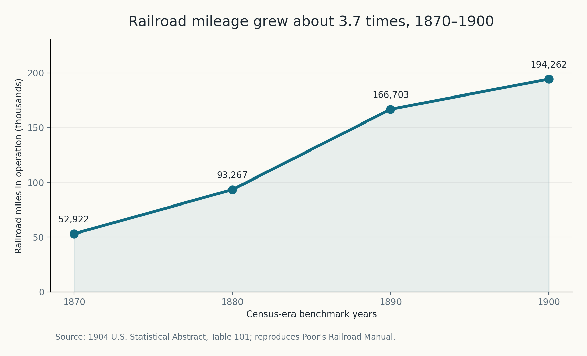
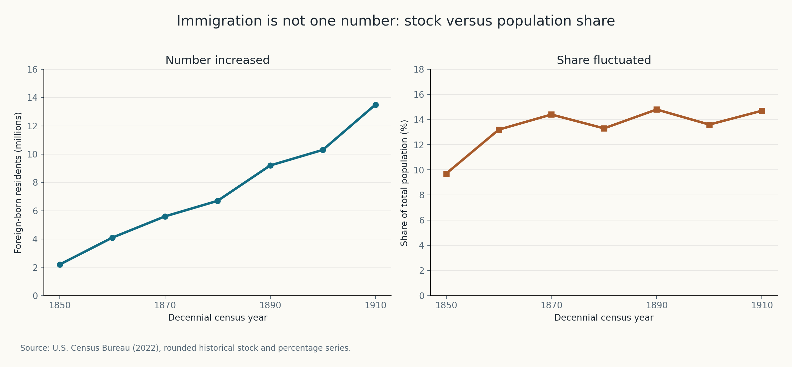
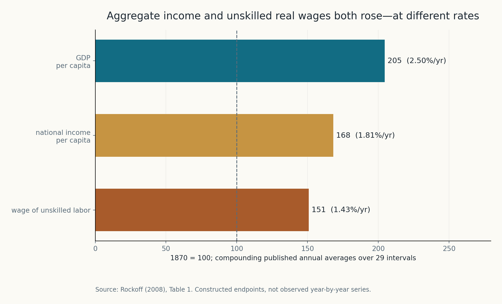
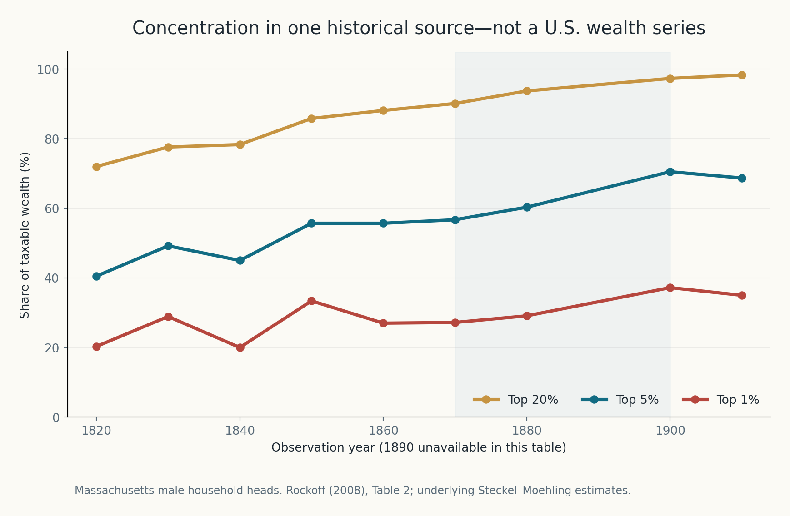
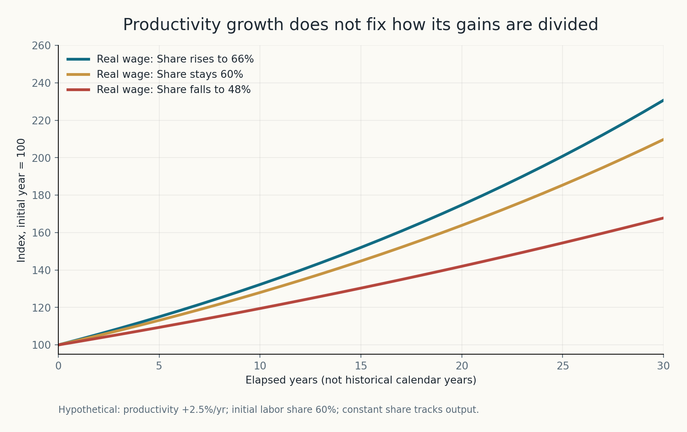
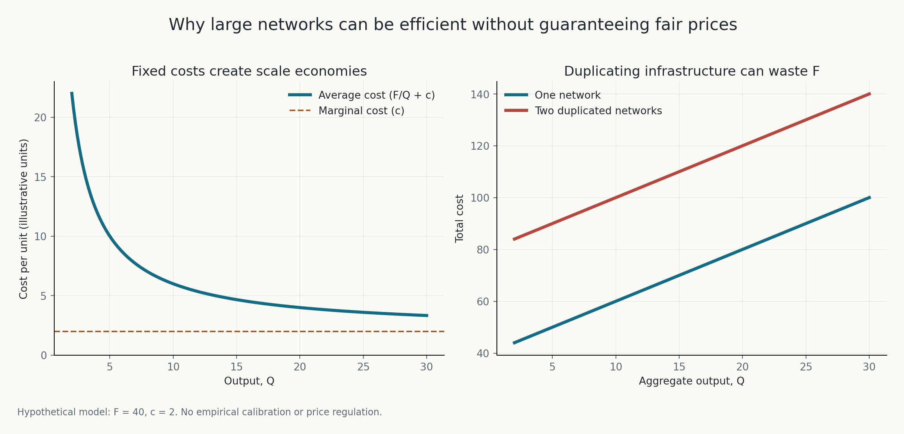
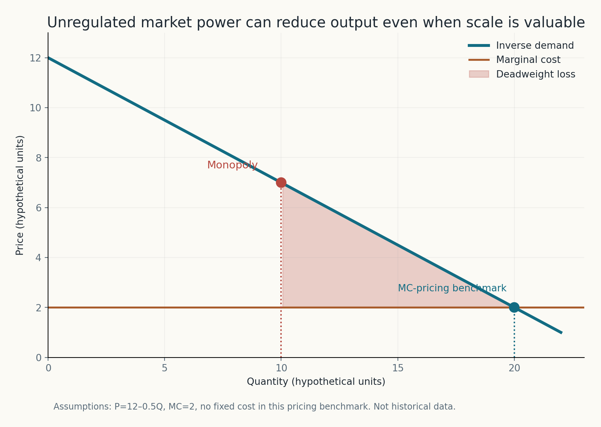
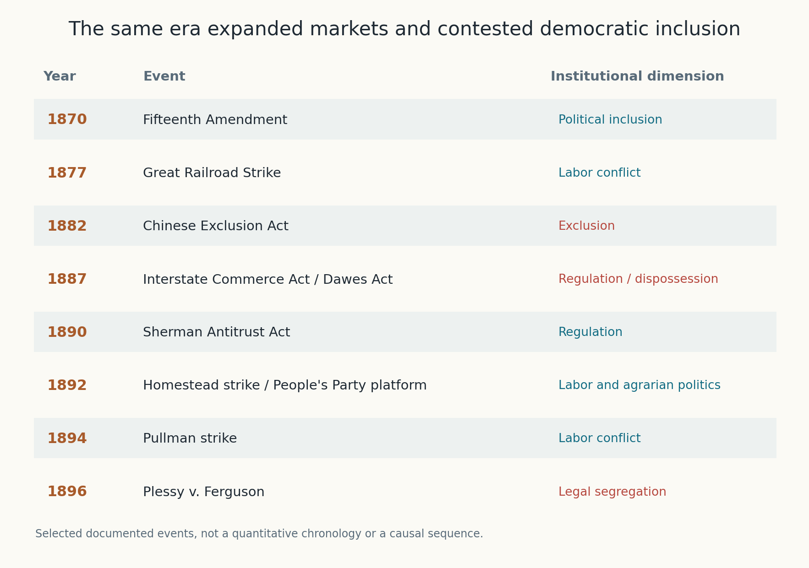

# The Gold Was Real. So Was the Gilding: The Political Economy of America's Gilded Age

*What railroads, wages, great fortunes, and battles over political rights reveal about the difference between creating wealth and sharing progress*

Diogo Ribeiro | October 2026

*A historical and mathematical essay with eight original figures. Four figures draw on carefully scoped historical data or published estimates; four illustrate economic mechanisms under hypothetical assumptions. Nothing in the illustrations is a causal estimate of nineteenth-century policy or a reconstruction of missing data. The [reproducible companion](README.md) contains the data transcriptions, methods, code, notebook, and tests.*

## The country looked richer. Who owned the shine?

In 1873, Mark Twain and Charles Dudley Warner published *The Gilded Age: A Tale of Today*, a satire about speculation, political corruption, and the distance between the language of progress and the conduct of powerful people. The novel did not supply historians with a statistical definition of an era. Its name eventually became the label for an American transformation whose economic achievements were both enormous and unequally governed. The [Library of Congress traces the term](https://guides.loc.gov/gilded-age-business/introduction) to that novel and notes that the name became common as a historical period label only later.

The distinction between gold and gilding is useful because it asks us to examine what is underneath the surface. To gild a surface is to make something appear more valuable by covering it with a thin decorative layer. Applied to American economic history, the metaphor does not mean that the industrial expansion was imaginary. Railroads genuinely connected regions. Factories increased the scale of production. New business organisations coordinated transactions that smaller firms could not previously manage. Technological innovation altered how Americans travelled, worked, ate, communicated, and invested.

Nor does the metaphor establish that everybody outside the richest households became poorer. That would be historically false. Some measures of living standards and real wages rose substantially during the late nineteenth century. A serious critical account must begin by acknowledging that progress. Otherwise the story becomes a morality play, in which entrepreneurs are villains, workers never gain anything, and institutions do not change. The economic history is more complicated and more illuminating.

Yet the gains of industrialisation did not answer the questions of ownership and power. In some places a railway provided the only affordable access to a national market. Workers could produce more output and still have little control over the factory's conditions or the division of its profits. A prosperous corporation could coexist with a financially exposed town. An expanding economy could coexist with the systematic restriction of voting rights, the exclusion of Chinese migrants, the dispossession of Indigenous nations, and violence against Black Americans. Aggregate output was not a democratic rights index.

This article is about that coexistence. It examines the American Gilded Age, conventionally understood as stretching from roughly the 1870s to the end of the nineteenth century, through three complementary lenses. The first is historical: what happened to transport, industry, wages, political rights, and organised resistance? The second is empirical: what can contemporary records and later economic reconstructions tell us, and where are they too weak to sustain confident numbers? The third is mathematical: why can technological efficiency and inequality, or falling unit costs and monopoly power, appear in the same economic system?

My argument is not that large firms are inherently harmful, nor that every strike is justified, nor that competition alone can solve social inequality. It is that **economic development and democratic development are distinct outcomes, governed by overlapping but different institutions.** Productivity can create opportunities; distributional arrangements determine who receives them. Network scale may reduce costs; rules over pricing and access determine who can benefit from those reductions. Political rights determine who can challenge the arrangements when they become unfair.

We should also resist the tempting final step of declaring that every contemporary technological boom is simply another Gilded Age. Historical analogies illuminate mechanisms, but they are not identification strategies. Today's capital markets, social insurance, voting institutions, labor law, fiscal systems, global supply chains, and digital infrastructures differ materially from the United States of 1890. The comparison is useful only when we specify which mechanisms are similar and which institutions have changed.

The evidence assembled here will lead to a narrower conclusion, and I think a stronger one: **a society can become richer while failing to distribute either economic security or political influence broadly.** The achievement of growth does not prove the achievement of justice. But a critique of unequal power should not erase the very real benefits of industrial expansion, either.

## 1. What belongs inside the Gilded Age?

Period labels are retrospective conveniences. They are not naturally occurring breaks in an economic time series. Some historians begin the Gilded Age after the Civil War, others after the political settlement of Reconstruction in 1877. Some end it around 1900; others regard the turn-of-century merger wave and early Progressive Era as part of the same institutional process. Hugh Rockoff, in the economic-history study *Great Fortunes of the Gilded Age*, works with the years 1870–1899 while noting that no precise dates have universal authority. The [working paper](https://www.nber.org/system/files/working_papers/w14555/w14555.pdf) is particularly useful because it combines economic performance with the study of the period's largest fortunes.

For our purposes, the interval from 1870 to 1900 is a practical frame. It begins near the ratification of the Fifteenth Amendment, extends through railroad expansion and large-scale industrial development, and ends before the principal legislative reforms associated with the twentieth-century Progressive Era. Some figures use 1850–1910 or 1820–1910 because their historical sources provide valuable context outside the chosen frame. Those observations are labelled; they are not quietly reassigned to the Gilded Age.

It would be a mistake to tell this story as though the country were one homogeneous industrial district. The economic circumstances of a steelworker in Pennsylvania, a cotton tenant in the South, a wheat farmer in Kansas, a Chinese railway worker in the West, and a financier in New York could differ fundamentally. Labor markets, property rights, local political institutions, mobility, racial discrimination, and exposure to international prices were not the same. Even the term *industrialisation* compresses changes in manufacturing, agriculture, services, communications, trade, urban settlement, and financial intermediation.

The economic expansion was inseparable from the Civil War's institutional aftermath. Emancipation and the Reconstruction Amendments transformed the constitutional meaning of citizenship, but enforcement was contested. The end of federal Reconstruction in the South did not make the promises of the Fourteenth and Fifteenth Amendments self-enforcing. Southern systems of segregation and disenfranchisement developed alongside Northern industrial investment. We therefore need to read industrial statistics next to the history of the franchise, courts, labor organisations, and state violence, not in an appendix to it.

The demographic scale was also striking. The country received migrants from abroad while internal migration moved people between regions and sectors. Population growth increased both the supply of labor and the demand for goods, housing, and infrastructure. New connections across previously separated markets changed relative prices and incentives. But total population, the number of immigrants, the number of wage workers, and the proportion of people with genuine political rights are four different quantities. It is possible for all four to move in different directions.

The phrase *the rise of the corporation* similarly needs care. The legal form of a corporation long predated the Gilded Age. What changed was the scale of business organisation, financial claims, managerial coordination, production technology, and market reach in particular sectors. A large railway network or an oil-refining system could exploit economies unavailable to small, disconnected establishments. The precise size that minimises cost, however, is not a moral rule about how such a company should price its products, treat workers, or influence government.

The central historical questions are therefore not adequately described by a simple contest between markets and the state. Who received legal permission to build, consolidate, exclude, bargain, strike, own property, or vote? Which demands could be enforced, and by whom? Which conflicts did public officials treat as problems of competition, and which did they treat as problems of public order? This approach makes the era a study of institutions, not merely an album of famous millionaires.

## 2. The railroad was an economic revolution, not just a symbol of excess

Consider the railroad system. In the 1904 *Statistical Abstract of the United States*, Table 101 reproduced a series from *Poor's Railroad Manual* for miles of railway in operation. It reported 52,922 miles in 1870, 93,267 in 1880, 166,703 in 1890, and 194,262 in 1900. The [Census Bureau's historical statistical abstract](https://www2.census.gov/library/publications/1905/compendia/statab/27ed/1904-04.pdf) remains accessible. The figure below transcribes those four benchmarks. It shows growth by a factor of about 3.67 over thirty years.

*Figure 1.* Reported U.S. railroad mileage in operation, from the 1904 *Statistical Abstract*, Table 101, which attributes the series to *Poor's Railroad Manual*. This is line mileage, not proof of an equivalent increase in service quality, traffic, or welfare. The line joins four historical benchmarks and does not invent annual observations between them.

Railroads changed the feasible geography of an economy. A farmer whose crop could previously reach only a local market could sell into distant markets, subject to transport prices and product conditions. A manufacturer could source materials from a wider region and sell output over a larger area. Railways expanded the practical market for perishable goods, coal, steel, machinery, timber, and agricultural products. They facilitated the growth of specialised production and the coordination of economic activities over distances that had previously imposed prohibitive costs.

The gains were not only monetary. Transport networks can reduce travel time, allow families to move, improve access to goods, and alter what kinds of enterprises are feasible in a region. In economic language, they change both the production possibilities and the effective boundaries of markets. Rockoff's account of great fortunes emphasises this complementarity: the development of continuous-flow manufacturing processes and wide transport networks made new forms of large-scale production possible. A refinery is more valuable when raw materials and finished products can be moved reliably.

But railway expansion also changed the structure of dependence. In a city with several independent routes, shippers might compare prices. In a locality served by one viable line, the railway could be a gatekeeper to the wider economy. Farmers often lacked the shipment volume or bargaining position of large industrial customers. Transport costs were simultaneously falling in an aggregate sense and remaining high or discriminatory for particular users. These two statements are not contradictory.

The [National Archives' account of the Interstate Commerce Act](https://www.archives.gov/milestone-documents/interstate-commerce-act) explains the distinction between competing long-haul routes and locally monopolistic short-haul services. It also describes rebates and discriminatory prices for different shippers and localities. The relevant economics is not that one big company was always inefficient. It is that efficient scale can coexist with market power, especially where building a rival network requires very large fixed expenditure.

Before celebrating either market concentration or compulsory competition, we have to ask which problem a policy is intended to solve. Forcing three complete parallel railway networks into a small market might waste resources. Giving one network an unrestricted right to discriminate among captive customers creates a different problem. A public-interest response may involve rate regulation, nondiscriminatory access, common-carrier rules, structural separation, or public ownership, each with its own difficulties. The optimal choice cannot be inferred from the number of firms alone.

The railway example also limits what can be concluded from a national infrastructure statistic. A measure of miles in operation says little about quality, maintenance, freight rates, wages, shareholder returns, environmental damage, land acquisition, or who gained access. It provides evidence of capacity expansion. It does not settle the distributional argument. To understand the Gilded Age, we need both those observations in view.

## 3. A nation of migration, but not a single immigration story

The Gilded Age was also a period of substantial international migration. Census reconstructions show an increase in the foreign-born population from approximately 5.6 million in 1870 to 10.3 million in 1900. In the same period, the foreign-born proportion of the total population moved from about 14.4% in 1870 to 13.6% in 1900, with 14.8% recorded in 1890. These are not contradictory measurements: the total population grew as well.

The [U.S. Census Bureau's historical presentation](https://www2.census.gov/about/training-workshops/2022/2022-03-31-ancestry-presentation.pdf) reports rounded figures from 1850 to 2010. We transcribed seven decennial observations from 1850 through 1910, including the surrounding years as context.

*Figure 2.* A population stock in millions on the left and a percentage of all residents on the right. Both panels come from a Census Bureau historical compilation and use rounded values. Neither panel is an annual flow of new arrivals; these data do not identify the causal effect of a particular immigration law.

This figure illustrates a general statistical discipline that often disappears from public debate. A count can increase while a percentage stays roughly stable or falls. A group's share of the population cannot be inferred from the size of the group without the denominator. Even if immigration changes labor supply, it does not follow that we can directly infer the size of a wage effect from the foreign-born stock. Such an inference would require a model of skill composition, capital adjustment, geographic substitutability, demand, trade, institutions, and selection into sectors.

Nor should we imagine migrants as a uniform input to production. Different people arrived with different languages, family structures, resources, occupations, and legal positions. Many worked in conditions of substantial dependence, but migrant entrepreneurs also formed businesses and community institutions. The economy's capacity to absorb migration developed through housing construction, transport, employer recruitment, networks of relatives, and changes in the geography of industry. Integration and exclusion occurred alongside one another.

The political contradiction was especially clear in 1882, when the federal government enacted the Chinese Exclusion Act. The [National Archives preserves the legislation and its context](https://www.archives.gov/milestone-documents/chinese-exclusion-act). The law restricted the immigration of Chinese laborers and prevented Chinese nationals from obtaining naturalisation, with exemptions for certain categories. Its later extensions demonstrate that this was not an isolated administrative episode. An expanding economy could actively recruit, depend on, or profit from labor while the political system restricted the rights and entry of a particular group.

The Chinese Exclusion Act should not be described as the inevitable result of a statistical increase in the foreign-born population. The plotted data describe the national stock of residents born abroad; they do not isolate Chinese migration or the political coalitions that produced exclusion. Racism, labor competition, political agitation, legal classifications, and international relations formed the relevant context. A national percentage line cannot substitute for that history.

There is also a deeper issue of who is included in the data. Historical censuses were designed and conducted through institutions with changing categories, boundaries, and uneven coverage. The status and treatment of Indigenous people, people living in different territories, racial classifications, and local enumeration practices complicate any attempt to treat the historical denominator as a perfectly neutral object. The figures are useful, but their numerical precision is not the same thing as conceptual completeness.

Immigration therefore exposes one of the central paradoxes of the era. Industrial development depended on mobility, networks, and access to labor. The political community decided, with unequal principles, which mobile people could become full members and which would face restriction. Growth expanded economic possibilities, but it did not automatically generate universal citizenship.

## 4. Real wages rose. That does not settle the distributional question

One weakness in popular accounts of the Gilded Age is the suggestion that an economy cannot be unequal if living standards improve, or conversely that rising inequality proves ordinary people received no benefit from growth. Both claims confuse different outcomes. The difference is visible even in economic estimates produced by researchers critical of the era's concentration of wealth.

In *Great Fortunes of the Gilded Age*, Rockoff tabulates average annual growth rates for 1870–1899. His Table 1 reports approximately 2.50% a year for real GDP per capita, 1.81% for real national income per capita, and 1.43% for the real wage of unskilled labor. These are historical reconstructions with different definitions and source methods, not three perfectly comparable administrative measurements. In the same table, the estimated cost of living fell over the period, which helps explain how real wages could increase despite weaker nominal wage growth.

The following figure compounds each reported average rate over the 29 intervals separating 1870 and 1899 and sets its initial index to 100. This exercise compares implied endpoint changes under constant compounding; it is explicitly **not** a plot of actual year-by-year observations.

*Figure 3.* Three constructed endpoints from Rockoff (2008), Table 1: real GDP per capita, real national income per capita, and the real wage of unskilled labor. Annual averages are compounded mathematically. The bars do not claim that the historical annual trajectories were smooth, and their different measurement frameworks prevent treating every gap as a directly estimated transfer between groups.

Both the real wage and the broad measures of income rose in these reconstructions. The observation matters. Industrial progress was capable of improving material conditions even without the later welfare state. It is not intellectually serious to deny that achievement merely to make the moral criticism easier. A debate about the Gilded Age must allow for the possibility that some conditions became better, while other aspects of life remained harsh or became more unequal.

The same estimates also show why aggregate growth is not a complete welfare argument. If GDP per capita grows faster than a wage series, we cannot immediately assign the difference to the wealthiest one percent; the measures have different coverage and concepts. But the discrepancy rightly motivates further investigation into the labor share, capital income, the composition of workers, prices, hours of work, and the distribution within each group. Different growth rates make the allocation of gains an empirical question, not a conclusion.

Consider working time. Two jobs paying the same weekly wage need not offer the same welfare if one requires much longer hours, more physical danger, or unstable employment. A nominal wage is not a real wage; a real wage is not a measure of health; a national average is not the wage of a specific worker. The real cost of living also differs by locality and household composition. These were not minor technicalities to the people whose families depended on finding work after a factory closed or a railway cut its payroll.

The history of financial crises makes the problem sharper. An average growth rate across three decades can be positive while entire years are catastrophic for particular households. The Panic of 1873 and the Panic of 1893 disrupted credit and production, with the latter followed by severe unemployment. The [Federal Reserve's historical account](https://www.federalreservehistory.org/essays/banking-panics-of-the-gilded-age) explains how banking and railroad finance transmitted shocks through the broader economy. An endpoint index cannot record the insecurity experienced between those endpoints.

It is equally important not to mistake the word *unskilled* in historical wage tables for a neutral description of the people concerned. It is an occupational classification from a particular literature, not a judgment about workers' abilities or contributions. Other occupations, women workers, agricultural laborers, and racialised labor markets may follow quite different paths. We cannot recover all their experiences by averaging one series into a universal American wage.

The most honest conclusion is therefore neither that prosperity was entirely fraudulent nor that growth vindicated the existing institutions. The evidence supports substantial economic expansion and some real-wage improvement. The claims about who accumulated wealth, who controlled production, and who bore the risks require other data and another level of analysis.

## 5. Great fortunes and the limits of measuring inequality before 1913

The Gilded Age has become inseparable from the names of Carnegie, Rockefeller, Vanderbilt, and other wealthy families. But lists of spectacular fortunes are not income-distribution surveys. They reveal what certain prominent individuals owned or were believed to own; they do not by themselves reveal what a typical household possessed, the share owned by the top one percent, or how the economic position of the median family changed.

Rockoff's paper is valuable partly because it takes the old lists of millionaires seriously as historical evidence while remaining alert to their limitations. He studies lists published in 1892 and 1902, identifies sources of wealth, and traces the roles of manufacturing, inheritance, wholesale and retail trade, real estate, and finance. In his account, new industrial production technology helped create large fortunes, but the pathways through which fortunes were maintained and diversified were not confined to factory ownership. Land and financial investment were important, too.

This is an economic point, not just a biographical one. A firm can become more productive because of genuine innovation, while the wealth of its owner also grows through asset appreciation, market access, financing arrangements, and rents derived from scarce or legally protected positions. We need not declare every fortune undeserved to recognise that wealth accumulation is not a single mechanism. A serious historical explanation decomposes its sources.

The difficulty is data. The United States did not have the sort of comprehensive federal income-tax records that support much modern income-inequality research during the 1870s or 1880s. A national income tax arrived later. Wealth measurement is even more complicated, especially when sources consist of tax assessments, probate documents, household records, and estimates of substantial fortunes. These instruments differ in coverage, legal definitions, reporting incentives, and sample selection.

To see both what can be learned and what must not be generalised, consider the research by Richard Steckel and Carolyn Moehling on Massachusetts wealth, reported in Rockoff's Table 2. Their estimates concern taxable wealth among **male household heads in Massachusetts**. This is a historically useful regional series with a clearly defined population. It is emphatically not the U.S. national wealth distribution, nor the taxable wealth of all adults and all households.

*Figure 4.* A transcription of the Massachusetts distribution presented in Rockoff (2008), Table 2, based on Steckel and Moehling's research. The top-one-percent share rose from 27.2% in 1870 to 37.2% in 1900 **within this sample definition**. The graph also shows top-five- and top-twenty-percent shares and leaves 1890 unobserved; it cannot be used as a national Gini coefficient.

The increase of ten percentage points in the top-one-percent share between the two named observations is substantial. It says something about the regional concentration of assessed taxable wealth during industrialisation. It does not establish a corresponding ten-point increase for the entire American population, nor does it identify the causal contribution of railroads, immigration, monopoly, or any individual law. The source is powerful precisely because we can state both its finding and its boundary.

Steckel and Moehling's [research abstract](https://www.nber.org/papers/h0122) reports a substantial rise in inequality over the longer period and notes that shifts out of rural areas and agriculture into more unequal urban settings contributed to the result. Yet the authors also find increasing inequality within groups, and they caution against simple labor-market explanations. This is not a story that can be solved by saying all the inequality was merely the statistical consequence of people moving to cities.

The sample restriction matters for more than statistical neatness. A record of male household heads reflects legal and social practices around property and family representation. It can miss economic dependency and assets held by women or recorded under different arrangements. Taxable wealth is not necessarily all marketable wealth, and the prevalence of people with little or no taxable property can strongly affect top-share calculations. These features are part of the interpretation, not embarrassments to omit from the chart caption.

The responsible inference is that considerable wealth concentration existed and, in this important regional evidence, intensified. We cannot legitimately replace a missing national series with a modern Gini estimate or project present-day survey methodology backwards as though definitions were fixed. The lack of comprehensive data should make us more careful about quantitative claims, not less interested in the question.

There is also a normative issue distinct from measurement. Suppose a society's lowest incomes rise while the rich become enormously richer. Has inequality become irrelevant? Not necessarily. A person's capacity to buy goods is one component of welfare. Wealth can also purchase security during crises, the ability to bear risk, access to education and property, legal representation, control of workplaces, and influence over political decisions. The institutional consequences of concentrated wealth may extend beyond the distribution of current consumption.

That is why the Gilded Age continues to matter as a case study. Wealth was created through processes that often had genuine productive value. But the social consequences depended on how firms, property, labor organisations, financial claims, and democratic institutions divided and governed the gains. To explain the period adequately, we must examine both the production of the surplus and the power to allocate it.

## 6. A small accounting identity explains why production and wages can diverge

Economic history requires more than attaching a single moral label to a growth rate. It helps to write down the relationship between production, workers, and distribution. Let total real output be \(Y_t\), the number of workers be \(L_t\), and average output per worker be \(A_t=Y_t/L_t\). For the moment, imagine a highly simplified economy in which a fraction \(s_t\) of output becomes workers' compensation. Total labor compensation is \(W_t=s_tY_t\), and compensation per worker is therefore

\[
w_t=\frac{W_t}{L_t}=s_t A_t.
\]

Taking the ratio between two dates gives

\[
\frac{w_t}{w_0}
=\frac{A_t}{A_0}\frac{s_t}{s_0}.
\]

The identity is elementary. Its implication is often neglected. If labor's share is constant, compensation per worker grows at the same rate as average output per worker, under the model's deliberately simplified definitions. If the share falls, compensation can grow more slowly; if it rises, compensation can grow more quickly. Productivity growth therefore creates the possibility of higher wages but does not, by arithmetic alone, fix the distribution of its benefits.

Consider a hypothetical economy in which output per worker grows by 2.5% annually for thirty years. This number is chosen for illustration, and the model must not be confused with Rockoff's historical GDP-per-capita series. Suppose labor's initial output share is 60%. If it stays at 60%, the wage index follows the productivity index. If it rises linearly to 66%, the wage index ends higher. If it falls to 48%, the wage index grows more slowly despite the unchanged productivity path.

*Figure 5.* An accounting illustration with assumed annual productivity growth of 2.5%, an initial labor share of 60%, and three arbitrarily selected endpoints for that share after thirty years. No historical labor-share series is used, estimated, or implied. The paths show a conditional mathematical relationship, not observed Gilded Age wages.

The hypothetical wage index increases in all three scenarios. That is important: a falling labor share does not automatically mean falling real pay. The value of output per worker may increase enough to offset the smaller share. Conversely, a growing labor share does not guarantee that all households gain equally, because earnings can remain uneven within the labor force. The model makes one relationship visible by holding other conditions fixed; it should not be promoted into a general theory of every aspect of inequality.

There are several reasons not to apply this identity naively to historical data. GDP per capita is output divided by total population, not necessarily output per worker. People work different hours, participate in different sectors, and receive different forms of compensation. Real output is deflated with an output price measure; real wages may be deflated with a household consumption basket. Some income goes to the self-employed, whose labor and capital returns are difficult to separate. Taxes and public services can alter disposable welfare. Historical data are particularly thin on the household and working-time margins.

The identity is useful not because it solves those problems, but because it disciplines the questions. Did productivity increase? Did the proportion flowing to labor change? Did the distribution among workers change? What happened to hours, job security, employment risk, and the costs of basic necessities? The answers may differ. A statistical report that establishes only one of them has not established all of them.

The same logic applies to political claims. If a leader says that a factory has become more productive, the statement can be true while a worker objects to the wage contract. If a worker says that compensation is inadequate, the objection does not disprove technological progress. The disagreement concerns the allocation and terms of production, not whether machines and logistics improved. Separating these questions is the beginning of analysis, not a rhetorical concession to either side.

## 7. Why efficient networks can become instruments of power

Railways have high fixed costs. Before a single fare or freight charge can be collected, a company must acquire land or access rights, construct track and bridges, arrange stations, buy equipment, and establish an operating system. Large expenses are incurred regardless of whether the network initially carries many or few passengers. This structure helps explain why a railway is unlike a roadside stall.

Write total cost as

\[
C(Q)=F+cQ,\qquad F>0,\quad c\geq0,
\]

where \(F\) is a fixed network cost and \(c\) is the marginal cost of each additional unit of traffic. The average cost is

\[
AC(Q)=\frac{F}{Q}+c.
\]

As \(Q\) increases, the fixed cost is spread over more output. This stylised model gives declining average cost, a simple form of economies of scale. Suppose two independent companies must duplicate the same infrastructure to serve the same aggregate output. If their variable cost per unit is the same, a single network costs \(F+cQ\), while two complete networks together cost \(2F+cQ\). The additional fixed cost is real even if competition later benefits some customers.

*Figure 6.* A theoretical cost exercise using \(F=40\) and \(c=2\) in arbitrary units. The left panel shows how average cost declines as a fixed cost is distributed over more output. The right compares a single network with two complete networks serving the same combined quantity. The example contains no observed railroad cost estimates.

This is one reason the history of large corporations cannot be adequately written as a tale of small firms being virtuous and big firms being bad. Some activities are expensive to divide. A coordinated network may create genuine savings and new services. A policy that ignores these economies can destroy valuable infrastructure or make access more expensive. The natural-monopoly argument is a warning against assuming that duplicating fixed-cost facilities always improves efficiency.

But it is also a warning against the opposite mistake. The fact that one network may minimise production cost says nothing by itself about the price its owner will charge. The operator may have an incentive to set prices above the incremental cost of service, to discriminate among users with different alternatives, or to favour large customers who offer more profitable volume. A captive shipper can face high charges even when the network's technological cost is low.

An additional complication is that railroads were not equally monopolistic everywhere. Competing routes existed for certain cities and long-haul markets. Alternative waterways, modes of transport, and routing arrangements constrained some rates but not others. There was no universal railroad monopoly price. The institutional challenge was to identify where and how market power operated, and to address it without eliminating the network benefits.

The [National Archives' account of the 1887 Interstate Commerce Act](https://www.archives.gov/milestone-documents/interstate-commerce-act) records a direct political response. Farmers and small shippers objected to discriminatory rates and rebates, while rail operators and large customers benefited from arrangements that could be difficult for a smaller participant to match. The Interstate Commerce Commission was established to address these concerns. The statute attempted to govern a system whose economic value did not eliminate its unequal bargaining positions.

There is no single obvious solution. Marginal-cost pricing may fail to cover large fixed costs. Average-cost pricing can cover the network but may still generate distributional concerns. A public subsidy raises questions of taxation, auditing, and incentives. Public ownership avoids some private monopoly incentives while creating other risks of inefficiency or political capture. Structural regulation may work well in one market and poorly in another. The economic problem requires institutional design, not a slogan about size.

The important distinction is between **the technology that makes scale efficient** and **the political rules that govern what scale permits a firm to do**. The first determines a feasible cost structure. The second determines pricing, access, accountability, and the distribution of rents. The Gilded Age made that distinction visible because an increasingly interconnected country was also increasingly dependent on strategically placed private organisations.

## 8. Monopoly pricing can waste welfare without erasing the value of innovation

To make the tension precise, consider a second hypothetical model. For now set fixed cost aside, so we can isolate the pricing distortion. Suppose inverse demand is linear:

\[
P(Q)=a-bQ,\qquad a>c\geq0,\quad b>0,
\]

and production has constant marginal cost \(MC=c\). Under a simple competitive or marginal-cost-pricing benchmark, the quantity at which price equals marginal cost is

\[
Q_C=\frac{a-c}{b}.
\]

A profit-maximising, single-price monopolist equates marginal revenue to marginal cost. Because marginal revenue is \(MR=a-2bQ\), its chosen quantity is

\[
Q_M=\frac{a-c}{2b}=\frac{Q_C}{2},
\]

and its price is

\[
P_M=\frac{a+c}{2}.
\]

The monopolist restricts output relative to the marginal-cost benchmark and charges a price above marginal cost. In this particular model, the loss of total surplus from otherwise valuable transactions that do not occur is

\[
DWL=\frac{1}{2}(Q_C-Q_M)(P_M-c)
=\frac{(a-c)^2}{8b}.
\]

For the illustrative parameters \(a=12\), \(b=0.5\), and \(c=2\), the benchmark quantity is 20, the monopoly quantity is 10, the monopoly price is 7, and the deadweight loss is 25 arbitrary surplus units. These are mathematical outputs, not estimates of American rail rates.

*Figure 7.* Linear demand and constant marginal cost under a single-price, unregulated monopoly in a purely theoretical market. The shaded region is the deadweight loss relative to marginal-cost pricing. It does not describe an observed nineteenth-century firm, and this static pricing exercise intentionally omits fixed costs.

Why omit the fixed cost here? Because a firm with substantial fixed cost may not be financially sustainable if it is required to charge marginal cost without compensation. Mixing that problem with the elementary surplus diagram would conceal a real policy tradeoff. Figure 6 explains the scale advantage of a network with fixed costs; Figure 7 separately explains why unregulated pricing power can be inefficient. Together they show how a firm can be technologically efficient and still require rules to prevent the exploitation of market power.

Real markets are not this simple. Firms may have multiple products and multiple classes of customer. Demand may depend on network size, frequency, reliability, and geographic access. A firm can price discriminate, face potential competition, have regulated rates, or negotiate long-term contracts. Investment incentives matter, and an intervention that eliminates rents may also change the incentive to build. We cannot infer a historical deadweight-loss triangle from a nineteenth-century company name alone.

Nevertheless, the model illuminates the conflict that made railroads a major political issue. Some shippers benefited from the growth of the network while objecting to rates or preferential contracts. The same steel lines that connected them to distant markets could become indispensable infrastructure whose owner controlled their terms of access. Economic integration produced both greater opportunity and new dependencies.

The policy discussion was not simply anti-business. Farmers demanded more predictable and equitable rates because they relied on transport to participate in commerce. Their complaint was that market access should not be governed entirely by private arrangements that imposed arbitrary or discriminatory terms on those without alternatives. Seen in this light, regulation can be an attempt to make a valuable network work for more people, rather than a denial of the network's productive worth.

This distinction is also useful today, but only with care. Digital platforms, electricity networks, ports, telecommunications, and payment systems have different cost functions and different sources of market power. Some feature network effects in demand as well as economies of scale in supply. The nineteenth-century railroad is a conceptual analogy, not an empirical substitute for studying any modern platform. The general lesson is to analyse the infrastructure and the rules together.

## 9. The labor contract was a political institution, not just a price

Factories and railways depended on people whose ability to negotiate varied with their skills, savings, local opportunities, family obligations, and legal status. An economist may begin with a wage as the price of labor services. But a wage contract is negotiated under institutions governing association, dismissal, violence, property, and collective action. The demand for labor is partly technical; the balance of bargaining power is not.

The 1877 Great Railroad Strike illustrates the scale of conflict that could accompany wage cuts and financial distress. Railway workers resisted reductions in compensation, and the protests spread across several parts of the country. Public authorities intervened, sometimes with force. The [Library of Congress chronology of railroad labor organisations](https://guides.loc.gov/organized-labor/railroads) places the strike within a longer history of unions, arbitration measures, and disputes that extended beyond the nineteenth century. The conflict cannot be reduced to the equation of labor demand and labor supply at a single point in time.

In 1892, the conflict at Carnegie Steel's Homestead works became a decisive confrontation over wages and union power. Negotiations failed; management prepared to continue production without the union; private security agents were brought in; violence followed; and state militia helped enable the plant's reopening. The [Library of Congress guide to the Homestead Strike](https://guides.loc.gov/this-month-in-business-history/july/1892-homestead-strike) documents the conflict and its consequences for the union's position in steel. It is a vivid example of why one cannot analyse industrial relations as a voluntary exchange between parties who command equal resources.

The 1894 Pullman strike made the relationship between wages and housing especially visible. The Pullman company operated a company town in which many workers rented their homes from their employer. During a downturn, workers faced reduced wages while remaining exposed to the costs of company-owned housing. A strike and nationwide boycott followed, as did federal intervention and violence. The [Library of Congress's historical exhibition](https://www.loc.gov/exhibits/treasures/tr11c.html) provides a chronology. The economic issue was not merely whether the wage had moved with the market; it was how employer power extended across employment, residence, and access to alternative livelihoods.

These are concrete episodes, not proof that all employers behaved similarly. Some industrial workers received rising real wages. Some companies offered employment stability or opportunities for advancement; some managers introduced valuable improvements. Strikes themselves had different objectives, degrees of public support, and consequences. Violence in industrial conflict harmed people, and neither a union nor a corporation possesses automatic moral authority merely by occupying its side of the bargaining table.

What the examples reveal is the inadequacy of the frictionless model. A worker may have a nominal right to leave but lack savings, transport, or alternative jobs in the relevant town. An employer may have a nominal right to dismiss but face the cost of training replacements, disrupting production, or losing specialised knowledge. A union may increase workers' bargaining leverage; a court injunction, public force, or discriminatory employment rule may weaken it. The outcomes depend on these mechanisms, not just on individual preferences.

Suresh Naidu and Noam Yuchtman's research, [*Labor Market Institutions in the Gilded Age of American Economic History*](https://www.nber.org/papers/w22117), finds evidence of firm-specific rents and discusses how wage bargains, strikes, judicial injunctions, and public intervention shaped nineteenth-century labor markets. Their analysis is particularly important because it does not treat the absence of comprehensive modern labor law as the absence of institutions. Courts and police are institutions. Employers' legal rights are institutions. The conditions under which workers can organise are institutions.

This connects the historical story to the general question of moderation and political conflict. When a government or company asks workers to abandon a strike before bargaining, the question is not only whether everyone is behaving politely. It is whether the request changes the costs of disagreement and the incentives to compromise. In some circumstances a temporary suspension supports a credible settlement. In others it removes the workers' principal bargaining instrument. The ethical and strategic assessment depends on the terms, enforcement, and alternatives—not on the word *moderate*.

Organised labor itself was not perfectly inclusive. Divisions by race, occupation, skill, gender, and migration status could affect who was admitted to unions and whose grievances they defended. An adequate account of workers' power must examine the boundaries of solidarity as well as the conflicts between employees and owners. There was no single worker interest that automatically included every person employed in the rapidly changing economy.

The Gilded Age therefore exposes two forms of institutional asymmetry. Productive assets were often owned by relatively few entities, and the legal system could shape how those assets were defended in disputes. But workers also attempted to build collective institutions to negotiate on more equal terms. The contest was over the distribution of a surplus that technological progress had helped create—and over which methods of collective pressure the political system would recognise as legitimate.

## 10. Banking panics and the distribution of economic risk

The era's optimism about production has to be set beside its fragile financial arrangements. Railways required large capital investment, often financed through securities and debt. Their construction could generate productivity gains, but it could also encourage speculative expansion, optimistic projections of future traffic, and debt commitments vulnerable to downturns. A railway was physical infrastructure; its financing belonged to a system of expectations and credit.

The Panic of 1873 was linked to railroad investment, international financial shocks, and the collapse of Jay Cooke and Company, a major financier exposed to railway development. The consequences passed through creditors, firms, workers, and communities. The Panic of 1893 involved banks, monetary pressures, business contraction, and renewed fears about convertibility and financial stability. The [Federal Reserve's historical account of Gilded Age banking panics](https://www.federalreservehistory.org/essays/banking-panics-of-the-gilded-age) details the episodes and their different transmission mechanisms.

Here the distributional problem is temporal as well as social. Suppose a country experiences thirty years of high average growth, but with several periods when credit collapses and employment becomes scarce. An investor with liquid savings may survive and purchase distressed assets. A worker whose income ceases immediately may have to sell belongings, borrow at unfavourable rates, or move. A farmer facing falling prices may be unable to service debt even if average agricultural productivity is improving.

Averages suppress this heterogeneity. The arithmetic mean of growth rates is not a measure of the probability that an individual household can meet its obligations in every month. Total economic output can recover more quickly than a household rebuilds lost assets. A recession can leave persistent effects on educational opportunity, health, home ownership, and regional development. Those are mechanisms worth investigating, not claims that we have estimated their exact nineteenth-century magnitudes in this article.

Economic security also depends on the distribution of liquidity. A family with more wealth has a larger option to wait, refinance, and resist a bad contract. In crisis, that option itself can be economically valuable. Wealth therefore matters not only as a claim on current consumption but as insurance against an unpredictable future. Concentration can affect who is forced to accept lower wages or sell property under adverse conditions.

The panics also illustrate that systemic risk is a collective-action problem. A bank's funding decisions may be individually rational under expected conditions, but correlated failures and runs impose costs across the financial system. A railroad's financing strategy can affect employers and suppliers who did not consent to its leverage. The case for institutional safeguards is not simply that some investors become too rich. It is that private arrangements may create vulnerabilities with social consequences larger than the originating contract.

None of this implies that a late nineteenth-century economy could simply have adopted all the institutions of a modern central bank and welfare state. The Federal Reserve did not exist until 1913, and the political and administrative capacity for contemporary stabilisation policies developed gradually. A historically serious counterfactual must account for the knowledge, monetary arrangements, federal powers, and political coalitions of the time.

The broader point is that **a high long-run growth rate and a safe economic life are not equivalent achievements**. The gains from industrial coordination were real. So were the risks of credit expansion and concentrated exposure to shocks. Evaluating an economic system requires questions about volatility, loss absorption, and the ability of ordinary households to withstand disruptions—not merely the trend in national output.

## 11. Farmers, the Populists, and the struggle over public infrastructure

The Gilded Age's political resistance was not confined to the factory floor. Farmers faced market power in transportation, volatile crop prices, credit conditions, and the difficulty of bargaining individually with large intermediaries. For an isolated producer, the price quoted by a railway or lender could determine whether a commercially valuable crop produced enough income to cover debts. A national market might expand opportunities and simultaneously make farmers dependent on institutions they could not easily influence.

The Granger movement and related agrarian organisations pressed for changes in railroad practices. The [National Archives' account of interstate commerce regulation](https://www.archives.gov/milestone-documents/interstate-commerce-act) documents how state-level efforts faced constitutional and practical limits, particularly when transport crossed state boundaries. The federal Interstate Commerce Act of 1887 was not an abstract prohibition on markets. It responded to concrete complaints about discriminatory prices and the public consequences of privately controlled infrastructure.

The People's Party, or Populists, went further. Its 1892 Omaha platform proposed public ownership of railways, monetary reform, a graduated income tax, and other institutional changes. The [National Constitution Center reproduces the historical platform](https://constitutioncenter.org/the-constitution/historic-document-library/detail/populist-party-platform-july-4-1892-in-a-populist-reader-selections-from-the-works-of-american-populist-leaders-9096), while the [Library of Congress holds contemporary collections of party platforms](https://www.loc.gov/item/30000314/). These are documents that allow us to see how critics at the time understood the relation between economic dependence and democratic government.

Their demands may seem far apart from the modern textbook definition of a competitive market. Yet the underlying problem was recognisable: if a network is a necessity for participation in commerce, private control of access can become a public issue. The Populists argued that economic freedom was incomplete when infrastructure owners had the capacity to govern the conditions under which other producers entered the market.

The platform also reveals how economic arguments can become political arguments about sovereignty. If public institutions cannot regulate or own indispensable systems, who determines their terms? If they can, who holds the regulators accountable? The response does not have to be full public ownership. But a debate over rates and transport becomes a debate about the reach of democratic authority once a private service becomes essential to large numbers of citizens.

We should not romanticise the Populist movement as a uniform alliance of all the dispossessed. Regional political divisions, race, and competing views on currency and federal power complicated its programme. Proposals that could help some indebted farmers could affect creditors and other groups differently. Some elements of populist reform became influential later, while other proposals did not achieve their stated aims. Their existence shows that dissatisfaction with the Gilded Age's institutional arrangements was contemporary to the boom, not an objection invented a century later.

There is a useful analytic distinction here. A campaign can seek a different *allocation* within existing rules, such as a lower railway charge, or it can demand a change in the *rules of allocation*, such as a new regulatory authority. The second may be necessary when the same economic grievance repeatedly arises because one party controls the structure of the market. Political reform is not merely the aggregation of separate price negotiations; it can change the rights and constraints under which all future negotiations occur.

This makes the era a useful case for institutional economics. Technological progress altered feasible production and transport costs. Organisations made claims on the gains. Collective movements challenged the rules. Legislatures and courts partially revised them. None of these components alone explains the outcome. Growth was an outcome of the whole system, and so was the struggle over its direction.

## 12. The constitutional contradiction: growth without equal membership

There is another reason to resist judging the Gilded Age through output statistics alone. The meaning of citizenship and political membership was contested in ways that shaped whose interests could be represented and enforced. A society's capacity to make goods is not a sufficient measure of its commitment to equal rights. The coexistence of industrial expansion and legal exclusion is one of the period's defining features.

The Fifteenth Amendment, ratified in 1870, prohibited denial of voting rights on account of race, color, or previous condition of servitude. The [National Archives documents both the amendment and subsequent devices used to circumvent its promise](https://www.archives.gov/milestone-documents/15th-amendment). In the decades after Reconstruction, disfranchisement in the former Confederate states advanced through a combination of legislation, intimidation, violence, and discriminatory administration. Formal constitutional language did not guarantee equal political power without effective enforcement.

The 1896 Supreme Court decision in *Plessy v. Ferguson* illustrates the institutional reversal. The Court upheld a Louisiana racial segregation law under what became known as the separate-but-equal doctrine. The [National Archives preserves the case and the Court's reasoning](https://www.archives.gov/milestone-documents/plessy-v-ferguson). The same country that was linking distant markets by rail also used law to separate passengers by race. Mobility as an economic capacity was expanding; equal access to that mobility was not.

Black Americans were not merely passive victims of this institutional retreat. Journalists, organisers, educators, lawyers, and local communities challenged exclusion and violence. Ida B. Wells's investigative journalism and anti-lynching activism in the 1890s are a particularly important example. The [Library of Congress's guide to Wells's reporting](https://guides.loc.gov/chronicling-america-ida-wells) documents her public work and the sources it produced. The struggle for citizenship was a political and intellectual part of the age, not a later corrective attached to the story after the period ended.

Indigenous nations faced a different but equally consequential transformation of property and sovereignty. The Dawes Act of 1887 authorised the division of collectively held tribal lands into individual allotments, with surplus lands made available to non-Indigenous settlers. The [National Park Service's historical account](https://home.nps.gov/articles/000/dawes-act.htm) explains the long-run dispossession associated with the policy, including the loss of more than ninety million acres over its operation. That long-run loss should not be misdated as though all the acreage had disappeared between 1887 and 1900.

The Dawes Act also cautions us against treating property as an unchanging natural unit. A policy presented as the creation of individual ownership can simultaneously undermine the collective property rights and governing institutions of another community. Different legal conceptions of ownership were not simply neutral technical instruments. They allocated power over land and shaped who could participate in subsequent markets on whose terms.

Chinese exclusion added another layer. The federal state that encouraged investment and facilitated international commerce also used explicit national-origin restrictions to exclude Chinese workers from immigration and citizenship. We need to distinguish the economic value of migration from the legal status assigned to migrants. A foreign-born percentage is unable to show who faced restrictions on entry, family life, work, naturalisation, or legal recourse.

Women's political rights were uneven, too. The national franchise had not yet been extended to women by constitutional amendment; that came in 1920. But it would be incorrect to say that no American women could vote before that date. Women in Wyoming Territory had gained voting rights in 1869, and Wyoming entered the Union in 1890 with those rights intact. The [National Park Service describes this regional history](https://home.nps.gov/articles/wyoming-women-s-history.htm). The distribution of political citizenship therefore differed across state and territorial institutions, just as labor and property rights did.

*Figure 8.* A selected chronology of labor conflict, economic regulation, constitutional change, and legal exclusion. It deliberately places the 1887 Interstate Commerce Act next to the 1887 Dawes Act: the same year produced measures governing corporate transport and measures with severe consequences for Indigenous land rights. The figure is documentary, not an index of progress or a causal timeline.

It is tempting to claim that an unequal economy necessarily causes unequal political rights. The examples above do not establish such a simple one-way mechanism. Racial hierarchy, settler colonialism, gender exclusion, federalism, party competition, and labor conflict all have their own histories. Industrial change interacted with them, but interaction is not identical to causation. To study whether economic concentration affected political outcomes, one would need evidence on lobbying, elections, court decisions, enforcement, and counterfactual institutions.

What is indisputable is the logical distinction. A country can increase its production possibilities while restricting who can vote, inherit, travel, own land, organise, and seek legal remedies. If political freedom is part of welfare, then production statistics leave out central dimensions of the social outcome. If citizenship changes the capacity to bargain and defend property, then the omission is also economically relevant.

The Gilded Age's history of resistance reinforces the point. Demands for antitrust regulation, civil rights, labor organisation, and women's suffrage arose because industrial prosperity did not settle disputes over authority. The period cannot be understood only from the vantage point of those who financed infrastructure. It must also be studied from the position of those who contested how infrastructure and institutions governed their lives.

## 13. Did regulation solve the problem? Law on the books versus law in effect

The Interstate Commerce Act of 1887 and the Sherman Antitrust Act of 1890 are often cited as evidence that the United States eventually responded to corporate concentration. They did establish new legal principles. But the creation of a statute is not a measure of its enforcement, and the existence of a regulator is not proof that private market power has been neutralised.

The Interstate Commerce Act prohibited certain discriminatory railroad practices and established a federal commission. The [National Archives' description](https://www.archives.gov/milestone-documents/interstate-commerce-act) explains both the legislative ambition and the implementation problems. Some provisions were difficult to reconcile or enforce. The Archives' [guide to House committee records](https://www.archives.gov/legislative/guide/house/chapter-07.html) notes that by the end of the 1890s the Commission had been weakened by judicial decisions, and later legislation was required to strengthen its authority.

The Sherman Act made restraints of trade and monopolistic practices subject to federal legal challenge. It remains historically important, but early case law limited its application. The [National Archives' account of the Sherman Antitrust Act](https://www.archives.gov/milestone-documents/sherman-anti-trust-act) discusses the Court's treatment of the American Sugar Refining Company, whose large control of sugar refining did not lead the Court to apply the law as reformers had hoped. The gap between a broad congressional objective and narrow judicial interpretation could be substantial.

These histories suggest at least four distinct stages of public policy: the recognition of an economic problem, the enactment of a rule, the creation of enforcement capacity, and the alteration of actual conduct. An article that moves directly from stage two to an assertion of success skips much of the institutional history. A rule can be symbolically significant while yielding small immediate changes. Conversely, a modest statutory measure can become consequential after administrative capacities and judicial interpretations develop.

The same distinction applies to labor rights. A worker's theoretical ability to quit is not the same as an affordable alternative job. A union's existence is not equivalent to bargaining power when courts can enjoin its activities and the state can deploy force to protect employers' operations. Public order and private property were enforceable categories; the scope of collective labor rights remained contested. Legal neutrality cannot be inferred from the mere presence of a court.

Institutional design therefore requires more than identifying an undesirable outcome. Regulatory agencies can be captured, underfunded, or constrained by the courts. Monopoly restrictions can prevent abusive practices but may also change incentives to invest. Public ownership can address exclusionary conduct while creating questions of administrative competence and political accountability. Labor organisations can counterbalance employers while reproducing exclusions of their own. Good analysis states these tradeoffs and searches for evidence about their magnitude.

This is where the distinction between the Gilded Age and the later Progressive Era becomes useful. Many problems recognised in the nineteenth century generated institutional responses that matured only in the twentieth. We should not credit 1890 with the full enforcement framework developed in subsequent decades. Equally, we should not claim that reform began from nothing in 1900. The politics of regulation grew out of earlier conflicts over market access, corporate power, and public accountability.

The broader lesson is that **democratic control is a process with implementation costs**, not a declaration that business has become good or bad. History is most instructive when we examine whether institutions changed incentives and power relations, rather than counting laws and assuming each solved the problem it named.

## 14. Is today's economy another Gilded Age?

The expression *new Gilded Age* is attractive whenever technology creates enormous firms and a small number of extraordinary fortunes. The resemblance can be illuminating: network infrastructure, economies of scale, financial claims, market power, and political influence are recurring mechanisms. Rockoff himself uses the analogy as a starting point for explaining how nineteenth-century fortunes were made. But resemblance is not identity.

The digital economy differs from railways in the cost of replicating software, the value of network participation, the role of data, the speed of innovation, and the governance of intellectual property. A platform may have near-zero marginal cost for a digital transaction but substantial costs for infrastructure, trust, moderation, security, and research. Economies of scale may coexist with network effects in demand, creating different feedback mechanisms from a steel-track network. Copying nineteenth-century policy instruments without analysing these differences would be careless.

The distributional evidence is different as well. Modern tax, national-account, household-survey, and firm-level data can support analyses that were impossible for the years before the federal income tax. Yet even today's measures disagree on definitions of income, wealth, tax incidence, capital gains, household equivalence, and the boundaries of the economy. A claimed comparison between the top-one-percent wealth share in 1890 and the share today must verify that both numbers refer to comparable populations and assets. Otherwise precision is decorative.

Political institutions also changed. Universal adult suffrage is a different legal framework from the exclusions and uneven franchise of the nineteenth century, even though contemporary democratic rights remain subject to conflict and unequal access. Modern employment law, social insurance, consumer protection, central banking, and administrative regulation are not minor footnotes. They change the distribution of risks and the bargaining positions of employers, workers, and citizens.

The right question is therefore not whether one can find a modern billionaire who resembles Rockefeller, or a digital platform that resembles a railway. It is whether a specified mechanism—such as high fixed costs, unequal bargaining alternatives, control over essential access, or concentrated ownership—produces a comparable institutional problem. That proposition can be analysed with industry data, legal evidence, and models appropriate to each era.

History provides hypotheses, not automatic forecasts. A useful analogy helps us recognise that technological success need not produce equal bargaining power. An unhelpful analogy simply replaces a contemporary argument with a historical costume.

## 15. What can we actually establish with these figures?

It is worth stating the evidentiary boundaries plainly because historical graphs can create an illusion of certainty. Figure 1 transcribes four observations of miles of railway in operation. It supports the claim that the reported network expanded sharply between 1870 and 1900. It does not estimate lower transport costs, consumer surplus, railroad profitability, or the welfare effects of the Interstate Commerce Act.

Figure 2 presents decennial stocks and shares of foreign-born residents, rounded in a modern Census Bureau compilation. It supports statements about the size and relative proportion of this population under the source's definitions. It cannot identify labor-market displacement, an immigration policy's effect, or the experiences of any particular national-origin community.

Figure 4 records an important regional inequality estimate. It can describe concentration of taxable wealth among Massachusetts male household heads. It cannot establish the national wealth share of the top one percent, quantify the average conditions of all households, or show which policy generated the change. Its striking values are a reason to investigate the source closely, not to promote it into an unqualified national statistic.

Figure 3 is a mathematical transformation of published average annual rates. It makes a growth-rate comparison easier to see, but it does not reveal the path of real incomes and wages through individual crises. Figures 5–7 are explicitly hypothetical models. Their results follow from stated assumptions about fixed costs, market demand, pricing, productivity, and factor shares. They provide no historical estimates of monopoly markups, prices, deadweight loss, or labor's actual share. Figure 8 is a selected chronology, not a statistical test of the causes of legislation.

A stronger empirical research programme could assemble harmonised regional wage and price series with occupational coverage; reconstruct household and wealth positions from tax records with explicit sample-selection models; study freight-rate schedules and competition between routes; compare locations with different exposure to rail construction; analyse judicial labor injunctions; and examine electoral consequences of organisational and demographic changes. It would also need to confront the question of who was absent from or misclassified in the original data.

Any causal design would require an identification argument. Railway routes, for example, were not randomly built across the country. They responded to geography, expected commerce, political decisions, land grants, and local demand. A difference in outcomes between connected and unconnected towns may be partly a consequence of these pre-existing differences. Likewise, cities with more immigrants or more intense labor conflict may already have different industrial trajectories. Correlation between growth and inequality does not by itself tell us which institution caused which outcome.

Historical work also involves interpretation of documents. A political platform is evidence of what a movement claimed or demanded, not proof that its preferred policy would have worked. A corporate annual report may report investment with greater precision than it describes social costs. A court opinion establishes what a court ruled, not whether the rule produced justice. An economic history paper may assemble ingenious estimates while still depending on selective sources. Evidence is not homogeneous simply because it can be linked online.

The companion repository makes these distinctions auditable. Its four small historical CSVs include only published values with named sources. Its code generates eight figures and three derived tables. Its tests check the mathematical relationships, numerical transcriptions, and reproducibility contracts. The analysis does not download a modern dataset and relabel it as history, nor does it fill missing inequality observations with invented values. The [README](README.md) documents the numerical definitions and known limits.

That restraint does not weaken the historical argument. It makes the argument more specific. We can say that production capacity expanded, a regional wealth series records increasing concentration, workers and farmers contested the rules of markets, and many political rights remained restricted. We can explain how scale economies, bargaining power, and legal institutions could link these facts. We cannot infer that every manifestation of inequality was caused by one named industrialist or that a simple regulatory alternative would have removed it.

## Conclusion: the economic miracle and the democratic question

The Gilded Age was not a fictional boom. Its railways, factories, financial networks, technologies, and organisations changed the American economy in durable ways. Economic historians can document substantial growth in real output and improvements in some measures of real wages. To deny those changes would make our assessment less accurate, not more compassionate.

But production and distribution are different processes. A rail network can make exchange cheaper while permitting discriminatory prices. A company can increase productivity while workers retain weak bargaining options. Financial development can fund investment while exposing households to sudden collapse. Great wealth can finance innovation while also becoming a source of political influence. Constitutional rights can expand on paper while courts and state practices narrow their effect.

What made the period *gilded* was not the absence of genuine gold beneath the surface. It was the distance between the language of national prosperity and the unequal institutions through which prosperity was owned, governed, and experienced. The gold and the gilding were present at the same time.

There is a temptation to resolve this history by choosing one of two familiar ideologies: everything achieved by private enterprise was good, or all private concentration was exploitation. Neither is a sufficient explanation. We need to distinguish productive efficiency from market power; rising earnings from economic security; asset ownership from political legitimacy; and legal reform from enforcement. Those distinctions survive the disappearance of the famous names and are more useful than a list of heroes and villains.

The central question is therefore not whether industrialisation should have happened. It is **who could shape its terms, who could share its gains, and who possessed enforceable rights when those terms were disputed**. That question connects nineteenth-century railroad rates to labor organisation, citizenship, financial security, and political reform. It also explains why no amount of aggregate growth can, by itself, answer whether a society is just.

The Gilded Age offers neither a complete warning against modern technology nor a ready-made policy programme. It offers an analytical standard. Whenever a society celebrates economic progress, we should ask for evidence of what has improved, who has benefited, who remains exposed, and whether the institutions governing those outcomes are accountable. A more productive economy is an achievement. A more inclusive democracy is another. We should measure both.

## Sources and further reading

The sources below include archival documents, official historical compilations, and original economic-history research. They do not form a systematic review; their different designs and coverage are discussed in the text.

### Period, industrialisation, and population

1. **Twain, Mark, and Charles Dudley Warner** (1873). *The Gilded Age: A Tale of To-Day*. [Library of Congress catalogue and digitised edition](https://www.loc.gov/item/24022206/).
2. **Library of Congress**. *American Business: The Gilded Age and the Progressive Era*. [Historical research guide](https://guides.loc.gov/gilded-age-business/introduction) and [statistical sources](https://guides.loc.gov/gilded-age-business/statistics).
3. **U.S. Bureau of the Census** (1905). *Statistical Abstract of the United States, 1904*, Table 101, railroad miles in operation from *Poor's Railroad Manual*. [Original PDF](https://www2.census.gov/library/publications/1905/compendia/statab/27ed/1904-04.pdf).
4. **U.S. Census Bureau** (2022). *Your Community by the Numbers: Ancestry and Foreign-Born Populations*. Historical decennial values on the long-term-trends slide. [Official PDF](https://www2.census.gov/about/training-workshops/2022/2022-03-31-ancestry-presentation.pdf). See also [Historical Census Statistics on the Foreign-Born Population, 1850–2000](https://www.census.gov/library/working-papers/2006/demo/POP-twps0081.html).
5. **U.S. Census Bureau**. *History of Urban and Rural Areas*. [Historical changes in Census definitions](https://www.census.gov/about/history/historical-censuses-and-surveys/census-programs-surveys/geography/urban-and-rural-areas.html).

### Economic growth, inequality, and labor

6. **Rockoff, Hugh** (2008). *Great Fortunes of the Gilded Age*. NBER Working Paper 14555. [Paper and Tables 1–2](https://www.nber.org/system/files/working_papers/w14555/w14555.pdf). Working paper, not a peer-reviewed journal article.
7. **Steckel, Richard H., and Carolyn M. Moehling** (2000). *Wealth Inequality Trends in Industrializing New England: New Evidence and Tests of Competing Hypotheses*. NBER Historical Working Paper 122. [Working paper and abstract](https://www.nber.org/papers/h0122).
8. **Naidu, Suresh, and Noam Yuchtman** (2016). *Labor Market Institutions in the Gilded Age of American Economic History*. NBER Working Paper 22117. [Working paper and abstract](https://www.nber.org/papers/w22117).
9. **Library of Congress**. *1892 Homestead Strike*. [Business history and primary-source guide](https://guides.loc.gov/this-month-in-business-history/july/1892-homestead-strike).
10. **Library of Congress**. *American Treasures: Pullman Strike*. [Chronology and archival exhibits](https://www.loc.gov/exhibits/treasures/tr11c.html).
11. **Library of Congress**. *History of the American Federation of Labor, 1866–1924*. [Organisational timeline](https://www.loc.gov/collections/american-federation-of-labor-records/articles-and-essays/timeline/).
12. **Federal Reserve History**. *Banking Panics of the Gilded Age*. [Research-based institutional history](https://www.federalreservehistory.org/essays/banking-panics-of-the-gilded-age).

### Law, democratic membership, and institutional responses

13. **U.S. National Archives**. *Interstate Commerce Act (1887)*. [Law and historical context](https://www.archives.gov/milestone-documents/interstate-commerce-act). See also the [guide to House records](https://www.archives.gov/legislative/guide/house/chapter-07.html) on the Commission's early limitations.
14. **U.S. National Archives**. *Sherman Anti-Trust Act (1890)*. [Law, early interpretation, and historical context](https://www.archives.gov/milestone-documents/sherman-anti-trust-act).
15. **People's Party** (1892). *Omaha Platform*. [Historical primary text via the National Constitution Center](https://constitutioncenter.org/the-constitution/historic-document-library/detail/populist-party-platform-july-4-1892-in-a-populist-reader-selections-from-the-works-of-american-populist-leaders-9096).
16. **U.S. National Archives**. *Fifteenth Amendment to the U.S. Constitution (1870)*. [Text and historical background](https://www.archives.gov/milestone-documents/15th-amendment).
17. **U.S. National Archives**. *Chinese Exclusion Act (1882)*. [Primary statute and historical background](https://www.archives.gov/milestone-documents/chinese-exclusion-act).
18. **U.S. National Archives**. *Plessy v. Ferguson (1896)*. [Supreme Court record and historical background](https://www.archives.gov/milestone-documents/plessy-v-ferguson).
19. **U.S. National Park Service**. *The Dawes Act*. [Land allotment and dispossession](https://home.nps.gov/articles/000/dawes-act.htm).
20. **U.S. National Park Service**. *Wyoming and the Nineteenth Amendment*. [Territorial and state-level women’s suffrage](https://home.nps.gov/articles/wyoming-women-s-history.htm).
21. **Library of Congress**. *Ida B. Wells: Topics in Chronicling America*. [Journalistic activism and primary documents](https://guides.loc.gov/chronicling-america-ida-wells).
22. **Library of Congress**. *Railroad Unions: Organized Labor Since the Nineteenth Century*. [Research guide](https://guides.loc.gov/organized-labor/railroads).

### Reproducibility and interpretation

The [analysis script](analysis.py), [tests](tests/test_analysis.py), [executable notebook](model_walkthrough.ipynb), eight generated figures, three derived tables, and four historical-data CSV transcriptions accompany this article. Please consult the detailed [source and model audit](README.md) before reusing a graph. The author has not presented the hypothetical monopoly or labor-share paths as historically observed relationships, nor treated the local Massachusetts series as a national wealth distribution.
