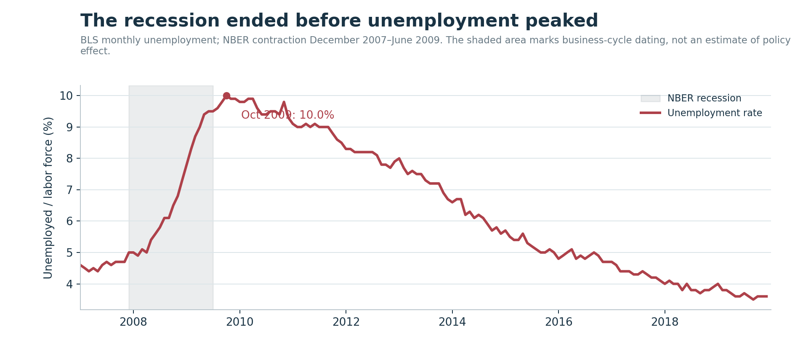
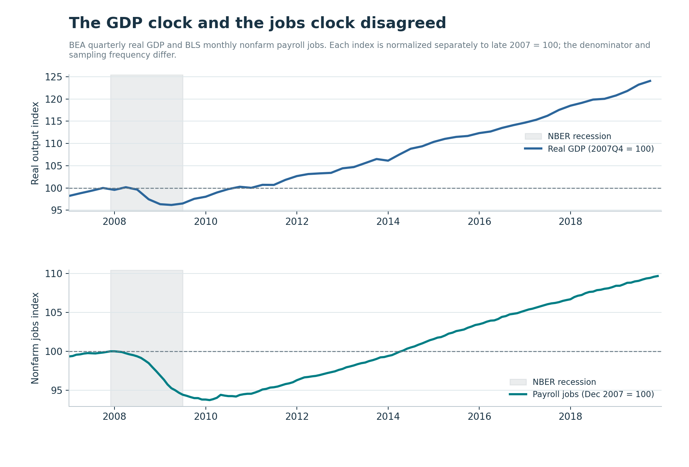
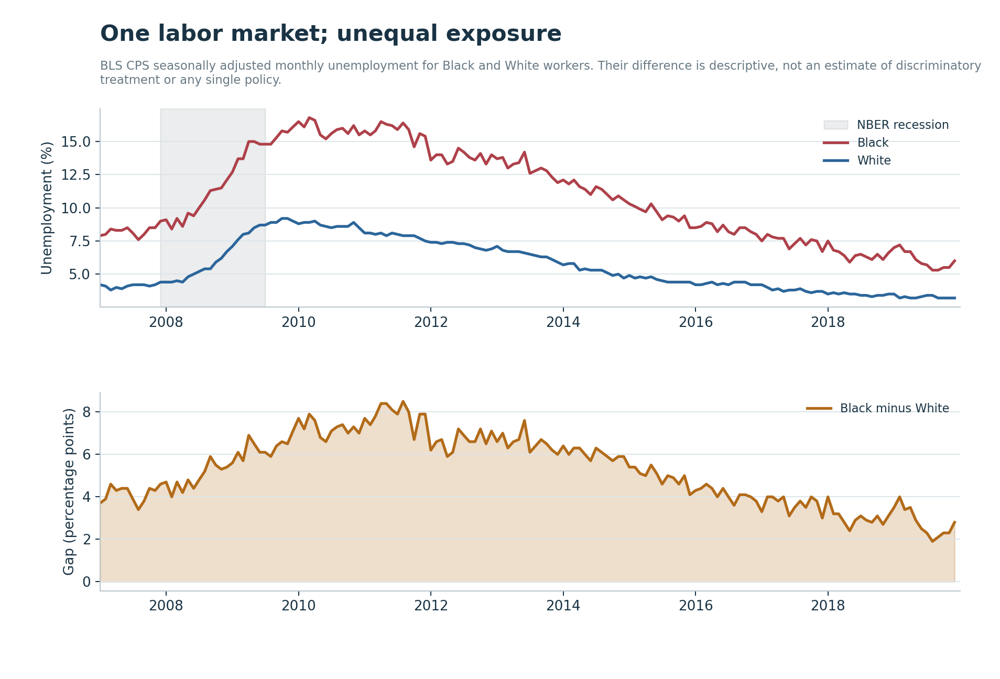
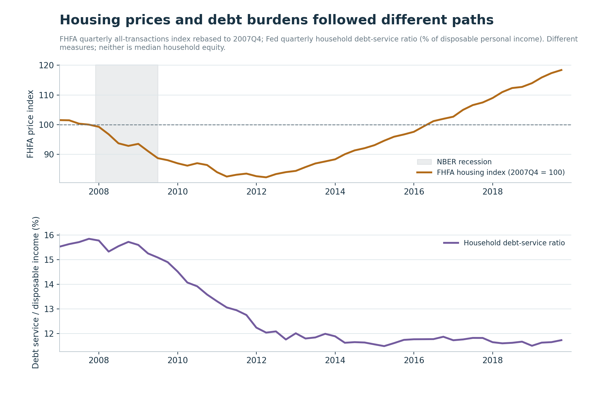
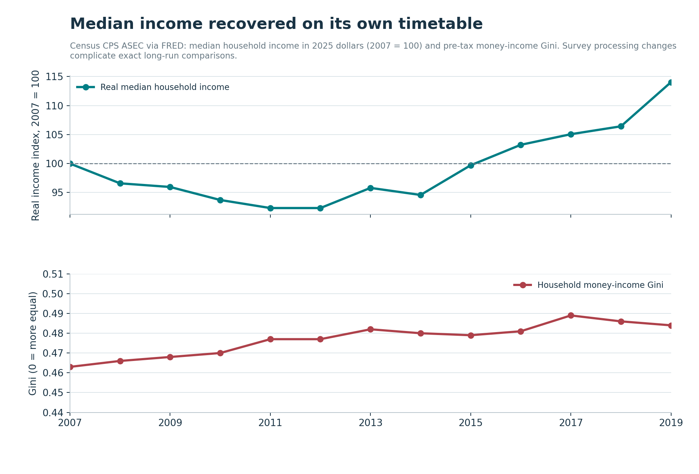
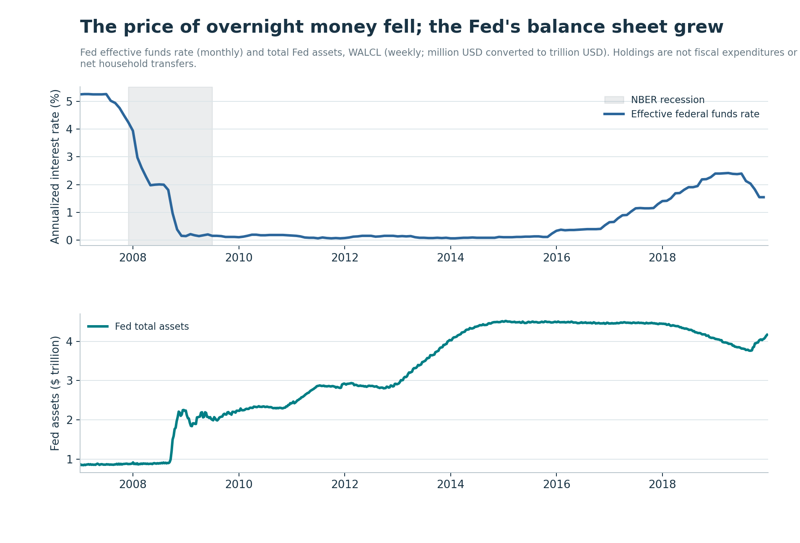
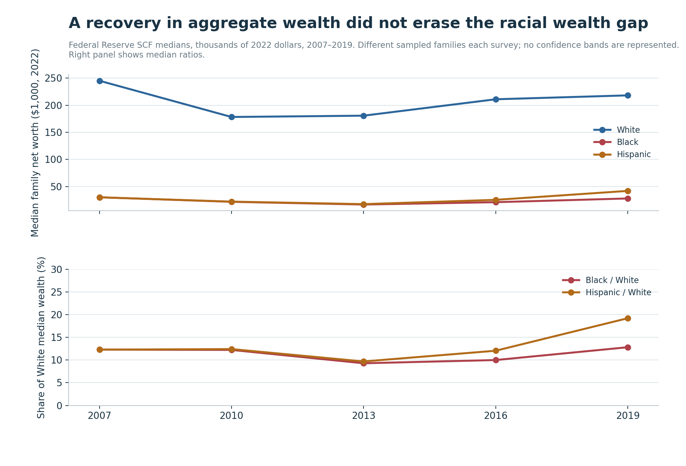
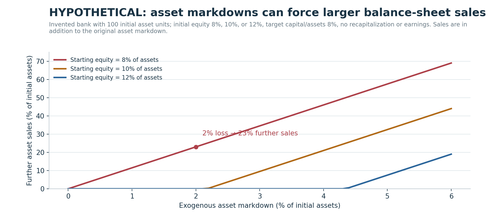

# The Recession Ended; the Damage Did Not

## The Financial Crisis of 2008, the Great Recession, and America's Unequal Recovery, 2007–2019

*An evidence-based history of mortgage leverage, institutional failure, emergency rescue, the slow restoration of work, and the difference between recovering an economy and repairing a society.*

**Article #25 · Political-economic history series · Research data through December 2019 · Source snapshots retrieved 1 November 2026**

---

The recession officially ended in June 2009. In October of that year, the American unemployment rate reached 10 percent. The level of real economic output returned to its late-2007 benchmark in the fourth quarter of 2010. The number of nonfarm payroll jobs did not return to its December 2007 benchmark until May 2014. A national house-price index took until 2016 to recover its fourth-quarter 2007 level. In the Federal Reserve's Survey of Consumer Finances, the typical Black family's net worth in 2019 remained below its 2007 level when both were measured in 2022 dollars.

None of these observations contradicts the others. They are measures of different things. The confusion begins when one measure is asked to stand for all the rest.

The Great Recession was a financial breakdown that became a collapse in spending, employment, income, and asset values. It was also a political test: which institutions could be stabilized immediately, whose losses would be absorbed slowly, and what counted as success once financial markets had stopped panicking? The government possessed tools that could lend against collateral, guarantee liabilities, inject capital, and purchase securities quickly. Preventing an individual foreclosure, rebuilding a destroyed credit record, restoring wages, or replacing wealth lost during the housing bust operated on different legal, administrative, and economic timetables. Those differences were not a technical footnote. They shaped the social experience of the recovery.

An important distinction runs through the evidence. The emergency actions were not identical: Federal Reserve lending facilities, Treasury investments under the Troubled Asset Relief Program, deposit and other guarantees, the 2009 fiscal stimulus, mortgage-relief programs, and later bank supervision involved different agencies, legal powers, beneficiaries, liabilities, and objectives. They cannot responsibly be combined into a single number called “the bailout.” Equally, not all assistance to a financial institution was a permanent transfer to its owners. Loans could be repaid, preferred shares redeemed, and assets sold. But a low eventual fiscal cost is not proof that every intervention was fairly allocated, that there was no moral hazard, or that households were adequately protected.

This essay follows the [preceding study of globalization, credit and fragile prosperity in 1990–2007](../financialization-before-2008/article.md). Its question is what occurred when the pre-crisis system confronted falling collateral values and a sudden loss of confidence. It draws on the [Financial Crisis Inquiry Commission's report](https://www.govinfo.gov/app/details/GPO-FCIC), [NBER's business-cycle chronology](https://www.nber.org/research/data/us-business-cycle-expansions-and-contractions), Federal Reserve histories and data, Bureau of Labor Statistics observations, Census income series, and the Federal Reserve's Survey of Consumer Finances. The Commission's majority and its dissenters disagreed on important causal interpretations. A serious history should preserve that dispute while acknowledging the documented sequence of failures.

Seven original charts measure observed series. The eighth is explicitly **hypothetical**: a small accounting exercise about capital losses and forced asset sales. It is not a causal estimate, a simulation of an actual bank, or evidence that a specific rescue succeeded or failed. A companion repository provides the frozen source files, transformations, figure code, tables, tests, and notebook. Numerical values below are calculated from those files unless attributed to another named source.

The argument is not that no recovery took place. It is that the phrase *the recovery* obscures the distribution of time, risk, and relief. The system could be stabilized before the median household felt repaired; it could expand again while some groups remained unusually exposed to unemployment and had much smaller cushions of wealth. To call the episode over because a statistical recession had ended was true within the narrow definition and inadequate as a political-economic description.

## 1. The boom depended on promises that could not all be honored at once

At the end of 2007, many claims on the same underlying stream of mortgage payments had been distributed across banks, insurance companies, pension portfolios, securities dealers, money-market investors, and highly leveraged structures. That network helped connect American home purchases to global savings and finance. It also made a fall in mortgage performance unusually difficult to locate, price, and contain.

A mortgage is first an obligation of a borrower to a lender. A securitized mortgage is more complicated. The loan may be sold into a pool. Securities backed by that pool may promise different positions in the order of receiving cash flows. Some holders receive payments before others, and lower-priority tranches absorb losses first. A bank might retain exposure directly, hold related securities through an off-balance-sheet vehicle, write a guarantee, finance an investor holding the securities, or face a derivative counterparty whose condition depended on them. The *ownership* of an apparent risk and the *location* of an effective exposure were not always the same.

Securitization by itself does not mathematically require a crisis. Risk can be diversified when assets are genuinely independent, claims are understood, and funding is resilient. The pre-crisis problem was that some forms of risk were correlated and some claims were funded with money that could disappear quickly. Housing losses in different places were not as independent as optimistic models sometimes assumed. Short-term lenders could refuse to roll over financing, increase collateral demands, or exit a market precisely when selling the underlying assets was hardest.

This created a second vulnerability, distinct from credit losses. An institution can have assets whose expected long-run value exceeds its liabilities yet fail because it cannot make payments *today*. Conversely, an institution can obtain abundant short-term liquidity and still be insolvent because its assets do not cover its obligations. Liquidity and solvency are not synonyms. Emergency lending is most defensible as a bridge for the first problem; it cannot, by itself, make the second disappear. In a crisis, outsiders cannot always tell which problem a firm has, and managers have incentives to describe insolvency as temporary illiquidity.

Consider a securities dealer funding a long-duration asset with overnight repurchase agreements, or *repos*. A repo resembles secured short-term borrowing: cash is received against collateral, with an obligation to repurchase it. If the lender demands a larger margin—often called a haircut—the dealer must supply more collateral, raise cash, or sell assets. A forced sale can lower the observed market price of comparable securities. Other lenders then mark down collateral, demand more margin, and trigger still more selling. This is a possible **fire-sale feedback loop**, not an assertion that every price decline was artificial. The loss of market liquidity and the deterioration of fundamental cash flows can reinforce one another.

The distinction also explains why a housing bust could threaten firms that never originated a subprime mortgage. Exposure traveled through securities, liquidity promises, derivatives, prime brokerage relationships, and interconnected payment obligations. Financial opacity mattered because fear about unknown exposures could impair trading even among firms whose direct credit losses were manageable. The [Federal Reserve's official history of the Great Recession](https://www.federalreservehistory.org/essays/great-recession-and-its-aftermath) describes strains that began in mortgage-related assets and spread to a broader contraction of intermediation.

This was the institutional inheritance of the preceding decade's prosperity. For households, rising collateral values had made borrowing and refinancing look sustainable. For intermediaries, the historical rarity of simultaneous national housing distress helped support the belief that diversified mortgage pools could withstand severe but local shocks. For policy institutions, low inflation and the previous period of macroeconomic stability had reduced the apparent urgency of some risks accumulating in balance sheets. These beliefs were not universal, and warnings existed. Yet the financing structure made a modest mistake about the joint distribution of losses potentially catastrophic when multiplied by leverage.

The essential lesson is therefore not that finance is unreal and the productive economy is real. Credit finances production, homes, consumption smoothing, and investment. The failure was in a configuration that promised liquidity where there was none, safety where losses were correlated, and resilience where capital buffers and funding arrangements could not bear a shared reversal.

## 2. The crisis began before the most famous bankruptcy

The public memory of 2008 is concentrated in September: Lehman Brothers, AIG, emergency meetings, collapsing share prices, and the hurried legislation that produced TARP. But the chronology begins earlier. As housing price increases slowed and mortgage delinquencies rose, the valuation of securities exposed to weaker borrowers became more contentious. A problem that might initially look confined to a category of mortgage loans began to affect funding markets.

By 2007, some mortgage originators were failing, some structured-credit markets were becoming difficult to trade, and large financial firms faced uncertainty about how much loss was embedded in assets they owned or financed. In August 2007, strains in term money markets made the broader liquidity problem unmistakable. The Federal Reserve and other central banks began responding well before Lehman's bankruptcy. Interventions expanded in purpose as the disruption spread.

The NBER dates the subsequent U.S. recession from **December 2007 through June 2009**, an eighteen-month contraction. This date is a retrospective judgement about the economy's peak and trough, based on multiple indicators; it is not a declaration about when financial markets first became fragile. The [NBER's December 2008 peak announcement](https://www.nber.org/news/business-cycle-dating-committee-announcement-december-1-2008) and [September 2010 trough announcement](https://www.nber.org/news/business-cycle-dating-committee-announcement-september-20-2010) were made after the events they dated. If a reader asks why the recession “started” in December 2007 even though the greatest panic came in September 2008, the answer is that business-cycle dating and crisis chronology measure different phenomena.

In March 2008, the sudden deterioration of Bear Stearns exposed how quickly a securities dealer dependent on short-term confidence could lose access to funding. The Federal Reserve arranged emergency support connected to JPMorgan Chase's acquisition. The institution did not survive as an independent dealer, but its distress produced public intervention intended to contain spillovers. The [Federal Reserve's history of institution-specific support](https://www.federalreservehistory.org/essays/support-for-specific-institutions) sets out the facilities and collateral structures involved.

During the summer, concerns around mortgage finance remained unresolved. In September, Fannie Mae and Freddie Mac entered federal conservatorship. Their federal relationship, guarantee activities, and role in the mortgage market differed from that of an investment bank; placing them in conservatorship was not simply another iteration of the Bear Stearns transaction. The same month, Lehman Brothers filed for bankruptcy. The next day, the Federal Reserve supplied support to AIG, whose financial obligations could transmit distress to other institutions and markets.

These decisions have been debated ever since. The sharp contrast between helping Bear Stearns or AIG and allowing Lehman to fail created understandable questions about consistency, private-sector incentives, and legal authority. It is tempting to write a simple counterfactual: rescue Lehman and the recession would have disappeared, or allow every firm to fail and a cleaner system would have emerged. Neither follows from a timeline. A counterfactual requires evidence about feasible legal actions, available collateral, creditor behavior, substitute institutions, and the scale of contagion that would have followed a different choice.

The failure of Lehman was especially consequential because it occurred in a system already under strain. The bankruptcy produced immediate uncertainty over contracts, exposures, and settlement. A prominent money-market fund later announced that its share value had fallen below the customary one-dollar level after a loss on Lehman paper, intensifying withdrawals in a market many investors had treated as nearly cash-equivalent. Funding distress then threatened commercial paper—the short-term borrowing market through which many otherwise ordinary businesses financed operations. The Fed's [history of emergency credit programs](https://www.federalreservehistory.org/essays/fed-credit-programs) traces the facilities developed for primary dealers, money-market funds, commercial paper, and other channels.

These events reveal a difficult fact about modern financial intermediation. Some claims become money-like in normal times not because they are literally insured bank deposits, but because investors believe they can redeem them quickly without loss. When the belief fails, attempts by individual investors to protect themselves can make the collective problem worse. A funding run is not necessarily caused by irrationality. Each participant may have good reason to withdraw first once other withdrawals are expected.

That is why the 2008 panic cannot be explained solely as people borrowing more than they could afford. Mortgage origination and repayment mattered, but the structure of wholesale funding and the distribution of claims determined how losses migrated through the financial system. The **mortgage shock** and the **financial system's amplification mechanism** must be analyzed together.

## 3. The mortgage machine turned local defaults into interconnected exposures

The scale of the crisis requires looking below the most familiar labels. “Subprime,” “securitization,” “derivatives,” and “deregulation” name different mechanisms. Treating them as interchangeable substitutes for explanation loses the economic links.

First, mortgage underwriting changed in parts of the market. Contracts could combine introductory rates, future payment resets, limited documentation, high combined loan-to-value positions, and assumptions about easy refinancing. Not every subprime mortgage contained these features, and not every foreclosed property was financed with a subprime loan. The point is that the marginal loan could depend on continuing appreciation or refinancing options rather than on a sufficiently robust capacity to service debt under adverse conditions. Rising house prices helped conceal some underwriting weaknesses because borrowers could sell or refinance before defaults fully revealed them.

Second, the *originate-to-distribute* chain could weaken the incentives of an originator to evaluate a borrower's long-term capacity to repay if the expected economic return came from making and selling the loan. This did not eliminate underwriting across the entire industry; incentives varied by lender, product, buyer, and contractual representation. But it created opportunities for adverse selection and poor verification. A downstream investor buying a security faced a harder task than inspecting the individual borrower or the original collateral.

Third, securitization redistributed cash flows and made claims harder to value. When mortgages were pooled and claims divided into senior and subordinate positions, the safety of a tranche depended on assumptions about default probability, loss severity, prepayment, and especially correlation. A senior rating was never the same thing as immunity from a national housing shock. Rating agencies were paid within an institutional structure that attracted scrutiny for conflicts of interest and inadequate models. The [Financial Crisis Inquiry Report](https://www.govinfo.gov/app/details/GPO-FCIC) documents these channels and provides competing interpretations in its dissenting chapters.

Fourth, synthetic exposures and credit derivatives allowed parties to gain or offset mortgage-linked risk without holding the underlying loan. A credit-default swap can be a useful hedge, but it also creates a promise by a protection seller. That promise matters only if the seller can perform when losses arrive. Collateral terms and bilateral interconnection can turn a credit event into an immediate demand for liquidity. A portfolio with a small measured net exposure can still face acute cash needs because payments and collateral are due at different times.

Fifth, the market for short-term financing treated some mortgage-linked securities as convenient collateral. Securities created to transform risky loans into assets that investors were willing to fund could become difficult to sell at any price precisely when those investors sought repayment. This is the point where an underwriting failure, a valuation error, a capital shortage, and a funding run can become difficult to separate in real time.

Research after the crisis examined the household side independently of institutional balance sheets. In [*Household Leverage and the Recession of 2007 to 2009*](https://www.nber.org/papers/w15896), Atif Mian and Amir Sufi find that pre-crisis household leverage was strongly associated with subsequent declines in consumption and economic activity across U.S. counties. Their empirical work is much closer to an identified local exposure design than a national chart showing that debt and unemployment rose around the same time. Yet even county comparisons require assumptions about other differences across places; they do not directly identify the value of every crisis intervention.

The strongest account is not a monocausal slogan. Housing losses mattered because they were real, widely distributed, and in many places severe. The design of securities, balance-sheet leverage, funding structures, supervision, and risk transfer mattered because they turned those losses into a threat to credit provision. Global capital flows mattered because the buyers and lenders were not confined to American households. Expectations and political choices mattered because attempts to stabilize the system changed who bore immediate losses and who retained claims on future gains.

## 4. September and October 2008: rescue was a sequence, not a single check

The public language of “bailout” has understandable moral force. People who had signed contracts for their homes saw those contracts enforced with grave consequences, while some institutions on the other side of mortgage-related transactions received extraordinary public support. It would be a mistake, however, to make institutional similarity where there was none. The 2008 response comprised several mechanisms operating across different balance sheets.

Central-bank liquidity support involves lending or securities operations conducted under monetary authority. A lender of last resort attempts to prevent a temporary inability to obtain cash from destroying assets and payment systems unnecessarily. Such lending can entail risk, and terms and collateral are central to its legitimacy. Yet the face amount of an emergency loan is not automatically a grant, and the peak amount outstanding is not necessarily a permanent public loss.

Deposit insurance and exceptional guarantees work differently. Their purpose is to reduce incentives for creditors or depositors to run, altering the likelihood of withdrawals or refinancing failure. The exposure of a guarantor may be contingent: if the insured institution performs, the public does not necessarily pay the headline guaranteed amount. Such commitments can nevertheless shift risk and weaken private monitoring if made without appropriate supervision or pricing.

Treasury capital injections under TARP were different again. A capital investment can absorb losses and increase an institution's ability to meet obligations. Treasury might receive preferred stock, warrants, dividends, proceeds from asset sales, and repayments. Public capital can protect a firm from failure while imposing varying degrees of dilution or conditions on shareholders and management. Whether the terms were sufficiently punitive, whether creditors should have shared more losses, and whether the institutions receiving support were systemically necessary are political and economic questions distinct from the net accounting cost.

The legislation creating TARP—the Emergency Economic Stabilization Act—was enacted in October 2008. The program's original **$700 billion authorization** was a ceiling, not an assertion that $700 billion was permanently spent or lost. Later statutory changes lowered that ceiling. After all TARP-funded programs concluded, a [Government Accountability Office lifetime-cost audit](https://www.gao.gov/products/gao-24-107033) reported **$443.5 billion disbursed** and **$31.1 billion lifetime cost** net of repayments, sales, dividends, interest, and other income, using results as of September 2023. Those figures concern TARP-funded programs as defined by the audit—not every Federal Reserve facility, guarantee, loss, or social cost associated with the crisis. They include bank and nonbank interventions and housing-related programs, which had different recovery profiles.

One can simultaneously hold that preventing a financial collapse was necessary, that some TARP investments were substantially recovered, and that the allocation of relief was politically unequal. These are not contradictory propositions. A program's eventual fiscal cost measures one important dimension. Its distributional incidence, deterrence of future risk taking, effects on credit supply, opportunity costs, and public legitimacy measure others. Some of these can be studied credibly; none is visible by subtracting one large headline dollar figure from another.

The central question in the immediate panic was not whether all firms deserved survival. It was whether allowing simultaneous disorderly failures would deepen the collapse of financial intermediation and thereby harm households who had no role in originating the risky assets. The equally important subsequent question was whether the urgency of saving the system displaced slower, more difficult efforts to protect households, preserve employment, and prevent the loss of neighborhood wealth.

## 5. When the financial seizure became an employment disaster

A crisis in financial securities does not automatically create mass unemployment. For that to happen, the shock must reach spending, production, labor demand, and household balance sheets. In 2008 and 2009 it did.

Declining home values limited households' capacity to borrow against equity and made some mortgages difficult to refinance or repay. Defaults and foreclosures imposed losses on borrowers and lenders and could damage neighboring markets. Falling consumption reduced revenue for businesses, especially in sectors dependent on discretionary spending. Firms facing weaker sales and uncertain financing delayed investment, stopped hiring, or laid off workers. When unemployment rose, it created additional mortgage distress and reduced purchasing power, reinforcing the original problem. Local construction contractions had direct effects, but the chain also ran through retailers, services, manufacturing, and firms with otherwise viable products whose customers lacked income or whose short-term funding became unreliable.

Mian and Sufi's later [employment-channel research](https://www.nber.org/papers/w17830) identifies a pattern in which local areas suffering larger household balance-sheet shocks lost particularly substantial employment in nontradable activities. Their paper estimates a major role for reduced demand. The point here is the mechanism and the kind of evidence required, not the claim that their estimate can be read off the aggregate chart below. Supply disruptions, uncertainty, global demand, and policy responses were also part of the environment.

The Bureau of Labor Statistics unemployment rate stood at an annual average of about **4.6 percent in 2007**, rose to **9.3 percent in 2009**, and averaged roughly **9.6 percent in 2010** in the frozen vintage used here. Its monthly peak was **10.0 percent in October 2009**—four months after the NBER recession trough in June. Even these numbers omit people who left the labor force, accepted fewer hours than they wanted, or experienced long-term scarring from missing years of work.

The chart's gray band is the NBER's December 2007–June 2009 contraction. The band ends while unemployment is still moving upward. There is no puzzle in that sequence. An economy can begin producing more before employers have sufficient confidence or demand to reverse layoffs, and the unemployment rate can remain elevated as people reenter the labor force. Output, employment, labor-force participation, and unemployment are linked but are not synchronized identities.

Why does this matter politically? Because the business-cycle label can become a shorthand for national reassurance. A statistical trough marks the lowest point of a broad contraction. It does not mean the damage has been undone. If a household lost a job near the trough, the beginning of aggregate expansion supplied no guarantee about when a comparable job would appear. A family that sold a home at a distressed price could not simply recover its prior equity when an index eventually rose. An age cohort that entered the labor market during deep unemployment could face consequences that extended beyond the chart's final recession month.

The timing also complicates direct claims about fiscal and monetary rescue. Policies enacted near the trough may affect the *trajectory* of later unemployment without immediately reducing the *level*. The observed fact that joblessness continued rising after an intervention is not proof the intervention had no effect; the relevant counterfactual could have been worse. Conversely, improvement after an intervention is not proof that intervention alone caused it. A credible evaluation must specify the mechanism, population, comparison, and credible counterfactual.

## 6. Four recovery clocks, and why none tells the whole story

The term *recovery* becomes more intelligible if we make its benchmark explicit. This study selects four simple, auditable comparisons. It asks when the observed level of a series first returned to a chosen late-2007 value after the recession. That is a historical measurement, not a welfare verdict.

| Indicator | Benchmark | First return after the recession | What the measure leaves out |
| --- | --- | --- | --- |
| Real GDP | 2007 Q4 | **2010 Q4** | Population change, potential output, distribution |
| Nonfarm payroll jobs | December 2007 | **May 2014** | Population growth, hours, job quality |
| FHFA all-transactions house-price index | 2007 Q4 | **2016 Q3** | Regional prices, equity, mortgage debt |
| Real median household income | Calendar 2007 | **Calendar 2016** | Within-household burdens, wealth, survey comparability |

These dates were calculated from the frozen BEA, BLS, FHFA, and Census series in the companion's machine-readable [recovery-milestone table](results/recovery_milestones.csv). They depend on specified baselines. For example, the FHFA benchmark is *2007 Q4*, not a claim that the national housing market peaked exactly then. Another price index or a local metropolitan series can have a different recovery date. The real GDP series uses today's revised historical estimate, not the contemporaneous estimate policymakers saw in 2010. “First return” also says nothing about whether growth then persisted, and the annual income data locate a calendar year rather than a precise month.

In Figure 2, real GDP briefly rises above its fourth-quarter 2007 benchmark before the recession's deepest phase, falls sharply, and returns to that benchmark in late 2010. Payroll employment falls longer and reattains its December 2007 count only in 2014. Using separately indexed levels is preferable to mixing billions of chained dollars with thousands of workers on an arbitrary dual axis. Even the index comparison has limits: the two series represent different underlying concepts and observation frequencies.

Returning to a prior **level** is not the same as returning to the path that might have been expected without the crisis. If population has grown over six years, an unchanged number of jobs provides fewer jobs per person than before. If technology, demographics, and productivity have changed, a GDP level equivalent to an earlier year does not establish whether productive capacity has been permanently damaged. Nor does a simple extrapolation of the 2000–2007 growth rate identify a crisis effect. It assumes a trend that may have changed for many reasons and ignores uncertainty about the path that would otherwise have occurred.

The same warning applies to the interpretation of the labor-market recovery. Payroll employment counts jobs, not individual workers; a person can hold multiple jobs, and payrolls exclude some forms of employment. A count can return to its prior level while the mix of jobs, hours, earnings, benefits, and regional opportunities has altered. The unemployment rate, employment-to-population ratio, and real pay answer different questions. To claim that the labor market was healed in May 2014 would require stronger and more disaggregated evidence.

Our narrow clock comparison establishes one durable conclusion: different economic margins turned upward and regained their prior levels at different times. It cannot establish which policy delayed or accelerated those crossings. The temptation to assign each milestone to a president, a central-bank chair, an election, or a statute would turn a transparent description into an unsupported causal design.

Those different clocks matter because people do not experience the economy as a single aggregate. A mortgage obligation is due monthly regardless of the GDP growth rate. A worker's prospects depend on a local labor market. A pension depends on the claims held and the price at which liquidation becomes necessary. A renter may benefit from lower house prices in one channel while suffering an unemployment shock in another. The recovery was real, but it was not a single event shared in a single way.

## 7. Unemployment was unequal even within the same national expansion

National averages are necessary for describing a macroeconomic contraction, but they can erase the distance between social groups. The labor market of 2009 was not an isolated storm in which everyone had the same probability of losing a job. Long before the crisis, Black workers faced higher unemployment rates than White workers. The crisis widened the lived importance of that difference as both groups experienced severe distress.

The BLS Current Population Survey provides seasonally adjusted monthly unemployment rates for White workers and for Black or African American workers. The companion freezes two official BLS API exports and constructs a 156-month series for each group covering January 2007 through December 2019. Figure 3 shows both unemployment rates and the arithmetic gap in percentage points. A percentage-point difference is not a ratio: if unemployment is 16 percent for one group and 9 percent for another, the gap is 7 points, while the ratio is approximately 1.8. Each statistic answers a different question.

In the frozen monthly observations, Black unemployment averaged approximately **8.3 percent in 2007**, **14.8 percent in 2009**, **16.0 percent in 2010**, and **6.1 percent in 2019**. The corresponding White averages were approximately **4.1**, **8.5**, **8.7**, and **3.3 percent**. Even by the end of a long expansion, the groups' unemployment rates had not converged. The BLS's [2019 race and ethnicity report](https://www.bls.gov/opub/reports/race-and-ethnicity/2019/home.htm) independently reports annual averages of 6.1 and 3.3 percent for Black and White workers.

It would be wrong to infer from this time series the causal size of discrimination, the effect of any particular labor-market regulation, or the role of education alone. Groups differ in age structures, geographic distribution, occupational exposure, experience, opportunity, hiring networks, and exposure to earlier forms of exclusion. These differences are themselves often shaped by policy and history, so “controlling” for them mechanically would not necessarily remove social inequality rather than part of its mechanism. The graph does not tell us which channels explain the gap, but it makes the gap impossible to dismiss as an exceptional outcome of a single bad year.

The data also warn against a deceptively comforting use of growth statistics. A recovery can lower unemployment for every measured group and still leave very unequal probabilities of joblessness. If policy is evaluated only at the national level, the fact of a shared downward trend can be mistaken for equality of risk. If evaluated only by a gap, it can miss large improvements in the level of employment experienced by both groups. Responsible interpretation requires holding both observations together.

There is a further measurement limit: the CPS produces survey estimates, not a census of all jobs and job searches. Sampling error becomes more important as groups are subdivided. The two displayed race series do not form a mutually exclusive partition of all workers, and Hispanic ethnicity is not separately charted here. Changes in how people identify, population weights, and household-survey adjustments can affect comparisons. A stronger inferential analysis would need sampling variances and a design suited to the question. This essay uses the series descriptively and resists attributing the observed paths to a single cause.

The significance for economic history is nonetheless substantial. A macroeconomic policy can be broadly beneficial while the crisis continues to fall unequally on groups that entered it with fewer buffers. Labor income is not the only buffer, and unequal unemployment is not the same thing as unequal wealth. The two interact: a lost paycheck is more destabilizing for a family with little liquid savings or home equity, and a damaged balance sheet can make it harder to search for a new job, relocate, or wait for a better offer.

## 8. Homes were collateral, shelter, consumption, and neighborhood wealth

Housing occupied several places in the crisis at once. A home was a place to live. It was often the largest asset on a family's balance sheet. For mortgage borrowers, it also secured a debt contract. For lenders and investors, mortgage claims were assets whose expected value depended on repayment, collateral, and legal enforcement. For local governments, property values helped sustain tax bases. A falling house price could affect these functions differently and simultaneously.

The FHFA all-transactions national house-price index, obtained from the frozen FRED export, declined substantially after the 2007 benchmark used here. The annual average of the index was about **90.3 percent of its fourth-quarter 2007 level in 2009**, **83.1 percent in 2012**, and **116.4 percent in 2019**. Its first quarterly return to the Q4 2007 level after the recession occurred in **2016 Q3**. The index includes transactions across the covered mortgage market and is not seasonally adjusted; it is neither a median dwelling price nor a measure of every property's market value. Regional markets and housing quality changed differently.

The Federal Reserve's household debt-service ratio captures another part of the story. It relates estimated required household debt payments to aggregate disposable personal income, with its own accounting conventions. The annual average in our source fell from approximately **15.7 percent in 2007** to **11.6 percent in 2019**. This aggregate decline is consistent with a prolonged reduction in the burden of scheduled payments relative to disposable income. It does not prove that the households hardest hit by foreclosures had repaired their finances. The ratio can change because debts are repaid, defaulted on or written off, borrowing is reduced, rates decline, incomes grow, or the composition of borrowers changes.

These two curves should not be collapsed into a single story of household healing. A borrower who completed a foreclosure may no longer have the associated debt-service payment. That lowers debt outstanding and may mechanically improve some aggregate ratios while leaving the borrower with lost equity, credit damage, relocation costs, or an interruption to family stability. A household that managed to keep the home may gain from lower interest rates or refinancing while still carrying negative equity for years. A renter could gain from a more affordable purchase price but lose that opportunity if unemployment or tighter underwriting prevents obtaining a mortgage.

Distressed sales may also impose externalities on nearby owners and renters. Vacant or poorly maintained properties can affect local amenities, perceived safety, and market prices. If many households must sell into the same falling market, price reductions change the collateral values of households that were not initially delinquent. The resulting decline in accessible borrowing and spending can transmit the shock well beyond the originally risky loans. None of these mechanisms is fully represented by a national housing price index.

The policy question was accordingly more difficult than stabilizing a market price. Keeping a financially viable family in a home might avoid losses associated with foreclosure; subsidizing an unsustainable loan might simply postpone the inevitable and shift the cost to taxpayers or other parties. Principal reductions, interest-rate changes, refinancing programs, forbearance, and foreclosure delays each redistribute risk differently. Contracts have borrowers, lenders, investors, servicers, and legal restrictions; a public program that changes one side's payment must determine what happens to the other side's claim. Mortgage relief is administratively slow partly because the relevant assets and institutions are heterogeneous.

TARP-funded housing programs eventually assisted millions of homeowners, according to the [GAO's final audit](https://www.gao.gov/products/gao-24-107033). That should neither be minimized nor taken as proof that the intervention reached every eligible family or operated at the optimal scale. To judge success, one would need data on participation, take-up, avoided foreclosures, subsequent defaults, neighborhood spillovers, distribution, and credible counterfactual trajectories. Aggregate house-price recovery is not such an evaluation.

There is also an ethical accounting question. If a rescue prevents the disorderly collapse of mortgage-backed claims, the benefit may appear quickly on institutions' asset statements. If a household is prevented from losing a home, the benefit may be less visible in an aggregate financial-market statistic but more consequential for stability and future opportunity. The difference in visibility should not determine the value assigned to a policy. Nor should the fact that two beneficiaries are connected by the same debt contract imply that their bargaining power or exposure was equal.

## 9. Median income recovered, but a median is not a distribution

Wages and income offer another recovery clock. The Census series used here reports real median household money income in **2025 dollars**, so values from different years are shown in a common purchasing-power convention. It places the median at **$74,810 in 2007**, **$69,070 in 2011**, and **$85,320 in 2019**. In the 2007–2019 series, the median did not exceed its 2007 level again until **2016**. The constant-dollar base is a feature of the current statistical vintage; it is not an assertion that households in 2011 calculated their income in 2025 prices.

The household income Gini coefficient supplies a separate distributional summary. The all-household series in the frozen source rises from **0.463 in 2007** to **0.484 in 2019**. Higher Gini values indicate greater measured inequality in that specific income concept, but the statistic depends on the survey's definition of income, treatment of top incomes, household composition, sampling, and processing. It is not a Gini for wealth, after-tax disposable resources, lifetime earnings, or total public services. The Census CPS ASEC underwent methodological changes during the period, so small year-to-year differences should not be read as precise structural effects.

The two panels answer questions that a single mean income series would miss. The median tells us about the middle of the household income distribution, not whether the bottom tenth has recovered or whether very high incomes gained more. The Gini summarizes the distribution's inequality but cannot identify which deciles gained, why, or whether a policy caused a change. A rich household may have high capital gains or a valuable property portfolio that does not appear as money income in the way its net worth appears in the Survey of Consumer Finances.

It is also possible for both the median and inequality to rise. If a growing economy delivers gains across much of the distribution but very large gains at the top, the median can improve while the Gini remains high or increases. Conversely, a large decline at the top during a financial crash can temporarily compress a measured distribution even while lower-income families endure serious hardship. Distributional justice cannot be measured by the direction of a single summary statistic.

Household composition complicates the story further. A median household in 2019 is not the same observation as a particular household followed from 2007. People marry, divorce, move, age, join or leave a household, and experience different labor-force states. The income statistic is a repeated cross-section, not a longitudinal account of every family damaged in 2008. We cannot infer from a higher 2019 median that someone who lost a job, home, or retirement savings in 2009 fully recovered.

The same caution applies to comparisons between real GDP and real median household income. GDP is aggregate value added measured in national accounts, while the Census median refers to households and uses a different price and coverage concept. We therefore chart them in separate figures and report their benchmark recoveries without treating the gap between them as an estimated labor share, an inequality decomposition, or the amount “taken” from households. Those latter claims need compatible accounting units and stronger identification.

The deeper result is that the terms *income recovery* and *wealth recovery* should not be interchangeable. A family can return to its previous earnings and remain poorer because it sold its home at a distressed price or used savings to survive unemployment. Another family may experience a rising portfolio and little change in labor income. The interaction of asset ownership and labor-market exposure helps explain why aggregate stock-market and GDP rebounds did not generate an equally shared sense of restoration.

## 10. Monetary rescue was both the old instrument and new balance-sheet operations

Monetary policy began the crisis with a familiar instrument: the short-term policy interest rate. The effective federal funds rate averaged about **5.0 percent in 2007** in the monthly source, declined sharply in 2008, and averaged approximately **0.16 percent in 2009**. In December 2008 the Federal Open Market Committee set a target range of zero to 0.25 percent. The intended effects of lower rates worked through financing costs, financial conditions, expectations, and spending decisions, but not every borrower immediately obtained cheap credit. A policy rate is not the interest rate printed on every mortgage or small-business loan.

The lower bound made the conventional instrument more constrained. The Fed then employed and expanded nontraditional instruments: lending facilities directed at impaired markets, changes in the composition of its assets, and large-scale purchases of securities. The [Federal Reserve's historical timeline of balance-sheet policies](https://www.federalreserve.gov/monetarypolicy/timeline-balance-sheet-policies.htm) records announcements and purchases of agency debt, mortgage-backed securities, and longer-term Treasuries. Their purpose was to influence longer-term yields and credit availability when the short-term policy rate could be reduced little further.

The change in the central bank's footprint is visible in Figure 6. The Fed's weekly total assets, series WALCL, averaged about **$0.87 trillion during 2007**, rose above **$4 trillion in the 2014 annual average**, and remained approximately **$3.93 trillion in 2019**. The data describe the size of the asset side of the Federal Reserve's balance sheet. They do **not** show that the central bank “spent” those sums as grants, that households received the same amount, or that each dollar purchased generated a particular amount of GDP.

When the central bank purchases a security, it exchanges one asset for a claim on the central bank or other settlement balance under the monetary system's accounting rules. The economic consequences may involve portfolio rebalancing, term premia, expectations, liquidity, and signaling. The interest income on assets, central-bank liabilities, maturities, remittances, and subsequent asset sales matter for the financial accounting. A chart of gross assets is therefore an inadequate measure of the ultimate fiscal cost of the program.

Nor is the balance-sheet line an identified effect curve. Assets rose when the Fed was responding to severe weakness; recovery later occurred while many other forces were changing. A simple correlation between holdings and employment would be contaminated by policy reacting to the very economic conditions it sought to influence. Researchers studying announcements, changes in market yields around surprises, and differences across securities can offer narrower evidence about particular channels. Translating those effects into counterfactual employment and the distribution of income requires additional models and assumptions.

There were also real trade-offs. Reducing long-term rates can ease refinancing and investment but also alter the pricing of financial assets. Asset holders may benefit from valuation changes; future retirees, savers, homeowners, renters, and leveraged borrowers can be affected in different directions depending on portfolios and liabilities. Monetary policy can support aggregate demand without being an ideal instrument for targeting foreclosure prevention or repairing the credit histories of specific households. That mismatch is not proof that monetary action was unnecessary. It is a reason to distinguish the effectiveness of stabilization from the completeness of social repair.

## 11. Fiscal stimulus and regulation answered different questions

The **American Recovery and Reinvestment Act of 2009** was a fiscal response to collapsing demand and employment. It combined spending, transfers, aid to states, and tax provisions. Such a program differs from lending against collateral or buying a mortgage security. Its central economic question is whether government action can support spending and employment when private demand has contracted and households or businesses are trying to rebuild balance sheets.

Support for states mattered because state and local governments generally face tighter financing and balanced-budget constraints than the federal government. A fall in tax revenue can otherwise prompt cuts to public employment, education, services, and investment during a recession—exactly when such cuts may add to unemployment. Transfers can support consumption among recipients with immediate spending needs. Infrastructure spending may create useful public assets but can take time to plan and implement. Tax provisions and direct spending can have different timing, take-up, and distribution.

Fiscal multipliers are not constants that can simply be read from the unemployment chart. Their size depends on the economy's slack, monetary policy, import leakages, the composition of expenditure, expectations, and the responses of households and firms. The Congressional Budget Office evaluated ARRA with ranges rather than a single observed causal number. Its [2014 retrospective assessment](https://www.cbo.gov/publication/49958) estimated continuing, comparatively modest effects by that late point in the recovery. Such estimates are model-based counterfactual assessments, not randomized measurements of the entire law's impact.

The response also renewed the question of whether extraordinary financial support should produce permanent changes in supervision. The **Dodd–Frank Wall Street Reform and Consumer Protection Act**, signed in 2010, reshaped the regulatory framework, including systemic-risk oversight, approaches to resolving certain large institutions, and consumer financial protection. The Consumer Financial Protection Bureau became one of the most visible institutional innovations, while stress testing, capital and liquidity standards, and oversight of parts of derivatives and nonbank finance changed the landscape. The [Federal Reserve's account of Dodd–Frank](https://www.federalreservehistory.org/essays/dodd-frank-act) places it in the context of the 2007–2009 breakdown.

Regulation is best evaluated by the particular failure mode it aims to address. More capital can increase a firm's ability to absorb losses; liquidity rules can discourage unstable maturity transformation; stress testing can force explicit adverse-scenario planning; transparent derivatives clearing may reduce some forms of bilateral opacity while concentrating risk in clearinghouses; resolution planning may make failure less disruptive. Each approach can also have costs, loopholes, and unintended consequences. A law cannot be judged a total success because it was enacted after the crisis, nor a total failure because future crises remain possible.

The timing of policies matters for evaluation. The Fed's emergency lending of 2008, the fiscal measures beginning in 2009, the regulatory architecture of 2010, and subsequent supervisory implementation affected different margins over different horizons. Asking whether “the government response” produced the 2019 outcome is not one causal question but a bundle of questions. An intervention aimed at avoiding a payment-system collapse might be judged partly by failures that did *not* occur; a homeowner program by foreclosures avoided; a fiscal program by counterfactual demand and employment; a regulatory change by resilience under subsequent shocks.

There is a further issue of legitimacy. Some rescue mechanisms were technically fast precisely because the recipient institutions were already legible to the state. Central banks have established counterparties and collateral procedures; Treasuries can contract with large firms and banks. Locating and verifying millions of distressed borrowers, determining eligibility, modifying privately serviced mortgages, and resolving conflicting claims are harder administrative tasks. The resulting asymmetry can look like a moral judgement even when part of it comes from institutional capacity. Political choices about program design, agency resources, conditionality, and legal rights determine how far that administrative explanation goes.

## 12. Wealth made the recovery especially unequal

Wealth is a stock of accumulated claims minus liabilities. It offers a cushion against lost income, helps finance education and mobility, affects retirement security, and can be passed to subsequent generations. When the asset that falls is a home, the consequences differ according to ownership, mortgage leverage, available liquid assets, and whether the household must sell. When the asset that rises later is a financial portfolio, the gains accrue to those who hold that portfolio. These elementary facts make the distribution of pre-crisis wealth central to understanding an unequal recovery.

The Federal Reserve's **Survey of Consumer Finances** (SCF) provides a source that national GDP and household-income medians cannot replace. It surveys families and records detailed assets and liabilities. Its triennial estimates are repeated cross-sections, not observations of exactly the same families across all survey years. The group medians shown in Figure 7 come from the Federal Reserve's [2023 accessible historical table](https://www.federalreserve.gov/econres/notes/feds-notes/greater-wealth-greater-uncertainty-changes-in-racial-inequality-in-the-survey-of-consumer-finances-accessible-20231018.htm). They are reported in **thousands of 2022 dollars**, not nominal dollars of the survey year.

In this source, the median net worth of White families was approximately **$245,110 in 2007**, **$178,280 in 2010**, and **$218,140 in 2019**, measured consistently in 2022 dollars. The median for Black families was **$30,140**, **$21,800**, and **$27,970** in those same years. For Hispanic families the corresponding medians were **$30,120**, **$22,130**, and **$41,910**. The intervening 2013 and 2016 observations reveal distinct recovery paths rather than a smooth upward line.

These numbers support several interpretations, and rejecting the false ones is as important as stating the true ones. First, the typical White family had far more wealth than the typical Black or Hispanic family at the beginning and end of the period. Second, all three medians declined during the 2007–2010 interval in this source. Third, by 2019 the measured median was still below its 2007 level for White and Black families; the Hispanic median exceeded its 2007 level. Fourth, the **Black median was approximately 12.3 percent of the White median in 2007 and 12.8 percent in 2019**; the **Hispanic ratio moved from roughly 12.3 percent to 19.2 percent**. A rising ratio is a narrower statistical statement than the disappearance of a structural gap.

It is especially important not to present the plot as a race-based experiment or to assume that every observed change is statistically significant. SCF estimates involve sampling uncertainty, imputation, weighting, and changes in group composition. The racial and ethnic categories reflect survey classifications and do not capture every form of within-group inequality. The medians also do not reveal the net worth of the same individual families across time, the complete wealth distribution, or the mechanisms that generated the differences.

The more powerful historical inference is about exposure and recovery capacity. A household with a small initial net worth can lose a smaller number of dollars than a wealthy household while experiencing a larger reduction in its ability to withstand emergencies or support the next generation. A family whose wealth is concentrated in a leveraged home experiences house-price changes differently from a family with diversified financial assets. Unequal access to credit, housing location, inheritance, labor markets, and savings opportunities may interact over time. The graph alone cannot assign causal weights to these mechanisms, but it shows why measures of aggregate wealth or financial-market recovery are insufficient.

The Federal Reserve's separate [analysis of race and wealth in the 2019 SCF](https://www.federalreserve.gov/econres/notes/feds-notes/disparities-in-wealth-by-race-and-ethnicity-in-the-2019-survey-of-consumer-finances-20200928.html) discusses composition, asset ownership, and persistent disparities. The data are not merely a special-interest appendix to macroeconomic history. They describe the different reserves with which families faced the same nominal recession and the divergent opportunities to participate in the subsequent asset-price recovery.

The welfare consequences of a lost home cannot be inferred just by subtracting 2019 median wealth from 2007 median wealth. Some families were different; people aged, invested, inherited, paid down debts, received transfers, or changed housing tenure. An accounting change is not a complete social history. But precisely because the SCF differs from GDP, payrolls, and the Census income median, it adds necessary information. A country can be richer in aggregate while the wealth buffer of a particular measured group remains extraordinarily small.

## 13. Why the rescue felt different depending on which balance sheet you held

The economy's major balance sheets were linked but not interchangeable. A bank was a collection of assets, obligations, capital claims, and payment relationships. A household was a combination of income risks, housing needs, debts, savings, and human possibilities. A government could influence both, but its instruments were neither equally direct nor equally fast.

Financial rescue had a highly visible feature: large nominal commitments could be announced in days. The balance-sheet deterioration of a household was often dispersed over months or years. A mortgage could remain underwater after an emergency program ended. A worker might exhaust savings before obtaining a stable new job. A family losing a home might suffer irreversible moving costs or educational disruption. Stabilizing asset prices may stop further deterioration without reversing already realized losses. This is why an intervention can be necessary in macroeconomic terms and still feel morally inadequate to those living with its residual consequences.

We should resist two misleading conclusions. The first is that protecting financial institutions necessarily meant rewarding every shareholder or executive; some firms failed, shareholders suffered losses, management changed, and public claims were repaid or realized at different values. The second is that eventual repayments make questions of fairness disappear. A guarantee, emergency credit line, or capital injection can preserve the franchise value of an institution and protect its creditors even if the Treasury ultimately records little loss. The existence, value, and distribution of that protection remain legitimate subjects of analysis.

The political controversy also involved **ex ante** incentives. If management expects creditors to be protected in a crisis, it may take more risk before the next one unless regulation, pricing, or resolution rules offset the expectation. If every institution believes the state will never intervene, investors may discipline risk more strongly, but panic can impose costs on people who never consented to the original bets. The optimal policy is not implied by a slogan about markets or bailouts. It depends on the feasibility of credible resolution, the observability of risk, the external costs of failure, and the political capacity to impose losses and conditions.

Distributional evaluation should thus ask not only who received a check. It should ask whose claims were honored, whose contracts were modified, whose losses were delayed or accelerated, which collateral retained a market, which households could refinance, and who could participate in the rebound. Such a ledger is larger than a fiscal spreadsheet. It includes real losses from unemployment, lost opportunities, damaged neighborhoods, and missed investment, as well as financial transfers and risk reduction.

Some of these consequences are measurable and some require careful modeling. Neither the GAO's net TARP cost nor the Fed's balance-sheet total answers all of them. The right response is not to abandon quantitative discipline but to choose the correct unit of analysis: a specific program, a specific population, a specific counterfactual, and a horizon long enough to capture the outcome at stake.

## 14. A small capital calculation explains why a modest loss can trigger a large contraction

There is an important mechanism behind the speed of the financial collapse that does not require an elaborate general-equilibrium model to understand. When a balance sheet is highly leveraged, losses fall disproportionately on a small equity cushion. If creditors or regulators then require a particular equity-to-assets ratio, a firm may need to sell assets and repay liabilities to restore that ratio. The sales can be much larger than the initial markdown.

The companion constructs a deliberately **hypothetical** bank, not a historical reconstruction of Lehman, AIG, a commercial bank, or an average financial intermediary. It begins with 100 units of assets. Suppose the bank funds those assets with 92 units of liabilities and 8 units of equity. Its simple book capital ratio is 8 percent. Now suppose an unexpected loss reduces the market value of its assets by 2 units while liabilities do not change. After recognizing the loss, it has 98 units of assets, 92 units of liabilities, and 6 units of equity. Its equity-to-assets ratio becomes approximately 6.12 percent. The asset loss was only 2 percent of the initial balance sheet, but the loss consumed one quarter of initial equity.

If the institution must return to a hypothetical 8 percent capital-to-assets target without raising new equity or retaining earnings, the maximum assets supportable by 6 units of equity are 6 / 0.08 = 75. Selling assets at their marked-down accounting value and using the proceeds to repay debt reduces assets and liabilities equally while leaving equity unchanged. The bank therefore needs to sell **23 additional units** of assets, beyond the 2-unit original markdown, to reach 75. That is a reduction equivalent to 23 percent of the original asset base from a 2 percent initial asset loss.

Generalize the identity. Let initial assets be normalized to one, initial equity share be k₀, unanticipated asset markdown be ℓ, and required post-adjustment capital ratio be k*. Assume 0 ≤ ℓ < k₀ < 1, all liabilities remain contractually fixed at the moment of recognition, and asset sales occur without an additional discount or profit. Then:

\[
A_1=1-\ell,\qquad E_1=k_0-\ell,\qquad
A_{\max}=\frac{k_0-\ell}{k_*}.
\]

The fraction of original assets that must be sold **in addition to the markdown**, under this stylized rule, is

\[
s(\ell,k_0,k_*)=
\max\!\left\{0,\;1-\ell-\frac{k_0-\ell}{k_*}\right\}.
\]

The expression is elementary but revealing. If a firm starts with a comfortable buffer above the target, a small loss may require no additional sale. If it starts exactly at the target, the same loss can generate a large adjustment. At starting equity ratios of 8, 10, and 12 percent and a common target of 8 percent, the companion's sensitivity grid makes that difference visible.

This is **not a prediction of actual credit contraction**. Banks hold heterogeneous assets with different regulatory risk weights; risk-weighted capital ratios are not the simple equity/assets ratio used here. Some assets cannot be sold at the marked value. Firms can raise capital, retain income, change dividends, receive private support, restructure liabilities, negotiate forbearance, use central-bank facilities, or fail. The cost of liquidation can itself move market prices and change the size of the loss. There are also leverage and liquidity constraints outside the simplified equation. No default distribution, fire-sale price function, government reaction, deposit run, or macroeconomic multiplier has been fitted.

The model deliberately excludes all those mechanisms. Its purpose is to prevent a common numerical intuition error: treating a small percentage decline in asset value as equally small relative to equity, liquidity needs, or possible reductions in credit supply. The arithmetic explains a channel through which leveraged intermediation can amplify losses; it does not establish how much amplification occurred in 2008.

This distinction matters for policy. Requiring more initial capital may make institutions more resilient to a given loss, as the colored sensitivity curves illustrate. Yet capital is not the only condition for safe intermediation. A solvent bank can still face a funding run, a well-capitalized institution can misprice correlated exposures, and the aggregate economy can suffer if lenders all tighten simultaneously. Emergency liquidity can prevent disorderly asset sales without reversing underlying credit losses; recapitalization can change the equity constraint but may transfer risk or ownership; resolution can impose losses but must preserve critical services. The instruments differ because the failure modes differ.

## 15. What the evidence can establish, and what it cannot

The central empirical temptation in a crisis history is to turn an event sequence into causal certainty. The methodological obligation is to resist that temptation without treating every explanation as equally plausible.

Consider the claim that the rescue caused the recovery. We observe interventions followed by lower unemployment, higher output, and improving financial conditions. But policymakers chose interventions partly because they anticipated severe losses. That makes treatment endogenous to the expected outcome. The country also experienced changing global demand, household deleveraging, technology, demographics, fiscal policy, and private balance-sheet repair. The crisis itself moved several series at once. There is no independent untreated United States in 2008 with which to compare the one that existed.

The opposite claim—that the rescue failed because unemployment kept rising after June 2009—has the same problem. A policy can reduce the severity of a counterfactual disaster while the observed level of unemployment worsens. To evaluate it requires a plausible estimate of the alternative path, not merely the sign of an observed change. Model-based counterfactuals can be useful, but their assumptions and sensitivity should be stated. They are not direct facts about a world that never happened.

The household-leverage literature offers a more focused design. Areas differed in pre-crisis leverage, exposure to housing markets, and the severity of subsequent shocks. Mian and Sufi's [2010 paper](https://www.nber.org/papers/w15896) asks whether such differences predict local spending and employment outcomes. Their [2012 follow-up](https://www.nber.org/papers/w17830) studies employment in tradable and nontradable sectors as a way to examine the aggregate-demand mechanism. Those comparisons can test mechanisms more credibly than a national line chart, although local leverage is not randomly assigned and the identifying assumptions require scrutiny. Other researchers emphasize weak underwriting, liquidity, firm fragility, uncertainty, global trade, and supply disruptions. The evidence is a research program, not a one-line verdict.

Similarly, studying asset-purchase announcements may identify changes in financial prices around unexpected policy news, but that is not automatically the causal effect on median wealth. Studying eligibility rules or geographic variation in mortgage modification may produce evidence about avoided foreclosures among affected borrowers, but those results need not generalize to everyone. A bank stress-test event study can identify market expectations without establishing a law's long-run effect on systemic risk.

The SCF wealth series presents another limit. Because surveys sample different families across waves, a fall in a group median is not the average loss experienced by a fixed panel of members of that group. It can reflect within-family changes, demographic shifts, entry and exit from the population, and methodological variation. A rigorous analysis of statistical significance would use survey weights and replicate procedures, not assume the plotted medians have zero sampling error. We accordingly report levels and ratios without invented confidence intervals.

The annual Census income series has its own population definition and survey adjustments. The BLS CPS monthly unemployment series is not identical to the payroll survey. The FHFA house-price index is based on a particular financing and transaction universe, and its national movements hide local variation. The household debt-service series is aggregate and not a distribution of individual payments. The Federal Reserve asset series records gross holdings, not fiscal transfers. Each is valid for its stated object and unsuitable for several questions readers may naturally want to ask.

There are also *vintage* limitations. Historical national accounts, seasonal adjustments, and income measures are revised. Our source snapshots were collected in late October and early November **2026**, then restricted analytically to 2007–2019. The figures therefore show a current retrospective measurement of that period. They are not a recreation of the data available to officials on the day Lehman failed or when ARRA was enacted. To study real-time decisions, one would need contemporaneous vintages and the information sets policymakers actually possessed.

One final distinction concerns policy trade-offs. “A financial collapse would have been worse” is a counterfactual claim demanding analysis; it is not refuted merely because a rescue later proved unpopular. “A rescue was necessary” still leaves choices of terms, governance, ownership, conditionality, oversight, and household relief. “The economy recovered” is a claim about measured outcomes; it does not answer whether a more equitable or faster recovery was available. Descriptive macroeconomics can tell us when levels changed. Causal research may tell us why. Political judgement must state what outcomes count and whose welfare is included.

## 16. The crisis was American in origin but international in transmission

The 2008 crisis cannot be confined to the borders of the American housing market. Global banks and investors held securities linked to U.S. mortgages, used dollar-denominated wholesale funding, and interacted in internationally connected derivatives and interbank markets. Funding strains affected institutions that were exposed indirectly through short-term markets as well as those that had purchased mortgage-backed assets. Central-bank coordination and cross-border liquidity arrangements became part of the emergency response.

This international character matters for competing explanations. It is insufficient to say that U.S. households borrowed too much. Global demand for safe-seeming securities, international capital flows, and a network of intermediaries helped determine which mortgages were originated and financed. Yet blaming an undifferentiated “global savings glut” cannot excuse failures of domestic underwriting, governance, supervision, or risk management. Capital inflows do not dictate that a lender ignore repayment capacity or that a dealer fund long-term exposures on fragile overnight liabilities.

After the U.S. recession's official end, the euro area encountered sovereign-debt and banking pressures that prolonged global uncertainty. The institutional arrangements of the monetary union, national fiscal positions, cross-border bank exposures, and policy choices made the European episode different from the original American mortgage-driven seizure. Yet banks holding sovereign claims, governments supporting banks, and weak growth aggravating balance sheets made it difficult to regard the U.S. recovery as operating in isolation. The [Federal Reserve's historical review](https://www.federalreservehistory.org/essays/great-recession-and-its-aftermath) situates the crisis in that wider setting.

This essay's figures intentionally stop at the U.S. border. They do not estimate euro-area GDP, cross-border dollar funding, currency-swap effects, or country-specific fiscal austerity. It would be unsound to infer those effects from a U.S. payroll or Fed-asset chart. The global dimension is historically necessary, but the absence of a matched international dataset here places a clear limit on the numerical analysis.

## 17. The recovery changed the meaning of economic competence

Before 2008, economic management often centered on inflation, interest rates, deficits, growth, and the presumed sophistication of risk pricing. These were never irrelevant. But a framework that used low inflation and stable headline output as proxies for financial resilience could miss vulnerability building in household and intermediary balance sheets. When the crisis struck, public institutions discovered or revived powers that had received less public attention during the boom.

The aftermath introduced a more visible politics of leverage, central-bank liquidity, resolution authority, stress tests, capital buffers, mortgage servicing, and consumer protection. It also produced conflicting narratives. Some saw public rescue as an unavoidable defense against depression; others saw it as a mechanism by which connected institutions privatized upside and socialized downside. Still others emphasized the costs of an insufficient fiscal response or constraints on household mortgage relief. Each position can contain a valid concern; none is tested by comparing a single before-and-after data point.

The language of competence became contentious. An economist could point to the recession's end, restored GDP, falling unemployment, a wider central-bank toolkit, or eventual recoveries on public investments. A homeowner might point to lost equity, a tenant to insecure employment, a graduate to delayed earnings, and a worker to a job lower paid than the one lost. These claims have different evidentiary foundations, but they do not occupy a hierarchy in which an aggregate number simply cancels the personal balance sheet.

This does not mean testimony should replace statistics, or that every anecdote describes the population. It means the choice of statistic is itself substantive. If the outcome is systemic payments continuing, stabilization is central. If the outcome is intergenerational mobility, one needs family wealth and education measures. If the outcome is racial economic disparity, national averages are insufficient. If the question is the efficacy of a law, one needs a policy-specific design rather than an evocative chart.

The financial crisis is also a history of the boundaries of expert governance. Expertise was essential in understanding payment systems, collateral, central-bank balance sheets, and fiscal mechanics. It was inadequate as a substitute for public argument over whose losses should be borne, which contracts should be modifiable, and what obligations society owes to people harmed by systemic failure. Disagreement about those allocations was not simply a failure of civility or inability to understand economics. It was often disagreement about real stakes that measurement could clarify but not decide in isolation.

The danger in a narrative of inevitable rescue is that citizens are asked to accept ex post necessity without examining ex ante design. The danger in a narrative of universal punishment is that it overlooks the harm a generalized financial shutdown could inflict on workers, savers, and firms uninvolved in the original risk. A democratic account needs the capacity to say both that emergency stabilization may be warranted and that its terms must be accountable, distributionally legible, and subject to institutional reform.

## 18. Conclusion: the aggregate can be saved before the household is secure

The Great Recession illustrates an asymmetry. Financial claims can be liquid or illiquid, secured or unsecured, insured or exposed, senior or subordinated, and supported by public facilities. Those legal and financial distinctions determine how losses travel when markets seize. The same crisis then appears in households through employment, credit access, home prices, wealth, income, and opportunity. The effects do not vanish when a committee declares the end of a business-cycle contraction.

The historical evidence supports a bounded but powerful account. The recession ran from December 2007 to June 2009, yet unemployment peaked afterward. Real GDP reached its selected late-2007 level in late 2010, payroll jobs in 2014, and the FHFA house-price index in 2016. The annual median household income series returned to its 2007 level in 2016. The funds rate moved toward zero and the Fed's assets expanded substantially. Average debt-service burdens declined over the longer period. Black unemployment remained above White unemployment. The Survey of Consumer Finances showed deeply unequal and uneven median wealth recovery.

These are not interchangeable outcomes, and they are not causal estimates of particular policies. Together, they refute the suggestion that a single financial or macroeconomic milestone can stand in for social repair. They also refute the simplistic claim that nothing improved. Output grew, unemployment fell, housing prices recovered nationally, incomes eventually increased, and some public rescue investments were repaid. The distribution and timing of those changes are essential parts of the historical truth.

There are lessons for the next emergency. Balance-sheet resilience matters before panic begins. Funding structures and collateral risk matter alongside interest rates. Government should possess credible tools to prevent disorderly contagion and resolve institutions that cannot be saved on defensible terms. Assistance should be auditable not only by fiscal cost but by beneficiaries, conditions, avoided harm, and risk allocation. Household protection and labor-market stabilization should not be peripheral simply because they are harder to administer quickly.

Above all, economic history should resist the demand for a single moral verdict that makes evidence uncomplicated. The 2008 response helped stabilize a damaged financial architecture. Subsequent restoration of activity was real. The slow recovery of work, housing, income, and wealth—and the persistent inequality of the reserves with which families faced the shock—was also real. A society can say that the recession ended without saying the consequences were finished. It can recognize the necessity of some rescue measures without surrendering the right to argue about who was rescued, on what terms, and who remained exposed.

The best conclusion is neither complacent optimism nor retrospective fatalism. It is a measurement rule and a democratic one: **ask which balance sheet recovered, for whom, by which date, and under what counterfactual.** When those questions are kept distinct, the crisis ceases to be a quarrel over whether the economy was “saved” and becomes a useful inquiry into how a resilient and less unequal economy might be built.

---

## Methodological appendix: sources, transformations, and limitations

This companion is intentionally reproducible *offline*. It freezes original BLS API JSON responses and FRED CSV exports, plus a transparent transcription of one Federal Reserve SCF accessible-data table. All transformations are implemented in typed Python, checked by unit tests, and used to regenerate graphs and numerical tables. Source checksums, series descriptions, extraction dates, frequencies, and transformations are documented in [the source manifest](data/sources.json). The manuscript is not an exercise in policy-effect identification.

**Observation window.** All historical figures are restricted to January 2007–December 2019, with quarterly or weekly observations placed at their recorded observation dates. The report date is November 2026. Some original FRED source files contain a longer history, which the code does not extrapolate into the analytical window. As of this vintage, Census real median household income is expressed in 2025 dollars and the Federal Reserve SCF historical accessible table in 2022 dollars. These are separate deflator conventions and are not combined in a dollar-level chart.

**Unemployment.** The BLS aggregate monthly series is UNRATE, seasonally adjusted. The race-specific CPS series are LNS14000003 (White) and LNS14000006 (Black or African American), frozen from official BLS public API responses in two nonoverlapping periods. The code requires all twelve months of every year, validates coverage, and computes annual simple means. The difference of two unemployment rates is measured in percentage points; it is not a treatment effect or same-household panel comparison.

**GDP and payroll.** GDPC1 is BEA real gross domestic product, quarterly at a seasonally adjusted annual rate; PAYEMS is BLS seasonally adjusted total nonfarm payroll employment in thousands. Figure 2 divides each series by a different fixed observation: GDP in 2007 Q4 and payrolls in December 2007. Their units are indexed separately, so no comparison of dollars per worker is implied. The first recovery after the NBER trough is calculated as the first reported period at or above the designated baseline.

**House prices and debt service.** USSTHPI is FHFA's quarterly all-transactions U.S. house-price index, not seasonally adjusted, with Q4 2007 normalized to 100. TDSP is the Federal Reserve household debt-service payment ratio, a quarterly seasonally adjusted measure of required payments relative to aggregate disposable personal income. The data do not measure median borrower leverage, defaults, foreclosures, lending standards, or regional heterogeneity. They should never be used to infer the number of distressed households without a different source.

**Income and distribution.** MEHOINUSA672N is Census real median household income from the CPS ASEC, expressed in 2025 dollars; GINIALLRH is the all-household money-income Gini. Both are annual. Their survey universe and definitions differ from the SCF family wealth estimates, and structural breaks in survey methodology complicate trends. The companion transcribes the Federal Reserve's accessible 2023 SCF historical medians for White, Black and Hispanic family groups in 2007, 2010, 2013, 2016, and 2019. The SCF data are **repeated cross-section** estimates, subject to sampling uncertainty and changing composition. Figure 7 does not display uncertainty bands because estimates were not provided in the transcribed source table.

**Federal Reserve operations.** FEDFUNDS is the effective federal funds rate, monthly, in percent. WALCL is total Federal Reserve assets, weekly Wednesday observations, in millions of dollars. The latter is divided by one million to display trillions. A balance-sheet asset is not identical to a fiscal expenditure, a grant, or a net transfer. Figure 6 does not identify monetary transmission effects.

**Hypothetical balance-sheet arithmetic.** Figure 8 assumes unit initial assets, 8–12 percent initial book equity, a target simple capital-to-assets ratio of 8 percent, exogenous immediate markdowns of 0–6 percent of initial assets, no new capital, no retained earnings, fixed liabilities at recognition, and sales at marked-down book value followed by debt repayment. The model omits risk-weighting, market price feedback, liquidity, default, resolution, regulation, and behavioral choices. Its only valid interpretation is a static accounting sensitivity exercise.

**Selection, endpoints, and missingness.** The period begins immediately before the recession and ends before the pandemic to avoid conflating the two shocks. The source files are frozen retrospective vintages, not 2008-era real-time records. Missing values are rejected, not interpolated. Annual means require twelve monthly observations or four quarterly observations as appropriate; the Fed weekly series requires approximately one observation per week. SCF observations are triennial and are not interpolated into annual wealth values. The figures deliberately do not estimate racial treatment effects, foreclosure program impacts, bank-level solvency, fiscal multipliers, or permanent output losses.

**A reproducibility note.** The code can verify that a chart was generated consistently and that a stated numerical identity is correct. It cannot verify that the selected concepts answer every legitimate question about the crisis. Historical claims about institutions and policies draw on the sources below. The fact that this Markdown manuscript is included in a GitHub repository does not imply that it has been published on Medium.

## Selected primary sources and research

1. [Financial Crisis Inquiry Commission, *The Financial Crisis Inquiry Report* (2011)](https://www.govinfo.gov/app/details/GPO-FCIC). Government inquiry, including majority findings and dissenting views.
2. [National Bureau of Economic Research, U.S. business-cycle peaks and troughs](https://www.nber.org/research/data/us-business-cycle-expansions-and-contractions); [peak announcement, December 2008](https://www.nber.org/news/business-cycle-dating-committee-announcement-december-1-2008); [trough announcement, September 2010](https://www.nber.org/news/business-cycle-dating-committee-announcement-september-20-2010).
3. [Federal Reserve History, *The Great Recession and Its Aftermath*](https://www.federalreservehistory.org/essays/great-recession-and-its-aftermath).
4. [Federal Reserve History, *Support for Specific Institutions*](https://www.federalreservehistory.org/essays/support-for-specific-institutions).
5. [Federal Reserve History, *Federal Reserve Credit Programs During the Meltdown*](https://www.federalreservehistory.org/essays/fed-credit-programs).
6. [Federal Reserve Board, *Timeline: Balance Sheet Policies*](https://www.federalreserve.gov/monetarypolicy/timeline-balance-sheet-policies.htm) and [Large-Scale Asset Purchases](https://www.federalreserve.gov/monetarypolicy/bst_openmarketops.htm).
7. [U.S. Government Accountability Office, *Troubled Asset Relief Program: Lifetime Cost*, GAO-24-107033](https://www.gao.gov/products/gao-24-107033). Final accounting as of September 2023.
8. [U.S. Department of the Treasury, *Troubled Asset Relief Program*](https://home.treasury.gov/data/troubled-asset-relief-program).
9. [Congressional Budget Office, *Estimated Impact of the American Recovery and Reinvestment Act on Employment and Economic Output in 2014*](https://www.cbo.gov/publication/49958). Model-based estimates.
10. [Federal Reserve History, *Dodd–Frank Wall Street Reform and Consumer Protection Act of 2010*](https://www.federalreservehistory.org/essays/dodd-frank-act).
11. [Bureau of Labor Statistics, *Labor Force Characteristics by Race and Ethnicity, 2019*](https://www.bls.gov/opub/reports/race-and-ethnicity/2019/home.htm); [BLS Public Data API](https://www.bls.gov/developers/).
12. [BLS/FRED aggregate unemployment UNRATE](https://fred.stlouisfed.org/series/UNRATE), [payroll employment PAYEMS](https://fred.stlouisfed.org/series/PAYEMS), [White unemployment LNS14000003](https://fred.stlouisfed.org/series/LNS14000003), and [Black unemployment LNS14000006](https://fred.stlouisfed.org/series/LNS14000006).
13. [BEA/FRED real GDP GDPC1](https://fred.stlouisfed.org/series/GDPC1) and [FHFA/FRED national house prices USSTHPI](https://fred.stlouisfed.org/series/USSTHPI).
14. [Federal Reserve/FRED household debt service TDSP](https://fred.stlouisfed.org/series/TDSP), [effective federal funds rate FEDFUNDS](https://fred.stlouisfed.org/series/FEDFUNDS), and [Federal Reserve assets WALCL](https://fred.stlouisfed.org/series/WALCL).
15. [Census/FRED real median household income MEHOINUSA672N](https://fred.stlouisfed.org/series/MEHOINUSA672N) and [Census household Gini GINIALLRH](https://fred.stlouisfed.org/series/GINIALLRH); [CPS methodology history](https://www.census.gov/topics/income-poverty/income/guidance/cps-methodology-changes.html).
16. [Federal Reserve Board, *Greater Wealth, Greater Uncertainty: Changes in Racial Inequality in the Survey of Consumer Finances*, accessible data (2023)](https://www.federalreserve.gov/econres/notes/feds-notes/greater-wealth-greater-uncertainty-changes-in-racial-inequality-in-the-survey-of-consumer-finances-accessible-20231018.htm).
17. [Federal Reserve Board, *Disparities in Wealth by Race and Ethnicity in the 2019 Survey of Consumer Finances*](https://www.federalreserve.gov/econres/notes/feds-notes/disparities-in-wealth-by-race-and-ethnicity-in-the-2019-survey-of-consumer-finances-20200928.html).
18. Atif Mian and Amir Sufi, [*Household Leverage and the Recession of 2007 to 2009*](https://www.nber.org/papers/w15896), NBER Working Paper 15896 (2010).
19. Atif Mian and Amir Sufi, [*What Explains High Unemployment? The Aggregate Demand Channel*](https://www.nber.org/papers/w17830), NBER Working Paper 17830 (2012).
20. Atif Mian and Amir Sufi, [*House Prices, Home Equity-Based Borrowing, and the U.S. Household Leverage Crisis*](https://www.nber.org/papers/w15283), NBER Working Paper 15283 (2009).
