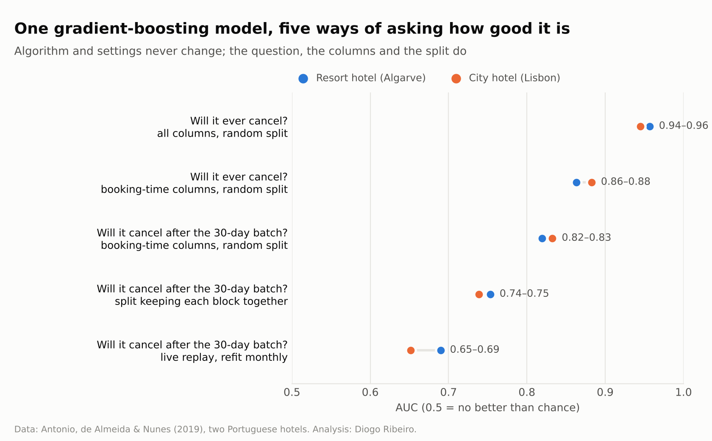
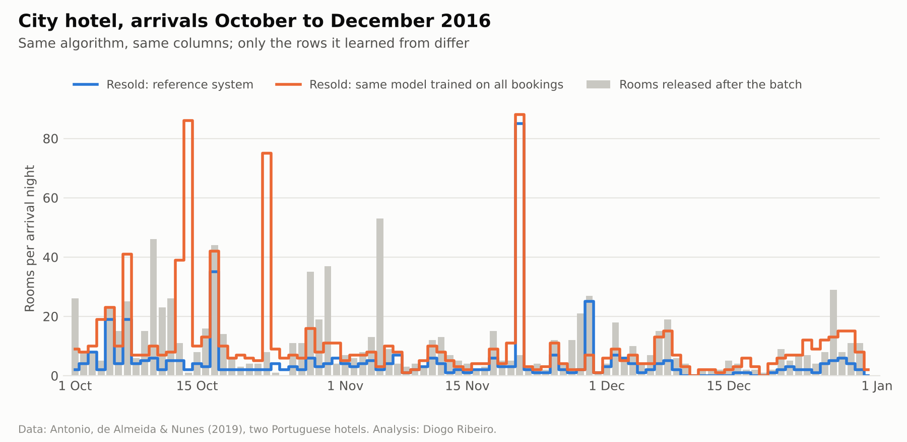
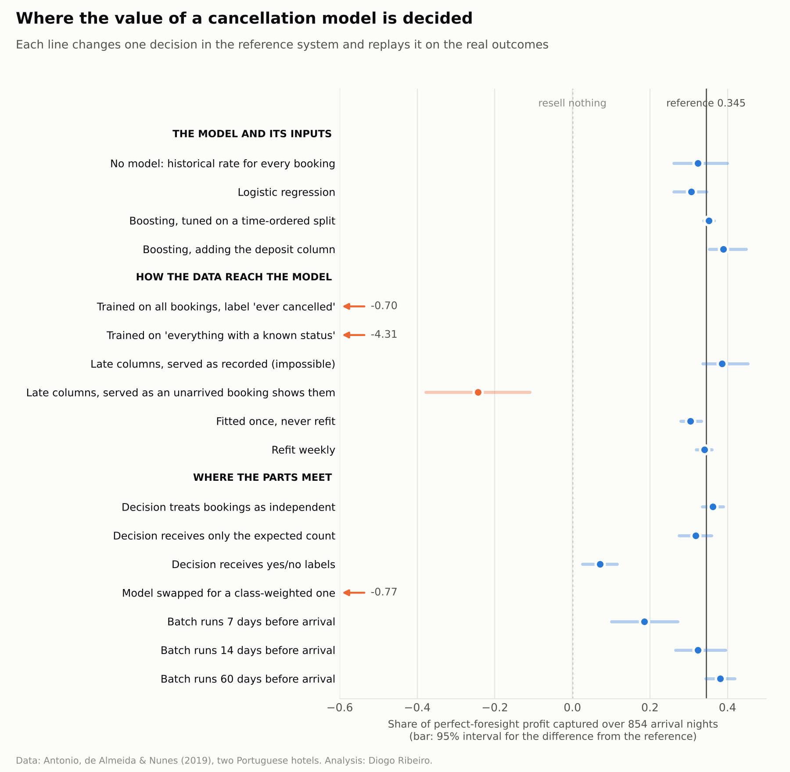

# Scientist, Engineer, Architect: A Fourteen-Month Replay of a Hotel Cancellation System

*Replaying 854 arrival nights at two Portuguese hotels to measure how much of the value comes from the model and how much from the decisions around it*

The usual picture of a data scientist's work puts the model at the centre. Data come in on one side, a model is chosen, tuned and validated in the middle, and something useful comes out on the other side, with the plumbing at either end treated as somebody else's concern. Courses are organised around that middle, interviews test it, and most published case studies end with a ranking of algorithms by a metric. The picture is right about what the scientific part of the job involves. It is wrong about where, in a system that is actually used, the value of that work gets decided.

My claim in this article is that a data scientist who builds anything meant to be used is doing three jobs at once. The first is a scientist's job: stating precisely which quantity is being estimated, for which population, at which moment, and how uncertain the estimate is. The second is an engineer's job: making sure that the rows and columns the model learns from are the rows and columns it will see when it is used, at the moment it is used, and that this stays true when the system reruns every night for a year. The third is an architect's job: deciding what passes between the model and the decision that consumes it, what counts as a unit, when each piece runs, and which change to one part silently breaks another. The model itself, the object that most of the training in this field is about, turns out to be the smallest of the places where the value is decided.

That is an empirical claim, so it should be measured rather than asserted. Below I take one real decision at two real hotels, with fourteen months of real outcomes, and replay it night by night under eighteen versions of the same system. Each version changes exactly one thing: the algorithm, the way the training rows were built, the columns the model was allowed to read, how often it was refitted, what it handed to the decision, how the decision aggregated bookings, or when the nightly batch ran. Every version is scored on the same 854 arrival nights against the same ceiling, with a bootstrap interval for its difference from a reference system.

The headline is easy to state. Replacing gradient boosting with logistic regression, with a tuned version of itself, or with no model at all (every booking given the historical rate) moves the share of attainable profit the system captures by less than four percentage points, and none of those differences can be told apart from zero. Training the same algorithm on the wrong rows moves it by more than a hundred points, from a profit to a loss. Handing the decision yes/no labels instead of probabilities moves it by twenty-seven points. Swapping in a class-weighted version of the same model without telling the decision layer moves it by more than a hundred. The rest of the article is about why, and about what that says regarding the job.

## Two hotels, one decision

In 2019 Nuno Antonio, Ana de Almeida and Luis Nunes published two datasets extracted from the property management systems of two Portuguese hotels, a resort hotel in the Algarve and a city hotel in Lisbon, both four-star and both with more than two hundred rooms. Together they hold 119,390 bookings due to arrive between 1 July 2015 and 31 August 2017, each with its outcome: the guest checked out, the booking was cancelled, or the guest did not turn up. The description of the data appeared in *Data in Brief*, and the files have since become one of the most widely used teaching datasets in machine learning, almost always as a binary classification exercise in which a model learns to say whether a booking will be cancelled.

The same three authors did something rarer with their data than most of the people who download it. They built a system that ran inside the two hotels, retraining every day and scoring future arrivals, and in the same year they published an account of it in the *Data Science Journal*. The account is unusually candid about what happened when models that looked good offline met real bookings, and I will come back to it several times, because a number of the failures I reproduce below are failures its authors met first and reported honestly.

The decision I replay is the one that gives a cancellation forecast its money value. Every night, at a fixed distance before a given arrival date, a batch job looks at the bookings still on the books for that night, scores each of them, and decides how many of their rooms to put back on sale. If the hotel resells a room and the original booking then cancels, it has earned a night it would otherwise have lost. If it resells a room and the original guest arrives anyway, someone has to be walked, which in the trade means sent to another hotel, with the transport, the compensation and the damage to the relationship paid by the hotel that overbooked. Revenue-management texts treat this trade between empty rooms and walked guests as the core of the overbooking problem (Talluri and van Ryzin give it a chapter of its own), and it has a clean form worth stating once.

Suppose that on the night of the batch there are n bookings for a given arrival date and the hotel resells q of their rooms. Let N be the number of those n bookings that will release their room, by cancelling before arrival or by not turning up. Each resold room earns a nightly rate r and each guest who arrives to a resold room costs w. Relative to reselling nothing, the profit of the decision is

r·q − w·max(q − N, 0).

The q that maximises expected profit is the largest one for which the probability that N is at most q − 1 does not exceed r/w. It is a quantile of the distribution of N, and the cost ratio says which quantile. With a walk cost of three nights' rate, the rule resells only as many rooms as will come back with a probability of at least two in three, which is the kind of caution one would want from a rule that can embarrass the front desk.

Two consequences follow before any model is fitted. The decision needs a distribution for N, not a probability for each booking, so whatever produces the probabilities has to hand the decision something from which that distribution can be built. And the value of any chain of choices can be measured against a ceiling: a hotel with perfect foresight would resell exactly N rooms every night and never walk anyone. I report every system as the share of that perfect-foresight profit it captures. A share of zero is what reselling nothing earns; a negative share means the system would have been better switched off.

The replay covers 427 arrival nights per hotel, from 1 July 2016 to 31 August 2017. Every system is walked forward through that period as it would have run. It is refitted on a schedule using only bookings whose arrival date had already passed at the moment of refitting, so that every training label is final, and each nightly decision uses the model in force on the night the batch ran. Nothing is tuned on the period being scored. The price of a resold room is the median nightly rate of the bookings visible for that night, the walk cost is three times that price, and I check further down how the conclusions move when it is two or five times. The Lisbon hotel's soft opening in July and August 2015 is dropped, as the data authors did in their own system, which leaves 115,512 bookings.

The replay is stylised in two ways that matter. It assumes that every room put back on sale finds a buyer at the going rate, which is more plausible a month before arrival than on the eve of it, and it ignores the bookings that will be made after the batch, which a real overbooking policy would also forecast. Both simplifications are the same for every system compared, which is what a comparison needs, but they mean the euro amounts should be read as an index of how well a system anticipates releases rather than as a forecast of what either hotel would have earned. Over the live period the reference system, described in a moment, faces on average 5.42 rooms per hotel-night that will be released after its batch, and perfect foresight would be worth €578 per hotel-night under these assumptions.

The reference system is what a careful team would build. Its nightly batch runs thirty days before arrival. It learns from snapshots that show each past booking as it looked thirty days before its own arrival, it reads only columns known when the booking was made, it fits gradient boosting with default settings and refits monthly, and it hands the decision a probability for each booking together with the block the booking belongs to (a term I explain below). It captures 34.5% of the perfect-foresight profit: it resells 3.11 rooms per hotel-night, walks 0.47 guests per hotel-night, has at least one walk on 17.4% of nights, and earns €199 per hotel-night relative to doing nothing. Each of the other seventeen systems differs from it in exactly one respect.

## The scientist's part: deciding what is being estimated

The first decision is the one most often made without being noticed. "Will this booking be cancelled?" sounds like a precise question, and the dataset answers it with a column called `is_canceled`. But the decision above is taken on a particular night, about the bookings still on the books that night, and the question it needs answered is narrower: will this booking, which has survived until tonight, release its room between tonight and its arrival?

The data show how different the two questions are. Of the 115,512 bookings, 42,053 (36.4%) ended in a cancellation or a no-show. Cancellations happened a median of 58 days before arrival, with a quartile range from 19 to 129 days, so most of them are over long before any short-range decision is taken. Thirty days before arrival, only 43.9% of all bookings are visible to the batch, because the rest either had not yet been made or had already been cancelled. Among the visible ones, the rate of release still to come is 15.5%, against 36.4% for bookings in general, and only 18.7% of all the releases in the data still lie ahead at that point. Seven days out, the visible late-release rate is 6.9% and only 9.9% of releases remain; on the eve of arrival it is 2.8%. The quantity that matters for the decision is a small, late tail of a process that the usual framing treats as one event.

The difference between the two questions is a conditioning event, and anyone who has worked with survival data will recognise it. "Will it ever be cancelled?" is a question about the whole life of the booking. "Will it be cancelled after tonight, given that it has not been cancelled so far?" is a question about the remaining life of a booking that has already survived to tonight. The second probability is the first one updated by the knowledge that the early part of the hazard has passed without an event, and because most cancellations happen early, that update is large. A model of the first quantity applied to the population of the second will be too pessimistic about almost every booking it sees, and no amount of tuning on the first population will reveal it, because the error is not in the fit. It is in which question the fit answers.

Stating the estimand is not pedantry, because it changes what any honest evaluation will report. The figure below shows the same gradient-boosting model, with the same software and default settings, evaluated on five versions of the problem.

*Figure 1. The same algorithm, five questions. AUC from five-fold cross-validation in the first four rows and from the walk-forward replay in the last.*

Asked whether a booking will ever be cancelled, with every column in the file and a random five-fold split, it reaches an AUC of 0.957 at the resort and 0.945 in the city, the kind of number that makes this dataset look easy. Restricted to columns that exist when the booking is made, it drops to 0.863 and 0.883. Asked the question the decision needs (release after a batch thirty days out, among bookings still visible then) it reaches 0.819 and 0.833 under a random split. When the split keeps all bookings of a block on the same side, it falls to 0.753 and 0.739. And when the model is used as it would be in operation, refitted monthly on the past and scored on the future, it achieves 0.690 at the resort and 0.652 in the city. The algorithm is identical in all five rows. What changes is the question, the columns allowed and the honesty of the split, and between the first row and the last the AUC loses almost three-tenths. Anyone who chose a model by the first number would have chosen it for the wrong problem.

Two of the drops deserve a word now, although they belong to the engineer's and architect's parts. The fall from all columns to booking-time columns is leakage, and I return to it below. The fall from a random split to a split that keeps blocks together is the consequence of a fact about these bookings that the usual table does not show: many of them were made together, by the same agent, on the same day, for the same arrival, and they share their fate. A random split puts siblings on both sides, and the model learns to recognise the family rather than the risk. The remaining fall, from grouped cross-validation to the replay, is time: cancellation behaviour in these hotels drifted from quarter to quarter, and a model fitted on the past is always a little out of date.

The second scientific decision is about what the probabilities are for. There is a short calculation that explains most of what follows. If the n bookings visible for a night release their rooms independently, with probabilities p₁, …, pₙ, then N has mean Σpᵢ and variance Σpᵢ(1 − pᵢ). Write p̄ for the average of the pᵢ and s² for their spread around that average. A line of algebra gives

Σpᵢ(1 − pᵢ) = n·p̄(1 − p̄) − n·s².

The first term is the variance a hotel would face if it knew only the average rate and gave every booking the same probability. The second is what discrimination buys: the more sharply the model separates likely from unlikely cancellers, the larger s² and the narrower the distribution of N. That is the only channel through which a better ranking of bookings improves this decision. Calibration enters through the other channel, the mean. If the probabilities are too high by a fraction δ on average, the centre of the distribution moves by about n·p̄·δ rooms, and the release rule moves with it.

The orders of magnitude are what matter. A bias in the mean moves the decision in proportion to n. An improvement in discrimination shrinks a standard deviation that grows only like √n, and shrinks it by a factor of √(1 − s²/(p̄(1 − p̄))), which is close to one unless the model separates bookings very sharply. In the replay, the reference model's probabilities narrow the independent standard deviation of N by 5.3% on an average night compared with giving every visible booking the same rate (the ratio is 0.947). That is the entire contribution of discrimination to the spread, and it is small, because an AUC of 0.67 does not separate bookings sharply. For a decision that aggregates dozens of bookings, an error of calibration costs more than a deficit of ranking, and a model chosen by AUC is chosen by the quantity that matters least.

The replay bears this out. With everything else in the reference system held fixed, giving every visible booking the historical rate of release among visible bookings, with no model at all, captures 32.4% of the attainable profit against the reference's 34.5%. The difference is −2.1 points, with a 95% interval from −8.3 to +5.4 points. Logistic regression on the same columns captures 30.7%, 3.8 points below the reference, with an interval from −8.3 to +0.1. Boosting tuned on a time-ordered split of the training window captures 35.2%, 0.7 points above, with an interval from −0.6 to +2.0. None of these differences can be told apart from zero with fourteen months of nights, and the largest of them is a few points of a ceiling that no system reaches by more than two-fifths. The model's contribution does grow when mistakes become more expensive: with a walk cost of five nights' rate, the no-model system falls 6.1 points behind the reference (interval −12.4 to −0.4), logistic regression 2.9 points (−6.4 to +0.6) and the tuned model 1.0 point (−2.9 to +0.9). Even then the whole spread between doing without a model and the best model available is a few points.

The variable that does make a visible difference among the inputs is one I left out of the reference on purpose. The deposit type (no deposit, non-refundable, refundable) is computed, according to the data documentation, from payments recorded before arrival or cancellation, which means its value at the moment of the batch is not knowable from the file: a booking paid a week before arrival shows "no deposit" a month before arrival. Adding it raises the captured share to 38.9%, 4.4 points above the reference, with an interval from +0.8 to +10.3. It also has the oddest relationship with the outcome in the file: of 13,802 bookings marked non-refundable, 99.3% were cancelled, the opposite of what the name suggests. Those bookings are almost all group and tour-operator business (61.3% in the groups segment and 35.8% through offline travel agents and tour operators), and 98.8% of them sit in blocks of two or more bookings, so my reading, which the file cannot confirm, is that the label records how blocks of rooms were paid for and released rather than how individual guests behaved. Whether to use it is not a modelling question. It is a question about when the value was written, and it can only be answered by someone who can see the payment table's timestamps. I report the gain and leave the column out.

The scientist's part, then, is decisive in a way that the usual picture misses. It is not the choice between algorithms, which barely matters here. It is the choice of question: which population, conditioned on what, evaluated how, and for a decision that uses probabilities through their sum and their spread. Get that wrong and every later step optimises the wrong thing very efficiently.

## The engineer's part: the rows and columns the model actually sees

The second set of decisions concerns how data reach the model. In a notebook they are made implicitly, by whatever query produced the table. In a system that runs every night they are made once and then repeated hundreds of times, so an error in them is not a mistake but a policy.

The first of these decisions is which rows to learn from. The reference system builds its training set with the same function that builds its serving set: every past booking appears as it looked thirty days before its own arrival, if it was visible then, labelled by whether it released its room afterwards. The most common alternative is the framing in which this dataset is usually taught: train on all past bookings with the label "ever cancelled", then apply the model to the bookings on the books tonight. The algorithm and the columns are the same; only the rows and the meaning of the label change.

The replay of that alternative is the clearest single result in this study. Its AUC on the live period is 0.657, barely below the reference's 0.668; on the metric most teams would monitor, nothing is wrong. Its probabilities, however, sum on average to 1.94 times the number of releases that actually happen, because it estimates the probability of cancelling at any time and is applied to bookings that have already survived most of their hazard. The release rule does exactly what it is told. It resells 8.45 rooms per hotel-night against the reference's 3.11, walks 3.96 guests per hotel-night against 0.47, has at least one walk on 67.8% of nights, and loses €406 per hotel-night relative to doing nothing. Its share of the attainable profit is −70.3%, 104.7 points below the reference, with an interval from −128.0 to −81.9 points.

*Figure 2. The grey bars are the rooms actually released after each batch. The blue line is what the reference system resold; the orange line is what the same algorithm resold after learning from all bookings with the label "ever cancelled".*

The figure shows what that looks like at the Lisbon hotel over three months. The reference system's resales sit below the releases on most nights, as a rule that resells only what will come back on two nights in three should. The other system's resales sit above them night after night. No hotel would let this run for fourteen months; a revenue manager would notice within days, from the front desk if not from the dashboard. That is precisely the point. The failure would be detected by the business and not by the model's metrics, and the person able to explain it would need to know survival analysis, not hyperparameters.

The second alternative is subtler, and it is the one the data authors report having lived through. A team that wants as much recent data as possible takes "everything whose status is known" at the moment of refitting: past arrivals, plus future arrivals that have already been cancelled, while dropping future bookings whose fate is still open. Every row in that set has a true label, and every one of the added rows is a genuine cancellation. The set is nonetheless biased, because the future bookings enter the training data only if they cancelled, so the more recent the data, the more cancellations it appears to contain. Antonio and his co-authors describe removing the unresolved bookings and finding that their models then predicted that most future arrivals were likely to cancel. In the replay, this construction produces probabilities that sum to 3.85 times the realised releases, resells 18.85 rooms per hotel-night, walks 13.65 guests per hotel-night and reaches a share of −430.7%. The AUC is 0.619. Again the ranking survives almost intact while the level is destroyed, and again the decision, being a function of the level, follows the level.

The third engineering decision concerns columns. A booking record in a property management system is not written once. Rooms are assigned when the guest arrives, nationality is corrected at the desk, parking spaces and special requests are added, amendments accumulate. A file extracted after the stays have happened holds the last value of each field, and for some fields the last value depends on whether the guest arrived. Kaufman and colleagues, in their formal treatment of the problem, define leakage as the use of information that would not legitimately be available at the moment of prediction, and this file is a textbook instance of it. The documentation says the values were taken as of the day before arrival where the change log allowed it, but the data contain patterns that no value written before arrival could produce, and the authors' own production paper names one of them: the leakage in the country column came from Portugal being filled in by default and corrected only at check-in. The file shows the consequence: bookings recorded as Portuguese were cancelled at 64.3% in Lisbon against 27.2% for everyone else, and at 42.2% against 16.4% at the resort. Another column is starker. There are 7,333 bookings with one required parking space, and not one of them was cancelled. Parking is evidently recorded on arrival, so the column is a perfect, and perfectly useless, predictor.

The engineering response is not to remember these facts but to write them down where the code can enforce them. The repository behind this article keeps a registry in which every column is listed with the moment its value becomes known and the evidence for that timing: the documentation, the authors' production account, or a pattern in the data. A test refuses to build the reference system from any column not marked as known at booking, and another test checks the parking pattern on every run, so that if a future version of the file changed it, the build would fail instead of silently changing the conclusion. None of this is sophisticated. All of it is the difference between a result and an accident.

What does the leakage cost? It depends on what the serving system sees, and the published file cannot say exactly, which is itself a finding. I bracket it. If the model that reads the late columns were served the values as recorded, which no real system could do because those values do not exist yet a month before arrival, it would reach an AUC of 0.822 and capture 38.6% of the attainable profit, 4.1 points more than the reference (interval −0.8 to +10.8). That is the number an offline evaluation would show. If instead it were served what an unarrived booking actually shows for the three columns whose timing is clearest (the default country, the reserved room as the assigned room, and no parking space), leaving amendments and special requests as recorded, which favours it, its AUC falls to 0.632, its probabilities sum to 1.81 times the realised releases, it walks 3.25 guests per hotel-night and its share is −24.3%, 58.8 points below the reference (interval −72.3 to −45.5). The truth for a real deployment lies somewhere between an impossible gain and a substantial loss, and nobody can say where without the change log the file was built from.

The fourth engineering decision is how often to refit. The reference refits monthly. Fitting once at the start of the live period and never again captures 30.5%, 4.0 points below the reference, with an interval from −6.5 to −1.2 points; it is the only modest difference in this group whose interval excludes zero, and it comes from drift. The late-release rate among visible bookings moved between quarters by several points at both hotels (at the Lisbon hotel it ranged from 11.8% to 22.8% over the period), and a frozen model's probabilities fell to 0.795 of the realised releases. Refitting weekly instead of monthly captures 34.1%, indistinguishable from monthly (interval −2.5 to +1.5). The data authors' production system retrained a challenger model every day and replaced the champion only when the challenger beat it consistently, a design that buys protection against drift with a good deal of machinery. In this replay monthly was enough; daily might matter more for a hotel whose mix of channels changes faster.

So far the engineer's part has been more consequential than the scientist's choice of algorithm by more than an order of magnitude, and every one of its failures shares a feature: the model's ranking metric hardly moved. The AUCs of the three systems that lost money range from 0.619 to 0.657, against 0.668 for the reference. A team that monitored AUC would have seen nothing. The quantity that moved was the level of the probabilities, which no ranking metric measures, and the level is exactly what the decision consumes.

## The architect's part: what passes between the pieces

The third set of decisions is about the boundaries between parts of the system: what one part hands to the next, what the unit of analysis is, when each part runs, and which properties of one part another part silently relies on. These are architectural decisions in the ordinary sense of the word. They are made once, they are expensive to change, and they determine which errors are possible.

Take the interface between the model and the decision. The reference system hands over a probability for every booking and the block it belongs to, so the decision can build a distribution for N and take the right quantile. A very common alternative hands over a label: the model's `predict` method, which in most libraries thresholds the probability at one half, and the decision counts the bookings labelled as cancellations. In this problem, where the average visible booking has a probability of release around one in six, almost no booking crosses one half. The system that receives labels resells 0.70 rooms per hotel-night and captures 7.2% of the attainable profit, 27.3 points below the reference, with an interval from −31.8 to −22.9 points. The model is the same, its probabilities are the same, and its AUC is the same. A one-line choice about what crosses the boundary throws away four-fifths of the value.

A third design hands over only the expected count, the sum of the probabilities, and resells that many rooms. It captures 31.8%, 2.6 points below the reference, an interval from −6.9 to +1.4, so at a walk cost of three nights' rate it is not clearly worse. The reason is that with this cost ratio the right quantile of N is not very far below its mean. The picture changes as walks become more expensive. At a walk cost of two nights' rate the expected count captures 49.7% against the reference's 47.6%, a gain of 2.2 points (interval +0.5 to +3.9), because when walks are cheap the reference's extra caution is itself a cost; at five nights' rate it captures −4.0% against 25.9%, a difference of −30.0 points with an interval from −43.5 to −19.1. An interface that carries only the mean is adequate exactly as long as the business's costs stay symmetric enough for the mean to be the right answer, and it fails without warning when they do not. The architectural decision to pass a distribution, or the means of building one, is what lets the decision adapt to a change in costs without touching the model.

The second architectural question is what a unit is. The property management system stores bookings, one row each, and the dataset inherits that grain. Cancellation risk does not live at that grain. If I define a block as the bookings for the same arrival, entered on the same day, by the same agent and company, through the same market segment, then 58.6% of all bookings belong to a block of two or more, there are 16,176 such blocks, and the largest holds 180 bookings. Within a block the outcome is usually shared: 79.4% of multi-booking blocks ended either entirely cancelled or entirely arrived, and of the 4,316 blocks with two or more cancellations, 72.7% had all of them recorded on a single date. Thirty days before arrival, 59.2% of the releases still to come belong to bookings in blocks of two or more, and 31.0% to blocks of ten or more.

The consequence for the decision is that N is far more variable than the independent model says. Over the live period the squared difference between the realised releases and their predicted mean was, on average, 7.66 times the variance that independence implies. A decision that treats bookings as independent is overconfident about the number of releases by a factor of almost three in standard deviation. The reference system's decision layer treats each block as a unit that releases all its rooms or none, with the block's average probability; that is cruder than reality, since a fifth of the blocks split, but it puts the variance in the right place.

Here the replay delivers a result that does not flatter the reference. At a walk cost of three nights' rate the independent decision captures 36.2%, 1.7 points more than the block-aware one, with an interval from −1.0 to +4.5 points. It is not distinguishable from the reference, and the reason it is not worse is instructive. The reference model's probabilities fall short of the realised releases (they sum to 0.854 of them), so the system is already cautious in its mean; the block-aware rule adds caution through the variance, and the two together are more cautious than this cost ratio requires. The independent rule's overconfidence about the spread partly cancels the model's underestimate of the level. Two errors offset each other, which is a common way for a system to look healthy. The offset depends on the costs. At two nights' rate the independent rule is ahead by 1.8 points (interval +0.2 to +3.5); at five nights' rate the independent decision captures 19.9% against the block-aware 25.9%, a difference of −6.0 points with an interval from −14.5 to −0.3. The unit of risk is an architectural fact about the business, and a design that ignores it is correct only by coincidence of parameters.

Blocks also cut the other way, and the replay contains the clearest example. On 21 November 2016 the Lisbon hotel had 111 bookings visible for that night thirty days ahead. Among them was a block of 85 group bookings entered 215 days before arrival, and the model gave it an average probability of release of 0.68. Treating the block as one unit, the decision concluded that with probability above two in three all 85 rooms would come back, and resold all of them. Three of the 85 bookings were cancelled. The reference system walked 78 guests that night, which is 78 of the 400 walks it made over all 854 nights, and the independent rule, which resold 59 rooms, walked 52. A forecast about one group of guests had become a single bet on eighty-five rooms. Nothing about that night contradicts the model, since an event with probability 0.68 fails about one time in three, and that is exactly why the guard has to be architectural rather than statistical: a limit on how much of any one block can be resold on the strength of a forecast, or a rule that hands blocks above a certain size to whoever negotiates group contracts, is a design decision about where forecasts are allowed to act alone. Nothing in the model can make it.

The third question is about contracts. Every component that consumes another's output depends on properties of that output, whether or not anyone wrote them down. The decision layer here depends on the probabilities meaning what they say: that among bookings scored 0.2, about one in five releases its room. Imagine a later change in which someone retrains the model with class weights, a standard remedy for "imbalanced" data that every library offers and that improves recall at a fixed threshold. The ranking barely changes: the class-weighted model's AUC on the live period is 0.659. But class weighting inflates every probability, so the sum rises to 2.05 times the realised releases. Swapped in without a change to the decision, it resells 8.96 rooms per hotel-night, walks 4.36 guests, and captures −77.3%, 111.7 points below the reference, with an interval from −138.5 to −86.4 points. A test suite that checked the model's AUC before deployment, which is what most model-validation steps check, would have passed it. A contract that said "probabilities must be calibrated within a stated tolerance on the most recent month" would have stopped it. The difference between those two tests is not statistical sophistication. It is knowing which property of the model the rest of the system relies on.

The fourth question is when things run. The reference batch runs thirty days before arrival, which is a choice about the schedule, the extract and the data freshness, not about the model. Running the same system seven days before arrival captures 18.5% of the attainable profit at that horizon, 15.9 points less than the reference at thirty days, with an interval from −24.4 to −7.3. Fourteen days captures 32.3% (interval for the difference −7.9 to +5.0) and sixty days 38.1% (−0.1 to +7.4). In money the differences are larger, because the attainable profit itself depends on the horizon: perfect foresight is worth €259 per hotel-night at seven days, €424 at fourteen, €578 at thirty and €656 at sixty, simply because more releases are still to come the earlier one looks. The reference earns €199 per hotel-night at thirty days and the same system earns €48 at seven. This comparison holds the resale assumption fixed, which flatters short horizons (a room put back on sale a week before arrival is harder to sell), so if anything it understates the case for an early batch. Under the replay's assumptions, the decision about when to run the job is worth more than all of the decisions about which model to run.

The fifth question is what the system stores, and here the replay is its own evidence. Everything above depends on being able to reconstruct what each booking looked like on the night of each batch. That reconstruction is possible for this dataset only for the columns that were written once (the booking date, the requested stay, the agreed rate) and for the outcome dates. For every column that was updated, the file holds a single final value, the documentation describes a snapshot that the data do not fully honour, and the replay is reduced to bracketing. A system that stored events, each change to a booking with its timestamp, would make every analysis in this article exact. A system that stores current state makes them guesses. Which of the two a hotel has is decided when its data platform is designed, long before anyone asks a data scientist to predict cancellations, and it decides what any data scientist can later know.

There is one more boundary that this data cannot measure but that any honest account of the system must mention. The data authors' system began to be used systematically at the end of May 2017, inside my live period, and the hotels acted on its output by contacting guests whose bookings it flagged. The authors report that, in their comparison between a control group of half the bookings and the rest, cancellation rates did not differ significantly; they also note that the bookings acted upon were not recorded as a feature, and that recording them would probably improve the model. A prediction that triggers an action changes the outcome it predicted, which is what Perdomo and colleagues called performative prediction. Whether a system logs its own interventions is an architectural decision, and without that log the next model learns from outcomes that its predecessor helped to cause.

## Adding it up

The figure below puts the seventeen departures from the reference on one scale: the share of the attainable profit each captures, with the interval for its difference from the reference system.

*Figure 3. Each line changes one decision in the reference system and replays it on the same 854 arrival nights. Bars show the 95% interval for the difference from the reference; values off the scale are printed at the left edge.*

Read by group, the figure says three things. In the top group, the model and its inputs, the variants cluster around the reference within a few points, their intervals overlapping it, with the one clear gain coming from a column whose timing cannot be verified. In the middle group, how the data reach the model, two of the six variants are catastrophic, the two leakage variants bracket an outcome somewhere between a small gain and a large loss, fitting once costs a modest but genuine amount, and refitting weekly changes nothing. In the bottom group, where the parts meet, the outcome ranges from a slight, non-significant gain to a hundred-point loss, depending on choices that most model-centred workflows never surface as choices at all.

None of this says that models do not matter. It says that in this problem, as in many decision problems in which a forecast feeds an aggregate quantity, the model is the component whose variation the rest of the system is best at absorbing. A reasonable algorithm on the right rows, with the right columns, handing the right object to a decision that understands it, performs about as well as any other reasonable algorithm in the same position. An excellent algorithm in the wrong position cannot be rescued by its own excellence.

## What this says about the job

If the value is decided in those three places, then a data scientist who works only in the middle one has handed most of the consequential decisions to whoever happens to make them, usually without anyone noticing that they were decisions. The scientist's part is not optional because it tells everyone else what is being estimated; without it, the engineers build a faithful pipeline for the wrong quantity. The engineer's part is not optional for a data scientist because the failures in this replay are statistical failures that look like plumbing. Training on all bookings is a survival-analysis error; training on "known status" is a selection-bias error; the country column is a measurement-timing error. A data engineer who has never thought about conditioning on survival has no reason to see any of them, and the tests that would catch them have to be written by someone who knows what they are testing for. The architect's part is not optional because the interfaces are where the statistics are either preserved or destroyed. Whether the decision receives labels, means or distributions; whether bookings or blocks are the unit; whether calibration is a contract; whether events are stored. Each of these is a statistical property expressed as a design.

That is why I resist the convenient division of labour in which the data scientist owns the model, the engineer owns the pipeline and the architect owns the boxes and arrows. The division is reasonable as a description of who types what. It is unreasonable as a description of who must understand what. Every catastrophic variant in this study would have passed a review conducted by any one of those three roles in isolation: the model was fine, the pipeline ran, the interface was clean. What failed was the fit between them, and that fit is a statistical object.

It also explains why the repository for this article looks the way it does. It is organised by those three parts rather than by notebook. A feature registry records when each column becomes known and why. A snapshot module builds training and serving rows with one function, so they cannot drift apart. A decision module states the profit, the rule and the interfaces explicitly. Tests check the visibility edges of a snapshot, the optimality of the release rule and the timing evidence for the leaking columns. A continuous-integration workflow verifies the data checksum, reruns every variant and fails if a single reported number changes. None of this is there for appearance. Each piece exists because, without it, one of the failures above could happen silently.

## Objections worth taking seriously

The first objection is that this is machine-learning engineering, a recognised specialty, and that the right response is to hire for it rather than to load it onto data scientists. I agree that the specialty exists and that larger teams should have it. But the replay suggests where the boundary has to fall. The person who decides that the estimand is conditional on survival, that blocks are the unit of risk and that calibration is the contract has to be the person who understands the statistics; the person who implements the feature store, the scheduler and the deployment can be someone else. What cannot be delegated is the knowledge of what those pieces must guarantee, because nobody else in the room has a reason to know.

The second objection is that the replay is stylised and the failures exaggerated: no hotel would walk thirteen guests a night for a year. That is true, and I have tried to report the failures in rooms and guests per night precisely so that their absurdity is visible. But the absurd versions are the limit of failures that, in milder form, do run for months. A system whose probabilities are 15% too high rather than 285% too high would not provoke complaints at the desk; it would quietly resell a little too much, walk a few more guests than necessary and earn less than it could, and its AUC would look exactly like the reference's. The extreme cases are useful because they show the mechanism at a size that cannot be argued away.

The third objection is that a better model would change the conclusion. A much better model, one that separated late cancellers from the rest with an AUC of 0.9 under an honest evaluation, would narrow the distribution of N more and would be worth more. The variance identity says how much: the gain comes through s², and the reference's probabilities currently remove about 5% of the independent standard deviation. But a model like that would need information about each booking that the file does not contain, such as the guest's interactions with the hotel since booking, price movements, or events in the destination city. Acquiring that information is, once again, a question of data architecture and engineering before it is a question of algorithms. The tuned boosting variant shows how much is left in the columns that do exist: 0.7 points.

The fourth objection is that the case is one dataset and two hotels. It is, and I would not generalise the magnitudes. I would generalise the structure. Wherever a per-unit forecast feeds a decision about an aggregate (stock to order, staff to roster, credit to provision, beds to free), the decision depends on the level and spread of a sum, the per-unit ranking matters only through the spread, units are often correlated, and the population at the moment of decision is conditioned on the history up to it. Those are properties of the problem class, and the replay shows what they do in one well-documented member of it.

## Conjectures

What follows is not established by this study; I state it as conjecture, in the hope that someone with access to the right data can test it.

My first conjecture is that the pattern in Figure 3, in which algorithm choice moves value by a few points and the surrounding decisions move it by tens or hundreds, holds broadly for operational forecasting problems in which a per-unit probability is aggregated into a decision. The variance identity gives a reason to expect it whenever the per-unit model has modest discrimination and n is in the dozens or more, but the size of the effect will depend on how correlated the units are and how asymmetric the costs.

My second conjecture is that most production failures of such systems are calibration failures that are invisible to the ranking metrics typically monitored, and that a monitoring regime built on predicted-to-realised ratios at the level of the decision (here, the sum of probabilities against the rooms actually released each night) would detect them weeks earlier than one built on AUC. The replay supports this in every failed variant, but the replay is not a production system with real monitoring delays.

My third conjecture is about the job market rather than the hotels. If the value of data-science work is decided mostly outside the model, then interviews and courses that concentrate on the model are selecting and training for the part of the work that matters least. I do not know how to test that directly, and I state it only as the conclusion this study points to.

## Code and data

All code, the compressed data with its checksum, the results and the figures are in the `hotel-cancellation-replay` folder of my Medium-Blog repository on GitHub: https://github.com/DiogoRibeiro7/Medium-Blog/tree/main/hotel-cancellation-replay. One command reproduces every number quoted here (`python -m cancelreplay run`), and a GitHub Actions workflow reruns the tests and the full replay on every change and fails if any reported number differs from the committed run. The data are those published by Antonio, de Almeida and Nunes (2019) with their *Data in Brief* article; I use them as redistributed by the TidyTuesday project.

## References

Antonio, N., de Almeida, A., & Nunes, L. (2019). Hotel booking demand datasets. *Data in Brief*, 22, 41–49. https://doi.org/10.1016/j.dib.2018.11.126

Antonio, N., de Almeida, A., & Nunes, L. (2019). An automated machine learning based decision support system to predict hotel booking cancellations. *Data Science Journal*, 18(1), 32. https://doi.org/10.5334/dsj-2019-032

Kaufman, S., Rosset, S., Perlich, C., & Stitelman, O. (2012). Leakage in data mining: Formulation, detection, and avoidance. *ACM Transactions on Knowledge Discovery from Data*, 6(4), 15. https://doi.org/10.1145/2382577.2382579

Perdomo, J., Zrnic, T., Mendler-Dünner, C., & Hardt, M. (2020). Performative prediction. *Proceedings of the 37th International Conference on Machine Learning*, PMLR 119, 7599–7609. https://proceedings.mlr.press/v119/perdomo20a.html

Talluri, K. T., & van Ryzin, G. J. (2004). *The Theory and Practice of Revenue Management*. Kluwer Academic Publishers (Springer).
