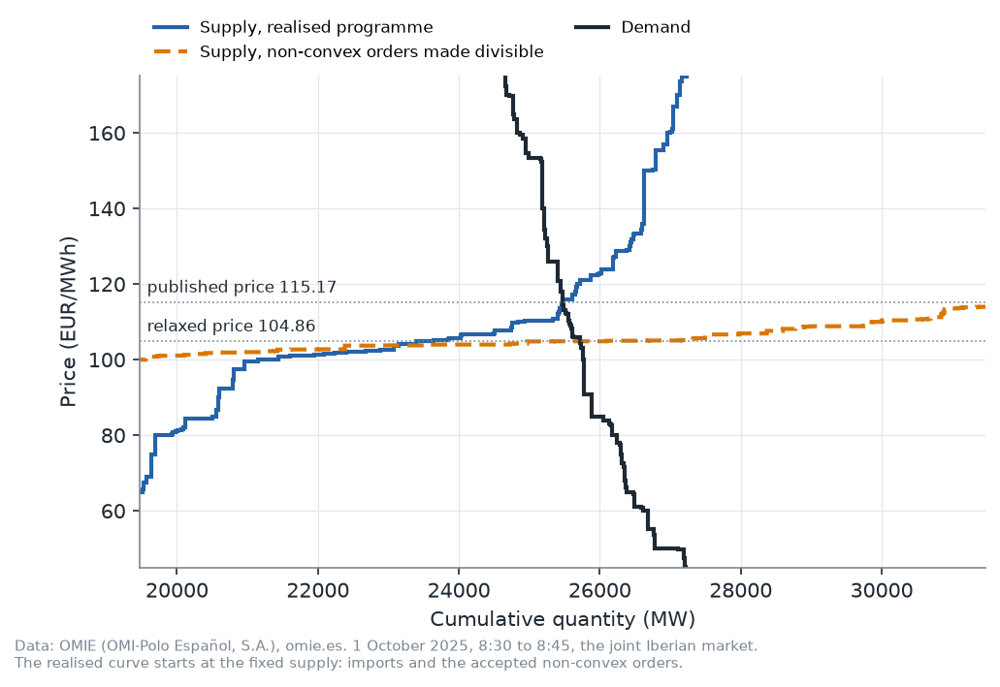
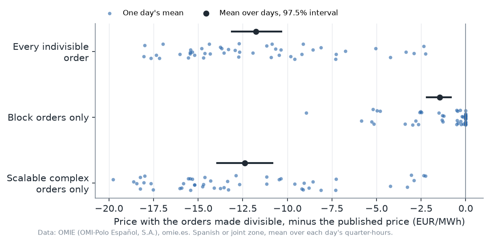
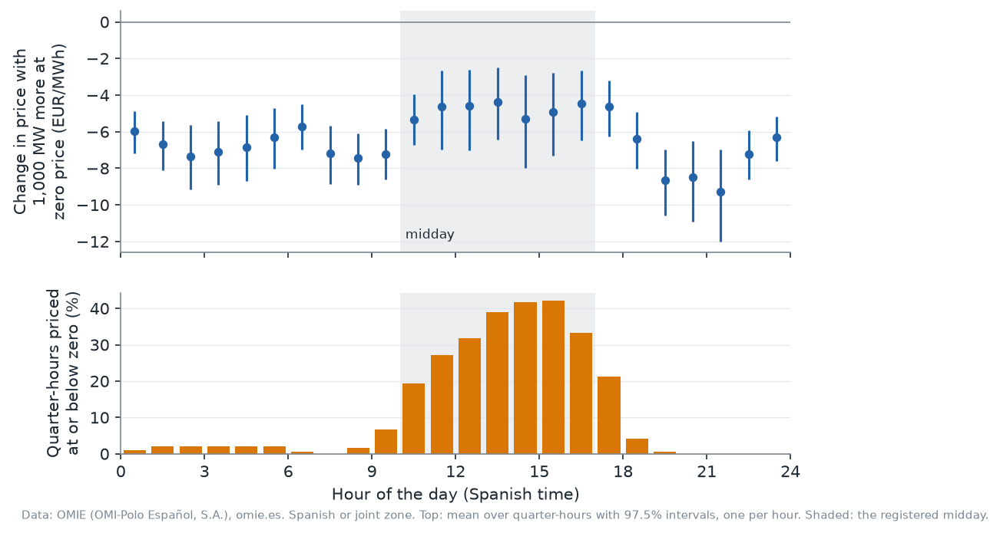

# Rebuilding the Iberian Day-Ahead Electricity Price from OMIE's Order Books

*{{n_programmes}} linear programmes solved from every published bid step, and what they say about non-convex orders, zero-priced supply and the border with France*

*Data: OMIE (OMI-Polo Español, S.A.), [omie.es](https://www.omie.es).*

Before noon every day, the generators, retailers, traders and large consumers that want to buy or sell electricity in Spain or Portugal for the following day send their bids to OMIE, the operator of the Iberian day-ahead market. Since {{first_day}} each bid refers to a quarter-hour of the next day rather than to an hour. Once the gate has closed, an algorithm returns a price for every quarter-hour in each of the two countries, together with the quantity that each bid sold or bought, and those prices become the reference spot price of the peninsula for the day that follows.

For anyone trained in optimisation, those prices are a familiar mathematical object. Suppose every bid were divisible, so that any fraction of it could be accepted, and suppose each quarter-hour were cleared on its own, without reference to the others. Clearing the market would then be a linear programme: choose how much of each bid to accept so as to maximise the value buyers declare for what they receive minus the cost sellers declare for what they supply, subject to the condition that what is supplied equals what is consumed. The price would be the shadow price of that single condition, the rate at which the best attainable gains from trade fall when one more megawatt of fixed demand has to be served. This is the picture of an electricity auction that appears in textbooks, and it describes most of what happens in the Iberian market.

Not all of it, though. The Iberian market is cleared jointly with the rest of Europe by an algorithm called EUPHEMIA, and a large part of what Iberian generators offer is submitted through orders that a linear programme cannot represent: blocks that must be accepted entirely or not at all across several quarter-hours, groups of blocks of which only one may run, and orders that are activated as a whole and must earn, over the day, enough to cover a fixed cost such as a start-up. These are non-convex orders. With them the clearing problem acquires integer decisions, and a uniform price that supports the chosen schedule need not exist. EUPHEMIA handles this by separating two steps. It first decides which non-convex orders to accept and how much power crosses each border, and it then prices that decision. Once those choices are fixed, what is left in each quarter-hour is again a linear programme, and the algorithm's acceptance rules force the published price to be one of its shadow prices.

That last observation is what makes the price something one can take apart. OMIE publishes, for every quarter-hour, every offered bid step and every accepted one, with its price, its quantity, its side, its zone and the type of order it belongs to, along with the flows across the borders. From those files the residual linear programme can be rebuilt, and a programme that has been rebuilt can also be changed. One can ask what the price would have been if the non-convex orders had been ordinary divisible bids, if {{e3_mw}} MW more had been offered at zero, or if no power had crossed the Pyrenees in either direction. Each of those questions is a counterfactual, and each is answered by solving a programme.

For a data scientist this is an unusual situation, and it is the reason for treating the subject at length. Most of the counterfactual questions we are asked are answered with a statistical model of a process we cannot observe, and the model's assumptions carry most of the weight of the answer. Here the process is an optimisation whose inputs are public and whose rules are documented, so a counterfactual is a computation rather than an estimate. The statistical work does not disappear, but it moves: to checking that the rebuilt programme really is the one the market solved, to deciding which days to study and how to express uncertainty across them, and above all to stating precisely what each computation holds fixed. Most of what the numbers below can and cannot mean is decided in that last part.

I sampled {{n_days}} days from the first year of quarter-hourly prices, {{first_day}} to {{last_day}}, and solved {{n_programmes}} linear programmes rebuilt from their published bids. The questions, the quantities to estimate, the rule for deciding each question and my expectation about each answer were written into a dated plan before any bid was compared with a price. Analyses added after the results are labelled as such where they appear, and a critical review of the code, the data and the text was made before publication. Every number in the article is inserted by code from the result files in the [project repository](https://github.com/DiogoRibeiro7/Medium-Blog/tree/main/iberian-electricity-lp), and a test checks that each qualitative statement made about a number holds in those files.

Three results carry the article. The first is a check rather than a discovery: with the non-convex orders' outcome and the border flows taken as given, the published price was a shadow price of the rebuilt programme in every one of the {{n_periods}} quarter-hours, in Spain and in Portugal alike. The second is a failed expectation. I expected that turning the non-convex orders into ordinary divisible bids would move the price in no particular direction; instead it would have lowered the price in most quarter-hours, by {{e2_drop}} €/MWh on average, a figure that is an upper bound for reasons explained below, and by {{line_full_drop}} €/MWh even when the quarter-hours are restricted to those in which the line to France was full. The third concerns zero-priced supply. {{e3_mw}} MW more at zero price would have lowered the price by {{e3_drop}} €/MWh on average, and by less around midday than at other hours, as I had expected. The gap is explained by the first half of the reason I gave, that midday prices are low, in its bluntest form: supply offered at zero cannot push a price below zero, and {{nonpos_midday_pct}} of midday prices were already at or below zero. The second half, a flatter supply curve at midday, finds no support in the data.

## A market is a linear programme

Take one quarter-hour and one zone. A sell step offers up to q MW at a price of at least p €/MWh; a buy step asks for up to Q MW at a price of at most P. Write s for the megawatts accepted from a sell step and b for those accepted from a buy step. Some volume is settled before the quarter-hour is cleared, such as the power exported minus the power imported across a border whose flow has been decided elsewhere, and I call that net fixed requirement R. The clearing programme is

> maximise Σ P·b − Σ p·s, subject to Σ s − Σ b = R and 0 ≤ s ≤ q, 0 ≤ b ≤ Q for every step.

The objective is the buyers' declared willingness to pay for what they receive minus the sellers' declared cost of what they supply: the gains from trade, measured at the prices in the bids. There is one equality constraint, so there is one dual variable, λ, measured in euros per megawatt-hour. It is the shadow price of the balance condition, the rate at which the optimal gains from trade fall when R rises by one megawatt. In words, it is what serving one more megawatt of fixed demand would cost the market at the margin.

Linear programming duality makes λ concrete. The complementary slackness conditions, which tie an optimal solution to an optimal dual, say here that a value λ is an optimal dual exactly when three things hold together. Every sell step priced below λ is accepted in full, and every sell step priced above λ is rejected. The mirror image holds for the buyers: every buy step priced above λ is accepted in full and every one priced below it is rejected. Only a step priced exactly at λ may be accepted in part. Read aloud, this is the rule of a uniform-price auction, in which everyone in the money trades, everyone out of the money does not, and the marginal bid sets the price. So a shadow price of the clearing programme is a clearing price of the auction, and a clearing price of the auction is a shadow price of the programme. The two descriptions are one statement in two vocabularies, and this equivalence is the whole reason the market can be studied with the tools of linear programming.

The second consequence is less familiar, and it matters for everything that follows: the shadow price need not be unique. Picture a quarter-hour with three sell steps, a cheap one, a middle one and a dear one, and a fixed demand to be served. If the demand is larger than the cheap step but smaller than the cheap and the middle steps together, the optimum takes all of the cheap step, part of the middle one and nothing from the dear one. The middle step is then partly accepted, and complementary slackness pins λ to its price, because the next megawatt of demand would come from the middle step and cost the middle price. If instead the demand happens to equal the cheap step exactly, no step is partly accepted. One more megawatt would have to come from the middle step, one megawatt less would be saved on the cheap step, and any price from the cheap step's price up to the middle step's price leaves the cheap seller willing to sell all it offered and the middle seller willing to sell nothing. Every price in that range clears the market, and every one of them is an optimal dual.

Geometrically, the optimal gains from trade, seen as a function of R, are piecewise linear and concave, with a kink wherever R crosses the boundary between two steps. The shadow price is the rate at which that function falls. Between kinks the rate is unique. At a kink the rates on the two sides differ, and the set of optimal duals is the whole interval between them, the superdifferential of a concave function in the language of convex analysis. This is not a curiosity of the theory. In the realised programmes of this study it was the situation in {{wide_pct}} of the zone-quarter-hours. An analysis that treats the shadow price as a single number reports, in those quarter-hours, whichever point of the interval the solver happens to return, and a comparison between a published price and a rebuilt one becomes a comparison with an arbitrary choice. Throughout this study the whole interval was computed exactly, and every comparison was made against it.

## Where the textbook stops

Electricity generation has costs that a linear programme cannot express. A thermal plant that starts up pays a fixed cost before it delivers its first megawatt, and below a technical minimum it cannot run at all. A plant that bid as if each quarter-hour were independent and each megawatt divisible would risk being dispatched for a single quarter-hour at a price that covers its fuel but not its start-up, or for a fraction of its minimum output that it cannot physically deliver. Power exchanges have long let such generators state these constraints directly, through order types whose acceptance is not a continuous choice.

EUPHEMIA's public description lists the order types, and OMIE's files distinguish three of them besides the simple steps. A block order offers a volume across several quarter-hours, possibly a different volume in each, at a single price, and it is accepted entirely or not at all, or at least down to a minimum share that the bidder sets. Exclusive blocks come in groups whose accepted shares add up to at most one, so that, of blocks that must be accepted in full, at most one in each group is. A scalable complex order is a set of steps spread over the day that is activated as a whole or not at all. Once activated, its steps are divisible above a minimum power. It can carry a minimum income condition, under which the money the order earns over the day must cover a fixed term, such as a plant's start-up cost, as well as the prices of its steps, and it can carry limits on how fast its output may change from one quarter-hour to the next. If its conditions are not met, the whole order is rejected, including steps priced below the market price.

These orders are not a detail. In the sampled days they made up {{nc_offered_pct}} of the sell volume offered, and only a small part of what was offered through them was accepted: {{acc_c01}} of the block volume, {{acc_c04}} of the exclusive-block volume and {{acc_c02}} of the scalable-complex volume. The rest was rejected, and the rejected part, as the results will show, was not all priced above the market price.

With such orders, clearing the market is no longer a linear programme. Whether each block is accepted and whether each complex order is activated are binary decisions, and through them the quarter-hours of the day are coupled to one another. The deeper difficulty, though, is economic rather than computational. In a convex market the allocation that maximises the gains from trade can always be supported by a uniform price, one at which every bidder is content with what it was given. With indivisibilities there may be no such price. A block that is efficient to accept may lose money at the price that clears everything else, and a block that would profit at that price may be inefficient to accept. A market designer has to decide which of these inconsistencies to tolerate. EUPHEMIA never accepts a block that would lose money over the quarter-hours it spans, judged at the prices of those quarter-hours taken together, but it allows a block to be rejected even though it would have been in the money, which the algorithm's documentation calls a paradoxically rejected block.

The algorithm proceeds in stages that mirror this choice. A master problem selects the block and complex orders to accept, and a price-determination step then computes prices for that selection, which are checked against the acceptance rules. For the ordinary steps, the rule is stated without qualification: every order in the money must be accepted in full, every order out of the money must be rejected, and only orders at the money may be accepted in part. EUPHEMIA validates its solutions by checking exactly this complementary slackness for its chosen selection. Once that selection and the flows across the borders are fixed, therefore, the remaining choices in each quarter-hour form the linear programme of the previous section, and the published price must be one of its shadow prices.

Fixing the integer decisions of a non-convex market and pricing what is left as a linear programme is a known construction. O'Neill and coauthors (2005) showed that the duals of the linear programme obtained by fixing the integer variables at their optimal values give commodity prices that, together with payments for the fixed decisions, support the efficient allocation. European day-ahead markets do not make such side payments, and EUPHEMIA relies on its acceptance rules instead to keep accepted orders from losing money, but the relation between its prices and its choices is the same: the prices are duals of what remains once the choices have been made.

## What OMIE publishes, and what it does not

For each delivery day OMIE publishes three files that matter here. The price file gives the Spanish and the Portuguese price of every quarter-hour. The curve file lists every bid step offered and every step matched, quarter-hour by quarter-hour, with its price, its quantity, its side, its zone and the type of order it came from, and it lists the flows across the borders among the matched steps. The interconnection file gives the capacity of each border and how much of it remained free.

Everything in these files is anonymous. A step says that some seller offered so many megawatts at such a price through a scalable complex order, but not which seller, not which other steps belong to the same order, and not the order's fixed term, its minimum power or its limits on how fast output may change. The curve file shows the consequences of the orders' conditions, which steps were accepted and which were not, but not the conditions themselves. Several of the qualifications below come from that gap.

I used the first year of the quarter-hourly market, from {{first_day}} to {{last_day}}, and drew {{days_per_month}} days at random from each month, {{n_days}} in all, with a fixed seed so that the draw can be repeated. Drawing within months keeps every season equally represented, which matters in a market whose supply changes as much as the Iberian one does between a windy winter and a sunny summer. Every quarter-hour of a drawn day was used, {{n_periods}} quarter-hours in all.

The files are large. In the joint or Spanish market a quarter-hour has a median of {{steps_median}} offered bid steps. Many of them share a price, a side and an order type, and summing those leaves a median of {{steps_summed}}. Summing changes nothing in the programmes, because both programmes depend on the steps only through their prices and the total quantity offered at each price: two steps at the same price are interchangeable in the objective and in the constraint, and the set of optimal duals is determined by the cumulative supply and demand at each price.

Spain and Portugal share one price as long as the interconnection between them is not full. When it is, the market splits into two zones, each with its own supply and demand and, usually, its own price. That happened in {{n_split}} of the {{n_periods}} quarter-hours ({{split_pct}}), on {{split_days}} of the {{n_days}} days, and in {{split_differ}} of those split quarter-hours the two prices differed. In a split quarter-hour each zone is rebuilt as its own programme, with the flow between the two countries fixed at its published value, which gives {{n_zone_periods}} zone-quarter-hours to rebuild in all.

The files write quantities in tenths of a megawatt and prices in cents, and I read them as integers, so that every sum and every comparison is exact and the published price can be compared with a rebuilt one without a tolerance chosen after the fact. The interval of shadow prices of each programme was computed directly from the cumulative curves, using the characterisation of the previous section. At a candidate price, the smallest net supply consistent with it accepts only the sell steps priced strictly below it and every buy step priced at or above it; the largest adds the sell steps priced exactly at it and drops the buy steps priced exactly at it. The candidate is a shadow price exactly when the fixed requirement R lies between the two. As an independent check, every programme was also solved as a linear programme with the HiGHS solver through SciPy {{scipy_version}}. In all {{n_programmes}} solves, the dual value that HiGHS returned lay inside the exact interval, and its optimal objective matched the exact one.

## Two programmes, three changes and a rule for the price

For every zone and quarter-hour I built two programmes from the bids. In the realised programme, the simple steps are the variables. The accepted volume of the non-convex orders and every flow across a border are fixed at what the market decided, and they enter the programme through R. This is the residual programme of which, by EUPHEMIA's rules, the published price must be a dual. The relaxed programme is the same, except that every offered step of the non-convex orders becomes an ordinary divisible step at its offered price, and the orders' fixed terms, which the files do not show, are dropped. The flows stay fixed in both.

Three changes are then asked of these programmes. The first compares the relaxed programme's price with the published one, and so measures what the non-convex orders' conditions do to the price. The second adds to the realised programme one more sell step of {{e3_mw}} MW at zero price, a clean version of the merit-order question. The third sets the flows with France to zero in the realised programme, as if the interconnection had been closed. In each case everything not mentioned is held fixed: every other bid, the flows across the other borders, and, in the second and third changes, which non-convex orders were accepted and how much of each.

A counterfactual programme can have an interval of shadow prices rather than a single one, so a rule is needed to turn it into a price. The rule fixed in the plan takes the point of the interval nearest the published price. The reason is attribution. When the published price already lies inside the counterfactual interval, the change does not force the price to move, and the rule reports no movement; when it lies outside, the rule reports the smallest movement the change forces. A rule that took the midpoint of the interval would sometimes report a movement caused by nothing but the interval's width.

Uncertainty is expressed over days. The {{n_days}} days are a sample from the year, and the quarter-hours of one day are far from independent: the same bidders submit related orders for the whole day, and a block or a complex order ties many quarter-hours together. Every interval below is therefore a percentile bootstrap that resamples whole days, keeping all the quarter-hours of a drawn day together. Two of the questions were set up to decide something, the effect of relaxing the non-convex orders and the comparison of the merit-order effect at midday with the other hours. Their intervals are at {{simultaneous_level}} each, so that the two decisions hold together at a joint level of at least 95%. The other intervals are at 95%, and the intervals by hour of the day in the last figure are not corrected across hours.

Before anything was solved, the plan stated the rule by which each question would be decided and what I expected the answer to be. The point of writing an expectation down is that a result can then be seen to disagree with it, rather than being fitted afterwards to an expectation reconstructed from the result. One of the expectations failed, and the section on the non-convex orders says how.

## The rebuild reproduces the published price

The plan asked for the published price to lie within {{e1_tolerance}} €/MWh of the realised programme's interval of shadow prices in at least {{e1_threshold}} of zone-quarter-hours, failing which the other questions would be reported as descriptive only. The published price lay inside the interval in every one of the {{n_zone_periods}} zone-quarter-hours, in the joint market, in Spain and in Portugal, and since prices are whole cents the tolerance was never needed. The programme's accepted volume matched the published accepted volume within {{volume_tolerance}} MW in every one of them as well. In {{wide_pct}} of them the shadow prices formed a genuine interval rather than a single point, with a median width of {{wide_median}} €/MWh, and the published price lay inside each of those intervals too.

It would be easy to present this as the main finding, and it is not one. EUPHEMIA must accept every in-the-money order in full and reject every out-of-the-money one, and it validates its solutions by checking exactly this complementary slackness for its chosen selection of non-convex orders. Given that selection, the published price is a shadow price of the realised programme by construction. The check could have failed only through an error somewhere between the market and my code: a misread file, a flow assigned to the wrong side, a step placed in the wrong zone, a sign reversed. With every zone-quarter-hour inside, a bootstrap interval for the share carries no information, since every resample contains only successes.

What the check establishes is that OMIE's public files are complete enough, and the rebuild faithful enough, for the residual programme to be reproduced to the cent, with the right volumes as well as the right prices. That is the precondition for trusting anything the programme says once it is changed. A counterfactual computed from a model that cannot reproduce the factual is an extrapolation from an unknown error, and a reproduction to the cent removes that unknown before any question is asked of the model.

## What the non-convex orders do to the price

For each quarter-hour, δ is the relaxed programme's price minus the published price, in the Spanish zone, or in the joint zone when the market did not split. A negative δ means that treating the non-convex orders as ordinary bids would have cleared the market at a lower price.

In the plan I expected no direction, with δ = 0 in most quarter-hours. That expectation failed, and it had already looked doubtful before the study's programmes were solved: on the day used to develop and test the code, which lay outside the sample and after the study period, relaxing the non-convex orders lowered the price in most quarter-hours. The plan's change log records that observation, and also that the expectation and the decision rule were left as they had been registered. The result over the sample is

> mean δ = {{e2_mean}} €/MWh ({{simultaneous_level}} interval {{e2_mean_low}} to {{e2_mean_high}})

The interval excludes zero, so by the rule fixed in advance the non-convex orders move the average price. The movement is not confined to a few quarter-hours. The price moved by more than a cent in {{e2_moved}} of them: down in {{e2_down}} of the {{n_periods}}, up in {{e2_up}}.

*A quarter-hour of the first sampled day, chosen by rule: of that day's joint quarter-hours, the one whose change from the relaxation is nearest the mean change over all quarter-hours ({{e2_mean}} €/MWh). Blue: the sell steps of the realised programme, starting from its fixed supply. Orange: the same with the non-convex orders made divisible. Black: demand. Each price is where supply meets demand.*

The figure above shows what the relaxation does in a single quarter-hour, chosen by a rule rather than by eye. The blue curve is the supply of the realised programme, which starts from the fixed supply of imports and accepted non-convex orders; the orange curve is the supply once the non-convex orders are made divisible; the black curve is demand. The orange curve runs almost flat, at prices below the published one, for several thousand megawatts. That flat stretch is volume offered through non-convex orders, much of it at prices below the price the market set. In the realised programme only the accepted part of that volume appears, as fixed supply at the start of the blue curve; the rest was kept out by the conditions attached to it. Made divisible, the whole of it becomes the cheapest way to meet the last thousands of megawatts of demand, and the price falls to the point where demand crosses the orange curve.

How large is the effect? The mean fall, {{e2_drop}} €/MWh, is about {{e2_share_of_price}} of the mean published price over the same quarter-hours, {{mean_price}} €/MWh. It should be read as an upper bound for this kind of relaxation, for three reasons that the critical review identified after the results, and quantified where the files allow.

The first is the fixed terms. The relaxed programme keeps the step prices of the scalable complex orders and drops each order's fixed term, because the files do not show it. A gentler relaxation, one that spread each fixed term over its order's volume, would raise the effective price of every step and with it the clearing price. By how much depends on how each bidder divided its costs between the fixed term and the steps, and the public files do not reveal that.

The second is the border with France. The flows with France stay at their published values in both programmes. In {{line_room_pct}} of the quarter-hours the line had free capacity in the direction of the flow, and in those quarter-hours the cheap supply released by the relaxation could in reality have flowed to France, which would have kept the Iberian price above the computed one. Restricting attention to the quarter-hours in which the line was full, where holding the flow fixed is a much weaker assumption, the mean δ is {{line_full_delta}} €/MWh (95% interval {{line_full_delta_low}} to {{line_full_delta_high}}), against {{line_room_delta}} when the line had room. The effect keeps most of its size under that restriction.

The third is the exclusive blocks. The curve file does not say which exclusive blocks belong to the same group, so the relaxed programme counts each of them as independent divisible supply, although, in a group of blocks that must be accepted in full, at most one can be. That overstates the supply the relaxation adds. For the relaxation of every order the overstatement is small; for the blocks considered alone it is not, as the breakdown below shows.

The average also mixes two different experiments. In a joint quarter-hour the relaxation acts on the whole Iberian market, with the line between Spain and Portugal unconstrained. In a split quarter-hour it acts on Spain alone, with Portugal's orders and the flow between the two countries held at their published values. The mean δ is {{joint_delta}} €/MWh in joint quarter-hours and {{split_delta}} in Spain in split ones, so the effect is larger where the relaxation reaches the whole market. Split quarter-hours are a minority, and the pooled mean stays close to the joint one.

Relaxing one kind of order at a time shows where the effect comes from, although the parts do not add up to the whole. Each relaxation changes the price at which the other orders are judged, and the pieces interact.

Relaxing only the scalable complex orders moves the price by {{e2_sco}} €/MWh ({{simultaneous_level}} interval {{e2_sco_low}} to {{e2_sco_high}}), as much as relaxing every order. It never raised the price in any quarter-hour, and that follows from the rules rather than from the data. In every quarter-hour, the accepted volume of these orders never exceeded their offered volume priced at or below the price, so relaxing them could only add supply at or below the price; it could never remove supply that had been accepted above it. Which of the orders' conditions kept the rejected steps out cannot be read from the anonymous files. It could be the minimum income condition, the limits on how fast output may change, the minimum power, or a combination, and attributing the effect to any one of them would go beyond what the data show.

Relaxing only the blocks gives {{e2_blocks}} €/MWh in the computation fixed in the plan, but that figure counts the blocks of each exclusive group as if all of them could be accepted, which is the overstatement described above. With the exclusive blocks left as they were and only the simple blocks relaxed, the figure is {{blocks_c01}}. The blocks also move the price in both directions, down in {{e2_blocks_down}} quarter-hours and up in {{e2_blocks_up}}, and the upward movements are instructive. EUPHEMIA judges a block against all the quarter-hours it spans together, so a block can be accepted although its price is above the market price in some of its quarter-hours, provided it is in the money over the block as a whole. Relaxed, such a block becomes an ordinary step in each quarter-hour and is rejected wherever it is out of the money, which removes supply and raises the price. A plausible reading of why the scalable complex orders alone move the price slightly more than every order together, which the study did not test separately, is the same mechanism: when the blocks are relaxed as well, accepted blocks priced above the new, lower price drop out of the supply.

*One dot a day: the mean change over that day's quarter-hours. Black: the mean over days with its {{simultaneous_level}} interval. The block row is the computation fixed in the plan, with exclusive blocks counted as additive supply.*

The second figure shows the same breakdown day by day. The row for every order and the row for the scalable complex orders alone look alike, and the result is not carried by a few unusual days: the daily means spread widely, but every day's mean lies below zero in both rows. The block row sits close to zero on most days, with a tail of days on which the blocks mattered.

None of this is the price that a market without non-convex orders would have produced. The orders exist because their conditions protect the bidders who use them, against starting a plant that would not recover its start-up cost, for instance, or against being dispatched in a pattern the plant cannot follow. Without the conditions, those bidders would bid differently, presumably at higher prices on their steps, and the relaxed programme, which holds every bid as it was submitted, cannot say how. What δ measures is narrower and still useful: how much the conditions bind in the clearing, given the bids as they were. A large δ says that a large volume of supply was offered at prices below the market price and kept out by conditions attached to it. And for a modeller who represents the Iberian supply curve by every offered step, as if every bid were divisible, the relaxed programme is that model, so δ is the error such a model would make in these quarter-hours, with the flows as they were.

## {{e3_mw}} MW more at zero price

Supply offered at zero price, as wind and solar output often is, displaces the dearest accepted offers from the merit order and lowers the price. The effect has been measured on the German market (Sensfuß and coauthors, 2008) and, from OMIE's own curves, on the Spanish one (Ciarreta and coauthors, 2014), and it is a staple of discussions about what renewable capacity does to wholesale prices. With the realised programme in hand it can be computed directly, quarter-hour by quarter-hour, without a regression. For each quarter-hour, m is the realised programme's price with one more sell step of {{e3_mw}} MW at zero price, minus the published price, with every bid, the border flows and the non-convex orders' acceptance held fixed.

The extra step shifts the supply curve to the right by {{e3_mw}} MW at every price above zero, and the new price is where demand meets the shifted curve. Where the curves near the old price are steep, a fixed shift moves the price a long way; where they are flat, it moves it a little.

> mean m = {{e3_mean}} €/MWh ({{simultaneous_level}} interval {{e3_mean_low}} to {{e3_mean_high}})

The effect grows roughly in proportion to the size of the step: {{e3_small_mw}} MW lowers the price by {{e3_small_drop}} €/MWh on average, and {{e3_large_mw}} MW by {{e3_large_drop}}. Over this range, then, the average response behaves almost linearly in the volume added, although that says nothing about any single quarter-hour, where the response is a step function of the volume.

The plan also asked whether the effect is smaller around midday, from {{midday_from}} to {{midday_to}}, Spanish time, and I expected it to be. The reason written into the plan had two halves: at midday solar output keeps the price low, and it makes the supply curve flat, so that the same extra supply moves the price less. The comparison fixed in advance was G, the mean size of m outside midday minus its mean size at midday. By that rule the effect is smaller at midday. The mean size of m is {{e3_outside_abs}} €/MWh outside midday and {{e3_midday_abs}} at midday, a gap of

> G = {{e3_g}} €/MWh ({{simultaneous_level}} interval {{e3_g_low}} to {{e3_g_high}}).

The interval lies above zero, so the expectation holds as a statement about G. Whether the reason I gave for it holds is a different question, and the answer is that only half of the reason holds.

What follows was computed after the results and decides nothing; its purpose is to explain. A step offered at zero price cannot push a price below zero. If the published price is already at or below zero, the new step is at or out of the money, the price has no reason to move, and m is zero. If the published price is positive, the step is taken, but the new price cannot fall below zero either, because at any negative price the step would again be out of the money and the market would be back to its original supply, short of what it needs. The extra supply can take the price down to zero and no further.

In the sample, prices at or below zero were a midday phenomenon. They occurred in {{nonpos_midday_pct}} of midday quarter-hours against {{nonpos_other_pct}} at other hours, and in every one of them m was zero. Those zeros alone account for the gap: at the point estimates, G comes from the quarter-hours priced at or below zero, and the quarter-hours priced above zero contribute almost nothing to it. The first half of my reason, that midday prices are low, is therefore enough to explain why the effect is smaller at midday, in the bluntest possible way.

The second half, that the supply curve is flatter at midday, is harder to test, because the floor does not stop binding at zero. The bound that m cannot exceed the price in size holds at every price, and midday prices above zero were lower too, with a median of {{pos_midday_median}} €/MWh against {{pos_outside_median}} at other hours. Comparing midday quarter-hours with the others among those priced above zero still compares cheap quarter-hours with dear ones, and the floor still favours a smaller effect at midday. A fairer comparison holds the price level fixed. Within bands of the published price, the effect was larger at midday in {{bands_larger}} of {{bands_n}} bands. The bands are coarse and the comparison was not planned, so this is no evidence of a steeper curve at midday, but it gives the flatter-curve explanation no support. What can be said is that the midday effect is smaller because midday prices are low, often at or below zero, and that the data do not show a flatter supply curve behind it.

*Top: the mean change in price by hour, each with its own {{simultaneous_level}} interval (one per hour, not joint across the hours). Bottom: the share of quarter-hours priced at or below zero. Shaded: the midday fixed in the plan.*

The hourly pattern behind G is in the figure above. The effect is smallest in the solar hours and largest in the evening. The lower panel rises through the same midday hours in which the upper one weakens, which is the floor at work. Why the evening effect is the largest the study did not examine; a natural conjecture is that once solar output has gone and demand is still high, the price is set on a steeper part of the supply curve.

Like the relaxation, the merit-order figures hold the flows with France fixed, so the extra Iberian supply cannot be exported even when the line has room. In the quarter-hours with the line full, the effect is smaller, a mean m of {{line_full_m}} €/MWh against {{line_room_m}} when the line had room. The figures also hold fixed which non-convex orders were accepted. With the price lower, some accepted orders with a minimum income condition might no longer earn enough to qualify, and their withdrawal would push the price back up. Both simplifications make m larger in size than the response of the real market would be.

## The French border

The last question was descriptive from the start and decides nothing. Holding every bid and the non-convex orders' acceptance fixed, it sets the flows with France to zero, as if the interconnection had been closed for that quarter-hour, and asks how the price would have moved.

In the {{e4_imports_n}} quarter-hours that imported from France, removing the imports removes fixed supply, and the mean change in the price is {{e4_imports}} €/MWh (95% interval {{e4_imports_low}} to {{e4_imports_high}}). In the {{e4_exports_n}} that exported to France, removing the exports removes fixed demand, and the mean change is {{e4_exports}} €/MWh ({{e4_exports_low}} to {{e4_exports_high}}). Without the imports, the price rises; without the exports, it falls.

The signs are mechanical, since taking supply away cannot lower a price and taking demand away cannot raise one. The sizes are not mechanical, and the asymmetry between them is the interesting part: the response to losing imports was about twice the response to losing exports. A plausible reading, which the study did not test, is that the market imports when Iberian prices are high and the price sits on a steep part of the supply curve, and exports when Iberian prices are low, often in the solar hours where the curve is flat and the zero floor is near. The same caveat as before applies in the other direction: a higher price would let more orders with a minimum income condition qualify, so the rise without imports is overstated in size too.

## What the numbers do not say

The rebuild is not a replication of EUPHEMIA. The flows with France and the outcome of the non-convex orders are taken as given in the realised programme, or, in the relaxation, ignored, and the bids from the rest of Europe are not modelled at all. The study asks what the Iberian price does when one thing changes inside the Iberian programme, not what the coupled European market would have done.

Nor is it a model of behaviour. Every bid is held as it was submitted, and real bidders would respond to a market without conditions on their orders, to {{e3_mw}} MW of new zero-priced capacity, or to a closed border. With the border flows fixed, extra Iberian supply cannot be exported, so the relaxation and the merit-order figures overstate the effect when the line to France has room. With the non-convex orders' acceptance fixed in the last two questions, a moved price would in reality accept or reject some of those orders differently, and in each case the adjustment would work against the computed movement.

Prices are the object throughout. No welfare figure is computed, and nothing here is a forecast of future prices. And the sample is one year of the quarter-hourly market, {{n_days}} days drawn from it; whether the same numbers hold in other years, with different weather, different fuel prices and a different fleet, is a question for other years' files.

## What a data scientist can take from it

The general lesson is about what changes when the mechanism that produces the data is an algorithm with published inputs. A counterfactual becomes a computation, and the questions that usually absorb most of the effort of causal inference, about confounding and identification, give way to two others. The first is whether the rebuilt mechanism is the real one. Here that question had a sharp answer, because the market's own rules imply that the published price must be a shadow price of the residual programme, and a reproduction of every price to the cent, and of every accepted volume to a tenth of a megawatt, leaves little room for a silent error. Any analysis that changes a model of a mechanism should begin by reproducing the factual outcome with it, and should treat a failure to reproduce as a finding about the model rather than a nuisance.

The second question is what each computation holds fixed, and here there is no sharp answer, only an obligation to state it. Every number in this article is conditional on a list: every bid as submitted, the flows across the borders, the acceptance of the non-convex orders, the zone structure of the quarter-hour. A number is only as meaningful as that list, and much of the work of interpretation consisted of asking, for each item, in which direction holding it fixed biases the result. For the relaxation and the merit-order effect the answer was the same each time: the computed movement is larger than a responsive market would produce.

For anyone who models the Iberian market, the conditions on non-convex orders matter. Treating those orders as ordinary bids would have lowered the price by as much as {{e2_drop}} €/MWh on average, about {{e2_share_of_price}} of the mean price of {{mean_price}} €/MWh, and the bias is not confined to a few hours but appears in most quarter-hours. A model of the supply curve built from every offered step, without the conditions, inherits a bias of that order.

For anyone who estimates merit-order effects from bid curves, two habits follow from the midday analysis. Check how often the price is already at or below zero, because a step offered at zero cannot lower such a price at all. And compare like with like: an effect that looks smaller at midday can come entirely from the zero floor, and the floor keeps binding at low positive prices, so a comparison between hours that does not hold the price level fixed is a comparison of price levels.

For anyone who teaches linear programming, the Iberian market is a rare example in which duality is not a metaphor for a price but the definition of one. Once the power exchange has made its all-or-nothing choices, its price is a shadow price of a linear programme, the published order books let you check that to the cent, and the same programme can then be used to ask what-if questions whose answers are exact given what they hold fixed.

And for anyone who runs studies of this kind, the habit of writing the expectations down before the data are seen earned its keep. One of mine failed outright and the reason for another failed by half. Neither would have been visible as a failure if the expectations had been written after the results.

## Data, code and acknowledgements

The data tables, the code, the research plan with every change made to it, the full results and the critical review, with the corrections it led to, are in the [project repository](https://github.com/DiogoRibeiro7/Medium-Blog/tree/main/iberian-electricity-lp). Data: OMIE (OMI-Polo Español, S.A.), [omie.es](https://www.omie.es). OMIE's public information may be used freely, keeping its original content intact and citing the source. The repository does not redistribute OMIE's files; it holds tables derived from them (the offered steps summed by price, and one row per market quarter-hour), with each file's name and SHA-256 hash.

The order types and EUPHEMIA's acceptance rules (sections 5.1, 5.3, 5.4 and 8.2) are from the EUPHEMIA Public Description: Single Price Coupling Algorithm, 18 December 2025, published by the NEMO Committee.

O'Neill, R. P., P. M. Sotkiewicz, B. F. Hobbs, M. H. Rothkopf and W. R. Stewart. 2005: Efficient market-clearing prices in markets with nonconvexities, European Journal of Operational Research, 164(1), 269-285. doi:10.1016/j.ejor.2003.12.011.

Software: HiGHS, through SciPy {{scipy_version}}. Huangfu, Q., and J. A. J. Hall. 2018: Parallelizing the dual revised simplex method, Mathematical Programming Computation, 10(1), 119-142. doi:10.1007/s12532-017-0130-5. Virtanen, P., et al. 2020: SciPy 1.0: fundamental algorithms for scientific computing in Python, Nature Methods, 17(3), 261-272. doi:10.1038/s41592-019-0686-2.

Sensfuß, F., M. Ragwitz and M. Genoese. 2008: The merit-order effect: A detailed analysis of the price effect of renewable electricity generation on spot market prices in Germany, Energy Policy, 36(8), 3086-3094. doi:10.1016/j.enpol.2008.03.035.

Ciarreta, A., M. P. Espinosa and C. Pizarro-Irizar. 2014: Is green energy expensive? Empirical evidence from the Spanish electricity market, Energy Policy, 69, 205-215. doi:10.1016/j.enpol.2014.02.025.
