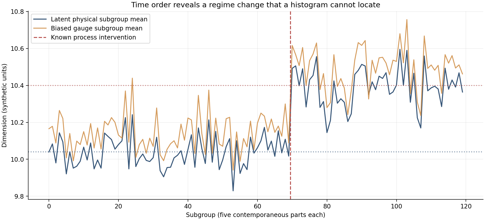
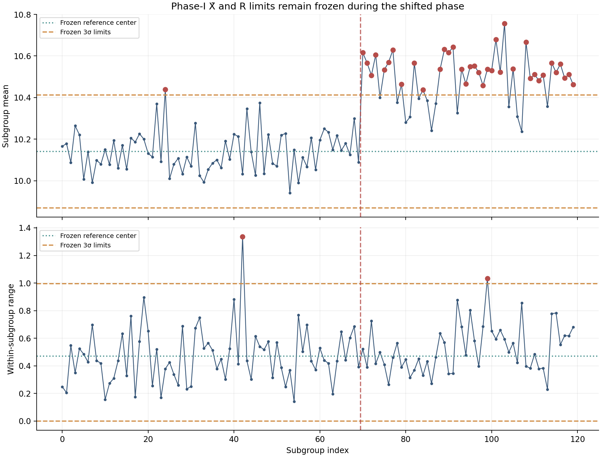
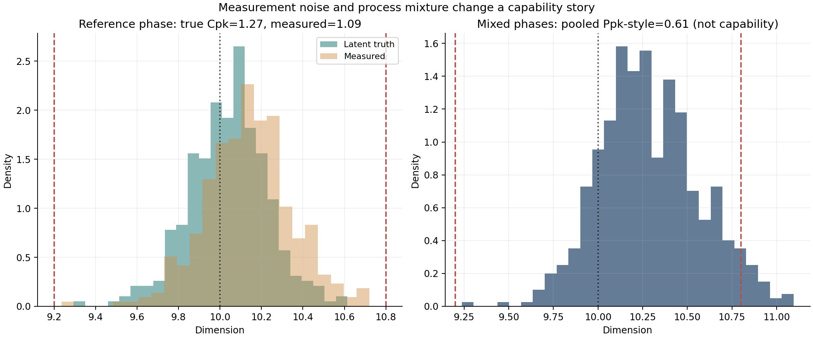
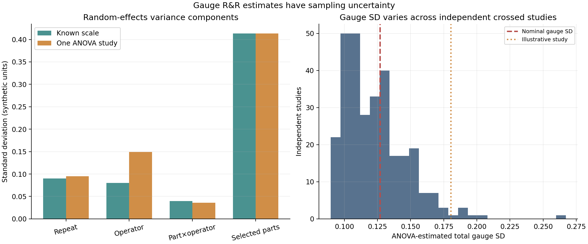
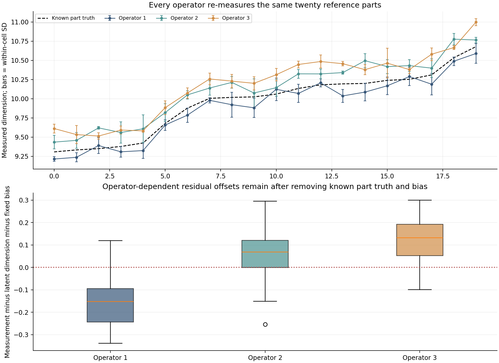
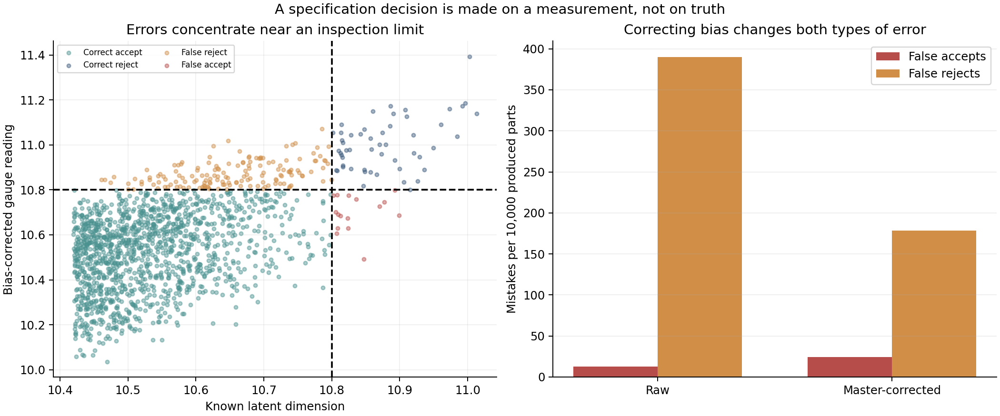
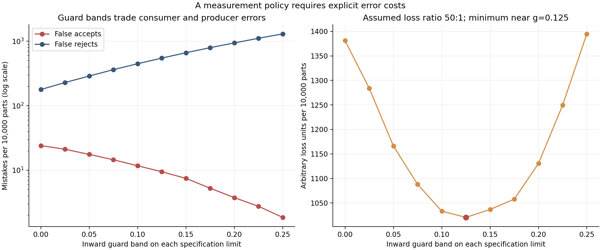
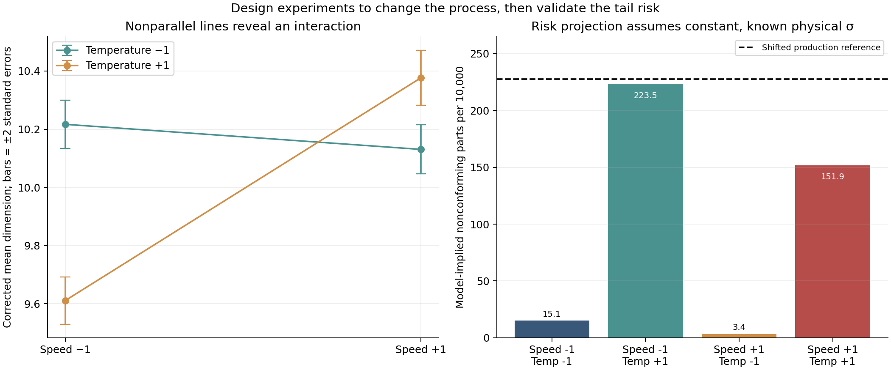

# A Factory Is Not a Histogram: Industrial Statistics for Data Scientists

*Why a capable process can fail inspection, why a measurement can be precise but wrong, and why designing an experiment is more useful than endlessly adjusting the control limit.*

A production manager has a report showing a respectable process capability index. The previous quarter's measurements are approximately bell-shaped. The process average lies comfortably between the specification limits, and the machine has passed its routine maintenance checks. According to the dashboard, the line is performing well.

Yet the customer is rejecting parts.

The first instinct is to look for a better forecasting algorithm, a tighter machine setting, or an unusual cluster of defective products. Another possibility is less glamorous: the numbers in the report may answer a question that nobody actually asked. The process may have changed halfway through the quarter. The gauge may have introduced a systematic bias. Different operators may measure the same part differently. The inspection rule may have been tuned without considering the cost of accepting a bad part or rejecting a good one.

All of these possibilities can coexist. A histogram cannot separate them.

Industrial statistics developed around a set of problems that modern data science still encounters: learning from a process that operates continuously, distinguishing ordinary variation from changes that demand intervention, separating measurement error from physical variation, and designing experiments that can reveal what actually controls an outcome. It combines statistical process control (SPC), process capability, measurement-system analysis, acceptance decisions, and experimental design.

We often discuss these subjects independently. A quality engineer monitors a control chart. A production analyst computes \(C_{pk}\). A metrology team performs a gauge repeatability and reproducibility study. A data scientist trains a predictive model. Manufacturing leadership asks whether to adjust the process. But the underlying random variables and decisions form a connected system. A capability index is only as meaningful as the stability and measurement model that produced it. A monitor can detect a shift without explaining its cause. An improvement experiment can be perfectly randomized while the outcome is still mismeasured.

This article builds one controlled manufacturing case study from beginning to end. We will model physical part dimensions, introduce a persistent change in a production line, estimate \(\bar X\) and \(R\) control limits, compare true and measured process capability, derive a crossed gauge R&R analysis, quantify false acceptance and false rejection, evaluate inspection guard bands, and finally design a replicated \(2^2\) factorial experiment with an interaction.

There are eight figures, ten machine-readable result tables, a typed Python implementation, an executable notebook and mathematical tests in [the companion research directory](README.md). The numerical study is **entirely synthetic**. We know every generated part's true dimension, every artificial measurement bias, and the experimental response function. That is valuable because it allows us to isolate statistical mistakes. It is also a strict limit: none of the results below is evidence about a real manufacturer, instrument, customer or production improvement.

The guiding argument is simple: **a factory is not a collection of independent numbers. It is a time-ordered physical process observed through an imperfect measurement system and governed by decisions.**

## Five questions that should not be confused

Suppose the characteristic of interest is a manufactured part's dimension. We set a target of 10.0 units and two engineering specification limits:

\[
\mathrm{LSL}=9.2,\qquad T=10.0,\qquad \mathrm{USL}=10.8.
\]

The unit could represent millimetres or another physical dimension, but in our constructed example it is deliberately called a *synthetic unit*. We do not imply that tolerances of 0.8 units would be appropriate for any particular product.

We need to distinguish five kinds of statements:

1. **Stability:** Does the process generating parts retain a sufficiently constant statistical mechanism during the period being studied?
2. **Capability:** Given that mechanism, how does the distribution of physical dimensions compare with the customer's specification limits?
3. **Measurement:** How well do the gauge, operators, reference artifacts and measurement procedure represent the physical quantities we want to know?
4. **Inspection:** Given an imperfect measured value, when should a part be accepted, rejected, reinspected or escalated?
5. **Improvement:** Which adjustable production factors actually change the process, and how can we learn their effects without confusing one factor with another?

These questions are sequentially related, but they are not synonymous. Passing a specification is not evidence that the manufacturing process is statistically stable. A statistically stable process can be consistently off target. A process may be capable in its physical dimensions and still be judged poor because the measurement system adds noise or bias. A well-calibrated gauge does not by itself identify which machine setting will improve production.

The distinctions are central in the NIST/SEMATECH *e-Handbook of Statistical Methods*. Its [process-capability section](https://www.itl.nist.gov/div898/handbook/pmc/section1/pmc16.htm) explicitly frames capability as a comparison between specification limits and the distribution of a process that is already in control; its [process-stability discussion](https://itl.nist.gov/div898/handbook/ppc/section4/ppc45.htm) makes clear why stability should be assessed first. We will follow that logic, while carefully limiting the conclusions to the Gaussian simulation we actually run.

This is not merely terminology. The answer determines which denominator belongs in a defect rate, which standard deviation belongs in an index, and whether an observed difference can be attributed to an experimental intervention.

## Model the physical process before modelling a gauge

Our line produces 120 consecutive *rational subgroups*, each containing five parts manufactured close enough in time to share a process state. Let \(X_{t,i}\) be the true dimension of part \(i\) in subgroup \(t\), with \(i=1,\ldots,5\).

For subgroups 0 through 69, we deliberately generate a stationary reference process:

\[
X_{t,i}\overset{\mathrm{iid}}{\sim}N(10.04,0.20^2),
\qquad t=0,\ldots,69.
\]

At zero-based subgroup index 70, we impose a permanent upward mean shift of 0.36, without changing the physical within-subgroup standard deviation:

\[
X_{t,i}\overset{\mathrm{iid}}{\sim}N(10.40,0.20^2),
\qquad t=70,\ldots,119.
\]

The baseline is slightly above the target of 10.0 but still centred well within the allowed range. The postshift distribution moves closer to the upper specification limit. Every physical part remains subject to ordinary independent random variation. The intervention changes the mean, not the within-subgroup spread.

We do not observe these dimensions perfectly. The monitoring gauge introduces a fixed additive bias \(b=0.10\) and independent repeatability error with standard deviation \(0.09\):

\[
Y_{t,i}=X_{t,i}+0.10+\varepsilon_{t,i},
\qquad
\varepsilon_{t,i}\sim N(0,0.09^2).
\]

The same gauge and measurement setup are used across the time-ordered production run. Operator changes are reserved for a separate crossed measurement study later in the article. Keeping those experiments separate is deliberate: otherwise a change in operator could be mistaken for a physical change in the machine.

For the baseline phase, the latent physical standard deviation is 0.20. The measured standard deviation is

\[
\sigma_Y=\sqrt{\sigma_X^2+\sigma_\varepsilon^2}
=\sqrt{0.20^2+0.09^2}
\approx0.2193,
\]

assuming the physical dimension and measurement error are independent. Measurement noise widens the observed distribution even if the production machine has not become more variable. Meanwhile the fixed bias shifts its observed centre by 0.10. The same instrument can therefore affect the numerator and denominator of a capability calculation in different ways.

Our first figure shows the true and observed subgroup means in their actual sequence. The vertical dashed line marks the intervention we constructed, not a change point estimated by an algorithm.



*Figure 1. One synthetic line with 120 subgroups of five parts each. The physical process mean rises after subgroup 69; the fixed gauge bias and repeatability error affect every reading. A histogram of all 600 measurements would discard the temporal evidence that separates the two regimes.*

Before the intervention, the measured points tend to lie about 0.10 above their latent counterparts. After the intervention, both physical and measured means move upward. That observation is obvious because we possess the generating code. A real investigation would have to consider whether the apparent shift came from a machine, a gauge adjustment, temperature, supplier material, an operator change, or a data-processing error.

The practical unit of analysis is not a trivial detail. If each subgroup combines parts produced hours apart under different settings, within-subgroup variation can absorb changes that should instead appear between subgroups. If observations are correlated because many parts share the same material batch, treating them as independent replicates can overstate the information available. Rational subgrouping is an attempt to collect observations in a way that preserves the process structure relevant to the decision.

The [NIST control-chart discussion](https://itl.nist.gov/div898/handbook/pmc/section3/pmc321.htm) describes the distinction between subgroup means and within-subgroup variation. We will use the familiar five-part \(\bar X/R\) chart, not because it is universally optimal, but because its assumptions, constants and meaning are transparent.

## A control chart is about time, not about specification limits

Control limits and engineering specification limits answer different questions. A control limit describes expected variation in a chosen statistic when the process follows its reference model. A specification limit states a product requirement. A point can be inside specification and still indicate a special-cause signal relative to the process. A process can remain statistically in control while producing parts outside specification.

For each subgroup \(t\), compute its sample mean and range:

\[
\bar Y_t=\frac{1}{n}\sum_{i=1}^{n}Y_{t,i},
\qquad
R_t=\max_iY_{t,i}-\min_iY_{t,i},
\qquad n=5.
\]

From the first \(m=70\) subgroups alone, calculate the grand mean \(\bar{\bar Y}\) and average range \(\bar R\):

\[
\bar{\bar Y}=\frac1m\sum_{t=0}^{m-1}\bar Y_t,
\qquad
\bar R=\frac1m\sum_{t=0}^{m-1}R_t.
\]

Under the usual independent normal-subgroup model, the expected sample range is \(d_2\sigma\). With \(n=5\), the tabulated constant is \(d_2=2.326\), giving the within-subgroup estimate

\[
\hat\sigma_{\mathrm{within}}=\frac{\bar R}{d_2}.
\]

For the five-part \(\bar X\) chart, we use \(A_2=0.577\) and define:

\[
\begin{aligned}
\mathrm{CL}_{\bar X}&=\bar{\bar Y},\\
\mathrm{UCL}_{\bar X}&=\bar{\bar Y}+A_2\bar R,\\
\mathrm{LCL}_{\bar X}&=\bar{\bar Y}-A_2\bar R.
\end{aligned}
\]

The corresponding range-chart limits are

\[
\mathrm{CL}_{R}=\bar R,\qquad
\mathrm{UCL}_{R}=D_4\bar R,\qquad
\mathrm{LCL}_{R}=D_3\bar R,
\]

with \(D_3=0\) and \(D_4=2.115\) for subgroup size five. These are the familiar three-sigma-style factors documented in the [NIST \(\bar X/R\) chart reference](https://itl.nist.gov/div898/handbook/pmc/section3/pmc321.htm).

We estimate the limits only from the reference segment and **freeze** them before evaluating the subsequent 50 subgroups. Recalculating the centre and spread after every new observation could absorb the very change we want to detect. There are adaptive chart designs, but an adaptation policy must be explicit and evaluated for its ability to hide slow or persistent deterioration.

In the fixed-seed run, the measured reference phase produces an \(\bar X\) upper control limit of approximately 10.412, and the range-chart upper limit is approximately 0.995. The shifted phase generates 37 \(\bar X\) alarms among its 50 subgroups. The range chart remains mostly quiet, which is appropriate: we changed the mean but not the within-subgroup standard deviation.



*Figure 2. Phase-I limits are estimated from 70 known-baseline subgroups and kept fixed. Red observations cross their corresponding statistical limits. The process mean changes at subgroup 70; a range chart monitors spread and is not expected to react to a pure location shift in the same way as a mean chart.*

One reference-phase subgroup also crosses an \(\bar X\) limit, despite the fact that its physical generator is stationary. That is not an error in the simulator. Even a genuinely in-control Gaussian process occasionally generates extreme subgroup statistics. A three-sigma rule has a nonzero pointwise false-alarm probability, and repeated monitoring provides many opportunities to see one. Estimated control limits add further uncertainty.

In a real phase-I study, the red reference point would require investigation before declaring the historical period suitable for setting limits. It would be methodologically dishonest to erase the point merely because our synthetic ground truth says the process is stationary; conversely, it would be incorrect to claim that a statistical exceedance proves a physical special cause. Here we retain it and disclose that we know the generating process was unchanged.

This observation connects industrial SPC to the sequential-detection problem studied in [our earlier article on CUSUM and EWMA](../sequential-change-detection-for-data-scientists/article.md). A control-chart crossing is an alarm, not a physical cause or an exact estimate of when a process changed. The industrial-statistics question adds rational subgrouping, the measurement process, and the product specification to that logic.

## Capability indices are conditional on a meaningful process model

Process capability is often summarized by one number. That is convenient for reporting but dangerous when the assumptions behind the number disappear from view.

For a stable normal process with mean \(\mu\), standard deviation \(\sigma\), lower specification \(\mathrm{LSL}\), upper specification \(\mathrm{USL}\), and target \(T\), three common indices are:

\[
C_p=\frac{\mathrm{USL}-\mathrm{LSL}}{6\sigma},
\]

\[
C_{pk}=\min\left(
\frac{\mathrm{USL}-\mu}{3\sigma},
\frac{\mu-\mathrm{LSL}}{3\sigma}
\right),
\]

\[
C_{pm}=\frac{\mathrm{USL}-\mathrm{LSL}}
{6\sqrt{\sigma^2+(\mu-T)^2}}.
\]

The differences are substantive. \(C_p\) compares the specification width with six process standard deviations; it does not penalize an off-centre mean. \(C_{pk}\) incorporates the distance to the nearer specification limit. \(C_{pm}\) also penalizes deviation from the target, not only the boundary. A process can have a reasonably large \(C_p\) and a poor \(C_{pk}\) if the mean moves toward an edge. Even when the distribution is perfectly Gaussian, these indices answer different questions.

For our known physical baseline, \(\mu=10.04\) and \(\sigma=0.20\), the exact population values are

\[
C_p=\frac{1.6}{1.2}\approx1.333,
\]

\[
C_{pk}
=\min\left(\frac{10.8-10.04}{0.6},
\frac{10.04-9.2}{0.6}\right)
\approx1.267.
\]

This is the genuine, stationary *latent* baseline. It is not what a gauge reports without error. From the first 70 measured subgroups, using the range-based within-subgroup standard deviation, our estimate is \(C_{pk}\approx1.09\). Part of the difference is known measurement bias and additional gauge variance; part is ordinary finite-sample estimation error. The measured number is not an unbiased estimate of the latent physical process index simply because a capability function returned it.

Now consider the remaining 50 subgroups, after the true physical mean shifts to 10.40. The known latent physical \(C_{pk}\) for that new stationary regime falls to

\[
C_{pk,\mathrm{post}}
=\frac{10.8-10.40}{3(0.20)}
\approx0.667.
\]

Nothing happened to the physical standard deviation. The capability deterioration comes from the displacement of the mean toward the upper limit. A chart that only monitored the sample range could miss the central problem.

The situation becomes worse when we pool every measured part from both regimes and calculate an overall sample standard deviation. The resulting descriptive *Ppk-style* expression is

\[
\widehat P_{pk,\mathrm{descriptive}}
=\min\left(
\frac{\mathrm{USL}-\bar Y_{\mathrm{all}}}{3s_{\mathrm{all}}},
\frac{\bar Y_{\mathrm{all}}-\mathrm{LSL}}{3s_{\mathrm{all}}}
\right).
\]

In this study its numerical value is approximately **0.61**. It mixes variation from the two physical means with genuine within-regime variation and measurement noise. We report the number so its origin is auditable, but we do **not** call it valid stationary process capability. The point is precisely that a distribution pooling two different process states lacks the stable mechanism assumed by a normal-theory capability interpretation.



*Figure 3. Left: the same stable reference parts, first as latent dimensions and then as biased noisy measurements. Right: measurements pooled across the physical change, accompanied by a descriptive Ppk-style value. The latter is **not** a valid claim that a nonstationary process is capable or incapable according to one stable normal distribution.*

A common practical mistake is to interpret a wider pooled histogram as evidence that the machine became noisier. Here the within-regime physical sigma remained exactly 0.20. The additional pooled dispersion comes partly from the **difference between regime means**. By the law of total variance,

\[
\operatorname{Var}(Y)
=E[\operatorname{Var}(Y\mid S)]
+\operatorname{Var}(E[Y\mid S]),
\]

where \(S\) identifies the regime. The second term is positive whenever the regime means differ. A pooled variance cannot tell us which part comes from within-regime fluctuations and which part comes from changing states unless we retain and model the state labels or time structure.

For a physical specification decision, we might instead calculate the probability of a truly nonconforming part under each *separately stable* normal model:

\[
p_{\mathrm{bad}}(\mu,\sigma)
=\Phi\left(\frac{\mathrm{LSL}-\mu}{\sigma}\right)
+1-\Phi\left(\frac{\mathrm{USL}-\mu}{\sigma}\right).
\]

With the true postshift parameters \(\mu=10.40\) and \(\sigma=0.20\), this probability is approximately 0.02275, or **227.5 nonconforming parts per 10,000** in the Gaussian model. This is a model-implied *physical* defect rate, not the rate of gauge readings outside limits. The distinction will become crucial.

No capability index makes the normality assumption true. If a process is heavy-tailed, skewed, bounded, clustered by lot, autocorrelated, or subject to changing means, normal-tail extrapolation may be inaccurate. Before converting \(C_{pk}\) into parts per million, we need evidence that the model captures the mechanism relevant to the target risk. The [NIST capability reference](https://www.itl.nist.gov/div898/handbook/pmc/section1/pmc16.htm) makes its normality and stability assumptions explicit; so should we.

## Measurement is its own stochastic process

We have so far used one stable gauge in the time-ordered monitoring stream. Real manufacturing inspection may involve several operators, multiple gauges, different fixtures, temperature changes, daily calibration cycles and repeated measurements of the same reference parts. A capability analysis that ignores these effects may attribute measurement variability to manufacturing.

The key point is not that gauges are inherently unreliable. It is that their uncertainty must be characterized for the *way they are actually used*. One operator can obtain nearly identical readings on the same part and still consistently measure it too high. A gauge may repeat well at the nominal value but have bias or nonlinearity near the specification limit. An operator effect may appear only on particular part geometries. These are different sources of error and require different study designs.

NIST's [measurement-process characterization](https://www.itl.nist.gov/div898/handbook/mpc/section4/mpc4.htm) separates repeatability, reproducibility, stability and bias. Its guidance also includes resolution, nonlinearity, drift and geometry-dependent effects. We will implement a balanced *crossed* gauge repeatability and reproducibility study and then make a separate measurement against a known reference master to estimate bias.

## A crossed gauge R&R study is a variance-components experiment

Select twenty physical reference parts, with known dimensions spread across approximately 9.3 to 10.7 synthetic units. They cover more of the inspection range than one ordinary subgroup. Three operators measure every part, and each operator repeats each part's measurement three times. The complete balanced design contains

\[
p\times o\times r=20\times3\times3=180
\]

readings. The same physical part is deliberately observed by more than one operator. Without that crossing, operator differences could be confused with differences between the parts assigned to each operator.

We generate readings using the model

\[
Y_{ijk}=P_i+b+O_j+(PO)_{ij}+\varepsilon_{ijk},
\]

where:

- \(P_i\) is the actual dimension of selected part \(i\);
- \(b=0.10\) is the common additive bias;
- \(O_j\) represents a persistent offset associated with operator \(j\);
- \((PO)_{ij}\) is an operator-by-part interaction: the same operator need not measure every part with the same relative error;
- \(\varepsilon_{ijk}\) is the reading-level repeatability error.

The simulated generating standard deviations for the random measurement components are

\[
\sigma_O=0.08,\qquad
\sigma_{PO}=0.04,\qquad
\sigma_\varepsilon=0.09.
\]

The three realized operator offsets are centred within the illustrative study so that the average offset across its balanced operator set is zero. This is a convenient parameterization of the deployed set, not a claim that three real operators will automatically have zero average bias.

The total random gauge variance in the generating model is

\[
\sigma_{\mathrm{gauge}}^2
=\sigma_O^2+\sigma_{PO}^2+\sigma_\varepsilon^2
=0.08^2+0.04^2+0.09^2
=0.0161,
\]

so the nominal gauge standard deviation is

\[
\sigma_{\mathrm{gauge}}\approx0.1269.
\]

An important caveat: this is a nominal variance for the *crossed inspection setup*. The earlier time-ordered control chart used one fixed gauge and operator configuration, so only its own repeatability variance was active there. It would be inconsistent to add the full operator variance to those already-generated monitoring observations.

Because every part appears under every operator and every operator repeats every part, a balanced two-way random-effects ANOVA can estimate separate sources of variation. Let \(MS_P\), \(MS_O\), \(MS_{PO}\), and \(MS_E\) denote the mean squares for selected parts, operators, their interaction, and within-cell repetition error. For a balanced random-effects model, their expected values have the form

\[
\begin{aligned}
E[MS_E]&=\sigma_\varepsilon^2,\\
E[MS_{PO}]&=\sigma_\varepsilon^2+r\sigma_{PO}^2,\\
E[MS_O]&=\sigma_\varepsilon^2+r\sigma_{PO}^2+pr\sigma_O^2,\\
E[MS_P]&=\sigma_\varepsilon^2+r\sigma_{PO}^2+or\sigma_P^2.
\end{aligned}
\]

Solving these equations by the method of moments gives

\[
\hat\sigma_\varepsilon^2=MS_E,
\]

\[
\hat\sigma_{PO}^2=
\frac{MS_{PO}-MS_E}{r},
\qquad
\hat\sigma_O^2=
\frac{MS_O-MS_{PO}}{pr},
\]

\[
\hat\sigma_P^2=
\frac{MS_P-MS_{PO}}{or}.
\]

Because sampling noise can make a difference of mean squares negative even when a physical variance cannot be, our implementation clips negative component estimates at zero. This is one conventional constrained reporting choice, not an unbiased estimator for every parameter value or a substitute for likelihood-based random-effects inference. A real study would also examine residuals, assumption adequacy, possible heteroscedasticity and whether the random-effects interpretation fits the design.

The part-to-part component deserves special care. We deliberately selected twenty parts spanning much of the gauge's range, so the observed variance across these parts reflects the study's selection scheme. It is **not automatically the short-term variance of parts coming off the line**. A large spread of reference parts can make a measurement-system variation ratio look small, while a narrow selection can make it look large. Any reported percentage of gauge variation needs the population and denominator specified.

One common descriptive ratio is

\[
\%\,\mathrm{StudyVariation}_{\mathrm{gauge}}
=100\,
\frac{\hat\sigma_{\mathrm{gauge}}}
{\sqrt{\hat\sigma_{\mathrm{gauge}}^2+\hat\sigma_P^2}}.
\]

It measures the gauge standard deviation relative to the combined gauge-plus-selected-part standard deviation in this design. It is not the percentage of parts misclassified, and it is not a universal pass/fail criterion. Nor is it equivalent to the variance-contribution ratio \(100\hat\sigma_{\mathrm{gauge}}^2/(\hat\sigma_{\mathrm{gauge}}^2+\hat\sigma_P^2)\). Square roots and denominators matter.

## What one gauge study can and cannot tell us

For our fixed-seed crossed study, the ANOVA estimates a total gauge standard deviation of approximately **0.180**, noticeably above the nominal generating value of **0.127**. The estimated operator component is particularly large: its standard deviation estimate is approximately 0.149, compared with the generating parameter 0.08.

This discrepancy is not evidence that the simulator secretly changed its parameters. The study contains only three operators, and their realized offsets are a small random sample of possible operator effects. The interaction and repeatability components are also estimated from finite degrees of freedom. Sampling uncertainty does not disappear simply because an ANOVA table prints several decimal places.

To make the uncertainty visible, we repeat the entire balanced crossed study **300 independent times**, drawing new selected parts, new operator effects, new interactions and new repetitions under the same nominal generating parameters. Across those studies, the estimated gauge standard deviation has a median near 0.119, with empirical fifth and ninety-fifth percentiles near **0.096 and 0.166**. These are Monte Carlo percentiles under our specified simulation, not universal confidence bounds for real gauges.



*Figure 4. Left: generating measurement-component scales and estimates from one crossed study. The part column represents the realized spread of deliberately selected reference parts. Right: distribution of gauge standard deviation estimates from 300 independent studies under the same generating model, with the nominal gauge SD and one study's estimate marked separately.*

The single study's reported gauge study-variation ratio is about 40%. Across the 300 independent studies, the median ratio is approximately 28%, and the fifth-to-ninety-fifth percentile range is roughly 22%–41%. If we had treated the one reported percentage as an intrinsic property of the instrument, we would have hidden the design and sampling uncertainty that created it.

This is a recurring issue in industrial analytics. A dashboard may display a neat percentage with traffic-light thresholds, while the study behind it has few operators, few parts, and too few repetitions to distinguish relevant sources of variation precisely. The presentation gives an impression of certainty that the experiment cannot justify.

We can also examine the observed operator profiles directly. After sorting the twenty parts by their known dimensions, plot the mean of each operator's three readings for each part. The parts are common to all operators, so systematic vertical differences can reveal offsets. Repeated measurements within a cell give a glimpse of repeatability.



*Figure 5. Top: repeated measurements of the same twenty parts under three operators, compared with latent part truth. The vertical bars show the within-cell standard deviation from three readings, not a confidence interval for the true part dimension. Bottom: measurement residuals after subtracting the known part value and the injected common bias, grouped by operator.*

The bottom panel subtracts both physical part truth and the known common bias. That subtraction is possible only because this is a controlled simulation. A real factory rarely knows the exact latent dimension of every production part, and it cannot estimate an unknown fixed gauge bias merely by repeating measurements of parts whose true values are unknown.

There is an identifiability problem. If we add a constant \(c\) to every unknown part dimension and subtract \(c\) from the common bias, the predicted measurements remain unchanged:

\[
(P_i+c)+(b-c)+O_j+(PO)_{ij}+\varepsilon_{ijk}
=Y_{ijk}.
\]

The crossed measurements alone do not distinguish those two parameter combinations. Repeatability and operator comparisons can be estimated from contrasts, but absolute bias requires external information. We need a reference artifact with an independently established value, or another traceable calibration procedure.

This is why gauge repeatability and reproducibility are not synonyms for *accuracy*. A measurement procedure can be highly repeatable and systematically wrong. Conversely, measurements can be unbiased on average and individually too noisy to distinguish near-specification parts. Good measurement engineering requires both questions.

## A traceable master changes the bias question

We now introduce a separate reference master whose true value is known to be exactly 10.0 in our simulation. The same three operators collectively perform 180 independent master readings, balanced across operator assignments. We estimate the overall deployment bias using

\[
\hat b=\bar Y_{\mathrm{master}}-10.0.
\]

The injected common bias is \(b=0.10\). The estimated bias from the seeded master check is approximately **0.086**. It differs because the master readings still contain random repeatability and operator-part-type measurement error. The independent reference value identifies the level of bias, but a finite number of readings does not estimate it without uncertainty.

We will correct a future measurement by subtracting \(\hat b\):

\[
Y_{\mathrm{corrected}}=Y_{\mathrm{raw}}-\hat b.
\]

That transformation moves the average reading closer to the physical quantity. It does not remove random repeatability, operator variation or part-dependent effects. Nor does it guarantee the bias is constant across dimensions, temperatures or time. A single master value cannot establish linearity throughout the entire specification range.

NIST treats [bias and uncertainty](https://www.itl.nist.gov/div898/handbook/mpc/section4/mpc46.htm) as separate parts of measurement-process characterization, alongside repeatability and long-term variation. The distinction matters because the economically correct *inspection decision* may depend on the complete error distribution and error costs, not only whether we subtract a bias estimate.

## Specification acceptance is a classification problem with physical consequences

In routine inspection, we do not observe the true physical dimension \(X\) directly. We decide whether to accept a part using a measurement \(Y\). For a symmetric acceptance rule with no guard band:

\[
\text{Accept if}\qquad
9.2\leq Y\leq10.8.
\]

We can define two different mistakes:

- **False acceptance:** the physical part is actually outside specification, yet its measured value falls inside the acceptance limits.
- **False rejection:** the physical part is actually inside specification, yet the measurement falls outside the acceptance limits.

These are related to the familiar concepts of consumer and producer risk. Their exact operational costs depend on the product, contract, inspection procedure, rework options and consequences of escaped defects. Neither type should be dismissed as a mere nuisance: one can ship a defective product; the other can discard or rework a conforming product.

Here we create a **new and separate inspection population** of 200,000 parts from

\[
X_{\mathrm{inspection}}\sim N(10.20,0.25^2).
\]

This population is deliberately closer to a specification boundary and more variable than the earlier reference process. The reason is methodological: if the baseline produced almost no defective parts in a finite Monte Carlo run, a conditional false-acceptance estimate would be extremely noisy or undefined. We do not mix these inspection parts into the earlier capability sample, and we do not claim that this population is the same production line continuing without change.

Each inspected part is measured using the common \(+0.10\) bias, one of the three studied operators, an operator-by-part-type noise term, and repeatability noise. The operator assignments are random, using the realized operator offsets of the crossed study. We evaluate the raw measurements and the measurements corrected by the separately estimated master bias.

Because the data are synthetic, every inspected part has a known latent true dimension. That allows us to count the errors that a real production inspection ordinarily cannot label without destructive tests, independent metrology or a sufficiently accurate reference system.

Of 200,000 generated parts, 1,681 are truly outside specification, approximately **84.1 parts per 10,000**. Notice that this is the defect prevalence in the *separate inspection population*, not the 227.5-per-10,000 model rate for the previous shifted production phase. The two scenarios have different parameters and serve different statistical purposes.

The measured inspection outcomes are:

| Measurement policy | False accepts per 10,000 produced | False rejects per 10,000 produced |
| --- | ---: | ---: |
| Raw biased reading | 12.95 | 389.90 |
| Master-bias-corrected reading | 24.05 | 178.45 |

These are **unconditional counts per 10,000 produced parts**. They are not the probability of an error conditional on the relevant true class. To see the difference, the corrected policy falsely accepts 481 of the 1,681 truly defective parts:

\[
P(\mathrm{accept}\mid\mathrm{defective})
\approx\frac{481}{1681}
\approx0.286.
\]

That is a conditional false-acceptance rate of about 28.6%. Yet, because true defects are relatively uncommon in this inspection population, the *unconditional* false-acceptance rate is 481 divided by 200,000, or 24.05 per 10,000 produced parts. A supplier, customer and quality analyst can all quote a “false-acceptance percentage” and mean different denominators. A meaningful report should always make the denominator explicit.

The uncorrected gauge shifts readings upward. Because the inspection population is also shifted toward the upper specification limit, this tends to reject many genuinely good near-limit parts. Subtracting the estimated bias greatly reduces false rejections, from about 390 to 178 per 10,000. But it also allows more truly defective upper-limit parts to pass measurement-based inspection, raising false acceptances from about 13 to 24 per 10,000.

That is not an argument against bias correction. It is a warning against mistaking **measurement accuracy** for a complete decision policy. A corrected gauge is closer to truth on average, but deciding which noisy readings to accept still involves uncertainty and consequences.



*Figure 6. Left: a selected set of near-upper-limit parts with known physical truth and bias-corrected readings. The dashed vertical and horizontal lines are the same engineering specification expressed in the true and measured spaces. Right: unconditional false-acceptance and false-rejection counts per 10,000 produced parts, before and after master-based bias correction.*

The scatter plot illustrates something a single confusion matrix can hide. Many mistakes occur near the physical boundary because random measurement error can put the reading on the opposite side. An observation very far from the limit is much easier to classify correctly. A binary inspection label conceals the distance to the limit and the conditional uncertainty that distance implies.

If the physical dimensions were not normally distributed, if measurement error depended strongly on part size, or if some operators systematically encountered different classes of parts, the error probabilities would change. The numerical comparison cannot be transferred to another plant just because both systems use the same gauge brand.

## Guard bands make the inspection tradeoff explicit

One way to respond to measurement uncertainty is to narrow the acceptance region inside the engineering specification. With a nonnegative symmetric inward guard band \(g\), we accept only when

\[
\mathrm{LSL}+g
\leq Y_{\mathrm{corrected}}
\leq\mathrm{USL}-g.
\]

As \(g\) increases, acceptance becomes stricter. For a fixed set of true dimensions and measured readings, false acceptances cannot increase under nested acceptance regions: an out-of-specification part that was rejected remains rejected. False rejections cannot decrease: a conforming part that was rejected remains rejected, and more near-limit conforming parts may now be refused.

This monotonicity is a mathematical property of the acceptance regions, independent of our Gaussian assumptions. It does not tell us which guard band is desirable. That requires a decision objective or a constraint on a particular type of error.

We evaluate eleven guard bands from 0 to 0.25 synthetic units on the same 200,000 corrected inspection readings. For each value we retain both the conditional and unconditional error measures. We then introduce an explicitly **illustrative** loss: one false acceptance costs 50 arbitrary units and one false rejection costs one arbitrary unit. Thus, per 10,000 produced parts,

\[
L(g)
=50\,N_{\mathrm{FA},10k}(g)
+N_{\mathrm{FR},10k}(g).
\]

We could have used a different ratio, asymmetric specification guard bands, a mandatory upper bound on consumer risk, or a more complex reinspection policy. The 50:1 ratio is not estimated from any company and should not be interpreted as a recommended industry standard.

Under that invented ratio, the lowest value among our eleven examined guard bands occurs at \(g\approx0.125\). The weighted loss is approximately 1,021 arbitrary units per 10,000 produced parts, compared with approximately 1,381 at zero guard band. The selected value is a minimum over a finite simulation grid with fixed parameters, not an analytically proven global optimum, and its location would change with the model, costs and inspection population.



*Figure 7. Left: false accepts and false rejects per 10,000 produced parts as the corrected-reading acceptance region narrows; the vertical scale is logarithmic to reveal both error types. Right: illustrative weighted cost under an assumed 50:1 false-accept-to-false-reject loss ratio. The marked minimum is specific to this synthetic simulation and grid.*

Guard bands reduce one risk by accepting more of another. If rejecting a good part only means inexpensive reinspection, a stricter guard band may be attractive. If rejecting a good part destroys a costly item or interrupts a safety-critical supply chain, false rejection deserves greater weight. If false acceptance could cause severe downstream harm, the decision may need to satisfy a hard risk constraint rather than minimizing a single expected-cost expression.

The possibility of remeasurement changes the problem again. We might require a second independent measurement for readings near a boundary. If the errors are truly independent, averaging repetitions reduces random variance; if the source is a shared bias or operator-related systematic error, repeating the same measurement with the same setup may do little. The optimal number of repeats and the value of an independent reference instrument then become questions of sequential decision theory and measurement economics.

The broader point is that quality control is not only about finding a threshold that produces a desired count of red or green decisions. It is about linking the observable measurement distribution to the underlying physical truth and the consequences of a wrong decision. SPC warns us when the process changes. Measurement-system analysis asks whether the observation is trustworthy. Inspection policy determines what happens to the part.

## The next question is causal: which settings change the process?

At this point, the synthetic line has given us several distinct findings. Its physical mean increased during production. A chart designed around the reference phase detected signals after the change. Some of the reported capability loss came from the physical shift, while some came from the observation system. An independent gauge study revealed meaningful measurement uncertainty. A master reference made the fixed bias estimable. Finally, inspection choices exchanged one class of error for another.

What none of those analyses has told us is *why* the physical mean moved.

Suppose the factory can adjust two factors: feed speed and operating temperature. An operations dashboard might show that higher speed correlates with larger dimensions. But that correlation could reflect a third variable. Perhaps operators increase speed only when processing a particular supplier's material. Perhaps temperature and speed are changed together. Perhaps the quality measurement itself changes when a different operator takes over.

Forecasting the next dimension from historical covariates is a legitimate task. It is not the same as estimating the result of setting the machine to a different configuration.

An experiment addresses the latter question by deliberately assigning factor combinations. That is why design of experiments (DOE) belongs in an industrial data scientist's toolkit rather than being treated as a historical footnote. The value of randomization is not that it guarantees an attractive result. It is that, under an appropriate design and execution, it reduces systematic confounding between the tested factor settings and uncontrolled temporal conditions.

We now conduct a separate synthetic experiment. We do not silently fit a regression to the 120 earlier subgroups and call its coefficients interventions. The original production sequence contained only one imposed change and no randomized factor assignments. It cannot identify the feed-speed and temperature effects that we are about to study.

## A replicated factorial experiment, not one factor at a time

We encode feed speed by \(a\in\{-1,+1\}\) and temperature by \(b\in\{-1,+1\}\). The codes represent two defined operating levels for each factor, not actual physical speed or temperature units. Four corner combinations form the \(2^2\) factorial design.

For the simulation we know the true mean response surface:

\[
\mu(a,b)
=10.05+0.14a-0.10b+0.18ab.
\]

Each coefficient has a clear interpretation in coded coordinates. The intercept is the mean at the coded origin if the model extends there. The \(a\) and \(b\) coefficients contribute to average factor effects. The \(ab\) term is an interaction: the influence of speed depends on the temperature level, and conversely.

At \(b=-1\), the change in expected dimension between high and low speed is

\[
\mu(+1,-1)-\mu(-1,-1)
=2(0.14-0.18)=-0.08.
\]

At \(b=+1\), the same nominal speed change instead produces

\[
\mu(+1,+1)-\mu(-1,+1)
=2(0.14+0.18)=+0.64.
\]

Those effects even have different signs. A sequential one-factor-at-a-time procedure might examine speed only at the colder setting and conclude that increasing it slightly *reduces* dimensions. The same statement would be badly misleading at the hotter setting. Averaging the two temperature regimes also loses the operational specificity of the interaction.

We generate six independent experimental runs at each of the four corners, giving 24 factorial runs. We add four runs at the coded centre \((a,b)=(0,0)\), for a total of 28. The run order is randomized. Each run represents the mean of five independently generated new physical parts, with physical within-run standard deviation 0.20; the measurement system adds a fixed bias and independent repeatability error. Before fitting the response model, we subtract the independently estimated master-reference bias from each run mean.

The centre runs are not there to inflate a sample size. They offer a simple opportunity to look for curvature that a first-order factorial model with interaction does not represent. In this deliberately bilinear generating model, the centre expectation is 10.05, equal to the average of the four true corner means. In real manufacturing, centre points might reveal curvature, drift, warm-up effects or some combination that requires a richer response-surface experiment.

The randomization matters because the process is time ordered. If all low-speed runs occur before all high-speed runs, a warm-up drift can masquerade as a speed effect. A good design separates what can be separated in advance, and the recorded run order makes deviations from the planned assignment auditable. The NIST/SEMATECH handbook discusses these properties of [replicated factorial designs](https://www.itl.nist.gov/div898/handbook/pri/section3/pri3332.htm).

The data-generating noise is independent here. In a physical experiment, five parts from one run are *subsamples of that run*, not necessarily five independent assignments of speed and temperature. Treating all 140 measured parts as 140 independent randomized runs would be pseudoreplication. Our model is fitted to the 28 run-level means, preserving the unit at which the settings were assigned.

## Estimating effects and reading an interaction plot

Fit an ordinary least-squares model to the corrected run means:

\[
\bar Y_r^{\mathrm{corrected}}
=\beta_0+\beta_a a_r+\beta_b b_r
+\beta_{ab}a_rb_r+e_r.
\]

For this particular seeded experiment, the fitted coefficients are approximately

\[
\begin{aligned}
\hat\beta_0&=10.074,\\
\hat\beta_a&=0.170,\\
\hat\beta_b&=-0.090,\\
\hat\beta_{ab}&=0.213.
\end{aligned}
\]

The true interaction used to generate the data was 0.18. The fitted value differs because the 28 experimental means contain random physical and gauge variation, and because we estimated rather than knew the master bias. A statistical estimate is not required to reproduce the data-generating parameter exactly in a finite sample. The analysis exports the fitted coefficients and their model-based standard errors to the result tables.

For a balanced two-level design, the estimated *main effect* of speed, averaged over the two temperature settings, is \(2\hat\beta_a\), not \(\hat\beta_a\). The fitted speed change conditional on the low temperature setting is

\[
2(\hat\beta_a-\hat\beta_{ab})
\approx-0.086,
\]

whereas at the high temperature setting it is

\[
2(\hat\beta_a+\hat\beta_{ab})
\approx+0.766.
\]

The difference between these simple effects is \(4\hat\beta_{ab}\). This contrast is the operational content of the interaction. It is more informative than saying that an interaction term is statistically significant, especially when the decision is which machine settings to choose.

The first panel of Figure 8 shows the fitted dimension against speed at each temperature level. The lines are not parallel, and the speed effect reverses direction. The second panel converts each fitted corner mean into an illustrative specification-failure probability.



*Figure 8. Left: fitted factor-combination means from the randomized, replicated \(2^2\) experiment; nonparallel lines reveal the speed–temperature interaction. Right: Gaussian-model projections of out-of-specification parts per 10,000 under each fitted mean, assuming the physical standard deviation remains fixed at 0.20. These are model predictions, not observed production gains or confirmed defect rates.*

The operating-setting comparison is not based on the measured gauge distribution. It asks a physical question: what fraction of future *true dimensions* would fall outside \([9.2,10.8]\) under a particular mean, if the physical standard deviation remains 0.20? The probability used for each candidate setting is

\[
p_{\mathrm{out}}(\mu)
=\Phi\!\left(\frac{9.2-\mu}{0.20}\right)
+1-\Phi\!\left(\frac{10.8-\mu}{0.20}\right),
\]

where \(\Phi\) is the standard-normal cumulative distribution function. We multiply this probability by 10,000 for a more readable scale.

Under the fitted means, the four illustrative projections are approximately:

| Speed code | Temperature code | Fitted physical mean | Projected out-of-spec parts per 10,000 |
|:--:|:--:|--:|--:|
| \(-1\) | \(-1\) | 10.207 | 15.1 |
| \(-1\) | \(+1\) | 9.602 | 223.5 |
| \(+1\) | \(-1\) | 10.121 | 3.4 |
| \(+1\) | \(+1\) | 10.367 | 151.9 |

In this particular simulation, high speed with low temperature has the smallest *projected* two-sided defect probability. It is not automatically the best real-world configuration. A factory may have constraints on throughput, energy, material stress, equipment lifetime, production cost, safety or response variability. A setting that optimizes one dimension can make another quality characteristic worse.

Notice also that the model projects risk in distribution tails, where small errors in the fitted mean or assumed standard deviation can produce large relative changes in very small estimated probabilities. We have not propagated coefficient uncertainty into intervals for the displayed risks, and we have deliberately treated physical \(\sigma=0.20\) as known. A defensible engineering recommendation would need that uncertainty, an independent confirmation run, assessment of other product characteristics and postchange monitoring.

The fitted \((+1,+1)\) mean is about 10.367, although its true data-generating mean is only 10.27. This is a particularly useful reminder that simulation truth and fitted response surfaces differ. It would be misleading to treat the coloured bars as ground-truth failure frequencies or to announce the selected settings as a validated process improvement.

The comparison with the shifted production regime is nonetheless instructive. That prior regime had true mean 10.40 and, under our assumed normal model, an out-of-specification probability of about 227.5 parts per 10,000. The experimental analysis offers candidate mechanisms and settings that might reduce this risk. Confirmation is the bridge between an estimated response surface and an operational change.

## Three layers of uncertainty must remain separate

Industrial studies often report a single standard deviation, which makes it deceptively easy to confuse different sources of variation. At least three layers are present here.

First, there is **physical process variation**: parts manufactured at the same settings differ. In our synthetic line, that standard deviation is 0.20. It enters the probability that a physical part violates a specification and the distribution of a run mean.

Second, there is **measurement variation**: an instrument and its operators do not reproduce the physical quantity exactly. In the crossed study, variance comes from operator, part-by-operator and repeatability terms, plus a separate fixed bias. The observation model changes how accurately we learn about the physical process and how often inspection labels are wrong.

Third, there is **parameter-estimation uncertainty**: the process mean, gauge variance components and experimental coefficients are learned from finite studies. Even if physical and measurement errors follow the assumed distributions, the estimates are random. A risk calculation using fitted parameters is a *plug-in prediction*, not a statement that uncertainty has disappeared.

These layers need different evidence. More inspected parts can reduce uncertainty about a defect fraction, but not remove a persistent instrument bias. Repeated measurements of one part can characterize repeatability, but not reveal every source of between-part physical variation. More experimental replicates can improve precision about factor effects, but will not eliminate confounding caused by a design that changes speed and operator in lockstep.

There is also a fourth layer in practice: **model uncertainty**. Our normal distributions, independence assumptions, constant variance and bilinear mean response were imposed by construction. Real dimensions may be skewed, multimodal, autocorrelated, censored, affected by tool wear, or bounded by physical constraints. A complicated model is not automatically an adequate model. Residual structure, predictive checks, independent validation and process knowledge matter.

These distinctions explain why it is dangerous to apply one familiar confidence interval or one bootstrap scheme to every quantity. For a random-effects gauge study, uncertainty must respect the crossed design. For time-ordered SPC data, a naive independent-observation bootstrap can destroy dependence. For a randomized factorial experiment, analysis must respect the randomization unit and the actual run structure. Each procedure can be correct only relative to the assumptions and sampling mechanism it represents.

## An industrial analysis workflow that can survive production

The example suggests a practical sequence, although real investigations sometimes need to revisit earlier stages rather than following a rigid checklist.

**1. Start with the engineering decision and a data contract.** Identify the physical characteristic, measurement units, product specifications, target, subgrouping logic, part identifiers, timestamps, operator, gauge identity and operating settings. Define whether the decision is about detecting a process change, demonstrating capability, making an acceptance decision or selecting factor levels. A dataset without its collection mechanism is not a complete description of the process.

**2. Check the observation system.** Verify traceability, calibration, bias and the scale of repeatability relative to the tolerance and the variation you hope to detect. Use a properly planned crossed gauge R&R study when its structure matches the measurement process. If different instruments or operators are used across shifts, model or stratify them before interpreting a trend as physical.

**3. Preserve time and context.** Plot dimensions in production order. Establish whether subgroups represent short intervals of approximately homogeneous conditions. Separate reference and subsequent monitoring periods. Keep control-chart parameters frozen for monitoring; do not quietly incorporate suspected shifts into a new centre line and then claim they were normal.

**4. Investigate stability before capability.** Interpret out-of-control signals as calls for investigation, not proof of a particular cause. Use capability estimates for stable, reasonably well-modelled regimes. When data come from multiple production states, report their distinct distributions or explain explicitly that a pooled estimate is only descriptive.

**5. Quantify inspection decisions against physical truth where possible.** Use reference artifacts, destructive verification, calibrated reference measurements or defensible latent-variable modelling as appropriate. Distinguish false acceptance among all parts from false acceptance among truly defective parts. Specify the economic or safety consequences before choosing guard bands, remeasurement or automated rejection policies.

**6. Design interventions rather than reading causality into logs.** Choose factors and levels with engineering input. Randomize, replicate, record run order, and model interactions. Check curvature and other responses. Confirm any proposed operating point with fresh data. Then establish a new stable reference regime for ongoing monitoring.

**7. Automate reproducibility, not just plotting.** Version the generation or extraction logic, assumptions, model definitions, code, figures and numerical tables. Test mathematical identities as well as programming behaviour. Review the data and research scope when operational conditions change.

One subtle point links all seven stages: *the unit of analysis changes with the question*. For process monitoring it may be a subgroup; for gauge R&R it is a reading nested in a part–operator combination; for acceptance it is an inspected part; for a factorial experiment it is a randomized run. A flat table in which every row is treated as interchangeable cannot represent those distinctions without additional structure.

## Common failure modes worth recognizing

Several mistakes are particularly easy for an experienced data scientist to make when entering industrial analysis from a purely predictive background.

The first is to use a holdout split or a high cross-validated score as a substitute for understanding the data-generating system. Randomly splitting measurements from the same production batch can leak batch-specific information. A model that accurately predicts the current defective label may only have learned an imperfect inspection procedure. If the label changes after gauge calibration, apparent model performance changes even though the underlying production process might not.

The second is to confuse **a lack of chart signals** with proof of statistical control. A Shewhart chart has a finite probability of missing small shifts, especially with limited sampling. Conversely, a reference process will sometimes trigger an alarm by chance. Our seeded reference phase contains one such \(\bar X\) signal; knowing the synthetic generating distribution makes it possible to identify that particular signal as a false alarm. In real work, one investigates rather than retrospectively erasing inconvenient observations.

The third is to compute \(C_{pk}\) from a mixture and silently describe it as a property of the machine. A mixture can look normal enough in a coarse histogram, and an overall standard deviation can conceal operating-state changes. The study period, sampling design, choice of within-process versus overall standard deviation, and evidence of stability belong next to the reported index.

The fourth is to treat a large gauge R&R percentage as a context-free verdict. A study using parts with little true dimensional spread can produce a large percentage of observed variation attributable to the gauge even if the gauge itself is unchanged. Tolerance-based ratios, process-variation ratios and discrimination capability answer related but different questions. The actual part-selection range should be documented.

The fifth is to confuse correcting bias with reducing random measurement error. Our master correction shifts the reading scale and changes both false-accept and false-reject counts. It does not change repeatability or operator effects. In this example, correcting the fixed bias even increases the *illustrative weighted loss* under one arbitrary 50:1 cost ratio at zero guard band. That fact is not an argument against calibration; it shows why calibration, risk policy and the inspection rule are distinct decisions.

The sixth is to evaluate rare defects from small samples without expressing uncertainty. Observing zero out-of-specification parts in 100 inspections does not establish that the true failure probability is zero. For small tail probabilities, credible evaluation may require far more physical parts than a convenient demonstration dataset, a justified distributional model, or a combination of both. Normal-tail extrapolations should be checked against engineering mechanisms, not simply accepted because a fitted bell curve looks smooth.

The seventh is to use an experimental model outside its design region. Our factorial contrast supports inference about four coded corners and a centre within a deliberately specified experimental structure. Extrapolating beyond the tested temperature or speed range without new evidence introduces additional assumptions. A local optimum in our four-cell comparison is not necessarily a global manufacturing optimum.

Finally, do not forget operational feedback. Once a process controller uses a prediction to intervene, the resulting data are affected by the controller's decisions. A new dashboard, inspection policy or machine setting can change the data-generating mechanism. Monitoring a system after deployment is therefore part of statistical inference, not a separate administrative activity.

## Reproducing the eight figures and ten result tables

The companion directory contains the deterministic synthetic simulation, figure generation, numeric exports and unit tests. The Python implementation uses explicit random-number streams so regenerating one section does not silently change unrelated simulated experiments. The simulation is fixed to seed `20261030`; the seed is a reproducibility mechanism, not an estimate of uncertainty.

From the project directory, install the dependencies and run:

```bash
python -m pip install -r requirements.txt
python analysis.py
python -m unittest discover -s tests -v
```

The generated assets live in `figures/` and `results/`. An executable notebook, `industrial_statistics.ipynb`, walks through the same cases and checks the output tables. The targeted GitHub Actions workflow verifies the study without running unrelated article pipelines.

The CSV exports preserve more than the highlighted rounded numbers in this narrative. The subgroup table retains time order and paired true-versus-measured subgroup summaries; the gauge table retains each latent true part dimension and its individual operator–repetition readings; the inspection tables retain both confusion-count definitions and conditional-error denominators; the factorial table retains assigned settings and individual run identifiers. The individual 200,000 inspection readings are generated by the code but deliberately not exported, keeping the repository compact. These details make it possible to challenge the analysis, calculate alternative summaries or inspect the assumptions without reconstructing numbers from figure pixels.

The most important limitation is equally reproducible: the simulated samples do not validate any manufacturing plant. The supposed defects, instrument bias, operator differences and experimental response are known because the code created them. To apply the workflow to a real line, you would need traceable measurements, domain-specific specifications, an appropriate sampling and experimental plan, environmental and material covariates, and an explicit decision model.

## Closing: quality is a chain of statistical claims

We began with an apparently capable line that was still receiving complaints. The same set of measured numbers can support very different stories when we ignore their sequence, the instrument that produced them or the decisions made from them.

The synthetic study has shown how an upward mean shift can damage physical capability; how a fixed gauge bias and random measurement error affect observed indices differently; how a crossed study can separate sources of gauge variation; how inspection creates false acceptance and false rejection; and how a randomized factorial experiment can uncover a strong interaction missed by one-factor-at-a-time adjustments.

The takeaway is not that every plant needs eight figures or a larger analytics stack. It is that every reported figure rests on a claim about what was measured, how it was sampled, what changed, and which decision it supports. Industrial statistics asks us to make those claims explicit.

A histogram describes a set of values. A factory is a changing physical system, observed imperfectly, whose outputs matter in the world. Data science becomes useful to manufacturing when its models respect that distinction.

## References and further reading

1. Shewhart, W. A. (1931). *Economic Control of Quality of Manufactured Product*. D. Van Nostrand Company. Foundational development of statistical quality-control concepts.
2. Fisher, R. A. (1935). *The Design of Experiments*. Oliver & Boyd. Foundational treatment of randomization, replication and experimental inference.
3. NIST/SEMATECH. [*e-Handbook of Statistical Methods*: Process Capability](https://www.itl.nist.gov/div898/handbook/pmc/section1/pmc16.htm). Definitions and prerequisites for capability indices.
4. NIST/SEMATECH. [*e-Handbook*: Assessing Process Stability](https://itl.nist.gov/div898/handbook/ppc/section4/ppc45.htm). Separation of stability assessment from capability claims.
5. NIST/SEMATECH. [*e-Handbook*: Shewhart Control Charts](https://itl.nist.gov/div898/handbook/pmc/section3/pmc321.htm). \(\bar X\) and \(R\) chart formulation, assumptions and tabulated constants.
6. NIST/SEMATECH. [*e-Handbook*: Gauge R&R Studies](https://www.itl.nist.gov/div898/handbook/mpc/section4/mpc4.htm). Study design and sources of measurement-system variation.
7. NIST/SEMATECH. [*e-Handbook*: Repeatability](https://itl.nist.gov/div898/handbook/mpc/section4/mpc441.htm). Measurement repeatability and corresponding precision questions.
8. NIST/SEMATECH. [*e-Handbook*: Measurement Bias and Uncertainty](https://www.itl.nist.gov/div898/handbook/mpc/section4/mpc46.htm). Traceability and correction of systematic errors.
9. NIST/SEMATECH. [*e-Handbook*: Full Factorial Designs](https://www.itl.nist.gov/div898/handbook/pri/section3/pri3332.htm). Randomization, replication, factor combinations and centre points.
10. NIST/SEMATECH. [*e-Handbook*: Models for Designed Experiments](https://itl.nist.gov/div898/handbook/pri/section4/pri43.htm). Regression and analysis of experimental response models.
11. NIST/SEMATECH. [*e-Handbook*: Understanding Interactions in Factorial Designs](https://itl.nist.gov/div898/handbook/pri/section5/pri5997.htm). Interpretation of combined factor effects.

*All figures, tables, observations and factory scenarios in this article are original synthetic illustrations. They are designed for reproducible methodological comparison and should not be interpreted as empirical findings about a particular manufacturer.*
