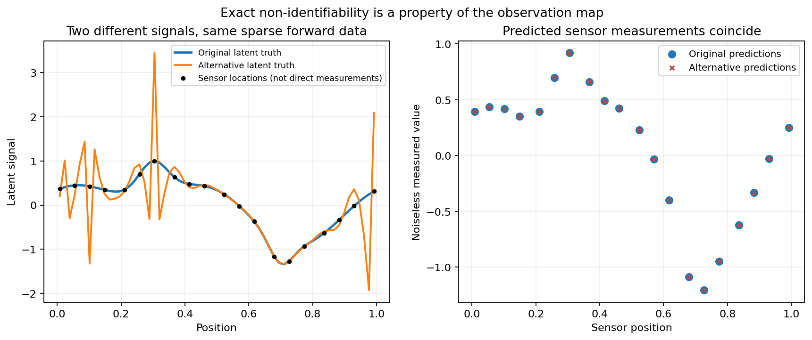
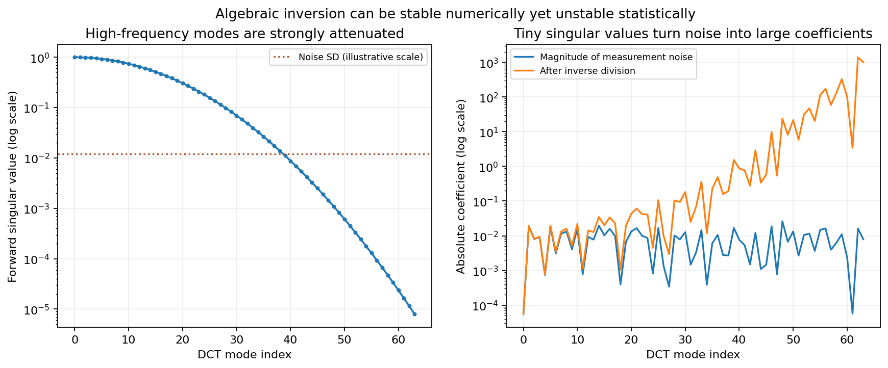
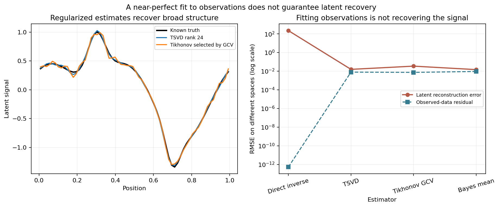
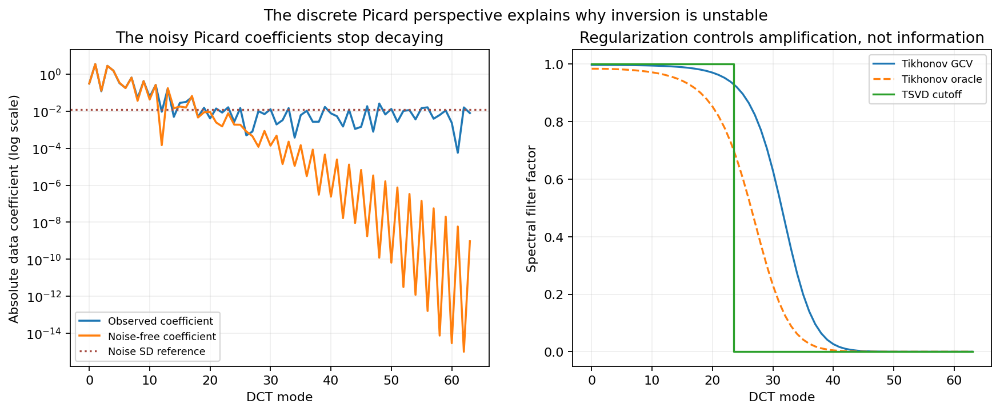
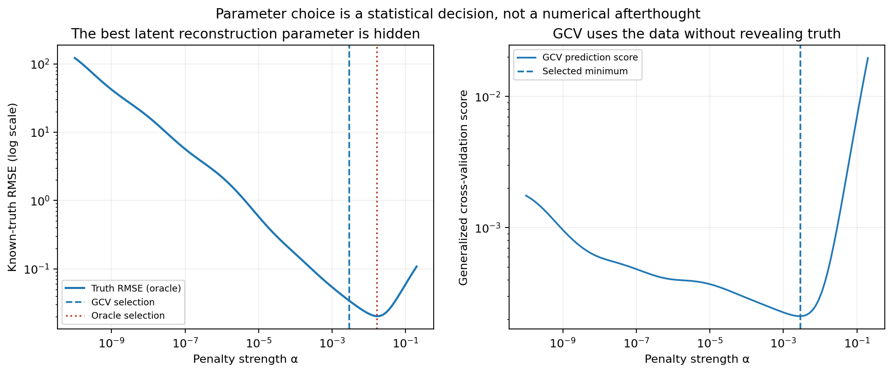
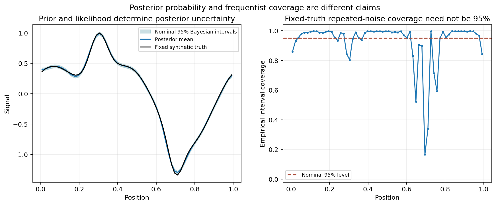
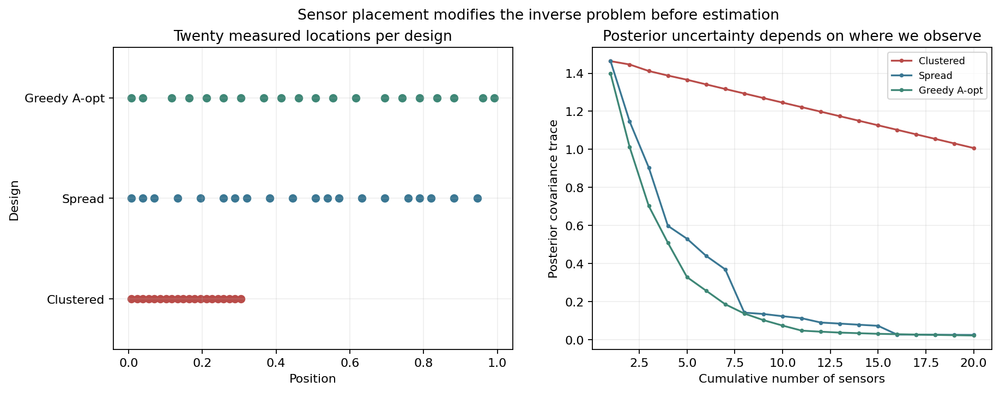
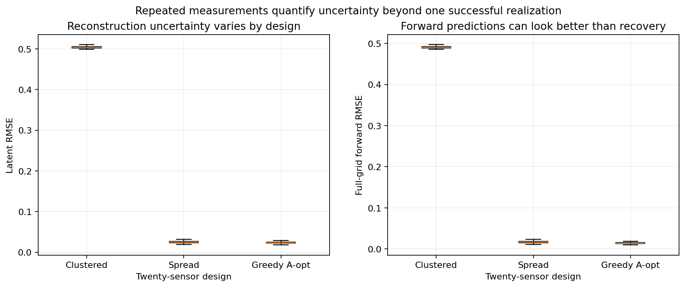

# A Good Fit Is Not an Identified Model: Inverse Problems for Data Scientists

*What singular values, regularization, Bayesian uncertainty, and sensor placement reveal about the difference between explaining observations and recovering reality.*

A data scientist is shown a model that reproduces almost every measured value. The residuals are close to zero. The numerical solver converged without warnings. A dashboard reports excellent performance, and a plot of predictions against observations lies almost perfectly along the diagonal.

It would be tempting to call this a success.

Now imagine that the model estimates an unobserved physical quantity: a heat distribution inside a component, the location of a device inferred from radio signals, an underground material profile from surface observations, or the spatial source of a pollutant reconstructed from a handful of sensors. The observed data may be consistent with many different underlying realities. A tiny amount of measurement noise can correspond to an enormous difference in a reconstructed parameter. A model can predict the readings perfectly and still give a scientifically indefensible explanation of what produced them.

This is the central problem of *inverse inference*. A **forward problem** asks what we will observe if the underlying system is known. An **inverse problem** asks what the underlying system must have been, given what we observed. The second question is not automatically answered by an accurate solution to the first.

Modern machine learning has many versions of this difficulty. We estimate hidden states from sensor data, latent factors from ratings, a treatment effect from an observational sample, an image from blurred measurements, a causal mechanism from input–output records, or a physical parameter from an imperfect simulator. Often, the model is easy to run forward and much harder to invert.

The problem is mathematical before it is computational. If the observation map loses information, no amount of optimizer tuning can restore what was never measured. When the information is present but heavily attenuated, numerical inversion may be possible in exact arithmetic yet unstable under realistic noise. Regularization can select a plausible answer, but selection is not the same thing as identification. A Bayesian prior can produce a coherent posterior distribution, but that posterior is conditional on assumptions about unknown states and measurement error. Even the locations where we place sensors can determine which questions are answerable.

In this article, we will build a reproducible synthetic case study with a 64-dimensional hidden signal, a smoothing forward operator, and Gaussian measurement noise. We will distinguish exact non-identifiability from ill-conditioning, examine singular-value decay, compare a naive inverse with truncated singular-value decomposition (TSVD) and Tikhonov regularization, select a penalty by generalized cross-validation (GCV), study Gaussian posterior uncertainty, and compare three 20-sensor designs using repeated Monte Carlo experiments.

The [companion research directory](README.md) contains typed Python code, an executable notebook, ten CSV result tables, eight publication figures, and tests. Every numeric result is generated from **synthetic data** using a fixed random seed. We know the hidden truth only because the experiment created it. We are not claiming to have reconstructed a real physical system or measured performance in an industrial deployment.

Our argument is that **recoverability is an attribute of the data-generating and observation process, not a reward for training a more powerful model.**

## The forward model comes first

Let \(x\in\mathbb R^n\) represent an unknown physical signal. The observation process maps it to measured values \(y\in\mathbb R^m\):

\[
y=Ax+\varepsilon.
\]

Here \(A\in\mathbb R^{m\times n}\) is a known forward operator and \(\varepsilon\) represents measurement noise. The expression is deliberately simple. Real problems may involve nonlinear maps, discretization error, uncertain calibration parameters, biased instruments, or measurements that depend on previous measurements. But the linear case already contains the essential difficulty.

If \(x\) is known, obtaining a predicted observation is straightforward:

\[
\hat y=Ax.
\]

If \(y\) is known and \(x\) is not, we might try to solve the inverse equation:

\[
\hat x=A^{-1}y.
\]

That last expression makes sense only when \(A\) is square and invertible. If there are more unknowns than independent measurements, the inverse need not exist uniquely. If \(A\) is square and technically invertible but has tiny singular values, the inverse may turn small noise into enormous fluctuations. And if the forward operator is wrong, an accurate inversion of the wrong operator need not recover the physical truth.

It is useful to separate three questions before evaluating an estimator:

1. **Existence:** Does a candidate latent state reproduce the observation, at least approximately under the assumed noise model?
2. **Uniqueness:** Are the observations sufficient to distinguish that state from all relevant alternatives?
3. **Stability:** If the measured data change slightly, does the inferred state change only slightly?

In classical treatments of inverse problems, these questions are related to the well-posedness framework often associated with Hadamard. The modern computational literature develops precise ways of diagnosing failure and imposing stabilizing structure. Hansen's work on [discrete ill-posed problems and truncated SVD](https://epubs.siam.org/doi/abs/10.1137/0911028), Vogel's [computational treatment of inverse problems](https://epubs.siam.org/doi/10.1137/1.9780898717570), and Kaipio and Somersalo's [statistical formulation](https://link.springer.com/book/10.1007/b138659) are especially relevant.

One of the most dangerous habits is to treat a low residual as an answer to all three questions. A low residual primarily addresses existence relative to the observation model. It says much less about uniqueness or stability.

## A synthetic signal observed through a smoothing system

Our unknown signal has \(n=64\) values on a one-dimensional spatial grid. The values are constructed from a smooth oscillating background and two localized features. The coordinates are dimensionless; they do not represent a calibrated length, temperature, pressure, or tissue measurement.

We define an orthonormal discrete cosine basis \(V\in\mathbb R^{64\times64}\), with

\[
V^\mathsf TV=VV^\mathsf T=I.
\]

The forward operator attenuates the higher-frequency cosine modes:

\[
A=V\operatorname{diag}(s_0,\ldots,s_{63})V^\mathsf T,
\qquad
s_k=\exp\!\left[-\frac12\left(\frac{k}{13}\right)^2\right].
\]

Low-frequency spatial structure is transmitted relatively well. High-frequency structure is progressively suppressed. This is a dimensionless *diffusion-like spectral surrogate*, chosen because its singular values are explicit. It is not claimed to be the governing equation of any actual heat process.

We add independently generated normal measurement error to each fully observed coordinate:

\[
\varepsilon_j\overset{\mathrm{iid}}{\sim}N(0,0.012^2).
\]

The complete experiment is seeded with `20261030`. Independent random-number streams separate the original observation, the regularization simulation, the coverage study, and the sensor-design comparison. This makes our results reproducible, while avoiding an accidental change to one experiment when the number of trials in another is increased.

We will use two observation regimes:

- A **sparse** regime, measuring only 20 of the 64 possible outputs, to demonstrate an exact nullspace.
- A **full-grid** regime, observing all 64 outputs through a square but severely ill-conditioned matrix, to demonstrate instability under noise.

These should not be confused. The first is structurally underdetermined. The second is identifiable in exact arithmetic for a known operator, yet its inverse is fragile with respect to realistic measurement error. A theoretical distinction becomes visible when we compare the two cases side by side.

## Exact non-identifiability: two truths, one observation

Suppose we observe only the output at 20 selected sensor locations. Let \(S\) be the row-selection operator and define

\[
B=SA\in\mathbb R^{20\times64}.
\]

By rank–nullity,

\[
\dim\ker(B)=64-\operatorname{rank}(B)\geq44.
\]

Any nonzero vector \(v\in\ker(B)\) has the property \(Bv=0\). Thus, for every scalar \(c\),

\[
B(x+cv)=Bx+cBv=Bx.
\]

The original state \(x\) and the alternative state \(x+cv\) produce exactly the same sparse sensor predictions. Not approximately the same. Exactly the same under the mathematical forward map.

In our simulation we construct a unit vector from the nullspace of the 20-row observation matrix, then set

\[
x_{\mathrm{alternative}}=x_{\mathrm{true}}+5v.
\]

The root-mean-square difference between these two 64-dimensional latent states is \(5/\sqrt{64}=0.625\). That is substantial relative to the signal's scale. Yet the numerical norm of their difference in the twenty predicted sensor outputs is about \(6.3\times10^{-16}\), effectively floating-point roundoff.



*Figure 1. Left: two different 64-coordinate hidden signals and the locations of twenty sensors. The black markers denote locations, not direct measurements of the hidden state. Right: both hidden signals produce indistinguishable predictions after the sparse forward map. The nullspace was constructed analytically and numerically; no optimizer was required to create the ambiguity.*

This is not a case of a training algorithm getting stuck in a poor local minimum. There is a family of solutions that no amount of extra precision at the *same twenty linear measurements* can distinguish without additional assumptions. Better sensors, more independent observations, physical constraints, prior information, or a revised target may resolve some of the ambiguity, but reducing the optimizer's tolerance will not.

Notice the phrase *the same twenty linear measurements*. If we alter the measurement geometry and sample new locations, the new data may distinguish the two states. Identifiability belongs to the mapping between the unknown and the observation protocol. It is not a permanent property of an abstract parameter vector.

A common response is to impose a smoothness constraint, choose the smallest-norm solution, or fit a learned prior. These are often sensible methods. But they are assumptions used to select one member of an observational equivalence class. They should be described honestly as prior or regularizing information, not as facts newly discovered by the twenty observations.

In causal inference, similar logic appears when several causal structures produce the same observational distribution. In latent-variable models, rotations or permutations may leave predictions unchanged. In matrix factorization, different factors can reconstruct the same matrix. Those examples differ technically from our linear sensor nullspace, but they share the central warning: identifying a representation requires more than matching observed outputs.

## Full rank is not the same as stable recovery

Now suppose that all 64 smoothed outputs are measured, each with independent Gaussian noise. Our constructed operator is square, symmetric, and invertible in exact arithmetic. Every singular value \(s_k\) is strictly positive.

The smallest singular value is nevertheless tiny:

\[
s_{63}=\exp\!\left[-\frac12(63/13)^2\right]
\approx7.95\times10^{-6}.
\]

Because the largest singular value is \(s_0=1\), the spectral condition number is

\[
\kappa_2(A)=\frac{s_0}{s_{63}}\approx1.26\times10^5.
\]

This number measures the potential relative sensitivity of solving the linear system to perturbations. It does not, by itself, compute a probability distribution for reconstruction error. To see the statistical effect, express the unknown and observed signals in singular coordinates.

Write

\[
\theta=V^\mathsf Tx,\qquad z=V^\mathsf Ty.
\]

Orthogonality gives

\[
z_k=s_k\theta_k+\eta_k,
\qquad
\eta_k=(V^\mathsf T\varepsilon)_k.
\]

Since the original noise is independent and isotropic Gaussian, the transformed noise also has independent \(N(0,0.012^2)\) coordinates. The formal unregularized inverse estimates

\[
\hat\theta_k^{\,\mathrm{direct}}=\frac{z_k}{s_k}
=\theta_k+\frac{\eta_k}{s_k}.
\]

The variance of its error in mode \(k\) is

\[
\operatorname{Var}
\bigl(\hat\theta_k^{\,\mathrm{direct}}-\theta_k\bigr)
=\frac{0.012^2}{s_k^2}.
\]

The problem is evident: when \(s_k\) approaches zero, the noise variance after inversion grows without bound. The data barely contain the high-frequency coefficient, but the algebra asks us to divide by a number that nearly erased it.



*Figure 2. Left: the constructed forward singular spectrum decays sharply as spatial frequency increases. The horizontal noise-SD reference is only a visual scale, not a universal identifiability threshold. Right: the very same noise coefficients before and after division by the singular values. High-frequency noise can dominate the nominal inverse.*

This is the statistical version of a familiar numerical-analysis result. A small perturbation in \(y\) can be associated with a large change in \(x\), even when the solver correctly computes the inverse of \(A\) to machine precision. Blaming floating-point rounding alone would misdiagnose the issue. Our experiment adds intentional observation noise that is many orders of magnitude larger than machine epsilon.

The crucial quantity is not just the condition number but the relationship among singular values, the latent signal's coefficients, and the noise level. A problem with decaying singular values may still permit accurate recovery of a particularly smooth signal. Another signal that concentrates information in attenuated modes may be practically unrecoverable at the same noise level.

This is why statements about "the" identifiability of a model can be too coarse. We should specify the parameter or feature of interest, the available measurement budget, the perturbations considered, and the assumptions used to exclude alternative solutions.

## The direct inverse wins the fit and loses the reconstruction

We can now compare a direct inverse with two regularized alternatives on exactly the same noisy full-grid observation.

The unregularized solution is

\[
\hat x_{\mathrm{direct}}=V
\operatorname{diag}(s_k^{-1})V^\mathsf Ty.
\]

Because the matrix is square and invertible, \(A\hat x_{\mathrm{direct}}=y\) up to numerical roundoff. By the usual observed-data residual criterion,

\[
\|A\hat x_{\mathrm{direct}}-y\|_2\approx0,
\]

it is essentially perfect.

But we know the hidden truth. In this particular seeded sample, the direct inverse has a latent reconstruction RMSE of approximately **221.75** signal units. The underlying latent signal itself varies on a scale of roughly one unit. The result is not a modest inaccuracy; it is an almost complete failure to recover the quantity we actually care about.

Two regularized methods behave very differently. A TSVD estimator retaining the first 24 singular modes reconstructs the truth with RMSE approximately **0.0156**. A Tikhonov estimator with its penalty chosen by GCV has RMSE approximately **0.0344**. A Gaussian posterior mean under the separate prior specified later has RMSE approximately **0.0146** on this one sample.

Those numbers are properties of this constructed experiment, not a ranking that should be generalized to other inverse problems. The TSVD rank was fixed in advance for the demonstration, the GCV penalty has its own criterion, and the Bayesian estimate depends on its prior. Their performance changes with signal smoothness, observation geometry and the noise distribution.



*Figure 3. Left: the known truth and two regularized reconstructions. Right: each method's latent reconstruction RMSE versus its residual RMSE against noisy observations, on a logarithmic scale. The direct inverse nearly interpolates all observations while its latent error is orders of magnitude greater. A smaller measured-data residual is therefore not a valid proxy for accurate latent recovery.*

Why might conventional model selection fail here? If a held-out test consists of additional noisy readings from the same forward geometry, excellent prediction may be compatible with poor recovery of the latent state. The problem is not necessarily that a split was performed incorrectly. It is that the evaluation target is different from the scientific estimand.

Suppose the decision is whether a component has a local internal hot spot. Accurate predictions of blurred surface readings may not identify its exact location or amplitude. Suppose the decision is which individual sensor is malfunctioning. A model that predicts aggregate signal strength may not identify each transmitter. In both cases, predictive performance can remain useful, but we need to be explicit about what it does and does not establish.

The lesson is not to stop measuring predictive error. It is to measure the error that corresponds to the decision, and to report when that error cannot be established from observed data alone.

## Regularization changes the problem on purpose

The standard response to unstable inversion is *regularization*. We do not attempt to estimate every latent direction with the same freedom. Instead, we restrict the inverse solution using a penalty, a dimensionality reduction, a prior distribution, physical constraints, or some combination of them.

This should be explained in the language of assumptions rather than in the language of numerical tricks. Regularization works by preferring some states over others. Its success depends on whether those preferences exclude implausible states without excluding the actual features we need to recover.

Two familiar methods make the tradeoff visible.

### Truncated singular-value decomposition

In singular coordinates, the direct inverse uses all 64 noisy coefficients:

\[
\hat x_{\mathrm{direct}}
=\sum_{k=0}^{63}\frac{z_k}{s_k}v_k,
\]

where \(v_k\) is the \(k\)-th column of \(V\). TSVD keeps only the first \(r\) components:

\[
\hat x_{\mathrm{TSVD},r}
=\sum_{k=0}^{r-1}\frac{z_k}{s_k}v_k.
\]

The retained modes are ordered by decreasing singular value. We set \(r=24\) for the illustrative method comparison. All higher modes are set to zero, not because the observations prove the true coefficients are zero, but because those directions are not trusted at this noise level under the chosen reconstruction strategy.

TSVD is easy to interpret. It says that we will estimate broad, well-transmitted features and decline to estimate increasingly fine details. If a critical local feature lies mostly in a discarded mode, TSVD can smooth it away. Choosing a rank is itself a model-selection decision. A fixed rank that happens to work well on this synthetic signal would not be a universal recommendation for imaging or metrology.

### Tikhonov regularization

Tikhonov regularization replaces exact interpolation with a penalized objective:

\[
\hat x_\alpha
=\arg\min_x
\left\{
\|Ax-y\|_2^2+\alpha\|x\|_2^2
\right\},
\qquad \alpha>0.
\]

The normal equations are

\[
(A^\mathsf TA+\alpha I)\hat x_\alpha=A^\mathsf Ty.
\]

For our diagonalizable synthetic operator, this becomes

\[
\hat x_\alpha
=\sum_{k=0}^{63}
\frac{s_k}{s_k^2+\alpha}z_kv_k.
\]

We can express it as a filtered direct inverse:

\[
\hat x_\alpha
=\sum_{k=0}^{63}
\underbrace{\frac{s_k^2}{s_k^2+\alpha}}_{f_k(\alpha)}
\frac{z_k}{s_k}v_k.
\]

The spectral filter \(f_k(\alpha)\) is close to one for \(s_k^2\gg\alpha\) and close to zero for \(s_k^2\ll\alpha\). TSVD has a hard cutoff. Tikhonov has a continuous transition.

The parameter \(\alpha\) controls bias and variance. A very small value approaches unstable inversion. A very large value produces a strongly shrunken estimate, potentially suppressing scientifically important features. The word *regularization* does not mean "more is better". It describes a family of biased estimators whose bias may be a good price to pay for variance reduction.

We used the identity penalty \(\|x\|^2\) because it permits a transparent derivation. In many physical inverse problems, a derivative penalty, total variation, positivity, mass conservation or a structured prior would be more appropriate. Penalizing the magnitude of \(x\) is not equivalent to penalizing roughness, even though both can stabilize an inverse solution. The engineering meaning of the penalty should be articulated before it is optimized.

The relationship between stabilizing methods is developed in Hansen's work on [truncated SVD and discrete ill-posedness](https://epubs.siam.org/doi/abs/10.1137/0911028) and Vogel's [Computational Methods for Inverse Problems](https://epubs.siam.org/doi/10.1137/1.9780898717570). These are useful starting points for moving from the simple spectral model to a general forward operator.

## The discrete Picard perspective: what the observations actually contain

Why do spectral filters often help? The answer is visible when we compare the data coefficients \(z_k\), the noise-free forward coefficients \(s_k\theta_k\), and the singular values.

For many well-behaved discrete ill-posed problems, the expansion coefficients of the *noise-free* right-hand side decay, on average, sufficiently quickly relative to the singular values. This relationship is called the **discrete Picard condition**. It matters because a direct inverse divides those coefficients by increasingly small singular values. If the signal coefficients do not decay appropriately, or if additive noise dominates the attenuated data coefficients, the inverse becomes unreliable.

In our synthetic problem, the noise-free coefficients \(s_k\theta_k\) decline with mode number. The coefficients from the observed \(y\) initially follow a similar pattern but eventually stop decreasing: the independent observation noise establishes a stochastic floor. At that point, the measured high-frequency coefficients are not trustworthy estimates of the hidden signal's corresponding coefficients.



*Figure 4. Left: noise-free versus noisy data coefficients in the cosine basis. Their different high-frequency behaviour is the practical signal of the Picard difficulty. The plotted noise SD is a reference scale, not a mathematically exact cutoff. Right: the continuous Tikhonov filters chosen by GCV and by a simulation-only oracle, compared with the rank-24 TSVD hard cutoff.*

The condition should not be reduced to the simplistic rule "discard everything below the noise standard deviation". Noise enters in the data basis, coefficients are random, signal amplitudes differ, and the appropriate loss depends on the quantity to be estimated. A mode with a small singular value can still matter if its physical coefficient is large and observations are precise enough. A mode with a moderate singular value can be unhelpful if there is no relevant signal there.

This diagnosis also clarifies why high-dimensional machine learning models are not immune to inverse instability. A neural network can learn an effective regularizer, either implicitly through training or explicitly through a prior and loss. If the training distribution excludes certain latent states, the learned reconstruction may look excellent on familiar examples yet fail on an unusual but observationally plausible input. The relevant test includes whether the system can signal uncertainty or mismatch when the inputs do not resolve the latent state.

In the synthetic study, the regularized reconstructions agree substantially with the known truth. That agreement is fortunate but conditional. Without the simulated truth, their reasonableness would have to be argued from independent measurements, prior validation, experimental structure, or the demands of the downstream decision.

## Selecting a penalty when the latent truth is hidden

We now face a practical question: how should we choose \(\alpha\) when we do not possess the true \(x\)?

In the simulation, we can calculate an *oracle* reconstruction error for each candidate penalty:

\[
E_{\mathrm{oracle}}(\alpha)
=\sqrt{\frac1{64}\|\hat x_\alpha-x_{\mathrm{true}}\|_2^2}.
\]

This is useful for validating a method because the code generated the truth. It is not a selection criterion available in an actual inverse problem. If a real latent state were fully known, we would not need to reconstruct it from noisy indirect measurements.

One data-driven alternative is generalized cross-validation (GCV), introduced in the ridge-parameter context by [Golub, Heath and Wahba (1979)](https://www.tandfonline.com/doi/abs/10.1080/00401706.1979.10489751). For the linear smoother

\[
\hat y_\alpha=H_\alpha y,
\qquad
H_\alpha=A(A^\mathsf TA+\alpha I)^{-1}A^\mathsf T,
\]

define

\[
\operatorname{GCV}(\alpha)
=\frac{\|(I-H_\alpha)y\|_2^2/n}
{\left[1-\operatorname{tr}(H_\alpha)/n\right]^2},
\qquad n=64.
\]

The numerator measures the residual against observations. The denominator adjusts for the effective flexibility of the smoother, with \(\operatorname{tr}(H_\alpha)\) playing the role of effective degrees of freedom. Without that adjustment, minimizing observed residuals would push the estimator toward interpolation and therefore toward the original instability.

The GCV formula is convenient in our spectral system because the eigenvalues of \(H_\alpha\) are exactly the filter factors

\[
f_k(\alpha)=\frac{s_k^2}{s_k^2+\alpha}.
\]

There is no need to invert a separate 64-by-64 matrix at every point on the penalty grid. We evaluate 112 positive penalties between \(10^{-10}\) and roughly \(0.2\) using the known singular basis.

For the seeded full-grid observation, GCV selects approximately

\[
\hat\alpha_{\mathrm{GCV}}=0.00286.
\]

The simulated latent-truth oracle, evaluating the same grid, prefers approximately

\[
\hat\alpha_{\mathrm{oracle}}=0.01625.
\]

The two values are different, as are the objectives. GCV seeks a form of predictive data-fit performance under assumptions associated with its derivation; the oracle directly measures the hidden quantity. They do not have to agree on a finite noisy sample, even if both calculations are implemented correctly.



*Figure 5. Left: reconstruction error against the known synthetic truth, shown only as an oracle diagnostic; the two vertical markers are the GCV and oracle selections. Right: the GCV score computed from observable data and the linear-smoother degrees of freedom. The selected penalties differ because the selection criteria and their statistical targets differ.*

An often-overlooked issue is that every tuning rule carries an implicit target. Choosing an \(\alpha\) to predict new observed readings is not necessarily the same as choosing it to recover a hidden physical field, classify a dangerous local feature, or estimate an integral of the field. If the decision depends on the location of a peak, average squared signal error may not be the relevant loss either.

GCV also has assumptions. Correlated noise, heteroscedasticity, errors in the forward operator, strong model mismatch, or complex dependence can distort its operating characteristics. In problems with known noise magnitude, discrepancy principles provide another perspective. L-curve methods examine the relationship between solution norm and residual norm. They too are criteria, not guarantees. Hansen's [analysis of the L-curve](https://epubs.siam.org/doi/10.1137/1034115) and Hansen and O'Leary's [regularization parameter method](https://epubs.siam.org/doi/abs/10.1137/0914086) help explain why different selection rules may favour different solutions.

The correct lesson is not that GCV failed this example. It made a valid data-driven choice under its criterion, and it produced a useful regularized estimate. The lesson is that model selection and scientific recovery are not identical objective functions.

## Repeating the noise: an estimator is a distribution, not one curve

We have looked at one particularly informative observation. A single lucky or unlucky noise draw could exaggerate or conceal an estimator's limitations. To describe its operating characteristics, we now hold the hidden signal and forward operator fixed and regenerate the observation noise independently **480 times**.

For each replicate, we compute three latent reconstruction errors:

- Direct unregularized inversion.
- TSVD with the prespecified rank \(r=24\).
- Tikhonov regularization with its GCV penalty selected separately from that replicate's observed data.

The repetitions do not redraw the hidden signal or change the smoothing operator. This is a fixed-truth, repeated-noise experiment. In particular, the variability reported here is not an estimate of how much an actual manufacturing or sensing environment will change over time.

The median latent RMSEs in this constructed Monte Carlo study are approximately:

| Method | Median latent RMSE over 480 noise draws | 90th-percentile latent RMSE |
| --- | ---: | ---: |
| Unregularized inverse | 224.52 | 378.22 |
| Rank-24 TSVD | 0.0158 | 0.0207 |
| Tikhonov, GCV selected per replicate | 0.0479 | 0.0848 |

This table is not an unbiased contest between optimally tuned general-purpose estimators. The TSVD rank was chosen as a convenient fixed illustration and happens to work well for the particular smooth synthetic truth. The GCV method makes a fresh data-driven choice in each replicate, targeting a different criterion. The table demonstrates the cost of unrestricted inversion and makes the scale of Monte Carlo uncertainty visible; it does not establish that TSVD always dominates GCV or ridge regularization.

There is a deeper implication. We can calculate the expectation of inverse-solution squared error in a simple spectral model:

\[
\mathbb E\|\hat x_\alpha-x\|_2^2
=\sum_{k=0}^{63}
\left[
\left(1-f_k(\alpha)\right)^2\theta_k^2
+\frac{\sigma_\varepsilon^2s_k^2}{(s_k^2+\alpha)^2}
\right].
\]

The first term is squared regularization bias relative to the fixed truth. The second is variance from measurement noise. Reducing \(\alpha\) generally reduces bias but may explode variance. Increasing it suppresses variance but can erase real structure. The optimum depends on the unknown coefficient sequence \(\theta_k\), which is precisely why parameter selection is difficult.

If the actual inferential target is a linear functional \(Lx\), rather than the entire \(x\), the corresponding bias–variance decomposition involves \(L\) and can favour a different penalty. An integral or average may be estimable even when a local high-frequency feature is not. Inverse problems are therefore not uniformly hard or easy: recoverability can depend strongly on what we ask the measurements to tell us.

## Bayesian inversion: uncertainty is part of the answer

An inverse estimate is often presented as one curve, one image, or one parameter vector. That may be convenient for downstream computation, but the scientific question is usually not whether we can draw *an* estimate. It is how much the evidence constrains the unknown state, where the constraints are weak, and which conclusions depend mainly on assumptions.

Bayesian inverse problems make the additional structure explicit by introducing a probability distribution over latent states. For our spectral problem, we specify independent Gaussian priors on the cosine coefficients:

\[
\theta_k\sim N(0,\tau_k^2),
\qquad
\tau_k=\frac{0.7}{1+(k/4)^2}.
\]

The prior SD declines with frequency, expressing a preference for comparatively smooth signals. The mean is zero in the cosine-coordinate system. These are modelling choices, not information supplied by the sensor readings. We chose the scale deliberately to make the question of prior-driven undercoverage visible in the synthetic example.

Under the Gaussian likelihood,

\[
z_k\mid\theta_k
\sim N(s_k\theta_k,\sigma_\varepsilon^2),
\qquad \sigma_\varepsilon=0.012,
\]

the posterior factorizes by cosine mode. The variance of coefficient \(k\) is

\[
v_k
=\left(
\frac1{\tau_k^2}+\frac{s_k^2}{\sigma_\varepsilon^2}
\right)^{-1},
\]

and the posterior mean is

\[
m_k
=v_k\,\frac{s_kz_k}{\sigma_\varepsilon^2}.
\]

In the physical coordinate system,

\[
\begin{aligned}
\mathbb E[x\mid y]&=Vm,\\
\operatorname{Cov}(x\mid y)
&=V\operatorname{diag}(v_k)V^\mathsf T.
\end{aligned}
\]

These formulas are exact for the **assumed** linear Gaussian forward model, independent Gaussian prior coefficients, and known noise variance. No numerical sampling method is necessary to obtain this finite-dimensional posterior. For nonlinear problems, non-Gaussian likelihoods or complicated priors, computation and theoretical guarantees can become much harder. The statistical formulation is developed in [Kaipio and Somersalo](https://link.springer.com/book/10.1007/b138659) and Stuart's [Bayesian perspective on inverse problems](https://doi.org/10.1017/S0962492910000061).

We can now describe uncertainty about each physical coordinate \(x_j\). Its marginal posterior variance is

\[
\operatorname{Var}(x_j\mid y)
=\sum_{k=0}^{63}V_{jk}^2v_k.
\]

A normal-theory marginal 95% credible interval is therefore

\[
\mathbb E[x_j\mid y]
\pm1.96\sqrt{\operatorname{Var}(x_j\mid y)}.
\]

There are two qualifications. First, these are **pointwise** intervals, not a simultaneous band with 95% probability of containing the entire 64-dimensional signal. Second, the 95% is a conditional posterior probability under the stated model. It is not automatically a guarantee that the interval procedure covers every fixed physical truth 95% of the time.

We test the second claim directly. Keep the same hidden synthetic signal fixed and draw 480 new noise vectors. For each new observation, compute the Gaussian posterior mean and its fixed posterior covariance. At each coordinate, count how frequently the resulting nominal 95% interval contains the fixed true value.

The average of those **64 pointwise coverage frequencies** is approximately **92.8%**. That average is descriptive; it is not itself a confidence level. Some coordinates have coverage close to one, while the lowest location has coverage about **16.7%**, at spatial coordinate \(0.6953\). The poorest coverage occurs near the localized negative feature that the prior smooths more strongly than the known truth warrants.



*Figure 6. Left: posterior mean and nominal pointwise 95% credible intervals for one noisy observation, alongside the constructed truth. Right: empirical pointwise coverage across 480 fresh noise draws with the same truth held fixed. The local coverage shortfall is a consequence of the interaction between prior assumptions, truth and likelihood; it is not an estimate of coverage for real instruments.*

This result should not be interpreted as a contradiction in Bayesian probability. Under the full joint model, in which the unknown signal itself is sampled from the specified prior, the posterior has its usual probability interpretation. Our coverage experiment deliberately conditions on a **particular truth that was not sampled from that prior**, and repeats only the observation noise. Different probability statements need not produce the same numerical coverage.

It would also be a mistake to treat the discrepancy as proof that Bayesian inference is generally underconfident or overconfident. With a broader prior, some intervals can become conservative relative to this fixed truth. With a much more concentrated or misspecified prior, the undercoverage can be more pronounced. The correct scientific issue is whether the prior is defensible for the specific features and decisions at stake.

### Priors, penalties, and data limitations

There is a close relationship between Gaussian priors and quadratic regularization. An isotropic Gaussian prior \(x\sim N(0,\tau^2I)\) combined with the Gaussian likelihood produces a posterior mode that minimizes

\[
\|Ax-y\|_2^2+
\frac{\sigma_\varepsilon^2}{\tau^2}\|x\|_2^2.
\]

Thus, in that special case, the Tikhonov penalty parameter corresponds to \(\alpha=\sigma_\varepsilon^2/\tau^2\). A frequency-dependent prior like ours instead induces a weighted penalty in the singular basis. This gives a probabilistic interpretation to some forms of regularization, but it does not make the assumptions disappear.

Likewise, a posterior covariance shrinking after new observations does not guarantee that the posterior mean is close to the truth when the forward operator is wrong. If the noise variance is underestimated, posterior intervals may be too narrow. If the prior excludes a physically possible sharp feature, no amount of conditioning can force the posterior to represent that feature correctly without enough informative data.

Model validation therefore needs more than plotting credible bands. It may require sensor calibration, residual analysis under the forward map, alternative priors, forward-model discrepancy terms, simulation-based calibration when the full generative model is genuinely believed, sensitivity analysis and independent measurements of features that matter.

## Sensor placement changes what can be learned

We have mostly treated observations as given. But in applied data science we often influence the observation process itself. We choose where to place sensors, which laboratory test to run, how frequently to measure, which intervention to randomize, and which features of the physical system are measured directly.

That leads to a stronger question than "which estimator should we use?" It asks: **which observations should we collect to make the inverse problem less ambiguous?**

Suppose we have a fixed budget of 20 sensors and can choose their locations among the 64 possible output positions. For a selected set \(S\), define \(B_S\) as the corresponding twenty rows of the full forward operator. We retain the same Gaussian prior and known measurement noise.

Let the prior covariance of the latent physical vector be

\[
C_0
=V\operatorname{diag}(\tau_k^2)V^\mathsf T.
\]

For the selected sensor vector \(y_S\), the Gaussian posterior covariance is

\[
C_S
=C_0-
C_0B_S^\mathsf T
\left(B_SC_0B_S^\mathsf T+\sigma_\varepsilon^2I\right)^{-1}
B_SC_0.
\]

This is also a form of the Woodbury covariance update. It makes two facts visible. First, the posterior uncertainty depends on the selected rows of \(A\), not only on how many rows there are. Second, the posterior uncertainty depends on the prior covariance and the assumed noise variance. A design that looks optimal under one prior need not be optimal under another.

There are several legitimate choices of design criterion. An A-optimality objective minimizes \(\operatorname{tr}(C_S)\), the sum of marginal posterior variances in the chosen physical coordinates. A D-optimality criterion can target a log-determinant or information-volume measure. A decision-specific objective may target the uncertainty of a particular integral, threshold event, peak location or failure probability. These need not select the same sensors.

For our experiment, we use covariance trace because it is directly interpretable under squared-error loss. In a correctly specified Gaussian model, posterior trace equals the conditional expected squared Euclidean error of the posterior mean. In our **fixed-truth** experiment, the prior is not the truth-generating mechanism, so we use the trace as a design objective and compare it separately with actual repeated-noise reconstruction error.

We examine three placement strategies, each selecting exactly twenty locations:

1. **Clustered:** take the first twenty adjacent candidate locations. This intentionally leaves much of the domain weakly observed.
2. **Spread:** use a deterministic bit-reversed ordering of the 64 spatial indices, adding locations across the domain at multiple resolutions.
3. **Greedy A-optimal:** at each step, select the unmeasured location that maximally reduces the current posterior covariance trace.

The third strategy is a sequential greedy heuristic. It does not prove that the selected set is the globally optimal twenty-location subset. The sensor-selection literature treats related objectives and computational challenges more broadly; Alexanderian's [review of optimal design for Bayesian inverse problems](https://doi.org/10.1088/1361-6420/abe10c) is particularly useful here.

For one candidate observation row \(a\) and current posterior covariance \(C\), the trace reduction after adding that scalar measurement is

\[
\Delta(a)
=\frac{aC^2a^\mathsf T}
{\sigma_\varepsilon^2+aCa^\mathsf T}.
\]

We compute this quantity for the available candidates, take the largest, update the covariance, and repeat until twenty locations are selected. No measured output values are used to design the locations. With known \(A\), prior and noise, the Gaussian covariance update depends only on the geometry of the observations.



*Figure 7. Left: equal-budget clustered, spread and greedy A-optimal sensor placements across the spatial domain. Right: posterior covariance trace after each added sensor. The greedy curve is the result of a sequential trace-reduction heuristic; the spread curve uses a fixed deterministic multiscale order. The clustered design learns comparatively little about most of the domain under this particular operator and prior.*

For this constructed problem, the initial prior covariance trace is approximately **1.784**. After all twenty sensors:

| Design | Posterior covariance trace |
| --- | ---: |
| Clustered | 1.007 |
| Spread | 0.0240 |
| Greedy A-optimal | 0.0211 |

The difference is substantial even though all strategies use the same number of readings and the same assumed per-sensor noise. Observing twenty nearly adjacent locations does not provide the same spatial information as observing twenty locations that cover the domain.

That conclusion is specific to our smoothing operator and covariance model. If the unknown field were physically localized in the observed corner, a clustered design might be entirely reasonable. If equipment costs, inaccessible regions, shared calibration errors or sensor failures dominate, the design objective changes. A posterior-trace figure is not a substitute for the engineering constraints of a real experiment.

## The same measurement budget, tested 480 times

A design objective based on a specified prior is valuable, but we should not stop there. We know the fixed synthetic truth, and we can study how each twenty-sensor configuration behaves when its measurements are perturbed repeatedly.

We therefore generate 480 independent Gaussian noise fields over the complete 64-location grid. For each replicate and each design, the selected sensors observe the same underlying physical signal, perturbed by the components of that replicate's noise field at their locations. Using a common noise field is useful: differences among the three strategies are not inflated by needlessly giving each one a different random world.

For each selected design \(S\), the posterior mean under the assumed Gaussian model can be written

\[
\hat x_S
=C_0B_S^\mathsf T
\left(B_SC_0B_S^\mathsf T+\sigma_\varepsilon^2I\right)^{-1}
y_S.
\]

We evaluate two errors for every replicate. The first is latent reconstruction RMSE against the constructed truth:

\[
\mathrm{RMSE}_{\mathrm{latent}}
=\sqrt{\frac1{64}\|\hat x_S-x_{\mathrm{true}}\|_2^2}.
\]

The second is a full-grid *forward prediction* RMSE, comparing the noiseless predicted measurements from the reconstructed signal with the true noiseless forward image:

\[
\mathrm{RMSE}_{\mathrm{forward}}
=\sqrt{\frac1{64}\|A\hat x_S-Ax_{\mathrm{true}}\|_2^2}.
\]

We deliberately use the **complete noiseless forward image** for the second measure. It tests the physical output implied across the whole domain, not merely whether the estimator can interpolate the sensors it was allowed to observe. Both errors remain simulation-only evaluation quantities because an actual deployment typically would not provide every true latent or noiseless output value.

The resulting mean errors across 480 repeated draws are:

| Twenty-sensor design | Mean latent RMSE | Mean full-grid forward RMSE |
| --- | ---: | ---: |
| Clustered | 0.5041 | 0.4907 |
| Spread | 0.0251 | 0.0163 |
| Greedy A-optimal | 0.0235 | 0.0140 |



*Figure 8. Boxplots of latent reconstruction and complete-grid noiseless forward prediction RMSE over 480 paired noise draws for each twenty-sensor design. The boxes exclude displayed outlier markers for readability, but the CSV contains all replicate-level values. The case is synthetic, and the greedy design is chosen under a particular Gaussian prior and squared-error objective.*

The clustered design struggles because it has almost no direct spatial coverage outside the left portion of the domain. Its posterior mean is driven strongly by the zero-mean prior in the unobserved region. The spread and greedy designs capture substantially more of the smooth signal's information and achieve much smaller errors under this constructed truth.

That improvement should not be described as a universal efficiency ratio or a demonstrated manufacturing saving. It depends on the forward kernel, prior, signal, candidate locations and assumed independent noise. Its purpose is to establish that **how we measure a system can matter more than another iteration of fitting the same observations**.

The figure also separates latent and forward-space performance. Forward operators attenuate some directions, so a reconstructed signal can have errors that matter in latent space while affecting the predicted observations much less. That difference is visible even among the well-spread designs. We should avoid evaluating an inverse model solely through the error of applying the forward operator again to its reconstruction.

An additional practical nuance is that a design selected to optimize an expected Bayesian criterion can perform poorly for a truth that violates its prior assumptions. This is why our study includes both posterior trace and fixed-truth Monte Carlo error. The two quantities are related under a correctly specified joint model, but they should not be used interchangeably without checking the assumptions.

## What identifiability means for common data-science problems

It is easy to imagine that inverse problems are a specialist topic confined to tomography or mathematical physics. In practice, the same reasoning appears whenever our object of interest is not directly observed.

### Indoor localization from signal strengths

Radio-signal strength varies with position, device orientation, walls, occlusion, interference and changing propagation conditions. A forward model might predict received signal strength from a location and an environment. The inverse asks for the location from a set of noisy observations.

If two rooms produce similar patterns across the available receivers, the system may be locally difficult to identify even if a classifier performs well on a balanced validation dataset. Adding more random receivers is not necessarily equivalent to adding a receiver where its spatial signature distinguishes the ambiguous rooms. A Bayesian filter can incorporate temporal continuity, but its posterior localization uncertainty remains dependent on the transition and emission models.

The lesson from the synthetic study is to examine ambiguity in observation space and to design the receiver geometry around the distinctions that matter. Our one-dimensional blur is not a radio-propagation model, and its numerical values should not be imported into that application.

### Health monitoring from indirect sensors

Ambient activity data, wearables and physiological measurements often provide indirect evidence about a person's state. Multiple latent explanations may generate similar readings: genuine behaviour change, missing data, sensor movement, new routines or instrument drift.

A successful anomaly detector identifies an unusual pattern in the observed stream. It does not automatically determine which physiological or behavioural mechanism caused it. An intervention based on such a model should account for that gap between detection and explanation, especially when false alarms and missed events have different consequences.

Regularization and priors can improve the estimation of hidden states, but medical or care decisions require external validation and domain-specific evidence. The synthetic experiment is not a clinical model or an evaluation of any medical sensor.

### Remote sensing and material inference

Inferring an underground structure from surface measurements, a source distribution from downstream readings, or a material property from imaging measurements often involves physical operators that smooth, integrate or otherwise discard fine-scale information.

Here, regularization is indispensable, but the exact penalty matters. Imposing smoothness can make an inverse numerically stable while removing the abrupt boundaries or localized features that are physically important. Sensor placement and experimental excitation can sometimes improve recoverability more than an elaborate optimizer applied to weak observations.

These examples share a structure, but their scientific models are not interchangeable. Each application needs its own forward operator, noise characterization, constraints, and decision loss.

## A research workflow for the inverse-data-science problem

The synthetic study suggests an operational sequence. It is not a universal algorithm, and some steps may be iterative in real projects.

**1. State the estimand precisely.** Do we want the entire latent field, a mean value, the position of a peak, the probability of exceeding a limit, or a decision between two candidate states? Different estimands can be identifiable at different levels of precision from exactly the same measurements.

**2. Write a forward measurement model.** Start with the physics, instrumentation and data collection. Identify calibration parameters, relevant environmental variables, correlations and biases. If the forward model is an approximation, make discrepancy visible instead of treating its output as ground truth.

**3. Examine structural identifiability.** Check the rank and nullspace for a linear model. For nonlinear models, examine symmetries, invariances, local Jacobians and alternative latent states with similar predicted observations. Structural identifiability should be addressed before interpreting uncertainty estimates from a chosen optimizer.

**4. Examine practical sensitivity.** Plot singular values or sensitivity directions in the relevant parameterization. Compare expected signal effects with noise magnitudes. Study how perturbations propagate to the actual estimand. A high condition number is a warning but not a substitute for this analysis.

**5. Choose regularization deliberately.** Document what is being penalized and why. For learned priors, document their training distribution and plausible failure modes. Assess parameter-selection methods against the downstream loss, including the distinction between prediction and latent recovery.

**6. Quantify uncertainty under several assumptions.** Report conditional posterior uncertainty and sensitivity to noise levels, priors and operator mismatch. When possible, perform recovery experiments on synthetic states not drawn from the fitted prior, using a range of plausible sharp features, shifts or structural alternatives.

**7. Design additional observations.** If important modes remain weak, ask whether a new sensor, intervention, calibration target, or experimental geometry can distinguish them. Document the proposed design criterion and its assumptions. More measurements collected in nearly redundant locations need not resolve the information problem.

**8. Validate independently.** Measure known physical references or acquire independent data that target the uncertain features. Reuse the same error definitions and units. Keep a clear separation between simulations that test code, simulations that test assumptions, and empirical validation that supports claims about the world.

This last step deserves emphasis. Simulation ground truth is extremely useful for checking algorithms. It is not empirical proof that the simulated generating assumptions hold. Recoverability demonstrated in a mathematical toy model does not establish recoverability of a real state under an unverified sensor model.

## Failure modes that a clean notebook can conceal

The first is **confusing structural and practical non-identifiability**. Our sparse experiment has an exact nullspace. Our full-grid matrix is invertible but ill-conditioned. Adding independent measurements may remove an exact nullspace, while improving precision or changing noise levels may address practical instability. These interventions do not solve precisely the same problem.

The second is **mistaking tiny solver residuals for uncertainty calibration**. An exact solution to \(Ax=y\) says nothing about whether \(y\) is a noisy observation of the quantity we want. A linear solver can be numerically accurate even when the underlying inferential task is wildly unstable. Numerical errors and statistical errors should be diagnosed separately.

The third is **assuming that any regularizer preserves relevant structure**. An \(\ell_2\) penalty is simple and often useful, but different penalties encode different geometries. A derivative penalty favours smoothness. Total-variation regularization tends to preserve some discontinuities but can produce its own artifacts. Positivity or conservation constraints rule out particular alternatives. No penalty has a claim to physical appropriateness without context.

The fourth is **using simulation truth to choose a deployable hyperparameter**. Our oracle error curve is visible because the latent state was generated by code. Using its minimum as if it were available to an operational model would leak the answer. GCV, independent measurements and domain-specific parameter rules must be evaluated within the information available at deployment.

The fifth is **treating Bayesian intervals as automatic coverage guarantees**. A coherent posterior is conditional on a joint model. Its nominal pointwise probability is not a guarantee for every fixed physical truth or under an incorrect likelihood. Our deliberately smooth prior yields severe local undercoverage at a sharp feature, even while other coordinates are conservatively covered.

The sixth is **optimizing sensor locations for the wrong objective**. Minimizing posterior trace averages uncertainty across coordinates under the chosen prior. It may not reduce uncertainty about a rare failure boundary, a specific room, a safety threshold or the location of a sharp edge. Those decisions require objectives designed for their own loss functions.

The seventh is **ignoring shared measurement noise**. Our experiment assumes independent observation errors with a known standard deviation. Common drift, environmental interference and shared calibration can make repeated measurements far less informative than the independent-noise model predicts. Doubling the number of sensors is not equivalent to doubling independent information when their errors are correlated.

The eighth is **evaluating only on familiar latent states**. A learned inverse can appear excellent when test signals follow the same distribution as training signals. The more serious test may be a plausible but rare configuration in a weakly observed mode, or a sharp feature that the regularizer systematically suppresses. If the use case is safety-critical, sensitivity to such alternatives should be part of the validation plan.

## Reproduce and challenge the numerical study

The research directory includes the fixed-seed Python simulation, every plotted figure, compact machine-readable tables, and unit tests for the central mathematical invariants.

Run the full study from its directory:

```bash
python -m pip install -r requirements.txt
python analysis.py
python -m unittest discover -s tests -v
```

For a faster complete check, use `python analysis.py --quick`. The quick mode reduces the Monte Carlo replication count from 480 to 64 and writes outputs with `_quick` suffixes rather than replacing publication assets. The [executable notebook](inverse_problems.ipynb) walks through the same constructions in smaller form.

The ten full CSVs retain the observed and noiseless signal, singular-mode coefficients, the regularization parameter path, method comparisons, Bayesian intervals, all chosen sensor positions, posterior-trace sequences and replicate-level errors. They support reanalysis without reading numbers off figure pixels.

The tests check orthonormality of the cosine basis, the forward singular decomposition, the Tikhonov normal equations, TSVD mode retention, posterior-variance contraction, the rank–nullity demonstration, monotone covariance-trace reduction under added sensors, reproducibility under the same seed, and the contrast between observed-data fit and latent error. The targeted GitHub Actions workflow runs the quick numerical study and the notebook in a fresh Python environment.

One subtle detail matters for reproducibility: rerunning the same random seed is not a statistical confidence statement. It reproduces the same synthetic experiment. The separate Monte Carlo distributions are what describe variability under the assumed noise mechanism, and even those distributions do not describe uncertainty about an incorrect forward operator or missing physical processes.

## Closing: the model can fit and the answer can still be unknown

We began with a model whose predictions matched its observed data almost perfectly. In the underdetermined case, the same observations corresponded to different hidden states. In the fully observed case, the mathematical inverse existed, but noise in attenuated modes made the direct reconstruction unusable. Regularization made the problem tractable by imposing structure; it did not create information where the measurements had lost it.

The Bayesian analysis added an explicit description of uncertainty, with an important qualification: a posterior's credibility is conditional on its model. The fixed-truth coverage experiment showed why that qualification is substantive, especially near local features excluded by a smooth prior. The sensor-design experiment then demonstrated that the observation process itself can often be improved, and that equal measurement budgets can carry very different amounts of information.

The practical message is not that every data scientist needs to become an inverse-problem specialist. It is that whenever our target is hidden behind a measurement system, we should ask *whether the observations identify what we claim to estimate*. That question belongs before performance dashboards, hyperparameter searches, and deployment decisions.

An accurate forward prediction may be valuable. A well-regularized reconstruction may be the best decision-support estimate available. A Bayesian posterior may communicate uncertainty transparently. None should be mistaken, without additional evidence, for a proof that the underlying physical reality has been recovered.

## References and further reading

1. Tikhonov, A. N., and Arsenin, V. Y. (1977). [*Solutions of Ill-Posed Problems*](https://search.worldcat.org/title/Solutions-of-ill-posed-problems/oclc/2837312). Winston / Halsted Press. Foundational monograph on stabilized solutions.
2. Engl, H. W., Hanke, M., and Neubauer, A. (1996). [*Regularization of Inverse Problems*](https://link.springer.com/book/9780792341574). Springer. Mathematical foundations and convergence of regularization methods.
3. Hansen, P. C. (1990). [Truncated Singular Value Decomposition Solutions to Discrete Ill-Posed Problems with Ill-Determined Numerical Rank](https://epubs.siam.org/doi/abs/10.1137/0911028). *SIAM Journal on Scientific and Statistical Computing*. Analysis of singular modes and the discrete Picard condition.
4. Hansen, P. C. (1992). [Analysis of Discrete Ill-Posed Problems by Means of the L-Curve](https://epubs.siam.org/doi/10.1137/1034115). *SIAM Review*, 34(4), 561–580.
5. Hansen, P. C., and O'Leary, D. P. (1993). [The Use of the L-Curve in the Regularization of Discrete Ill-Posed Problems](https://epubs.siam.org/doi/abs/10.1137/0914086). *SIAM Journal on Scientific Computing*. Penalty-selection analysis.
6. Golub, G. H., Heath, M., and Wahba, G. (1979). [Generalized Cross-Validation as a Method for Choosing a Good Ridge Parameter](https://www.tandfonline.com/doi/abs/10.1080/00401706.1979.10489751). *Technometrics*, 21(2). Original GCV treatment.
7. Vogel, C. R. (2002). [*Computational Methods for Inverse Problems*](https://epubs.siam.org/doi/10.1137/1.9780898717570). SIAM. Numerical and statistical computational methods.
8. Tarantola, A. (2005). [*Inverse Problem Theory and Methods for Model Parameter Estimation*](https://epubs.siam.org/doi/10.1137/1.9780898717921.ch1). SIAM. Theory connecting data, models and inference.
9. Kaipio, J., and Somersalo, E. (2005). [*Statistical and Computational Inverse Problems*](https://link.springer.com/book/10.1007/b138659). Springer. Bayesian and computational inverse modelling.
10. Stuart, A. M. (2010). [Inverse Problems: A Bayesian Perspective](https://doi.org/10.1017/S0962492910000061). *Acta Numerica*, 19, 451–559. Bayesian inverse-problem framework.
11. Alexanderian, A. (2021). [Optimal Experimental Design for Infinite-Dimensional Bayesian Inverse Problems Governed by PDEs: A Review](https://doi.org/10.1088/1361-6420/abe10c). *Inverse Problems*, 37, 043001. Experimental design and information objectives.

*The signal, sensors, forward map, errors, posterior intervals, numerical comparisons and all eight figures are original synthetic illustrations. No results here are measurements of real instruments, patients, facilities or physical systems.*
