# The Forecast Is Not the Fit: Rebuilding an 89% Midterm Election Model

*Diogo Ribeiro — 31 October 2026*
*An independent, reproducible assessment prepared before the 3 November 2026 U.S. midterm elections.*

**How to read the headline forecast:** A loss of **32.32 Republican House seats** is the model's *conditional prediction* under the original D+8 generic-ballot and 220-defended-seat assumptions. It is not an observed election result, and an historical \(R^2\) near 0.89 is **not** an 89% probability that Republicans will lose those seats or lose the majority. The registered 95% model-based prediction interval corresponds to losses of approximately **16–48 seats**, conditional on the model's assumptions.

An attractive chart can perform two jobs at once. It can communicate an empirical relationship with remarkable efficiency, and it can encourage us to believe more than the underlying analysis establishes. The better the graphic, the easier it is to move from observation to expectation without pausing over the uncertainty between them. The interesting question is not whether an elegant regression is somehow dishonest. It is whether the conclusions attached to it are calibrated to the evidence it actually contains.

On 30 October 2026, Steve Rattner presented a simple model of United States House of Representatives midterm elections. It used two familiar quantities: the national generic congressional ballot and the number of seats already held by the president's party. A scatterplot placed the model's estimated seat changes against the changes that actually occurred in elections from the middle of the twentieth century through 2022. The fitted and observed values lined up remarkably well. The reported coefficient of determination was 0.89. With Republicans defending 220 House seats and Democrats ahead by eight points in the generic ballot, the model projected a loss of approximately 33 Republican seats in the November 2026 election. The accompanying description made the substantive claim that those two predictors accounted for approximately 89% of the historical variation in midterm outcomes [1].

The image circulated with a social-media comment that is worth taking seriously rather than dismissing. The commenter liked seeing statistical relationships rendered graphically, recognized that correlation is not causation, and suggested that the distinction did not really matter for this particular chart. My first instinct, before seeing the chart itself, was to object. A high coefficient of determination is not a causal explanation. That proposition is true, but it was largely beside the point. Once the complete chart was available, the objective became clear: this was a forecast, not an attempt to estimate the causal effect of a political intervention. In a forecasting problem, useful information does not have to be a causal mechanism. A thermometer can predict a demand peak without causing demand; a market price can summarize information without causing every decision represented in it. Many robust predictive systems intentionally use measurements that are proxies for a complex set of causes.

The commenter's qualification was therefore more defensible than my initial reaction. What still needed examination was different: how much of the apparent performance survives honest evaluation on elections not used to estimate the coefficients? How sensitive is the forecast to the precise historical polling series? What prediction interval is compatible with the residual errors? Does the point estimate survive removal of influential elections? And, if an uncertainty interval is reported, which kinds of uncertainty does it actually represent?

Those questions can be answered without pretending to know the result of an election that has not yet occurred. I reconstructed the historical dataset from the organizations identified in Rattner's graphic: Gallup for the earlier generic ballots, RealClearPolitics for the modern final polling averages, and the American Presidency Project for the president's party and its seat changes [2–9]. I fitted the two-predictor regression directly using ordinary least squares, assessed every historical election in leave-one-out validation, and then carried out a stricter expanding-window test in which an election was predicted using only elections that had occurred before it. I computed conventional Student-t prediction intervals, an independent bootstrap sensitivity analysis, a range of polling scenarios, and influence diagnostics. All numerical claims, source transcriptions, tests, generated tables, and original figures are in the companion repository linked at the end.

The result is more interesting than an easy debunking. A defensible historical reconstruction produces \(R^2=0.8934\), extremely close to the displayed 0.89. It produces a conditional 2026 forecast of **−32.32 Republican seats**, close to the published −33. Leave-one-election-out prediction has an RMSE of **7.99 seats**; a genuinely forward-in-time test on the later ten observed elections has an RMSE of **8.70 seats**, compared with **20.09 seats** for a generic-ballot-only regression trained on precisely the same earlier elections. The apparent predictive relationship is therefore not an illusion generated solely by the full-sample scatterplot. Yet the model-based 95% prediction interval for the original 2026 inputs extends from approximately **−48.43 to −16.22 seats**. A single number is a reasonable summary of the conditional forecast, but it is not the complete statement of what the data support.

A subsequent check of three fixed-parameter alternative estimators exposes a subtler uncertainty. Heavy-tailed Student-t regression scores **8.48** rather than **8.70** seats on the same ten forward elections, but that two-tenths-seat advantage disappears when a different published Gallup retrospective is used. Removing just the 2010 election from the common evaluation scoreboard also reverses the ranking. Paired-year resampling makes the uncertainty of such a narrow comparison visible without inventing an eleventh historical test election. The forecast can be informative while the leaderboard of nearly tied estimators remains unsettled.

This essay is about that distinction. It is also about methodological honesty. The missing data and contradictory retrospective polling tables turned out to be real; ignoring them would have made the reconstruction look more exact while making the evidence less credible. The analysis provides a close, independent reproduction, not a claim to know the unpublished coefficients or internal dataset of the original graphic. The 2026 outcome has deliberately been excluded. What follows is an ex-ante audit, frozen on 31 October 2026, so that it remains possible to distinguish a forecast made before an event from an explanation improvised after it.

## The question a scatterplot cannot ask for us

Start with the statistical object. Rattner's graphic has predicted seat change on the horizontal axis and observed seat change on the vertical axis. Most points lie close to the 45-degree line. Election years are annotated, giving the viewer some ability to identify historically important departures. The headline identifies two predictors. The graphic then places a star near −33 on the model's prediction scale for 2026. Its visual grammar is familiar: a good historical fit supports confidence in a future estimate.

That reasoning is neither absurd nor automatically correct. There are three different propositions hidden inside it. The first is descriptive: using the historical sample, a linear model can account for much of the variation in observed seat change. The second is predictive: the relationship generalizes well enough to elections held out from estimation. The third is prospective: the conditional relationship, polling measurement and electoral environment remain stable enough for its prediction to be useful in November 2026. Historical fit establishes the first proposition, cross-validation gives partial evidence about the second, and neither can establish the third without assumptions about the future data-generating process.

The most common numerical misunderstanding is that an \(R^2\) of 0.89 means the model is 89% accurate. It does not. Under ordinary least squares with an intercept,

\[
R^2=1-\frac{\sum_{t=1}^{n}(y_t-\widehat y_t)^2}
{\sum_{t=1}^{n}(y_t-\bar y)^2}.
\]

The numerator measures the squared deviation between actual and fitted outcomes. The denominator measures the historical squared deviation from the sample mean. The ratio answers how much of that sample's total squared variation is removed by fitting the regression, relative to predicting its overall mean. The familiar bounded interpretation \(0\leq R^2\leq1\) applies to in-sample least squares with an intercept. Out-of-sample \(R^2\) can be negative, and alternative definitions of a reported fit statistic can behave differently. Nothing in this identity assigns a probability to a particular election result, and it does not say that 89 out of every 100 future predictions will be correct.

It is also not, in general, the Pearson correlation between the two variables in the model. In a simple linear regression with an intercept, \(R^2=r_{xy}^2\), so \(R^2=0.89\) corresponds to \(|r_{xy}|\simeq0.943\). But Rattner uses **two predictors**, and there is no single pairwise correlation coefficient whose square equals the reported model fit. For in-sample ordinary least squares with an intercept, \(R^2\) does equal the squared correlation between the observed outcome and the fitted values. That is a property of the fitted projection, not a correlation between some single poll and seat loss. In predictive analysis, those distinctions matter because they tell us what has actually been estimated.

Another misunderstanding runs in the opposite direction. Some commentators hear that correlation is not causation and conclude that a regression without causal identification is worthless. That is as mistaken as treating a high \(R^2\) as proof of causation. Many reliable prediction problems are solved by exploiting correlations. The prediction target, feature availability, deployment horizon, evaluation protocol and stability of the relationship define whether a model is useful. A model predicting seats from the final generic ballot is judged primarily by whether it predicts seats when asked to do so, not by whether changing the wording of a national poll would itself change how citizens vote.

This has an important consequence for reading the original debate. Saying that causal identification is not necessary for this forecast is essentially correct. Saying that causation does not matter for **any conclusion** drawn from the same chart would go too far. The fitted coefficient on a poll margin cannot be read as the number of House seats that a campaign would gain by manipulating its polling margin by one point. The defended-seats coefficient cannot be read as the effect of handing a party one additional district. For decision-making based on interventions, structural mechanisms return to the foreground. For conditional forecasting, our first obligation is to test the predictive claim honestly.

### What exactly is being predicted?

The dependent variable is **the change in House seats held by the president's party**, not the final number of seats held by Democrats, not the national share of votes, and not the probability of controlling Congress. That choice makes the dependent variable politically symmetric. Republican and Democratic presidents' midterms are placed on the same outcome scale, where negative values mean the president's party lost seats. The common phrase *midterm penalty* describes the historical tendency for presidents' parties to lose representation, though individual elections can defy it. In the American Presidency Project's series, Bill Clinton's Democrats gained four seats in 1998 and George W. Bush's Republicans gained eight in 2002; those are important exceptions [3].

The first predictor, the generic congressional ballot, is the answer to a survey question about whether respondents would prefer a Democratic or Republican candidate in a hypothetical House election, without naming candidates. We convert the reported difference into a signed percentage-point margin favoring the president's party. In 2018, for example, the final RealClearPolitics average placed Democrats ahead by 7.3 points. Because the sitting president was Republican, the model's party-oriented margin is **−7.3**. In 2010, Republicans led by 9.4 points and the sitting president was Democratic, so the same party-oriented margin is **−9.4**. In both cases, the negative sign indicates a hostile national electoral climate for the party holding the presidency. The second predictor is the number of seats it holds before the election. This is an exposure measure: a party cannot lose a seat it does not control, and the number and location of defended seats influence the potential range of changes.

The 2026 scenario is therefore unambiguous in the coded model: Republican president, 220 Republican House seats defended, and a Democratic generic-ballot lead of eight percentage points, translated into a Republican-oriented margin of −8. There is no 2026 observation of seat change in the regression. The −33 on the published graphic is a conditional prediction made in advance, and the corresponding −32.32 in this reconstruction is also a prediction. Its adequacy can be evaluated only after outcomes arrive; until then, we can evaluate its historical design, assumptions and uncertainty.

There is a practical reason to be precise about the dependent variable. A predicted loss of 33 seats does not mean a 33-seat Republican minority, a 33-point electoral defeat, or an 89% probability of a Democratic House majority. Converting a seat-change forecast into a final seat tally requires a consistent starting count, treatment of vacancies and minor-party affiliation. Converting it into probabilities requires a distribution for the outcome, not just an estimated conditional mean. The original forecast's surrounding commentary includes a possible House composition, but that interpretation is downstream of its 220-seat input and the assumption that all relevant seat accounting is consistent. In this analysis, I keep the estimand narrow: seats gained or lost by the president's party.

The narrowness is not a weakness. It prevents a frequent kind of journalistic slippage in which a chart designed to quantify one question becomes evidence for a broader claim the underlying numbers cannot answer. An electoral model can be politically consequential without being a model of individual voter choices. It can summarize national conditions without identifying district-level winners. It can give a useful expectation without offering certainty about the final arithmetic of Congress. We should demand a clear mapping between outcome, predictors and claim before arguing about the sophistication of the regression.

## Reconstructing eighteen elections without manufacturing the nineteenth

The historical observation is an election, not a House district, a survey respondent or a month of polling. The period 1950–2022 contains nineteen possible presidential midterm election years, one every four years. At that level the available sample is small. That fact is not a rhetorical attack on the model. The sample is simply constrained by the number of elections that have taken place since the generic ballot became a regular measurement. A regression fitted to national elections cannot create new independent national elections by using many survey respondents; the sampling uncertainty of the polls and the uncertainty of the cross-election regression are different quantities.

The source review produced a problem that is easy to hide if the goal is merely to reproduce the headline. Gallup's retrospective discussion explicitly says that the generic congressional ballot was **not asked in 1986** [4]. The American Presidency Project provides Reagan's party, its 181 defended House seats, and its loss of five seats that year [3]. But a House outcome and a defended-seat value do not supply the missing historical polling estimate. The graphic presented by Rattner appears to include a point labeled 1986. Its associated article does not identify the alternative polling source or exact input used for that specific year [1]. It may have been taken from a different poll series. Without a traceable source, a replica that quietly assigns a value to 1986 is not reproducible evidence.

I therefore use **eighteen** elections. The decision loses one observation and leaves the exact original fit unrecoverable, but it also makes the boundaries of this reconstruction auditable. One can inspect every row of the input CSV, identify the year, president's party, initial seats, seat change, generic margin and generic-ballot source. That is a more meaningful notion of reproducibility than a model whose floating-point output happens to resemble a published number. If an attributable 1986 polling measure becomes available, it can be evaluated as a different specification, with an explicit choice about comparability. It should not be invented retroactively.

The dependent variable and defended-seat predictor come from the American Presidency Project's table of midterm seats gained or lost by the president's party, which cites the House Historian's party-division records [3]. That source is useful because its political framing is already aligned to the dependent variable: it tells us who held the presidency and the direction of that party's seat change. A party-aligned response is not trivial bookkeeping. If one instead placed Democratic seat change on the vertical axis while alternating the sign convention for the ballot or ignoring which party controlled the presidency, the model would be answering a different question. Such mistakes can produce apparently sensible regressions with internally inconsistent interpretations.

For 1950 through 1998, I use Gallup's 2002 retrospective Democratic two-party generic-ballot percentage, converted into a Democratic-minus-Republican margin. The 2002 midterm input itself comes from a later Gallup retrospective showing a final 53.0% Republican two-party figure, equivalent to a six-point Republican advantage [4, 5]. For 2006, 2010, 2014, 2018 and 2022, I use the **final RealClearPolitics polling average**, not the realized national House vote listed in the same tables [6–10]. The distinction is decisive. Feeding the actual election result into a model purportedly based on pre-election polling would be a form of leakage, even if it made the retrospective line look better.

The following examples show exactly how the signs work. The model sees the ballot after it has been oriented toward the party holding the presidency:

| Year | President's party | House seats defended | Generic-ballot margin for president's party | Actual change |
| --- | :---: | ---: | ---: | ---: |
| 1950 | D | 263 | +2.0 | −28 |
| 1974 | R | 192 | −20.0 | −48 |
| 1998 | D | 207 | +4.2 | +4 |
| 2002 | R | 220 | +6.0 | +8 |
| 2006 | R | 233 | −11.5 | −30 |
| 2010 | D | 257 | −9.4 | −63 |
| 2018 | R | 241 | −7.3 | −41 |
| 2022 | D | 222 | −2.5 | −9 |

These are selected rows, not a substitute for the full dataset. The exact eighteen-row table and its source mapping are in `data/historical_midterms.csv` and `data/PROVENANCE.md`. The columns have explicit units and can be checked against the original Gallup, RCP and American Presidency Project pages. The comparison also reveals why the president's party matters: a reported Democratic lead is favorable when a Democrat holds the presidency and unfavorable when a Republican does. Consistently orienting the margin toward the incumbent presidential party is an analytical decision, not a change in the survey results.

### Even the historical polling archive is not perfectly consistent

A second source complication concerns two Gallup retrospective tables. In a 2002 publication, Gallup reports a Democratic generic-ballot figure of 55.5% for 1962 and 52.1% for 1998 [4]. In a 2004 retrospective built around the Republican two-party percentage, the figures imply 54.5% Democratic in 1962 and 50.0% Democratic in 1998 [5]. Those are differences of one and 2.1 percentage points in Democratic two-party share, or two and 4.2 points in the Democratic-minus-Republican margin. The publications do not, on their face, establish whether the discrepancy arises from a different screen for likely voters, a change in poll selection, a revised calculation, or another definition. Assigning a cause without checking the original polling microdata would be speculation.

I choose the 2002 Gallup retrospective consistently for the earlier years in the primary analysis and place the conflicting later figures in an explicit **alternative-source sensitivity**. That choice has two virtues. First, the primary data construction is stated before looking at whether the 2026 prediction becomes more dramatic. Second, an independent reader can replace precisely those two cells and see the effect. With the alternative Gallup retrospective, the historical \(R^2\) becomes **0.8884** rather than **0.8934**, and the point forecast becomes **−31.91** rather than **−32.32** seats. The substantive forecast changes by less than half a seat; the exact reproduction of the third decimal place does not survive a definitional change. That is a useful result in its own right. Strong relationships can be stable in their practical predictions while sensitive in reported fit statistics.

The sources also differ in survey universes and construction. Older Gallup results may be based on national adults or different screens of registered and likely voters. Modern RCP figures aggregate multiple polling organizations, sometimes with varying sample definitions, question wording, house effects and timing. Conversion to a common sign and unit harmonizes their **numerical representation**, not the underlying sampling process. There may be genuine discontinuities between a single final Gallup estimate and an aggregate of several pollsters. If those discontinuities correlate with elections or periods of unusual turnout, they enter the residual and perhaps the regression coefficients. Treating all eighteen generic-ballot numbers as exchangeable, identically measured observations is an approximation that should be displayed, not buried in a footnote.

The source decision is also a defense against inadvertent hindsight. At the time of analysis, 2026 is three days from election day; the Rattner input is an observed late-October generic-ballot estimate, not the eventual national vote. The historical RCP final averages are available only because those earlier elections are complete. Their retrospective availability is legitimate for evaluating a short-horizon forecast using final pre-election polls. It would be illegitimate to claim that the same performance would have been achieved six months earlier, when the final generic ballot was not yet known. The precise forecast horizon is part of the model's meaning.

## Fitting the two-predictor regression from first principles

Let \(t\) index the available historical midterm elections. Write \(Y_t\) for the seat change of the president's party, \(G_t\) for the generic-ballot margin expressed in percentage points **for** that party, and \(S_t\) for the number of House seats it defends. The working statistical model is

\[
Y_t=\beta_0+\beta_1G_t+\beta_2S_t+\varepsilon_t,
\quad t=1,\ldots,18.
\]

The equation says that the conditional mean is linear in those two historical summaries. It does not say the political process is itself linear, that polls are causal, or that the residuals are randomly assigned treatments. There is no instrumental variable, randomized design, structural voting model, or identified policy intervention here. Ordinary least squares estimates coefficients that minimize squared historical prediction errors. With an intercept and two slopes, the design matrix \(X\) has eighteen rows and three columns, including the column of ones; the response vector is \(y\in\mathbb R^{18}\). Assuming full column rank,

\[
\widehat\beta=(X^\top X)^{-1}X^\top y,
\qquad
\widehat y=X\widehat\beta.
\]

In code I use a rank-checked least-squares solver based on numerical linear algebra rather than forming the inverse for the coefficient estimate. The normal-equation expression remains useful for explaining the geometry, while QR or SVD-based least squares is generally preferable numerically. The inverse of \(X^\top X\) is used separately for leverage, coefficient uncertainty and the model-based predictive interval, where that matrix plays a defined role. Tests verify the normal-equation orthogonality of the residuals and compare the numerical solver with an independently calculated matrix expression.

The result, under the primary historical source series, is

\[
\boxed{\widehat Y_t
=106.998+2.70846G_t-0.534787S_t.}
\]

The first slope is measured in House seats per percentage point of generic-ballot margin. Conditional on defended seats, a one-point improvement in the president's party's poll margin changes the fitted seat change by approximately +2.71 seats. The second slope is measured in change of seats per additional seat defended. Conditional on the poll margin, an additional defended seat is associated with approximately 0.535 fewer seats in the fitted change. Those are **partial regression coefficients**, not causal effects. The defended-seat coefficient is especially vulnerable to mechanical and political interpretation: the number of seats held encodes how much a party can lose, how successful it was in prior elections, and which seats are exposed to competitive races. A negative coefficient is unsurprising without implying that taking control of another House seat causes the party to perform worse in the next election.

The intercept, about 107, is not a plausible standalone seat forecast for a party defending no House seats with an exactly tied generic ballot. It is simply the algebraic anchor of the fitted plane at a covariate combination far outside the observed political context. Extrapolating the intercept as a political counterfactual is a common mistake in multiple regression. Centering \(S_t\) around 220 would move the intercept into a more interpretable region without changing fitted outcomes, slopes or \(R^2\). The original chart concerns the fitted predictions for actual historical inputs and the conditional 2026 scenario; those are the points where the model has substantive content.

For the specified 2026 inputs, \(G_{2026}=-8\) and \(S_{2026}=220\):

\[
\begin{aligned}
\widehat Y_{2026}
&=106.998+2.70846(-8)-0.534787(220)\\
&\approx-32.32\text{ House seats}.
\end{aligned}
\]

Rounded to a whole seat, this reconstruction predicts a loss of 32 Republican seats. The original graphic reports 33. That difference is smaller than the historical forecast errors and is unsurprising given the excluded 1986 election and the unknown exact treatment of the historical polls. The match supports the claim that we have reconstructed essentially the same *kind of predictive relationship*. It does **not** identify the author's exact data, coefficient estimates or estimation procedure.

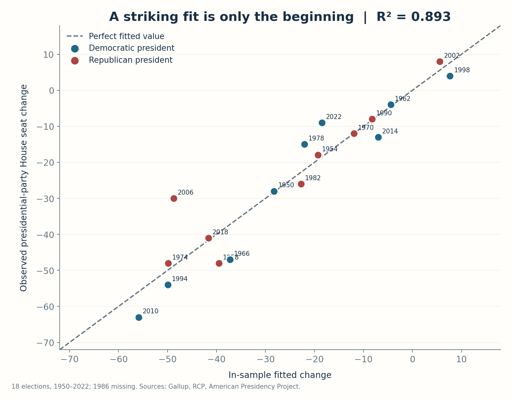

*Figure 1. Reconstructed historical fitted values versus actual seat changes, 1950–2022. The dashed line is exact equality; election labels expose deviations that a single fit statistic conceals. Blue points have Democratic presidents, red points Republican presidents. The omitted 1986 election is not a zero and not a fitted observation.*

The in-sample \(R^2\) is **0.89345**, and the in-sample root mean squared error is **6.66 seats**. The latter is calculated as the square root of the average squared fitted error over eighteen historical elections, not as the residual standard deviation estimated with fifteen degrees of freedom. The model's residual variance estimator, needed for conventional Student-t intervals, divides the sum of squared residuals by \(18-3=15\), not by eighteen. Small distinctions in denominators can look unimportant until an uncertainty calculation depends on them.

The figure deserves credit. It communicates that a simple, interpretable model captures an impressive amount of historical midterm variation. It also exposes where the model misses. The 2006 election is a striking example: the model fits approximately **−48.75** Republican seats, but the actual loss was **−30**. Its in-sample residual is therefore **+18.75 seats**. In 2010, the model fits about **−55.90** Democratic seats, compared with the observed **−63**; in 2022 it fits **−18.50** Democratic seats, against a loss of only **nine**. Those differences are not mistakes in plotting. They are the part of political history the model does not capture with two regressors.

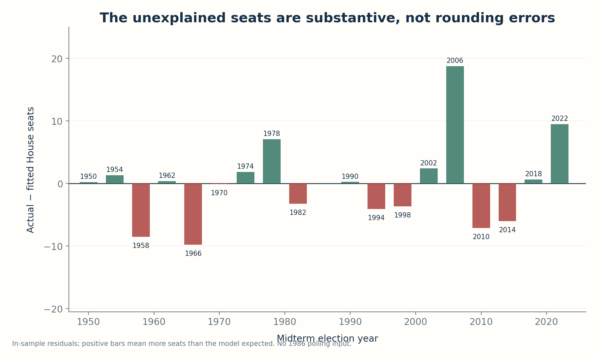

*Figure 2. Historical residuals \(Y_t-\widehat Y_t\) by election. A positive bar means the president's party performed better than the full-sample model fitted; a negative bar means it performed worse. These are **fitted** residuals, not truly held-out forecast errors.*

The distinction in that caption leads directly to the most important test. A regression fitted to all eighteen elections has already used 2006, 2010 and 2022 to choose its coefficients. An impressive fit is evidence of a pattern in the historical sample, but the coefficients have benefited from seeing every historical outcome. If we want to know whether the model predicts rather than merely describes, we need to stop letting an election help determine the regression used to predict that same election.

## Removing the election we are trying to predict

The first evaluation is leave-one-election-out cross-validation. Choose a historical election \(i\), remove it, estimate the same two-predictor model on the other seventeen elections, and predict the removed outcome using only that election's two known predictors. Repeat for each of the eighteen elections. Every outcome then receives a prediction from a fitted regression that was not allowed to see that outcome. This is an elementary form of sample reuse for predictive assessment, with a long methodological history in statistics [11, 12]. It changes the exercise from explaining the dependent variable with coefficients optimized on all of it to evaluating the predictive rule on outcomes excluded from their own coefficient estimation.

Let \(\widehat y_{(-i),i}\) denote the prediction of election \(i\) from a model trained without election \(i\). The cross-validated RMSE is

\[
\operatorname{RMSE}_{\rm LOO}
=\sqrt{\frac{1}{n}\sum_{i=1}^{n}
\left(y_i-\widehat y_{(-i),i}\right)^2}.
\]

The corresponding leave-one-out \(R^2\), when the comparison is explicitly the **full-sample mean of historical outcomes**, is defined in this study as one minus the held-out sum of squared errors divided by the historical total sum of squares. It is an evaluation summary, not an algebraic feature of the fitted line. A negative value would be possible if held-out errors exceeded the historical variance benchmark. The code reports both the error in actual seat units and this dimensionless summary so that readers need not guess what an impressive decimal means.

The result is **LOOCV RMSE = 7.99 seats**, mean absolute error **5.70 seats**, and held-out \(R^2=0.8465\). Predictive performance falls from the training \(R^2\), as one would expect, but it does not collapse. The relationship retains a substantial signal even when each observed election is excluded from the coefficient estimation that predicts it. That is stronger evidence for predictive utility than the initial fitted-versus-actual scatterplot alone. A scientifically fair account should acknowledge it. It would be wrong to see the loss of a few percentage points in \(R^2\) and call the model invalid merely because its out-of-sample value is lower than the training value.

There is also a useful analytical check on the implementation. For a full-rank ordinary least-squares model, if \(h_{ii}\) is the \(i\)th diagonal element of the hat matrix \(H=X(X^\top X)^{-1}X^\top\), then the held-out residual follows the exact identity

\[
y_i-\widehat y_{(-i),i}
=\frac{y_i-\widehat y_i}{1-h_{ii}}.
\]

This is not an approximate Monte Carlo result. It is an algebraic property of ordinary least squares. The reproduction tests compute the holdout predictions by refitting the regression eighteen times and independently verify the identity using the full-fit residuals and leverages. Agreement to floating-point precision is a valuable check: the model cannot accidentally be using the held-out row while still passing that test. This is one reason to publish executable code rather than only a summary table of scores.

The unusual 2006 election remains difficult. Without the 2006 observation, the model predicts approximately **−51.89** Republican seats against an actual loss of **30**. The held-out error, predicted minus actual, is approximately **−21.89 seats**. The error is large enough that a useful predictive system must carry a nontrivial uncertainty band even if its average performance is good. Other elections have smaller misses, and that is why the overall RMSE remains below eight seats. The residual distribution is an aggregate of periods that differed in policy context, turnout patterns, geographic coalitions and the way polling was conducted. We should not pretend that a good average erases a particular large miss.

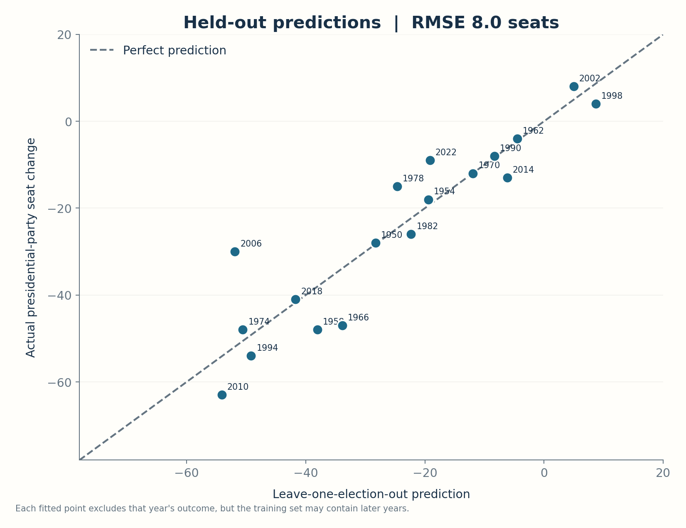

*Figure 3. Out-of-sample predictions from leave-one-election-out cross-validation. An election is not used to fit the model predicting its own result. However, the training folds may include elections that occurred later than the held-out election; this is not a strictly chronological backtest.*

That qualification is crucial. Cross-validation is not a single universal procedure. Holding out 1974 while training on elections up to 2022 tests whether a relationship estimated from other observations is useful for that missing row. It does **not** reproduce what an analyst in October 1974 could have known. In particular, it allows future electoral regimes and poll measurement practices to inform predictions of earlier elections. If the target question is how the model would have behaved when deployed one election at a time, we need to respect the direction of time.

## A stricter test: predict the next election using only the past

The second evaluation uses an expanding-origin backtest. Train the regression on the first eight eligible elections, from 1950 through 1978, and predict the next eligible election, 1982. Then add 1982 to the training data, refit, and predict 1990. The next eligible year jumps to 1990 because there is no comparable 1986 poll in our source series. Continue this procedure until predicting 2022 using only the elections up to 2018. In each fold, the training records have years strictly earlier than the year being evaluated. The code asserts that ordering and that the number of training observations grows one at a time.

This is a more realistic experiment for assessing historical deployment, though it has an important limitation: each test election is assigned its **final pre-election generic ballot**. Our model is intended to be a late-election forecast conditional on that poll. The backtest therefore asks what would have happened if an analyst had access to the last historical polling estimate for each target election but estimated its coefficients using earlier elections only. It is not an evaluation of a March forecast, a January forecast or a forecast without polling. The latter would require a model for how the generic ballot evolves and how its estimation uncertainty changes across the campaign. Conflating forecast horizons would make the comparison much less meaningful.

I begin with a deliberately simple baseline: at each origin, predict that the president's party will gain or lose the **average number of seats observed in all earlier eligible elections**. That rule does not use the current generic ballot or the initial seat count. Its purpose is to establish a minimal performance reference, not to represent the best available electoral forecast. A more demanding comparison is needed to learn whether *both* variables earn their place in the model, so I also estimate two reduced regressions at each same historical origin: an intercept plus the generic ballot, and an intercept plus seats defended. The feature-only models cannot borrow any outcomes from the election they predict or from later elections. A still richer benchmark would use district polls, incumbency and political geography; those are outside this national reconstruction.

Across the **ten forward test elections**, the regression's RMSE is **8.70 seats** and its mean absolute error is **6.00 seats**. The historical-mean baseline's RMSE is **23.81 seats** and its mean absolute error **20.76 seats**, calculated on exactly the same ten target outcomes. Under this defined test-set comparison, the regression substantially improves predictive accuracy. The forward test's descriptive out-of-sample \(R^2\) is **0.8533**, while the historical-mean baseline has a negative value under the same full-test-sample variance denominator. A negative baseline \(R^2\) is entirely possible because the fold-specific historical means are not optimized to the test-set mean.

Those numbers support a conclusion stronger than my initial skepticism: the two-predictor model captures a stable **historical predictive relationship**, at least over the forward-testing sequence defined here. They do not support saying that the model is guaranteed to predict November 2026 with an error of 8.70 seats. RMSE is an estimated average loss over a small and politically heterogeneous set of observations. Future error can exceed the historical average, and a single major polling miss or a changed electoral environment can dominate the forecast. For small samples, the sampling variability of a score like RMSE is itself material; comparing point estimates as if they were known constants would be a mistake.

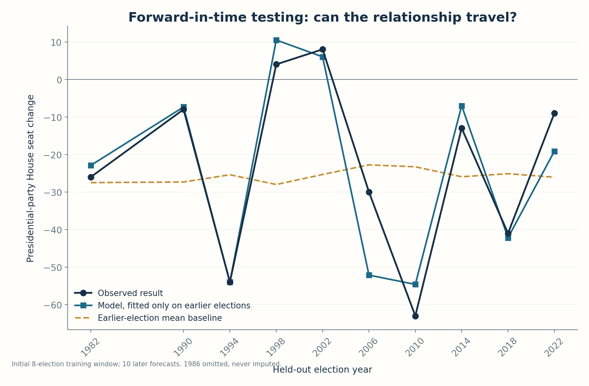

*Figure 4. Expanding-origin validation. For each later election, the regression is fitted using only earlier elections. The historical-mean baseline is recomputed from the same earlier outcomes. This is a short-horizon conditional backtest using final pre-election polling inputs, not a forecast made months before those polling values existed.*

The visual impression of the forward plot is also instructive. The model follows the direction and much of the magnitude of electoral swings, while the mean baseline barely responds to national conditions. That improvement is consistent with both the timely generic-ballot measurement **and** the number of seats exposed to loss contributing useful predictive information. The result is not a revelation that every parameter is structurally stable. The small historical sample still leaves coefficients imprecise, and the national poll and defended seats jointly summarize important electoral conditions without explaining their causal origins.

The forecast errors should also be inspected individually. When 2006 is held out in the forward sequence, the regression predicts roughly **−52.14** Republican seats against the actual **−30**. It overstates the loss by about 22 seats. In 2010, it predicts approximately **−54.61** Democratic seats compared with the actual **−63**, understating the loss by about eight. In 2022, it predicts approximately **−19.13** Democratic seats compared with the actual **−9**, overstating the loss by about ten. It would be misleading to report only 8.70 RMSE and suppress these examples. A good forecasting paper communicates the average *and* the shape of the errors.

The fact that the most difficult 2006 prediction survives both validation procedures is evidence that the historical regression is not a perfect rule connecting poll margin to seat outcome. It also shows why one should be suspicious of a claim like “the final generic ballot determines the seat loss.” The national ballot captures a significant component of electoral mood, but the seat conversion depends on geography, district competitiveness, incumbent strength, strategic retirement, third-party effects, redistricting and political events. Rattner's two predictors summarize much of that complexity in a compact relationship. They do not dissolve it.

### Does the second predictor earn its place?

There is a stronger question than whether a model informed by current polling beats an uninformed historical average. If the generic ballot already captures the country's partisan mood, does adding the number of seats defended contribute genuine forward-predictive value? Conversely, could the seat count alone explain most of the results? I answer those questions with the *same ten target elections*, the *same first-eight-election training origin*, and the *same expanding training sets* as the headline model. The single-feature equations each have an intercept and one estimated slope; the full equation has an intercept and two slopes. There is no tuning, cross-validation-based selection or extra external input available to one model but not the others.

| Forecast rule | Predictors available at each origin | Forward RMSE, seats | Forward MAE, seats |
| --- | --- | ---: | ---: |
| Two-predictor OLS | Generic ballot + seats defended | **8.70** | **6.00** |
| Generic-ballot-only OLS | Party-aligned final generic ballot | 20.09 | 18.18 |
| Seats-only OLS | President's party seats defended | 23.00 | 20.17 |
| Historical training mean | No contemporaneous predictor | 23.81 | 20.76 |

This is a material improvement over merely defeating the historical mean. The two-variable model gives smaller absolute errors than the generic-ballot-only regression in **nine of the ten** held-out elections, although its roughly 22-seat miss in 2006 is an important exception: in that year, the ballot-only model's prediction was considerably closer to the eventual result. In 1994, for instance, the two-predictor model anticipates a roughly 54-seat Democratic loss, close to the observed loss of 54, while the ballot-only model predicts roughly 28 seats lost. In 2002, the full model predicts a modest Republican gain, close to the actual eight-seat gain; the ballot-only model instead predicts a loss. These are not new outcomes or extra data points. They are alternative predictions of the original ten historical targets, all independently reproduced in the companion's [forward model comparison CSV](results/forward_model_comparison.csv).

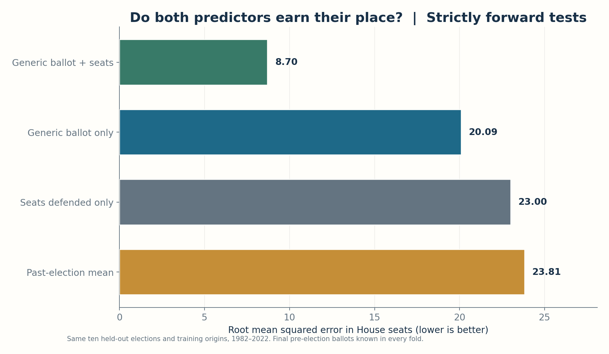

*Figure 5. A fair predictive comparison: all four rules are fitted only on earlier eligible elections and evaluated on **exactly the same ten later elections**. The two-predictor regression has the lowest RMSE by a substantial margin. This chart deliberately replaces the earlier mixture of in-sample, leave-one-out and forward-error bars, whose different test sets did not support direct model ranking.*

A revealing subtlety is that the full-sample generic-ballot-only regression forecasts approximately **−31.56 Republican seats** for the specified 2026 inputs, not far from the full model's **−32.32**. Point forecasts that happen to agree in one scenario can nevertheless come from predictors with very different historical error profiles. Their agreement here is no proof that the simpler model is just as reliable; the forward comparison provides more discriminating information. Likewise, neither model's numeric coefficients should be read causally. Seats defended partly capture exposure to losing seats, previous electoral strength and the shape of the district map; they are predictors, not manipulable treatments.

As a check against an arbitrary polling-transcription choice, I repeated the same ten-origin comparison with the alternative Gallup figures for 1962 and 1998 discussed earlier. The full-model RMSE becomes approximately **8.97 seats**, against **20.63 seats** for the generic-ballot-only model; the full model still has the smaller absolute error in nine of ten elections. Those results appear alongside the primary estimates in the [source-sensitivity table](results/source_sensitivity.csv). This is useful evidence that the incremental predictive result is not solely an artifact of the two disputed Gallup cells. It is not evidence of invariance to every possible alternative polling series or definition.

This expanded comparison is still exploratory. It was added after seeing the original historical fit and backtests, it contains only ten forecast errors, and all four rules use final pre-election ballot data when applicable. Large apparent gains may be sensitive to which elections and polling definitions are included. The exercise does **not** show that the full model beats district-level or fundamentals-based forecasting methods, or that ten historical paired errors determine a stable future ranking. It shows the narrower and more useful fact that, under this frozen source series and fixed chronological evaluation protocol, the defended-seat variable adds substantial predictive value beyond the generic ballot alone.

One might ask whether the 8.70-seat forward RMSE is “good.” It is useful compared with these reduced-model and historical-mean baselines, and the observed errors are relatively small compared with the largest historical midterm swings. But the absolute answer depends on the decision being made. A political commentary that wants the rough direction of control may find the model sufficient. A forecaster calculating the probability of 218 Democratic seats needs a full distribution of possible outcomes and a consistent starting seat count. Someone allocating resources across close districts requires district-level probabilities, not only a national conditional average. The appropriate scoring rule depends on the actual prediction product and its downstream decision.

The backtests have further limitations. We chose this simple specification after the historical era was complete, and the specific two predictors were already highlighted in Rattner's public model. If many candidate regressions had been tried and only the best displayed, neither ordinary LOOCV nor an expanding-origin exercise on the selected equation would fully correct for specification search. The strongest claim would come from predictions that were recorded **before** each historical election by an analyst who did not know later data or later model-selection decisions. We do not have such an archive for this exact equation. The forward exercise faithfully restricts coefficient estimation within each fold, but it cannot erase hindsight from the choice of features and functional form.

That is not a reason to discard the test. It is a reason to label the test accurately. A model is not either “validated” or “unvalidated” in one binary sense. We can be confident that the numerical implementation is reproducible, confident that held-out historical predictions are reasonably good, and less confident about how sensitive future performance is to a new voting environment. These are different levels of evidence. Good scientific communication separates them instead of promoting every successful check into a guarantee of generalization.

## From a conditional mean to a prediction interval

The original presentation's most consequential rhetorical choice is not the reported \(R^2\). It is the display of a single 2026 seat-change point without a corresponding interval. A point estimate is useful: it gives the center of the model's conditional expectation for the supplied inputs. But a point estimate is not an honest description of the range of outcomes compatible with the historical residuals. The 2006 miss alone shows why a plausible election can end up more than twenty seats away from a fitted expectation. Quantifying that uncertainty does not weaken the model. It makes the claim more precise.

There are two intervals that are often confused. A **confidence interval for the expected conditional mean** concerns uncertainty in the regression coefficients and hence in \(\operatorname{E}(Y\mid G,S)\). A **prediction interval for a future election's realized seat change** also includes the variation of the future outcome around that mean. The latter is necessarily wider under the usual linear model because the future residual is not known, even if we could estimate the coefficients without error. Presenting a narrow mean-confidence interval as the range of likely electoral outcomes would leave out the most important source of uncertainty for the object readers care about.

Under the classical linear regression assumptions, write \(x_0=(1,G_0,S_0)^\top\), let \(\widehat\sigma^2\) be the sum of squared training residuals divided by \(n-p\), with \(n=18\) and \(p=3\), and let \(q_{\alpha/2,\,n-p}\) be the appropriate Student-t critical value. A two-sided \((1-\alpha)\) prediction interval is

\[
\widehat y_0\pm
t_{1-\alpha/2,\,n-p}\,\widehat\sigma
\sqrt{1+x_0^\top(X^\top X)^{-1}x_0}.
\]

The leading **1** inside the square root represents the variance of a new election's residual. Remove that term, and the conventional formula becomes a confidence interval for the conditional mean, not a prediction interval for the realized outcome. The leverage term represents uncertainty about the fitted conditional mean at the input \(x_0\). Its size increases away from the center of the observed covariates. An input well outside the historical range can therefore generate a much wider model-based interval, even before admitting that a linear specification may fail outside its training domain.

For the D+8 and 220-seat scenario, the reconstructed conditional prediction is \(\widehat y_0=-32.32\). The **90% model-based prediction interval** is approximately **[−45.57, −19.08]** seats, and the **95% interval** is approximately **[−48.43, −16.22]** seats. These are continuous-model bounds; realized seat counts are integers, so practical reporting may round endpoints outward or state a range of whole-seat changes. The intervals are wider than the difference between a 32-seat and a 33-seat point forecast. In other words, the uncertainty that matters is on the scale of tens of seats, not whether two plausible reconstructions disagree by one.

What does “95%” mean here? Under repeated sampling from a stable linear model with the stated error assumptions, intervals constructed by this procedure cover the next observation with their nominal frequency. It does **not** mean that an event has a fixed 95% frequentist probability of falling within this one interval after the data and interval have been observed. Nor does it mean that a 2026 election must behave as an independently drawn copy of a midterm election in 1962 or 1994. Statistical coverage is a property of a procedure under assumptions, and those assumptions deserve as much scrutiny as the arithmetic used to calculate the endpoints.

The classical formula assumes, among other things, an adequately specified conditional mean, errors with stable variance, a workable normal approximation for the conditional predictive distribution, and a sufficiently stable regression relationship from historical elections to the election being predicted. The observations are discrete elections rather than exchangeable laboratory replicates; political environments share persistent features, and poll methodologies evolve. The small sample makes it difficult to diagnose these assumptions with high power. The model-based intervals are therefore conditional summaries, not distribution-free coverage guarantees or evidence that every form of model misspecification has been incorporated.

There is a simple historical coverage check, though it too is uncertain. In leave-one-election-out validation, the nominal 90% and 95% intervals both cover **17 of the 18** held-out elections, an observed coverage of **94.4%** at either nominal level. In the stricter forward-in-time sequence, both nominal levels cover **nine of ten** elections, or **90%**. That equality between different nominal levels is not a profound calibration result: with eighteen and ten observations, empirical coverage can move only in large discrete steps. An observed 90% from ten trials is weak evidence about whether the true long-run rate is exactly 90%, 95% or something else. Reporting the numerator and denominator matters more than decorating the percentage with extra decimals.

The difficult historical election is instructive again. The 2006 forward prediction misses to the more negative side: the model expects a substantially larger Republican loss than occurred. A prediction-interval procedure that never permits such deviations cannot be suitable for interpreting the future. The resulting 95% model-based interval in 2026 admits both a much smaller and a much larger loss than the point estimate. It is not an admission that we know nothing. We know the direction suggested by the particular model and its historical data; we also know that the magnitude is uncertain enough to deserve a range.

### A bootstrap check gives a different answer—not an automatic improvement

To examine sensitivity to the parametric uncertainty formula, I also implement a transparent bootstrap procedure. Each of **5,000** seeded replications samples the eighteen historical election records with replacement, refits the same linear model, predicts the 2026 input, and adds one centered residual sampled from that resampled fit. This is a combined pairs-and-residual resampling sensitivity, chosen to include parameter re-estimation and some future outcome variation. The random seed is fixed at **20261031**. The procedure never simulates a fictional 2026 training outcome, never accesses live polling, and never tunes its output to match Rattner's −33 point.

The resulting central bootstrap 95% interval is approximately **[−41.75, −14.37]** seats. Its width and asymmetry differ from the Student-t interval. The bootstrap is noticeably narrower on the large-loss side, largely because a residual resample from a very small empirical distribution cannot recreate tails that were never observed in the source data. The model's most extreme residuals remain influential; a resample with duplicates changes the geometry of the coefficients; and the calibration problem is compounded by the fact that the future election's structural environment is not guaranteed exchangeable with the observed eighteen. A bootstrap percentile interval is therefore not automatically more rigorous than a transparent parametric interval.

This comparison is useful because it forces the reader to notice that there is no single uncertainty number independent of assumptions. The Student-t construction adopts a familiar normal-error linear-model framework and produces symmetric bounds about the conditional mean. The resampling construction relies on repeated election records and their fitted residuals, producing a different empirical shape. Both are reproducible. Both exclude genuinely unforeseen regime change, new district configurations, unexpected polling error structure and other possibilities that historical residuals cannot reliably represent. In publication I report the parametric prediction interval as the headline model-based interval and the bootstrap as a **sensitivity analysis**, not as a second guaranteed coverage statement.

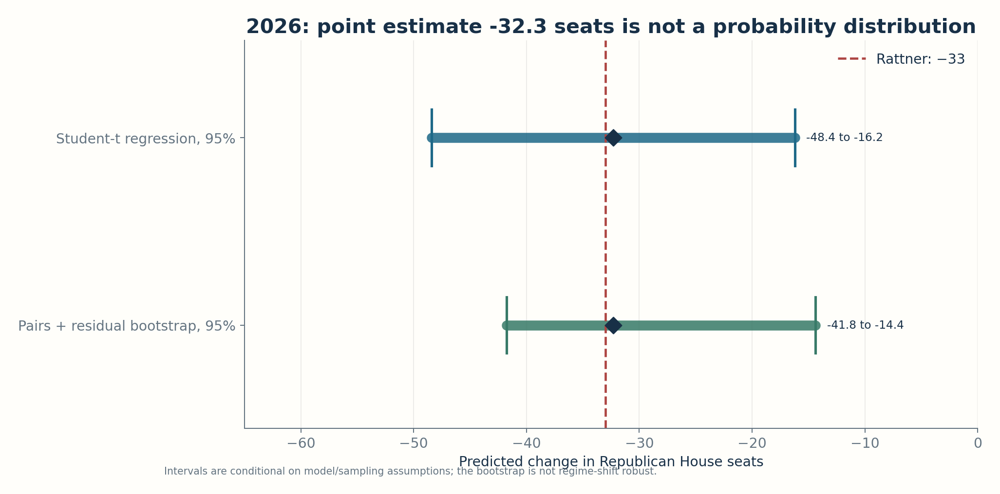

*Figure 6. Two different assumptions about uncertainty, one conditional scenario. Both intervals include the original −33 estimate and the reconstructed −32.32 estimate; their different tails reveal the cost of treating “the uncertainty” as a unique property of the chart. These are not probabilities that either political party wins control of the House.*

The distinction between the two interval methods also clarifies an issue in ordinary scientific publishing. Researchers sometimes report uncertainty only for estimable coefficients because software prints standard errors and p-values by default. Those numbers may be scientifically interesting, but they are not substitutes for predictive uncertainty when the scientific claim is about an individual future realization. A careful forecasting article should state the conditioning information, the forecast horizon, the target variable, the loss metric, the distributional assumptions and the interval construction. A high fit statistic is an incomplete substitute for any of these.

## A forecast conditional on the poll, not a forecast of the poll

The next sensitivity analysis is almost embarrassingly simple. Change the generic-ballot input while leaving the model and the defended-seat count fixed. Because the fitted predictor is linear, every one-point increase in the Democratic generic-ballot lead in 2026 makes the president's-party margin one point more negative, changing the predicted Republican seat result by about **−2.71 seats**. Two additional Democratic points therefore imply about 5.42 more Republican seats lost under this conditional model. This is a mathematical implication of the fitted equation, not a statement that campaigning to move a poll by two points would causally generate exactly five additional seats.

With Republicans defending 220 seats, D+6 produces a conditional prediction of approximately **−26.91**, while D+10 produces approximately **−37.74**. All three scenarios are applications of the same coefficients. None has been assigned a probability in this exercise. Doing so would require a separate model of polling uncertainty, its possible movement over the remaining days, any systematic polling bias, and the joint dependence between the national poll and district-specific outcomes. A shaded prediction band around each conditional mean does not provide a distribution over the input axis; the distinction matters whenever readers see a family of forecast curves and interpret it as a probabilistic fan chart.

The defended-seat count enters linearly too. Holding the same D+8 national poll, a hypothetical count of 210 Republican seats defended gives a conditional model prediction around **−26.97**; 230 defended gives approximately **−37.67**. These are scenario calculations, not claims about the actual number of seats to be defended in 2026, which remains fixed at 220 in the source scenario. The arithmetic illustrates the model's exposure effect. A party defending more seats has more opportunities to lose them, but a realistic political counterfactual would also change the composition and partisan lean of the additional defended districts. Treating a mechanically altered seat count as a feasible intervention would overinterpret an observational coefficient.

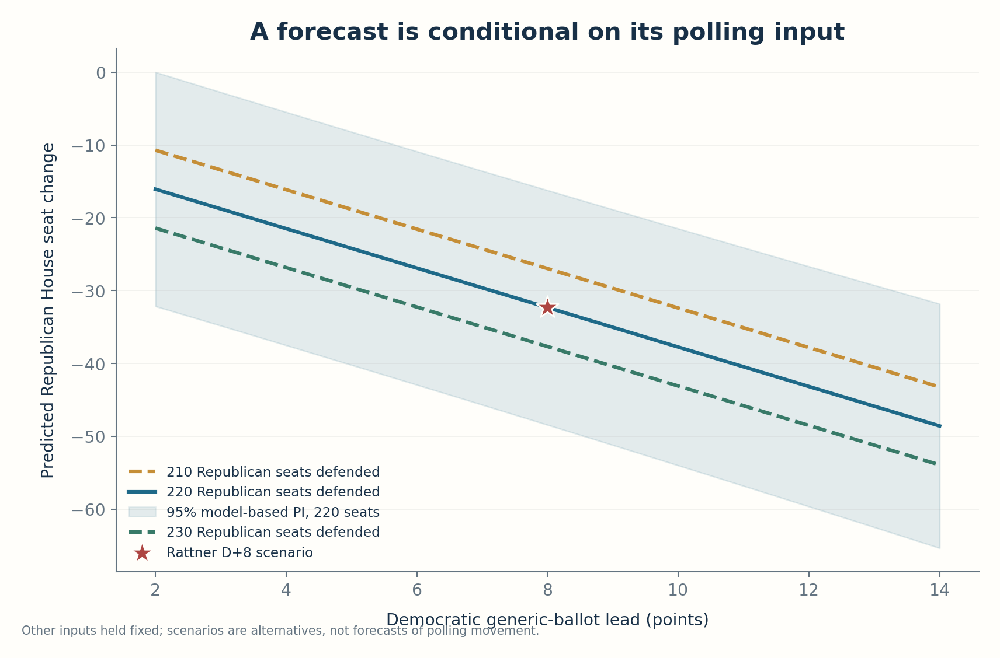

*Figure 7. Conditional sensitivity to the polling input. The star marks the specific D+8, 220-seat scenario from the original 30 October 2026 presentation. The shaded region is a model-based prediction interval at each poll setting, not uncertainty about which setting will occur.*

It is tempting to compress this plot into a political slogan: two more poll points equal five more seats. That would be overly strong. First, the regression is estimated from national polling averages at different historical dates and under different survey conventions. Second, the seat conversion is nonlinear at the district level: a national swing concentrated in safe districts produces a different seat outcome from the same aggregate swing distributed across competitive districts. Third, a one-point change in a generic ballot can reflect sampling variability rather than actual voter movement. Finally, model slopes are estimated with uncertainty and may change with the political regime. The line describes how the fitted equation behaves as an input is varied; it does not prove a universal election law.

That is also why it is valuable that the 2026 scenario lies inside the broad historical range of the two numerical predictors. We are not asking the regression to predict an election with a president's party defending 400 House seats or a generic-ballot margin of 70 points. The D+8 national scenario and the defended count of 220 are within plausible historical ranges. Interpolation in covariate space is generally less hazardous than extreme extrapolation. But historical range overlap is not sufficient to guarantee distributional stability: a point can lie in a familiar numerical rectangle while belonging to a different political system of district boundaries, voting coalitions, turnout patterns and party organization.

## Does one unusual election determine the entire forecast?

When a regression contains eighteen observations and three coefficients, individual records matter. The concern is not merely that a sample is small; it is that some observations occupy unusual regions of the predictor space or have large residuals. These are related but different features. **Leverage** measures the location of a data point's predictors relative to the center of the observed design. A point can have high leverage yet follow the fitted regression closely. A large residual measures an unexpected outcome conditional on the fitted equation, but may occur for an observation near the center of predictor space. Influence combines the two: an election matters for estimating the coefficients when deleting it appreciably changes the fit.

The hat matrix \(H=X(X^\top X)^{-1}X^\top\) supplies the leverages \(h_{ii}\). For a full-rank OLS fit with three columns including the intercept, the leverages sum to three. Their sample average here is \(3/18=1/6\), an exact consequence of the projection's rank, not a scientific estimate. The largest observed leverage is about **0.2785**. That is above the sample average but does not by itself make the election erroneous or removable. The internally studentized residual divides each fitted residual by the fitted residual standard deviation adjusted for \(1-h_{ii}\), making it easier to compare deviations among observations with different leverages.

One common influence summary is Cook's distance,

\[
D_i=\frac{e_i^2}{p\widehat\sigma^2}
\frac{h_{ii}}{(1-h_{ii})^2},
\]

where \(e_i\) is the full-sample fitted residual and \(p=3\) is the number of estimated coefficients. This is a diagnostic for the effect of deleting an observation on the fitted model; it is not a probability that the observation is false, and its heuristic thresholds do not establish that a political election should be discarded. The largest Cook's distance in this reconstruction belongs to **2006**, about **0.430**. That makes intuitive sense. The Republican generic-ballot deficit that year suggested a very severe outcome, while the eventual seat loss was less extreme than the two-variable regression would fit. The point is not to delete 2006 until the forecast looks cleaner. It is to retain it, diagnose its role, and show readers how much the forecast changes if it is omitted.

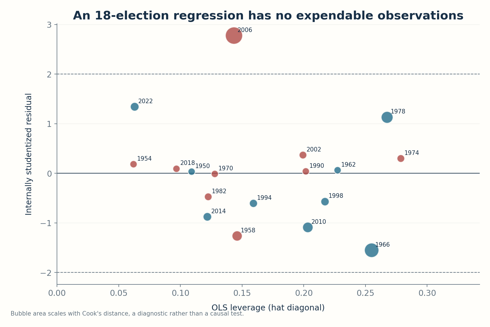

*Figure 8. Influence diagnostics for the historical regression. The larger 2006 bubble reflects its substantial residual and resulting Cook's distance. Neither leverage nor Cook's distance implies that an election is an invalid observation, and the plot does not identify an electoral causal effect.*

I refit the historical regression eighteen times, each time excluding one election, and apply the resulting model to the **same** 2026 polling and defended-seat inputs. Across those leave-one-election-out versions of the final model, the 2026 point forecast ranges from approximately **−34.23 to −31.38** seats. The fact that this range is fairly narrow is encouraging for the stability of the **conditional mean** against the deletion of one historical record. It also explains why the two conflicting Gallup retrospective values do not dramatically change the headline prediction. But this sensitivity range is not a prediction interval. Every member of it is a fitted conditional expectation, and the procedure is not attempting to represent the random deviation of the 2026 outcome from that expectation.

Deleting one historical election is also a modest perturbation. It does not test what happens if the entire relationship between national votes and district seats changes, if polling methods begin producing a systematic partisan bias, or if a new redistricting pattern shifts the number of competitive districts. An influence diagnostic tells us which observed points exert force on this particular regression; a structural-break analysis would ask a different question about the parameters themselves. With eighteen observations, splitting the sample into eras quickly leaves too few elections to estimate stable two-predictor regressions. A formal break test here could be very underpowered and overinterpreted. The intellectually honest option is to describe regime stability as an assumption and a risk, not to manufacture precision with tiny subsamples.

The same concern applies to adding more predictors. Presidential approval, economic growth, inflation, unemployment, fundraising, incumbency, district partisanship and campaign-specific events might all contain relevant information. With eighteen national elections, however, adding a large vector of explanatory variables would rapidly consume the degrees of freedom and increase the risk of historical overfitting. A two-predictor model can be preferable because it is interpretable and parsimonious, especially when the generic ballot already incorporates many contemporaneous signals. The alternative is not necessarily an unrestricted regression with ten variables. It may be a separate district-level forecasting framework with thousands of contests, appropriate dependence assumptions, and out-of-time evaluation. The correct model complexity depends on the available information and target question.

For comparison, contemporaneous scholarly election-forecasting projects such as Gary King's LogisTiCC model incorporate individual districts, past elections, incumbency and candidate effects, and distinguish forecasts that use fundamentals alone from those updated by the generic ballot and other polls [15]. That approach can quantify probabilities over a large collection of related outcomes, but it is answering a richer question using a different data architecture. It is not evidence that Rattner's national regression is wrong, and we should not infer relative predictive superiority without evaluating competing models on the same frozen dates, sources and loss functions. The compact model earns its place when its purpose is a transparent national expectation; the richer model earns its complexity when district-level decisions or probabilities are needed.

## A two-dimensional surface, not a map of election probabilities

The last figure displays the fitted conditional seat prediction as two inputs vary together. Across Democratic generic-ballot leads of four to twelve points and Republican defended-seat counts from 210 to 230, each coordinate receives the value generated by the same plane \(106.998+2.70846G-0.534787S\), with \(G\) signed toward the Republican presidential party. Contours mark conditional predictions such as −30 or −40 seats. The star marks Rattner's D+8 and 220-seat scenario. This is an effective way to show how a regression transforms inputs into an outcome scale, and it makes the tradeoff between the two coefficient dimensions explicit.

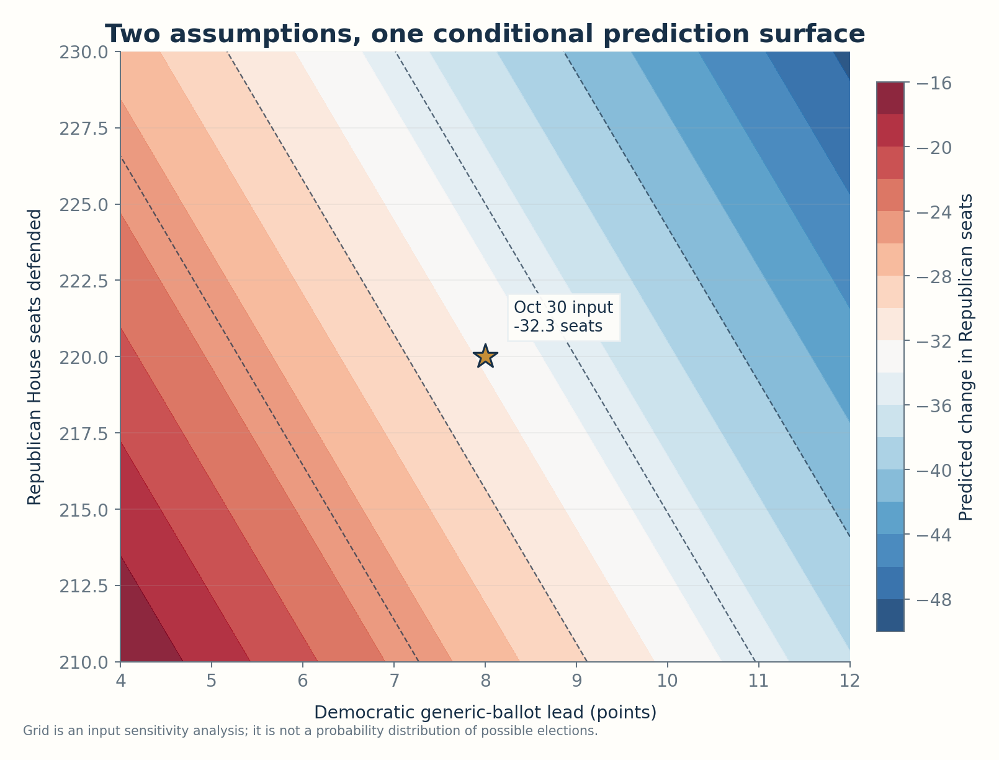

*Figure 9. A scenario surface for the 2026 conditional forecast. The colors are **predicted seat changes**, not probabilities. A reader cannot integrate the colored area to determine a chance of a particular result because no joint distribution for polling and defended seats has been supplied.*

This clarification is important in discussions of political forecasts because a heatmap looks probabilistic even when its color scale is not. A dense region of color is not necessarily a likely state of the world. Here every point on the grid is an alternate conditional input. To turn it into a predictive distribution, one would need at least a probability model for the generic ballot, a justified treatment of the defended-seat variable, uncertainty about the coefficients, and a model of the future residual. To calculate the probability of a House majority, one would additionally need a coherent mapping from net seat changes to actual seats won, including vacant seats, district-level dependence and potentially third-party representation. None of those probabilities follows automatically from \(R^2\).

There is a deeper statistical point in this visualization. A high historical coefficient of determination is a property of how the fitted plane passes through the observed covariate configurations and outcomes. The heatmap, by contrast, is a visualization of the **model function** over configurations we choose. A visually smooth plane can coexist with large uncertainty about its coefficients, unstable relationships across eras and substantial irreducible electoral variation. Smoothness of a fitted function is not stability of a prediction system. One can make any linear model look smooth by plotting its surface at sufficiently high resolution; the apparent precision belongs to the graphic, not necessarily to the science.

The local derivatives are informative within the model's conditional language. Increasing the president's party generic-ballot margin by one point changes the fitted seat expectation by approximately 2.71 seats, holding defended seats fixed. Increasing defended seats by one changes the fitted expected seat change by about −0.535, holding the margin fixed. Those derivatives are a concise description of a parameterized predictive surface. They become causal comparative statics only if an additional structural argument justifies interpreting the manipulated inputs as feasible interventions that leave all other relevant aspects of the system unchanged. This study does not make that argument. The mathematical derivative of a regression function is not a substitute for a causal estimand.

## Three more models: does changing the estimator change the evidence?

The objection to a simple regression is sometimes phrased as a demand for a more sophisticated algorithm. That demand confuses two distinct possibilities. A new *predictor* can supply information absent from the generic ballot and defended-seat count; a new *estimator* can change how the existing information is weighted or constrained. With only eighteen observations, those are very different risks. Before expanding the covariate set or introducing a flexible machine-learning system, it is instructive to hold the original two predictors fixed and change only three statistical assumptions: the shape of the residual distribution, the treatment of unstable coefficients, and the relevance of older elections.

These extensions are deliberately modest. They are not fitted to an enormous, continuously refreshed dataset. They are not a search over hundreds of specifications. All three alternatives retain an intercept, the president-party-oriented generic-ballot margin, and the number of seats defended. I assign their tuning constants explicitly—**four Student-t degrees of freedom, ridge penalty two, and a twenty-four-year weighting half-life**—rather than finding the values that maximize these ten historical test scores. Within every training fold, each model uses only earlier election outcomes, and any standardization of the predictor columns is calculated from those earlier observations alone. We evaluate all four procedures, including the original OLS, against precisely the same ten held-out elections: 1982 and 1990–2022, with the unsupported 1986 poll still omitted.

### Heavy tails: Student-t regression

Ordinary least squares gives residuals a quadratic cost. That is well motivated for Gaussian errors, but a large election-specific departure receives considerable influence. The 2006 result, whose original full-sample fitted residual is about nineteen seats, makes this issue concrete. A heavy-tailed likelihood offers one way to prevent a single unusually large error from exerting an ever-growing quadratic pull on the estimated regression plane. Following the robust-regression tradition formalized by Lange, Little and Taylor [17], I fit the same location equation with independent Student-t residuals:

\[
Y_t=\beta_0+\beta_1G_t^{(P)}+\beta_2S_t+\varepsilon_t,
\qquad \varepsilon_t\sim t_{\nu}(0,\sigma),\quad\nu=4.
\]

Ignoring terms constant in the parameters, the minimized negative log-likelihood is

\[
\mathcal L(\beta,\sigma)=n\log\sigma
+\frac{\nu+1}{2}\sum_{t=1}^{n}
\log\!\left(1+\frac{(Y_t-X_t^\top\beta)^2}{\nu\sigma^2}\right).
\]

The residual contribution grows roughly logarithmically rather than quadratically in the tails. The resulting estimating equations downweight a case when its residual is extreme relative to the fitted scale. This is a defensible sensitivity analysis because 2006 should neither be erased nor granted unlimited leverage on the fitted slopes. I fix \(\nu=4\) and estimate the regression coefficients and scale by deterministic numerical likelihood optimization; estimating the tail parameter itself from eight to eighteen observations per fold would add another poorly identified degree of freedom. The code checks the analytic gradient and the optimizer's convergence. In this model, the Student-t parameter is a likelihood assumption about residuals. It must **not** be confused with the Student-t *critical value* used earlier to construct the conventional OLS prediction interval. The new fit supplies a point forecast; it does **not** establish the nominal coverage of a new heavy-tailed predictive interval.

### Shrinking slopes: ridge regression

The second alternative attacks variance rather than residual tails. Two correlated, finite-sample predictors can yield slopes that change more than we would like when an influential election enters or leaves the training set. Ridge regression trades some fitting bias for potentially lower sampling variance by shrinking those slopes toward zero. In the notation of Hoerl and Kennard's original method [18], with a separately estimated intercept and predictor columns centered and scaled **inside each training fold**, I minimize

\[
\sum_{t\in\mathcal T}
\big(Y_t-a-\theta_1Z_{t1}-\theta_2Z_{t2}\big)^2
+2\big(\theta_1^2+\theta_2^2\big).
\]

The penalty coefficient here is \(\alpha=2\), not a value optimized on the subsequent elections. The intercept is unpenalized; otherwise even the historical sample mean would be pulled arbitrarily toward zero seats. Standardization makes a two-unit penalty comparable across a generic-ballot variable measured in percentage points and a defended-seat variable measured in hundreds of seats. Each fitted coefficient vector is then transformed back into the original units for predictions. Setting the penalty to zero reproduces OLS in the tests. Shrinkage is a methodological preference for smaller slopes, **not** a guarantee of lower forecast error. An estimator can become more stable while also becoming more biased for the election process actually observed.

### Discounting older elections: recency-weighted least squares

The third estimator addresses a political rather than numerical worry: why should the national vote-to-seats relationship estimated from the 1950s receive the same weight as the one observed in 2022? Party coalitions, district maps, ticket-splitting, survey methods and electoral institutions have changed. A transparent alternative is weighted least squares, using an exponentially declining function of the age of each *training* election. For target year \(T\), define

\[
w_t(T)=2^{-(T-t)/24},\qquad
\widehat\beta_T=\operatorname*{arg\,min}_{\beta}
\sum_{t<T}w_t(T)\big(Y_t-X_t^\top\beta\big)^2.
\]

The fixed half-life is twenty-four years, or six ordinary midterm cycles: one election that is twenty-four years older than another receives half its weight. For a 2026 prediction, the oldest eligible election is discounted considerably, but it remains in the sample. The weights have an effective sample size \((\sum w)^2/\sum w^2\) of approximately **13.02** out of eighteen when evaluating the specified 2026 scenario. In each historical forward fold the weights are recomputed using that fold's target year, without looking at its actual seat change. Choosing to privilege recent elections is intelligible, but it is also a substantive assertion that the current political regime resembles the recent past more than the distant past. If occasional rare episodes contain essential information about future volatility, forgetting them can make prediction worse.

### The common test: ten elections, four rules

The comparison is not a contest between a model's in-sample \(R^2\) and another model's holdout RMSE. Every RMSE below is computed using the **same ten chronologically held-out seat changes**, and every corresponding 2026 point forecast uses the same frozen D+8, 220-seat inputs. The separate column changes *only* the disputed Gallup retrospective values in 1962 and 1998; it repeats the entire chronological exercise under that alternative source transcription.

| Estimator | Forward RMSE, primary Gallup | Forward RMSE, alternative Gallup | 2026 GOP seat-change forecast |
| --- | ---: | ---: | ---: |
| Ordinary least squares | **8.70** | **8.97** | −32.32 |
| Student-t likelihood, \(\nu=4\) | 8.48 | 9.02 | −33.76 |
| Ridge, \(\alpha=2\) | 12.18 | 12.67 | −31.06 |
| Recency-weighted OLS, 24-year half-life | 9.13 | 9.37 | −30.98 |

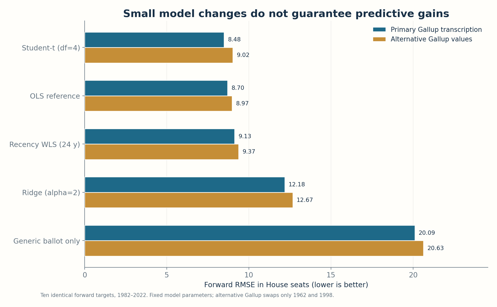

*Figure 10. Ten held-out midterms, identical chronological cutoff for each method. The two bars per method represent different published Gallup retrospective tables, not independent datasets or repeated randomized experiments. Student-t achieves the lowest primary-series RMSE by about 0.21 seats relative to OLS; its narrow lead reverses under the alternate Gallup transcription. The ballot-only benchmark is included to preserve the scale of the original two-predictor improvement.*

It would be statistically indefensible to describe Student-t's 8.48 as a decisive victory over OLS's 8.70. Their difference is approximately **0.21 seats** in an RMSE estimated from just ten heterogeneous elections. Under the alternative Gallup table, OLS instead has the slight advantage, 8.97 versus 9.02. The change of winner is not evidence that either published source is erroneous; it shows that the apparent ranking of two nearly tied estimators is less stable than the much larger improvement over the ballot-only rule. Nor should the last decimal be treated as a replicated result from a large sampling experiment. The design is exploratory, with deliberately simple fixed settings, and the hyperparameters themselves have not undergone a separate nested or prospective tuning protocol.

Ridge is a useful negative result. With \(\alpha=2\), it performs markedly worse in forward RMSE than unpenalized OLS despite its potential variance-reduction appeal. Shrinking standardized slopes on a tiny, strong-signal dataset can discard real information. A different penalty could perform differently, but choosing one *after* inspecting these historical errors would contaminate an already small evaluation set. Recency weighting comes closer to OLS, at 9.13 seats on the primary source, yet does not improve the historical RMSE. This is equally informative: a concern about political regime change is not itself empirical proof that systematically discounting older midterms helps predict the next election. Both alternatives deserve to remain visible as failed-to-improve tests of reasonable assumptions rather than disappear from a tidy success narrative.

The four point forecasts for the frozen 2026 scenario range from **−33.76 to −30.98 Republican seats**, a span of fewer than three seats. That numerical agreement is reassuring in a limited sense: these three estimation changes do not overturn the rough magnitude of the original −33 estimate. But the span is **not a model-averaged credible interval**, a forecast distribution, or a calibrated uncertainty band. The earlier OLS 95% prediction interval remains the explicitly conditional interval derived and tested for that particular specification. Comparing a handful of conditional means neither accounts for polling-input uncertainty nor puts probability mass on unforeseen electoral shocks. All four estimators could be wrong together if a shared predictor becomes misleading.

### What changes when the history gets longer?

One more check focuses on the stability of the *2026 scenario calculation* as historical observations are accumulated. For each training endpoint from 1978 through 2022, I fit all four estimators on the first eight, nine, and eventually eighteen eligible elections and then plug the same **2026 inputs** into the fitted function. In other words, the horizontal axis represents the **last election used to estimate the parameters**, not the date when the 2026 generic-ballot observation was available. No analyst in 1978 could have observed the specific October 2026 D+8 value. These are retrospective coefficient-path sensitivity calculations, explicitly **not** contemporaneously issued forecasts.

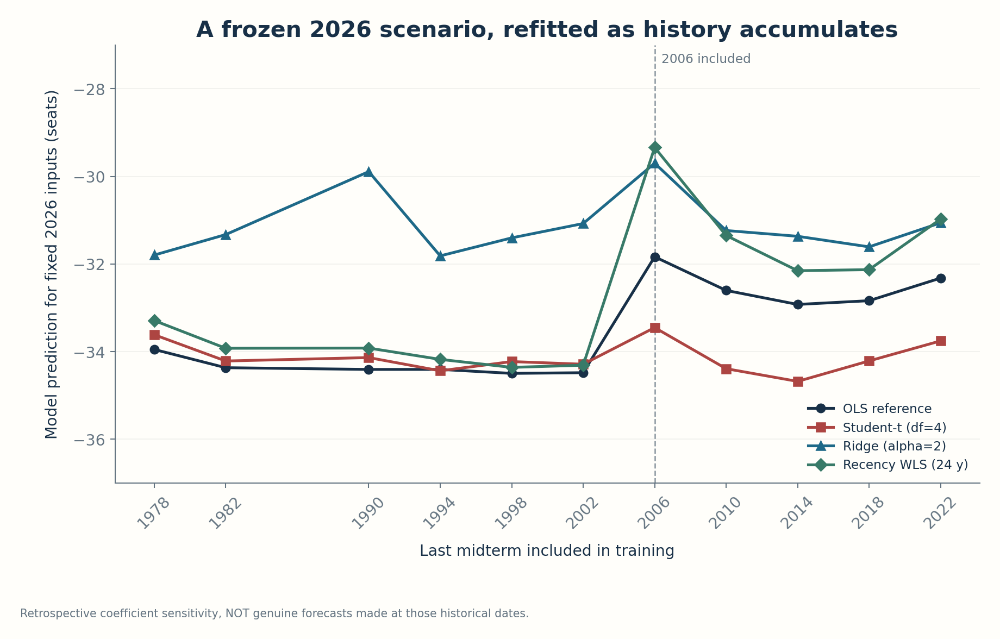

*Figure 11. Four estimates of the same fixed 2026 conditional scenario, refitted as the historical training sample expands from eight to eighteen elections. The vertical reference marks inclusion of the 2006 outcome. Because the 2026 predictors are held fixed retrospectively, this is an estimator-stability diagnostic—not an ex-ante historical forecast record and not an error-based validation plot.*

The 2006 election illustrates the difference among methods particularly clearly. The OLS 2026-scenario estimate moves from approximately −34.48 seats after the 2002 training endpoint to −31.84 when 2006 is included. The recency-weighted estimate shifts even more, from approximately −34.31 to −29.34, because a fresh 2006 observation receives substantial weight. Student-t changes less, from about −34.29 to −33.45, consistent with its less aggressive response to a large residual. This comparison is about **sensitivity**, not a determination that 2006 should have been discounted: a heavy-tailed estimator could underreact to a genuinely informative change. After subsequent elections, the final predictions converge toward the range reported above, although their trajectories do not become identical.

The lesson is narrower and more durable than “the robust model wins.” An election model can be challenged along distinct axes—outliers, coefficient shrinkage, temporal relevance—and reasonable adjustments can succeed, fail, or yield almost identical future conditional expectations. Using a common chronological protocol exposes those tradeoffs without manufacturing extra observations. The [primary forward prediction rows](results/alternative_model_forward.csv), [alternative Gallup rows](results/alternative_model_forward_gallup.csv), [retrospective coefficient-path table](results/alternative_model_path.csv), and [parameter and score summary](results/alternative_models_summary.json) make the comparison auditable. The implementation, notebook, deterministic output generation, numerical checks and workflow are part of the same reproducibility companion. A more flexible random forest or boosting model trained on eighteen national elections might produce an attractive historical fit, but without a defensible independent validation design it would make the risk of specification search considerably worse. The present evidence warrants maintaining the original interpretable OLS as a reference while treating the alternative fits as **sensitivity analyses**, not as post-hoc grounds for silently replacing the pre-election forecast.

## How uncertain is the model leaderboard itself?

The historical comparison has a further limitation that deserves its own calculation. Saying that Student-t's forward RMSE is 8.48 rather than 8.70 gives an exact arithmetic summary of ten recorded errors. It does not tell us whether this difference is representative of other possible electoral sequences. We have already established that the ranking flips when two historical Gallup polling values are replaced by a different published retrospective. We can now ask two related questions without changing any forecast model: **Which individual held-out elections produce the RMSE gap, and what happens when the paired historical errors are perturbed?**

The word *paired* does important work. The Student-t and OLS models did not predict different sets of elections. Both predicted the same 1982 outcome from the same earlier observation window; both predicted 1990 from an expanded earlier window; and so on through 2022. The errors within a given election share political circumstances, poll definitions and actual outcomes. Treating one model's ten losses as independent of the other model's ten losses would discard the main advantage of the common historical evaluation protocol. If we examine a difference, we must compare the methods **within each election** before combining the differences across elections.

### The exact arithmetic: where the advantage comes from

For candidate estimator \(j\) and held-out year \(t\), write the forecast error as \(e_{j,t}=\widehat Y_{j,t}-Y_t\). The per-election squared-loss differential against OLS is

\[
d_{j,t}=e_{j,t}^{2}-e_{\mathrm{OLS},t}^{2}.
\]

Negative \(d_{j,t}\) favors the candidate, positive \(d_{j,t}\) favors OLS, and zero is a tie. Because the methods share the same ten targets,

\[
\underbrace{\operatorname{MSE}_{j}-\operatorname{MSE}_{\mathrm{OLS}}}_{\text{exact difference on the ten elections}}
=\frac{1}{10}\sum_{t=1}^{10}d_{j,t}.
\]

This additivity is why I inspect squared losses before interpreting the more familiar RMSE difference. RMSE is the square root of the aggregate MSE, so its *ranking* agrees with MSE on a common test set, but its difference cannot be attributed to individual elections simply by summing RMSE terms. The wider forecasting literature develops comparisons using common loss functions and loss differentials; the original Diebold–Mariano paper is a methodological reference for this distinction [19]. That reference does not imply that its asymptotic test is reliable with the **ten** dependent-looking observations available here, and I do not report a nominal Diebold–Mariano significance test.

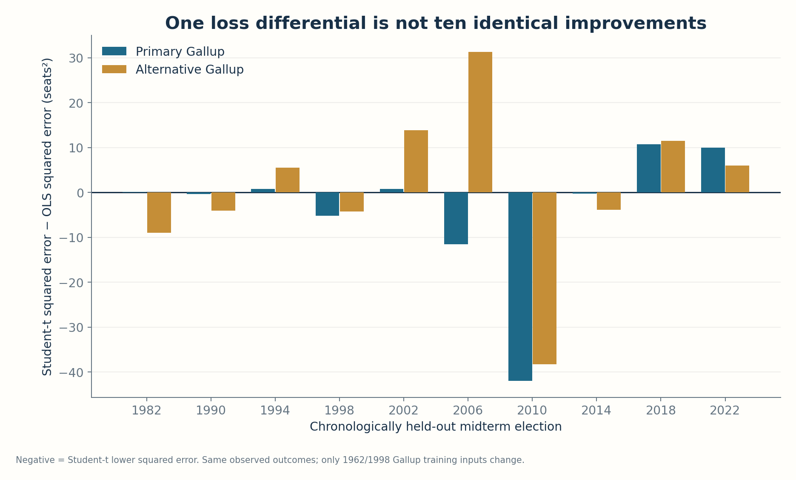

*Figure 12. Student-t's squared forecast error minus OLS's squared forecast error for each common held-out midterm. Bars below zero mean the robust estimator was closer in that year. Replacing Gallup's disputed 1962/1998 retrospectively reported values changes the training inputs but not the evaluation years or actual seat outcomes. The 2010 improvement and the source-sensitive 2006 loss contribute heavily to the overall ranking.*

In the primary Gallup version, Student-t has a smaller *absolute* error in **five of ten** elections, not nine or ten. Its small aggregate RMSE advantage is not a pattern of consistently superior predictions. The 2010 election supplies a squared-loss advantage of about **42 seat-squared units**; measured by the sum of absolute per-election squared-loss differences between these two models, 2010 contributes approximately **51.4%**. It is reasonable that one unusual election should influence an assessment of forecast methods. The problem arises when the aggregate statistic conceals how concentrated that influence is. In 2018 and 2022, the Student-t error is instead slightly larger than OLS's. These cross-year changes in sign are valuable data, not noise to be hidden behind one reported RMSE.

The alternative Gallup source is especially revealing for 2006. Under the primary source, Student-t's 2006 squared loss is about **11.5 seat-squared units below** OLS's; with the alternative retrospective, it becomes about **31.4 units above** OLS's. Both methods continue to badly overpredict the magnitude of the Republican seat loss that year, but the order of their losses changes. That does not mean that 2006's recorded outcome has been modified, and it does not justify deleting the year. It means the fitted functions at that origin depend on prior historical polling inputs. The source choice propagates through the training history, making a narrow model-ranking difference sensitive to defensible alternative data transcription.

### One omitted election at a time

A deliberately transparent diagnostic is to omit one of the **ten test errors**, *from every candidate and OLS simultaneously*, and recompute each model's RMSE on the remaining nine errors. This is not the original leave-one-out procedure for fitting regression coefficients. The historical forecasts themselves remain exactly as they were; only the *evaluation set* is perturbed. It answers a different question: would the ranking survive removal of one election's contribution to the scoreboard? It also does not measure the effect of deleting a training election, because later historical forecast origins continue to use the original training histories.

For primary-series Student-t versus OLS, the answer is almost, but not completely. Student-t's overall RMSE difference is **−0.214 seats**. If 2010 is omitted from the scoreboard, the difference becomes approximately **+0.033 seats**: OLS is then slightly better. Omitting any of the other nine test elections leaves Student-t ahead by between roughly 0.20 and 0.31 seats. Under the alternative Gallup source, where OLS initially leads by just 0.048 seats, omitting **three** different held-out elections reverses that ranking. The direction of a small mean error difference is plainly not an invariant property of the model family; it depends both on measurement choices and on which heterogeneous elections the summary includes.

Ridge shows an interesting contrast. Its primary-source RMSE remains worse than OLS after omission of **any one** held-out year. That is a stronger descriptive indication of its poor performance in this fixed setup than a tiny and easily reversed 0.21-seat difference would be. But it does not establish a universal inferiority result, particularly because ridge was evaluated at one fixed penalty and the national election sample is so small. Recency weighting is also close enough to OLS that omitting one year can reverse its ranking. A model leaderboard is not a theorem about every possible future election regime.

### A paired bootstrap, with its limitations stated up front

The second diagnostic is a fixed-seed Monte Carlo resampling of the ten historical *test-year pairs*. In each of **20,000** replications (seed **20261031**) I sample ten indices with replacement from the ten evaluation years. For a sampled index, I carry its candidate and OLS losses together; I then recompute the candidate's RMSE minus OLS's RMSE on that resampled set. The **same resampled index matrix** is reused for the three candidate estimators and for both Gallup source transcriptions. This preserves within-year pairing and makes the numerical comparisons directly reproducible. It does **not** refit the historical regressions on a resampled collection of test outcomes, alter the expanding training cutoffs, or introduce a fictional 2026 result.

| Candidate minus OLS | Primary RMSE difference | Primary resample 2.5%–97.5% range | Alternative RMSE difference | Alternative resample 2.5%–97.5% range |
| --- | ---: | ---: | ---: | ---: |
| Student-t, \(\nu=4\) | −0.21 | [−0.98, +0.33] | +0.05 | [−0.97, +0.51] |
| Ridge, \(\alpha=2\) | +3.48 | [−1.72, +9.24] | +3.69 | [−2.17, +10.03] |
| Recency WLS, 24-year half-life | +0.43 | [−0.22, +1.88] | +0.40 | [−0.31, +1.99] |

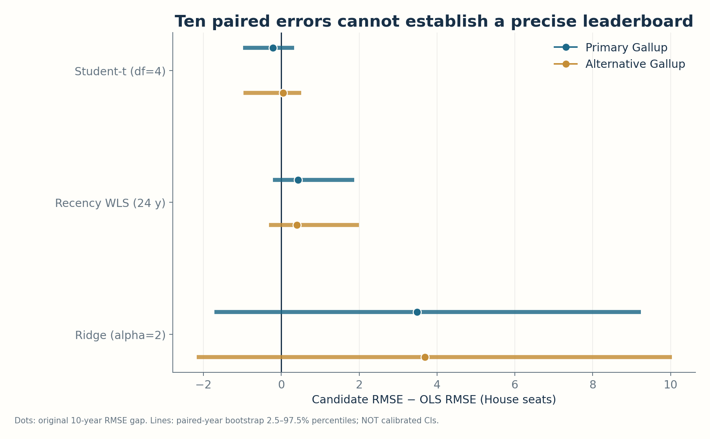

*Figure 13. Dots are the exact original ten-election RMSE differences; horizontal lines show the 2.5th–97.5th percentiles across fixed-seed paired-year resamples. Negative values favor the candidate estimator. The intervals are **descriptive resampling ranges**, not calibrated 95% confidence intervals for future forecasting performance. They straddle zero for each candidate under both Gallup source choices.*

It is tempting to label those percentile ranges “95% confidence intervals” and infer that the models are statistically tied because each includes zero. That would be too strong. An ordinary pairs bootstrap often relies on treating the observed sampling units as approximately exchangeable. Here election regimes can change, and successive expanding-origin forecasts share most of their training data. Consequently their errors, and particularly the differences between candidate methods, need not be independent or identically distributed. A block bootstrap would introduce its own difficult block-length and stationarity assumptions with only ten cycles. Nothing about drawing 20,000 resamples creates twenty thousand independent American elections. More Monte Carlo draws make the distribution conditional on the observed ten rows numerically smoother; they cannot repair the underlying shortage of independent historical evidence [16].

The ranges are therefore **sensitivity envelopes under one transparent resampling scheme**, not probability statements about which method will forecast the next election best. As a separate descriptive number, Student-t's primary-series resamples have lower RMSE than OLS in about **77%** of the draws, compared with approximately **42%** under the alternative Gallup source. Neither percentage is a posterior model probability, a frequentist confidence level, or an estimate of the chance that Student-t will beat OLS in November 2026. The inputs and loss geometry—not new election information—produce these proportions.

There is also a useful explanation for ridge's wide bootstrap range. Although ridge loses in the full ten-election comparison and remains worse when any **single** election is omitted, its squared error is considerably smaller than OLS's in the difficult 2006 midterm. Some resamples repeat that favorable case and omit several years where ridge is substantially worse, producing a negative RMSE difference. This is not a contradiction. An omission diagnostic and a resample-with-replacement diagnostic probe different perturbations. The first changes one row at a time; the second can heavily reweight an unusual row. Neither should be elevated into a definitive test of population-level predictive superiority.

The source variants should also never be pooled as though they supplied twenty independent errors. They are two measurements of **the same ten election histories**, not two electoral universes. Their disagreement is valuable because it exposes sensitivity to published data definitions, but it does not double the historical sample size. Similarly, the conditional 2026 point forecasts in the previous section remain unchanged and untested against a future outcome. The present exercise studies the uncertainty of a retrospective model comparison, **not** the probability distribution of the 2026 House result.

The practical conclusion is consistent across the diagnostics. The two-predictor OLS model remains an interpretable and defensible reference. The heavy-tailed Student-t alternative is worth tracking because it reacts differently to influential histories, but a roughly two-tenths-seat historical RMSE edge does not select a winner. Ridge and recency weighting explore reasonable alternative assumptions without improving the observed full-sample forward score. An honest report keeps all candidates and both source definitions visible, records the common loss function, and presents individual-year contributions alongside summary statistics. The [paired squared-loss table](results/paired_loss_differences.csv), [comparison and resampling summary](results/paired_model_comparisons.csv), [one-year-omission results](results/paired_leave_one_year_out.csv), and [machine-readable run specification](results/paired_uncertainty_summary.json) make these conclusions fully reproducible. A genuinely stronger selection claim would require **new prospective elections**, a precommitted evaluation protocol, and comparable forecast information sets; no mathematical trick can manufacture that evidence from ten old midterms.

## Why the correlation–causation objection was misplaced here

The distinction that initiated this investigation deserves a direct answer. There is no requirement that a predictor cause the target for it to be useful. The final generic ballot is not a randomized treatment; it is a contemporaneous aggregate measurement of expressed voter preference. Its success as a predictor is entirely compatible with its being a proxy for a large set of political and social processes. It can absorb information about presidential popularity, perceived economic conditions, candidate quality, ideological polarization, campaign effects and other circumstances without identifying the individual effects of those processes. If the task is forecasting the next aggregate election from information currently available, the test is whether the relationship generalizes and how well the uncertainty is calibrated.

The converse caution matters as much. A model can forecast well under one environment and fail when its inputs are changed by an intervention, even if those changes look numerically similar to naturally occurring variation. A party might move the generic ballot by changing which people answer polls, without moving votes. A new district map could alter seat conversion without moving the national vote. The model's counterfactual prediction under a forced input change would still be mathematically defined, but the political intervention might invalidate the observational relationship. Predictive and causal questions are related, not interchangeable. Rejecting causal language does not reject prediction; accepting prediction does not authorize causal language.

The empirical political-science literature offers a useful reminder that the generic ballot has its own dynamics. Bafumi, Erikson and Wlezien study the tendency for midterm public preferences to move toward the party outside the presidency as campaigns progress, and they consider theoretical explanations for that regularity [13]. Their research concerns how electoral preferences evolve and how they relate to midterm outcomes. It does not transform the coefficients of this two-predictor national regression into causal effects, but it provides independent scholarly context for why the ballot can be predictive. Historical regularities are valuable when used carefully; theories of political behavior can help explain when a regularity might be expected to persist or fail.

It is also possible for the predictive objective to be successful even when several causal stories remain observationally equivalent. Suppose economic dissatisfaction influences the generic ballot and the seat outcome. A regression based on the poll can still predict the outcome well without estimating the independent causal effect of dissatisfaction. Suppose the number of defended seats reflects previous electoral success and the exposure of marginal districts. It can still be informative without being a variable a campaign can simply set by policy. The question for prediction is whether the joint historical relationship travels. The question for causal inference is what changes when a defined intervention alters one component of the system. A good article should be able to say both things without contradiction.

The social-media comment was therefore right in its limited context: causality is not the central test of a descriptive election forecast. But I would replace “it doesn't really matter” with a more exact proposition. **Causal identification is not required to evaluate this conditional forecast; prospective accuracy and uncertainty calibration are.** That statement keeps the intellectual benefit of the comment while avoiding the implication that causal interpretation never matters in applications of the model. It also corrects my original impulse to attack the wrong mathematical question.

## What remains uncertain before 3 November

The largest omission is not a calculation we forgot to perform. It is information no historical dataset can fully supply: the realization of a future election under its own political and institutional conditions. The model is evaluated on eighteen historical midterms with a mixture of Gallup and RCP polling measurements. Its coefficients are not estimated from twenty-first-century districts alone; they borrow stability across a long and changing political era. That borrowing is sensible if the broad relationship between national partisan preference, exposure and seat change persists. It can be dangerous if there is a break in the vote-to-seat relationship or a systematic polling error unlike the historical observations.

The final generic ballot is itself measured with error. Pollsters may disagree, a mean may carry persistent partisan bias, and turnout differences can separate reported preferences from votes cast. A regression that takes the published poll margin as known without uncertainty conditions on a potentially noisy measurement. The conditional Student-t interval accounts for variability in seat changes around the regression **given the supplied polling value**. It does not explicitly propagate a probability distribution over possible latent true generic-ballot margins or over last-minute changes between the poll and the election. A more comprehensive probabilistic forecast would jointly model those sources of uncertainty, ideally informed by pollster history and by geographically resolved voting information.

Forecast validation itself has uncertainty. Ten forward-evaluated elections provide ten forecast errors, not ten thousand independent experimental replications. A point difference in RMSE between two candidate methods would be difficult to regard as decisive at this sample size, especially if one method had been selected after looking at the results. The comparison in this article is not marginal: the full model materially outperforms both the simple historical mean and a more relevant generic-ballot-only regression. Nevertheless, reduced regressions are not the strongest imaginable electoral forecasts, and the benchmark expansion was performed after inspecting the historical results. These findings are evidence for incremental predictive value within the specified model family, not a claim of best-in-class forecasting performance. Comparative forecast evaluation should use common targets, dates and error metrics, a principle emphasized in the forecasting methodology literature [14].

The missing 1986 ballot and conflicting Gallup retrospective figures should remain visible in any subsequent audit. They affect the exact reconstruction of the headline coefficient of determination. The unusually influential 2006 election should also remain in the dataset; deleting an inconvenient outcome merely to improve historical fit would undermine the exercise. The sample is too small for confident estimation of complex structural shifts from the same eighteen rows. Each limitation points toward a tractable future improvement: obtain the original 1986 source if available, document poll-sample definitions more comprehensively, compare with district-level probabilistic forecasts, and record truly prospective evaluation before the next election outcome is known.

After election day, the next step should be mechanical rather than rhetorical. Freeze this article and its source snapshot. Obtain the official post-election president-party House seat change from a consistent source. Record the difference between that outcome and the **pre-registered −32.32** forecast, along with whether it falls inside the fixed intervals. Then compare the model to historical baselines and other forecasts made at a similar time using the same available information. If the election lies near the model point, that is one successful prospective prediction, not proof that the model is structurally correct. If it lies outside the interval, that is a useful failure to diagnose, not an invitation to alter the original forecast retroactively. Genuine forecast evaluation requires preserving the before-and-after boundary.

## What the experiment actually establishes

The reconstructed equation is simple: two predictors, eighteen usable historical midterms, and three estimated regression coefficients. It accounts for approximately 89.3% of the **in-sample variance** in historical seat changes. Its leave-one-election-out performance retains an \(R^2\) around 0.85 and an error of about eight seats. In the more demanding expanding-origin experiment, the model achieves an RMSE of about 8.7 seats on ten later elections, compared with 20.1 seats for the ballot-only regression and 23.8 for the historical-mean rule on those same elections. The 2026 inputs cited in Rattner's presentation lead to an independent conditional expectation of roughly 32 Republican seats lost, very close to his 33-seat estimate.

Those are meaningful results. They do not justify dismissing the original graphic simply because a correlation is not causal. The model accomplishes an intelligible predictive task and, in this audit, survives useful historical holdout tests. The central methodological improvement is to describe what its point estimate leaves uncertain. A conventional, assumption-dependent 95% prediction interval extends from roughly 16 to 48 Republican seats lost. A small-sample bootstrap sensitivity produces a different range. Historical polling definitions are not perfectly consistent. The 1986 generic ballot is unavailable from the cited Gallup retrospective, and its treatment in the original chart remains undocumented. These facts reduce claims of **exact replication** and **precise uncertainty**, not the evidence that a strong historical predictive relationship exists.

A scientific explanation should not be allowed to retreat into skepticism whenever a simple model works. Equally, a useful model should not be promoted into certainty because it can be summarized with one attractive decimal. The right discipline is to keep four layers separate: the model fitted to its training sample, the model evaluated on unobserved historical targets, the forecast made with currently observed inputs, and the future election outcome. The first layer gives us \(R^2\). The second gives us evidence about forecasting behavior. The third requires uncertainty and clearly stated conditions. The fourth will arrive only after the votes are counted.

The most important conclusion is therefore neither “the chart is proof” nor “the chart is meaningless.” It is that **the chart is a promising compressed forecast, and a defensible forecast should travel with its errors, assumptions and provenance**. In political analysis as in industrial forecasting, healthcare, economics and data science, a good fit is the beginning of a research question. It is not the end of one.

The expanded estimator and paired-error diagnostics reinforce that conclusion. Robustness of the *general two-predictor relationship* is not the same as certainty about the *best fitting procedure*. There is no sound reason to overwrite the pre-election OLS forecast with the Student-t estimate merely because its retrospective RMSE is smaller by 0.21 seats under one historical source transcription. The original point forecast, its conditional interval, and the competing diagnostic results should remain frozen together so that future evidence can genuinely test them.

---

## Reproducibility and references

The complete [reproducibility companion](README.md) provides the historical CSV with source keys, original public data links, typed NumPy/SciPy implementation, **thirteen** independent Matplotlib figures, an executable Jupyter notebook, numerical output tables, tests, and a path-scoped GitHub Actions workflow. The analysis uses a frozen pre-election 2026 scenario and fixed seeds for the separate forecast and model-comparison bootstrap procedures, with no post-election observations. It is independently reproducible without live API credentials or proprietary data.

The source classes are distinguished throughout: election and poll records are **historical observations and published measurements**; regression estimates, cross-validation errors and intervals are **derived statistics**; source swaps and 2026 input grids are **sensitivity scenarios**, not additional observed elections. The bootstrap draws are **resampling computations**, not simulated realizations with known electoral data-generating truth. No causal interpretation of the regression coefficients is claimed.

1. Rattner, S. (2026, 30 October). “The Trump Economy and Midterm Projections.” *Steve Rattner on Morning Joe.* [Original presentation and accompanying description](https://stevenrattner.com/2026/10/the-trump-economy-and-midterm-projections-steve-rattner-on-morning-joe/). Original claim: historical \(R^2\) approximately 0.89, D+8, 220 seats defended, predicted change approximately −33.
2. Office of the Historian, U.S. House of Representatives. “Party Divisions of the House of Representatives, 1789 to Present.” [Official historical series](https://history.house.gov/Institution/Party-Divisions/Party-Divisions/). Underlying party-division reference used by the American Presidency Project.
3. The American Presidency Project, University of California, Santa Barbara. “Seats in Congress Gained/Lost by the President's Party in Mid-Term Elections.” [Historical midterm table](https://www.presidency.ucsb.edu/statistics/data/seats-congress-gainedlost-the-presidents-party-mid-term-elections). Source of historical seat changes and seats defended; the 2026 scenario comes separately from Rattner [1].
4. Gallup (2002, 25 September). “Democrats Enjoy Slight Lead in Race for Control of Congress.” [Original retrospective generic-ballot table](https://news.gallup.com/poll/6877/democrats-enjoy-slight-lead-race-control-congress.aspx). Provides 1950–1998 Democratic two-party estimates and explicitly notes no generic-ballot observation for 1986.
5. Gallup (2004, November). “Control of U.S. House Looks Too Close to Call.” [Original Republican-share retrospective table](https://news.gallup.com/poll/13879/control-us-house-looks-too-close-call.aspx). Supplies the 2002 final Republican two-party estimate and an alternative historical retrospective for the discrepancy analysis.
6. RealClearPolitics. “2006 Generic Congressional Vote.” [Final RCP polling average](https://www.realclearpolitics.com/epolls/other/2006_generic_congressional_vote-2174.html). D+11.5, not the actual vote margin.
7. RealClearPolitics. “2010 Generic Congressional Vote.” [Final RCP polling average](https://www.realclearpolitics.com/epolls/other/2010_generic_congressional_vote-2171.html). R+9.4.
8. RealClearPolitics. “2014 Generic Congressional Vote.” [Final RCP polling average](https://www.realclearpolitics.com/epolls/other/generic_congressional_vote-2170.html). R+2.4.
9. RealClearPolitics. “2018 Generic Congressional Vote.” [Final RCP polling average](https://www.realclearpolitics.com/epolls/other/2018_generic_congressional_vote-6185.html). D+7.3.
10. RealClearPolitics. “2022 Generic Congressional Vote.” [Final RCP polling average](https://www1.realclearpolitics.com/epolls/other/2022-generic-congressional-vote-7361.html). R+2.5.
11. Stone, M. (1974). “Cross-Validatory Choice and Assessment of Statistical Predictions.” *Journal of the Royal Statistical Society: Series B*, **36**(2), 111–133. [DOI: 10.1111/j.2517-6161.1974.tb00994.x](https://doi.org/10.1111/j.2517-6161.1974.tb00994.x).
12. Efron, B. (1983). “Estimating the Error Rate of a Prediction Rule: Improvement on Cross-Validation.” *Journal of the American Statistical Association*, **78**(382), 316–331. [DOI: 10.1080/01621459.1983.10477973](https://doi.org/10.1080/01621459.1983.10477973).
13. Bafumi, J., Erikson, R. S., & Wlezien, C. (2010). “Balancing, Generic Polls and Midterm Congressional Elections.” *The Journal of Politics*, **72**(3), 705–719. [DOI: 10.1017/S0022381610000113](https://doi.org/10.1017/S0022381610000113). Primary research on midterm generic-ballot dynamics and the party balance hypothesis.
14. Hyndman, R. J., & Koehler, A. B. (2006). “Another Look at Measures of Forecast Accuracy.” *International Journal of Forecasting*, **22**(4), 679–688. [DOI: 10.1016/j.ijforecast.2006.03.001](https://doi.org/10.1016/j.ijforecast.2006.03.001). On careful selection and interpretation of predictive error measures.
15. King, G., and collaborators (2026). “ElectIt: Forecasts for All U.S. House and Senate Seats in the 11/3/2026 Election.” [Harvard project and published methodology](https://gking.harvard.edu/electit/). Distinct district-level modeling approach with one-election-ahead validation and multiple forecast information sets.
16. Efron, B., & Gong, G. (1983). “A Leisurely Look at the Bootstrap, the Jackknife, and Cross-Validation.” *The American Statistician*, **37**(1), 36–48. [DOI: 10.1080/00031305.1983.10483087](https://doi.org/10.1080/00031305.1983.10483087). Foundational methodological discussion of resampling variability.
17. Lange, K. L., Little, R. J. A., & Taylor, J. M. G. (1989). “Robust Statistical Modeling Using the t Distribution.” *Journal of the American Statistical Association*, **84**(408), 881–896. [DOI: 10.1080/01621459.1989.10478852](https://doi.org/10.1080/01621459.1989.10478852). Heavy-tailed likelihood and robust regression.
18. Hoerl, A. E., & Kennard, R. W. (1970). “Ridge Regression: Biased Estimation for Nonorthogonal Problems.” *Technometrics*, **12**(1), 55–67. [DOI: 10.1080/00401706.1970.10488634](https://doi.org/10.1080/00401706.1970.10488634). Shrinkage estimation for linear regression.
19. Diebold, F. X., & Mariano, R. S. (1995). “Comparing Predictive Accuracy.” *Journal of Business & Economic Statistics*, **13**(3), 253–263. [DOI: 10.1080/07350015.1995.10524599](https://doi.org/10.1080/07350015.1995.10524599). Primary methodological work on comparisons of predictive loss across common forecast targets.

### Registration addendum — 1 November 2026, before election day

The preceding analysis retains its **31 October 2026 information cut-off**. On **1 November 2026**, before the scheduled 3 November federal general election, I created a separate [pre-election registration and scoring protocol](PRE_ELECTION_REGISTRATION.md) and its [content-addressed forecast lock](results/forecast_lock.json). The registration preserves the **−32.322888** OLS conditional point estimate, its original **[−48.4284, −16.2174]** model-based 95% interval, the D+8/220-seat inputs, all previously compared alternative point forecasts, and SHA-256 fingerprints of the source snapshot. The dates are deliberately distinct: a registration written on 1 November cannot truthfully be described as a document deposited on 31 October, nor were the regression specifications chosen blind to past historical election outcomes.

For a later audit, [the scoring implementation](score_after_election.py) is prepared to compare those unchanged predictions with a **final** House Historian-aligned result, once such a result exists. It refuses to score before election day, requires a named official source and an explicit final-result confirmation, and writes the observed result to a **new report**, never to the frozen data or forecast. As of this addendum, no 2026 seat-change outcome is known, supplied or used. One future observation will be informative about this registered prediction, but it will not by itself establish the long-run calibration or causal correctness of any model.

*Editorial status: final pre-election manuscript, prepared for Medium publication on 1 November 2026. No 2026 election outcome is known or used in this manuscript. A separate post-election evaluation is optional future work, not a prerequisite for publishing this study.*
