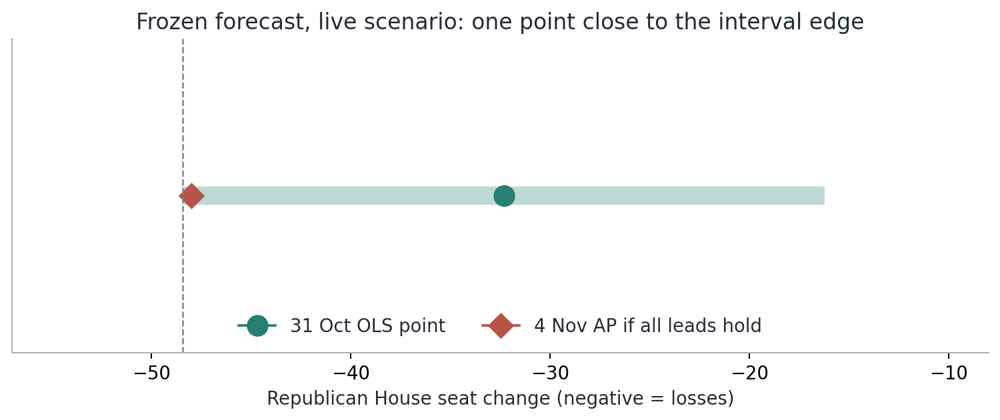
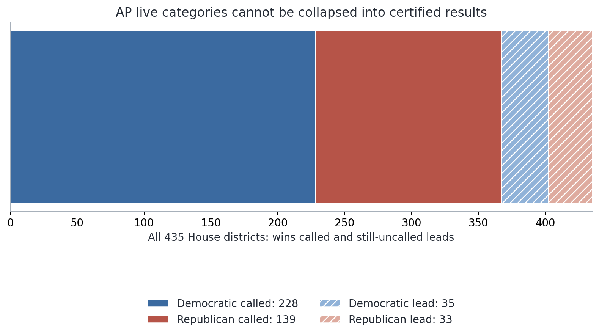
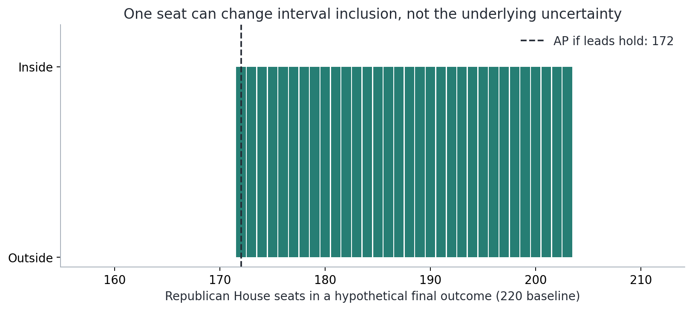
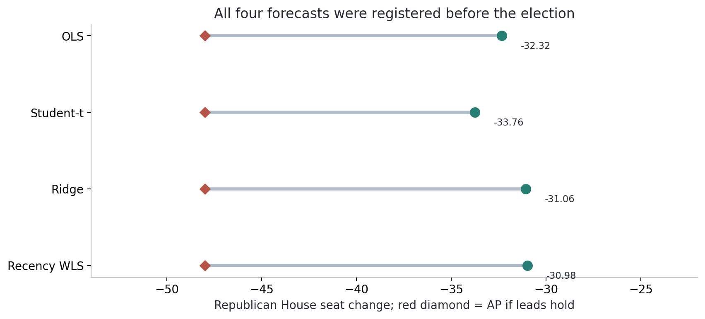
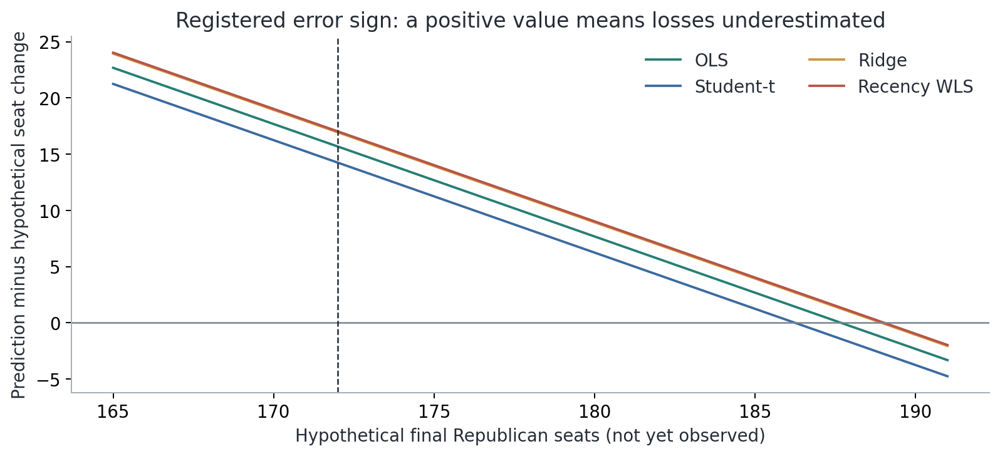
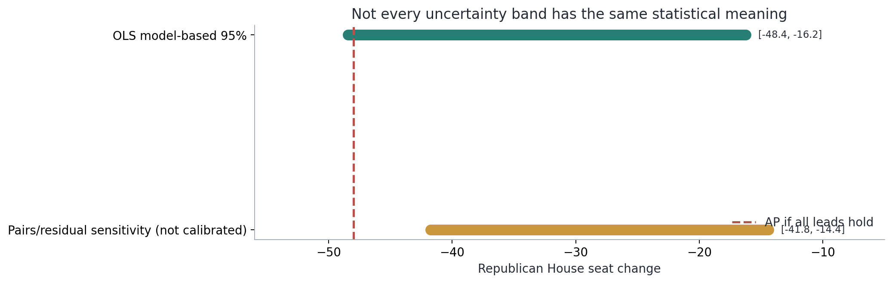
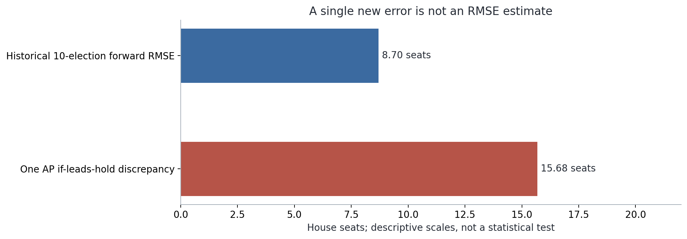
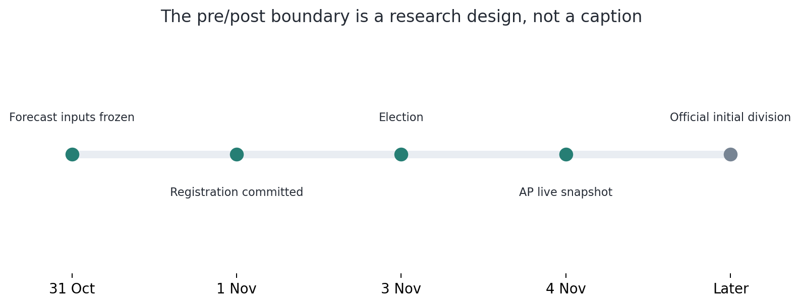

# The Votes Are In: Testing an 89% Midterm Model Against the 2026 Election

*Diogo Ribeiro — Research draft, 4 November 2026. Not yet a final election score.*

**Reader's note.** This essay compares a published, frozen forecast for the
3 November 2026 U.S. House election with an Associated Press live-results
snapshot retrieved on 4 November at 10:51:54 UTC. AP had called a Democratic
majority, but 68 House races remained uncalled in that snapshot. Every
statement involving 172 Republican seats, a 48-seat Republican loss, or
errors against that outcome is **conditional on all candidates then leading
eventually winning**. Those are not certified election results. Our
pre-election registration explicitly requires the initial-election
party-division series published by the House Historian or American Presidency
Project for the definitive score. We will append a separately dated final
analysis when that standard is met. The original forecast, its inputs and
intervals will not be revised.

## An unusually clear moment for a forecasting model

On 31 October, three days before Americans voted in their 2026 midterm
elections, I published a statistical reconstruction of a model that had drawn
attention for its striking historical fit. Steve Rattner had presented a
simple regression connecting the national generic congressional ballot, the
number of House seats held by the president's party, and that party's
subsequent seat change. The historical scatterplot had a reported coefficient
of determination near 0.89. With Democrats eight percentage points ahead on
the generic ballot and Republicans defending 220 House seats, the headline
projection was a Republican loss of about 33 seats.

The point of my article, [*The Forecast Is Not the Fit: Rebuilding an 89%
Midterm Election Model*](https://diogo-ribeiro-1975.medium.com/the-forecast-is-not-the-fit-rebuilding-an-89-midterm-election-model-8fb36cc269be),
was not to declare that a short regression must be useless. It was to ask
what the chart could actually support. I reconstructed the historical design,
documented conflicting polling sources, examined the role of influential
elections, tested predictions outside their training samples, and calculated
uncertainty intervals. The central estimate survived that scrutiny rather
well. The resulting model explained about 89.3% of historical in-sample
variation and achieved a forward-testing root mean squared error of about
8.7 House seats on ten later midterm elections, substantially better than
a generic-ballot-only model evaluated on exactly those same elections.

Those results mattered, but they did not settle the most important question.
A model tested retrospectively on earlier elections is not identical to a
model facing the next one. Its coefficients, explanatory variables and
residual distribution may have been shaped by circumstances that change.
The 2026 election was the first truly prospective observation for the
reconstruction published on 31 October. Whatever happened next would be
informative, but it would not be another opportunity to move the goalposts.

Now we have the first live returns. Democrats have already been called the
winners of enough House seats to hold a majority. The latest AP aggregate
available to this analysis shows substantially larger Republican losses than
the original conditional point forecast if the current district leads are
ultimately sustained. The interesting scientific finding is not simply that
the model may have missed by roughly sixteen seats. It is that the apparent
outcome sits almost exactly at the outer edge of the interval that we
registered before the election. A single seat separates an interval hit from
an interval miss under the integer-valued House outcome.

There is a temptation, here, to begin the story with that dramatic boundary
and end it there. I think that would repeat the very mistake the first
article challenged. In a small historical sample, a point forecast, a
nominal prediction interval, a partial election return and an official
final outcome do not carry the same inferential meaning. The more
consequential the election, the greater our obligation to keep those objects
distinct. We can be direct about the results without mistaking provisional
arithmetic for final statistical evidence.

This article therefore begins by reconstructing exactly what was known
before the vote, continues with what the AP had actually called and what
remained unsettled, and then examines the consequences of several possible
final seat counts. No model is re-estimated. The analysis of the election's
possible political causes is kept separate from the statistical question of
whether a particular conditional forecast was accurate. Above all, the
historical source definition used to fit the model remains the source
definition that must ultimately be used to score it.

## 1. What, precisely, was locked before election day?

Dates and versions are not administrative decoration in a forecasting
study. They form part of the research design. A forecast said to have been
made before an event has evidential value only if its inputs and
specification can be distinguished from changes made after the event. With
election data, this is especially important because both the data and the
interpretation evolve rapidly during the hours after polling closes. An
analyst who changes the baseline, substitutes an updated polling average, or
silently chooses the best-looking estimator after the result is known has
created a different exercise.

The original information cutoff was 31 October 2026. We recorded a separate
pre-election registration on 1 November, preserving the numerical forecasts,
source files, evaluation definitions and normalized SHA-256 fingerprints of
the model inputs. Those are two different dates. The publication used
information available on 31 October; the registration was prepared the next
day, still before the 3 November election. It would be misleading to present
the 1 November record as if it were independently timestamped in October.
The Git record supports inspection of the archived version, but it is not
the equivalent of third-party cryptographic notarization.

The registered target was the change in Republican House seats because
Republicans were the president's party in the 2026 midterm election. The
target was not the Democratic share of votes, the probability of Republican
control, a Senate seat change, or a prediction of individual district
winners. The locked hypothetical inputs were a Democratic generic-ballot
lead of eight percentage points, oriented as a Republican margin of minus
eight, and 220 Republican seats defended. The distinction between a
conditional input and an observed 2026 outcome remains fundamental. Neither
the election-night polling averages nor a different membership baseline may
be substituted retroactively and still be called the original forecast.

The primary estimator was ordinary least squares with an intercept, a
president-party-oriented generic-ballot margin and the number of defended
seats. Eighteen historical midterms from 1950 through 2022 supported the
reconstruction; 1986 was excluded because the required generic-ballot input
could not be sourced consistently. The fitted in-sample coefficient of
determination was 0.8934476847, and the expanding-origin forward RMSE on
ten later elections was 8.6958000728 seats. The forecast was not assigned
an 89% probability of correctness, and its 0.89 fit statistic was never a
probability of a Democratic majority.

The central 2026 prediction was minus 32.3228880263 Republican seats. The
conventional model-based 95% prediction interval ran from minus
48.4283865506 to minus 16.2173895020 seats. A separate pairs/residual
bootstrap sensitivity calculation produced endpoints at minus 41.7517081113
and minus 14.3739743229, but it was not registered as a second calibrated
prediction interval. Those two bands must not be confused simply because
both are displayed with a 95% label. One is the classical conditional
predictive calculation under its stated model assumptions; the other is a
resampling sensitivity diagnostic with weaker coverage claims.

Three alternative point estimators were also registered, without giving
them newly inferred prospective intervals. A fixed-degree-of-freedom
Student-t regression predicted minus 33.7575488232 seats. A ridge
regression with its predetermined penalty predicted minus 31.0607912265.
A recency-weighted least squares regression using a fixed 24-year half-life
predicted minus 30.9759726581. They were not selected after seeing the
2026 result. Their historical forward errors were examined in the original
study, where the small apparent advantage of Student-t over OLS depended
on which published Gallup retrospective series was used and on an
influential election in the ten-election test set.

The recorded forecasts are available in
[`results/forecast_lock.json`](../results/forecast_lock.json) and the
[registration report](../PRE_ELECTION_REGISTRATION.md). The source commit
was `fe98742efb86756fc30967477098482eb7505783`. The locked scoring rule
sets signed error equal to forecast minus final observed seat change, with
absolute error equal to its magnitude. It requires the final House
Historian-aligned initial-election party division, an exact source URL and
retrieval date, and a separate output file. A later election result must not
be appended to the pre-election historical dataset or inserted into the
forecast manifest. The research question is stronger because the boundary
is explicit: the 2026 data cannot teach the original model how to predict
2026.

*Figure 1. The frozen OLS point and model-based prediction interval are
compared with the 4 November AP scenario in which all then-current leads
hold. The diamond is not a certified observation; the small gap between it
and the lower interval endpoint is central to the subsequent analysis.*

## 2. A result is not a lead, and a lead is not a final result

Election night has a language that can be misleading when imported into a
statistical paper. Networks and news agencies call races once they determine
that a remaining-vote path to reversal is sufficiently implausible under
their decision procedures. Other races display a candidate leading in the
votes counted so far. A lead can narrow, widen or reverse. Neither kind of
live election feed should automatically be treated as the certified
historical party-division series used in a research dataset. Publication
and legal certification happen on different schedules, and district-level
recounts, late mail votes and election rules can matter.

The archived AP snapshot in this analysis has a precise timestamp:
10:51:02 UTC on 4 November 2026, retrieved at 10:51:54 UTC. At that instant,
AP had called 228 House races for Democrats and 139 for Republicans.
Democratic candidates led in another 35 uncalled races, while Republican
candidates led in another 33. Those figures reconcile to all 435 seats:
228 plus 139 equals 367 called races, and 35 plus 33 equals 68 still
uncalled races. The source file explicitly marks the result as live and
unofficial and leaves the final Republican seat-change target null.

The Democratic majority itself is secure on these called-seat numbers.
A 435-member House requires 218 seats for a majority, and AP had already
called 228 Democratic victories. Even if every one of the remaining
68 races had eventually been won by Republicans, the majority would not
change. This is a logically stronger statement than claiming an exact
final House composition from early returns. It tells us who will control
the chamber under the calls available; it does not yet provide the final
dependent variable needed for a seat-change regression.

If all leaders in the uncalled races become winners, Democrats would finish
with 263 seats and Republicans with 172. This is simple scenario arithmetic:
228 plus 35 and 139 plus 33. It is useful to describe the direction and
potential size of the election, but it is not a probability forecast.
Those leads need not be equally secure; a candidate leading in a district
with nearly all votes counted is not interchangeable with one leading a
district where many mail ballots remain outstanding. Our archived data
contain only national counts in each AP category. They do not support
district-specific odds, vote-margin distributions, or a national
probability that every current lead will hold.

There are useful bounds even without those probabilities. Given 139
Republican called wins and 68 uncalled districts, the Republican final
total, if the existing calls remain valid, cannot be lower than 139 or
higher than 207. The range is deliberately broad because it does not
pretend to know the vote distributions in those districts. The
172-seat figure lies within it, but is a *trend conditional on current
leaders*, not a new estimate derived from a statistical election
forecasting model. Calling it the observed GOP total would improperly
compress two distinct categories of evidence.

The AP also reported a sweeping Democratic performance in Senate and
gubernatorial races, including several Republican-held seats and offices
switching parties. That political context helps explain why the House
returns attracted attention, but it does not enter our registered response
variable. A House seat-change model cannot be credited with correctly
forecasting the Senate because the Senate was not its target. Equally, a
political story about a national shift does not directly supply the
uncertainty distribution of the House regression. Broad political
interpretation and precise model evaluation are complementary activities
only when their evidential boundaries are clear.

*Figure 2. The AP aggregate at 10:51:02 UTC: solid segments represent
called Democratic and Republican seats; hatched segments represent the
uncalled races in which each party led. The graphic is a composition of a
live results feed, not a final certified party division.*

## 3. The seat-change baseline is not a minor detail

The registered model predicts a *change*, not a total. Converting its
forecast to a future House composition necessarily requires the baseline
from which the change is measured. The original scenario used 220 seats
defended. On that input, minus 32.322888 seats corresponds to approximately
187.677 Republican seats, usually described as about 188. This conversion
is mathematically correct under the conditional scenario. But it does not
establish that the live AP current-membership display uses the same
definition. The [House Historian's initial-election record](https://history.house.gov/Institution/Party-Divisions/Party-Divisions/)
for the 119th Congress does list 220 Republicans and 215 Democrats, and the
[American Presidency Project's 2026 row](https://www.presidency.ucsb.edu/statistics/data/seats-congress-gainedlost-the-presidents-party-mid-term-elections)
likewise lists 220 Republican seats defended. That supports the registered
baseline under the stated historical source convention. It does not supply
the still-missing initial-election division of the 120th Congress.

Vacancies, special elections, minor-party affiliations, resignations,
district changes and the difference between initial election results and
subsequent membership make this important. A media dashboard may report
the current sitting representatives on election day; a historical table
may report the party division determined by the original election results
for a Congress. The model uses the latter historical series for labels.
Mixing the historical definition with current chamber membership would
introduce a measurement change precisely where we claim to be conducting
an out-of-sample test.

For now, it is legitimate to calculate a transparent *conditional*
illustration from the original 220-seat assumption. If the AP's 172-seat
trend were the eventual GOP initial-election total, then the change from
that registered baseline would be minus 48. The calculation is
straightforward: 172 minus 220. It is equally important to say what the
calculation is not. It is not the signed official House Historian seat
change, which is not supplied in the snapshot. It is not a revised estimate
of the generic-ballot margin. And it is not a declaration that all remaining
counts have concluded.

Suppose the eventual House Historian-aligned result used a different
starting count from the model's recorded 220-seat input. Then researchers
would face a definition problem, not a license to silently substitute a
more favorable number. The appropriate response would be to document the
two baselines and reconcile them openly, with the registered protocol
governing how the forecast is scored. If the discrepancy changes the
interpretation of the model, that discrepancy belongs in the results
section. It does not belong hidden in a spreadsheet transformation.

The broader lesson is simple: when a prediction is expressed as a
difference, the origin of that difference is part of its meaning. A
temperature change without a reference time, a revenue growth rate without
the reporting population, or a stock return without a consistent price
series can appear precise while failing the basic requirement of comparable
measurement. Election seats are integers, but integer precision cannot
repair a mismatch between the entities counted. Our final report must
therefore identify the House Historian or American Presidency Project
source, the initial-election party-division convention, the official
Republican result and the baseline used for the midterm net change.

## 4. The one-seat boundary: a useful fact with a dangerous interpretation

If every AP lead holds and the initial-election series eventually supports
the same 172-seat total under the registered baseline, the Republican loss
would be 48 seats. The frozen OLS 95% model-based prediction interval runs
from a loss of 48.4283865506 seats to a loss of 16.2173895020 seats.
The conditional minus-48 scenario is therefore inside the numerical
interval, but only by 0.4283865506 seats at the lower end. A minus-49
outcome would lie outside. The fractional interval endpoints come from a
continuous Gaussian approximation to an integer-valued target, so the
relevant threshold can be stated exactly for valid integer seat totals.

Adding the registered 220-seat baseline to the interval endpoints gives
the corresponding continuous range of total Republican seats:
approximately 171.5716 to 203.7826. Only integers can be actual seat
counts. Consequently, outcomes of 172, 173, and so on through 203 GOP seats
are classified as inside this interval. A result of 171 seats would
correspond to minus 49, outside the lower endpoint. A result of 204 seats
would correspond to minus 16, outside the upper endpoint. The fact that
the first boundary is relevant to this election does not make the second
boundary any less part of the registered statistical procedure.

This is a valuable illustration of the difference between a continuous
forecast distribution and the discrete measurement actually used to judge
it. The exact endpoints are generated from the original t-based model;
we have not rounded them to make 172 appear inside. The code computes
the allowed integer range using a ceiling for the lower total and a floor
for the upper total. The result is not open to post-election adjustment.
Changing the number of decimals displayed in a plot has no effect on the
underlying classification when the unrounded bounds are used.

Yet a nominal prediction interval should not be converted into a binary
certificate of model quality. The distance of 0.43 seats is not a voting
margin in any particular district. It is not the amount by which the model
is politically right, and it is not a direct probability of a recount
changing the interval score. It measures separation on the model's seat
scale between a particular conditional outcome and a model-based boundary.
If the final total changed by one seat, the interval-hit indicator could
change while the size of the statistical discrepancy changed very little.

This is familiar to anyone who has worked with thresholded scientific
decisions. A p-value of 0.049 and a p-value of 0.051 can receive different
labels under a mechanical significance rule, even when the associated
evidence is nearly identical. A fraud alert just above a classification
threshold can be treated differently from one just below it, even though
their estimated risks are close. A process-control rule can change state
on a small variation around a limit. The binary decision may be useful
for a predefined evaluation, but the continuous distance still matters
for interpretation. Here, the exact interval-hit result must be recorded
when final data exist, while the associated forecast error and source
uncertainty must be discussed separately.

*Figure 3. Under the pre-election baseline of 220 GOP seats, integers
172–203 fall within the frozen OLS 95% model-based interval. A 171-seat
outcome is outside. The dashed line marks the provisional AP if-leads-hold
scenario, not a final result. The display is an interval-classification
diagram, not a probability distribution over House totals.*

## 5. How large would the point error actually be?

The direction of a signed forecast error depends on a convention. Our
pre-election registration explicitly chose predicted change minus observed
change, so we will use that same convention in all later calculations.
Because Republican losses are represented by negative numbers, a positive
error means the model predicted a less severe loss than the outcome.
Using the conditional minus-48 scenario, the OLS difference is
minus 32.322888 minus minus 48, or positive 15.677112 seats. Its
absolute magnitude is about 15.68. The sign should not be casually
reversed to match the intuitive statement that Republicans lost more
than predicted. In words, the model would have *underestimated the loss*;
in the registered arithmetic, its signed forecast-minus-outcome error
would be positive.

For the other three registered point forecasts, the same hypothetical
calculation yields positive discrepancies of approximately 14.24 seats
for Student-t, 16.94 for ridge and 17.02 for recency-weighted regression.
The Student-t candidate would have the smallest absolute discrepancy if
the conditional AP trend became the final source-compatible change. That
does not mean we should promote it to the new preferred model or pretend
it was our main forecast. The original primary prediction was OLS. The
historical data did not robustly establish a clear winner among the
closely related estimators, and one additional election cannot settle
that contest without a fully specified decision framework.

It is possible to compare the provisional 15.68-seat absolute difference
with the original ten-election expanding-origin RMSE of 8.70 seats. Their
units match. The new conditional discrepancy is about 1.8 times that
historical RMSE. This comparison is descriptive, not an estimate of a
tail probability or a standardized Gaussian z-score. RMSE is an average
of squared historical forecast errors across ten heterogeneous elections;
it is not the standard error of a particular 2026 prediction after all
sources of parameter, structural and polling uncertainty have been taken
into account. Calling the comparison a two-sigma event would go well
beyond the evidence.

There is a more subtle reason to resist dramatic language. The original
model was trained with the final generic-ballot measure in past elections,
and the 2026 scenario was tied to Rattner's specified D+8 input. A move in
the polling measure between 30 October and election day can affect how one
interprets the conditional prediction, but it cannot be silently used to
revise the locked answer. A conditional forecast is evaluated as a
forecast conditional on the information it actually used. If the
conditions change before the event, that may diagnose an input-horizon
problem or suggest a separately labeled updated forecast. It does not
change what was forecast under the earlier information set.

The signed-error curve makes the arithmetic especially clear. For any
hypothetical final Republican total between 165 and 191 seats, the
corresponding seat change under the registered baseline is that total
minus 220. Each registered point estimate remains constant. Its signed
difference therefore varies linearly with the assumed final total. We
plot those lines without attaching probabilities to any of the
hypothetical seat totals. The line chart tells the reader how the
score *would* change under different eventual outcomes. It does not
forecast which of those eventual outcomes is most likely.

*Figure 4. The four registered candidate point forecasts all imply losses
of roughly 31–34 seats. The common AP if-leads-hold conditional scenario
is a 48-seat loss under the registered baseline. The red marker is held
fixed to show the discrepancy; selecting a candidate estimator after
seeing it would constitute hindsight model selection.*

*Figure 5. Signed differences are forecast minus hypothetical observed
change. Positive numbers represent losses that would be underestimated
under the given hypothetical final GOP seat count. The 172-seat dashed
line is an AP conditional trend and not an official score.*

## 6. Two uncertainty bands do not make two equally valid intervals

In the original article, I reported two numerical ranges because the
assumptions underlying a single textbook interval deserved scrutiny. The
first range is the classical model-based prediction interval associated
with the OLS fit. It includes uncertainty in the estimated conditional
mean and an additional term representing the random future residual. The
second is a pairs/residual bootstrap sensitivity range, designed to show
how the prediction changes when historical information is resampled
according to a particular algorithm. The two answers are not
interchangeable. Repeating the label 95% in their names does not give
them identical coverage properties.

The standard prediction interval requires a defensible description of
future residual variation. Under the classical linear model, the
forecast error includes both uncertainty in fitted coefficients and the
variation of the future election around the regression mean. It is
therefore wider than a confidence interval for the mean seat change.
The model assumes that a relationship estimated from earlier midterms
remains sufficiently stable for its conditional error distribution to
be useful in 2026. That assumption is substantive. It concerns
political institutions, district maps, party coalitions, voter turnout,
polling methods and the way national conditions translate into seat
outcomes. No numerical calculation can make it true merely by invoking
a familiar t critical value.

The pairs/residual bootstrap asks a different question. It explores
the sensitivity of the fitted result to resampling historical rows and
errors under its chosen procedure. But elections from different decades
are not randomized, exchangeable laboratory replicates. A bootstrap
can reproduce some features of the observed distribution without
reproducing a structural break. It may also fail to account adequately
for polling-input uncertainty or systematic changes in district-level
vote-to-seat conversion. Those limitations were stated before the
outcome. We would not be practicing methodological honesty if we
reclassified the bootstrap band as a valid probability interval now
because it happened to provide a convenient or dramatic comparison.

The provisional minus-48 scenario illustrates the difference. It is
inside the classical interval, because minus 48 exceeds its lower
endpoint at minus 48.4284. It is outside the reported bootstrap
sensitivity band, whose lower endpoint is minus 41.7517. Those are two
different statements about two different procedures. The second
statement is evidence that the fixed resampling exercise represented
a narrower range of scenarios, not evidence that an objectively true
95% probability event failed to occur. The diagnostic deserves a place
in the sequel because it tells us how much the choice of uncertainty
construction can change the narrative around the same forecast.

This also protects us against a tempting selective presentation. An
author who wants to defend the model could show only the classical
interval and say the result was covered. An author who wants to attack
it could show only the bootstrap band and say the model failed. Both
would conceal information registered before the event. An honest
assessment reports both, names their assumptions, and retains the
primary interval selected for formal scoring. If the source-compatible
final outcome differs from the live scenario, the comparison must be
recomputed without changing the definitions.

*Figure 6. The model-based 95% prediction interval and the bootstrap
sensitivity range have different inferential statuses. The conditional
AP trend lies within the former but outside the latter. No probability
distribution for the remaining election returns is implied.*

## 7. Was the original 89% model merely overfitted?

The prospect of a large 2026 point error may encourage readers to
return to the first article's title and assume that the high in-sample
R-squared was always meaningless. That would be too crude. The
original study did not stop at a scatterplot, and its conclusions were
not that the model lacked predictive content. The model was
reconstructed from independently documented historical election data.
The two predictors were simple and interpretable, even though their
coefficients were not causal effects. Its forward-validation procedure
trained only on elections preceding each target year. That chronology
did not make the experiment genuinely prospective in the way 2026 is,
but it did avoid the most elementary form of using the held-out target
row to fit its own coefficient estimates.

Within that historical evaluation, the full two-predictor OLS model
achieved an RMSE of about 8.70 seats over ten targets. A regression
using only the generic ballot produced an RMSE of approximately
20.09 seats on the same targets, and a rule using the earlier
historical mean produced approximately 23.81 seats. The second
predictor, seats defended, was not a cosmetic addition under those
particular comparison rules. The full model improved absolute error
over the generic-ballot-only model in nine of the ten forward
elections. The alternative Gallup retrospective source changed some
numerical values but did not eliminate that broad gap. These are
empirical results, not deductions from the 89% in-sample fit.

There were limitations. Ten held-out elections constitute a small
sample, and some share overlapping training histories. The political
process evolves across decades, while the design treats a compact
relationship as if its structural content can survive. The leave-one-
election-out calculation gave an RMSE of 7.99 seats and an out-of-sample
R-squared around 0.85, but leave-one-out folds can use elections that
occurred *after* the held-out election as training observations. That
is acceptable for some cross-sectional estimation diagnostics; it is
not a historical simulation of what an election forecaster knew at
each earlier date. The expanding-origin experiment is more relevant
to deployment, but still contains only ten test cases.

The 2006 election was a notable difficulty in the original
reconstruction. Its residual was unusually consequential, and its
role changed the ranking of competing estimators in some diagnostics.
That example illustrated why individual elections can influence a
small sample, but we did not delete it to improve the score. A
historically inconvenient observation is an invitation to investigate
model specification, not a reason to erase evidence. The same
principle now applies to 2026. If the outcome is unusually far from
the conditional mean, it must join the prospective evaluation record
as an observed case once measured properly. It cannot be declared
invalid because political events made the original expectation less
comfortable.

The right provisional conclusion is therefore neither that the 89%
fit proves the model nor that a roughly sixteen-seat miss would make
all historical validation irrelevant. The two sets of results answer
different questions. Backtesting provides evidence that a particular
relationship was useful over selected historical forecasting horizons.
The 2026 evaluation, once final, asks how that relationship transported
to one further election under a specifically documented information
cutoff. A model may be useful on average and nevertheless miss an
important individual election. The distinction is central to risk
management, industrial forecasting and healthcare prediction as well
as to electoral analysis. Decisions often turn on individual cases,
while estimates of average model accuracy require repeated evaluation.

*Figure 7. An RMSE computed from ten earlier forward test elections
and a single discrepancy against an unconfirmed live scenario share
the unit of House seats. They do not have the same sampling meaning.
The figure is descriptive, not a significance test.*

## 8. A high R-squared is a statement about past variance

The original 0.89 attracted attention because it compresses a complicated
political history into a remarkable-looking number. Such a statistic is
useful when understood on its own terms. For ordinary least squares
with an intercept fitted to the historical sample, the coefficient of
determination compares the fitted sum of squared residuals with the
sum of squared deviations from the sample mean. A value around 0.89
means that the fitted linear regression accounts for about 89% of that
particular sample's variation in the dependent variable relative to
the historical-mean benchmark. It is not a statement that 89% of
midterm predictions will land in a certain tolerance, nor a claim
that the selected 2026 outcome has an 89% probability.

The denominator is not an external law of nature. If the historical
sample contains election periods with wide variation in party losses,
the total sum of squares can be large. A model can explain a high
share of it while still making errors of several seats, or occasionally
many more. Conversely, in a very stable setting where outcomes vary
little, a low R-squared need not imply that practical predictions are
bad. A decision-maker who cares about whether the Republican Party
loses 20, 30 or 50 seats needs a distribution or error scale in seats,
not just the fraction of fitted historical variation.

Out-of-sample R-squared is also not guaranteed to lie between zero
and one. When predictions are evaluated on unseen cases against a
fixed baseline, the model may perform worse than that baseline and
receive a negative out-of-sample coefficient of determination. This
is one reason the original article reported several independent
metrics rather than relying on the pleasing in-sample figure. The
forward RMSE in seats, the relative performance against simpler
rules and the historical interval coverage are interpretable for
different purposes. None is interchangeable with the other.

The 2026 observation, when properly available, should not be added
to the historical sample before computing the original model's
prospective error. Doing so would permit the estimated coefficients
to respond to the target they are supposed to predict. A new
regression including 2026 may be a legitimate model for forecasting
2030 or studying changing relationships, but it would be a new
model. Its in-sample R-squared would no longer measure the same
experiment. The fact that the old R-squared would change is not
evidence of a discovery unless the training and test boundaries are
reported.

This may seem an unnecessarily technical response to a political
graphic. I think the opposite is true. Clear statistical language
is especially important when a number is persuasive because it is
simple. An 89% headline can give readers an impression of near
certainty that neither the regression equation nor the historical
validation supports. The responsible correction is not to replace
the statistic with a rhetorical dismissal; it is to show what it
measures and what additional evidence is needed before treating the
forecast as a decision-relevant prediction. The arrival of the
2026 result is precisely that next piece of evidence, provided we
measure it according to the rules fixed in advance.

## 9. Why the generic ballot is a fragile conditional input

The generic congressional ballot is an appealing predictor. It
summarizes national partisan preferences in a way that is broadly
relevant to House elections. But it is a measurement produced by
surveys, aggregation conventions and timing decisions. It is not a
direct count of ballots cast in each district, and there is no
reason to assume that a one-point change in a national polling
average maps mechanically to an identical number of House seats
in every election. District boundaries, geographic concentration,
candidate quality, local issues and differential turnout all
influence the conversion from national opinion to seat outcomes.

The original reconstruction explicitly documented that historical
Gallup retrospective series and later RealClearPolitics polling
averages did not form a perfectly homogeneous measurement system.
It identified two conflicting retrospective Gallup values and
repeated key analyses under the alternative source. That work was
not a distraction from prediction. The predictor's provenance is
part of what the model means, because the regression coefficient
is estimated against the numbers supplied by those particular
historical polling sources. An unexplained difference between
polling definitions could make the historical fit look more precise
than the available data justify.

In 2026, the published conditional calculation used a D+8
generic-ballot assumption supplied with the original Rattner
presentation. We retained it even though other polling measures
and later fieldwork might have produced different values. That
choice was deliberate. An evaluation of the October forecast
must use the October information set. A new forecast using polls
on 2 November could be useful, but it would have to be labeled
as a different issue date and tested under its own protocol.
The temptation to backfill updated poll numbers grows after
the election because those numbers may seem to explain why
the result differed from the earlier model. Such explanation
may be worthwhile, but it is not the same operation as scoring
the forecast that was actually made.

The problem can be expressed as a decomposition, although
identifying its numerical components requires more evidence.
An error in seat change can arise because the input value of
the generic ballot was not the value one would have used at
the final historical cutoff; because the historical relationship
between the generic ballot and seats shifted; because residual
district-level variation was unusually large; or because the
initial-election result and the forecast's baseline were
measured differently. These sources are neither independent
nor necessarily identifiable from one election. Calling all
of them random polling error would oversimplify the problem.
Calling all of them a structural break would be equally premature.

For a rigorous follow-up, we should eventually document the
final pre-election polling average under a clearly matched
source definition and calculate a **post-hoc explanatory
decomposition**, separately from the locked prospective score.
The decomposition must carry a warning that its inputs were
selected or observed after the original information cutoff.
It can help diagnose why the forecast failed or succeeded in
degree. It cannot be substituted for the October estimate.
The historical model can remain frozen while a later research
project explores how measurement and specification might improve
the next forecast.

## 10. What the election may reveal about model transport

Statistical forecasting relies on some form of transport from
observed data to unobserved outcomes. In this case, the transport
is temporal. We estimate a relationship from elections between
1950 and 2022 and use it to predict an election in 2026. That
requires more than a good historical regression line. It requires
the conditional distribution of seat changes, given the national
poll margin and defended seats, to remain informative under
the political configuration of the new election.

An important practical distinction is between a shifting
conditional mean and a shifting conditional variance. If the
model consistently underestimates losses at a particular
combination of defended seats and national mood, the
conditional mean specification may be inadequate. If its
mean is broadly correct but unusually large residuals
occur more frequently than its Gaussian model predicts,
the variance or tail assumptions may be inadequate. A
single new outcome cannot reliably distinguish these
explanations, especially because both can be affected by
the same changes in electoral institutions and party
coalitions.

The recency-weighted estimator was included in our original
study as an explicit response to the concern that midterms
in the 1950s should not have the same influence as those
in the last few decades. Its fixed half-life was 24 years,
but its registered 2026 point was around minus 30.98 seats,
even less negative than the OLS estimate. If the AP trend
becomes the final outcome, recency weighting in precisely
this form would not improve the point forecast. That result
would say something about one specified weighting rule,
not that recent elections contain no more relevant
information than distant ones.

Similarly, ridge regularization changes coefficient estimates
by shrinking slopes toward zero according to a predetermined
penalty. It can reduce estimation variance, but it cannot
guarantee a smaller forecast error for a particular event.
The ridge alternative also predicted smaller losses than
the OLS model. The heavy-tailed Student-t regression,
which was more resistant to certain historical residuals,
predicted a slightly larger loss. In the conditional AP
scenario, that happens to make Student-t the closest
of the four point estimates. It is a useful observation
about the response of these fixed estimators, not proof
that heavy-tailed regression is the correct general model
for future elections.

One scientific advantage of maintaining all four forecasts
in the 1 November manifest is that their 2026 performances
can be compared without claiming they were selected using
the new result. Yet even a fair comparison of four frozen
point predictions does not tell us which model would make
the best probabilistic forecast. Only the OLS model has a
registered conditional 95% interval in this exercise.
The alternatives are not assigned comparable predictive
distributions. We cannot infer a superior calibration
method by ranking their absolute differences to one
unconfirmed seat count.

## 11. Coverage is a property of a procedure, not an individual election

A common misunderstanding is to judge a 95% prediction
interval as if its claim were that the one event under
discussion *must* fall inside. That is not what frequentist
coverage means. Under specified assumptions, a procedure
may generate intervals that contain the realized outcome
in approximately 95% of repetitions from the relevant
data-generating process. The interval around any one
particular estimate either contains the outcome or does
not, but observing one success or failure reveals little
about the long-run coverage rate.

In the original historical study, 17 of 18 leave-one-out
95% intervals contained their held-out elections, or
94.4% empirical coverage. In the stricter ten-election
forward sequence, nine of ten intervals contained the
target, or 90%. Those values are worth reporting, but
their precision is bounded by sample size. With only
ten historical targets, the observed coverage rate
changes in increments of ten percentage points.
Calling the procedure exactly 90% calibrated would
be unjustified. The same finite-sample limitation
applies even if the 2026 interval eventually contains
the result.

The near-boundary scenario adds a second issue:
classification instability. If the final outcome is
minus 48, the registered interval's hit indicator is
one. If it is minus 49, the indicator is zero. The
difference in absolute forecast error is only one
seat, and neither classification establishes what
fraction of hypothetical future elections would be
covered. The binary record should be retained because
it was specified before the outcome, while the
continuous forecast error and its assumptions tell a
richer story.

For a deeper probabilistic comparison we would need
more than the registered interval. Proper scoring
rules such as logarithmic scores and the continuous
ranked probability score evaluate predictive
distributions under defined assumptions. They can
reward calibration and sharpness in a coherent way,
as discussed by Gneiting and Raftery. But assigning
a full probability distribution after the election
to a model that originally supplied a point and an
interval would be retrospective model construction.
The present study therefore keeps its formal evaluation
limited to what was registered and describes any
additional distributional thought experiment as
supplementary analysis, not a pre-election probability
statement.

The lesson reaches beyond elections. In medicine, a
patient-level event falling outside a risk interval
does not by itself prove a risk model is defective.
In industrial monitoring, one unusual production day
does not estimate the control chart's false-alarm
rate. In finance, a single loss exceeding a value-at-risk
threshold does not settle the statistical adequacy
of the model; repeated exception tests and dependency
assumptions matter. This does not diminish the
importance of individual failures. It tells us to
preserve them faithfully and combine them with
the appropriate longer-run evaluation rather than
mistaking one observation for a complete calibration
study.

## 12. Could the political explanations be causal?

The election has already generated explanations about
voter dissatisfaction, living costs, international
events, corruption concerns, candidate quality and
the public's judgment of the Trump administration.
The Associated Press reports several such themes in
its 4 November coverage. They are relevant to
understanding the political environment. They are
not, by themselves, identified causal effects
in the statistical sense used by our model.

The regression was intentionally predictive. It
estimated the association between a national generic
ballot, seats defended and the president's party's
eventual House seat change. It did not model
individual decisions, campaign interventions,
media exposure, economic shocks or candidate-level
treatments. The coefficient on the generic ballot
cannot be read as the number of seats a campaign
would win by manipulating the survey margin by
one percentage point. The defended-seats term
is partly a mechanical indicator of capacity
for losses or gains; treating its coefficient as
an intervention effect would be equally unsound.

Suppose dissatisfaction with high prices affected
both the generic ballot and final district votes.
Then the generic ballot could predict the election
because it measures a mixture of relevant political
conditions, without identifying the causal effect
of inflation or prices. Suppose another shock
occurred after the polling cutoff and shifted
turnout or preferences in particular districts.
Then the model could have a larger residual even
if its historical relationship was accurately
estimated. Distinguishing these pathways requires
data on timing, exposure, heterogeneity and
plausible counterfactual mechanisms. A national
scatterplot of eighteen midterms cannot supply
that information by itself.

The temptation to turn forecast error into causal
explanation is strongest when the election is
politically significant. If the losses are larger
than predicted, commentators may infer that one
specific issue must have caused an additional
fifteen or sixteen seats to change hands. But the
unexplained forecast residual is not an estimate
of any particular treatment effect. It contains
every form of omitted heterogeneity and noise,
including the possibility of source mismatch.
A residual is evidence of predictive discrepancy;
its causal interpretation remains an open research
question.

The appropriate next-stage political study might
combine district results, geographically matched
economic indicators, turnout histories and
pre-election polling under a design that explicitly
addresses confounding and selection. One could
examine whether the 2026 swing differed systematically
between districts by industrial exposure, household
cost burden or prior partisan margin. But even
such associations would need careful identification
before becoming causal claims. That is a legitimate
future project, separate from the narrowly defined
score of the 89% House regression. This article
is about the second question, not a substitute
for the first.

## 13. The research design survives the result

The sequence matters: forecast inputs on 31 October;
registration and source fingerprinting on 1 November;
election on 3 November; AP live snapshot on 4 November;
official initial-election party division still pending
at the time of this draft. The chronology prevents
readers from mistaking later information for an
input the model possessed when it was tested.
We do not need to conceal the fact that the registration
was recorded on 1 November, rather than 31 October,
or that the 2026 outcome is not yet officially
available under our agreed definition.

The lock includes a manifest of numerical predictions,
historical years, fixed modeling choices and normalized
file hashes. The article's companion code can regenerate
the historical tables and verify that the locked
forecast matches the preserved source. The post-election
program was already designed to refuse premature
evaluation. It demands a final, explicitly confirmed
House Historian or American Presidency Project source
and creates a new report instead of overwriting the
registered record. These constraints make the final
score falsifiable even when it is inconvenient.

I have kept the 4 November AP snapshot in a new,
separate, machine-readable file. The snapshot records
its publisher, URL, timestamp, retrieval time, 435-seat
reconciliation and the distinction between called
wins and uncalled leads. A small standalone script
reads it alongside the pre-election manifest, derives
the conditional arithmetic, and generates eight
original figures. Its tests reject any attempt to
insert an observed final seat change into that
unofficial source record or to mislabel it as final.
They also check that the original forecast remains
the same and that the integer interval thresholds
are correctly computed. This is not glamorous
infrastructure, but it is the difference between
a reproducible audit and a polished account whose
numbers cannot be traced.

The original registration explicitly stated that
the model's historically selected specification
was not preregistered before the *historical* data
were seen. That limitation does not disappear
because 2026 was prospective. We can claim that
the 2026 outcome was unknown when the forecast
and alternatives were locked, and that the model
was not tuned to the new election. We cannot claim
that all historical model-search choices were
performed prospectively. Distinguishing those
two statements is essential because a prospective
test may be valid even when the candidate forecast
was developed through historical exploration.

*Figure 8. The chronology is part of the evidence. A forecast information
cutoff on 31 October is not the same date as the 1 November registration.
The AP report comes after the vote, while the source-compatible final
outcome required for scoring remains a distinct later step.*

## 14. What will change when the official results arrive?

The most valuable discipline is to define now what
we will do later. The final outcome must come from
the House Historian's initial-election party-division
series or a source-consistent entry in the American
Presidency Project's midterm seat-change record.
Its exact date, URL, observed Republican seat change
and any baseline reconciliation must be archived.
We must not substitute a current-membership dashboard,
the AP's last live trend or an election-night count
for that official dependent variable. If recounts
or administrative delays postpone the source, then
the final statistical judgment must wait too.

Once the source is available, the locked scorer will
calculate the OLS signed error as minus 32.322888
minus the final observed seat change. It will
calculate the corresponding absolute error and
whether the outcome lies within the interval
minus 48.428386 to minus 16.217390. It will
then calculate analogous point errors for the
Student-t, ridge and recency-weighted alternatives.
The bootstrap sensitivity-band inclusion can be
reported as a separately labeled diagnostic.
The program will record the canonical hash of the
registered manifest so that anyone can connect
the post-election score to the before-election
forecast it evaluates.

We will also examine the source definition itself.
If the official series yields 172 Republican seats
under the relevant initial-election convention,
the minus-48 scenario will become a valid observed
change only if the original 220-seat baseline is
compatible with the official definition. If the
result differs by one or several districts, the
point error and possibly the binary interval-hit
indicator will change. If the historical source
uses a different base, we must report the difference
before scoring, rather than reverse-engineering
the most agreeable value. The purpose of the
pre-election lock was to make these questions
transparent, not to conceal them.

The publication should receive a new, dated
revision with a final results section and perhaps
an additional comparison of late polling information,
clearly marked as an explanatory analysis after
the event. We will preserve the original 4 November
snapshot rather than rewrite it into the later
data. This enables readers to see both how the
evidence developed and how the interpretation
was constrained as it developed. A report that
changes every time more votes are counted can be
useful operationally; a scientific post-mortem
requires immutable snapshots and an explicit
rule for which one becomes the final observation.

## 15. A model can be right about control and wrong about magnitude

One potential source of confusion is the distinction
between correctly anticipating the winning party
and correctly predicting the number of seats.
Under the original 220-seat baseline, every outcome
in the OLS 95% interval implies Republican losses
substantial enough to give Democrats control of
the chamber. The point forecast of about minus
32 seats also implies a Republican total near
188, comfortably below the 218-seat majority
threshold. AP has already called a Democratic
House majority. The model's directional and
control implication therefore aligns with the
majority result currently reported.

But the seat-change regression was not registered
as a model of majority probability. Its target
was an integer net change. A forecast can
correctly anticipate a change of control while
substantially underestimating the size of the
electoral swing. Conversely, it might predict
a large loss reasonably well in seats while
misclassifying control if the starting
composition or institutional details differ.
Those are distinct evaluation metrics that
should not be quietly exchanged when the
result arrives.

This matters for decision-making. A party planning
to preserve a majority, a journalist assessing
the likely legislative agenda and a statistician
testing a seat-change model may all use the same
forecast for different purposes. The party cares
about crossing 218. The journalist cares about
political consequences, committee control and
the distribution of power. The statistician
cares about the registered numerical target,
its predictive interval and the evidence of
out-of-sample performance. None of these is
an illegitimate question, but the original
model provides a direct numerical answer
only to one of them.

The Senate is another example. AP reports
Democrats gaining control of both houses of
Congress in the November election, but our
House regression cannot receive a forecasting
success for Senate outcomes it did not predict.
Nor does the Senate's result supply more
independent midterm observations for calibrating
the House interval. The two chambers respond
to a shared political environment, but they
have different election calendars and seat
allocation mechanisms. Treating them as
independent confirmations of the same numerical
House forecast would inflate the evidence.

The model should therefore receive whatever
credit its original target deserves and no
more. The apparent directional success is
real within the live data currently available.
The apparent magnitude error is conditional
until the party-division outcome is final.
The interval classification is particularly
sensitive to the final count. The post-election
study becomes more useful when it holds all
three propositions at once rather than
compressing them into a single verdict.

## 16. An honest result may be less dramatic than either political side wants

Forecasting models are often drawn into political
arguments as supporting exhibits. A model
predicting an opposition wave can become evidence
that the government is failing, and a model with
a high historical fit can be presented as if
the political conclusion is statistically
inevitable. When the election arrives,
the model may be celebrated for guessing the
winner or ridiculed for missing the size of
the wave. Those reactions are understandable
as political communication. They are a poor
substitute for a scientific post-mortem.

There is no obligation to rescue the model.
If the final observed seat change falls
outside the original 95% interval, we should
record a miss. A 95% interval is allowed
to miss sometimes. The result would be
important because it is a prospective
exception, and it could motivate research
into changing electoral relationships or
underestimated uncertainty. It would not,
by itself, prove the model was dishonest
or devoid of predictive skill. Similarly,
if the final result remains within the
interval by a fraction of a seat, we should
record a hit but resist turning that
classification into a triumphant claim
of calibrated certainty.

There is also no obligation to discredit
the model. Its historical reconstruction
was close to Rattner's displayed estimate
and fit statistic. Its expanding-origin
backtest improved substantially on the
specified simpler rules. Those findings
remain part of the record, whatever happens
in 2026. A result near the boundary of
an interval may be uncomfortable, but
one reason to calculate an interval is
precisely to describe outcomes substantially
removed from the point forecast. If we
called every large discrepancy an automatic
refutation, we would not be evaluating
the uncertainty model on its own terms.

What, then, would constitute progress?
First, a final outcome measured consistently
with the historical target. Second, a
numerical score computed from the original
registered forecasts. Third, an explanation
of which assumptions were strained, ideally
supported by additional data rather than a
single preferred story. Fourth, a genuinely
new model for later elections, explicitly
separated from the 2026 test, if the
evidence justifies one. The order matters.
Investigation follows scoring; scoring
does not follow the choice of a conclusion.

## Conclusion: the forecast becomes evidence only if we refuse to move it

The current AP snapshot makes the 2026 House
election a meaningful test of our October
forecast. Democrats have been called winners
of a House majority. If every uncalled race
retains its current leader, the Republican
total would be 172 seats, implying a
48-seat loss against the model's registered
220-seat baseline. All four frozen point
estimators predicted losses closer to
31–34 seats. The OLS conditional interval
would include the minus-48 outcome, but only
just. One additional Republican loss would
cross its lower numerical boundary.

Those are useful facts. They are not the final
score. AP leads are not official initial-
election party divisions. The 220-seat
scenario baseline must remain visible.
A threshold hit is not a complete test of
probabilistic calibration. A 0.89 historical
R-squared does not become an 89% forecast
accuracy rate merely because the model
correctly anticipated control of the House.
And a forecast residual does not identify
the political cause of an election.

The next and final empirical step is already
specified in the pre-election registration:
wait for the official source-compatible
outcome, record it separately and run the
locked scorer. The result may be kinder
or harsher to the model than this first
live scenario suggests. We should accept
it either way. A forecast becomes useful
scientific evidence when its prediction
survives untouched long enough for an
independent future observation to judge it.
That is the standard this study is designed
to meet.

---

## Sources, reproducibility and disclosure

1. **Ribeiro, Diogo (31 October 2026).** [*The Forecast Is Not the Fit: Rebuilding an 89% Midterm Election Model*](https://diogo-ribeiro-1975.medium.com/the-forecast-is-not-the-fit-rebuilding-an-89-midterm-election-model-8fb36cc269be). The original pre-election analysis; historical model, figures, forward tests and provenance.
2. **Ribeiro, Diogo (1 November 2026).** [Pre-election registration](../PRE_ELECTION_REGISTRATION.md) and [immutable forecasting manifest](../results/forecast_lock.json). Information cutoff 31 October; registered reference source commit `fe98742efb86756fc30967477098482eb7505783`.
3. **Associated Press (4 November 2026).** [U.S. election results hub](https://apnews.com/hub/elections). Aggregate House snapshot reported 10:51:02 UTC and retrieved 10:51:54 UTC, archived in [`data/ap_house_live_2026-11-04.json`](data/ap_house_live_2026-11-04.json). Source status live and unofficial.
4. **Associated Press (4 November 2026).** [Democrats win control of Congress](https://apnews.com/article/ef6199e25927a9ac9f4c18eae0e497cd). News report provides contemporaneous political context, not the official numeric seat-change target.
5. **Federal Election Commission.** [Election and voting information](https://www.fec.gov/introduction-campaign-finance/election-results-and-voting-information/). Identifies 3 November 2026 as the regular federal election date.
6. **U.S. House Historian.** [Party Divisions of the House of Representatives](https://history.house.gov/Institution/Party-Divisions/Party-Divisions/). Historical initial-election party divisions; required source category for final outcome scoring.
7. **American Presidency Project.** [Seats in Congress Gained/Lost by the President's Party in Mid-Term Elections](https://www.presidency.ucsb.edu/statistics/data/seats-congress-gainedlost-the-presidents-party-mid-term-elections). Historical target series based on the House party divisions.
8. **Gneiting, Tilmann, and Adrian E. Raftery (2007).** [Strictly Proper Scoring Rules, Prediction, and Estimation](https://doi.org/10.1198/016214506000001437). *Journal of the American Statistical Association*, 102(477), 359–378. Theoretical reference for probabilistic forecast evaluation; no new proper score is retroactively assigned here.

**Reproducibility.** The complete source, archived input, generated figures,
numeric diagnostics and unit tests are under
[`midterm-forecast-fit-vs-prediction/post_election/`](.).
The eight figures and all quoted conditional calculations are regenerated
by `analysis.py`, which reads the archived AP snapshot and the frozen
forecast lock without network access. The final official scorer remains
`../score_after_election.py`; it has not been run on the live AP data.
The [claim-by-claim evidence ledger](CLAIM_AUDIT.md) lists what is fixed,
what is provisional, what is hypothetical and what is not established.
