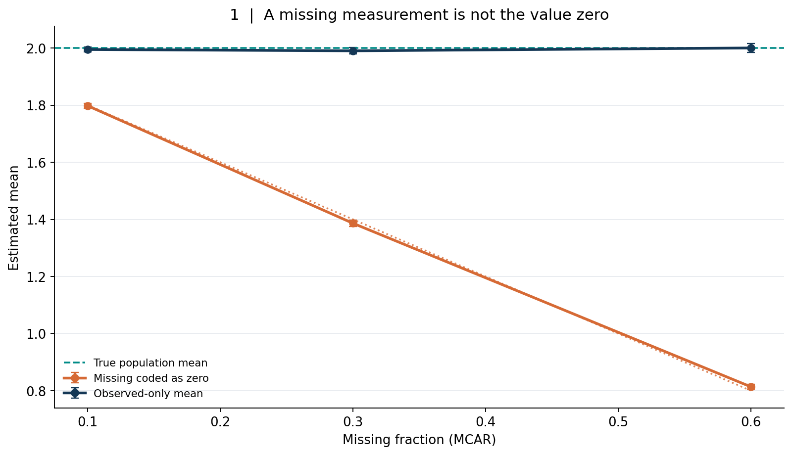
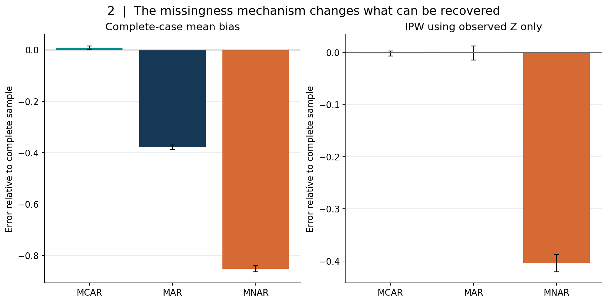
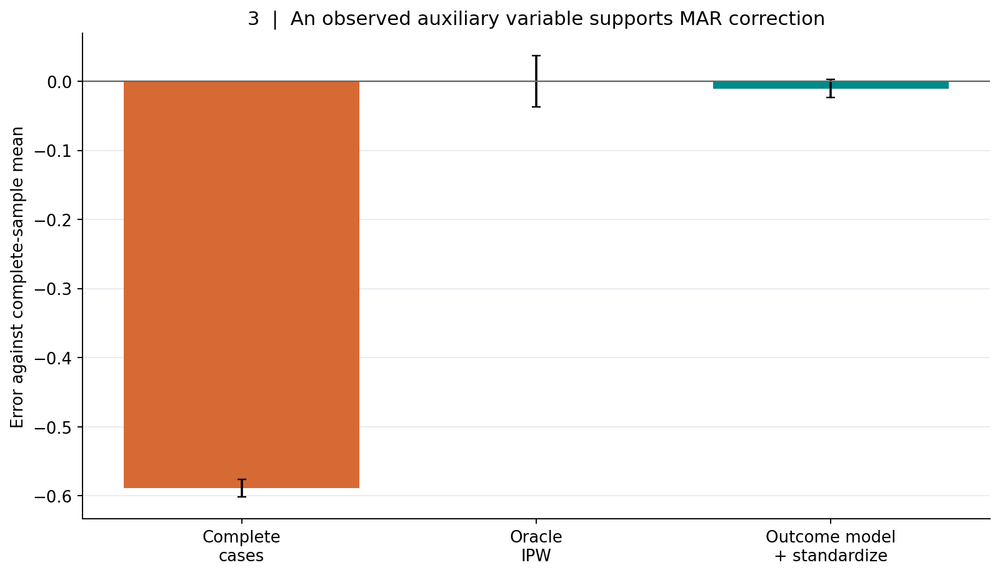
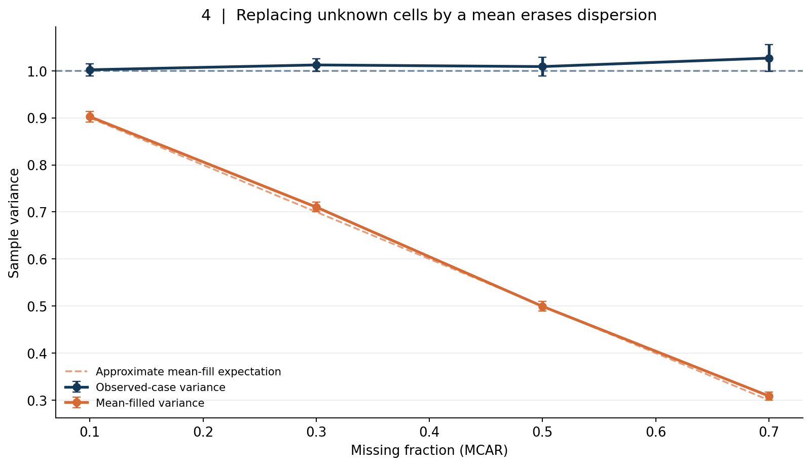
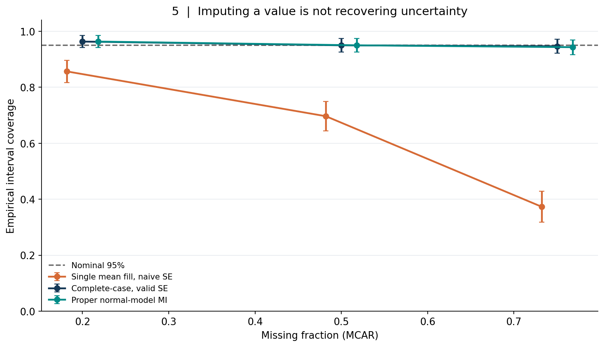
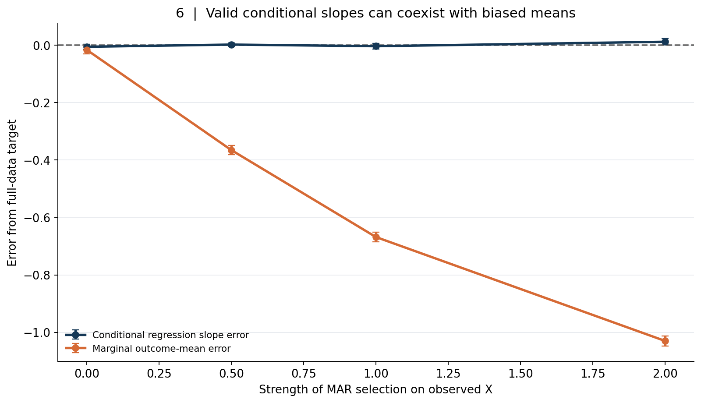
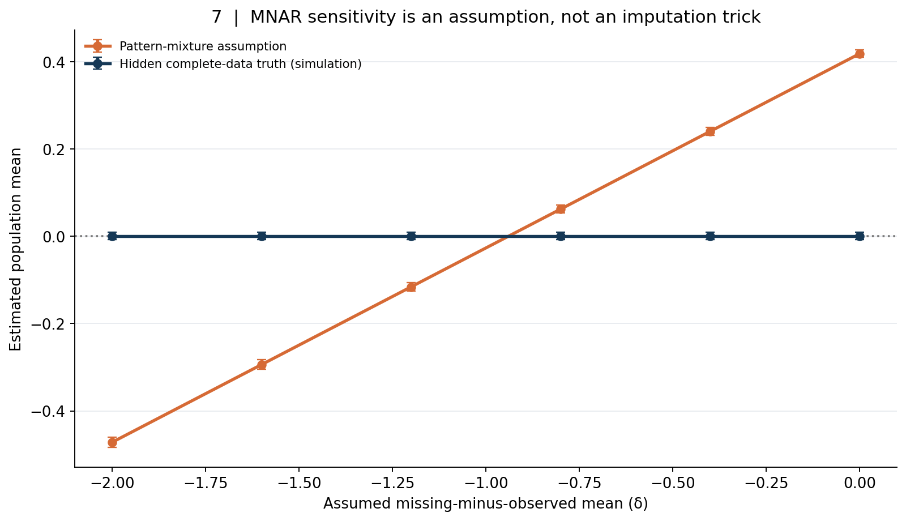
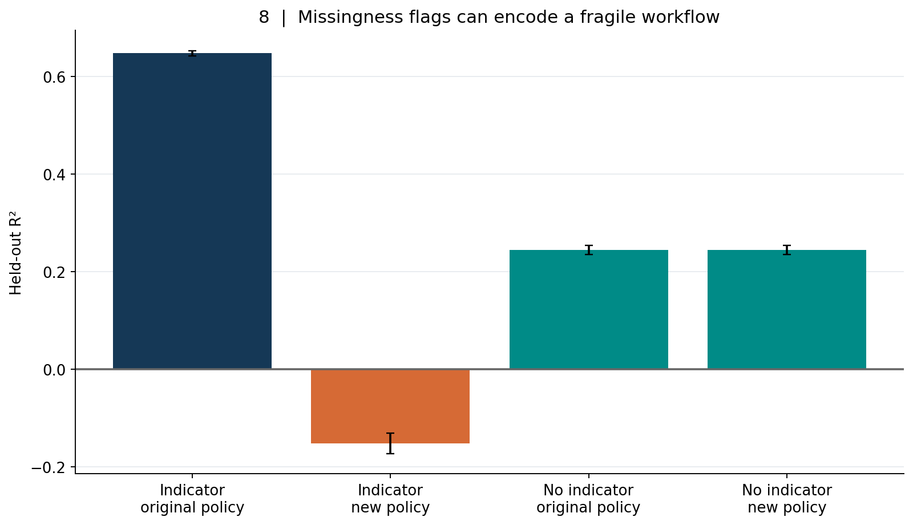
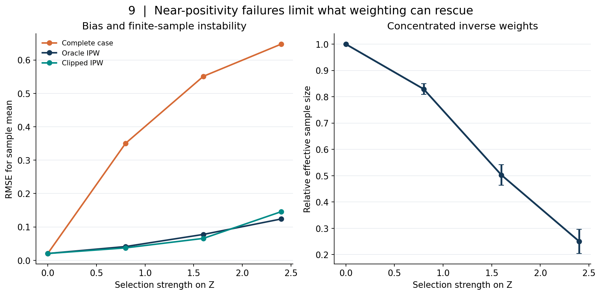

# A Missing Value Is Not a Zero: MCAR, MAR, MNAR, Imputation, and the Limits of Complete Cases

*Article #30 · Statistical identification and reproducible synthetic experiments · 1 November 2026*

> **Abstract.** Missing entries are frequently treated as inconvenient empty cells that can be dropped, filled with zero, or replaced by the mean before continuing with ordinary analysis. That habit hides a statistical problem: the process that determines what is measured may change which population is represented, which quantities are identifiable, how uncertain the estimates should be, and whether a prediction system will work when the measurement workflow changes. We distinguish missing completely at random (MCAR), missing at random conditional on observed information (MAR), and missing not at random (MNAR) through explicit observation indicators and selection laws. Nine independently seeded synthetic experiments produce nine original figures and eighteen reproducible CSV evidence tables. They show the bias from encoding missing values as zeros; complete-case bias under different observation mechanisms; recovery under MAR through weighting or outcome standardization; variance attenuation from mean filling; severe confidence-interval undercoverage from treating imputed values as observed; the difference between a valid conditional regression slope and a biased marginal mean; sensitivity to unidentifiable MNAR assumptions; predictive missingness flags that break under workflow changes; and the instability of inverse weighting when observation probabilities approach zero. The manuscript derives the estimands, states the identification assumptions, and separates synthetic demonstrations from field evidence. Missingness is not merely a formatting problem: it is part of the data-generating and measurement system.

## 1. The empty cell that silently changes an entire study

Consider a research team estimating average weekly energy expenditure among households. Some households provide complete meter readings, while others have gaps. The analyst exports a table, fills empty readings with zero, and computes an average. The program runs without errors. The chart is neat. But the answer no longer represents the same quantity. A missing meter reading does not mean that the household consumed no energy; it means the system failed to observe—or did not record—its consumption.

Now consider a clinical registry. Patients with severe symptoms might be measured more often, because they visit the clinic repeatedly. Patients with milder symptoms might be absent from follow-up because they recover, move, or see no reason to return. The complete cases are then a selected sample. Even without malicious data handling, a study of those who remain visible can differ systematically from the population it claims to describe.

Missingness can also be informative in the opposite direction. Some measurements are taken precisely because something is wrong. An absent laboratory result might indicate a healthy patient who never required the test. A missing industrial sensor value might mean communication failure during a harsh operating event. A blank survey item might reflect privacy concerns, fatigue, refusal, or a skip rule. These are different mechanisms with different implications.

The reflex is often to select an algorithm: delete rows, fill the median, run a nearest-neighbor imputer, or train a large model that accepts missing features. But the first question should not be which software fills a blank. It should be **which population quantity is being estimated, what generated the observation pattern, and what information is available about that pattern**. Without those distinctions, a more sophisticated imputer may produce a precise version of the wrong answer.

Rubin's foundational treatment of incomplete-data inference [1] established a vocabulary for relating missingness mechanisms to statistical analysis. Work on the EM algorithm [2], multiple imputation [3–6], inverse-probability weighting [7], and graphical identification of missing-data problems [8] gives tools for particular settings. None of the tools makes missing data disappear by definition; each uses assumptions that must fit the target problem.

This article takes a mathematical, experimentally controlled approach. Our simulated complete populations are known because we generate them. We then conceal selected values according to explicit laws and ask what different analyses recover. That controlled setting makes biases visible, but it also imposes a strict limit: the results do not estimate how frequently missingness mechanisms occur in energy, healthcare, finance, or manufacturing. Those real-world claims require external records and substantive investigations.

## 2. Start with the target and a binary observation indicator

Let \(Y\) be a numerical variable of interest and \(Z\) a vector of covariates observed for every unit. Define

\[
R=
\begin{cases}
1,&\text{if }Y\text{ is observed},\\
0,&\text{if }Y\text{ is missing}.
\end{cases}
\tag{1}
\]

The dataset reveals \(Z\), \(R\), and \(Y\) when \(R=1\). It does not reveal \(Y\) for \(R=0\). Our target might be the population mean \(\mu=\mathbb E(Y)\), a conditional regression function \(m(z)=\mathbb E(Y\mid Z=z)\), a predictive risk, a quantile, a covariance, or a causal effect. These are different estimands, and one missingness mechanism may affect them differently.

The observed-data likelihood combines the distribution of observed values and the mechanism that determines their visibility. One elementary identity captures the selection problem:

\[
p(y\mid R=1)
=\frac{P(R=1\mid Y=y)\,p(y)}{P(R=1)}.
\tag{2}
\]

The observed distribution equals the complete-population distribution reweighted by the probability of being recorded. Unless that probability is constant in \(y\), the shapes need not match. The same identity applies conditionally on fully observed covariates \(Z\).

For a population mean, the law of total expectation gives

\[
\mu=P(R=1)\,\mathbb E(Y\mid R=1)
   +P(R=0)\,\mathbb E(Y\mid R=0).
\tag{3}
\]

The first conditional mean is estimable from complete cases. The second is not directly observed. Without additional assumptions, an observed fraction and an observed mean do not determine \(\mu\). This is an identification issue, not merely a small-sample issue. Collecting more rows under an unchanged observation mechanism can estimate the visible part with great precision while leaving the missing part ambiguous.

Even the word *missing* can conceal distinct states. A survey question skipped because it was not applicable is structurally different from a respondent refusing an applicable question. A laboratory test not ordered differs from a test whose result was lost. An equipment sensor disabled by design differs from a sensor that fails at high temperature. Recording reason codes can make a future analysis more defensible, but those codes also require quality control and their own temporal provenance.

Throughout the nine experiments, \(R=1\) always denotes **observed**, not missing. This convention matters when writing likelihoods and inverse weights. A reversal of indicator coding can invert a supposedly corrective selection model. The companion code validates Boolean masks, checks observation-probability ranges, and archives both outcome estimates and the observation rates of each simulation.

## 3. MCAR, MAR, and MNAR are assumptions about conditional independence

In our one-incomplete-outcome setting, **missing completely at random (MCAR)** means

\[
R\perp(Y,Z).
\tag{4}
\]

The observation decision carries no statistical information about the complete variables. If a random subset of meter values is lost because of an independent hardware event, MCAR may be plausible. Under MCAR and suitable sampling assumptions, an observed-case mean can estimate the population mean, although it uses fewer observations and is less precise. Random missingness does not make deleted observations free.

**Missing at random (MAR)** means that, conditional on fully observed information \(Z\), the missingness indicator no longer depends on the unobserved outcome:

\[
P(R=1\mid Y,Z)=P(R=1\mid Z)=\pi(Z).
\tag{5}
\]

MAR does not mean that rows disappear uniformly. A survey might lose more responses among younger people, but age is observed for everyone and suffices to explain the loss after conditioning. The complete-case sample could have too many older respondents and a biased marginal mean. If outcome patterns within age groups are represented among responders, appropriate weighting or standardization can recover the overall mean.

**Missing not at random (MNAR)** describes a situation in which the observation law still depends on missing information after conditioning on the observed variables chosen for analysis. In our simplified setting,

\[
P(R=1\mid Y,Z)\ne P(R=1\mid Z).
\tag{6}
\]

For example, people with unusually high expenses may decline to report them, even after accounting for observed income and household characteristics. The missing values themselves carry information about why they are missing. Estimation generally requires additional assumptions, instrumental or follow-up information, external validation data, or explicit sensitivity analysis.

These labels are properties of a **joint model and an information set**, not permanent attributes stamped on a variable. Adding a genuinely observed auxiliary variable can change whether MAR is tenable. An observation process can be MAR for one analysis and insufficiently modeled for another. The assumptions are not identified by looking only at the histogram of observed \(Y\). In particular, an algorithm cannot establish MAR just because it successfully predicts which rows are missing using available columns.

Rubin's terminology [1] is often used alongside *ignorability*: conditions under which the missingness mechanism can be omitted from a particular likelihood or Bayesian analysis without invalidating inference. Ignorability requires more than uttering “MAR.” It involves distinctness or appropriate treatment of parameters and a correctly specified observed-data analysis. The assumptions that justify one estimator should be written for that estimator; they are not a universal permission slip for arbitrary deletion or filling.

## 4. Experiment 1: a missing entry is not an observed zero

Start with a synthetic measurement \(X=2+\varepsilon\), where \(\varepsilon\sim\mathcal N(0,1)\). The population mean is two. Conceal each value independently with probability \(q\), so missingness is MCAR. Compare a mean computed after coding every missing cell as numerical zero with a mean computed over genuinely observed values. The latter is valid under the MCAR design; the former changes the data.

Define the zero-coded variable \(X^0=RX\). Under independence,

\[
\mathbb E(X^0)
=\mathbb E(R)\mathbb E(X)
=(1-q)\mu.
\tag{7}
\]

This is an exact expectation, not a rule of thumb. At \(q=0.6\), the zero-coded mean targets \(0.4\times2=0.8\), not two. Its bias is \(-q\mu\). The direction depends on the true mean: if the mean were negative, replacing missing values by zero would bias the result upward. If zero is also a legitimate measured value, failure to distinguish a true zero from a missing marker can make the problem harder to detect.

*Figure 1. Twenty-four independent synthetic replications with 1,800 observations each. Missingness is independent of values. Error bars represent ±1.96 Monte Carlo standard errors; the dotted curve is the exact zero-coding expectation in Equation (7).*

With 60% missingness, the archived mean after zero coding is **0.814**, close to the exact **0.8**. The observed-case mean is **2.000**. At 30% missingness the zero-coded mean is **1.386** versus the exact 1.4, while complete cases average **1.990**. The small deviations from theoretical values are finite simulation variation. These numbers are not measurements of any actual energy use or patient characteristic.

One might object that a zero sometimes *is* the appropriate representation. That is true when the underlying domain defines non-occurrence as zero: no transactions, no recorded emissions, zero units produced. The point is not to ban zeros, but to distinguish a recorded quantity from a measurement failure. A categorical “not applicable” state and an actual zero can have different statistical meanings even when both appear blank in a spreadsheet.

The distinction also matters for denominators. If missing entries are encoded as zero, dividing the sum by all records estimates an aggregate with a contribution of zero from missing cases. Dividing by observed cases estimates a conditional mean. Dividing by an imputed exposure estimate may target a third quantity. A correct label on the y-axis must say which denominator is being used.

The experiment is intentionally simple because many large pipeline errors begin with this one-line transformation. It occurs before any sophisticated modeling, and every downstream result inherits the modified target. A unit test that accepts only finite numbers is not enough: the schema must preserve observation status and missingness reasons separately from numerical values.

## 5. Why complete cases can be selected even when no imputer is used

Complete-case analysis discards rows whose required values are missing. Its simplicity is appealing. It avoids generating synthetic values, and familiar estimators can be applied to the retained table. But the retained rows are themselves selected by \(R\).

For a mean, the complete-case estimator converges under ordinary regularity conditions to \(\mathbb E(Y\mid R=1)\), not necessarily \(\mathbb E(Y)\). Combining Equation (2) with the law of expectation shows

\[
\mathbb E(Y\mid R=1)-\mu
=\frac{\operatorname{Cov}(Y,R)}{P(R=1)}.
\tag{8}
\]

Under MCAR, \(\operatorname{Cov}(Y,R)=0\). Under MAR, it need not be zero marginally, because both \(Y\) and \(R\) may depend on \(Z\). Under MNAR it may be nonzero even after the available covariates are considered. Equation (8) explains why *percentage missing* is not enough to determine bias: two datasets with the same missing fraction can have very different covariances between the observation process and the target.

Complete cases also create precision and support problems. If a small subgroup has a very low observation probability, the retained sample may contain few or no such cases. A regression trained only on responders must extrapolate to the missing subgroup. Even when MCAR makes the mean unbiased, the effective sample size falls, which usually widens valid confidence intervals.

Deletion can change estimands in subtle ways. A regression coefficient conditional on \(Z\) may remain valid under selection on \(Z\), while a marginal mean is biased. Conversely, if missingness depends on an outcome residual after conditioning on predictors, complete-case regression slopes may also be distorted. One should not claim “complete-case analysis is biased” without naming the estimand and assumptions; nor should one claim “MAR makes complete cases safe.” Both slogans are too broad.

## 6. Experiment 2: three observation laws, three different recovery stories

Construct a fully observed auxiliary variable \(Z\sim\mathcal N(0,1)\) and outcome

\[
Y=1+Z+\varepsilon,\qquad
\varepsilon\sim\mathcal N(0,0.8^2).
\]

Then hide \(Y\) using one of three mechanisms:

\[
\begin{aligned}
\text{MCAR:}\quad &P(R=1\mid Y,Z)=0.62,\\
\text{MAR:}\quad &P(R=1\mid Y,Z)=\operatorname{logit}^{-1}(0.5-1.2Z),\\
\text{MNAR:}\quad &P(R=1\mid Y,Z)=\operatorname{logit}^{-1}(0.5-1.2Y).
\end{aligned}
\tag{9}
\]

Here \(\operatorname{logit}^{-1}(t)=1/(1+e^{-t})\). In the MAR scenario, larger observed \(Z\) values make observation less likely; since \(Y\) grows with \(Z\), complete cases have systematically smaller outcomes. In the MNAR scenario, the probability of being observed depends on the outcome itself. The three scenarios have deliberately different missing fractions, so the comparison is about mechanisms and estimation behavior, not a perfectly matched deletion percentage.

For each scenario, calculate the complete-case mean and a self-normalized inverse-probability-weighted mean using a logistic observation model fitted from \(R\) and the **observed** auxiliary \(Z\). The model is correctly specified for MCAR or MAR in this construction. Under MNAR it cannot condition on the unseen outcome residual for missing rows, and a model using \(Z\) alone does not generally recover the full selection mechanism.

*Figure 2. Mean errors relative to each simulation's complete sample, across 24 outer replications. The right panel fits an observation model using only the available auxiliary variable; it does not use hidden outcomes to construct weights.*

The archived complete-case mean errors are **+0.008** under MCAR, **−0.379** under MAR, and **−0.852** under MNAR. Weighting using only \(Z\) produces mean errors of **−0.002**, **−0.001**, and **−0.404**, respectively. MAR correction works in the stated model because the fully observed auxiliary captures the selection law. The MNAR score remains biased because the unseen outcome contributes to observation beyond \(Z\).

Do not read the slight positive MCAR error as a systematic MCAR effect. The theoretical bias is zero. We ran 24 independent finite replications; the observed mean deviated a little from zero. Likewise, the MNAR residual bias is not a universal numerical penalty. It depends on the strength and form of outcome-dependent selection, the outcome noise, the auxiliary variables, and the estimator.

The important asymmetry is informational. For MAR, the distribution of \(Z\) is visible for both responders and nonresponders, and the relation between \(R\) and \(Z\) is estimable. For MNAR, the counterfactual outcome values of nonresponders are not observed. A procedure that models \(R\) using only available \(Z\) may improve the estimate while still failing to recover the missing outcome-residual selection. A more complex classifier does not manufacture information about outcomes that remain invisible.

This experiment separates observed-data prediction of missingness from identification of the target mean. The fitted observation model predicts which rows are more likely to be visible, but prediction accuracy is not enough. The crucial condition is whether the relevant conditional independence and support assumptions hold. A plausible-looking propensity model may still be inconsistent for the target if the missingness mechanism depends on unobserved values.

## 7. Identification under MAR uses observed auxiliaries, not optimistic labels

Suppose \(Z\) is observed for all units, \(\pi(Z)=P(R=1\mid Z)\), and MAR holds as in Equation (5). Assume that \(\pi(Z)>0\) wherever the target population places mass. Then

\[
\mathbb E\!\left[\frac{RY}{\pi(Z)}\mid Z\right]
=\mathbb E(Y\mid Z).
\tag{10}
\]

The derivation is direct:

\[
\mathbb E\!\left[\frac{RY}{\pi(Z)}\mid Z\right]
=\frac{1}{\pi(Z)}
\mathbb E\left[Y\,\mathbb E(R\mid Y,Z)\mid Z\right]
=\mathbb E(Y\mid Z).
\]

Taking expectation over \(Z\) recovers \(\mathbb E(Y)\). This identity motivates inverse-probability weighting [7]. It rests on the MAR conditional independence, correct probability model, and positivity. It does not assert that the same algebra works when \(R\) depends on an unseen outcome after conditioning on \(Z\).

In a finite sample, our code uses the self-normalized Hájek mean:

\[
\hat\mu_{\mathrm H}
=\frac{\sum_i R_iY_i/\hat\pi(Z_i)}
       {\sum_i R_i/\hat\pi(Z_i)}.
\tag{11}
\]

This ratio is not exactly unbiased in finite samples merely because Equation (10) holds. Its consistency requires further regularity conditions and suitable estimation of \(\pi\). It is often more numerically stable than a raw unnormalized sum, but very small estimated observation probabilities can still create enormous weights.

A second path is outcome modeling. If a model \(m(Z)=\mathbb E(Y\mid Z)\) can be learned consistently from observed outcomes under MAR, then the marginal mean is

\[
\mu=\mathbb E_Z[m(Z)].
\tag{12}
\]

One fits the conditional regression among observed cases and averages predictions over the **full observed distribution of \(Z\)**, including covariates of people whose \(Y\) was missing. This is outcome standardization or regression imputation at the level of the target mean. It requires a correct conditional outcome model and adequate observed support. It can fail badly if the relation is nonlinear but the fitted model is rigid, or if the observed sample lacks an important region of \(Z\).

Weighting and outcome modeling have complementary strengths and weaknesses. The former emphasizes the selection law, while the latter emphasizes the response law. More advanced augmented estimators can combine the two, sometimes achieving double robustness under specified nuisance-model conditions, but that property must be derived for the estimator and identification assumptions at hand. We do not present a generic doubly robust estimator here; our aim is to make two simpler recovery strategies transparent.

## 8. Experiment 3: recovering a marginal mean under a known MAR design

Generate \(Z\sim\mathcal N(0,1)\), \(Y=1+1.2Z+\varepsilon\) with independent normal noise of standard deviation \(0.9\), and set

\[
\pi(Z)=\operatorname{logit}^{-1}(0.2-1.5Z).
\]

This is MAR for the incomplete outcome because \(R\) depends on \(Z\), which is always observed, and not on the outcome residual. We compare three estimates with the actual complete-sample mean of the same synthetic draw: complete-case averaging, Hájek weighting with the **known oracle** \(\pi(Z)\), and linear outcome-model standardization using all \(Z\).

*Figure 3. Means and Monte Carlo intervals over 24 independent synthetic samples of 1,600 units. The weighting method uses generator-known observation probabilities, which are not normally available in field data. The outcome model is correctly specified in this experiment.*

The complete-case mean underestimates the full-sample target by **0.589** on average. Oracle IPW has mean error approximately **−0.00007**, while outcome standardization has mean error **−0.0106**. The fitted linear model succeeds because our generator is linear with independent residual noise; this is not evidence that linear regression universally fixes MAR.

The root mean squared errors, computed from the archived squared-error results, are approximately **0.590** for complete cases, **0.092** for oracle weighting, and **0.033** for outcome standardization. The two corrected estimators have different finite-sample variances in this design. Outcome modeling uses the strong conditional linear relationship efficiently. Weighting pays for variable observation probabilities. Under outcome-model misspecification the comparison might reverse.

The adjective *oracle* matters. We know \(\pi\) exactly because we wrote it into the simulation. A real analyst must estimate it from observed \(R,Z\), perhaps with cross-fitting or robust procedures when flexibility is needed. The estimated weights must be checked for overlap and influence. Similarly, standardization must be validated against observed conditional patterns and the intended target population. Neither method guarantees recovery merely because its software completes successfully.

This provides an important positive conclusion: missing data are not always fatal to inference. With an appropriate information set, assumptions, and positivity, some targets are identifiable and estimable. The criticism is directed at automatic, undocumented deletion and filling—not at statistical methods designed to exploit legitimate observed structure.

## 9. Mean imputation can leave the mean plausible while destroying the variance

One of the most seductive fixes is to replace every missing value with the mean of its observed column. Under MCAR, this can preserve the observed-case mean exactly. The dataset appears complete, and many routines accept it without additional work. But the filled values contain no new observed variation. Treating them as real measurements compresses the empirical distribution and can invalidate downstream uncertainty.

Let \(X\) have mean \(\mu\) and variance \(\sigma^2\). Under MCAR with observation probability \(p=1-q\), consider filling missing observations with the population mean for an idealized derivation:

\[
X^{\mathrm{fill}}=RX+(1-R)\mu.
\]

Then \(\mathbb E(X^{\mathrm{fill}})=\mu\) and

\[
\operatorname{Var}(X^{\mathrm{fill}})
=p\,\sigma^2.
\tag{13}
\]

The between-observation component has been erased for the missing fraction. If the observed sample mean is used instead of the exact population mean, finite-sample corrections enter, but the attenuation mechanism remains. Filling with a median or a fixed constant produces related, though not identical, distortions.

This matters for more than univariate variance. Covariance matrices, principal components, correlations, regression residuals, confidence intervals, tail probabilities, and clustering distances all depend on dispersion and joint structure. A mean-filled table can suppress variance in one variable while altering its covariance with others. An algorithm may become numerically stable yet optimize against an artificial distribution.

An imputation model can also create relationships that were not present in the data or erase relationships that were. Using a deterministic conditional expectation \(m(Z)\) as a replacement tends to underrepresent the residual variation \(Y-m(Z)\) unless that uncertainty is handled elsewhere. A useful prediction of a missing value is not automatically a valid draw from its posterior predictive distribution. The distinction between conditional expectation and distributional uncertainty is central to principled multiple imputation.

## 10. Experiment 4: the variance disappears in proportion to missingness

Return to \(X=2+\varepsilon\) with \(\varepsilon\sim\mathcal N(0,1)\), and impose MCAR at missing fractions of 10%, 30%, 50%, and 70%. Compute three sample variances: that of the complete synthetic population, that of observed cases, and that of a full-length vector where missing values are replaced by the observed-case mean.

*Figure 4. Twenty-four independent replications of 1,800 units. Complete-case sample variance remains near one, while the mean-filled sample variance approaches the factor \(1-q\). Error bars are Monte Carlo uncertainties; the dashed attenuation line is the idealized population identity.*

At 70% missingness, the observed-case sample variance averages **1.027**, whereas the mean-filled sample variance averages **0.309**, near the benchmark **0.3**. At 50%, the corresponding mean-filled variance is **0.499**. The method can report a plausible mean alongside an implausibly concentrated distribution. If an application uses the filled table to calculate a confidence interval or to estimate an extreme-event threshold, the error can have practical consequences.

One should distinguish a completed dataset used for **prediction at an operational interface** from completed datasets used for **statistical inference**. A particular model may require a numerical placeholder to run; a missingness flag and a carefully designed training procedure may permit that operational choice. But a placeholder that is acceptable for model input is not necessarily a measured value suitable for computing descriptive population moments. The two workflows should not silently share the same cleaned table and inferential assumptions.

The variance experiment also illustrates an important diagnostic principle: examine how an imputation procedure changes the distribution of each variable and its joint relationship to others. A histogram of completed values may show a suspicious spike at the mean. But passing a distributional diagnostic does not prove correct imputation; many misspecified stochastic models can generate smooth-looking histograms. Identification and uncertainty remain separate questions.

## 11. Imputing values is not the same as restoring information

An estimator's uncertainty depends on what was actually observed. Suppose a random sample of size \(n\) comes from a normal distribution with unknown mean \(\mu\) and known variance \(\sigma^2\), and \(n_{\mathrm{obs}}\) independent values are observed under MCAR. The observed-data information for \(\mu\) scales with \(n_{\mathrm{obs}}/\sigma^2\), not \(n/\sigma^2\). Filling \(n-n_{\mathrm{obs}}\) cells with the observed mean does not create the independent observations that were never recorded.

Under known variance, a valid complete-case standard error is

\[
\operatorname{SE}_{\mathrm{CC}}
=\frac{\sigma}{\sqrt{n_{\mathrm{obs}}}}.
\tag{14}
\]

A naive program may instead compute the standard deviation of a mean-filled vector and divide by \(\sqrt n\). It commits two reductions simultaneously: the completed table's variance is too small, and its denominator counts imputed records as if they were independently observed. A point estimate can remain numerically unchanged while its confidence interval becomes much too narrow.

This is not a reason that every complete-case procedure is optimal. If auxiliary variables predict missing outcomes, a correctly specified observed-data model can use information from those auxiliaries and may improve efficiency. But it must propagate uncertainty about the missing values and estimated parameters. A deterministic replacement, followed by an analysis that forgets which values were imputed, generally fails that requirement.

Multiple imputation is one response to this problem. The original development by Rubin [3] and subsequent practical frameworks such as multivariate imputation by chained equations [4,5] emphasize generating multiple plausible completed datasets under an imputation model, analyzing each, and combining results in a way that accounts for uncertainty between imputations. The method is powerful, but it is neither assumption-free nor a universal cure for MNAR.

## 12. Rubin's pooling rules and a tractable normal-model example

Let \(m\) be the number of completed datasets. Imputation \(k\) yields a point estimate \(Q_k\) of the target and a complete-data variance estimate \(U_k\). Rubin's rules pool the estimates as

\[
\bar Q=\frac1m\sum_{k=1}^{m}Q_k,\qquad
\bar U=\frac1m\sum_{k=1}^{m}U_k,
\]

\[
B=\frac{1}{m-1}\sum_{k=1}^{m}(Q_k-\bar Q)^2,\qquad
T=\bar U+\left(1+\frac1m\right)B.
\tag{15}
\]

The first component describes average uncertainty within a completed-data analysis. The second reflects variation across plausible completions, including its finite-\(m\) factor. When there is substantial missing information, ignoring \(B\) can make intervals misleadingly precise. For small numbers of imputations or certain analysis models, degrees-of-freedom adjustments and appropriate reference distributions also matter.

Our experiment uses a special case where the mathematics is transparent. Outcomes are independent normal draws with true \(\mu=2\), known \(\sigma^2=1\), and MCAR. With an improper flat prior for the unknown mean, its posterior given the observed outcomes has

\[
\mu\mid Y_{\mathrm{obs}}
\sim\mathcal N\left(\bar Y_{\mathrm{obs}},\,1/n_{\mathrm{obs}}\right).
\tag{16}
\]

For each completed dataset, draw a plausible mean from Equation (16), then draw every missing outcome conditionally from a unit-variance normal centered on that plausible mean. Analyze the completed mean with within-imputation variance \(U_k=1/n\). Pool twenty completed-data estimates using Equation (15). This procedure is a deliberately narrow, proper normal-model imputation demonstration; it is not a general MICE or multivariate imputation engine.

Why draw the mean before drawing the missing values? If we plug in \(\bar Y_{\mathrm{obs}}\) as though it were known with certainty, the resulting predictive distribution ignores uncertainty about the underlying mean. The posterior mean draw propagates that uncertainty into the between-imputation term. The complete-data likelihood and imputation distribution must be compatible with the stated model if the pooled variance is to have its intended interpretation.

In real applications, the challenge is much broader. Variables may be non-Gaussian, missing in different patterns, highly correlated, bounded, or categorical. Imputation chains can be incompatible with a joint distribution or misspecified in their conditional equations. Outcomes, transformations, interactions, clustering, and substantive analysis terms may need to appear in the imputation model. White, Royston, and Wood [5] and Sterne and colleagues [6] discuss important practical pitfalls. A software package can automate draws without certifying that the model is congenial to the scientific analysis.

## 13. Experiment 5: confidence-interval coverage exposes false precision

Generate 120 observations per replication from \(\mathcal N(2,1)\). Independently conceal roughly 20%, 50%, or 75% of their values. For each of 300 independent outer replications per missing fraction, construct nominal 95% intervals three ways.

First, fill missing values with the observed mean and calculate a conventional standard error from the completed vector as if every value were observed. This is intentionally invalid for inferential use; it demonstrates the failure mode. Second, use the complete-case mean with the correct standard error based on the number of genuinely observed outcomes and the generator-known variance. Third, use the proper normal-model multiple imputation described above, with twenty imputations and Rubin's pooled variance.

Coverage is the proportion of generated intervals that include the actual fixed population mean \(\mu=2\). Because the true mean is known to the simulation, this is a genuine repeated-sampling coverage check, not a comparison to a noisy estimated benchmark. The nominal value is 0.95; realized coverage has Monte Carlo uncertainty because only 300 outer replications are performed.

*Figure 5. Each point represents 300 independent synthetic datasets. Vertical bars show ±1.96 Monte Carlo standard errors for the estimated coverage proportion. The horizontal reference is nominal 95% coverage, not a fitted target.*

At 20% missingness, naive mean-fill coverage is **85.7%**. At 50% it is **69.7%**. At 75% it falls to **37.3%**, despite the nominal label “95% confidence interval.” By comparison, complete-case intervals cover in **96.3%**, **95.0%**, and **94.7%** of replications. The corresponding properly pooled multiple-imputation coverages are **96.3%**, **95.0%**, and **94.3%**. These values are consistent with MCAR and the correctly specified normal model; small discrepancies from 95% are Monte Carlo variation and finite-imputation effects.

The interval-width contrast clarifies the mechanism. At 75% missingness, the average naive interval width is **0.173**, whereas the multiple-imputation interval width is **0.734** and the complete-case interval width is **0.724**. The naive algorithm appears unusually confident because it counts values it invented as if they were independent evidence. The true uncertainty does not vanish when an empty cell is filled.

There is an important nuance: in this simple MCAR example, complete-case inference already works. Multiple imputation does not create information out of nothing, and the extra simulation machinery does not automatically give narrower intervals. Its value becomes more substantial when additional observed variables supply real predictive information about the missing values, when multiple analysis variables are incomplete, or when a compatible inferential workflow benefits from multiple completed datasets.

We should not generalize the precise coverage percentages to other imputation engines. Our normal-model MI knows the outcome variance and uses the correct distributional family by construction. A default chained-equations routine applied to skewed, bounded, highly nonlinear, or MNAR data may behave differently. The experiment demonstrates *why* uncertainty accounting matters under a favorable model, not that every package labeled “multiple imputation” achieves calibrated intervals in every setting.

## 14. Conditional regression and marginal means are different estimands

A common claim is that complete-case analysis is always biased under MAR. That is too broad. Suppose the target is a conditional slope in a correctly specified linear model

\[
Y=\alpha+\beta X+\varepsilon,\qquad
\mathbb E(\varepsilon\mid X)=0,
\]

and \(Y\) is observed with probability \(\pi(X)\) depending only on the fully observed \(X\). Then

\[
\mathbb E(Y\mid X,R=1)
=\mathbb E(Y\mid X)=\alpha+\beta X.
\tag{17}
\]

The selected sample has a different distribution of \(X\), but the conditional regression function remains the same wherever selection allows observation. With adequate support, correct specification, and ordinary regression regularity conditions, an observed-case least-squares slope can remain consistent for \(\beta\). The marginal mean is another matter:

\[
\mathbb E(Y\mid R=1)
=\alpha+\beta\,\mathbb E(X\mid R=1),
\]

which differs from \(\alpha+\beta\mathbb E(X)\) when the distribution of \(X\) changes through selection.

The distinction can surprise practitioners who see a stable coefficient and assume the dataset is representative. A coefficient conditional on measured covariates can be valid while a prevalence, average cost, or population risk is biased. The reverse is also possible: a marginal summary can look reasonable while a conditional association is distorted by a more complex missingness law.

There are limits to the result. If \(R\) depends on the outcome residual even after conditioning on \(X\), Equation (17) can fail. If the regression function is nonlinear but a linear approximation is fitted, changing the covariate distribution can change the best linear projection even when the conditional function itself is invariant. If some values of \(X\) have zero observation probability, parts of the conditional relationship cannot be learned from complete cases. The estimand must therefore be defined as carefully as the missingness mechanism.

## 15. Experiment 6: an unbiased slope and a biased population mean coexist

Set \(X\sim\mathcal N(0,1)\), \(Y=1+2X+\varepsilon\), with independent normal noise of standard deviation \(0.8\). Make \(Y\) missing according to

\[
\pi(X)=\operatorname{logit}^{-1}(0.5-bX)
\]

for selection strengths \(b=0,0.5,1,2\). As \(b\) grows, high-\(X\) units become less likely to provide outcomes. For each sample, fit a linear regression of observed \(Y\) on observed \(X\), compare the slope to its true value 2, and compare the observed-case mean of \(Y\) with the complete synthetic sample mean.

*Figure 6. Twenty-four independent samples of 1,800 units for each selection strength. The same observation mechanism can preserve a conditional slope while moving the marginal mean. Intervals quantify across-replication Monte Carlo uncertainty.*

At \(b=2\), the mean observed-case outcome-mean error is **−1.030**. The average slope error is only **+0.0120**. At \(b=1\), the mean error is **−0.668**, while the slope error is **−0.0035**. These are not contradictory results. One estimand averages outcomes over a selected covariate distribution; the other estimates a correctly specified conditional relation over the observed support.

The average slope deviation at \(b=2\) is slightly positive and its Monte Carlo interval need not cover zero in a particular finite 24-replication run. That is simulation noise, not evidence that MAR selection necessarily biases the correctly specified conditional slope. A stronger claim of numerical equality would require more independent repetitions or analytic expectation. The exact population statement is Equation (17), under the stated assumptions.

An applied report that says “missing values did not affect the regression coefficient” should not silently promote that observation to “missingness did not affect our study.” What were the research outcomes? If the principal conclusion is about a coefficient conditional on covariates, the relevant assumptions may be defensible. If policymakers need a population average, the same complete cases may be unsuitable without weighting or standardization. The estimand must drive the diagnostic.

## 16. Why a test of MCAR cannot establish MAR or identify MNAR

Missingness diagnostics are useful but often overinterpreted. A test might assess whether patterns of observed variables differ between complete and incomplete rows. Little's classic test addresses a multivariate MCAR null under particular distributional assumptions [9]. A rejection can provide evidence against that null. A non-rejection is not proof that all missingness is independent of all unobserved values.

Consider an outcome \(Y\) that is missing more often when its unseen value is large. The visible table contains no \(Y\) for the nonresponders. A test using only the observed portion may have little power to detect the relevant dependence, or the observed-data distribution may be compatible with several missingness mechanisms. These are identification limitations, not defects fixable solely by increasing the complexity of a classifier that predicts \(R\).

One practical diagnostic is to model missingness using fully observed variables and inspect whether observed groups differ on those variables. This can reveal systematic selection that invalidates an MCAR assumption. But even a perfect fit to \(P(R=1\mid Z)\) does not verify the MAR condition \(R\perp Y\mid Z\), because the missing \(Y\) values are precisely what would be needed to test the residual dependence.

Where possible, the strongest information comes from the **measurement process itself**: reasons for nonresponse, callback records, audit samples, repeated attempts, alternative data sources, sensor-maintenance logs, and follow-up studies that recover a subset of missing outcomes. A randomly selected validation subsample with better measurements can constrain sensitivity assumptions. Such design information is often more valuable than trying another imputation algorithm on the same incomplete table.

Graphical missing-data frameworks, such as the work of Mohan, Pearl, and Tian [8], make the role of observation indicators and causal relationships explicit. They can identify recoverability under particular graphical conditions. The diagrams remain assumptions requiring substantive justification; they do not infer a uniquely correct graph from blanks alone.

## 17. MNAR calls for sensitivity analysis, not an invisible default

Under MNAR, the distribution of unobserved outcomes may differ from that of observed outcomes even after conditioning on available auxiliaries. Equation (3) makes the unknown component explicit. Let \(p=P(R=1)\), \(\mu_1=\mathbb E(Y\mid R=1)\), and \(\mu_0=\mathbb E(Y\mid R=0)\). Define the *pattern-mixture sensitivity parameter*

\[
\delta=\mu_0-\mu_1.
\]

Then

\[
\mu=p\mu_1+(1-p)(\mu_1+\delta)
=\mu_1+(1-p)\delta.
\tag{18}
\]

This identity is exact. The unknown quantity is \(\delta\). The observed data can estimate \(p\) and \(\mu_1\), but without further identification information they do not determine the missing-group mean. Choosing \(\delta=0\) is itself a substantive assumption equivalent to equal observed and missing means on this marginal scale. A black-box imputer that defaults to similar distributions can be making that assumption implicitly.

Sensitivity analysis varies \(\delta\) over a defensible range and asks how conclusions change. A *tipping point* is a value of the sensitivity parameter at which a substantive inference changes sign, crosses a threshold, or reverses a ranking. The parameter range should come from domain knowledge, previous studies, follow-up samples, or an explicit stress-testing purpose. It should not be selected after looking for the most persuasive answer.

The pattern-mixture formula is intentionally simple. Real missingness can depend on covariates and produce heterogeneous \(\delta(z)\), not a single universal offset. For binary, bounded, or time-to-event outcomes, a constant additive shift may be inappropriate or violate support. Selection models may instead parameterize \(P(R=1\mid Y,Z)\). Different sensitivity models can be observationally equivalent while implying different missing outcomes. The purpose is to expose the assumption, not to hide it inside a fitted coefficient.

## 18. Experiment 7: the hidden group can reverse a conclusion

Generate \(Y\sim\mathcal N(0,1)\) and let higher values be more likely to be observed:

\[
P(R=1\mid Y)
=\operatorname{logit}^{-1}(0.3+1.2Y).
\]

The observed cases therefore tend to have positive outcomes, while the unobserved cases tend to have lower outcomes. The complete-population mean is zero by construction. In a real study we would not know the hidden outcomes, but in the synthetic experiment we can calculate the true missing-minus-observed mean difference to check a sensitivity analysis.

We vary the assumed \(\delta\) from \(-2.0\) to \(0.0\) in steps of 0.4, calculate the population mean by Equation (18), and compare it with the complete synthetic truth. We do **not** estimate the oracle \(\delta\) from the visible records; it is displayed only because the generator permits an audit.

*Figure 7. The horizontal sensitivity parameter is not estimated by the observed-data likelihood. The dark curve is the complete-data truth available solely in simulation; the orange curve shows estimates under different user-supplied assumptions. Results average 24 independent synthetic datasets.*

The mean observed-case outcome in the simulation is approximately **0.418**. Assuming \(\delta=0\) therefore produces a population estimate of **0.418**, although the true complete-population mean averages **0.00075**. At \(\delta=-0.8\), the estimated mean is **0.0624**; at \(\delta=-1.2\), it is **−0.116**. The conclusion about the sign crosses zero between these assumptions. The hidden oracle mean difference is approximately **−0.938**, which explains why a value near \(-0.94\) would recover the truth in this generator.

The point is not that \(-0.938\) is a universally good sensitivity parameter. It is explicitly unavailable without extra information in an ordinary incomplete dataset. A responsible analysis would present a range and explain what external evidence makes some values more credible than others. If the substantive conclusion changes within a plausible range, the report should say it is not robust to the missingness assumption.

Sensitivity does not prove that the outcome is MNAR. It addresses what would happen to an estimand under alternative assumptions about missing values. That distinction is central: identification and sensitivity answer different questions. A transparent uncertainty band across plausible mechanisms can be more honest than a single highly precise imputed estimate.

## 19. Missingness itself can be predictive

In predictive modeling, the observation indicator may contain information about the outcome even when the missing measurement cannot be reconstructed. A missing blood test might mean a clinician saw no reason to order it. A missing quality-control reading might indicate a particular shift's workflow. A customer might skip an expensive questionnaire for reasons associated with future behavior. A missingness flag can therefore improve predictive accuracy in historical data.

It is tempting to add one indicator per missing feature and let the model decide what to learn. That can be useful in an operational setting where the observation policy is stable and available at prediction time. But the indicator is partly a measurement of the **institutional process**, not merely the person's or machine's underlying state. If the workflow changes, the learned association can disappear.

This is closely related to the leakage and distribution-shift problems discussed elsewhere in the series. A feature can be statistically predictive because of how it was recorded rather than because it is an invariant physical cause of the outcome. An imputation pipeline that retains missingness masks should also preserve documentation of when each mask is formed and whether it is available online. The flag's predictive success does not establish that reducing missingness would change the underlying outcome in the same direction.

For inference, including \(R\) as a predictor of \(Y\) does not by itself solve selection bias. One knows \(R=0\) for missing cases but still does not observe their \(Y\). A learned association between \(R\) and observed outcomes may depend on the chosen model and an information set with limited support. For prediction, the task can sometimes be feasible because the goal is to forecast a separate future label using masks available at prediction time. For identifying the distribution of a missing target, the same mask is part of the observation process that must be modeled.

## 20. Experiment 8: an informative missingness flag breaks when the policy changes

Let \(Z\) be a stable observed predictor, \(U\) an unobserved severity component, and

\[
Y=1.2Z+2U+\varepsilon.
\]

In the historical measurement workflow, a would-be sensor is missing when \(U\) plus small observation noise is positive. The binary missingness flag therefore conveys information about severity \(U\), which helps predict \(Y\). We fit one ridge model using \((Z,M)\), where \(M\) is the missingness flag, and a second ridge model using \(Z\) alone. Both are trained on the original workflow.

Now evaluate on independent test observations. In the original scenario, \(M\) is generated from severity as before. In the changed workflow, the flag is generated independently of severity, as if a new randomized measurement protocol were installed. The structural outcome equation and stable \(Z\) remain unchanged. This isolates a shift in the measurement process rather than a shift in the outcome mechanism.

*Figure 8. Twenty-four independent train/test synthetic replications. The changed policy changes only how the missingness flag is generated. The clean model, which does not use the flag, has identical scores across the paired evaluation scenarios.*

The model using the flag averages **\(R^2=0.647\)** under the original observation rule. Under the changed rule it falls to **−0.152**. The model excluding the flag averages **0.245** in both settings. The historical flag was valuable for predicting severity under its original process, but the value did not survive a measurement-policy change.

The counterfactual workflow in this experiment is stylized. Real organizations may change their testing frequency, eligibility criteria, clinical documentation, device firmware, or customer interface in ways more complicated than drawing independent masks. The experiment shows a possible mechanism, not the expected loss from any particular policy change. Still, it motivates a concrete engineering check: monitor the missingness rate and its relationship with upstream variables, and review model assumptions whenever the observation process is changed.

This also illustrates a tension between historical predictive utility and scientific interpretation. The model with \(M\) is better for its first evaluation population. It is not “wrong” to use \(M\) when the operating contract guarantees the mechanism. But calling the flag an enduring cause or relying on it without measurement-policy monitoring would be unjustified. A strong result on retrospective records is not proof of invariance.

## 21. Inverse weighting needs positivity, not only a fitted propensity model

Inverse-probability estimators compensate for underrepresented observations by giving them greater weight. That is a powerful idea, but it requires information in the observed sample. The key support condition is

\[
\pi(z)=P(R=1\mid Z=z)>0
\]

for covariate values that matter in the target population. If certain units never yield outcomes, observed data contain no direct information about their conditional outcomes. No finite reweighting of other units can create that information.

Even when \(\pi(z)\) is theoretically positive, very small probabilities can create extreme weights \(w_i=1/\pi(Z_i)\). The self-normalized mean in Equation (11) may then be driven by a handful of observations. Estimating \(\pi\) adds further variation and possible model misspecification. Seaman and White [7] discuss the importance of weight stability, truncation, and related issues in missing-data inference.

One common diagnostic is the Kish effective sample size:

\[
n_{\mathrm{eff}}
=\frac{\left(\sum_{i:R_i=1}w_i\right)^2}
       {\sum_{i:R_i=1}w_i^2}.
\tag{19}
\]

Equal positive weights yield the number of observed cases. Highly unequal weights can make the effective size much smaller. This number is not a complete inferential variance calculation, especially with estimated weights or dependent units, but it is a useful warning about concentration and sensitivity.

Truncating or clipping weights changes the estimator. Replacing \(\pi(z)\) below a threshold with that threshold reduces extreme weights but also reduces the correction for low-observation-probability groups. The tradeoff is bias versus variance, and its direction depends on the relationship between the target outcome and the underrepresented region. A weighted estimate is not automatically better because its weights have been stabilized.

## 22. Experiment 9: an oracle observation model can still have unstable weights

In the final experiment, create a fully observed auxiliary \(Z\sim\mathcal N(0,1)\) and outcome \(Y=2+Z+\varepsilon\), with independent normal noise of standard deviation \(0.8\). Hide \(Y\) using

\[
\pi(Z)=\operatorname{logit}^{-1}(-bZ),
\qquad b\in\{0,0.8,1.6,2.4\}.
\tag{20}
\]

Because the distribution of \(Z\) is symmetric, the average observation probability stays close to one half as \(b\) changes. But the *distribution of those probabilities* changes substantially. At high \(b\), large positive values of \(Z\), which also tend to have high \(Y\), are rarely observed. The inverse weights for the few such observed cases can become large.

Compare the complete-case mean, Hájek weighting with the **exact generator-known** \(\pi(Z)\), and a version that clips observation probabilities below 0.05 before constructing weights. Across 24 independent samples of 2,600 units for each strength, calculate errors relative to the complete sample mean. The figure reports root mean squared error (RMSE) over replications and relative effective sample size.

*Figure 9. The left panel plots RMSE from archived squared errors, not a confidence interval around the mean error. The right panel reports Kish effective size divided by the number of observed outcomes, with Monte Carlo uncertainty across 24 outer replicates. The known observation model makes this a favorable stress test for weighting.*

At \(b=2.4\), complete-case RMSE is approximately **0.648**. Oracle weighting lowers it to about **0.124**, but its variability is now much greater than in the MCAR setting. Clipping at probability 0.05 produces RMSE around **0.146**, with an average error of **−0.133**. The clipping operation reduces extreme weights but introduces bias in this generator because it undercorrects the rare high-\(Z\) outcomes.

The relative effective sample size falls from **1.000** at \(b=0\) to about **0.250** at \(b=2.4\). In other words, although roughly half the 2,600 cases are observed across conditions, the highly unequal weights at the strongest selection setting behave like a substantially smaller effective collection for the simple weighted-mean diagnostic. That ratio is informative about concentration but should not be confused with a full standard-error estimator for every weighted statistic.

This experiment provides a useful warning about oracle demonstrations. Knowing the correct observation probabilities removes one source of error; it does not eliminate finite-sample instability when the support is thin. In real applications, the probabilities themselves must be estimated, sometimes in very small subgroups or over changing time periods. A flexible classifier that predicts missingness accurately on average can still estimate tiny probabilities poorly where the target depends most on them.

Clipping is not intrinsically wrong. It can be a defensible decision when accompanied by a target and sensitivity analysis. But it changes the effective estimand or approximation, and the threshold should be disclosed. A study should compare plausible thresholds, weight distributions, effective sizes, and outcome estimates, rather than report a single “stabilized” result with no explanation of what was changed.

## 23. Imputation belongs inside the prediction and validation pipeline

The statistics of missing data and the engineering of prediction pipelines are tightly connected. If an imputer is fitted using a complete dataset before splitting into training and test sets, the imputation parameters can contain information from the test population. The leakage may be subtle: even a column mean computed across all rows is an estimate that incorporates data designated as unseen during evaluation. A complex iterative imputer may transmit more information through cross-feature relationships.

For honest model evaluation, the imputation rule must be learned using the appropriate training portion of each split. In cross-validation, every fold needs its own fitted preprocessing state. The rule is then applied to validation or test observations without refitting on them. Temporal prediction requires additional care because a future distribution can affect a retrospectively computed mean or embedding if the full table is used in preprocessing.

This is an implementation contract, not an excuse to claim that train-only preprocessing solves missing-data identification. A pipeline can be perfectly leakage-free and still biased for a population mean if its observation mechanism is MNAR. It can also be statistically appropriate for predictive risk while unsuitable for estimating a causal effect, because prediction and causal identification have different targets.

A robust data schema should represent at least three concepts separately: the recorded value, whether it was observed, and why it was absent if known. Some systems need a fourth: the time at which the measurement or correction became available. Treating null, zero, “not applicable,” suppressed, delayed, failed, and structurally impossible as a single numerical sentinel destroys distinctions that cannot later be reconstructed from a completed vector.

Deployment changes complicate the picture. A new sensor firmware might reduce dropouts but change which failures remain; a clinical guideline might increase testing among people previously unmeasured; a survey redesign might change nonresponse by age or income. The historical imputer and missingness indicators were learned under a particular observation policy. Their calibration should therefore be monitored alongside ordinary covariate drift and label drift.

An operational monitoring report should record missingness by feature, subgroup, time, and reason code, not only a global percentage. It should also track conditional outcome performance where outcomes are eventually available. If a model relies heavily on a missingness flag, a workflow change can be a model change even when all numerical feature definitions remain constant. This is exactly the kind of failure our eighth experiment isolates.

## 24. A reporting protocol for incomplete-data analyses

The following procedure can help translate the mathematical distinctions into an auditable research or production workflow.

**1. State the estimand before cleaning.** Is the goal a marginal population mean, a conditional regression parameter, a treatment effect, a predictive loss, a quantile, or an operational forecast? Specify the target population and time window. A method valid for a conditional slope may not be valid for a population prevalence.

**2. Inventory missingness by variable and unit.** Report counts, fractions, joint missingness patterns, and reasons where known. Check whether missingness is structural, censored, delayed, suppressed, or genuinely unknown. Preserve observation flags instead of overwriting them with a numerical value.

**3. Write a plausible observation model.** Identify fully observed auxiliary variables, the timing of their availability, and whether the observation process may depend on unseen outcomes. Use a causal or process diagram when that makes the assumptions clearer. Do not label the mechanism MAR solely because a software package offers imputation.

**4. Check the support conditions.** Examine observation probabilities by important strata. A subgroup with almost no observed outcomes may not support a stable estimate. Weight histograms, quantiles, and effective sample sizes should accompany inverse-probability estimates. The fact that a fitted probability is mathematically positive is not enough if it is effectively zero.

**5. Separate the analysis model from the imputation model.** Make explicit how an imputed distribution relates to the model used for the final scientific estimate. Include substantive predictors, nonlinearities, interactions, and outcomes where appropriate and legally available. Avoid incompatible transformations or conditional equations that silently impose implausible relationships.

**6. Propagate the right uncertainty.** A mean-filled value should not be counted as independent measured evidence. Under a valid simple MCAR setting, a complete-case interval may suffice. Under a suitable imputation model, pool within- and between-imputation variation, and account for the inferential reference distribution and the number of imputations. Clustered, longitudinal, and survey samples need uncertainty procedures respecting their sampling designs.

**7. Perform identified analyses first, then MNAR sensitivity.** Under explicit MAR assumptions, compare defensible approaches such as outcome standardization and weighting where feasible. For MNAR uncertainty, vary interpretable parameters such as the mean difference between missing and observed outcomes. Show the range of conclusions and the tipping point. Do not present one arbitrary delta as empirically estimated.

**8. Distinguish point prediction from scientific inference.** Some predictive models can use numerical placeholders and missingness flags effectively. That does not make their completed table appropriate for descriptive variance estimation or causal adjustment. If the prediction workflow depends on a stable observation policy, monitor that policy.

**9. Keep preprocessing inside every validation boundary.** Fit imputers, scalers, encoders, and selection models on training data only. Apply them to untouched evaluation samples. Use time-respecting and group-respecting splits when required, and audit the as-of availability of both numerical values and missingness flags.

**10. Write an evidence-boundary statement.** Say which assumptions allow recovery and which quantities remain unidentified. State whether results are synthetic demonstrations, observed-data associations, model-dependent estimates, or causal conclusions supported by a separate design. If the conclusion changes over a plausible MNAR range, the uncertainty belongs in the main result, not a footnote.

A concise applied result might say: “We estimated the marginal mean using outcome standardization conditional on age and region, which were observed for all eligible units. The estimate relies on missingness of the outcome being conditionally independent of its unobserved value given those variables. Alternative pattern-mixture offsets of the missing outcomes changed the estimate across the policy threshold; therefore the policy conclusion is sensitive to nonresponse assumptions.” That is much more informative than “missing values were imputed.”

## 25. What the nine controlled experiments establish

The numerical evidence is best read as a map between a common analytical shortcut, an explicit assumption, and a result. Different figures have different target scales; a coverage probability is not comparable numerically with a mean error or an \(R^2\). The experiments are related by their missing-data theme, not by a shared performance scoreboard.

| Figure | Contrast | Selected canonical result | Interpretation boundary |
| --- | --- | --- | --- |
| 1 | MCAR zero coding vs observed-only mean | At 60% missing: 0.814 vs 2.000 | A missing marker is not a measured zero |
| 2 | MCAR/MAR/MNAR complete cases vs observed-Z weighting | MNAR residual mean error ≈−0.404 after Z weighting | Observed auxiliaries do not reveal missing outcome residuals |
| 3 | MAR complete cases vs oracle IPW vs outcome model | Errors ≈−0.589, −0.00007, −0.0106 | Recovery depends on the observation and outcome models |
| 4 | Mean filling vs observed-case variance | At 70% missing: variance ≈0.309 vs 1.027 | Filling can suppress dispersion |
| 5 | Naive fill intervals vs complete cases vs proper MI | At 75% missing: 37.3% vs 94.7% vs 94.3% coverage | Imputed values are not independent evidence |
| 6 | Conditional slope vs marginal mean under MAR | At strongest selection: slope error ≈0.012, mean error ≈−1.030 | Different estimands have different selection vulnerabilities |
| 7 | MNAR pattern-mixture delta | Assumed δ=0 gives mean≈0.418; δ=−1.2 gives ≈−0.116 | Missing-group mean is not identified from visible cases |
| 8 | Missingness indicator across workflow policies | Indicator model R²≈0.647 original, ≈−0.152 shifted | Observation mechanisms can be unstable predictors |
| 9 | IPW selection strength and weight concentration | Relative effective sample size drops to ≈0.250 | Positivity matters even with correct oracle probabilities |

None of these findings establishes the prevalence of a mechanism in the world. We did not infer genuine healthcare nonresponse, household energy use, or industrial failure distributions. Our generators are fully specified, with the complete values known before a mask is drawn. This gives a controlled benchmark for understanding what an estimator can and cannot recover under those assumptions. A real dataset usually has a more complicated measurement process, incomplete auxiliary information, dependence among units, and uncertainty about the correct model.

The simulations also make some favorable assumptions on purpose. Several outcome models are linear; some inverse weights use true generator probabilities; the interval study assumes known normal variance; and the MNAR sensitivity oracle sees hidden values only for auditing the simulation. These decisions make mathematical identities visible. They should never be repackaged as practical guarantees for arbitrary imputation software.

The project is intentionally not a competition between commercial data platforms or packages. It does not benchmark speed, provide a universal ranking of imputation algorithms, or claim a procedure is uniformly best across all missingness patterns. The scientifically defensible output is a set of mechanism-specific comparisons, reproducible evidence, and clearly stated identification limits.

## 26. Reproducibility, uncertainty, and evidence audit

The accompanying analysis uses NumPy and SciPy for synthetic draws and probability models, scikit-learn for simple regression and logistic observation models, and Matplotlib for original figures. All experiments start from canonical seed **20261101**, with independent NumPy SeedSequence streams keyed by the experiment name and outer-replication index using a stable CRC32 identifier. Repetitions are independent at the outer level; paired conditions within one repetition may reuse the same complete synthetic observations.

The full design uses 24 independent outer replications for eight studies and **300** for the confidence-interval coverage study, where hundreds of datasets make a proportion estimate more meaningful. For each experiment, the script writes one long-format replicate CSV and one grouped summary CSV. The nine studies therefore archive **eighteen CSV evidence tables**, and the plotting code renders **nine publication PNGs** from the recorded summaries.

If \(D_{cr}\) denotes a statistic for condition \(c\) and outer replicate \(r\), the reported Monte Carlo mean and standard error are

\[
\bar D_c=\frac{1}{m_c}\sum_{r=1}^{m_c}D_{cr},\qquad
\operatorname{MCSE}(\bar D_c)
=\frac{s_c}{\sqrt{m_c}},
\tag{21}
\]

with \(s_c\) the empirical standard deviation across independent replications. Figure intervals generally show \(\bar D_c\pm1.96\,\operatorname{MCSE}\). For the coverage study, \(D_{cr}\) is the zero-one indicator that a confidence interval contained the true mean. Its Monte Carlo error reflects the number of simulated datasets, not confidence in a missingness mechanism or a field population.

Several comparisons use the same generated values under different observation or analysis conditions. Their estimates are paired. To compare conditions formally, one should analyze replicate-level differences rather than combine plotted marginal Monte Carlo errors as if independent. The replicate tables preserve the necessary IDs. The scripts use one observation mechanism draw per defined scenario per outer replicate, and the MI experiment uses twenty inner completed-data draws that are not treated as twenty independent outer datasets.

The executable notebook imports the same canonical functions and generates quick, independent simulations into a temporary directory without overwriting versioned evidence. The notebook source is deterministically generated from notebook_builder.py. The automated test suite checks input validation, missingness-mask semantics, Hájek weighting, effective sample sizes, special-case multiple imputation, analytic identities, all nine experiment shapes and numerical outcomes, CSV integrity, original PNG files, notebook structure, and fresh-kernel execution in CI.

For source auditing, scientific claims about the taxonomy, methods, and limitations are tied to the following primary literature. All numerical statistics in this article are generated by the companion code and preserved in versioned results tables; they are not transcribed from these papers.

| Claim family | Primary literature or original evidence | Purpose |
| --- | --- | --- |
| MCAR, MAR, MNAR and ignorability | Rubin [1] | Missingness framework |
| Likelihood with incomplete data and EM | Dempster, Laird, Rubin [2] | Foundational likelihood method |
| Multiple imputation and pooling | Rubin [3] | Inferential uncertainty |
| Chained-equations software and practical assumptions | van Buuren, Groothuis-Oudshoorn [4]; White, Royston, Wood [5] | Multivariate imputation practice |
| Scientific reporting pitfalls with MI | Sterne et al. [6] | Empirical methodological guidance |
| Inverse-probability weighting and unstable weights | Seaman, White [7] | Missing-data weighting literature |
| Graphical missing-data identification | Mohan, Pearl, Tian [8] | Recoverability under causal assumptions |
| Testing an MCAR null | Little [9] | Diagnostic test, not proof of MAR |
| Equations, nine figures, simulated results | analysis.py, figures/, results/ | This article's original synthetic evidence |

This audit separates foundational research from our numerical conclusions. It also prevents a common rhetorical error: a citation to a well-known imputation paper does not establish that a particular undocumented dataset satisfies MAR or that a particular implementation's output is unbiased. Those are new empirical and modeling claims requiring their own evidence.

## 27. Conclusion: the observation process is part of the data

Missingness is not a cosmetic inconvenience on the way to a clean table. It is a mechanism that decides which parts of the population become visible. When missing entries are turned into zeros, estimates can change immediately. When complete cases are selected by observed covariates, marginal means can shift even as conditional slopes remain valid. When a point imputation is treated as a measured value, intervals can become dramatically overconfident. When outcomes influence their own visibility, some quantities are not identified without extra assumptions.

These distinctions also provide constructive paths forward. Under defensible MAR assumptions and adequate support, weighting or outcome modeling can recover targets. Proper multiple imputation can propagate uncertainty under a compatible model. Sensitivity analysis can expose how MNAR assumptions affect a conclusion. Observation indicators can be predictive under a stable workflow, but they need monitoring when that workflow changes. None of those methods should be chosen by reflex before defining the estimand.

The next time a program asks how to fill a blank, pause. Ask what was supposed to be measured, why it is not visible, whether the available information can identify the target, and how the uncertainty will be represented. **A missing value is not zero; it is a statement about what the dataset does not know.** Good statistics begins by taking that statement seriously.

## References

1. Rubin, D. B. (1976). **Inference and Missing Data.** *Biometrika*, 63(3), 581–592. [Original article, DOI:10.1093/biomet/63.3.581](https://doi.org/10.1093/biomet/63.3.581).
2. Dempster, A. P., Laird, N. M., & Rubin, D. B. (1977). **Maximum Likelihood from Incomplete Data via the EM Algorithm.** *Journal of the Royal Statistical Society, Series B*, 39(1), 1–22. [Original article, DOI:10.1111/j.2517-6161.1977.tb01600.x](https://doi.org/10.1111/j.2517-6161.1977.tb01600.x).
3. Rubin, D. B. (1987). **Multiple Imputation for Nonresponse in Surveys.** Wiley. [Original book, DOI:10.1002/9780470316696](https://doi.org/10.1002/9780470316696).
4. van Buuren, S., & Groothuis-Oudshoorn, K. (2011). **mice: Multivariate Imputation by Chained Equations in R.** *Journal of Statistical Software*, 45(3), 1–67. [Original open-access article](https://www.jstatsoft.org/article/view/v045i03).
5. White, I. R., Royston, P., & Wood, A. M. (2011). **Multiple imputation using chained equations: Issues and guidance for practice.** *Statistics in Medicine*, 30(4), 377–399. [Original article, DOI:10.1002/sim.4067](https://doi.org/10.1002/sim.4067).
6. Sterne, J. A. C., White, I. R., Carlin, J. B., Spratt, M., Royston, P., Kenward, M. G., Wood, A. M., & Carpenter, J. R. (2009). **Multiple imputation for missing data in epidemiological and clinical research: potential and pitfalls.** *BMJ*, 338, b2393. [Original open-access article](https://doi.org/10.1136/bmj.b2393).
7. Seaman, S. R., & White, I. R. (2013). **Review of inverse probability weighting for dealing with missing data.** *Statistical Methods in Medical Research*, 22(3), 278–295. [Original article, DOI:10.1177/0962280210395740](https://doi.org/10.1177/0962280210395740).
8. Mohan, K., Pearl, J., & Tian, J. (2013). **Graphical Models for Inference with Missing Data.** *Advances in Neural Information Processing Systems*, 26. [Original conference paper](https://proceedings.neurips.cc/paper_files/paper/2013/hash/0ff8033cf9437c213ee13937b1c4c455-Abstract.html).
9. Little, R. J. A. (1988). **A Test of Missing Completely at Random for Multivariate Data with Missing Values.** *Journal of the American Statistical Association*, 83(404), 1198–1202. [Original article, DOI:10.1080/01621459.1988.10478722](https://doi.org/10.1080/01621459.1988.10478722).
