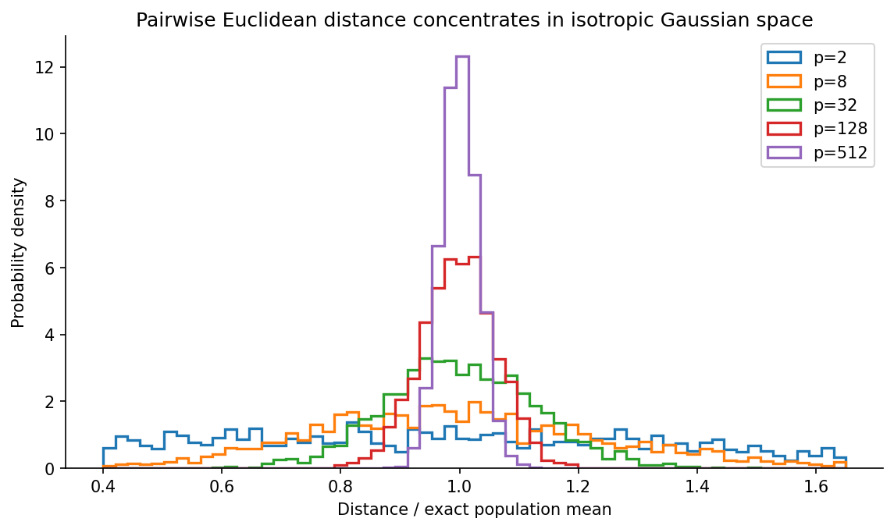
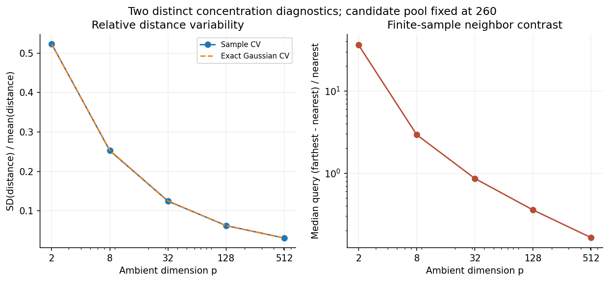
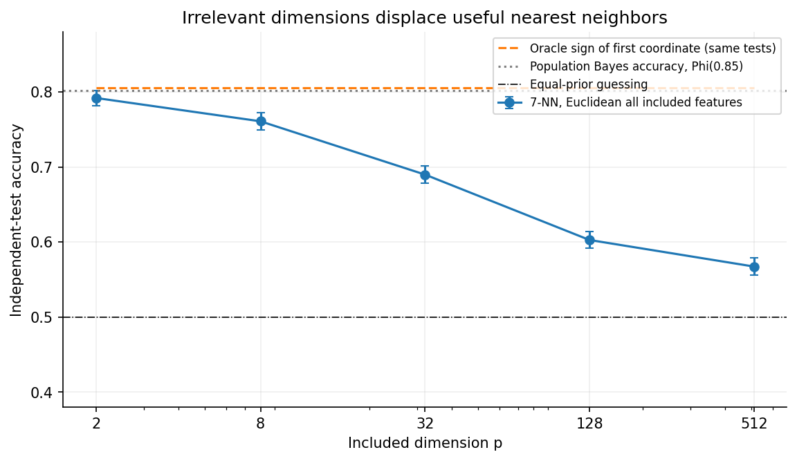
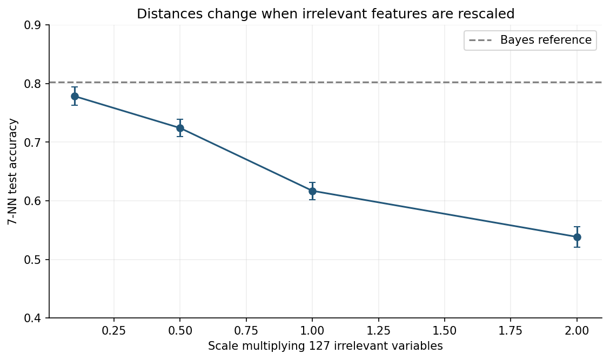
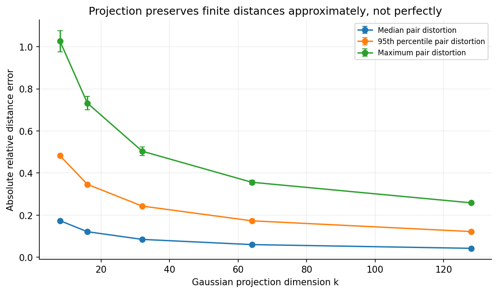
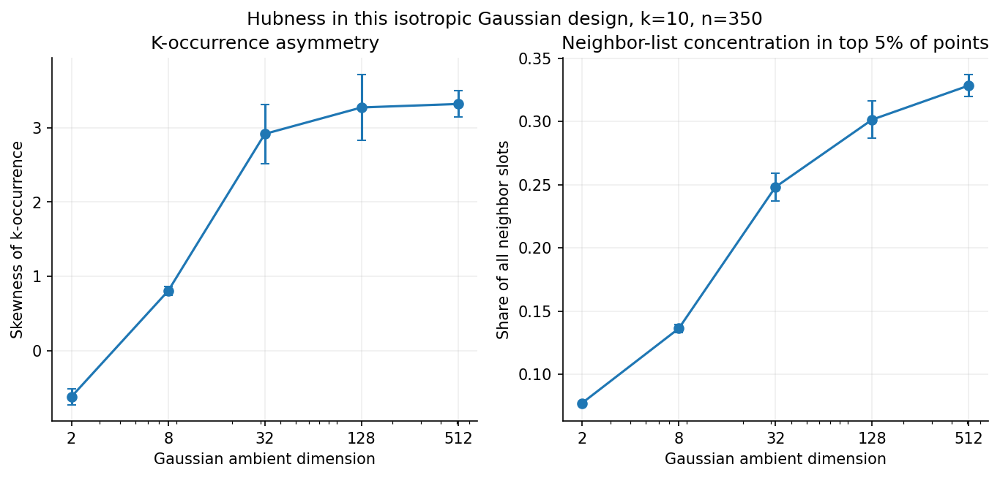
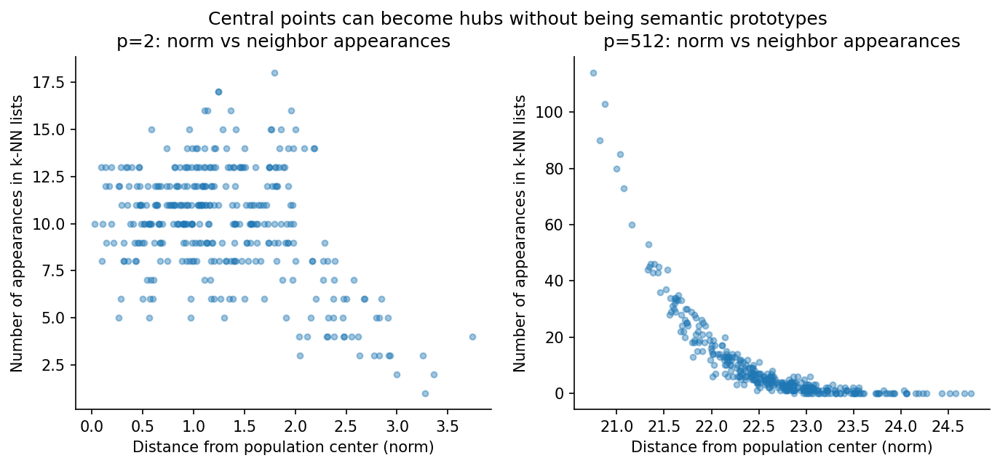
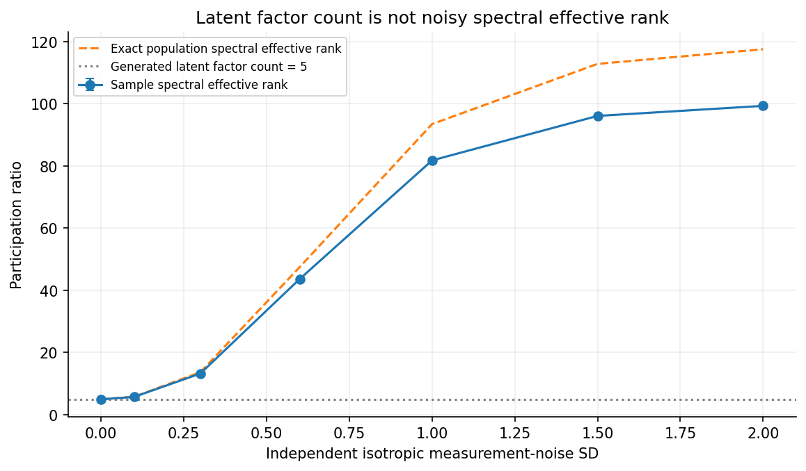
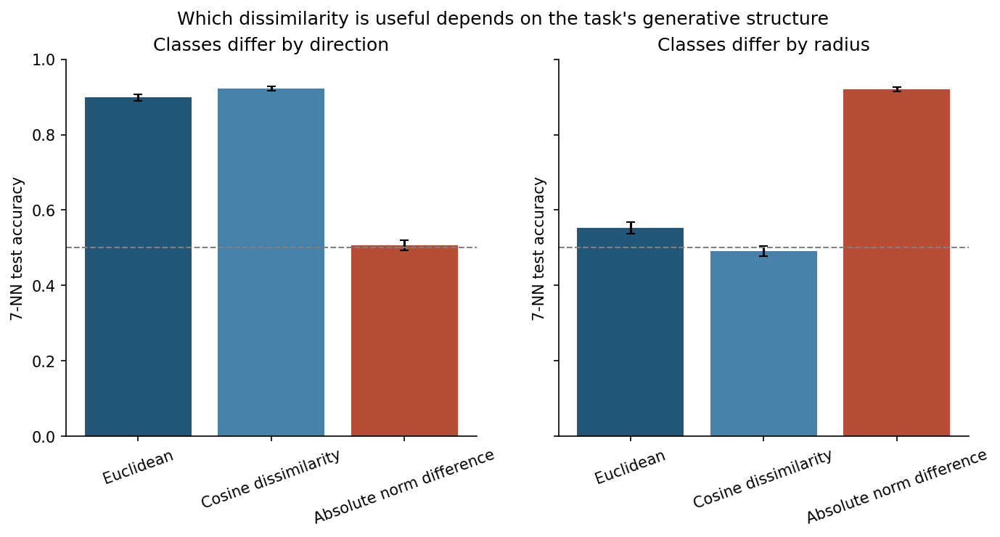

# A Nearest Neighbor Is Not Necessarily Similar: Distance Concentration, Hubness, and the Geometry of High-Dimensional Data

*Article #16 · A mathematical and reproducible investigation · 31 October 2026*

> **Abstract.** Nearest-neighbor methods turn a ranking by numerical distance
> into a claim about similarity. That move is sometimes useful and sometimes
> disastrously misleading. As the number of measured dimensions grows,
> pairwise Euclidean distances can become relatively concentrated; irrelevant
> coordinates can overwhelm a fixed predictive signal; particular observations
> can appear in many other observations' neighbor lists; and different
> dissimilarities can favor entirely different notions of resemblance. None of
> these statements means that every high-dimensional nearest-neighbor system
> must fail. Their validity depends on the distribution, metric, representation,
> sampling, query mechanism, and downstream task. We derive the exact distance
> moments for isotropic Gaussian vectors, construct a fixed-Bayes-information
> classification experiment, examine nuisance scaling and randomized distance
> preservation, quantify hubness and spectral effective dimension, and contrast
> directional with radial labeling mechanisms. Nine original figures and
> eighteen machine-readable tables come from seeded, tested Python code and
> an executable notebook. Throughout, we distinguish mathematical identities
> from finite Monte Carlo observations, predictive performance from semantic
> validity, and approximate search from the underlying geometry.

## 1. When a ranking quietly becomes a judgment

Suppose a document-retrieval system returns the five vectors closest to a
question embedding. The software has done exactly what was requested: it has
found five points ranked by an implemented distance. But consider the sequence
of claims that people often infer from this operation. The returned vectors
are close; therefore their documents are similar; therefore they are relevant
to the question; therefore using them will improve an answer. Those are four
different propositions. Only the first is established by the distance
calculation. The others require assumptions about representation quality,
supervised objectives, neighborhood structure, ground truth, and the cost of a
wrong retrieval. A nearest neighbor is necessarily nearest *under the chosen
rule among the chosen candidates*. Nothing in the definition makes it useful.

This distinction is easy to overlook in low-dimensional textbook examples.
Two points on a map are close by a natural, interpretable geometric measure.
Two RGB colors can have small numerical separation, although even there the
distance may poorly approximate perceptual difference. In a dataset of 512
features, however, there is no guarantee that each coordinate carries
comparable meaning, that units have been standardized appropriately, or that
all directions of variation deserve equal weight. The algorithm accepts a
numeric matrix; the problem supplies a notion of relevant resemblance.
Those are not the same object.

Nearest-neighbor reasoning is not an obscure corner of modern computing.
It appears in classification, imputation, recommendation, anomaly detection,
similarity search, clustering, approximate indexes, biological matching, and
learned vector retrieval. Cover and Hart's classical analysis [1] gave an
important theoretical basis for nearest-neighbor classification. Later work
by Beyer and colleagues [2], Aggarwal and colleagues [3], and Radovanović and
colleagues [4] examined conditions under which high-dimensional neighbors
become difficult to interpret. Random projection, including the
Johnson–Lindenstrauss result [5, 6], provides a more constructive message:
some aspects of finite-set geometry can survive dramatic compression.

The point of this article is neither to declare nearest-neighbor methods
broken nor to rehabilitate them with an unqualified recipe. We want to ask
what the distance actually measures, when its ordering becomes fragile, and
what evidence would justify using the ordering for a particular decision.
The empirical component consists solely of **synthetic** experiments whose
mechanisms we specify. That choice permits known mathematical references and
controlled interventions on feature geometry; it does *not* provide a field
benchmark on image retrieval, language embeddings, medical records, or search
engines. We return to that external-validity boundary repeatedly.

Our nine figures follow eight connected questions. How variable are Gaussian
pair distances? How far apart are the nearest and farthest candidates in a
finite set? Can nearest-neighbor accuracy fall while the Bayes classification
problem stays unchanged? Does changing arbitrary nuisance units matter? What
does a random projection actually preserve? Why do some observations become
popular neighbors? How does noise change measured dimension? And which notion
of similarity does a task reward? Each question uses a deliberately modest
design with inspectable tables, rather than an opaque benchmark that happens
to support a preferred story.

## 2. Three meanings of dimension—and why the distinction is foundational

Write a feature vector as \(x=(x_1,\ldots,x_p)\in\mathbb R^p\). Its **ambient
dimension** \(p\) is the number of coordinates presented to the algorithm.
That number is unambiguous but often uninformative about how the data are
distributed. A vector with 512 entries could vary in 512 independent
directions, or it could be generated from five latent variables and then
encoded redundantly in hundreds of coordinates. In the second case its
ambient representation is high dimensional even if the underlying noiseless
linear support has dimension five.

The **intrinsic dimension** of a distribution is more subtle. Sometimes it
means the dimension of a smooth manifold supporting the observations. In
other settings it means the local scaling of neighbor counts, a latent factor
dimension, or the statistical complexity of a representation. Those need not
agree. Measurement noise can move an otherwise low-dimensional cloud into
full ambient support. A discontinuous or mixed distribution may not have a
single useful manifold dimension. Estimates depend on neighborhood scale,
sample size, and assumptions about smoothness. Levina and Bickel [7] develop
one local neighbor-based intrinsic-dimension estimator; it is not the same
quantity as the spectral diagnostic we compute later.

**Effective dimension** usually denotes an intentionally chosen summary of
how variation is distributed across directions. For covariance eigenvalues
\(\lambda_1,\ldots,\lambda_p\geq0\), we will use the participation ratio

\[
 d_{\mathrm{PR}}(\Sigma)
 =\frac{\left(\sum_{j=1}^{p}\lambda_j\right)^2}
 {\sum_{j=1}^{p}\lambda_j^2}
 =\frac{\{\operatorname{tr}(\Sigma)\}^2}
 {\operatorname{tr}(\Sigma^2)}.
\]

For equal positive eigenvalues on exactly \(q\) axes, this expression is
\(q\). If almost all variance lies in one axis, it is near one. For a
nonzero positive-semidefinite matrix, Cauchy–Schwarz implies
\(1\le d_{\mathrm{PR}}\le\operatorname{rank}(\Sigma)\le p\). Multiplying all
features by a common constant scales covariance eigenvalues uniformly and
leaves the ratio unchanged; anisotropic rescaling generally changes it.
Importantly, Roy and Vetterli's **entropy-based effective rank** [8] uses
the exponential of spectral entropy, not this participation ratio. Both are
informative but they are different statistics. Calling either one *the*
intrinsic dimension erases useful distinctions.

There is a second ambiguity about dimension: the **dimension relevant to a
decision** may be smaller than every conventional data dimension. Imagine
binary labels determined by the first coordinate, with hundreds of other
independent coordinates recorded because sensors happened to measure them.
The joint distribution fills a high-dimensional space. Yet the Bayes decision
requires just one coordinate. A representation-selection method that knows
which direction matters can ignore the others. A Euclidean distance that
weights them all equally cannot. In such examples, the number of recorded
features is not a measure of predictive complexity. It is a measure of the
burden that the chosen algorithm voluntarily accepts.

These distinctions provide an immediate defense against overstatement. The
phrase *curse of dimensionality* is shorthand for several different
phenomena: local sample sparsity, unstable neighbor rankings, variance of
distance-based estimators, computational burden, and failures of a particular
representation. Some are related, but a computational nearest-neighbor index
could be very fast while returning meaningless neighbors. Conversely, a
problem could have a statistically useful metric but be too expensive to
search exactly at production scale. We must state which obstacle a method
addresses before claiming that it has solved anything.

## 3. Gaussian pair distances: an exact calculation, not a slogan

Start with a model whose geometry we can analyze without simulation. Let
\(X,Y\stackrel{\mathrm{iid}}{\sim}\mathcal N_p(0,I_p)\), with \(X\) and \(Y\)
independent. Their difference is \(X-Y\sim\mathcal N_p(0,2I_p)\). Therefore

\[
 D=\|X-Y\|_2
 \overset{d}{=}\sqrt{2}\,\chi_p,
 \qquad
 \frac{D^2}{2}=\sum_{j=1}^{p}Z_j^2\sim\chi^2_p,
\]

where the \(Z_j\) are independent standard normal variables. This identity
gives immediate exact moments:

\[
 \mathbb E[D^2]=2p,
 \qquad
 \mathbb E[D]
 =2\,\frac{\Gamma\{(p+1)/2\}}{\Gamma(p/2)},
 \qquad
 \operatorname{Var}(D)
 =2p-\bigl(\mathbb E[D]\bigr)^2.
\]

The gamma function, \(\Gamma(t)=\int_0^\infty u^{t-1}e^{-u}\,du\), extends
the factorial. For large \(p\), Stirling-type expansions of the gamma ratio
yield \(\mathbb E[D]=\sqrt{2p}\{1-1/(4p)+O(p^{-2})\}\) and
\(\operatorname{Var}(D)=1+O(p^{-1})\). Thus the **absolute** standard
deviation approaches roughly one even while the mean distance grows as
\(\sqrt{2p}\). The relative variability declines:

\[
 \operatorname{CV}(D)
 =\frac{\sqrt{\operatorname{Var}(D)}}{\mathbb E[D]}
 =\frac{1}{\sqrt{2p}}\{1+O(p^{-1})\}.
\]

It is important to read the asymptotic correctly. We have not shown that all
distances become equal in absolute units. We have shown that, in this
isotropic Gaussian model, their variation becomes small **relative to their
increasing scale**. In other geometries—heavy-tailed norms, separated
clusters, anisotropic covariance, sparse binary vectors, or representations
normalized to a sphere—the numerical pattern can differ. The full theorem
is a conditional mathematical statement, not a property of the integer
\(p\) in isolation.

Figure 1 draws 2,100 **independent pair differences** per dimension
\(p\in\{2,8,32,128,512\}\). To avoid reusing the dependent
\(\binom n2\) edges of one point cloud as if they were independent samples,
each simulated difference is generated directly from
\(\mathcal N_p(0,2I_p)\). Each distance is normalized by its exact
population mean. The distributions narrow visibly as \(p\) increases.

The checked-in table `results/distance_summary.csv` reports both empirical
and exact reference moments. For \(p=2\), the empirical coefficient of
variation is approximately **0.523**, while for \(p=512\) it is approximately
**0.0313**; the exact Gaussian coefficient at \(p=512\) is also about
**0.0313**. These are not estimates of a new universal constant. They show
that the implementation reproduces the known model well in a finite run.
The code computes the gamma ratio in log space with `scipy.special.gammaln`
to avoid overflow in moderately large dimensions. Unit tests also check
\(\mathbb E[D]^2+\operatorname{SD}(D)^2=2p\) directly.

Why does concentration matter for neighbors? A distance algorithm operates
on **differences** between candidate distances, not only on their marginal
spread. If the absolute gap between two candidates is small relative to
measurement error, numerical precision, representational drift, or stochastic
changes in the query, their ordering can be fragile. But a small global
coefficient of variation does not by itself prove unstable rankings. The
relevant gaps also depend on the number of candidates, dependencies among
distances that share a query, and the local conditional distribution. We
therefore examine a separate nearest-to-farthest contrast instead of assuming
that one summary statistic answers every question.

## 4. Farthest versus nearest: the finite candidate pool matters

Consider a query \(q\) and a fixed candidate set
\(\{x_1,\ldots,x_m\}\). Define ordered distances
\(D_{(1)}(q)\le\cdots\le D_{(m)}(q)\), where
\(D_i(q)=\|q-x_i\|_2\). A commonly studied relative contrast is

\[
 C(q)=\frac{D_{(m)}(q)-D_{(1)}(q)}{D_{(1)}(q)}.
\]

This statistic is zero when the nearest and farthest distances coincide,
positive otherwise, and potentially very large when the nearest distance
approaches zero. It is *not* the coefficient of variation of independent
pair distances. The two summaries use different sampling schemes, different
denominators, and different parts of the order-statistic distribution.
Treating them as interchangeable is a mathematical error.

In each of fourteen independent replications per dimension, our experiment
samples 260 Gaussian candidate vectors and 100 independent Gaussian queries.
Each query sees the same 260 candidates within its replication, inducing
dependence between its 260 distances. We compute the contrast for every
query, take the **median across queries** for that replication, and then
average those fourteen medians. This statistic is intentionally resistant
to extreme small-denominator observations. We also archive the mean
query contrast separately so that readers can see the impact of that choice.
The number of candidates is held fixed while dimension changes; otherwise
the geometry and the size of the nearest-neighbor search pool would change
simultaneously.

Figure 2 compares two phenomena. Its left panel shows simulated distance CV
beside the exact Gaussian reference. Its right panel plots across-replication
mean median-query contrast on a logarithmic vertical axis. In this setup the
contrast drops from about **36.15** at \(p=2\) to about **0.164** at
\(p=512\). The large low-dimensional contrast partly reflects the existence
of very nearby candidates in two dimensions; it is not evidence that
high-dimensional distances acquire a universal contrast value of 0.164.
The whiskers show \(1.96\) times the Monte Carlo standard error of the
replication mean, a descriptive measure of simulation precision.

Theoretical caution is necessary here. Beyer and colleagues [2] analyze
conditions under which the relative contrast of nearest and farthest
neighbors degenerates for certain distance functions and distributions.
Their results should not be collapsed into the slogan *all high-dimensional
neighbors are meaningless*. A mixture of well-separated clusters may retain
highly informative neighborhoods even if within-cluster pair distances
concentrate. Binary sparse vectors may have meaningful overlap patterns
despite a large number of features. Features selected by supervision can
preserve predictive discrimination that unweighted ambient Euclidean
distance would otherwise obscure. And when candidate count grows rapidly
with dimension, nearest-neighbor order statistics can behave differently.

This is also where the language of **relative** and **absolute** distances
becomes important in practice. Suppose one candidate is 0.1 units closer
than another in an embedding norm around 20. A 0.5% gap may be meaningful if
the encoder and measurement process have tiny uncertainty, but meaningless
if training randomness or representation drift routinely moves vectors by
larger amounts. A contrast plot does not calibrate that uncertainty. A
downstream application needs repeated queries, human relevance annotations,
or controlled perturbations to learn whether the observed margin predicts a
real decision advantage. Geometric contrast is a diagnostic, not a validation
label.

## 5. An unchanged Bayes problem can still defeat all-features 7-NN

The most useful distinction in the article is between *information in the
data* and *information accessible to a specific algorithm*. We construct a
binary classification task whose population optimum is identical across
every investigated ambient dimension. Draw \(Y\sim\operatorname{Bernoulli}
(1/2)\). Conditional on \(Y=y\), generate the first coordinate as

\[
 X_1\mid Y=y\sim\mathcal N\bigl((2y-1)a,1\bigr),\qquad a=0.85,
\]

and, independently of \(X_1\) and \(Y\), let
\(X_j\sim\mathcal N(0,1)\) for all \(j\ge2\). For each experiment
replication we first draw the entire 512-coordinate matrix, then expose the
same data at dimensions \(2,8,32,128,512\) by truncation. Training and
test observations are separate. This pairing makes changes across dimension
more interpretable because sample draws do not change at each step.

Derive the Bayes rule. Since the class priors are equal, we compare the
conditional densities of the first coordinate. Their log likelihood ratio is

\[
 \log\frac{f(X_1\mid Y=1)}{f(X_1\mid Y=0)}
 =-\frac{(X_1-a)^2-(X_1+a)^2}{2}
 =2aX_1.
\]

Every nuisance-coordinate density cancels from the likelihood ratio, because
it is the same under both labels. Therefore the Bayes decision is
\(g^*(x)=\mathbf 1\{x_1>0\}\). Its class-conditional success probabilities
are both \(\Pr\{N(a,1)>0\}=\Phi(a)\), where \(\Phi\) is the standard normal
cumulative distribution function. Hence

\[
 \Pr\{g^*(X)=Y\}=\Phi(0.85)\approx0.80234
\]

**for every ambient dimension we examine**. The irreducible Bayes error,
\(1-\Phi(0.85)\approx0.19766\), cannot be improved by the irrelevant
coordinates. More importantly, adding them does not make the underlying
classification problem intrinsically harder for a method capable of
identifying the first signal coordinate.

We train a simple 7-nearest-neighbor majority vote using unweighted
Euclidean distance on **all included coordinates**, with 260 training
observations and 160 independent test observations. The experiment repeats
36 times with independent random streams; it records test accuracy of 7-NN,
test accuracy of the known oracle sign rule, and the population Bayes
reference. There is no training-based tuning of \(k=7\), no selection of a
favorable random seed, and no feature selection. The point is to isolate a
method's response to irrelevant dimensions, not optimize its score.

For two observations \(x,x'\) and \(p\) included coordinates, squared
Euclidean distance decomposes into

\[
 \|x-x'\|_2^2
 =(x_1-x_1')^2
 +\sum_{j=2}^{p}(x_j-x'_j)^2.
\]

Only the first term can carry class information in this design. Each
additional nuisance coordinate contributes another nonnegative random term
to the ranking. Its expected contribution to a pairwise squared distance
is two. Across many coordinates, nuisance variation can dominate the
differences induced by the single predictive coordinate. The complete
Euclidean ranking may therefore assign nearby status to points whose labels
are unrelated to the query. This is an algorithmic mismatch to the signal
structure, not an information-theoretic impossibility of classification.

Figure 3 shows the outcome. Across the 36 simulations, mean test accuracy
falls from about **0.792** at \(p=2\) to **0.567** at \(p=512\), even though
the Bayes reference remains approximately **0.802**. The oracle accuracy
fluctuates across the finite test samples but uses the same underlying
test observations at every dimension within each replication. The archived
`classification_replicates.csv` makes that pairing visible; the summary
includes Monte Carlo standard errors rather than presenting bare means as
precise population facts.

This experiment does *not* prove that nearest-neighbor classification is
inconsistent in high dimensions, that all \(k\) values would behave alike,
or that a learned metric could not recover the signal. Classical asymptotic
results for nearest-neighbor rules [1] concern sampling regimes and
regularity conditions that differ from our fixed \(n=260\), growing-\(p\)
design. A sufficiently effective feature-selection procedure, supervised
linear classifier, or valid domain-specific representation could recover
much of the attainable accuracy. We hold the training sample fixed to show
how a plausible default **can** fail—not to claim that every reasonable
procedure **must** fail.

## 6. Distance is a choice of units disguised as a formula

The previous experiment treated every recorded feature as commensurate.
That assumption is easy to make implicitly: a developer stacks columns of a
numeric table and computes the ordinary Euclidean norm. But Euclidean
distance is not invariant to changes in the units of individual features.
If one sensor reports seconds rather than milliseconds while another reports
meters, the relative numerical weights of those measurements change even
if their physical content does not. Standardization, normalization,
clipping, and learned transformations are all interventions on the model's
geometry. They are not merely cosmetic preprocessing steps.

Mathematically, let \(S=\operatorname{diag}(s_1,\ldots,s_p)\) represent a
diagonal change of feature scale. The Euclidean distance after transformation
is

\[
 \|Sx-Sx'\|_2^2
 =\sum_{j=1}^{p}s_j^2(x_j-x'_j)^2.
\]

This is a weighted Euclidean distance in the original coordinates. In a
general linear transformation \(A\), the same identity becomes

\[
 \|Ax-Ax'\|_2^2
 =(x-x')^\top A^\top A(x-x'),
\]

which is a Mahalanobis-type quadratic form with positive-semidefinite
weight matrix \(M=A^\top A\). When \(M\) is positive definite, the
square-root quadratic form is a metric; when it is singular, distinct points
in its null space can have distance zero, producing a pseudometric.
This algebra shows why statements such as *we use Euclidean distance*
are incomplete without specifying the representation and preprocessing.

To isolate the role of scaling, we retain the exact binary signal model from
Section 5 but fix ambient dimension at \(p=128\). In every replication, only
the **127 irrelevant coordinates** are multiplied by a shared factor
\(s\in\{0.1,0.5,1,2\}\). The predictive first coordinate is left
unchanged. The Bayes rule and its accuracy stay the same. Euclidean 7-NN
now compares squared differences of the form

\[
 d_s(x,x')^2=(x_1-x_1')^2
 +s^2\sum_{j=2}^{128}(x_j-x'_j)^2.
\]

For a generic pair, the nuisance sum has expectation \(2\times127=254\).
At \(s=0.1\), its expected contribution is roughly \(2.54\); at \(s=2\),
it is roughly \(1{,}016\). Those numbers are not the typical gaps between
neighbors—ranking depends on differences *between candidate distances*—but
they show how dramatically feature units can shift geometric emphasis
without altering label information. The four scales are applied to the
same train/test draw within each of 28 repetitions, keeping the comparison
paired.

Figure 4 documents mean test accuracy near **0.779** with nuisance scale
\(0.1\) and **0.538** with scale \(2\). The intermediate values, standard
errors, and all replicate results are archived in the scale tables. This is
not a recommendation to multiply all nuisance features by 0.1 in practice.
The experimenter knows which coordinates are irrelevant because the data
were generated; a real analyst rarely has that privilege. A procedure that
uses evaluation labels to discover the best scale and then reports accuracy
on those same labels would overfit. Scaling rules must be fixed from
substantive units, estimated within training folds, or tuned on a separate
validation set.

Even familiar standardized features deserve scrutiny. Z-scoring gives
coordinates comparable marginal variance, not comparable relevance.
High-variance coordinates are not necessarily noise, and low-variance
coordinates are not necessarily useless. A rare but discriminative feature
may be critically important; an abundant standardized proxy may still be
irrelevant or leak the target. Whitening transforms covariance but can
amplify measurement noise along small-variance directions and becomes
unstable when covariance estimates are poor. Metric learning is potentially
valuable precisely because supervised signal is not identified by marginal
scale alone—but it also introduces model selection, data leakage, and
generalization obligations. Representation choice is part of the scientific
claim, not a preliminary administrative chore.

## 7. Johnson–Lindenstrauss: geometry can survive compression

Distance concentration can sound fatalistic: if a high-dimensional space is
troublesome, perhaps no useful distance can remain. The
Johnson–Lindenstrauss (JL) result gives an essential corrective. Given a
finite set of \(n\) points in Euclidean space and a desired distortion
\(0<\varepsilon<1\), one can map the points to a much lower dimension
\(k\) on the order of \(\varepsilon^{-2}\log n\) while approximately
preserving their pairwise Euclidean distances, with suitable constants and
probability qualifications [5, 6]. The important feature is that the target
dimension depends logarithmically on the **number of points**, rather than
linearly on the original ambient dimension.

Our experiment uses an uncomplicated Gaussian random map. Let
\(R\in\mathbb R^{p\times k}\) have independent entries
\(R_{ij}\sim\mathcal N(0,1/k)\), and set \(f(x)=xR\). For any *fixed*
difference vector \(v=x-y\), the coordinates of \(vR\) are independent
normals with variance \(\|v\|_2^2/k\). Consequently,

\[
 \frac{\|vR\|_2^2}{\|v\|_2^2}
 \overset d=\frac{\chi_k^2}{k},
 \qquad \mathbb E\|vR\|_2^2=\|v\|_2^2.
\]

This gives both the intuition and a warning. The squared distance is
preserved **in expectation** for a fixed pair, but a single random map
still causes distortion. Standard chi-square concentration bounds imply,
for suitable universal constants \(c>0\),

\[
 \Pr\left(\left|\frac{\|vR\|_2^2}{\|v\|_2^2}-1\right|>
 \varepsilon\right)
 \le 2\exp(-c k\varepsilon^2)
\]

for an appropriate range of \(\varepsilon\). A finite set of \(n\)
points has at most \(n(n-1)/2\) distinct unordered pairs. Applying a union
bound, the probability that **at least one** pair violates the desired
squared-distance tolerance is at most

\[
 n(n-1)\exp(-c k\varepsilon^2).
\]

Choosing \(k\) sufficiently large relative to
\(\varepsilon^{-2}\log(n/\delta)\) makes this failure probability at
most \(\delta\). This is a proof sketch, not an attempt to optimize
constants; precise theorem statements and a careful elementary proof are
available from Dasgupta and Gupta [5]. Achlioptas [9] also investigates
computationally convenient random projections. Notice that the guarantee
concerns the finite set chosen in advance and the randomness of the map.
It is not a free guarantee about every future adversarially selected query.

For the numerical demonstration we draw 170 fixed isotropic Gaussian points
in \(p=256\). That set has exactly
\(\binom{170}{2}=14{,}365\) distinct pairwise distances. For each target
dimension \(k\in\{8,16,32,64,128\}\), we sample 20 independent Gaussian
projection matrices. For each matrix we calculate the absolute relative
distance distortion for every pair,

\[
 E_{ij}=\frac{\big|\|f(x_i)-f(x_j)\|_2-
                      \|x_i-x_j\|_2\big|}{\|x_i-x_j\|_2},
\]

and archive the median, 95th percentile, and maximum across the pairs.
Because all pair errors within one projection share the same random matrix
and original point set, we do **not** treat the 14,365 errors as 14,365
independent projection repetitions. Monte Carlo standard errors summarize
the 20 independent maps. The dataset remains fixed across target dimensions;
the exercise isolates the map rather than resampling the source geometry.

The mean 95th-percentile absolute relative error is about **0.482** at
\(k=8\) and **0.122** at \(k=128\), in this finite experiment. These
numbers do not constitute a universal dimension-selection table. They depend
on the chosen fixed point cloud, projection family, distortion statistic,
and sample of maps. They do illustrate a constructive possibility: many
pairwise relationships may survive a much smaller representation with
quantifiable, nonzero error.

But distance preservation is narrower than semantic preservation. If an
original distance metric is uninformative for the task, preserving it very
accurately also preserves much of that irrelevance. A random projection
that maintains distances to within ten percent does not imply that the
nearest candidate retains the same identity when the gap between candidates
is one percent. Uniform *relative distance* control only preserves rankings
whose original margins are sufficiently large. Nor does JL provide a
supervised guarantee about classification accuracy, fairness, human
relevance, or an out-of-sample retrieval population. Its virtue is precision
about what is protected; we should not ask it to certify what it never
claimed to protect.

## 8. Hubness: popularity inside a neighbor graph

Pairwise concentration is not the only problem a distance-based system can
develop. Construct a directed \(k\)-nearest-neighbor graph on points
\(x_1,\ldots,x_n\). Each point has edges to its \(k\) nearest *other*
points. Define the \(k\)-occurrence count of point \(i\) by

\[
 N_k(i)=\sum_{j=1}^{n}\mathbf 1\{i\in\operatorname{kNN}(j)\},
\]

where the query point itself is excluded. Each query contributes exactly
\(k\) neighbor slots, so counting the same directed edges two ways gives
the nonnegotiable identity

\[
 \sum_{i=1}^{n}N_k(i)=nk,
 \qquad
 \frac1n\sum_{i=1}^{n}N_k(i)=k.
\]

This conservation law makes an important asymmetry clear. If some points
appear dramatically more often than \(k\), others must appear less often.
We call unusually popular points **hubs**, and points that almost never
appear in any lists **antihubs**. Hubness concerns the in-degree distribution
of a directed neighbor graph. It is not the same as having many reciprocal
neighbors, being dense under a particular density estimator, or being a
semantically central document. It can be measured without any label
information whatsoever. Radovanović and colleagues [4] provide an influential
analysis of this phenomenon in high-dimensional data.

Our controlled design samples \(n=350\) observations from
\(\mathcal N_p(0,I_p)\) at each of five ambient dimensions and builds
exact Euclidean \(k=10\) neighbor lists with self-edges excluded. There are
12 independent clouds per dimension. We summarize three related aspects:
the skewness of the 350 \(N_{10}(i)\) values; the share of all 3,500 slots
occupied by the 5% most popular points (rounded up to an integer count);
and the sample correlation between each point's norm and its occurrence
count. Each summary has its own interpretation and weaknesses. Skewness
is sensitive to outliers; top-share is bounded and descriptive but depends
on the chosen 5% cutoff; correlation can miss nonlinear relationships.

Figure 6 shows strongly changing neighbor-list concentration. The mean
top-5%-of-points share grows from approximately **7.73%** at \(p=2\)
to **32.85%** at \(p=512\). Mean skewness changes from approximately
**−0.62** to **3.32**. A uniform assignment of exactly ten slots per
point would allocate about 5% of slots to any particular 5% subset, but
our experiment is neither uniform nor a hypothesis test against that
reference. We chose the top subset *after* observing counts, so its share
is necessarily at least the population fraction, and the effective top
fraction is slightly larger than 5% because 18 of 350 points are selected.
The numbers are evidence for this model's hub distribution, not a theorem
about every high-dimensional distribution.

Why might hubs appear in a Gaussian cloud? A useful intuition begins with
norms. Even when observations arise from the same isotropic distribution,
some points lie relatively close to the population center. In high
dimensions, many different queries can find those central points somewhat
closer than more extreme observations, making the central points frequently
selected. This is a mechanism, not an identity: the correlation depends on
the distance, distribution, sample size, normalization, and presence of
clusters. One should not infer that the point with smallest norm *must*
be the largest hub in a particular sample.

Figure 7 plots the norm of each point against the number of appearances in
other points' lists for one \(p=2\) and one \(p=512\) replication. The
original per-point values are archived in
*results/hub_example_counts.csv*, allowing more than a visual anecdote.
The plot illustrates how geometric centrality can contribute to neighbor
popularity without assigning any semantic value to it.

In a retrieval system, a hub might be a broadly worded document repeatedly
returned for unrelated queries. In a nearest-neighbor classifier, the same
training observation might influence many predictions. But the mapping from
our Gaussian hubs to any real embedding system is only an analogy. Learned
vectors can be normalized, anisotropic, multimodal, or trained explicitly
to control neighborhood structures. Measuring hubness on the deployed
representation is necessary before claiming that a particular system has
this issue. Even after observing hubs, judging them harmful requires
relevance labels or task loss: a genuinely useful reference could correctly
be retrieved for many questions.

## 9. Diagnosing hubs without mistaking them for errors

Hubness diagnostics are often presented as if reducing skewness were an end
in itself. That would be a mistake. A neighbor graph with perfectly even
in-degree can still contain irrelevant edges. Imagine a dataset in which
every query retrieves an arbitrarily assigned different document. Popularity
would be balanced, but retrieval quality would be awful. Conversely, in a
specialized knowledge base one canonical specification may genuinely be
relevant to thousands of requests. Removing it from results merely to
equalize occurrence counts could worsen performance. The target is a
decision-relevant error measure, not a prettier histogram.

A useful audit should separate at least four questions. First, **does the
phenomenon exist?** Count occurrences under the actual metric and query
distribution, with an explicit policy for self-neighbors, ties, duplicate
vectors, and candidate availability. Second, **is it stable?** Compare
occurrence rankings across time, bootstrap samples of queries, and
representation versions. Third, **is it associated with error?** Within
predefined relevance strata, examine precision, false-positive rate,
calibration, or downstream task cost for hub-involving and other retrievals.
Fourth, **does an intervention help?** Compare candidate transformations,
local scaling, or re-ranking on a clean test set, including latency and
resource costs. These are separate empirical obligations.

One common temptation is to estimate neighbor popularity on the same query
set used to judge an adjusted ranking. If a re-ranking method explicitly
penalizes points with high occurrence and the analyst chooses the penalty
to maximize the reported test score, the evaluation has leaked information
from test queries. Even without label leakage, adapting to one evaluation
distribution may fail under another distribution's query mix. Temporal
splits or predeclared cross-validation procedures are preferable when
queries drift or contain repeated users, products, or documents. Hold-out
construction matters as much as the geometry.

Hubness also interacts with approximate search. An index may return a
subset of near neighbors rather than the exact top \(k\). Its observed
occurrence counts therefore reflect both representation geometry and the
index's algorithmic selection bias. Partitioning, search budgets,
quantization, candidate pruning, and insertion order can all alter which
points are exposed. The most defensible audit compares approximate results
against an exact baseline on a manageable stratified sample, reports
recall relative to the chosen metric, and separately asks whether either
ranking is semantically useful. Exact-search recall is not the same thing as
relevance precision.

Finally, hubness can have a distributional fairness dimension even when
no protected label appears in the vector. If a small set of items receives
most exposure, it may dominate recommendation opportunities or the
evidence presented to a language model. Whether this is harmful depends
on the true value and constraints of exposure. A sensible investigation
reports allocation and outcome metrics across justified groups while
avoiding causal attribution without an identification strategy. Our
Gaussian study does none of that applied work. Its contribution is to
make the counting issue visible, testable, and explicitly conditional.

## 10. Five latent factors, one hundred apparent directions

High-dimensional difficulty often depends less on the number of columns
than on how variation is distributed across them. Our spectral experiment
begins with a transparent latent factor model. Generate a matrix
\(B\in\mathbb R^{120\times5}\) with orthonormal columns, a latent vector
\(Z\sim\mathcal N_5(0,3I_5)\), and isotropic observation noise
\(\varepsilon\sim\mathcal N_{120}(0,\sigma^2I_{120})\), independently.
The observed vector is

\[
 X=BZ+\varepsilon,
 \qquad \Sigma_X=3BB^\top+\sigma^2 I_{120}.
\]

Because \(BB^\top\) projects onto a five-dimensional column space,
the population covariance has five eigenvalues \(3+\sigma^2\) and 115
eigenvalues \(\sigma^2\). The generative model has **exactly five latent
factors for every \(\sigma\)**. At zero noise, its covariance rank is
five; at any strictly positive isotropic noise level, the covariance is
full rank 120. The meaning of dimension changes depending on whether we
count latent factors, algebraic support, or an effective spread of variance.

Substituting the eigenvalues into the participation ratio yields an exact
expression:

\[
 d_{\mathrm{PR}}(\sigma)
 =\frac{\left[5(3+\sigma^2)+115\sigma^2\right]^2}
 {5(3+\sigma^2)^2+115\sigma^4}
 =\frac{(15+120\sigma^2)^2}
 {5(3+\sigma^2)^2+115\sigma^4}.
\]

At \(\sigma=0\), the ratio is five exactly. As noise becomes much larger
than the signal scale, all 120 eigenvalues approach equality *relative to
one another*, and the participation ratio approaches 120. This does not
mean the latent factor generator acquires 115 new factors. It means a
covariance summary increasingly describes the widespread noisy variation.
That is precisely why effective dimension must always be interpreted with
its definition and measurement scale attached.

We generate \(n=650\) observations at each of seven noise standard
deviations \(\sigma\in\{0,0.1,0.3,0.6,1,1.5,2\}\), repeating the
experiment 14 times per noise level. The same fixed orthonormal basis is
used across levels, so changes isolate noise magnitude and finite-sample
variation. We compute sample covariance with a \(1/n\) normalization,
then its participation ratio. We also record the number of leading sample
components needed to account for 90% of variance. Neither statistic
recovers *the* intrinsic dimension by definition; they answer distinct
operational questions about spectrum and compression.

At zero noise, the mean sample participation ratio is approximately
**4.956**—close to five, but not identical because empirical eigenvalues
of the five latent components are not perfectly equal. At the largest
noise level \(\sigma=2\), the mean sample ratio is about **99.31**.
Figure 8 includes the *population* formula beside those finite-sample
means, so a discrepancy need not be mistaken for a faulty model.
With finite \(n\), sample eigenvalues fluctuate, and high-dimensional
covariance estimation introduces bias into nonlinear spectral summaries.
The archive includes the population value and the 90%-variance component
count for every replicate.

What should a practitioner do with this finding? First, refrain from
equating the ambient number of embedding coordinates with the number of
independent semantic degrees of freedom. Second, refrain from concluding
that a small number of principal components necessarily carries the
*task-relevant* information: a low-variance direction may predict the
outcome. Third, measure stability of spectral estimates across training
sets and representation versions, especially when sample size is not large
relative to dimension. Fourth, choose the operational question—storage,
distance preservation, denoising, prediction, or interpretability—before
choosing a dimension estimator. Levina–Bickel local methods [7], spectral
participation ratio, and entropy-based rank [8] can all be reasonable
tools without being interchangeable.

## 11. The best dissimilarity depends on what counts as alike

Even when a representation is fixed, the question *similar in what way?*
remains unanswered. A customer may resemble another customer in the
**pattern** of purchases despite spending much more money. A medical signal
may resemble another in waveform shape but differ in absolute amplitude.
For a task predicting energy consumption, amplitude can be precisely the
quantity of interest. A distance that removes magnitude is helpful for one
question and destructive for another. Calling a representation a *vector
embedding* does not settle this semantic choice.

We compare three rules for nonzero vectors \(x,y\in\mathbb R^p\):

\[
 d_E(x,y)=\sqrt{\sum_{j=1}^p(x_j-y_j)^2},
\]

\[
 d_C(x,y)=1-\frac{x^\top y}{\|x\|_2\|y\|_2},
 \qquad
 d_R(x,y)=\big|\|x\|_2-\|y\|_2\big|.
\]

Euclidean distance is a metric. Cosine dissimilarity is invariant to positive
rescaling of either vector and emphasizes direction; the rule \(1-\cos\)
does **not** generally satisfy the triangle inequality, and is undefined
when either vector is zero. The radial rule \(d_R\) satisfies symmetry
and the triangle inequality because it is the absolute distance between
two scalar norms, but it fails identity of indiscernibles on vectors:
\(x\ne y\) can have \(\|x\|_2=\|y\|_2\), giving \(d_R(x,y)=0\).
It is therefore a **pseudodistance** (more precisely a pseudometric),
not a metric on \(\mathbb R^p\). We include it because the radial task
cares about norms, not directions; it is not proposed as a general-purpose
replacement for a valid metric.

We make two intentionally different synthetic classification problems,
both with \(p=12\), 280 training observations, 160 independent test
observations, and 36 replications. For the **angular task**, the binary
label chooses one of two coordinate directions. We draw a positive radius
from a lognormal distribution with log standard deviation 1.25 and
multiply it by a class-specific unit-direction center plus independent
Gaussian coordinate noise of standard deviation 0.45. The large radius
variation is irrelevant to the generating label mechanism but influences
the Euclidean ranking. Normalizing vectors or using cosine dissimilarity
suppresses much of that nuisance scale.

For the **radial task**, we instead draw a random unit direction, independent
of the label, and choose the radius by multiplying either 1.0 or 1.7
(according to the binary class) by a lognormal factor of log standard
deviation 0.18. Here direction is noise and the radius carries the class
separation. Cosine dissimilarity intentionally discards that information;
absolute norm difference preserves it. These mechanisms do not define
two realistic populations, but they make the meaning of similarity
testable with known ground truth.

Figure 9 shows the mean 7-NN test accuracies across independent replicates.
For the angular task, cosine dissimilarity yields approximately **0.923**,
Euclidean distance **0.899**, and norm difference **0.507**. For the
radial task, norm difference reaches approximately **0.920**, Euclidean
distance **0.553**, and cosine dissimilarity **0.492**. The complete
figures, six summary rows, and 216 individual accuracy values are archived
in the metric evidence tables. Each panel compares methods on the *same*
task; we do not compare 0.923 in one task to 0.920 in another and claim that
one distance wins across datasets.

This controlled reversal is a more reliable lesson than a list of popular
similarity functions. Normalization is not a universal improvement. In the
radial task, converting each vector to unit length intentionally destroys
most of the label information. Equally, retaining norms in the angular task
adds variation that obscures the direction signal. A learned cosine
embedding can work extremely well when the representation training objective
aligns angular separation with relevance; unnormalized Euclidean distance
can work extremely well when vector magnitude encodes the target. The
choice should be judged against a specified decision, and the comparison
must evaluate the *whole pipeline*, including how vectors were learned.

There is also a distinction between **neighbor selection** and **decision
aggregation**. Our example uses a majority vote from seven neighbors.
Another system may use distance-weighted votes, regression averages,
retrieval followed by a language model, or a local anomaly score. Even with
identical neighbor rankings, its performance and failure modes can differ.
No single one-number metric comparison substitutes for an evaluation of the
actual downstream decision rule. That limitation is particularly important
when invoking results like ours to justify a production retrieval change.

## 12. When distance concentrates, what actually becomes difficult?

It helps to distinguish three propositions that are often blended together.
First, **marginal distance variability declines** under a specified
distribution: Section 3 establishes that exactly for isotropic Gaussian
pair distances in relative units. Second, **neighbor gaps become small**
for a specified query and candidate process: Section 4 illustrates one
finite-pool contrast statistic, not a universal implication of the first
proposition. Third, **the selected neighbors become unhelpful for a
downstream task**: Section 5 demonstrates that for an all-features
Euclidean 7-NN classifier exposed to independent nuisance coordinates.
These are separate claims requiring separate evidence.

There is no contradiction in observing high relative distance concentration
and excellent classification simultaneously. Imagine two well-separated
Gaussian clusters whose internal pair distances are concentrated. Within
each cluster, far and near distances may look similar; nonetheless the
between-cluster distance can be substantially larger than typical
within-cluster distances. A sensible classifier may still be reliable.
Conversely, even in low dimensions, two classes with complete distributional
overlap cannot be separated better than their Bayes limit by any neighbor
method. Low ambient dimension does not manufacture information that the
generative model lacks.

Neighborhoods also depend on **local density**. A fixed numerical radius
can include many points in one part of a multimodal distribution and none
in another. A globally standardized embedding may combine subpopulations
with different covariance structures or document categories with different
amounts of topical specificity. A single average distance contrast over
the whole dataset can conceal that heterogeneity. Stratified examination
by query category and local support is often more informative than a single
global histogram. This is one reason intrinsic-dimension estimates that
operate at multiple neighborhood scales can be useful—provided their own
bias and sampling limitations are understood.

More generally, a ranking is reliable only relative to the uncertainty in
the representation process. A deterministic distance function does not
imply deterministic input vectors. An encoder can change after retraining,
tokenization rules can change, missing fields can be imputed differently,
measurement devices can be recalibrated, and user intent can drift. If
nearby candidates exchange places under ordinary perturbations, the
top-1 result may be operationally unstable. One practical diagnostic is to
perturb inputs or retrain encoders under a protocol that represents plausible
variation, then measure neighbor-set overlap, rank correlations, and
decision loss. Each diagnostic estimates a different target; high
Jaccard overlap of lists, for example, does not guarantee equal usefulness
of the top item.

The problem of ties deserves attention too. In discrete or heavily
quantized representations, many candidates may have identical reported
distances. A library's sorting behavior, insertion order, or hash iteration
may then choose neighbors arbitrarily. Our synthetic continuous Gaussian
experiments make exact ties overwhelmingly unlikely, except for the
deliberately lossy radial pseudodistance. Real systems may not share that
property. Reproducible evaluation must declare tie handling, floating-point
precision, and whether self-matches or duplicate records are permitted.
Otherwise an apparent change in relevance may be a change in software
ordering rather than in geometric information.

Finally, high-dimensional geometry can be either the problem or the
solution. If classes really differ across hundreds of independent,
well-measured coordinates, aggregating evidence may improve discrimination.
For example, a normalized average of many weak predictive signals can
have a better signal-to-noise ratio than any individual coordinate. Our
adversarial-to-Euclidean design places signal in exactly one coordinate
and independent noise everywhere else. Changing that structure could
reverse the trend. The right claim is not that dimension hurts, but that
**dimension changes the balance between signal, noise, sampling, and the
chosen method**.

## 13. Monte Carlo error bars are not uncertainty about the world

All experiments are seeded so readers can regenerate rather than merely
trust a diagram. Reproducibility does not make a simulation estimate a
universal parameter. Every numerical statement is conditional on its
data-generating mechanism and simulation design. To evaluate evidence,
we must identify the independent unit of replication, quantities held
fixed, summary statistic, and uncertainty source represented by an
error bar.

For a scalar statistic \(T_r\) from independent repetition
\(r=1,\ldots,R\), the summary reports

\[
 \overline T_R=\frac1R\sum_{r=1}^R T_r,\qquad
 \widehat{\operatorname{MCSE}}(\overline T_R)
 =\frac{s_T}{\sqrt R},\qquad
 s_T^2=\frac1{R-1}\sum_{r=1}^R(T_r-\overline T_R)^2.
\]

Where plotted, whiskers show
\(\overline T_R\pm1.96\,\widehat{\operatorname{MCSE}}\).
They describe simulation precision under an independent-replication
interpretation. They are not rigorous finite-sample coverage guarantees
under arbitrary replicate distributions and exclude uncertainty about
whether the data-generating model represents an applied population.
The Gaussian moment formulas are identities without simulation error;
their sample approximations are random quantities.

Pairing is important in the classification design. When dimension rises,
labels, training points, and test points within a replication stay the same;
only additional columns become available. The scaling experiment likewise
applies all factors to the same observations. An inferential comparison of
**differences** should use each replication's paired difference and its
standard error, not combine two marginal error bars as if the samples were
independent. The replication tables preserve those identifiers. The figures
show individual means for readability, but that does not discard the
paired design.

The projection experiment illustrates a different dependence. Its
14,365 pair errors share one random map and many endpoint observations.
The empirical 95th percentile is a valid description of that map on that
fixed cloud. Treating its errors as 14,365 independent map replications
would be pseudoreplication. Our independent units are 20 maps; the source
cloud is fixed. A broader uncertainty statement about possible source
clouds would additionally require resampling clouds.

The 100 queries in each contrast replication share a candidate pool, so
we first compute a per-replication median, then summarize independent
pool replications. In hubness, point occurrence counts within a graph
sum to \(nk\); they are obviously dependent. Independent *graphs*, not
individual points within one graph, supply the Monte Carlo uncertainty
of graph-level skewness and top-share. This discipline matters: a very
narrow interval based on a false independence assumption is not stronger
evidence. Applied systems additionally face repeated users, temporal
drift, annotation disagreement, and changing candidate pools. None of
those external uncertainties is represented by our synthetic whiskers.

## 14. A protocol for evaluating real retrieval systems

If a team suspects its vector search is misleading, the first response
should be a **task definition**, not a new metric. Choose a decision that
retrieval supports: a correct answer, accepted recommendation, relevant
passage, reliable match, or avoidance of an expensive false alarm.
Specify its scoring rule, relevant users, and asymmetry of error costs.
Nearest-neighbor distance has operational meaning only relative to
an outcome or a justified surrogate for one.

Next, construct a test set representing the intended query and candidate
distributions. For documents, consider topics, language, duplication,
recency, and the proportion of new material. For individual records,
repeated people across train and test can create optimistic results.
For time-dependent outcomes, random splits may expose future information
to a supposedly prospective system. Relevance labels need provenance,
adjudication, and where meaningful, agreement assessment. A small
well-described sample can be more persuasive than a much larger
unvalidated convenience dataset.

Establish an **exact-search reference** on a manageable subset. It tells
us which candidates are truly nearest under the current metric, independent
of an approximate index. Record feature transformations, embedding model
version, norm distribution, duplicate policy, filters, numerical precision,
and tie handling. Then compare approximate retrieval with exact retrieval
at the same \(k\) and with the same available candidates. That comparison
estimates approximate-search recall *under the chosen metric*. It does not
measure human relevance or downstream decision quality. An index may be
computationally accurate and semantically poor.

Run geometry diagnostics that match their interpretations: normalized
distance distributions; query-level nearest-to-farthest contrast; margins
between the first few candidates; occurrence-count skewness and top-share;
norm-versus-occurrence relationships; neighborhood stability under
plausible perturbations; and spectral or local dimension summaries.
Stratify by justified query groups and data sources. Random pairs of
database points need not have the same distribution as distances from
actual queries to a filtered candidate pool. Measure the process the
application uses, not the most convenient pair sampler.

Compare **predeclared pipelines**: validated Euclidean features, cosine
with explicit zero-vector handling, appropriate normalization, a learned
or domain-weighted distance, random projection for computational savings,
or re-ranking. Fit scalers and metric-learning models on training data;
select hyperparameters on validation data; evaluate the frozen choice
on an independent test. Report latency, memory, indexing and update cost
alongside relevance and decision loss. The highest scoring option may
violate operational constraints, and a very fast index may fail a minimum
quality threshold.

Finally, quantify uncertainty at the correct unit. If users issue many
queries, a user-cluster bootstrap may be more appropriate than resampling
queries independently. Averages may conceal low-frequency catastrophic
errors. Predefine primary outcomes, report paired improvements and
uncertainty, examine relevant subgroups, and monitor after deployment.
Corpus growth, retrained encoders, data drift, and new metadata filters
can move the observed geometry. No geometric theorem replaces prospective
validation under the operating distribution.

## 15. Limitations and threats to validity

Our strongest limitation is deliberate: **every observation is synthetic**.
Specified mechanisms give exact Bayes references, controlled nuisance
dimensions, and interpretable counterexamples. They do not support direct
claims about a commercial embedding provider, patients, consumers,
or any other real population. The patterns demonstrate possibilities
under selected distributions. Measuring their prevalence requires
representative applications with explicit ground truth, data provenance,
and uncertainty.

The Gaussian calculation assumes independent isotropic coordinates and
Euclidean distance, not heavy tails, sparse vectors, mixtures, anisotropic
covariance, or learned normalization. The finite-pool contrast fixes
260 candidates and uses a median-across-queries statistic whose large
low-dimensional value is sensitive to small nearest distances. The
classification study fixes 260 training examples, 160 test examples,
equal class priors, one useful feature, 7-NN, and a fixed signal amplitude.
It does not tune neighbor count, feature selection, or a metric-learning
model. Its decline is not a proof that Bayes error grows with dimension.

The scaling intervention exploits known nuisance identities that analysts
would have to estimate in real data. The projection analysis fixes
one cloud and varies random maps; its Monte Carlo uncertainty does not
cover random source clouds or future adaptive queries. Distance distortion
is not classification loss. We use exact distances; foundational work
on approximate search by Indyk and Motwani [10] and later developments
[11] concerns a separate computational problem. The hubness example fixes
\(n=350\), \(k=10\), an isotropic Gaussian distribution, and a chosen
top-share cutoff. Different topology, query mix, normalization, and index
algorithms can alter the pattern.

The spectral model has five orthogonal Gaussian factors plus isotropic
noise; participation ratio is not an estimator of semantic or manifold
dimension by fiat. The angular/radial designs were intentionally engineered
to reveal opposite metric preferences and cannot rank methods for real
data. Error bars summarize selected simulation repetitions, not uncertainty
over scientific model choice. Continuous sampling makes exact distance
ties rare; discrete or quantized production vectors require their own
tie policy. Our figures form an explanatory set, not a prespecified
family of confirmatory multiple-hypothesis tests.

We make no causal claim about human populations or the effects of
deploying a retrieval system. We do not evaluate demographic fairness,
user welfare, actual language-model answer quality, changing query
populations, or computational indexing overhead. Those outcomes could
be the subject of applied studies with new data and protocols.
The scientific value here is in explicit assumptions, reproducible
failure examples, and separation of what mathematics establishes from
what external evidence would still have to establish.

## 16. Nearest, similar, and useful are different propositions

The Gaussian calculation proves relative pairwise concentration in a
specified model. Finite-pool contrast summarizes another geometric
property. The fixed-Bayes experiment shows that irrelevant coordinates
can defeat a particular all-features nearest-neighbor classifier without
removing the information needed for classification. Scaling modifies
geometric emphasis; random projection approximately preserves finite-set
distances; hubness makes neighbor-list popularity uneven; spectral
effective rank changes with measurement noise despite fixed latent
factor count. Directional and radial tasks reward different invariances.
Every step answers a distinct question.

The shared lesson is not that high dimensions are inherently useless.
Every distance rule declares certain changes important and others
unimportant. Euclidean geometry weights coordinate differences; cosine
dissimilarity discards positive rescaling; radial pseudodistance discards
direction; learned metrics weight transformations supplied by training.
No formula knows what the user means by *similar* until representation,
outcome, and sampling assumptions make that connection. Without a tested
connection, even an extraordinarily fast approximate index can return
exactly the wrong evidence.

The useful order of inquiry is therefore: **What decision matters? Which
variations in the inputs matter to it? Does the representation preserve
those variations without leakage? Does the metric rank candidates
helpfully on independent cases? Are results stable under plausible
drift? Can the needed ranking be retrieved within cost constraints?**
Answering the computational question first is attractive because
algorithms are measurable. It does not settle whether the neighbors
are good.

*Nearest* is a geometric relation. *Similar* is a modeling assertion.
*Useful* is a property of a decision under constraints. The three can
coincide, but their agreement must be demonstrated, not presumed.

## 17. Reproducibility and evidence inventory

The adjacent directory contains the article manuscript, analysis code,
64 unit and integration test cases, a programmatically built executable
notebook, nine original PNG figures, and 18 canonical CSV evidence tables.
The README maps each experiment to its figures, sample sizes, independent
repetitions, and table files. Canonical outputs follow *python analysis.py*
under Python 3.12 with the listed requirements; *python analysis.py --quick*
generates separate suffixed smoke-test outputs. The notebook runs a
reduced experiment in a temporary directory without replacing the
checked-in tables. A path-scoped GitHub Actions workflow runs tests,
fresh-kernel notebook execution, and a separate quick reproduction.

All replicate tables retain their random-stream repetition identifiers.
The suite checks exact Gaussian moments, Bayes accuracy, positive
semidefinite spectral identities, neighbor-slot conservation, invalid
inputs, seeded generators, and the complete figure/table inventory.
The qualitative-direction tests are scoped to the stated simulated
designs. A passing test suite is a software and numerical reproducibility
result; it is not independent validation of any applied generalization.

To extend the work, vary training size, candidate-pool size, signal
distribution, sparsity, covariance structure, normalization, \(k\),
query drift, or learned feature weights one assumption at a time.
Archive new replicates rather than silently overwriting the evidence
for a different design. A scientific companion should make disagreement
and replication possible, not pretend that its particular simulations
close the question.

## References

1. Cover, T. M., and Hart, P. E. (1967). **Nearest Neighbor Pattern Classification.** *IEEE Transactions on Information Theory*, 13(1), 21–27. DOI: [10.1109/TIT.1967.1053964](https://doi.org/10.1109/TIT.1967.1053964).
2. Beyer, K., Goldstein, J., Ramakrishnan, R., and Shaft, U. (1999). **When Is “Nearest Neighbor” Meaningful?** *International Conference on Database Theory*, 217–235. [Original technical report](https://research.cs.wisc.edu/techreports/1998/TR1377.pdf); DOI: [10.1007/3-540-49257-7_15](https://doi.org/10.1007/3-540-49257-7_15).
3. Aggarwal, C. C., Hinneburg, A., and Keim, D. A. (2001). **On the Surprising Behavior of Distance Metrics in High Dimensional Space.** *International Conference on Database Theory*, 420–434. [Research paper](https://haralick.org/ML/surprise_in_high_dimensions.pdf).
4. Radovanović, M., Nanopoulos, A., and Ivanović, M. (2010). **Hubs in Space: Popular Nearest Neighbors in High-Dimensional Data.** *Journal of Machine Learning Research*, 11, 2487–2531. [Publisher PDF](https://jmlr.org/papers/volume11/radovanovic10a/radovanovic10a.pdf).
5. Dasgupta, S., and Gupta, A. (2003). **An Elementary Proof of a Theorem of Johnson and Lindenstrauss.** *Random Structures & Algorithms*. [Author PDF](https://cseweb.ucsd.edu/~dasgupta/papers/jl.pdf); DOI: [10.1002/rsa.10073](https://doi.org/10.1002/rsa.10073).
6. Johnson, W. B., and Lindenstrauss, J. (1984). **Extensions of Lipschitz Mappings into a Hilbert Space.** *Contemporary Mathematics*, 26, 189–206. [Discussed and attributed in Dasgupta–Gupta](https://cseweb.ucsd.edu/~dasgupta/papers/jl.pdf).
7. Levina, E., and Bickel, P. J. (2004). **Maximum Likelihood Estimation of Intrinsic Dimension.** *Advances in Neural Information Processing Systems*, 17. [Official proceedings](https://papers.nips.cc/paper_files/paper/2004/hash/74934548253bcab8490ebd74afed7031-Abstract.html).
8. Roy, O., and Vetterli, M. (2007). **The Effective Rank: A Measure of Effective Dimensionality.** *Proceedings of the European Signal Processing Conference*. [Archived publication](https://doi.org/10.5281/zenodo.40328). Its entropy-based rank differs from our participation ratio.
9. Achlioptas, D. (2003). **Database-Friendly Random Projections: Johnson–Lindenstrauss with Binary Coins.** *Journal of Computer and System Sciences*, 66, 671–687. DOI: [10.1016/S0022-0000(03)00025-4](https://doi.org/10.1016/S0022-0000(03)00025-4).
10. Indyk, P., and Motwani, R. (1998). **Approximate Nearest Neighbors: Towards Removing the Curse of Dimensionality.** *Proceedings of the 30th Annual ACM Symposium on Theory of Computing*. DOI: [10.1145/276698.276876](https://doi.org/10.1145/276698.276876).
11. Har-Peled, S., Indyk, P., and Motwani, R. (2012). **Approximate Nearest Neighbor: Towards Removing the Curse of Dimensionality.** *Theory of Computing*, 8, 321–350. [Journal paper](https://theoryofcomputing.org/articles/v008a014/v008a014.pdf).

