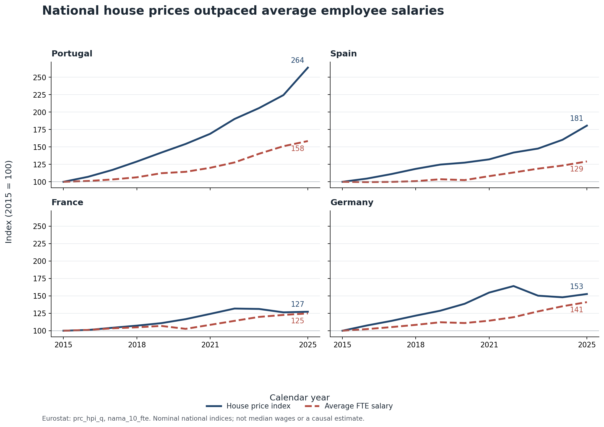
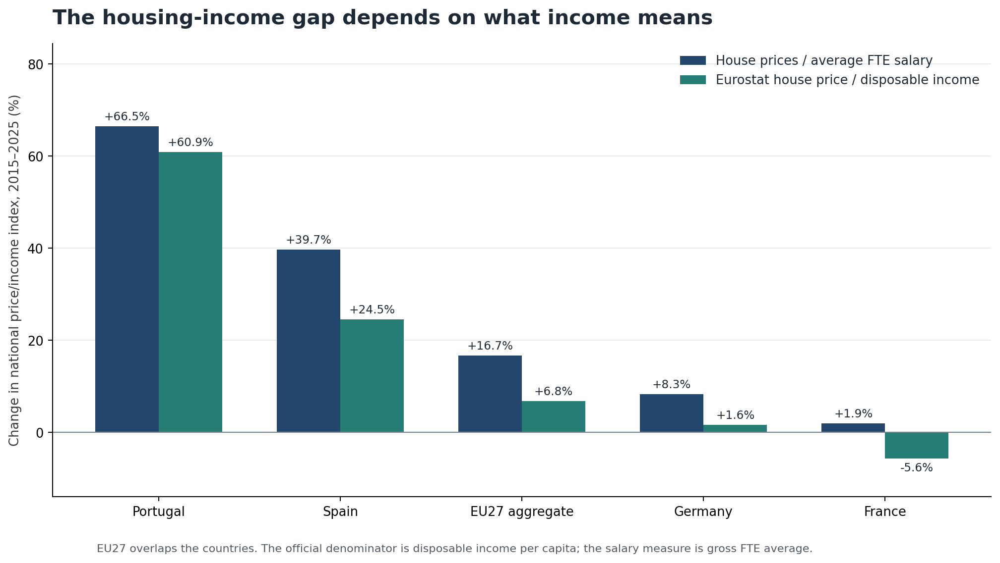
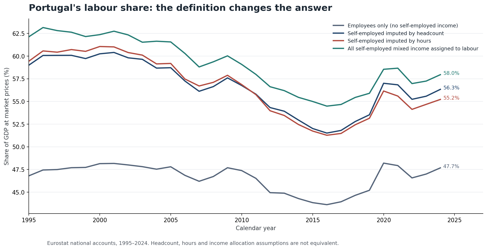
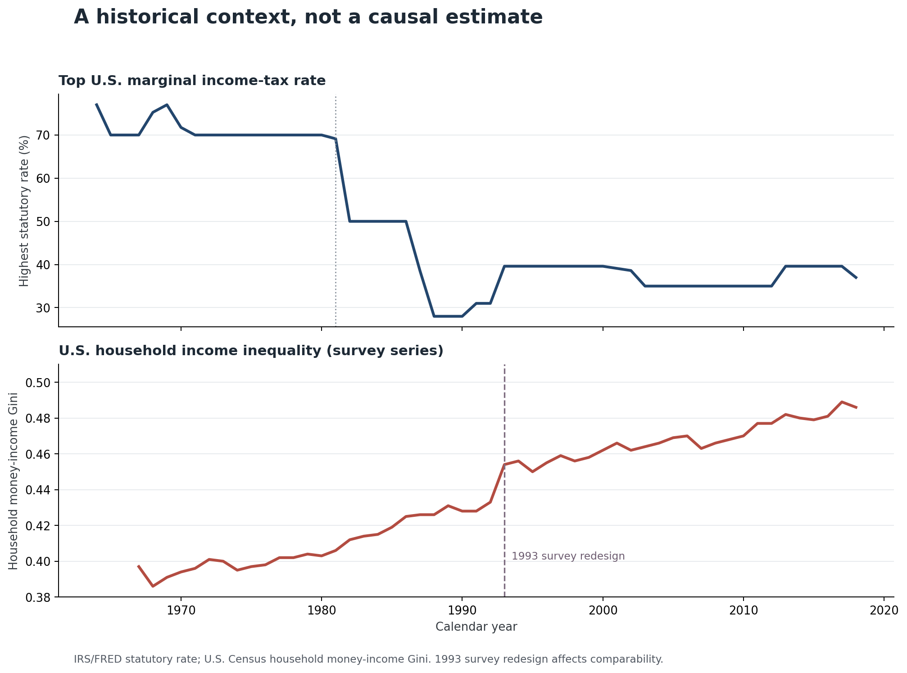
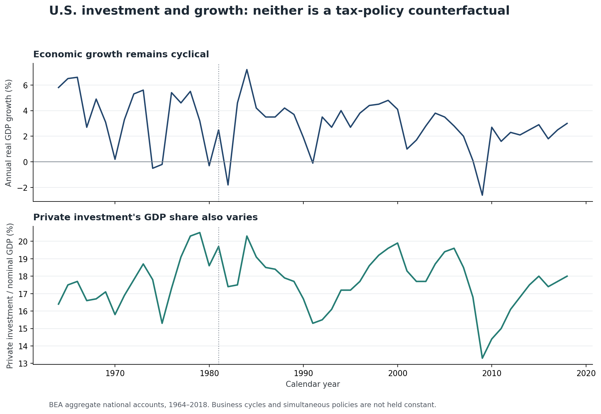

# Medium figure guide: placement, captions and accessible alt text

Figures are reproducible PNGs, with explanatory footnotes embedded. The wording below can be inserted directly into the two existing Medium manuscripts without implying that the charts are causal estimates.

## Figure 1 — National housing prices versus employee salaries

**Caption:** *The house-price index grew faster than the nominal average employee salary index from 2015 to 2025 in Portugal, Spain, France and Germany, but the divergence differs markedly by country. Eurostat `prc_hpi_q` and `nama_10_fte`, both rebased to 2015 = 100. These are national averages, not median earnings or individual housing costs.*

**Placement:** Housing essay, after the first Eurostat price-to-income paragraph; general essay, next to the discussion of income from work versus asset ownership.

## Figure 2 — The denominator matters

**Caption:** *Relative national housing affordability depends on which income concept is used. The price-to-average-FTE-salary ratio grew 66.5% in Portugal; Eurostat's standardised price-to-disposable-income indicator grew approximately 60.9%. The two measures have different denominators and must not be described as interchangeable. EU27 overlaps the country observations.*

**Placement:** Housing essay, immediately after Figure 1 and an explanation of wage versus household-income denominators.

## Figure 3 — Portuguese labour-share definitions

**Caption:** *There is no measurement-free statistic called "the labour share". For Portugal, the unadjusted employee-compensation share rises from 1995 to 2024, while three self-employment-adjusted variants decline. Eurostat national accounts, GDP at market prices. The upstream study tests 18 definitions; this graphic shows four to make the assumption visible.*

**Placement:** General essay, wage bargaining and distribution section; housing essay, if discussing the distribution of growth proceeds.

## Figure 4 — U.S. tax rates and inequality

**Caption:** *The highest U.S. statutory marginal income-tax rate fell sharply during the 1980s. Household money-income inequality rose over the longer historical sample, although the 1993 Census survey redesign complicates cross-period comparison. These are historical series, not an estimate of how much tax reforms caused inequality to change.*

**Placement:** General essay, Reagan-era fiscal policy section.

## Figure 5 — U.S. growth and investment are multi-causal

**Caption:** *Aggregate real growth and private-investment shares fluctuate with business cycles, interest rates, demand, technology and institutional conditions. The charts provide economic context but cannot tell us what growth or investment would have been under an alternative tax regime. BEA national accounts, 1964–2018.*

**Placement:** General essay, next to the assessment of trickle-down growth and investment promises.

## Citation practice

Link each figure to the [empirical companion](README.md) and its [source ledger](SOURCES.md). After the PR is merged, editorial references should prefer the exact commit SHA for reproducibility. Do not reuse the percentage from one price/income definition while labelling it as another.
