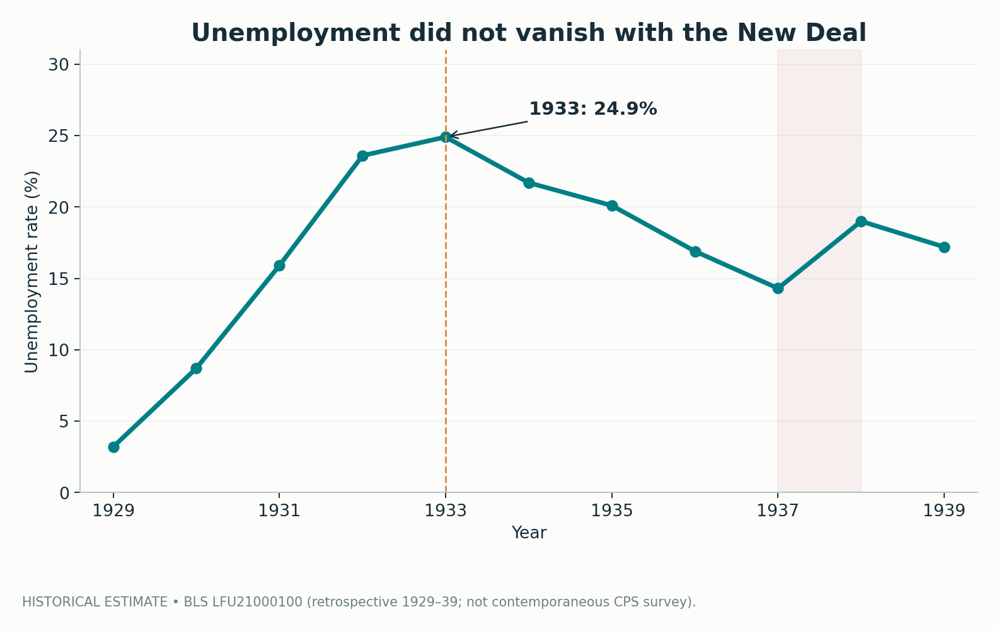
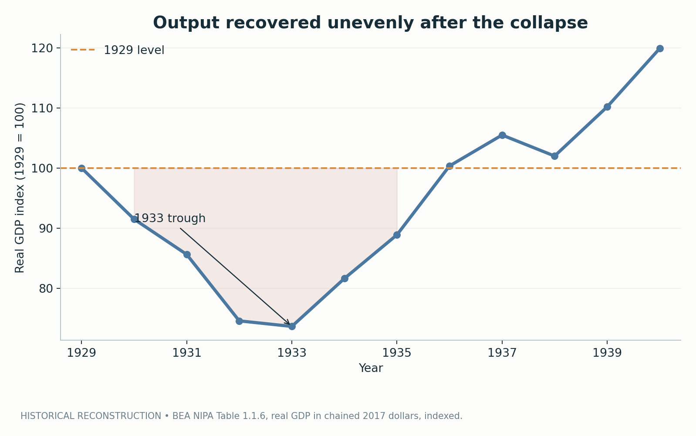
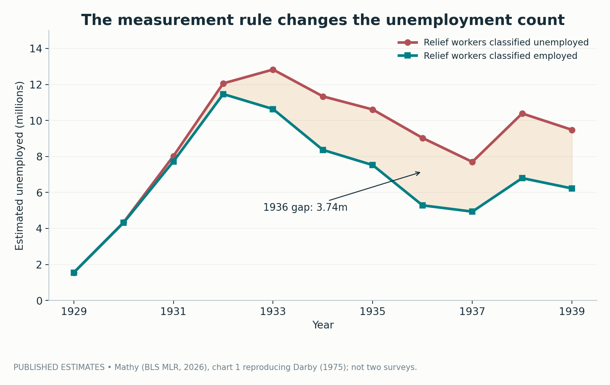
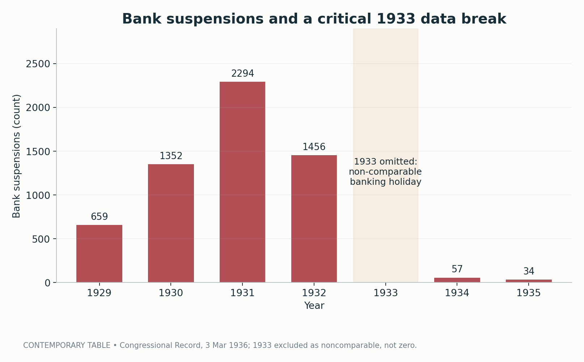
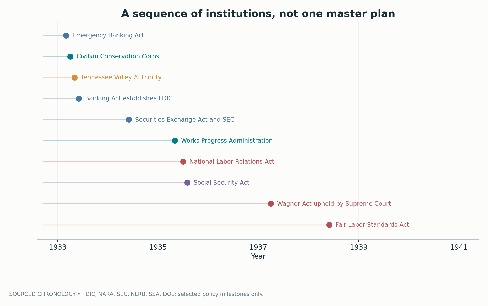
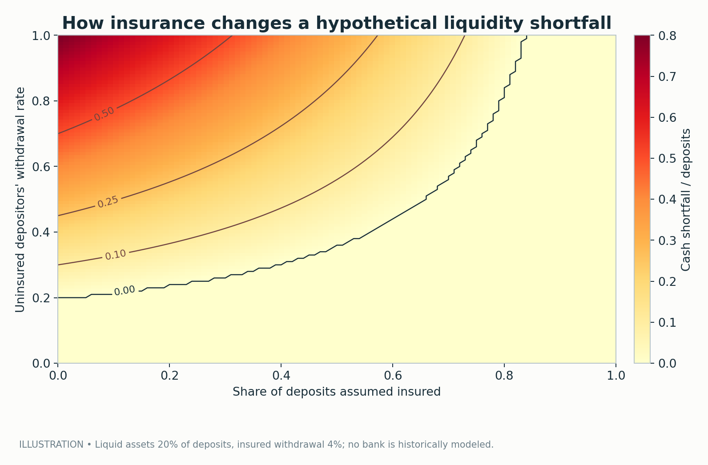
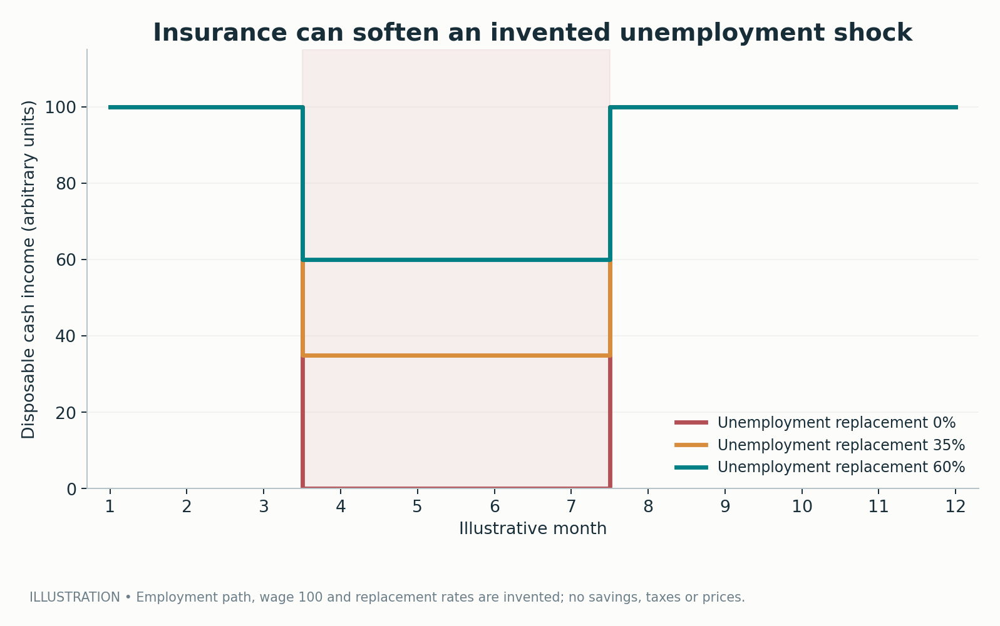
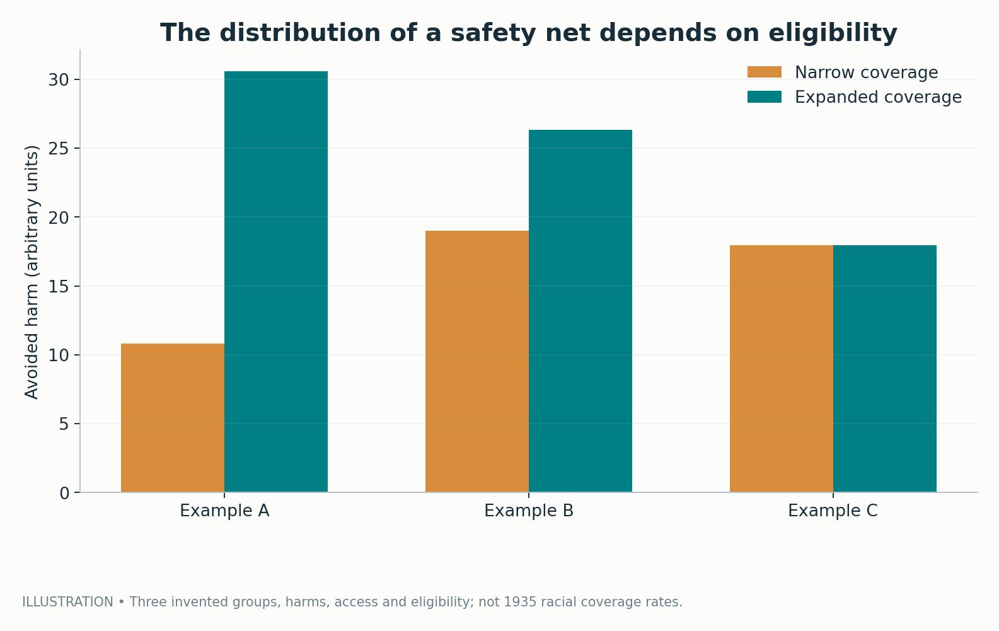

# A Safety Net Is Not a Social Contract: What the New Deal Built—and Whom It Left Out

*The American state learned to insure risks it had once treated as private misfortunes. That did not make its promises universal, its recovery automatic, or its compromises innocent.*

The question that gives the New Deal its enduring relevance is deceptively simple: **What does a society owe people when the economy fails them?**

Not when they make a demonstrably foolish choice. Not when they refuse a plausible opportunity. When the institutions on which ordinary life depends—the bank that holds their savings, the employer that buys their labor, the market that sets prices, the government that promises stability—break down together. When millions of individually prudent households cannot individually repair the system in which they live.

Before the Great Depression, American reformers had wrestled with versions of that question for decades. They had built professional public agencies, investigated industrial conditions, sought cleaner elections, and advanced consumer and labor protections. Yet the social question remained largely unresolved. The United States entered the 1930s with extraordinary productive capacity and only a patchwork of protection against unemployment, old age, bank failure, and household destitution. Industrial power had outgrown the arrangements intended to make its risks bearable.

The New Deal changed that relationship. It did not invent public responsibility from nothing; earlier reforms and state-level experiments mattered enormously. Nor did it produce an integrated welfare state in one dramatic stroke. What it did was establish, revise, and sometimes entrench a new assumption: certain economic risks were too widespread and too destructive to leave entirely to private charity, individual savings, and local improvisation.

There is a tempting version of the story in which Franklin D. Roosevelt arrives, launches a burst of programs, and rescues the economy. There is another tempting version in which all the programs amount to theater because unemployment remained high and war ultimately mobilized production. Neither version is adequate. One confuses institutional innovation with a completed recovery; the other confuses an incomplete recovery with an absence of institutional consequences.

The more revealing story is about **three different achievements**, and the distance between them:

1. **Emergency stabilization:** limiting immediate economic and financial collapse.
2. **Institution building:** creating rules and organizations that changed how the economy would work afterward.
3. **Social inclusion:** determining who actually gained protection, bargaining power, income, and dignity.

The New Deal made important progress on the first two, with uneven and often discriminatory results on the third. Those distinctions are the foundation of this article. Eight reproducible figures accompany the argument. The first five present historical estimates or documented events; the final three are openly hypothetical models designed to clarify mechanisms, **not** to estimate historical policy effects. Every chart, data transcription, assumption, and test is available in the companion repository.

## 1. The emergency that made private misfortune a public problem

In 1929, the United States was an unusually rich economy with unusually fragile household protections. The stock market crash became an icon, but the damage was far wider than stock ownership. Investment collapsed, factories curtailed production, commodity prices fell, banks failed, and falling incomes weakened the borrowers and depositors on whom banks depended. One contraction amplified another. A family without wages spent less; a shop with fewer customers purchased less; a producer with fewer orders hired less. The national economy was not merely experiencing a large number of separate setbacks. It was generating losses that reinforced one another.

Economic downturns were not novel. What was new in degree was the combination of scale, duration, financial dysfunction, and institutional insufficiency. Private relief could not match the need. Local governments and charitable organizations often lost revenue precisely as requests for assistance multiplied. An unemployed worker in one town was not helped by the theoretical possibility of employment in another if the entire economy was contracting. The old distinction between the deserving and undeserving poor became increasingly difficult to sustain when the supply of jobs itself had vanished.

This was a political crisis as well as an economic one. Markets depend on expectations: that deposits can be withdrawn, contracts will be honored, income may resume, and a bad year need not destroy a family's future. When those expectations disintegrate, ordinary mechanisms of adjustment can become mechanisms of panic. Depositors withdraw from sound and unsound banks alike because waiting may be fatal. Employers cut costs because they fear weak demand; workers reduce spending because they fear layoffs. Individual caution can compound collective catastrophe.

The scale is visible in the Bureau of Labor Statistics' retrospective annual unemployment estimates. The estimated unemployment rate rose from **3.2 percent in 1929** to **24.9 percent in 1933**. The associated estimate was roughly **12.83 million people unemployed** in 1933. Those figures describe far more than an isolated economic indicator. They mark the extraordinary erosion of the ordinary bargain: work would generally provide the means to live, and willingness to work would usually find a buyer.

*Figure 1 — Historical estimate. BLS retrospective annual unemployment rates for 1929–1939. The 1933 peak was 24.9 percent; the rate fell during the subsequent recovery but climbed again to 19.0 percent in 1938. These are historically reconstructed estimates, not observations collected by the later Current Population Survey. Source: [BLS historical labor-force series](https://data.bls.gov/timeseries/LFU21000100) and [BLS historical-series documentation](https://www.bls.gov/cps/prev_yrs.htm).*

Notice the chart's ending. Even in 1939, after years of intervention and recovery, the estimated unemployment rate remained **17.2 percent**. This fact is often used as a verdict on the entire New Deal. It is certainly evidence against triumphalist claims that the programs quickly restored full employment. It is not, by itself, evidence that a banking guarantee, a securities regulator, a pension system, or a collective-bargaining law had no lasting effect. A single labor-market measure cannot answer every question about a government's performance.

Indeed, the right question is not merely, “Did unemployment disappear?” It is also, “How much worse might the collapse have been without stabilization, and what rules survived after the emergency?” The first requires a credible counterfactual; the second requires institutional history. Neither can be inferred from a line chart alone.

## 2. Recovery is not the same thing as security

The output story is distinct from the employment story. The Bureau of Economic Analysis' reconstructed real GDP series shows the economy falling to approximately **74 percent of its 1929 output by 1933**, then expanding substantially. Real GDP in 1936 slightly exceeded the 1929 level in this series; output rose again in 1937, fell sharply in 1938, and recovered in 1939. The chart indexes the level of real GDP in 1929 to 100, so changes can be compared without mistaking billions of chained dollars for a household-level measure.

*Figure 2 — Historical reconstruction. Real GDP from [BEA National Income and Product Accounts, Table 1.1.6](https://apps.bea.gov/iTable/?Series=A&categories=survey&isuri=1&nipa_table_list=6&reqid=19&select_all_years=1&step=3), divided by its 1929 value and multiplied by 100. The visible 1937–1938 decline matters: recovery was not a smooth upward march. Indexed output is not a measure of employment, distribution, or household well-being.*

That juxtaposition is the first major lesson. A national economy can regain an aggregate output level while leaving large numbers of people without regular jobs. Output per worker may change, the composition of production may shift, work hours may be uneven, and the population may grow. A recovered gross total does not guarantee that a particular household has regained a secure income. Nor does it show whether the household's bank is safer, whether its elderly members can avoid destitution, or whether an employer must bargain with organized workers.

This distinction helps explain why the New Deal's economic meaning cannot be compressed into a single growth statistic. Some policies aimed to increase purchasing power immediately. Others sought to conserve land, build infrastructure, or create employment. Still others changed the financial system's incentives and rules. Insurance and labor institutions had timelines measured in years and decades. Asking them all to justify themselves solely by the unemployment rate in 1939 treats fundamentally different interventions as if they were rival short-term stimulus packages.

It also matters that **the recovery itself was neither uniform nor fully understood in one uncontested causal account**. Monetary expansion, changes to the gold standard, international gold flows, fiscal choices, banking stabilization, and shifts in private expectations all entered the story. Economic historian Christina Romer, for example, made an influential case that monetary expansion driven in significant part by gold inflows was central to the prewar recovery. That argument is a warning against attributing every rise in GDP directly to the employment and spending programs that are most visible in public memory. Conversely, it would be equally careless to declare that relief employment and federal investment made no difference simply because monetary expansion mattered.

The recession of **1937–1938** further complicates simple narratives. Production contracted again, and estimated unemployment jumped from **14.3 percent in 1937** to **19.0 percent in 1938**. Historians and economists debate the relative roles of monetary tightening, reserve requirements, the Treasury's handling of gold flows, fiscal retrenchment, and other influences. The event nonetheless demonstrates something more general: a recovery remained vulnerable when private demand, policy decisions, and financial conditions shifted. A society could have developed new public capacities without yet mastering economic stabilization.

That is why it is useful to distinguish **an economic recovery**, **an economic institution**, and **a social right**. A recovery is a change in macroeconomic activity. An institution is a durable rule or organization shaping future decisions. A social right is a claim people can plausibly exercise regardless of local goodwill. The New Deal pursued all three, but achieved them at different speeds, for different groups, and with varying degrees of completeness.

## 3. A measurement problem hiding in the unemployment debate

Before judging the programs against the unemployment record, we must address a subtle historical problem: **what counted as unemployment when a government hired people for emergency work?**

The figures we casually quote for the 1930s were reconstructed after the fact. The modern Current Population Survey did not exist throughout that decade. Historical labor-force estimates required assumptions about populations, employment categories, and, crucially, the status of people employed by emergency relief agencies. Counting someone on a work-relief payroll as unemployed and counting the same person as employed answer different statistical questions. One emphasizes the economy's dependence on public relief; the other recognizes that the person was doing paid work. Neither convention should be smuggled into an argument as though it were an uncontroversial measurement of the same thing.

Research discussed in a [2026 Bureau of Labor Statistics *Monthly Labor Review* article by Gabriel Mathy](https://www.bls.gov/opub/mlr/2026/article/private-sector-estimates-of-unemployment-in-the-1930s-and-the-development-of-official-labor-force-statistics.htm) reproduces a comparison associated with Michael Darby's historical work. Under the convention that classified relief workers as unemployed, the estimated unemployed population in **1936** was **9.03 million**. Under the convention classifying them as employed, it was approximately **5.286 million**. The difference is **3.744 million people**.

*Figure 3 — Published historical estimates, not two separate surveys. Estimates transcribed from Mathy's [BLS discussion](https://www.bls.gov/opub/mlr/2026/article/private-sector-estimates-of-unemployment-in-the-1930s-and-the-development-of-official-labor-force-statistics.htm), which reproduces a comparison citing [Michael Darby](https://www.nber.org/papers/w0088). The gap measures the consequences of classifying work-relief participants differently. It must not be interpreted as a causal estimate of the number of jobs the New Deal created.*

That last warning is central. The chart does **not** tell us how many jobs would have existed without the programs. It does **not** establish how many private jobs public employment displaced. It does **not** show that everyone enrolled in a relief program was thereby secure, well paid, or able to move into permanent work. It shows that a measurement decision substantially changes one headline number.

Imagine the same person repairing a public road under a relief agency's supervision. They report for work, perform tasks, receive pay, and use some earnings to support a household. One statistical convention registers employment; another classifies the position as an emergency relief category outside ordinary employment. Those classifications express different views of what the statistic should capture. The person and their work do not change when the label changes.

This matters for political arguments because the most dramatic simplifications often depend on unexamined definitions. “Unemployment remained above a particular threshold” may be correct under one historical reconstruction, while “millions performed paid public work” may also be correct. The statements are not inherently contradictory. They become misleading when the definition behind one is used to deny the reality represented by the other.

There is a broader lesson about public policy evidence here. A program may alter the thing being measured and the measurement convention through which we observe it. The technical detail is not an escape hatch from accountability. It is a precondition for honest accountability. If the goal is to learn from history rather than recruit history as a witness for a verdict already reached, categories deserve almost as much attention as counts.

## 4. Banking: when a guarantee changes behavior

Banking provides one of the clearest examples of a New Deal institution aimed at changing the rules of the game, not merely filling a temporary spending gap. A bank converts a large number of deposits into loans and other assets that cannot necessarily be liquidated immediately without loss. Depositors usually trust that only a minority will demand cash at the same time. If that expectation collapses, the withdrawal of one frightened depositor can make withdrawal look rational for the next. Even a bank with valuable long-term assets can suffer a crisis of immediate liquidity.

Financial panics had shaped American history before the 1930s. But the Depression produced a sequence of extraordinarily destructive banking disturbances in which institutional weakness, falling asset values, debt burdens, and policy errors interacted. The [Federal Reserve's historical account](https://www.federalreservehistory.org/essays/banking-panics-1930-31) emphasizes the spread of panics, while its [overview of the Great Depression](https://www.federalreservehistory.org/essays/great-depression) describes the severe contraction in money and economic activity. Banking was not a sideshow to an already inevitable collapse; banking distress helped transmit and deepen the disaster.

A contemporary table entered into the *Congressional Record* in 1936 offers one view of bank suspensions. It lists **659** suspensions in 1929, **1,352** in 1930, **2,294** in 1931, and **1,456** in 1932. For the selected postcrisis years, it lists **57** in 1934 and **34** in 1935. Those numbers suggest a profound break in the immediate pattern of disruptions. But they demand care at exactly the most tempting place in the chronology.

*Figure 4 — Contemporary counts from the [*Congressional Record*, March 3, 1936](https://www.govinfo.gov/content/pkg/GPO-CRECB-1936-pt3-v80/pdf/GPO-CRECB-1936-pt3-v80-11-2.pdf). The year **1933 is deliberately omitted**, not assigned zero: the nationwide banking holiday and reporting disruptions make that table's 1933 entry non-comparable. The [FDIC's history](https://www.fdic.gov/history/1930-1939) separately describes approximately 4,000 suspensions in 1933 under its historical accounting. The two should not be spliced into a deceptively uniform line.*

An honest chart can be more useful for what it refuses to show than for what it displays. Drawing a smooth line across 1933, inventing a zero, or filling the gap with a separately defined estimate would conceal a break precisely when public policy changed most dramatically. The gap is an annotation about knowledge, not a failure of the visualization.

Roosevelt's administration moved rapidly during the banking emergency. The **Emergency Banking Act of March 1933** was part of an effort to reopen banks under stronger federal supervision and restore public confidence. The **Banking Act of June 16, 1933** established the Federal Deposit Insurance Corporation, with federal deposit insurance beginning on **January 1, 1934**. The original temporary insurance limit was **$2,500 per depositor**. Those dates matter: the emergency measures, legal creation of the insurer, and start of insurance coverage were distinct steps.

Deposit insurance did more than compensate depositors after a failure. Its promise could change the calculation *before* a run occurred. A person whose eligible deposits are credibly protected has less reason to rush to a bank ahead of everyone else. If many people believe the guarantee and remain calm, the very crisis that would have triggered a payout may become less likely. A safety net can stabilize a system partly by altering the incentives to seek it.

This was not a magical fix. Insurance coverage was limited, supervision remained necessary, and banking failures did not become impossible. Moral hazard—taking excessive risks because losses may be partly socialized—was and remains a real design problem. The story is also not that every reduction in suspensions can be causally assigned to insurance alone: banking holidays, recapitalization, changed monetary policy, economic recovery, and selection of surviving institutions all mattered. The evidence supports a significant institutional shift and a change in the postcrisis pattern; it does not justify a simplistic before-and-after experiment.

The deeper change was conceptual. Financial security became something that the federal state would help guarantee by a standing rule rather than something each depositor was expected to verify through rumor, personal connections, or private judgment. A depositor no longer needed to become a sophisticated analyst of a bank's asset portfolio to feel that keeping a modest protected balance in the system was reasonable. The guarantee remained conditional and imperfect, but it changed the public meaning of a bank account.

## 5. There was no single New Deal

The phrase *the New Deal* can make a turbulent collection of experiments sound like one coherent blueprint. It was not. Programs appeared in response to different problems, at different moments, under different legal authorities. Some were temporary; some endured. Some expanded public employment; others regulated private business; still others institutionalized contributory insurance. Their political coalitions overlapped without being identical. Their purposes could conflict.

The chronology makes that variety visible.

*Figure 5 — Documented institutional chronology, not a comprehensive program inventory. Selected milestones: Emergency Banking Act, Civilian Conservation Corps, Tennessee Valley Authority, Banking Act/FDIC, Securities and Exchange Commission, Works Progress Administration, National Labor Relations Act, Social Security Act, Supreme Court validation of the labor law, and Fair Labor Standards Act. Dates checked against [FDIC](https://www.fdic.gov/90years), [National Archives](https://www.archives.gov/research/alic/reference/new-deal.html), [SEC](https://www.sec.gov/newsroom/speeches-statements/gensler-remarks-90thsec-060624), [NLRB](https://www.nlrb.gov/about-nlrb/who-we-are/our-history/1935-passage-of-the-wagner-act), [SSA](https://www.ssa.gov/history/35act.html), and [DOL](https://www.dol.gov/general/aboutdol/history/flsa1938).*

The sequence helps explain why popular labels such as “first” and “second” New Deal are useful but incomplete. Early initiatives concentrated heavily on emergency relief, stabilization, agriculture, and economic organization. Later legislation gave a more durable form to collective bargaining and social insurance. Yet banking reform already had enduring consequences in 1933, and relief work continued through later years. The categories are interpretive conveniences, not airtight boxes.

It is also important not to confuse **spending** with **governance**. A public works contract is an expenditure; a deposit-insurance scheme is a standing promise supported by law and funding arrangements; a labor board changes how disputes between workers and employers are adjudicated; a securities regulator changes what information firms must reveal to investors. Their budgetary costs cannot be added together as if they were versions of the same intervention. Nor can their results be judged by one fiscal multiplier.

The administration faced constant adaptation. The National Industrial Recovery Act of 1933 pursued industrial coordination and public works, but its National Recovery Administration framework collided with legal and political limits. The Supreme Court struck down central elements in 1935. Other policies were then built on different statutory foundations. A law's failure could generate another institutional experiment rather than the abandonment of reform. The history is better understood as iterative state building under severe pressure than as the execution of a prewritten master plan.

To call the New Deal experimental is not to romanticize experimentation. Mistakes harmed real people. Some programs protected established producers, disadvantaged consumers or competitors, or left vulnerable workers exposed. Others were entangled with local political hierarchies that federal officials did not consistently challenge. Administrative ambition did not always come with administrative competence or moral clarity. But the willingness to redesign institutions in public view became part of the era's political character.

It is striking how many of the debates concerned the proper *level* of responsibility. Should an unemployed person seek help from relatives, charity, a municipality, a state, or Washington? Should a bank guarantee depend on private assessments, state policy, or national insurance? Should labor conditions be negotiated by isolated employees, local organizations, or federally protected unions? The New Deal did not abolish federalism or replace the market. It moved portions of these questions into national law while leaving other decisions to states, employers, and local administrators.

That combination of national commitments and decentralized execution would help define both its power and its limitations.

## 6. Relief was not one thing—and work was not a pension

Perhaps the most visible New Deal initiatives put people to work. They should be considered neither mere public relations nor interchangeable with income insurance. A relief job could pay for groceries, repair infrastructure, maintain skills, support dignity, and create assets of lasting use. It could also be temporary, unevenly distributed, subject to political discretion, and inadequate for a household's needs. The actual experience depended on the program and the person.

The **Civilian Conservation Corps**, established in 1933, mobilized young men for conservation work. Its projects included activities associated with forests, parks, erosion control, and public lands. The underlying idea joined two needs: an economy with idle labor and a country with work worth doing. Workers were not simply handed cash; they were employed within an organized, often residential program. That structure brought public benefits and individual restrictions. Eligibility rules and administration shaped whose lives it could touch.

The **Works Progress Administration**, established in 1935, operated on a much broader scale as a federal work-relief agency. Its activities extended beyond roads and physical construction to projects involving cultural work, historical documentation, community facilities, and public services. The range matters. If we imagine the New Deal exclusively as men pouring concrete, we miss the work of writers, artists, teachers, archivists, and other participants whose outputs were not easily captured in a measure of highway mileage.

Other programs and agencies responded to immediate deprivation and state capacity. The Federal Emergency Relief Administration helped support emergency relief through federal-state channels, while local and state systems remained essential intermediaries. That relationship placed national resources behind local delivery, but also meant that the recipient's treatment could vary with geography and official discretion. In a federal system, an appropriation in Washington is only the beginning of a person's actual path to assistance.

The **Tennessee Valley Authority**, authorized in 1933, addressed regional development through electric power, dams, navigation, flood control, and related public purposes. The TVA presented a different theory of relief: build and manage infrastructure capable of changing a region's long-run economic possibilities. Electricity could enable household uses, businesses, and agricultural improvements far beyond the wages paid during construction. Yet large development schemes imposed costs and involved tradeoffs, including dislocation, environmental changes, and conflicts over whose interests counted. Calling a project “modernization” does not settle its distributive balance sheet.

These institutions were also politically legible in a way that abstract stabilization often was not. A bridge can be crossed. A school can be used. A photograph of a crew at work makes government action visible. The physical outputs became part of the New Deal's memory because they endured in landscapes and archives. By contrast, the bank run that never happened and the desperate withdrawal that never became necessary leave no comparable monument.

But employment programs had limits that public memory sometimes obscures. A person too old, sick, disabled, constrained by care responsibilities, or ineligible under a program's rules could not necessarily participate. A rural household might be far from a project; a woman might encounter hiring priorities shaped around the male breadwinner; Black workers could confront discriminatory practices. For these people, a policy premised on the availability of government work did not automatically furnish security.

Nor was a work-relief paycheck equivalent to a durable entitlement. Wages required participation in an available job, subject to a program's appropriations and rules. Old-age income support addressed a different event: the point at which labor earnings could no longer be assumed. Unemployment insurance addressed the interruption of work rather than work itself. Public employment, unemployment benefits, and pensions were complementary technologies of security with different eligibility tests and temporal structures.

What did relief work prove? It established that government could organize socially useful employment in an emergency, and that the distinction between a worker's productive capacity and the private market's willingness to hire them was politically important. It did **not** prove that a public job was an adequate substitute for comprehensive social insurance. The practical limitations of relief were part of the argument for building more permanent institutions.

## 7. The Social Security Act was an architecture, not a single pension

The **Social Security Act of August 1935** is often remembered as the moment when the United States created retirement checks. That shorthand misses both the scope and the initial restrictions of the law. The act established a layered approach involving old-age insurance, federal support for certain forms of public assistance, unemployment compensation within a federal-state framework, and additional provisions for specified vulnerable populations and services. Its programs were related by a new political commitment but not identical in financing, administration, or entitlement.

Consider three especially important dimensions.

**Old-age insurance** introduced a contributory structure designed to provide income linked to covered employment. The expectation of earning future benefits through payroll contributions helped distinguish insurance from poor relief. Workers were not merely asking a local official for charity; they were acquiring a statutory claim within a national scheme. But it is anachronistic to imagine a fully mature modern retirement system springing into operation in 1935. The original schedule contemplated monthly benefits beginning in 1942, before amendments in 1939 accelerated the start to 1940 and altered the program's design. Immediate assistance to elderly people in need was handled through a distinct means-tested program.

**Unemployment compensation** gave the loss of a job a new institutional answer. Rather than treating every unemployed person solely as a case for charity, the act supported a system in which qualifying workers could receive benefits under state-administered programs within a national legal and fiscal framework. This design embedded a tension that continues to shape American policy: a federal commitment can coexist with substantial differences in state eligibility rules, administration, and benefit experience.

**Public assistance provisions** recognized that contributory insurance alone would not reach everyone in need, especially during its early years. Older people without covered work histories and other groups did not become financially secure merely because payroll-based insurance had been legislated. Means-tested assistance could respond more immediately, but it also carried a different relationship between recipient and state. Determining need introduced administrative judgment, local variation, and potential stigma.

This architecture reveals a fundamental choice. Universal citizenship-based payments were not the organizing principle. Instead, Congress blended **social insurance attached to covered work**, **assistance conditioned on need**, and **state-administered arrangements**. Those elements could reduce insecurity while preserving sharp boundaries between categories of people. The New Deal made the state more responsible for economic risk without making every resident equally entitled to its support.

Why did the distinction between insurance and charity matter so much? An insurance claim can become routine. Its beneficiary need not prove moral worth each time a payment arrives. Eligibility still involves law and verification, but the political relationship is less personal and potentially less humiliating. A system of discretionary poor relief, by contrast, can leave people dependent on the judgments of local officials, donors, and social conventions. Of course, insurance tied to formal wages has a corresponding weakness: people whose work is excluded, informal, interrupted, or undervalued may never acquire the full claim.

The Social Security Act therefore represents both an expansion of solidarity and a decision about its boundaries. Its long-run importance is not diminished by acknowledging its incomplete initial design. Quite the opposite: understanding how coverage was subsequently widened requires seeing what was absent at the beginning.

There was a fiscal and political logic to the contributory model as well. Linking benefits to payroll records and employment gave administrators an observable basis for eligibility, and the language of earned protection made the program more defensible to voters wary of open-ended relief. Yet administrative feasibility should not be confused with an ethical principle that only formal wage earners deserve security. If a society chooses a legible tax record as the gateway to protection, people whose work does not produce such a record may be left out. That problem becomes decisive when the labor market itself is structured unequally.

Social Security did not simply enact generosity. It created a new **form of public obligation**: predictable, rule-governed, potentially durable, and expandable over time. It also encoded the economic assumptions of its designers, including assumptions about wage work, households, states, and the division between market earnings and care. Its significance lies in both facts.

## 8. Bargaining power belongs in the social-contract story

The New Deal also changed the rules governing the relationship between employers and workers. This part is sometimes treated as an unrelated labor-history chapter, but it goes directly to economic security. A worker may have access to insurance against unemployment while still lacking meaningful power over wages, hours, safety, or treatment at work. A society's social contract concerns not only what happens when employment disappears but also the bargaining conditions under which employment is offered.

The **National Labor Relations Act of 1935**, associated with Senator Robert Wagner and commonly called the Wagner Act, protected specified forms of workers' organizing and collective bargaining and established a federal enforcement framework. It provided legal institutions through which unions could seek representation and challenge certain employer practices. The law did not create worker organization out of thin air; labor movements had existed long before 1935, often at great cost to their members. Its significance was to change the legal environment in which such movements confronted employer power.

The statute's early life illustrates how contingent these changes remained. Its constitutionality was contested and the law's authority became much more secure after the **Supreme Court upheld it in 1937**. Court decisions, administrative capacity, employer resistance, union strategy, and the wider political climate all influenced whether a statutory promise became effective in a particular workplace. Legal recognition could help workers organize; it could not automatically produce strong unions in every industry or guarantee bargaining outcomes.

The **Fair Labor Standards Act of 1938** added a different kind of floor. Its initial federal standards included a **25-cent hourly minimum wage**, a **44-hour standard workweek with overtime provisions**, and restrictions on oppressive child labor in covered employment. These were starting provisions, not the later familiar standards. They represented a principle that some aspects of employment should be limited by law even when employers and individual employees might otherwise reach a different bargain.

The distinction between bargaining rights and labor standards is important. Collective bargaining attempts to change the power relationship through representation. A minimum wage or hours law sets a legal baseline for specified employment relationships. A labor market could have one without the other, and both could coexist with public insurance. Together they form part of a broader architecture: protection **during employment**, protection **between jobs**, and protection **after working life**.

Coverage was not universal. Different statutes defined covered employers and workers differently, and the exclusions mattered, especially in sectors heavily populated by women and racial minorities. Nor did the law erase local violence, social intimidation, segregation, or the many ways employers and officials could frustrate organizing. It would be inaccurate to treat legal passage as equivalent to immediate, uniformly effective rights.

Nonetheless, the shift was substantial. Bargaining was no longer imagined exclusively as the isolated exchange between one employer and one worker. Federal institutions acknowledged that private contractual freedom could conceal major asymmetries of power. A person with no credible alternative to an offered wage is not negotiating from the same position as a firm able to wait or hire someone else. Protecting organization and setting minimum standards were ways to modify that asymmetry without abolishing private enterprise.

There is a useful tension here. The New Deal sought to rescue an economy based largely on markets while accepting that markets did not generate legitimate or stable outcomes simply by operating without public constraints. This was reform through institutions, not a rejection of markets as such. Whether a particular rule worked well is a separate empirical question. The political innovation was to make the quality of the labor bargain a matter of national concern.

## 9. A market can be private and still require public rules

The **Securities and Exchange Commission**, created in 1934, embodies another part of that same settlement. Financial markets rely on information. Investors cannot sensibly evaluate securities if those selling them can conceal material facts or exploit information advantages without meaningful oversight. Rules concerning disclosure, reporting, and market conduct are not necessarily the opposite of market exchange; they can be part of what makes exchange more credible.

This is easy to overlook because a securities regulator does not look like a soup kitchen, a dam, or a pension check. Its work is technical, often invisible to people not trading stocks or bonds. Yet households depend indirectly on the financing and governance of firms, the reliability of retirement savings, and the legitimacy of capital markets. A crisis that destroys confidence can make people skeptical not just of one bank or company but of an entire economic system.

The SEC's creation signaled that Washington would supervise important dimensions of securities markets on an enduring basis. It did not make fraud impossible, investment risk disappear, or every firm trustworthy. No disclosure regime can guarantee future performance. But public oversight changed the baseline expectation about what issuers and market participants owed to investors.

The New Deal's financial reforms thus illustrate two complementary approaches to trust. **Deposit insurance** can reduce incentives for panic by protecting eligible claims. **Securities regulation** can reduce information asymmetries and punish certain abuses by structuring market conduct. One is a promise of protection under defined conditions; the other is a framework of oversight and obligation. Neither is equivalent to writing checks to stimulate immediate consumption. Both change the environment within which future financial decisions take place.

The point has wider implications. The social contract is often imagined as a set of transfers from taxpayers to beneficiaries. Transfers matter, especially when people cannot earn enough to live. But a durable settlement also includes **rules that determine who bears risk, who possesses information, who can bargain, and who may demand an enforceable remedy**. The New Deal's distinctive contribution was as much legal and administrative as fiscal.

## 10. Whom did the new protections actually reach?

The phrase *America's social contract* can become evasive if it suggests that all Americans were equally positioned to sign it. New Deal institutions operated inside a society structured by racial segregation, occupational hierarchy, gendered assumptions about paid work and family care, regional inequality, and extraordinary differences in political power. National laws did not automatically erase those structures. Sometimes program rules reproduced them; sometimes local administrators made them worse; sometimes federal action challenged them. A serious assessment must hold all three possibilities together.

Consider the original old-age insurance provisions of the Social Security Act. Coverage was concentrated in specified forms of industrial and commercial wage employment. **Agricultural and domestic workers were among the excluded occupational categories**, and they were not the only ones. Roughly half the labor force fell outside the original contributory old-age coverage. The excluded groups included a disproportionately large share of Black workers, as well as many women whose paid labor was performed in private households.

Here a distinction is indispensable: **unequal impact is not the same historical claim as deliberate discriminatory intent**. It is possible to demonstrate that an occupational rule disproportionately withheld a benefit from a racial group without possessing evidence that lawmakers selected the rule for that purpose. Those are related but different questions. They require different sources, and neither should be answered by rhetorical certainty.

Larry DeWitt's detailed [2010 article in the *Social Security Bulletin*](https://www.ssa.gov/policy/docs/ssb/v70n4/v70n4p49.html) examines whether the farm and domestic exclusions were intentionally designed to keep Black Americans out of Social Security. He argues that the available record supports **administrative and tax-collection difficulties** as the principal explanation for the initial coverage decisions, and he challenges the more categorical racial-motive thesis. His discussion notes, among other things, the difficulty of maintaining payroll records and collecting contributions from dispersed small employers and private households. It also traces disagreements among officials about how broadly the program could be administered from the start.

DeWitt's interpretation is important evidence, not a reason to stop asking about inequality. The effect of an exclusion remains unequal even if a particular account of its legislative origin emphasizes administrative feasibility. Administrative feasibility itself takes place in a political world: policymakers decide which problems deserve investment, which groups can wait, and how much complexity the state will accept. The historical question of motive deserves disciplined treatment; the normative question of who bore the cost deserves equal discipline.

And the numbers matter. Drawing on the 1930 census, DeWitt notes that approximately **65 percent of gainfully employed African Americans** were in agriculture or domestic service, compared with about **27 percent of employed white Americans** in those sectors. Those proportions do not mean everyone in the first group had no eventual route to covered earnings, nor do they define all statutory exclusions. They do show why an apparently occupation-based boundary could have profoundly unequal racial consequences. A design built around the records of regular industrial wage work did not map neutrally onto an unequal labor market.

Gender was woven into the same problem. Paid domestic service was heavily female, and much unpaid household and care work never generated insured earnings in the first place. Programs based on the household model of a male breadwinner could treat women's economic dependency as a normal fact to be administered rather than a condition policy might challenge. Women's participation in New Deal administration and reform was real, but it did not mean that every program regarded women as independent economic actors on equal terms.

Local administration produced another kind of exclusion. Consider an employer, landlord, or local committee with substantial control over which workers would qualify for a program or receive a payment. The federal government could finance a nominally broad intervention while the pathway to its benefits passed through precisely the power relationships that made poor people vulnerable. Formal availability at the national level did not guarantee fair access on the ground.

The **Agricultural Adjustment Act** offers a concrete warning. Attempts to stabilize farm prices through acreage reduction and payments could benefit landowners while harming tenants and sharecroppers. A [National Archives history of African Americans and the labor movement](https://www.archives.gov/publications/prologue/1997/summer/american-labor-movement.html) documents how local agricultural committees in Arkansas, dominated by white plantation owners, often disadvantaged tenant farmers, including through unfair distribution of payments and changes in workers' status. The creation of the interracial **Southern Tenant Farmers' Union in 1934** was, in part, an answer to such injustices. Here federal farm policy, racial hierarchy, and grassroots resistance belonged to the same historical episode.

The **Civilian Conservation Corps** is another case where public benefit and discrimination coexisted. The [National Park Service's account of Company 818](https://home.nps.gov/articles/000/company-818-and-segregation-in-the-civilian-conservation-corps.htm) describes a program that employed substantial numbers of Black men while imposing increasingly explicit segregation. In 1935, its director ordered racial separation of enrollees, despite the nondiscrimination language associated with the CCC's creation. The resulting exclusion cannot be understood merely as an accidental statistical side effect of occupational categories. It involved administrative decisions made within the program itself.

These examples should prevent two equal and opposite mistakes. It would be false to say that the New Deal offered nothing to Black Americans or that every federal agency behaved alike; the [Library of Congress](https://www.loc.gov/exhibits/civil-rights-act/segregation-era.html) describes its support as a significant departure from the previous federal record and notes the involvement of civil-rights advocates in pressing for fuller access. It would be just as false to claim that the national rhetoric of shared recovery made assistance equal in practice. The same historical period expanded federal responsibility while tolerating or reproducing serious discrimination.

The relevant unit of analysis, then, is not simply the law on a statute book. It is the **path from a legal promise to a lived result**:

- Does a person belong to a covered category?
- Can they document the work or circumstance the rule requires?
- Is the relevant office present, accessible, and fair?
- Can they challenge an adverse decision without facing retaliation?
- Is the actual benefit large and reliable enough to change their vulnerability?

A policy can appear generous at the first level and fail at the third or fourth. A universal-sounding statement can conceal a narrow definition of eligible work. An impressive national budget can coexist with a locality that withholds benefits from the people who need them most. In this sense, unequal administration is not a small implementation detail added after the “real” history. It is part of the real history of the institution.

## 11. The bargain with federalism, and the bargaining that followed

The New Deal operated through a federal system, and that fact shaped its political possibilities. The national government gained responsibilities that would have been difficult to imagine on the same scale a generation earlier. Yet states and local officials retained significant authority in important programs. Federal funding and national statutory frameworks could coexist with varied administrative capacity and local prejudice. This arrangement made compromise possible, but it also distributed the cost of compromise unevenly.

Decentralization was not always a vice. Local knowledge can help administrators respond to genuine differences in need and economic structure. State experimentation can reveal better designs. But the same discretion can produce arbitrariness, unequal standards, and barriers that fall most heavily on people with the least power to challenge them. The moral significance of a program depends partly on whether the recipient can predict and enforce the promised treatment. A benefit that exists only at the pleasure of a local official is a weaker form of security than a benefit a person can claim by right.

This tension also explains why the New Deal's exclusions cannot be reduced to a single list. **Statutory exclusion**, **administrative exclusion**, and **ineffective access** are different mechanisms. A worker might be outside the scope of an insurance law. Another might be legally eligible but unable to establish a work history. A third might pass every formal test yet be deterred by discrimination, distance, lack of information, or retaliation. All three experience a gap between the promise and the protection, but their remedies differ.

Lawmakers can amend a statutory definition. Agencies can simplify records and procedures. Courts can enforce rules; organizers can create collective power; civil-rights campaigns can expose unequal treatment. None of those interventions is a substitute for the others. The development of the American safety net has been, in part, a long argument over which level of government must accept responsibility for eliminating each kind of gap.

One reason the New Deal matters so much is that its institutions created **arenas for subsequent demands**. Once a pension program exists, excluded workers can organize to gain coverage. Once the state acknowledges a role in unemployment protection, workers can contest waiting periods, benefit levels, and access. Once collective bargaining has legal standing, workers can fight over its boundaries. The initial architecture is not the completed social contract; it changes the terms on which future generations can argue about that contract.

That political dynamic is easy to miss when history is narrated entirely through presidential decisions. Roosevelt and Congress mattered enormously, but labor organizers, civil-rights advocates, state administrators, local communities, business groups, courts, and voters also shaped what New Deal legislation became. Policies are made twice: first as enacted rules, and then through the repeated interactions that give those rules practical meaning.

The New Deal's coalition held together groups with conflicting interests. Southern white political power existed alongside urban labor, reformers, farmers, immigrant communities, and Black voters whose party loyalties were changing. It would be surprising if legislation emerging from that coalition had achieved a morally coherent universal settlement. It did not. The fact of compromise helps explain the outcomes; it does not require us to excuse them.

## 12. Did the New Deal end the Depression?

The conventional argument usually arrives here: if large-scale federal activism was so consequential, why did the Depression last until the approach of the Second World War? A fair answer begins with what is true in the challenge. The downturn was exceptionally prolonged, and ordinary peacetime labor-market conditions were not fully restored during the 1930s. Wartime mobilization profoundly changed employment, output, and the structure of demand. New Deal programs cannot plausibly be described as a quick, complete cure.

But the question often bundles together three propositions that deserve separate testing:

1. Did particular interventions improve employment, income, output, or financial stability relative to what would otherwise have happened?
2. Did the administration's entire evolving policy mix return the economy to a satisfactory level of activity before the war?
3. Did its institutions permanently change the distribution of economic risk and public responsibility?

The evidence needed for each is different. The second can be evaluated in part through the observed path of production and unemployment. The first requires causal identification and counterfactual estimates. The third requires examining legal structures, coverage, longevity, and the behavior of institutions after 1939. An answer to one cannot simply be substituted for the others.

There is substantial evidence that monetary events deserve central attention. The United States' departure from the earlier gold regime, changes in expectations, the expansion of money, and international gold movements are all essential to explaining recovery. The [Federal Reserve's history of Roosevelt's gold program](https://www.federalreservehistory.org/essays/roosevelts-gold-program) lays out the institutional changes, while [Romer's research](https://www.nber.org/papers/w3829) argues for the importance of monetary expansion to the prewar upswing. These do not make the physical work of the WPA imaginary or render deposit insurance unimportant; they warn against pretending that all causal channels were fiscal public works.

The relapse of 1937–1938 provides a further warning against monocausal storytelling. The [Federal Reserve's retrospective account](https://www.federalreservehistory.org/essays/recession-of-1937-38) discusses the role of policy changes and the difficulty of separating their effects. Fiscal contraction, monetary developments, and shifts in financial conditions are part of the debate. It is reasonable to conclude that policy choices influenced the renewed downturn; it is less reasonable to cite the event as a simple laboratory experiment proving one all-purpose theory of government.

Nor should wartime employment be interpreted as evidence that no prewar institution mattered. War mobilization can eliminate unused capacity through enormous production demands while leaving unanswered whether bank accounts, labor rights, securities markets, or old-age income should be governed differently afterward. Mobilization solves a different problem under extraordinary conditions. It can demonstrate what an economy can produce when demand and resources are directed at immense scale without providing a sustainable model of peacetime social security.

One useful counterfactual question is therefore narrower: **Would a depositor in the decades after 1934 have preferred to face another banking panic without federal deposit insurance?** Another is: **Would a wage worker approaching old age have been better off without the new legal basis for social insurance?** These are not substitutes for quantitative policy evaluation; they reveal why the durability of particular institutions is relevant evidence even when national unemployment remained painfully high.

What historians can say with confidence is that the New Deal introduced or consolidated significant and lasting public capacities amid a recovery that was real but insufficient. What they should not say without a stronger design is that the first fact completely explains the second. Institutional legacy and macroeconomic causation intersect, but they are not identical.

## 13. A simple model of why deposit insurance can matter

The history becomes clearer if we pause to distinguish **an observed outcome** from **a mechanism that might generate an outcome**. An observed decline in bank suspensions is evidence about what happened. An economic model can explain how a credible insurance guarantee might change withdrawals. But a model with invented numbers is not a measurement of what actually happened in 1934, and it cannot on its own identify the causal contribution of the FDIC.

To make the mechanism transparent, imagine an entirely hypothetical bank with deposits normalized to one unit. Assume it has liquid assets equal to **20 percent of deposits**, with other assets tied up in longer-term loans and investments. Let **q** denote the fraction of deposits assumed to be insured. Let **p** denote the fraction of *uninsured* deposits whose owners try to withdraw in a short period. Assume holders of insured deposits withdraw **4 percent** of their balances over the same period. These values are illustrative choices. They are not estimates of the behavior of any historical bank or depositor group.

Under those assumptions, the requested withdrawal share is:

\[
W=(1-q)p+0.04q.
\]

The simple short-run liquidity gap, as a share of initial deposits, is:

\[
G=\max(0,W-0.20).
\]

The maximum matters because a bank with sufficient liquid assets has no *immediate cash shortfall in this model*, even if the requested withdrawals are substantial. There may still be problems with asset values, capital, or future liquidity, none of which this toy formulation represents.

*Figure 6 — **Hypothetical model, not historical data.** The color scale shows the invented liquidity gap under the formula above. The bank has liquid assets of 20 percent of deposits and insured withdrawals fixed at 4 percent. Neither the fractions nor the resulting cash shortfalls describe U.S. banks in the 1930s. Reproducible calculations: companion [analysis.py](analysis.py), function named liquidity_gap.*

Consider one point on the surface. If **60 percent of uninsured deposits** are withdrawn and **none of the deposits are insured** in the assumed scenario, the requested withdrawal is 60 percent of deposits; after the 20 percent liquidity buffer, the gap is **40 percent**. With half of deposits insured and the same uninsured withdrawal propensity, the hypothetical request becomes \(0.5 \times 0.60 + 0.5 \times 0.04 = 0.32\), leaving a **12 percent** gap. With three-quarters insured under these assumptions, the requested share is 18 percent, and the modeled immediate gap disappears.

That result is arithmetic, not an empirical estimate. It does not account for a change in the underlying bank's investment choices, a government's capacity to honor guarantees, emergency lending, spillovers among banks, or a depositor's ability to distinguish insured from uninsured balances. Nor does it establish that increasing statutory coverage alone will induce a specific reduction in withdrawals. It simply clarifies why a credible guarantee can act *before* losses occur: insured depositors have less reason, within the assumed behavior, to join a run.

It also clarifies why insurance design matters. The result depends on coverage, credibility, deposit structure, liquidity, and depositor behavior. If a guarantee is distrusted, nominal coverage may do little. If a bank is deeply insolvent, avoiding an immediate run is not the same as restoring it to health. If banks take more risk because they expect deposits to be protected, a stronger supervisory framework becomes necessary. Insurance does not abolish the tradeoff between confidence and risk taking.

The historical significance of federal deposit insurance is therefore not the claim that someone in Washington found the ideal numerical level of coverage in 1933. It is that the system institutionalized a credible public backstop for defined deposit claims. The reason such a backstop can matter is visible in the model, while the magnitude of its actual historical contribution must come from other evidence. Keeping those two forms of reasoning separate makes both stronger.

## 14. Insurance changes what an economic shock does to a household

Banking is only one example of how an institution can change the relationship between a shock and its human consequences. Unemployment insurance works through a different channel. It does not prevent every layoff; it can reduce the amount of income a household loses when a layoff occurs. That distinction is especially important in evaluating a policy during a crisis. A jobless person receiving a partial benefit is still unemployed, but their immediate options may differ substantially from those of a person with no income.

Consider a second explicitly hypothetical example. A worker normally earns **100 arbitrary income units per month**. They are employed for the first three months of a twelve-month period, unemployed for the next four, and employed for the final five. Imagine three arrangements: no unemployment benefit, a benefit replacing **35 percent** of the ordinary wage during the unemployment months, and a benefit replacing **60 percent**. We assume immediate eligibility, constant benefits, and no changes in taxes, savings, other household earnings, prices, debt, or behavior. These are deliberately unrealistic simplifications designed to isolate the arithmetic of income smoothing.

For a month \(t\), let \(E_t=1\) if the person is employed and \(E_t=0\) otherwise, and let \(b\) be the replacement fraction. The illustrative monthly cash income is:

\[
Y_t=100\,[E_t+(1-E_t)b].
\]

The figure applies that expression to the invented employment path.

*Figure 7 — **Hypothetical model, not New Deal benefit history.** Four invented unemployment months are shaded. A wage of 100 units and replacement rates of 0, 35, and 60 percent are illustrative, not actual 1930s benefit schedules or estimates of recipient behavior. Reproducible calculations: companion [analysis.py](analysis.py), function named monthly_disposable_income.*

Without insurance, the twelve-month cash total is **800 units**. With 35 percent replacement during the four unemployed months, it is **940 units**. With 60 percent replacement, it is **1,040 units**. Even in the most generous of the three stylized arrangements, the person has experienced four months without a job. Yet the household-level income shock has been meaningfully reduced. The difference can affect whether someone pays rent, maintains nutrition, avoids a high-cost loan, or preserves savings. Our model does not establish any of those subsequent behaviors; it identifies the budget channel through which a program could influence them.

This is a useful corrective to an overly narrow focus on whether insurance reduces the measured unemployment rate. Some benefits are designed primarily to cushion the *consequences* of unemployment, not to make the unemployment event disappear. Insurance could also affect search behavior, employers' decisions, aggregate demand, and public finances, but those effects require evidence and models beyond this diagram. They should not be presumed from a household accounting identity.

Another important distinction concerns *timing*. Insurance is valuable because support arrives while a problem is being experienced. A promise of relief after months of destitution may have a very different effect from a predictable payment that arrives when income stops. Similarly, a system with burdensome eligibility rules may look generous on paper and provide little practical smoothing if applicants cannot access benefits quickly enough.

The New Deal's unemployment-insurance architecture did not guarantee the stylized benefit rates or uniform access depicted here. State administration, covered employment, waiting periods, financing, and program maturity all mattered. The point is conceptual: **the social value of a safety net cannot be read only from whether it eliminates the underlying shock**. A partial, timely, enforceable claim may profoundly alter the experience of the shock itself.

## 15. Eligibility can be as important as generosity

Suppose a government announces an impressive benefit: it can reduce a particular harm by 60 percent whenever it reaches an eligible person. The headline sounds significant. But what if most people suffering the greatest harm are ineligible? What if eligibility exists legally but access is difficult? What if recipients cannot maintain a claim through the necessary administrative steps? The practical result will diverge from the abstract promise.

Our third and final model makes that distinction explicit. It is **not a model of racial groups in 1935**, and it does not use observed New Deal coverage statistics. Instead, consider three invented populations—Examples A, B, and C—with baseline harms of **100, 65, and 35 arbitrary units**. Assume the fraction able to make effective use of a formally available benefit is **60, 75, and 90 percent**, respectively. Under a narrow coverage regime, let the legally covered fractions be **30, 65, and 95 percent**. Under an expanded regime, suppose they become **85, 90, and 95 percent**. Keep the benefit's hypothetical effectiveness at **60 percent** of the covered and accessible harm.

Let \(H_i\) be a group's baseline harm, \(c_i\) its covered share, \(a_i\) its effective access, and \(e=0.60\) the assumed effectiveness. The arithmetic for avoided harm is:

\[
R_i=H_i\,c_i\,a_i\,e.
\]

This expression is intentionally modest. It assumes the factors can simply be multiplied. It ignores interactions among groups, changes in behavior, public finance, political backlash, and differences within each invented category. No real person's race, gender, occupation, or benefits record is assigned to an example.

*Figure 8 — **Hypothetical model, not empirical estimates of 1935 coverage or racial disparities.** All group labels, baseline harms, eligibility fractions, access fractions, and effects are invented. The figure illustrates how the same per-beneficiary protection can have unequal group-level reach. Reproducible calculations: companion [analysis.py](analysis.py), function named realized_relief.*

For Example A, the narrow design avoids **10.8 units** of harm; expanded coverage, with access unchanged, avoids **30.6**. For Example B, the corresponding values are about **19.0** and **26.3**. Example C, already highly covered in the imagined baseline, receives the same **18.0 units** under both regimes. This example deliberately assigns the greatest baseline need to the least-covered group. That choice illustrates a possible distributional danger; it is not a historical measurement of who needed what in the 1930s.

The arithmetic highlights three distinctions:

- **Eligibility:** whether the law recognizes a person as belonging to a covered class.
- **Access:** whether an eligible person can actually obtain and retain the protection.
- **Adequacy:** how much the protection reduces the harm once it reaches the person.

Improving any one dimension may help, but they are not interchangeable. Doubling the nominal benefit is of limited use to someone entirely outside the program. Expanding eligibility without improving access may leave large gaps in practice. Simplifying enrollment while keeping the legal scope narrow can make a system easier for current beneficiaries without reaching those excluded by statute.

That is why the occupation-based boundaries of the original old-age system, the local operation of agricultural programs, and the segregation of relief employment belong in the same broader inquiry. They did not have identical mechanisms or origins. But each demonstrates how a national promise could be narrowed between legislative language and lived protection. The words *national system* describe an institutional scale; they do not prove universal access.

There is an uncomfortable political implication. Programs are often judged by their average benefit or their aggregate expenditure. Those measures can conceal who bears the residual risk. If the people most exposed to economic shocks receive the least reliable protection, a program may be fiscally significant while leaving the deepest vulnerabilities structurally intact. Distribution is not an optional fairness adjustment after effectiveness has been measured. It is part of what effectiveness means for a social institution.

This does not imply that every program must achieve identical outcomes among all people or that administrative boundaries have no legitimate purpose. It does imply that boundaries must be assessed, defended, and periodically revised. Their justification cannot end with the observation that a statute has a coherent definition. Public legitimacy depends on what that definition does in the world.

## 16. What the New Deal's record can—and cannot—teach us

It is tempting to ask history for one ideological lesson. Should government be larger? Should markets be freer? Is deficit spending always decisive? Are regulations always necessary? The New Deal resists those shortcuts because it involved many kinds of institutions and because its successes and failures occurred through different channels.

At least six conclusions survive careful inspection.

**First, there is no clean separation between economic growth and economic institutions.** Banking law, reliable information, labor rights, and social insurance influence the context in which investment, work, saving, and spending occur. But their existence does not by itself determine GDP in any given year. A good historical explanation must connect the institution to a plausible mechanism and then look for evidence that the mechanism mattered.

**Second, public relief has multiple purposes.** A job can raise current income, preserve a person's capacity to work, generate public assets, and make emergency action politically credible. An insurance payment can stabilize a household without preventing unemployment. A regulation can improve future incentives without producing an immediately visible construction project. Evaluating everything by near-term job creation will miss those differences.

**Third, numerical honesty strengthens, rather than weakens, historical arguments.** The unemployment measures depend partly on how relief work is classified; the 1933 bank-suspension record contains a comparability problem; reconstructed GDP is not a direct measure of household welfare. Recognizing those limits does not mean nothing is knowable. It means evidence should be given a job it can actually perform. A chart should answer its stated question rather than pretend to answer every question.

**Fourth, a statutory right and an accessible right are not the same.** The Social Security system's original covered occupations, the organization of state-administered benefits, and unequal experiences in farm and conservation programs all show the distance between national legislation and effective protection. A social contract is only as broad as the population it reliably includes.

**Fifth, intent, impact, and responsibility must be distinguished.** Historical motives require documentary evidence and interpretation. Disparate outcomes require evidence about populations and program operation. Ethical responsibility also includes choices about which exclusions to tolerate, how quickly to remove them, and whether an agency responds to known harm. Collapsing these into one accusation or one exoneration produces poorer history.

**Sixth, institutions are political achievements that remain politically unfinished.** The FDIC, SEC, Social Security architecture, labor-law framework, and federal labor standards helped make new claims and expectations possible. Their endurance did not settle debates about benefit levels, covered work, enforcement, regulatory discretion, or economic power. In many cases, creating the institution made the next demand for inclusion more legible.

These conclusions matter well beyond the Depression without requiring facile comparisons to the present. Different crises have different financial systems, work structures, and policy tools. Historical analogies become useful only after those differences are stated. We should resist treating the New Deal as either a sacred list of programs to replicate or a cautionary tale proving that public action inevitably fails.

Its strongest lesson is institutional: societies respond to catastrophe not only by spending money in the moment but by deciding **which dangers will be treated as shared responsibilities afterward**. That decision can enlarge freedom for people who previously lived one shock away from ruin. It can also preserve hierarchies when the promises are designed around an idealized worker or administered through unequal local power.

The New Deal was therefore neither the birth of a perfect safety net nor an irrelevant detour before war. It was a turning point in how Americans argued about risk, labor, finance, old age, and federal obligation. Its incompleteness is not an embarrassing footnote to a heroic story. It is essential to understanding what was built—and why later generations still had so much building to do.

## Conclusion: the difference between rescue and belonging

A rescue operation asks, “How do we stop the immediate damage?” A social contract asks, “Who can count on us when the damage returns?” The New Deal attempted to answer both questions. Its emergency programs addressed hunger, joblessness, collapsing credit, and a shattered sense of possibility. Its enduring institutions put certain public guarantees, labor protections, and forms of accountability into law.

Yet the people most vulnerable to economic collapse were not all admitted to those guarantees on equal terms. Occupation, race, gender, geography, institutional power, and administrative design shaped the reach of protection. A bank depositor might gain an enforceable guarantee while a domestic worker remained outside initial old-age coverage. A public works project might employ people who had no private opportunity while another agency's policies harmed sharecroppers. The contradictions were not peripheral. They were evidence that an expanding state could distribute protection unevenly.

The most revealing measure of the New Deal may not be any single line on an unemployment chart. It may be the new language of political expectation that its institutions made possible. Americans could increasingly ask why deposits should be left unprotected, why a worker's old age should depend entirely on private savings, why employment contracts should escape collective scrutiny, and why complex financial markets should operate without public disclosure rules. Those questions became ordinary subjects of federal politics.

That is a genuine achievement. It is also a challenge handed forward. A safety net is a set of mechanisms that may catch people under specified conditions. **A social contract is the continuing argument over whose falls count, whose work counts, and what promises can be enforced.** The New Deal built much of the machinery for that argument. It did not finish it.

---

## Sources, methods, and further reading

This article separates three kinds of claims: **historical measurements**, **documented institutional history**, and **hypothetical mechanisms**. Figures 1–5 use identified historical series or dated records, with stated limitations. Figures 6–8 use deliberately invented inputs and are not estimates of actual New Deal effects. The companion [README](README.md) explains the data provenance and assumptions; [analysis.py](analysis.py), the [notebook](model_walkthrough.ipynb), [tests](tests/test_analysis.py), input CSVs, and generated result tables make the work reproducible.

### Economic chronology and measurements

1. [Bureau of Labor Statistics, historical unemployment series (LFU21000100)](https://data.bls.gov/timeseries/LFU21000100). Retrospective annual estimates used in Figure 1.
2. [BLS, historical labor-force data and methodological notes](https://www.bls.gov/cps/prev_yrs.htm). Essential context for estimates that precede the modern survey framework.
3. [Gabriel Mathy, “Private-sector estimates of unemployment in the 1930s and the development of official labor force statistics,” BLS *Monthly Labor Review* (2026)](https://www.bls.gov/opub/mlr/2026/article/private-sector-estimates-of-unemployment-in-the-1930s-and-the-development-of-official-labor-force-statistics.htm). Source for the comparison of relief-worker classification methods.
4. [Michael Darby, “Three-and-a-Half Million U.S. Employees Have Been Mislaid” (NBER)](https://www.nber.org/papers/w0088). Historical interpretation underlying Figure 3's comparison.
5. [Bureau of Economic Analysis, National Income and Product Accounts, Table 1.1.6](https://apps.bea.gov/iTable/?Series=A&categories=survey&isuri=1&nipa_table_list=6&reqid=19&select_all_years=1&step=3). Real GDP data used in Figure 2, indexed to 1929.
6. [Federal Reserve History, “The Great Depression”](https://www.federalreservehistory.org/essays/great-depression). Overview of financial and monetary dimensions of the collapse.
7. [Federal Reserve History, “Banking Panics of 1930–31”](https://www.federalreservehistory.org/essays/banking-panics-1930-31) and [“Banking Panics of 1931–33”](https://www.federalreservehistory.org/essays/banking-panics-1931-33). Banking channels and chronology.
8. [Federal Reserve History, “Roosevelt's Gold Program”](https://www.federalreservehistory.org/essays/roosevelts-gold-program). Monetary institutional change in 1933–1934.
9. [Federal Reserve History, “Recession of 1937–38”](https://www.federalreservehistory.org/essays/recession-of-1937-38). Causes of the relapse and competing explanations.
10. [Christina D. Romer, “What Ended the Great Depression?” (NBER working paper)](https://www.nber.org/papers/w3829). Influential research on monetary expansion in the prewar recovery.
11. [*Congressional Record*, March 3, 1936 (bank-suspension table)](https://www.govinfo.gov/content/pkg/GPO-CRECB-1936-pt3-v80/pdf/GPO-CRECB-1936-pt3-v80-11-2.pdf). Source for Figure 4; the 1933 non-comparability is preserved.
12. [Federal Deposit Insurance Corporation, historical timeline](https://www.fdic.gov/90years) and [FDIC history, 1930–1939](https://www.fdic.gov/history/1930-1939). Banking Act, deposit insurance, and historical suspension context.

### Institutions, work, and distribution

13. [National Archives, records of the Civilian Conservation Corps](https://www.archives.gov/research/guide-fed-records/groups/035.html). Formation and administration of conservation employment.
14. [National Archives, records of the Works Progress Administration](https://www.archives.gov/research/guide-fed-records/groups/069.html). Work-relief programs, organization, and scope.
15. [National Archives, Tennessee Valley Authority Act](https://www.archives.gov/milestone-documents/tennessee-valley-authority-act). Primary statute and regional-development framework.
16. [National Archives, National Industrial Recovery Act](https://www.archives.gov/milestone-documents/national-industrial-recovery-act). Context for early industrial recovery policy and its legal difficulties.
17. [Securities and Exchange Commission, remarks on the agency's 90th anniversary](https://www.sec.gov/newsroom/speeches-statements/gensler-remarks-90thsec-060624). SEC origins and disclosure framework.
18. [National Labor Relations Board, passage of the Wagner Act (1935)](https://www.nlrb.gov/about-nlrb/who-we-are/our-history/1935-passage-of-the-wagner-act), [its 1937 constitutional validation](https://www.nlrb.gov/about-nlrb/who-we-are/our-history/1937-act-held-constitutional), and [the law it administers](https://www.nlrb.gov/about-nlrb/rights-we-protect/the-law). Bargaining rights and enforcement.
19. [Department of Labor, history of the Fair Labor Standards Act of 1938](https://www.dol.gov/general/aboutdol/history/flsa1938). Original wage, overtime, and child-labor standards.
20. [Social Security Administration, original 1935 Social Security Act](https://www.ssa.gov/history/35act.html). Primary legal text.
21. [Social Security Administration, “Social Security: A Program and Policy History”](https://www.ssa.gov/policy/docs/ssb/v66n1/v66n1p1.html) and [historical analysis of the 1935 system](https://www.ssa.gov/policy/docs/ssb/v70n3/v70n3p1.html). Program categories and evolution.
22. [Larry DeWitt, “The Decision to Exclude Agricultural and Domestic Workers from the 1935 Social Security Act,” *Social Security Bulletin* (2010)](https://www.ssa.gov/policy/docs/ssb/v70n4/v70n4p49.html). Careful discussion of disparate impact and competing claims about legislative intent.
23. [National Archives, “African Americans and the American Labor Movement”](https://www.archives.gov/publications/prologue/1997/summer/american-labor-movement.html). Documentation on the Agricultural Adjustment Act, tenant farmers, and the Southern Tenant Farmers' Union.
24. [National Park Service, “Company 818 and Segregation in the Civilian Conservation Corps”](https://home.nps.gov/articles/000/company-818-and-segregation-in-the-civilian-conservation-corps.htm). Evidence of racial discrimination in program administration.
25. [Library of Congress, “The Segregation Era (1900–1939)”](https://www.loc.gov/exhibits/civil-rights-act/segregation-era.html). New Deal support, continuing discrimination, and civil-rights advocacy.
26. [National Archives, a research guide to New Deal records](https://www.archives.gov/research/alic/reference/new-deal.html). Starting point for program-level primary sources.

### Important limitations

- The BLS data for 1929–1939 are retrospective estimates, not annual responses from a modern unemployment survey. Alternative treatment of work relief changes the reported estimates.
- The BEA GDP series describes reconstructed aggregate real production. It does not identify the causal effect of any single program or represent the distribution of income.
- Bank-suspension reports around the 1933 banking holiday are not seamlessly comparable. Figure 4 retains a gap in that year rather than creating false precision.
- New Deal institutions evolved substantially after their founding statutes. The article discusses original designs and selected early amendments, not every later change.
- The three models are *explanatory counterexamples* about incentives, income smoothing, and coverage. Their numbers were chosen for clarity and never presented as 1930s observations, historical benefit rates, racial-group estimates, or policy-effect calculations.

*For the preceding installment in this series, see the [Progressive Era article](../progressive-era-reform-gap/article.md), which examines the reform institutions that preceded the New Deal and the limits they left unresolved.*

