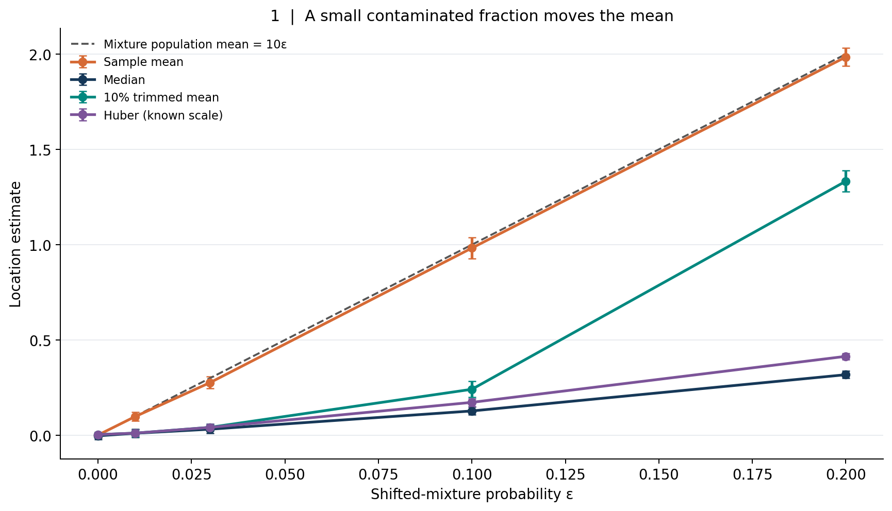
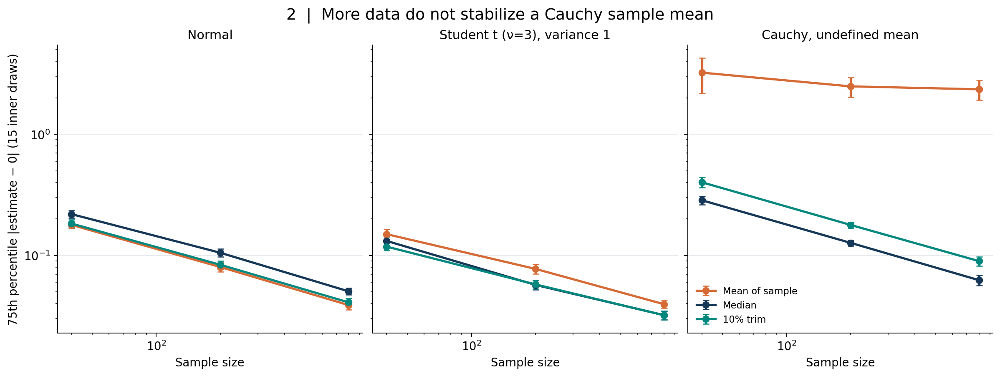
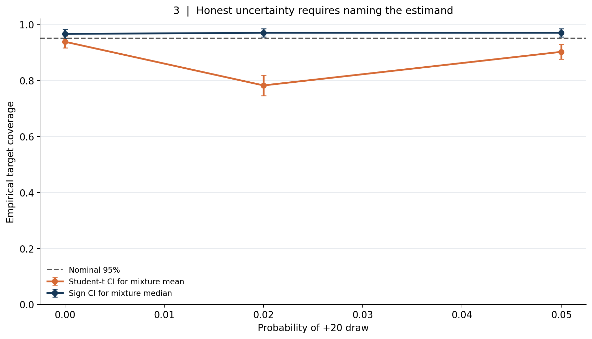
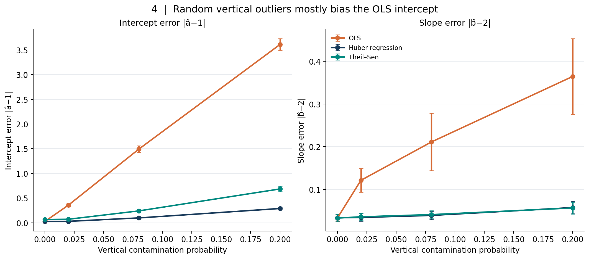
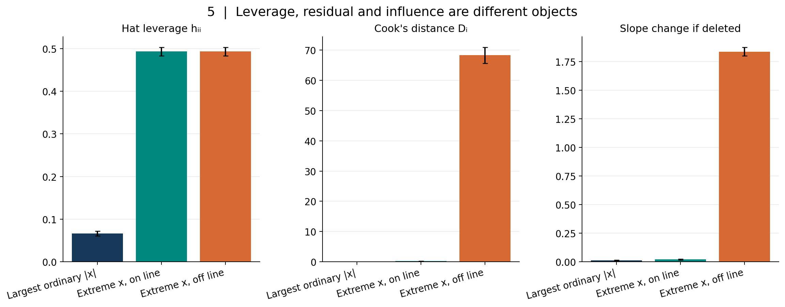
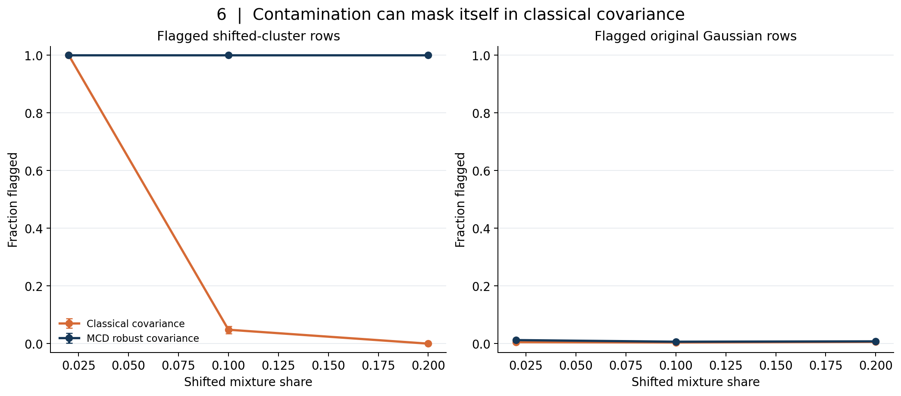
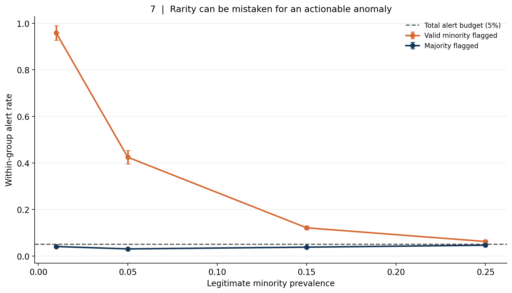
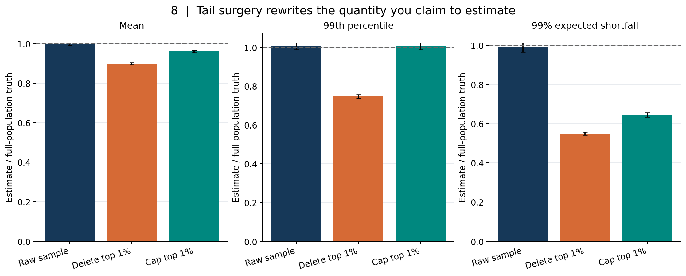
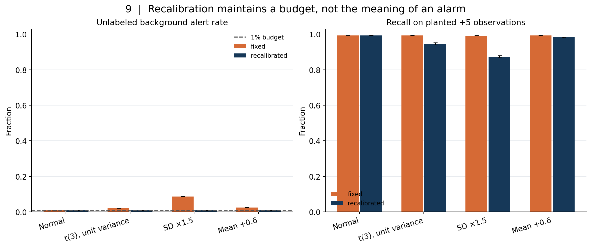

# An Outlier Is Not an Error: Robust Estimation, Influence, Heavy Tails, and the Limits of Anomaly Scores

*A practical, mathematical guide to asking what a surprising observation means before deleting it, downweighting it, or turning it into an alert.*

There is a familiar moment in a data-science project when the analyst discovers a number that looks impossible. A transaction is a hundred times larger than most transactions. A laboratory measurement sits far beyond its reference range. One customer has ten thousand times the activity of the median customer. A server produces a latency spike on the day a new service launches. A scatterplot contains a point so far from the cloud that the plotting library kindly stretches the entire axis to accommodate it.

The immediate question is often, *How do we remove outliers?* That is almost always the wrong first question. The observation could be a transcription mistake, a broken sensor, fraud, a rare but real customer, a new regime, a different subpopulation, a heavy-tailed process, a perfectly correct measurement under an inadequate model, or an unusually influential point in a regression. The same numerical extremeness can arise from all of those causes. None is identified by a z-score.

This distinction becomes especially important when an anomaly system is turned into an operational rule. A score higher than 0.9 can feel like a probability of bad data, even if the score has no probability interpretation. The highest-scoring 1% can feel like a list of errors, even if all of those observations are valid. A robust estimator can feel like a repaired mean, even if its purpose is to estimate a different population functional. And deleting the most expensive claims can make measured financial risk look reassuringly small precisely because the risk itself was removed from the sample.

The objective of this article is to make the different questions explicit. We will distinguish *validity* from *rarity*, *influence* from *leverage*, a *robust location* from a *population mean*, an *alert budget* from a *false-positive probability*, and a *sensitivity analysis* from a causal claim about data quality. We will derive the relevant estimators, examine where they fail, and use nine reproducible simulation studies to show when an apparently sensible cleaning decision changes the scientific target.

This is article **#31** in the long-form series. Its executable companion contains nine original figures, eighteen CSV evidence tables, a seeded analysis script, a generated Jupyter notebook, numerical-invariant tests, and a path-scoped continuous-integration workflow. All populations are synthetic. The experiments are demonstrations of specified mathematical mechanisms, not estimates of real-world prevalence, an endorsement of one software tool in all settings, or a substitute for field investigations.

## 1. Begin with an ontology of surprise

Imagine an insurance claims table. Its typical claim is a few hundred dollars; one is several million. There are at least six distinct possibilities. A misplaced decimal point made a legitimate $3,000 claim look like $3,000,000. An individual really experienced a catastrophic loss. The row belongs to a different product with a much higher policy limit. The insurer changed its product mix. A tiny number of intentionally fraudulent claims are present. Or the amount is correct but the modeling assumption that all claims follow one Gaussian distribution is wrong.

These explanations lead to different actions. The decimal error calls for provenance-based correction. The genuine catastrophic loss calls for retaining the observation in a tail-risk model. The different product calls for stratification or a richer feature representation. The changed book of business calls for temporal analysis and possibly recalibration. Fraud requires investigation and labels, not an automatic claim that the largest amounts are fraudulent. A wrong Gaussian likelihood calls for changing the model.

It helps to record at least four separate fields in an anomaly-review workflow:

1. **Surprise:** How unusual is this observation *under a specified model, feature representation, time window, and reference population*?
2. **Validity:** Does independent evidence indicate that the recorded value is erroneous, fabricated, or generated by an instrument failure?
3. **Relevance:** Does the observation belong to the target population and time period for the question being estimated?
4. **Consequence:** What does an action on this observation cost, and which decision changes if it is retained, corrected, separated, or escalated?

The first field is usually easy to compute. The other three require domain knowledge, provenance, or an explicit decision objective. Treating all four as interchangeable is the fundamental mistake behind indiscriminate outlier removal.

The phrase *an outlier* has no single mathematical definition. In Tukey's boxplot convention a value may lie beyond a multiple of the interquartile range. In a Gaussian model it may be several standard deviations from the fitted mean. In regression it may have a large residual, a high leverage value, or a large leave-one-out influence measure. In a multivariate cloud it may have a large Mahalanobis distance. In an Isolation Forest it may be isolated by short random partition paths. These are different orderings of the data. They need not select the same rows.

Even the word *error* is overloaded. There is measurement error, model residual error, prediction loss, numerical error, and a falsely flagged observation. A large *residual* is not proof of a *recording mistake*. It may expose a missing predictor, an interaction, heteroscedasticity, or an important event that the model was not designed to explain.

For every proposed exclusion, I recommend asking one blunt question: **If the value is completely correct, would excluding it still answer the question we promised to answer?** If the answer is no, the exclusion is not routine cleaning; it is a change of scientific estimand. Sometimes that change is defensible. It must be named.

### A useful distinction: contamination model versus population model

The conventional robustness thought experiment writes a distribution as

\[
F_\varepsilon=(1-\varepsilon)F_0+\varepsilon G,
\]

where \(F_0\) is a nominal reference model, \(G\) is an arbitrary contaminating distribution, and \(\varepsilon\) controls how much probability mass enters through \(G\). This is a powerful sensitivity model. It does **not** assert that observations from \(G\) are mistakes. In an ecology dataset, \(G\) might be an uncommon species. In finance, it might be the loss events that matter most. In a mixed hospital sample, it might be a small but clinically meaningful group.

If the target is the location of the dominant \(F_0\) component, a robust estimator that limits the influence of \(G\) can be useful. If the target is a mean over the entire mixture \(F_\varepsilon\), suppressing \(G\) may instead introduce bias. Robustness is a property relative to a *model neighborhood and a target*, not a moral quality of the data.

The rest of the article makes this distinction concrete. The companion code deliberately knows which observations came from each synthetic component because we control the generator. Real analysts generally do not have those latent labels. Knowing them in a simulation does not make them observable in production.

## 2. Study one: why the sample mean moves, and what the median estimates instead

Start with a deliberately simple population:

\[
X\sim(1-\varepsilon)N(0,1)+\varepsilon N(K,1),\qquad K=10.
\]

The two normal components have the same unit variance, but the second is displaced by ten units. We vary the mixture fraction through 0%, 1%, 3%, 10%, and 20%, draw 500 observations per condition, and repeat the experiment thirty times with independent random-number streams. We compare the arithmetic mean, the median, a symmetrically 10%-trimmed mean, and a Huber location M-estimator with **known unit scale**.

The mixture mean is not mysterious:

\[
\mu_\varepsilon=E[X]=(1-\varepsilon)\cdot0+\varepsilon\cdot10=10\varepsilon.
\]

At 10% mixture mass, its population mean is exactly 1. A sample mean near 1 is therefore not mathematically broken: it is accurately pursuing the *whole-mixture mean*. We might dislike that target if we wanted the uncontaminated component center 0, but that is a disagreement about the estimand, not evidence that the arithmetic mean was calculated incorrectly.

The median solves a different equation. Let \(\Phi\) denote the standard normal cumulative distribution function. The population median \(m_\varepsilon\) is the unique solution of

\[
(1-\varepsilon)\Phi(m_\varepsilon)
+\varepsilon\Phi(m_\varepsilon-10)=1/2.
\]

For fractions below one half and a well-separated displaced component, the median remains nearer to the dominant population's location. It is not generally *exactly* 0: the changed mixture alters the cumulative probability around zero. For example, at \(\varepsilon=.10\) the median shifts modestly above zero. Saying that the median is “unbiased for the original mean” would be wrong; those are different functionals, and the contaminated population median is itself a function of \(\varepsilon\).

### Huber's compromise

The Huber location estimator replaces a squared-error score, which grows without bound, by a clipped score. With supplied scale \(s\) and cutoff \(c\), define

\[
\psi_c(u)=\begin{cases}-c,&u<-c,\\u,&|u|\le c,\\c,&u>c,\end{cases}
\quad\text{and solve}\quad
\sum_{i=1}^n\psi_c\!\left(\frac{x_i-\hat\theta}{s}\right)=0.
\]

The associated Huber loss is quadratic near zero and linear in the tails. Under a normal reference model, the familiar cutoff \(c=1.345\) provides a conventional efficiency-robustness compromise. It is not a universally optimal constant. In this experiment \(s=1\) is *known from the synthetic generator*; the implementation does not estimate scale and should not be described as a generic adaptive robust procedure. If scale is estimated badly, the supposedly robust fit can perform badly too.

Why does clipping matter? For the sample mean, changing one observation from \(x\) to \(x+\Delta\) changes the estimate by \(\Delta/n\), however large \(\Delta\) becomes. Its influence is unbounded. A bounded \(\psi\) limits the score contribution of one extreme residual. The median, based on order, can likewise remain stable when an extreme value is moved even farther away without crossing the middle order statistic.

This is closely related to Hampel's influence-function perspective. Informally, the influence function differentiates an estimator functional as an infinitesimal mass is placed at a point \(z\):

\[
\operatorname{IF}(z;T,F)=\lim_{\varepsilon\downarrow0}
\frac{T((1-\varepsilon)F+\varepsilon\delta_z)-T(F)}{\varepsilon}.
\]

For the mean, \(\operatorname{IF}(z;\mu,F)=z-\mu\). For the median of a continuous density with positive value \(f(m)\) at the median, the influence function is a bounded sign-type function with magnitude \(1/[2f(m)]\). Bounded local influence is useful, but it does not by itself summarize every finite-sample breakdown problem, especially when scale and regression leverage enter.

The actual thirty-repetition summary shows the sample mean at **0.983** when \(\varepsilon=.10\), close to its population target of 1. At the same fraction the median is **0.128**, the Huber location is **0.173**, and the 10%-trimmed mean is **0.241**. At just 1% contamination, the mean is approximately **0.099**, while the Huber estimate is approximately **0.011**. The figure includes 1.96 times the Monte Carlo standard error of each across-repetition average, not a confidence interval for an observed dataset's unknown population mean.

The figure answers one question clearly: **Which functional changes less when a distant component gains mass?** It does not answer whether the distant component should be deleted. If a business policy must cover every customer, the mean's large shift could be exactly the signal the decision maker needs.

### Trimming is not the same as diagnosing

A 10%-trimmed mean orders the sample, removes the lowest and highest 10%, and averages the remainder. This limits sensitivity to extreme values but also removes legitimate observations from both tails. Asymmetric contamination does not necessarily disappear neatly at the trimming fraction. When contamination reaches or exceeds the trimming budget, displaced values enter the retained center. The 10%-trimmed mean in the simulation is more displaced at 10% contamination than the median or the fixed-scale Huber estimator.

Consider the difference between *trimmed estimation* and *row deletion*. A trimmed estimator can be used as a prespecified statistical functional while retaining every source record for auditing, subgroup reporting, and alternative analyses. Deleting source rows makes it harder to reconstruct what happened, and the deletion may silently alter every subsequent estimand. A team can safely compute and compare a trimmed mean without modifying the raw dataset. The governance choice is often more important than the formula.

Three sensitivity questions should accompany a robust location number. First, does the target include every mixture component or only a baseline regime? Second, is the contamination fraction plausibly below the estimator's useful tolerance? Third, are the tails themselves decision-relevant—for example, because service costs or catastrophic losses depend disproportionately on extreme events? The phrase “robust average” is not a substitute for those answers.

### Breakdown, influence, and efficiency are not synonyms

The finite-sample breakdown point asks how much arbitrary replacement is needed before an estimator can be driven arbitrarily far. The sample mean has replacement breakdown \(1/n\); one sufficiently extreme replacement can move it without bound. The sample median tolerates nearly half the sample being arbitrarily replaced before its location becomes unbounded, subject to finite-sample conventions. A symmetrically trimmed mean has a tolerance tied to its trimming proportion. These are worst-case replacement properties, not probabilities that a record is wrong.

Local influence studies an infinitesimal perturbation around a distribution. Breakdown asks about finite contamination large enough to destroy an estimator. Efficiency studies variability under a reference model. A method can have bounded local influence yet a weak finite-sample breakdown property in a more complicated setting. High-breakdown procedures may sacrifice efficiency or require careful tuning. A method that wins one simulation panel does not win all three axes at once.

The original analyses by [Huber (1964)](https://doi.org/10.1214/aoms/1177703732) and [Hampel (1974)](https://doi.org/10.1080/01621459.1974.10482962) give the principled foundation. The lesson for applied work is modest but demanding: document the reference model, target functional, loss or score, tuning constant, scale procedure, and the type of contamination against which you want protection.

## 3. Study two: heavy tails are a population property, not dirty rows

Now remove the displaced mixture. Suppose the observations are independent draws from a perfectly stationary, symmetric distribution with center zero. Every observation can be entirely valid. If the distribution is heavy-tailed, a sufficiently large sample will still contain values that look extraordinary under a Gaussian yardstick.

We compare three families: a standard normal distribution; Student's \(t\) with three degrees of freedom, divided by \(\sqrt{3}\) so that its variance is one; and a standard Cauchy distribution. We evaluate sample sizes 40, 200, and 800. For each family and size, each of thirty independent outer repetitions contains fifteen independently drawn samples. Within an outer repetition we compute the **75th percentile of the absolute location-estimation error** over those fifteen inner samples. We then summarize those thirty outer-level values.

The target for all three families is the known symmetry center 0. For the normal and the standardized \(t_3\), this is also the population mean. For a Cauchy distribution, the mathematical expectation **does not exist**. We may compute a finite-sample arithmetic average, but calling its error “error in estimating the Cauchy mean” would smuggle a nonexistent target into the analysis. We therefore compare its departure from the location parameter 0 while explicitly refusing to treat it as a consistent estimator of a defined Cauchy mean.

### Why a large sample is not a universal cure

For IID random variables with finite expectation, a law of large numbers usually makes the sample mean approach that expectation. For variables with finite variance, the conventional central limit theorem provides the familiar approximate \(1/\sqrt n\) rate and Gaussian limiting distribution for the centered, scaled sample mean. Student \(t_3\) has finite variance; the standardized version obeys these results even though its fourth moment is infinite. The speed and quality of finite-sample approximations can nevertheless differ from a Gaussian model.

The standard Cauchy distribution is fundamentally different. Its characteristic function is \(\varphi(t)=\exp(-|t|)\). For IID Cauchy observations, the arithmetic sample mean is itself Cauchy with the **same** scale. This exact distributional stability means that the sample mean's uncertainty does not shrink like \(1/\sqrt n\) as the sample size grows. An extreme draw can offset the contributions of hundreds of ordinary draws. The problem is not an unlucky simulation seed; the result follows from the distribution.

The median is a different story. A Cauchy density is positive at its center, so the sample median concentrates as sample size grows. For a regular continuous distribution with density \(f(m)>0\) at its median, the sample median has asymptotic variance approximately \(1/[4n f(m)^2]\). For the standard Cauchy, \(f(0)=1/\pi\), giving an approximate median variance \(\pi^2/(4n)\). This does not make the median a substitute for a mean that does not exist; it says that the median is a well-defined, estimable center.

In the synthetic results, the Cauchy sample average's outer-averaged 75th-percentile absolute departure is about **3.23** at \(n=40\), **2.49** at \(n=200\), and **2.35** at \(n=800\). These finite Monte Carlo estimates are themselves variable—especially because the Cauchy is heavy-tailed—so do not read a small apparent downward slope as consistency. The corresponding Cauchy median departures drop from about **0.285** to **0.127** to **0.062**. Under the normal distribution, the sample mean behaves as expected: the same metric decreases from about **0.178** at \(n=40\) to **0.039** at \(n=800\).

There is a useful analytic check on those last two values. For a normal sample mean \(\bar X\sim N(0,1/n)\), the 75th percentile of the **absolute** error is \(\Phi^{-1}(0.875)/\sqrt n\approx1.15035/\sqrt n\), giving approximately **0.182** at \(n=40\) and **0.0407** at \(n=800\). The value 0.67449 is the 75th percentile of a *signed* standard normal, not of its absolute value. The simulated values agree with the correct absolute-error benchmark within finite Monte Carlo variation.

One temptation is to remove Cauchy values beyond a chosen standard-deviation threshold. That does not merely “fix” the original data. The Cauchy standard deviation is undefined; empirical standard deviations swing wildly, and deleting observations changes the population one is implicitly describing. A winsorized or trimmed estimator can be a sensible estimator of location, but a separate operational argument is required before changing or discarding valid records.

### Tail geometry, not only distribution names

Heavy tails are a continuum of possibilities, not a binary diagnostic. Student \(t_\nu\) distributions have finite mean only when \(\nu>1\), and finite variance only when \(\nu>2\). A lognormal distribution has all positive integer moments finite but can still generate very large positive observations; its lack of symmetry matters greatly for inference. Pareto-type tails can have finite means but infinite variances depending on tail exponent. Mixtures can appear heavy-tailed even when every component is Gaussian. Time dependence can cluster tail events and further invalidate independent-sample calculations.

There are also at least three distinct goals. You may want a representative central value; a model for the complete outcome distribution; or a decision-sensitive tail quantity. The sample median may be excellent for the first goal, insufficient for the second, and actively harmful as a replacement for the third. If a hospital needs to budget rare, high-cost admissions, a robust center of admission cost cannot answer the budget-tail question. A method should be judged against its stated estimand and decision loss.

Before selecting a tail treatment, inspect transformations, units, cohort differences, measurement saturation, truncation mechanisms, and time dependence. A log scale may reveal a stable multiplicative process. A separate regime indicator may describe a known instrument change. If the relevant population is genuinely heavy-tailed, model its tail directly and report uncertainty; do not call the largest valid observations dirty merely because a Gaussian assumption failed.

### What a diagnostic histogram cannot establish

A histogram of 800 Cauchy draws may look almost Gaussian in the middle while a few enormous values dominate its horizontal extent. A probability plot against a normal reference can help reject normality, but does not reveal whether the data were correctly measured. A robust z-score based on the median and median absolute deviation can rank values relative to a typical scale, but its threshold still depends on a chosen reference population and action. A distributional lack of fit is evidence against a model, not a chain of custody for each point.

When stakeholders ask whether the “outliers” are real, show both the raw distribution and the analysis with a defensible robust summary; explain the target of each. If the largest values determine resource needs, show that dependence explicitly. Keeping two views is often more honest than forcing an arbitrary decision about which values deserve to exist.

## 4. Study three: a confidence interval is conditional on an estimand and a sampling model

Outlier handling changes not just a point estimate but also the uncertainty attached to it. It is possible to calculate a confidence interval with completely correct arithmetic and still have the wrong coverage because its sampling model is inappropriate. It is also possible for two intervals to have dramatically different widths and both be valid, because they estimate different population quantities.

Our third experiment draws \(n=80\) independent observations from

\[
F_\varepsilon=(1-\varepsilon)N(0,1)+\varepsilon N(20,1),
\qquad \varepsilon\in\{0,.02,.05\}.
\]

We perform 500 outer replications for each condition. The *mean* target is \(20\varepsilon\): exactly 0, 0.4, or 1.0. The *median* target is the solution to the mixture CDF equation shown earlier, with \(K=20\). On each sample we calculate two distinct intervals:

- A conventional two-sided 95% Student-\(t\) interval for the **mixture mean**, \(\bar x\pm t_{.975,n-1}s/\sqrt n\).
- An exact or conservative two-sided sign/order-statistic interval for the **mixture median**, based on sorted sample values and a binomial tail calculation.

We compare empirical coverage against the correct target for each method. We do **not** compare their widths as if their targets were interchangeable. The studentized mean interval is an approximate procedure outside the ideal normal model. The sign interval uses fewer distributional assumptions for its median target, provided the draws are IID from a continuous distribution with a unique median.

### Deriving the median interval

Let \(X_{(1)}\le\dots\le X_{(n)}\) be the order statistics from a continuous distribution with unique median \(m\). Exactly half the population lies below \(m\), so the number of observations below \(m\) has the \(\operatorname{Binomial}(n,1/2)\) distribution. Choose integer \(k\) so that

\[
\Pr\{B\le k-1\}\le .025,\qquad B\sim\operatorname{Binomial}(n,1/2),
\]

using the largest such positive \(k\). Then the interval \([X_{(k)},X_{(n-k+1)}]\) has coverage at least 95% for a continuous-population median. The discreteness of the binomial distribution ordinarily makes the coverage slightly conservative. It does not require estimating the population density at the median or pretending the sample is Gaussian.

The studentized mean interval estimates a different object. Its familiar finite-sample exactness assumes normal observations. With sufficiently large samples and appropriate moments it can work approximately beyond normality. But the specific rare-shift mixture creates a difficult finite-sample pattern: some samples contain no displaced observations; others contain one, two, or several values near 20. The sample standard deviation, and hence the interval width, changes abruptly with those counts.

At \(\varepsilon=.02\) and \(n=80\), the number of shifted draws is binomial with expected value 1.6. The probability of seeing **zero** shifted draws is \((.98)^{80}\), approximately 0.20. Such samples look like ordinary \(N(0,1)\) data even though the true mixture mean is 0.4. Their standard errors are correspondingly small. A standard 95% mean interval can miss its target in many of those samples, not because the software made a mistake but because finite-sample inference did not account adequately for the rare component.

Across 500 independent repetitions, the mean Student-\(t\) interval covers the true mixture mean about **93.8%** of the time with no shift component, **78.2%** at 2% mixture mass, and **90.2%** at 5%. The conservative median sign interval covers its median target about **96.6%**, **97.0%**, and **97.0%**, respectively. At 2% contamination, the mean interval's average width is about **1.18**, while the median interval's is about **0.61**. The widths cannot be ranked as a contest for the same parameter: they are estimates of different targets, and their sampling distributions respond differently to the mixture.

The apparently nonmonotone mean-interval coverage—worse at 2% than at 5%—is a valuable warning. More contamination does not always imply worse coverage in a simple monotonic way. At 5% contamination the typical sample contains more displaced observations, inflating its estimated variance and interval width. This can improve coverage relative to the rarer-contamination setting even while the population departs further from normality. The precise values depend on sample size, displacement, confidence procedure, and mixture prevalence. They are not general coverage constants for contaminated data.

### Why cleaning can make intervals look too precise

Suppose an analyst identifies high values by looking at the outcomes, deletes them, and then applies a classical interval formula to the retained observations as if no selection happened. The interval now conditions on a data-dependent exclusion that changed both the center and the spread. Ordinary confidence calculations do not automatically account for that selection. If the intended target remains the full-mixture mean, exclusion can introduce bias that narrow standard errors cannot repair.

If the intended target instead becomes a trimmed population mean, the uncertainty calculation must reflect that trimmed functional and its sampling distribution. A bootstrap can help in some regular settings, but it is not magical: bootstrap validity requires its own conditions, and severe tail behavior, selection, small subgroups, or dependence can break naive resampling schemes. For a median under IID continuous sampling, the sign interval provides an appealing assumption-light baseline. For a rare-event mean, an explicit two-component model or sensitivity analysis might better expose the uncertainty than a Gaussian interval around a cleaned sample.

This study also illustrates a reporting obligation. A 95% coverage claim means that a procedure covers a specified fixed population target in at least approximately 95% of hypothetical repeated samples under its assumptions. It does not mean there is a 95% probability that the parameter is inside the interval after observing one dataset. Our plotted error bars describe the Monte Carlo precision of simulated coverage rates. Keeping those two layers of uncertainty separate prevents another kind of accidental overconfidence.

## 5. Study four: regression outliers, robust losses, and the variable you perturb

“Outlier” in a regression can mean a surprising outcome conditional on ordinary predictors, or an unusual predictor configuration. These are not interchangeable. A vertical outlier has a large response residual for a given \(x\). A high-leverage observation has a predictor value far from the center of the observed design. A point can have one property without the other, and its influence on coefficients depends on their interaction.

Begin with a one-predictor data-generating process:

\[
X\sim N(0,1),\qquad Y=1+2X+U,\quad U\sim N(0,.7^2).
\]

We generate 360 paired observations and, independently of \(X\), add 18 to the outcome of a randomly chosen fraction \(\varepsilon\in\{0,.02,.08,.20\}\). Each condition is independently regenerated across thirty outer repetitions. The fitted estimators are ordinary least squares, Huber regression as implemented by scikit-learn, and a one-dimensional Theil–Sen slope with a separate median-based intercept. The reported metrics are the absolute intercept error relative to 1 and absolute slope error relative to 2.

This design is intentionally specific. Because the vertical shift is independent of \(X\), the contaminated conditional mean becomes

\[
E[Y\mid X=x]=1+18\varepsilon+2x.
\]

Thus the *population OLS intercept target* shifts by \(18\varepsilon\), while the population slope remains 2. Finite samples still experience noisy slopes because which observations receive large outcome shifts varies randomly. But it would be misleading to claim this experiment demonstrates asymptotic slope bias in OLS. It demonstrates intercept displacement and increased finite-sample slope variability under random vertical contamination. If contamination probability depended on \(X\), the slope story could be very different.

### Why least squares gives big vertical residuals so much authority

OLS chooses coefficients \(\hat\beta\) to minimize \(\sum_i(y_i-x_i^T\beta)^2\). Its normal equations aggregate contributions proportional to each residual multiplied by the predictors:

\[
X^T(Y-X\hat\beta)=0.
\]

An enormous vertical residual contributes enormously to this equation. Huber regression replaces squared loss far from zero with approximately linear loss, bounding the contribution of large residuals in response space. Theil–Sen estimates a slope using a median of pairwise slopes in the one-dimensional setting, giving a different form of resistance to exceptional response values. These methods have different tuning conventions, computational costs, efficiency, and vulnerability to adversarial predictor contamination.

One should also avoid conflating the *Huber location function* in study one with scikit-learn's *HuberRegressor*. The first uses supplied scale exactly equal to 1 and solves a one-dimensional M-estimation equation. The second jointly fits regression coefficients and a scale parameter using its library loss and optimization conventions. The experiments list the exact API and parameters so readers can distinguish them. They are not interchangeable pieces of black-box software with identical robustness guarantees.

At 8% vertical contamination, average absolute OLS intercept error is about **1.492**, versus **0.098** for Huber regression and **0.240** for the selected Theil–Sen procedure. At 20% it rises to **3.609**, while Huber's is about **0.288** and Theil–Sen's about **0.684**. These results arise because the robust procedures emphasize the dominant baseline linear relation while OLS follows the full-mixture conditional expectation. At 8%, mean absolute slope error is around **0.211** for OLS, **0.039** for Huber, and **0.041** for Theil–Sen. Again, that OLS slope metric describes finite-sample absolute error, not the sign of an asymptotic slope bias.

What if the shifted outcomes are actually valid? Perhaps the institution changed its payment rule for a random subset of customers. Then the robust intercept may be closer to the old baseline relation, but worse for estimating the new population's expected payment. If we want to predict every customer's expense in the changed world, the robust regression could systematically underpredict an important subgroup. A good robust sensitivity analysis should be accompanied by a full-mixture prediction or segment-specific model when that is the operational target.

### A robust line can still be a bad model

Robust estimators are not exemptions from model specification. If the true conditional expectation is nonlinear, fitting a robust straight line can produce large residuals for perfectly predictable nonlinear structure. If one group has a higher slope, a pooled robust line may discount the group's correct observations. If measurement variance grows with \(x\), large residuals at high \(x\) may reflect known heteroscedasticity instead of anomalies. If predictor measurements are corrupted, Huber's bounded response loss does not automatically protect against arbitrarily high leverage. And if the data are clustered or serially dependent, independent-observation uncertainty calculations still require adjustment.

An operationally useful sequence is to check units and joins, inspect residual patterns against *all* available covariates, fit alternative functional forms or group interactions, and compare ordinary versus robust estimates under a documented target. If the coefficient changes materially, investigate which observations drive the change rather than declaring those observations invalid. A data point can be influential because it provides valuable information at the edge of the design, not because its creator did something wrong.

The Theil–Sen lineage is part of the history of robust slope estimation; see [Sen (1968)](https://doi.org/10.1080/01621459.1968.10480934). High-breakdown regression addresses still other contamination patterns, as in [Rousseeuw (1984)](https://doi.org/10.1080/01621459.1984.10477105). There is no universal robustness guarantee for all combinations of outcome errors, predictor contamination, dependence, heteroscedasticity, and model misspecification.

## 6. Study five: leverage is not influence, and influence is not guilt

Suppose we fit the regression \(y_i=\beta_0+\beta_1x_i+\epsilon_i\). In a scatterplot, an observation at \(x=12\) appears much farther horizontally from a baseline sample with \(x\) near zero. Many analysts would call it an outlier immediately. But there are two quite different ways to place it vertically: directly on the baseline line near \(y=25\), or dramatically below it at \(y=-20\). Both observations have the same \(x\) and hence the same leverage within the same design. Only the second has a large disagreement with the baseline relationship.

For OLS with an intercept, the fitted value vector is \(\hat Y=HY\), where \(H=X(X^TX)^{-1}X^T\) is the hat matrix. The diagonal \(h_{ii}\) measures the leverage of row \(i\). With one predictor and an intercept,

\[
h_{ii}=\frac1n+\frac{(x_i-\bar x)^2}{\sum_j(x_j-\bar x)^2}.
\]

This is a property of the predictor geometry. It does not look at the outcome \(y_i\) at all. If we change only the outcome, leverage remains unchanged. High leverage says a row can potentially exert substantial control over fitted values; it does not say that it actually did.

One way to quantify actual coefficient influence is Cook's distance. Let \(e_i=y_i-\hat y_i\), \(p\) be the number of fitted coefficients including the intercept, and \(\widehat\sigma^2=\sum e_i^2/(n-p)\). Under the ordinary full-rank OLS setup, Cook's distance can be written

\[
D_i=\frac{e_i^2}{p\widehat\sigma^2}\frac{h_{ii}}{(1-h_{ii})^2}.
\]

The formula combines residual size and leverage. Equivalently, it measures how much the fitted coefficient vector changes upon deleting observation \(i\), scaled by estimated residual variation and the design matrix. It is a sensitivity diagnostic about a particular fitted linear model. It is **not** the posterior probability of a data error, and a generic numerical cutoff cannot decide validity without context.

We simulate thirty datasets of 150 baseline observations from \(Y=1+2X+N(0,.7^2)\). In each dataset we compare three designated rows: the baseline observation with the largest ordinary \(|x|\); a new high-leverage row \((x,y)=(12,25)\) on the reference line; and a high-leverage row \((12,-20)\) far off the line. For each case we compute the designated row's leverage, Cook's distance, and absolute change in fitted OLS slope when that row alone is removed.

The on-line and off-line points have the same average leverage, approximately **0.493**. That is enormous compared with the average designated ordinary row's leverage, approximately **0.066**. But their influence differs sharply. The on-line row has average Cook's distance about **0.191** and average leave-one-out slope change around **0.020**. The off-line row has average Cook's distance about **68.29** and average slope change about **1.839**. The ordinary designated row changes the slope about **0.013** on average. The striking high-leverage on-line point is unusual but not comparably disruptive to the fitted slope.

There is a subtlety here: even an exactly on-line point need not produce *zero* Cook's distance. The baseline sample has noise, so the full-sample regression line is not exactly the deterministic generating line. Adding a highly leveraged, perfectly generated point near \((12,25)\) can pull the fitted line modestly toward the true relationship. That pull is still influence, but it can be beneficial. Our simulation avoids the misleading statement that on-line high-leverage observations necessarily have no influence at all.

### Why deletion diagnostics need a second question

Imagine that an innovative customer is genuinely the first to purchase a much larger contract than anyone in the training data. The row may have high leverage because it extends the range of observed predictors. Deleting it can make the model appear more stable while discarding the only observation relevant to the expansion. Conversely, a spreadsheet join error may place an outcome against the wrong predictor row, generating a large Cook's distance with a clear provenance-based explanation. The diagnostic helps decide where to investigate; the underlying evidence decides whether to correct.

With high-dimensional predictors, leverage can arise through combinations of individually ordinary-looking coordinates. Collinearity, regularization, influential clusters, and nonlinear feature maps complicate the simple one-predictor picture. A single-case Cook's distance may also miss *joint influence*: a group of similar observations can mask each other because deleting one leaves the others in place. Case-deletion influence should therefore be supplemented with grouped or cluster sensitivity analysis when the problem calls for it.

I recommend reporting three things together: the row's predictor leverage, its conditional residual under the current model, and a direct comparison of key predictions or decisions with and without the row. If removal changes a decision, the next step is a domain investigation and an alternative model, not an automatic blacklist. The original paper by [Cook (1977)](https://doi.org/10.1080/00401706.1977.10489493) provides the statistical foundation for this separation.

## 7. Study six: multivariate masking makes a cluster look ordinary

In several dimensions, a common baseline measure of unusualness is squared Mahalanobis distance:

\[
d^2(x)=(x-\hat\mu)^T\hat\Sigma^{-1}(x-\hat\mu),
\]

where \(\hat\mu\) and \(\hat\Sigma\) are fitted location and covariance estimates. Under an ideal multivariate Gaussian population with known parameters, this squared distance has a chi-square distribution with degrees of freedom equal to the feature dimension. In practice, estimating parameters from the same contaminated observations changes the finite-sample reference distribution. The popular chi-square cutoff is consequently a model-dependent screening convention, not an exact universal false-positive guarantee.

The estimator of covariance matters as much as the distance formula. Suppose a displaced cluster makes up a substantial fraction of the training set. The empirical mean moves toward it, and the empirical covariance inflates along the direction joining the clusters. Some points in the displaced cluster then appear less distant relative to the fitted ellipse. This is *masking*: a group of unusual points distorts the estimated reference distribution enough to disguise its own unusualness.

The minimum covariance determinant, or MCD, offers a different estimate of multivariate location and scatter. In broad terms, it searches for a subset whose covariance determinant is small, then uses that subset and possible reweighting to form a robust estimate. Modern implementations use efficient approximations; the FastMCD contribution of [Rousseeuw and Van Driessen (1999)](https://doi.org/10.1080/00401706.1999.10485670) is foundational. This can resist separated contamination where the empirical covariance is pulled toward the contaminating cluster. It does not mean that whichever cluster MCD rejects is invalid.

Our sixth experiment generates correlated bivariate Gaussian baseline observations with covariance

\[
\Sigma=\begin{pmatrix}1&.65\\.65&1\end{pmatrix}.
\]

We add 2%, 10%, or 20% of observations from a tighter bivariate cluster centered at \((5,5)\), with covariance \(.2\Sigma\). Every dataset contains 380 rows, and each condition has 24 outer replications. We fit classical sample mean/covariance and scikit-learn's MinCovDet with support fraction 0.7. Both generate squared Mahalanobis distances evaluated against the same nominal 99th-percentile \(\chi^2_2\) cutoff. Because the generator reveals component membership, we can separately report the fraction of shifted-cluster rows flagged and the fraction of baseline rows flagged. These are **simulation component rates**, not observed real-world error rates.

At 2% displaced mixture mass, both methods flag essentially **100%** of shifted-cluster rows. At 10%, classical distance flags about **4.8%** of shifted-cluster rows, while the chosen MCD configuration still flags **100%**. At 20%, classical distance flags **0%** in these synthetic trials, while MCD flags **100%**. For baseline rows at 20%, the classical method flags about **0.62%** and MCD about **0.79%**. These numbers illustrate masking dramatically; they do not establish general superiority of MCD across all dimensions, contamination patterns, or covariance structures.

The implementation uses a two-dimensional dataset with moderate size, a tight and well-separated displaced component, and a fixed MCD support fraction. If the displaced group were the new legitimate majority, a robust subset estimator favoring the old cluster might become the wrong reference for current operations. If the baseline distribution had multiple legitimate modes, a single robust ellipse could reject an entire valid mode. If the dimensionality approached the sample size, covariance inversion could fail or require regularization, and MCD's computation and calibration would need reconsideration.

This brings us back to the ontology of surprise. A bivariate point can be anomalous relative to a single-ellipse model and completely ordinary within a known subpopulation. A cluster can be masked by a contaminated covariance, but it can also be hidden because the features omit a relevant category. Before declaring the cluster “wrong,” inspect whether there is a known subgroup, instrument, product, time period, or data-collection channel that accounts for it. Robust geometry is a way to find structure worth understanding.

### What a screening cutoff really buys

A nominal 99% chi-square cutoff means something precise only under the corresponding distributional assumptions. It does not say that 1% of the flagged rows are false alarms. The fraction of *unflagged* baseline observations and the prevalence of distinct populations both matter. Nor does a chi-square tail area prove a row was fabricated. In our synthetic table, a value called `mcd_tpr` means “fraction of deliberately generated shifted-component observations above the threshold,” not “sensitivity to fraud.” Making this label explicit protects later readers from interpreting the simulation as a deployed detection result.

If we must operate an alerting system, we should evaluate its thresholds with held-out, adjudicated cases whose validity labels came from independent evidence. Where labels are unavailable, we can still measure stability, drift, review workload, and subgroup disparities; we cannot estimate an actual error-detection precision merely by looking at an unsupervised score distribution. The score is a hypothesis generator.

## 8. Study seven: the perfectly valid minority that becomes an anomaly

Consider a business with two legitimate customer groups. Most customers have feature vectors centered near \((0,0)\), while an uncommon but valid type of customer has feature vectors near \((4,0)\). Neither group contains recording mistakes. There are no planted fraudulent examples. Yet a generic anomaly detector trained on the entire mixture will often mark the less common group as exceptional because it occupies a rarer part of feature space.

We create 950 two-dimensional observations, varying the legitimate minority's share through 1%, 5%, 15%, and 25%. The majority is standard bivariate Gaussian. The minority is bivariate Gaussian with mean \((4,0)\) and per-coordinate standard deviation 0.65. For every mixture share we fit an Isolation Forest with 100 trees, at most 256 observations sampled per tree, and an independent fixed random state per outer repetition. We repeat the complete experiment 24 times.

Isolation Forest assigns anomaly scores according to how readily observations can be separated by recursive random partitions. Rare and separated groups are often isolated with shorter path lengths, which creates a higher anomaly score. The original contribution by [Liu, Ting, and Zhou (2008)](https://doi.org/10.1109/ICDM.2008.17) explains the mechanism. The score is not a probability that data are inaccurate. It does not know whether a customer belongs to a protected class, an unusual but valuable product segment, or a population that the service has historically underserved.

We impose a strict **top-5%-by-score review budget** on the training scores. That threshold is chosen by rank, not by a statistical promise about error frequency. Then we calculate the proportion flagged separately within the minority and majority groups. We also calculate the fraction of flagged rows that belong to the valid minority. Since every row is valid by construction, neither of these is an actual data-error detection rate.

When the minority is only 1% of the population, the model flags about **95.8%** of its members while flagging about **4.09%** of majority members. Roughly **20.0%** of all flagged rows then belong to a group that accounts for only about 1% of the population. At a 5% minority share, around **42.4%** of the minority is flagged. At 25% minority share, the minority flagged fraction drops to about **6.25%**. The same spatial group becomes less anomalous merely because it is more prevalent in the training distribution.

This result has a direct operational implication. If a review team treats the highest isolation scores as probable invalid records, it may disproportionately burden precisely the uncommon users for whom the system has the least representative training data. The detector's behavior can look impressive on an unlabeled novelty benchmark while creating unfair or wasteful workflows. This is a statistical version of a familiar conceptual error: *uncommon* does not imply *unacceptable*.

### Anomaly scores are reference-dependent rankings

Changing the training population changes the anomaly score's meaning. Training on an undifferentiated mixture asks, in effect, how separable each point is from what the algorithm usually encounters. Training within each known legitimate group asks a different question: how surprising is a point *conditional on its group*? The latter can reduce systematic flags on a known minority, but it introduces its own tradeoffs. Small groups yield noisy score distributions and uncertain thresholds. Conditional models may hide cross-group harmful events that must be compared globally. Group labels can be wrong, unavailable, sensitive, or misused. A policy may need both global and group-conditional monitoring, with clearly stated purposes.

Our top-5% rule is particularly transparent because it guarantees review workload by construction. It does not guarantee five percent prevalence of errors, five percent false-positive rate, or comparable consequences across groups. If the adjudicated error base rate is extremely low, most alerts could be valid observations even when the detector ranks unusual values reasonably well. That problem belongs to decision theory and base-rate-aware evaluation, not unsupervised feature geometry alone.

For a deployed system, collect *review outcomes* with careful selection-bias accounting. Randomly audit a sample of observations below the threshold as well as above it. Otherwise, if only flagged cases receive human labels, evaluation is restricted to the policy-selected population and false negatives remain largely invisible. Inspect subgroup acceptance rates, false alarm rates where verified labels exist, repeat flags, remediation cost, and the experience of people whose records are escalated. A detector should be allowed to say “worth checking”; it should not be allowed to silently rewrite “valid” into “invalid.”

## 9. Study eight: deleting the tail edits the risk question

The strongest argument against blanket outlier deletion sometimes comes from the application itself. Imagine a risk analyst estimating the cost of exceptional insurance claims, the severity of industrial losses, or the cash required to survive large refunds. Those are precisely the domains where the largest valid observations dominate decisions. A rule that discards the highest 1% may lower measured volatility and improve the visual appearance of a histogram while destroying the target quantity.

To make this unambiguous, we generate 9,000 independent positive outcomes from a lognormal distribution, \(Y=\exp(Z)\) with \(Z\sim N(0,1.1^2)\). We compare three treatments within each of thirty outer repetitions:

1. Retain the original sample.
2. Delete values above its empirical 99th percentile.
3. Winsorize or cap values above its empirical 99th percentile at that percentile, retaining all rows but changing their numeric values.

For every treated dataset we calculate its empirical mean, 99th percentile, and empirical 99% expected shortfall, then divide by the corresponding **true functional of the original lognormal population**. The comparison is a deliberate stress test of what happens when the estimand is quietly held fixed even though the data transformation changes the distribution. The sample quantile uses NumPy's documented default interpolation convention. Expected shortfall is the mean of observed values at or above the empirical 99th-percentile threshold; ties after capping are included, so capping creates a particularly stark artificial tail.

The lognormal expectation is \(E[Y]=\exp(1.1^2/2)\). Let \(z_p=\Phi^{-1}(p)\). The upper \(p\)-quantile and expected shortfall of this original population are

\[
q_p=\exp(1.1z_p),\qquad
\operatorname{ES}_p=E[Y\mid Y\ge q_p]
=\frac{\exp(1.1^2/2)\,[1-\Phi(z_p-1.1)]}{1-p}.
\]

This is an especially instructive case because the lognormal distribution has finite mean and variance. There is no undefined-moment pathology to blame. The large positive tail is simply part of a perfectly valid probability distribution. Excluding high outcomes removes real probability mass from a functional that explicitly cares about the upper tail.

The original samples recover the population mean ratio at about **0.999**, the 99th-quantile ratio at **1.006**, and the expected-shortfall ratio at **0.989** over thirty repetitions. After deleting the top 1%, the mean ratio falls to **0.899**, the 99th-quantile ratio to **0.747**, and the expected-shortfall ratio to **0.549**. Winsorizing is less destructive to the mean, with ratio **0.961**, and preserves the empirical 99th-quantile threshold approximately, but its calculated expected shortfall still falls to **0.645** of the original-population target.

For a risk manager who needs the full-population expected shortfall, these are not successful cleaning results. They are substantial underestimates induced by changing the sample. The data generator has no measurement errors. There is nothing to “repair” in the tail. The deletion operation creates the problem. The fact that the new risk number is more stable or visually appealing does not compensate for the loss of the relevant target.

### There are legitimate reasons to cap or truncate—but they define new targets

If a product contract actually caps payouts at a known policy limit, capped payment is the economically relevant outcome for some questions. If the goal is to report a median customer experience, the uppermost 1% may contribute little to the selected statistic. If a finite-capacity dashboard cannot display every magnitude, visual winsorization may be appropriate provided the axis transformation is disclosed and the raw analytical values are retained. Some regulators or business processes require specific censored or trimmed reporting conventions. None of these is intrinsically wrong.

The essential difference is whether the transformation reflects a genuine **data-generating, contractual, measurement, or decision definition**, or whether it was invented after seeing inconvenient observations. If claims above a contractual limit are not payable, model the covered payout as \(\min(Y,L)\), retain the uncapped claim amount separately, and label the outcome. If an instrument saturates at a maximum, the observed upper values are censored readings and may require an explicit censoring model, not replacement by an assumed true maximum. If a statistical estimator is trimmed for robustness, keep the untrimmed distribution and report the trimmed estimand.

The distinction between a transformed variable and an erroneous record should be visible in schema and lineage. A field named `claim_amount_capped_at_policy_limit` is much more informative than overwriting `claim_amount`. A field named `risk_excluding_claims_above_sample_p99` clearly signals a sensitivity analysis rather than the same risk quantity with improved data quality. Good names force the analyst to face the scientific meaning of the operation.

### Tail decisions need uncertainty of their own

Extreme quantiles and expected shortfall are often statistically noisy. A 99% tail fraction in a sample of 9,000 involves only around ninety observations before interpolation and ties. Their dispersion can be high even when the full distribution has finite variance. Reporting an expected shortfall estimate without its sampling uncertainty or an assessment of dependence can create false precision. Deleting extreme outcomes may reduce *observed variability* while worsening error relative to the target. Low variance around a biased result is not a quality guarantee.

For an operational risk analysis, I would retain the original values, model heavy-tail behavior with appropriate uncertainty, compare parametric and nonparametric estimates, check temporal clustering, run threshold sensitivity analyses, and describe how decisions change under alternative plausible tail models. If actual recording errors are found through provenance, correct them explicitly and preserve an audit trail. That process is slower than trimming at an arbitrary percentile, but it answers the question the risk manager actually asked.

## 10. Study nine: a fixed alarm threshold drifts, and recalibration has a price

It is tempting to fit an anomaly model on a reference window, pick a threshold, and assume the threshold keeps the same meaning indefinitely. But a score is always relative to a background distribution, an input representation, and a model or scoring rule. The world can change without any measurement errors. New equipment, seasonality, customer acquisition, a different exposure mix, or a change in variance can make a previously ordinary alert threshold fire much more often.

Our ninth experiment uses a deliberately transparent anomaly score: \(S(x)=|x|\). We fit a threshold at the empirical 99th percentile of \(|N(0,1)|\) on 11,000 baseline training observations. In each of thirty independent outer replications, we evaluate four possible background populations, again with 11,000 observations each:

- Unchanged \(N(0,1)\).
- Student \(t_3\) divided by \(\sqrt{3}\), which has the *same variance* as the baseline normal but heavier tails.
- A zero-centered normal distribution with standard deviation 1.5.
- A unit-standard-deviation normal distribution with mean shifted to 0.6.

We also generate 500 deliberately planted shifted observations from \(N(5,1)\) in each condition. Here, “planted” is a simulation-only label used to measure detection sensitivity against a known constructed alternative. It is not a claim that these readings would be mistakes in an actual system.

For each background we compare two policies. The **fixed** policy continues to use the original baseline threshold. The **recalibrated** policy selects the empirical 99th percentile of \(|x|\) in the new background, so that approximately 1% of new background observations exceed the threshold by construction. We report both the background alert rate and recall on the planted shifted population. Crucially, recalibration is carried out on an unlabeled background sample; in practice, accurately identifying a clean current background may itself be difficult. Recalibrating on a mixture that includes emerging problems can absorb the problems into the new baseline.

The unchanged normal background triggers alerts about **1.00%** of the time under the fixed threshold. Under the variance-matched but heavier-tailed \(t_3\), it triggers **2.14%**. When standard deviation rises from 1 to 1.5, the rate jumps to **8.64%**. With mean shift +0.6, it becomes **2.49%**. These are changes in the *rate of surprises relative to the old normal baseline*. Nothing in the generator makes the background values incorrect.

Recalibration restores the observed background alert rate to about **1%** for all four environments, as its definition requires. But it changes the threshold and the detector's sensitivity to planted shifted observations. Under the standard-deviation-1.5 background, planted-event recall drops from about **99.2%** using the fixed threshold to about **87.3%** after recalibration. In the variance-matched heavy-tailed \(t_3\) case, recall falls from about **99.3%** to **94.6%**. The new threshold buys a stable review budget at the cost of missing a larger fraction of the deliberately shifted population.

This is not an argument to keep all thresholds fixed. A fixed threshold can overwhelm human reviewers when the background changes; low-value alerts can cause fatigue, queueing delays, and ultimately less effective action. But adaptive thresholding can hide new regimes by treating them as ordinary. The right choice depends on why the system exists. A safety-monitoring alarm may value detecting a new variance regime; a fixed-capacity customer-review queue may need to prioritize only its highest-risk cases. These are different objectives even when they use the same scalar score.

### Three baselines, not one

An effective deployment separates a *reference baseline*, a *current background estimate*, and a set of *adjudicated outcomes*. The reference baseline gives a stable historical yardstick for measuring change. The current background estimate helps predict workload and identify what is ordinary now. The adjudicated outcomes—where available through independent reviews or verified incidents—tell us whether the alerting policy achieves its actual operational purpose.

The danger is collapsing all three into one threshold. A percentage of rows above a historical cutoff is a drift statistic, not a measured error rate. A top-k list is a workload constraint, not a probability estimate. A calibrated probability of a specific verified event would require labeled data, an explicitly defined event, and calibration validation under the deployment distribution. An unsupervised anomaly score has none of those guarantees by default.

Practical monitoring should therefore include at least two distinct time series: a **frozen-reference alert rate** that exposes distribution change, and a **current-policy review rate** that tracks operational capacity. Add threshold values, score distributions, feature missingness, population composition, review turnaround, adjudicated outcome rates, and downstream decision costs. A stable review rate can coexist with meaningful drift; a rising frozen-reference rate can coexist with zero new data errors.

## 11. An outlier-review protocol that protects the raw evidence

The nine studies suggest a practical approach to anomaly handling. I prefer a protocol that delays irreversible deletion until the target, provenance, and consequence have been made explicit. It need not be bureaucratic. For a small analysis it can fit in a short review notebook; for a production system it belongs in the data contract and incident workflow.

**Gate 1: State the estimand or decision.** What exactly must remain correct? Is the target a population mean, a median, a conditional prediction, a subgroup effect, a rare-event quantile, a contractual payout, or a human-review queue? Write this in one sentence before proposing a threshold. “Make the distribution normal” is not an estimand. “Estimate the mean cost per policy across all covered customers this quarter” is.

**Gate 2: Preserve evidence and check provenance.** Never begin by overwriting source values. Identify the acquisition path, unit, timezone, software version, instrument calibration, row identifier, data joins, and any upstream transformations. Compare with original documents or independent measurement where possible. Distinguish a physically impossible value under a verified measurement contract from an economically unusual value that is entirely possible. A typed `0` may be missingness disguised as a number; a negative reading may be valid after baseline correction; a large integer may be an identifier. Context determines validity.

**Gate 3: Diagnose model dependence.** View the observation under several defensible reference models. Inspect an appropriate transformation, group-specific distribution, time window, and residual plot. Contrast ordinary and robust estimates, global and group-conditional scores, and classical and robust covariance. Record the conditions under which the row is called anomalous. If a point ceases to be extraordinary after adding a relevant categorical feature, the original score revealed missing context, not necessarily bad data.

**Gate 4: Quantify influence and decision sensitivity.** For a regression, compute leverage and residual diagnostics, then measure what happens to the actual decision or key prediction when the point is retained or investigated. For a population mean, report both the full-sample estimate and robust alternatives, labeling their targets. For a tail-risk decision, retain the extreme observations and quantify how removal would change quantiles and expected shortfall. Sensitivity analyses should be reported as such, not quietly substituted for the primary result.

**Gate 5: Obtain labels independently of the score.** Where action requires a claim of invalidity, establish the standard of evidence. A source-system correction, confirmed duplicate, sensor service log, or audited transaction can support a data-quality label. Merely being far from the mean, exceeding a Cook's-distance heuristic, or getting a short Isolation Forest path does not. If reviewers inspect only flagged cases, plan a sampled audit of the unflagged population so evaluation can at least begin to address selection bias.

**Gate 6: Choose a reversible action and document its scope.** The default is to preserve raw data and add explicit fields: `flag_reason`, `review_status`, `corrected_value`, `correction_provenance`, `reference_population`, `score_version`, and `policy_threshold`. A correction can be applied to an analysis-ready view while the original remains traceable. A legitimate distinct population can be stratified rather than erased. A robust alternative estimate can be reported without mutating rows. An operational escalation can be made with a human review and an appeal path when its consequences are material.

These gates avoid two false extremes. The first is “never remove anything,” which would leave confirmed unit mistakes and duplicated transactions uncorrected. The second is “all sufficiently unusual values are errors,” which deletes the rare events and minority populations that some analyses exist to understand. Good data governance is not anti-cleaning; it requires that cleaning be backed by a falsifiable reason and an auditable correction.

### A compact decision table

| Observed pattern | What it does **not** establish | Plausible next diagnostic | Appropriate action if confirmed |
| --- | --- | --- | --- |
| Huge univariate value | That a sensor malfunctioned | Source record, units, tail model, cohort | Correct proven error; otherwise retain and model tail |
| Large conditional residual | That the response was typed wrong | Missing predictors, interactions, heteroscedasticity | Improve model; correct only documented record error |
| High regression leverage | That the row strongly changed coefficients | Cook's D and leave-one-out prediction change | Report sensitivity, inspect extrapolation |
| High Cook's distance | That the row is invalid | Source evidence, grouped influence, decision change | Verify and document; do not auto-delete |
| High robust Mahalanobis distance | That the point is fraudulent | Known mixture groups, covariance fit, time regime | Investigate and segment if justified |
| High Isolation Forest score | A calibrated error probability | Group review rates, independent labels, drift | Prioritize a reversible review queue |
| Higher frozen-threshold alert rate | That more records are wrong | Background distribution and calibration shift | Separate drift monitoring from error investigations |
| Extremely high claim or loss | That the observation is irrelevant | Contract terms, exposure, tail uncertainty | Keep for full-population risk; cap only if the target is capped |

The table is intentionally diagnostic rather than prescriptive. A verified instrumentation failure can justify an immediate operational stop even before a full statistical review. Conversely, a group-level disparity may require policy redesign even when no individual row is known to be erroneous. The right degree of investigation depends on consequence and available evidence.

### Why simply “try several thresholds” is not enough

Threshold sensitivity is valuable, but it does not answer the validity question by itself. If deleting the upper 1%, 2%, and 5% steadily lowers an estimated risk, that demonstrates sensitivity of the risk estimate to upper-tail observations. It does not prove the observations were mistakes. If the difference between OLS and Huber shrinks after deleting one point, that demonstrates influence relative to the two estimators. It does not identify the data provenance. If an Isolation Forest flags the same minority under three parameter settings, that demonstrates stable model-based rarity, not stable invalidity.

Thresholds should instead be tied to explicit costs and capacities when they govern actions. What is the cost of human review? What is the consequence of a missed verified incident? Does the alert cause temporary investigation, permanent exclusion, loss of service, or a financial decision? Can the affected person correct the record? A five-percent review budget may be reasonable for triage; it should not quietly become a five-percent exclusion rate in the analytics pipeline.

## 12. Reproducibility, uncertainty, and what our experiments cannot prove

The companion study engine is designed for auditability. All nine experiments use stable independent NumPy `SeedSequence` streams derived from an explicit seed, an experiment key, and an outer replication index. Changing the order of experiments does not change their random streams. Full mode writes one long-format replication CSV and one summary CSV for each experiment: eighteen tables in total. Each figure is rendered from the corresponding summary using the same code that produced the numerical evidence. The Jupyter notebook runs quick versions of all nine studies in a temporary directory and displays all nine figures without overwriting the canonical outputs.

Every summary reports the across-outer-replication average, standard deviation, Monte Carlo standard error, and average plus or minus 1.96 Monte Carlo standard errors. Those error bars quantify uncertainty from a finite *simulation study*. They are not automatically confidence intervals for any real company's mean, a patient outcome, a fraudulent-claim rate, or a future detector deployment. In study two, each outer repetition first aggregates fifteen inner draws using the 75th-percentile absolute location error, so the unit of Monte Carlo replication remains the outer experiment. In study three, each outer replication yields a binary coverage event for each method and condition. All population targets are analytic or generated by the simulation.

We use separate, named metrics for distinct concepts. `minority_flagged_fraction` is not called a false-positive rate for real-world invalidity, because the simulation contains no such errors. In the multivariate study, `mcd_tpr` is explicitly relative to the *planted shifted component*. In the threshold-shift study, `fixed_background_alert_rate` is a fraction crossing a score threshold, not a probability that a reviewer will confirm wrongdoing. In the lognormal study, the reported ratios use the *original unmodified population* as the denominator so that the effect of changing the target is visible.

The tests check estimator identities, numerical input validation, correct binomial sign-test endpoints, regression-hat leverage sums, Cook's distance nonnegativity, deterministic random streams, CSV schemas, replication counts, consistency between raw and summary results, and the presence and format of all nine figures. The workflow executes the generated notebook in a fresh Jupyter kernel. A quick reproduction mode uses fewer repetitions and different suffixed filenames. The canonical evidence should be regenerated with the full script to check the reported figures, while quick mode provides a bounded CI smoke test.

Several limitations are worth stating plainly.

**Synthetic simplicity.** The nine generators are intentionally low-dimensional or analytically tractable. Actual data can combine measurement error, temporal dependence, unknown mixtures, covariate shifts, selection effects, missingness, and adversarial behavior. A procedure's advantage in an isolated Gaussian mixture does not prove an advantage in those settings.

**Known simulation truth.** We know the mixture component and the original lognormal distribution because we wrote the generator. A deployed analyst rarely knows exactly which observations arose from an alternative mechanism. We use the latent labels for evaluation only and do not confuse them with error adjudication.

**Chosen tuning and models.** Huber location uses a fixed known scale. Regression uses scikit-learn Huber settings and a particular Theil–Sen intercept convention. Multivariate screening uses MCD support fraction 0.7 and a nominal chi-square cutoff. Isolation Forest uses a specified number of trees and a top-five-percent score ranking. These are reproducibility choices, not universally optimized parameter settings.

**Monte Carlo precision.** Most studies use 24 or 30 independent outer repetitions; the interval-coverage study uses 500. The simulation-average confidence bars can be narrow when a condition produces low across-repetition variation, but that does not make the underlying model universal. Some heavy-tail metrics can remain noisy even with these repetitions. In the Cauchy case, using a 75th percentile over inner sample errors avoids claiming a stable expectation for an undefined population mean.

**Threshold calibration.** The squared Mahalanobis cutoff assumes an idealized chi-square reference that is not exact for estimated, possibly contaminated covariance. The recalibrated score threshold in study nine is deliberately computed from its evaluation background, making its 1% alert rate an in-sample construction. Operational systems should use independent calibration windows, account for time dependence, and measure lag in adaptation. Our result exposes the tradeoff; it is not a production-ready adaptive detector.

**No real-world causal inference.** The studies cannot establish that robust estimation improves any particular company's profit, that a minority is disadvantaged in an actual deployment, or that a flagged observation belongs to a specific causal mechanism. Those claims require appropriate domain data, identification assumptions, and evaluation. The paper's point is to prevent the mathematical score from being mistaken for that missing evidence.

### A reproducible reporting template

When publishing an applied analysis that involves anomaly handling, a concise but complete methodological note can follow this format:

> We defined the primary estimand as **[population, time frame, outcome functional]**. We flagged candidate observations using **[reference sample, features, scoring method, threshold, version]**. Flags were used for **[review/sensitivity/temporary quarantine]**, not as automatic evidence of recording error. Corrections were made only after **[independent verification rule]**. We retained original values and compared **[full-data result]** with **[specified robust or alternative-target result]**. The largest decision change was **[effect with uncertainty]**. We checked **[subgroup rates, temporal drift, or selection bias]**. Remaining uncertainty concerns **[unverified labels or model assumptions]**.

That paragraph is far more informative than “outliers were removed using the IQR method.” It states what the procedure was allowed to establish, how its consequences were measured, and what uncertainty remains.

## 13. The deeper connection: robust analysis is a form of question discipline

The common thread across our studies is that robustness is not the same thing as immunity to difficult data. It is deliberate control over which perturbations should matter to a specific question. A bounded-influence location estimator controls the effect of a distant observation on an estimate of center. It does not make the observation vanish from the population. A high-breakdown covariance estimator can preserve the geometry of a dominant cluster. It does not establish that the displaced cluster is wrong. A rank-based alert rule controls workload. It does not calibrate a probability of invalidity.

Each of those tools can be appropriate, and each can be misused by treating its output as the answer to a different question. If we need the full-population mean, the sample mean's response to a legitimate rare component is a feature, not necessarily a bug. If we need the typical baseline center, a robust estimator may be ideal. If we need reliable decisions in the tail, trimming away the largest values may be exactly the opposite of what we need. If we need to find confirmed transcription mistakes, no estimator alone can provide the required provenance.

There is a cultural issue here too. Many data-cleaning recipes implicitly reward making the final dataset look regular: symmetric histograms, small standard errors, stable coefficients, tidy scatterplots. Those are aesthetic or modeling preferences, not independent evidence of correctness. A population can be skewed, multimodal, heteroscedastic, or heavy-tailed. A point can be both rare and valid. A measurement can be extreme and highly informative. Replacing reality with a pleasant distribution may make the notebook look polished while damaging the decision.

The more constructive habit is to separate three deliverables: a **faithful data record**, an **estimand-specific statistical analysis**, and an **action policy**. The faithful record preserves what was observed and how it was verified. The analysis may use robust procedures, alternative distributions, stratification, or sensitivity studies, each with explicit targets. The action policy decides which observations warrant investigation, based on costs and evidence standards. They interact, but they should never be silently collapsed into a single binary `is_outlier` field.

That separation also helps when a team changes its mind. A later discovery may reveal that a cluster once thought invalid is a legitimate customer segment. If raw records were preserved and flags are versioned, the analysis can be rerun. If a winsorization threshold was applied irreversibly at ingestion, the original upper-tail information may be unrecoverable. Reversibility is not merely an engineering nicety; it is protection against the possibility that our initial model of the world was incomplete.

An outlier is a relationship between an observation and a reference. An error is a claim about the process that produced or recorded that observation. Those claims live on different evidentiary levels. The analysis becomes much stronger when we stop pretending that one implies the other.

## Reference and source audit

The following sources support the historical and theoretical method descriptions. The numerical results and all nine figures are **original synthetic simulations** generated by this article's code; they are not reproduced or adapted from these publications. Some sources are original journal articles with paywalled versions; their DOI links identify the original works rather than third-party summaries.

1. **Huber, P. J. (1964).** “Robust Estimation of a Location Parameter.” *The Annals of Mathematical Statistics*, 35(1), 73–101. [DOI: 10.1214/aoms/1177703732](https://doi.org/10.1214/aoms/1177703732). Source for the robust location M-estimation framework and contamination-neighborhood motivation.
2. **Hampel, F. R. (1974).** “The Influence Curve and Its Role in Robust Estimation.” *Journal of the American Statistical Association*, 69(346), 383–393. [DOI: 10.1080/01621459.1974.10482962](https://doi.org/10.1080/01621459.1974.10482962). Source for the functional-derivative notion of local influence; used here as a conceptual distinction from finite-sample breakdown.
3. **Sen, P. K. (1968).** “Estimates of the Regression Coefficient Based on Kendall's Tau.” *Journal of the American Statistical Association*, 63(324), 1379–1389. [DOI: 10.1080/01621459.1968.10480934](https://doi.org/10.1080/01621459.1968.10480934). Source for rank-based robust regression slope estimation.
4. **Cook, R. D. (1977).** “Detection of Influential Observation in Linear Regression.” *Technometrics*, 19(1), 15–18. [DOI: 10.1080/00401706.1977.10489493](https://doi.org/10.1080/00401706.1977.10489493). Source for Cook's influence diagnostic.
5. **Rousseeuw, P. J. (1984).** “Least Median of Squares Regression.” *Journal of the American Statistical Association*, 79(388), 871–880. [DOI: 10.1080/01621459.1984.10477105](https://doi.org/10.1080/01621459.1984.10477105). Source for high-breakdown regression motivation; this article does not claim to implement least-median-of-squares regression.
6. **Rousseeuw, P. J., and Van Driessen, K. (1999).** “A Fast Algorithm for the Minimum Covariance Determinant Estimator.” *Technometrics*, 41(3), 212–223. [DOI: 10.1080/00401706.1999.10485670](https://doi.org/10.1080/00401706.1999.10485670). Source for FastMCD and robust multivariate scatter estimation.
7. **Liu, F. T., Ting, K. M., and Zhou, Z.-H. (2008).** “Isolation Forest.” *2008 Eighth IEEE International Conference on Data Mining*, 413–422. [DOI: 10.1109/ICDM.2008.17](https://doi.org/10.1109/ICDM.2008.17). Source for the random-partition isolation scoring principle.

The sign-test interval derives directly from the binomial count of observations below a continuous-population median; the Cauchy sample-mean stability follows from its characteristic function; and the lognormal quantile and expected-shortfall formulas follow by Gaussian integration. We give these identities explicitly so their interpretation can be checked independently without relying on a loose citation. These mathematical results do not imply that any actual high-scoring record is an error.

### How to inspect or reproduce the numerical evidence

The adjacent `README.md` gives the exact Python and notebook commands, dependency ranges, directory inventory, and test instructions. The script `analysis.py` contains all nine study generators, estimator functions, summary statistics, plot logic, and a `--quick` non-overwriting mode. The nine figures cited above are stored in `figures/`; the paired replication and summary CSVs are stored in `results/`. The notebook `outlier_is_not_an_error.ipynb` runs a small version of each experiment in an isolated directory. No external dataset, account credential, or proprietary data are required.

**Final principle:** investigate a suspicious observation because it may be informative. Correct it when independent evidence establishes an error. Downweight it when a clearly defined estimand and robustness model justify doing so. Preserve it when rarity is the phenomenon the analysis exists to understand. Most importantly, never let an anomaly score silently decide which parts of the world count as real.
