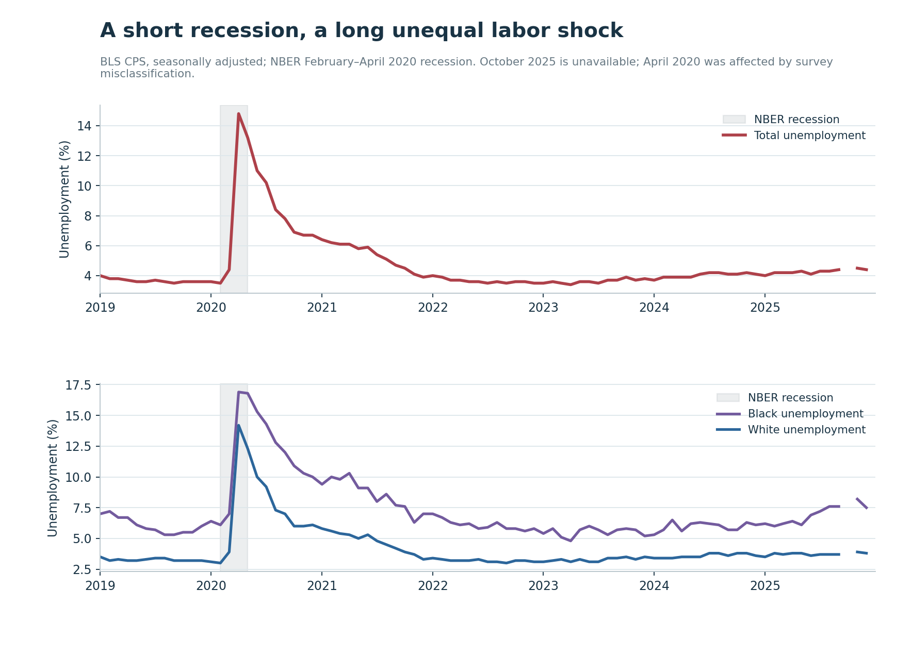
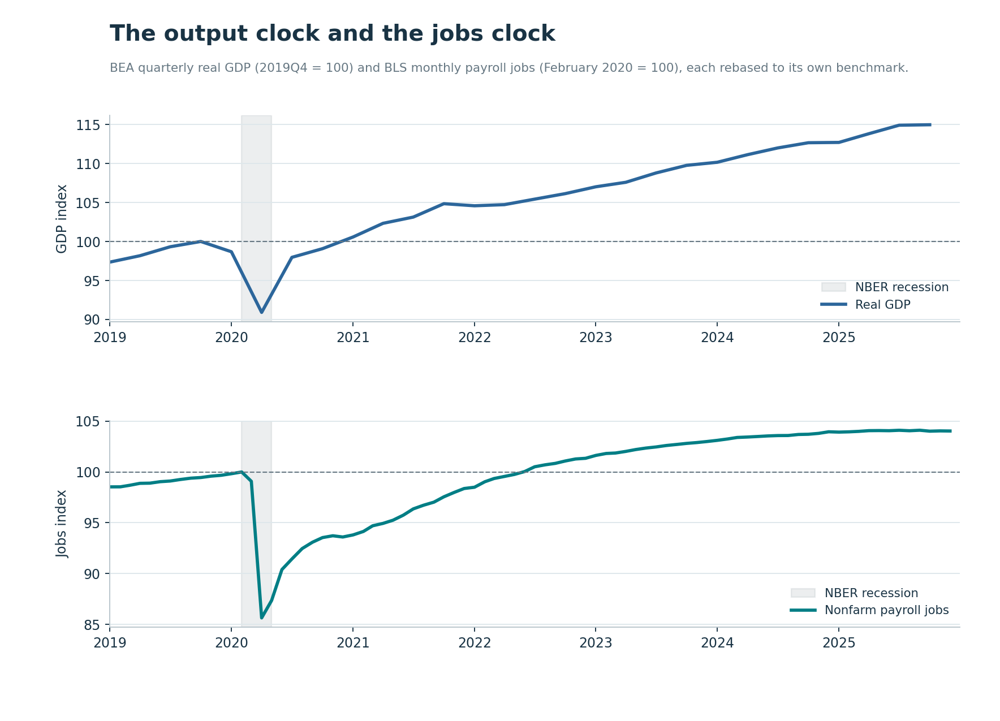
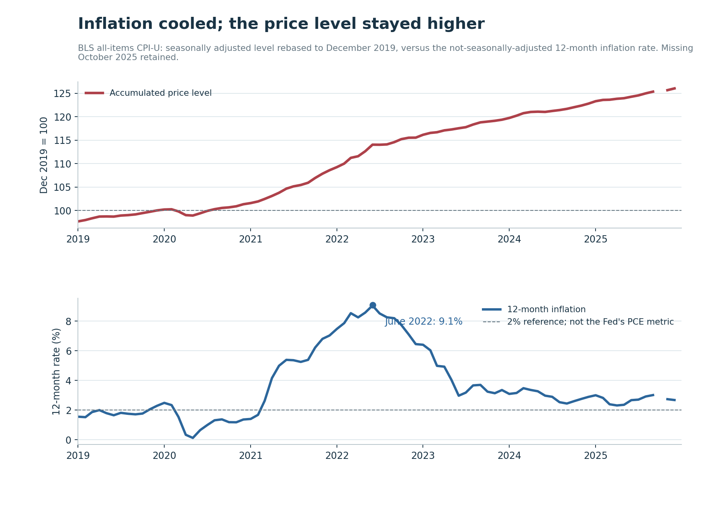
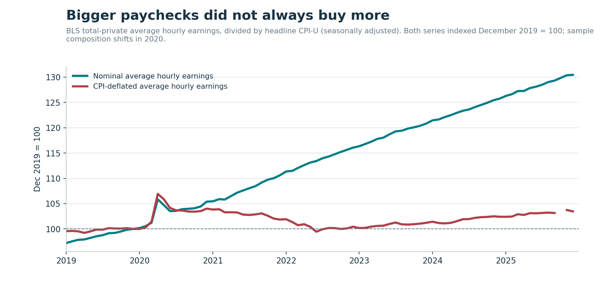
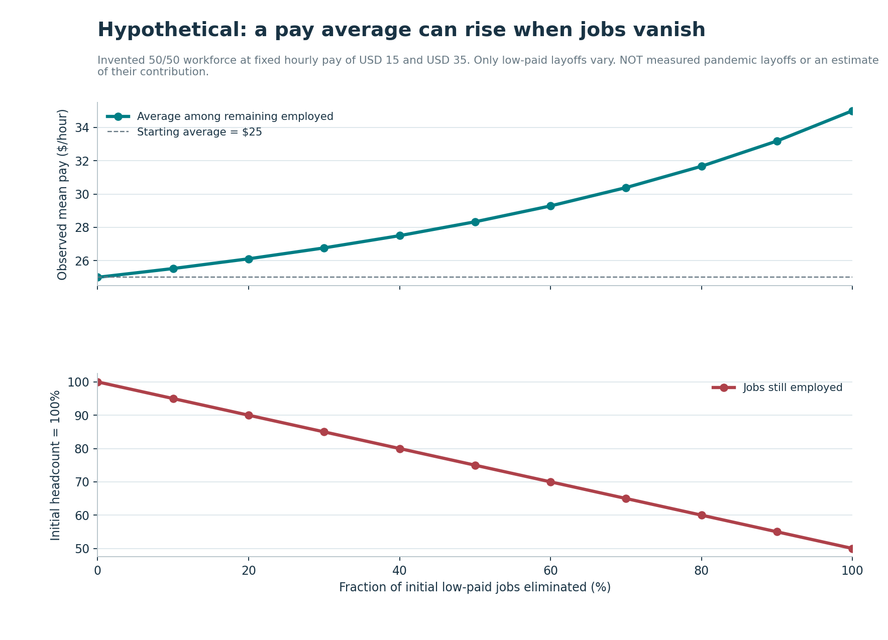
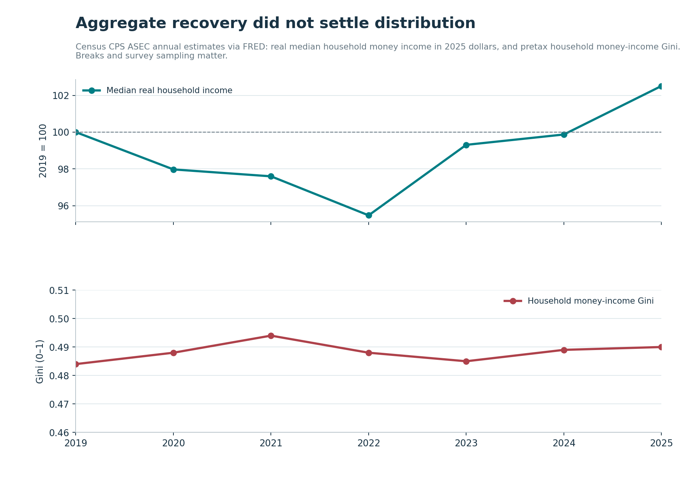
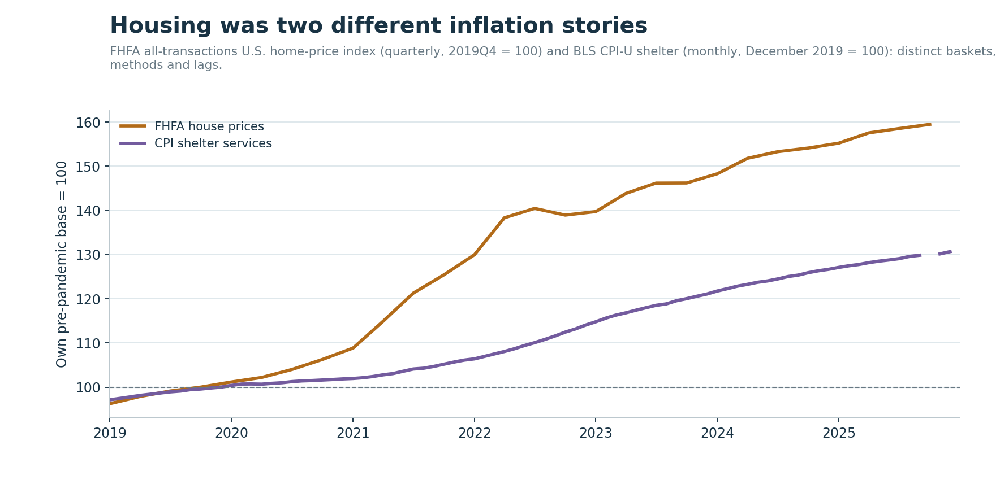
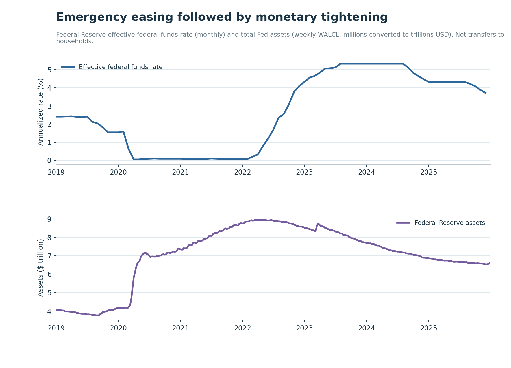

# Inflation Fell; Prices Did Not: The Pandemic Shock, Inflation, and the Unequal Adjustment, 2020–2025

*A recession measured in months, an inflation episode measured in years, and an economic recovery that looked different depending on which household you asked.*

**By Diogo Ribeiro**

*Research cutoff: 2025 calendar-year observations using government data vintages available in October 2026. This is a historical and measurement-focused analysis of the United States, not a causal estimate of any single policy's effect.*

## A recovery is never just one number

In February 2020, the United States stood at the end of a long economic expansion. Within weeks, a public-health emergency made ordinary economic activities unusually dangerous. Restaurants closed dining rooms. Flights disappeared from schedules. Offices emptied. Health systems struggled. Parents tried to keep working without their usual childcare arrangements. Workers whose jobs required physical presence faced a choice that other workers could often avoid: exposure or lost income. There is no way to tell the economic story of the period without remembering that it began with a disease, not with a conventional collapse in bank lending or a routine inventory correction.

The National Bureau of Economic Research dates the subsequent recession from February to April 2020. By its business-cycle convention, the downturn lasted only two months. That brevity is historically remarkable, but it is a poor description of how long the consequences lasted. An economy may reach its trough quickly and begin expanding without restoring the jobs, services, purchasing power, security, and possibilities that disappeared along the way. A business cycle is a measure of aggregate activity; it is not a collective certificate of recovery. [1]

Here are four apparently contradictory facts from our frozen, reproducible series:

- In the current retrospective vintage, real gross domestic product first exceeded its fourth-quarter 2019 level in **the first quarter of 2021**.
- Nonfarm payroll employment did not regain its February 2020 level until **June 2022**.
- The seasonally adjusted consumer price index was **26.1% higher in December 2025 than in December 2019**, even though its twelve-month inflation rate had fallen far below its June 2022 peak.
- Real median household money income in the 2025 Census reporting vintage was **$85,320 in 2019 and $87,460 in 2025**, a modest **2.5%** increase in purchasing-power-adjusted terms over six years. The first observed annual year in our series above the 2019 benchmark is 2025. [2][3][4]

Each fact measures something different. GDP is output, not a distribution of household welfare. Payroll employment is a count of jobs, not an estimate of whether those jobs offer enough hours or income. The CPI is an index of consumer prices, not a price tag that automatically comes down when inflation slows. Median household income incorporates multiple income earners and changing household composition; it is not the typical worker's hourly wage. Putting the measures side by side matters precisely because they do not collapse into a single moral or partisan verdict.

Consider the question that dominated many economic conversations after 2022: *Why do people still feel squeezed if inflation is falling?* The simple answer is that a lower **rate of price increase** does not restore the **old level of prices**. The fuller answer is that wages, benefits, rents, debt payments, savings, family circumstances, and assets did not adjust together. A fall in inflation relieves one source of pressure. It does not reverse all the adjustments made under earlier pressure.

This article follows the shock from 2020 through 2025, separating five overlapping histories: the collapse and rebound in employment; a large fiscal stabilization effort; the disruption and reallocation of supply and demand; the burst and subsequent moderation of inflation; and the distribution of losses and gains across households. It uses eight original figures, seven descriptive and one explicitly hypothetical, plus downloadable source snapshots and transparent code. The goal is neither to declare the recovery a triumph nor to dismiss its real achievements. It is to ask which recovery, for whom, on which measure, and at what cost.

## 1. How a two-month recession can change six years

The NBER's dates identify the peak and trough of economic activity, using a range of indicators rather than a mechanical rule requiring two quarters of negative GDP growth. The February–April 2020 chronology is especially important because the labor-market collapse was extraordinarily concentrated. February was the business-cycle peak; the unemployment rate then surged in March and April. Economic contraction was immense but brief in the committee's dating system. The shock that people faced was far more persistent and uneven. [1][5]

The distinction between *duration* and *damage* is not academic. Suppose a worker loses a restaurant job for six weeks. If the worker's employer reopens, the job returns, and all missed income is fully replaced, the long-run effect may be modest. Now suppose that same interruption drains savings, forces high-cost borrowing, causes an eviction, interrupts a training course, or coincides with school closure and caregiving responsibilities. A six-week interruption can initiate an adjustment lasting years. A monthly employment count cannot trace that entire chain, and aggregate GDP cannot identify who bore it.

Pandemic exposure was profoundly occupational. Some employees could move from office desks to home computers, maintaining salaries while avoiding the commute. Others worked in healthcare, warehousing, grocery retail, food service, personal care, public transit, hospitality, or cleaning. The ability to telework was itself an economic resource, linked to occupation, education, income, and housing circumstances. The same protective instruction—to limit in-person contact—therefore had unequal labor-market implications. It also mattered whether a worker was an employee, a contractor, or self-employed; whether paid sick leave existed; and whether someone at home required care.

No aggregate unemployment statistic captures the total loss of hours, job quality, safety, childcare, and educational continuity. Conversely, a fall in the unemployment rate does not mean every person who left the workforce found a good job. Some workers may have stopped looking and thus ceased meeting the survey definition of unemployed. Others switched jobs, reduced hours, or retired. The Current Population Survey and the establishment payroll survey view different populations through different sampling frames. Their discrepancies can be informative rather than errors.

This matters for another reason: a crisis changes the composition of what is measured. If many low-paid workers are the first to lose jobs, the average wage among workers who remain employed can rise even when nobody receives a raise. If households form, dissolve, or combine, the median household-income series can move for reasons other than a wage change for a representative person. If spending shifts from restaurants and travel toward furniture and electronics, the pressure on particular supply chains changes faster than an annual basket-based statistic can fully describe. An average is not a fixed person moving through time.

By 2025, the United States was no longer experiencing the 2020 employment collapse. That is a real recovery. But millions of separate accounts had been adjusted along the way: some families repaid debt and rebuilt savings, some entered a stronger job market, and others absorbed higher living costs or lost access to housing. Those trajectories need not offset one another in human terms, even when they sum to a strong aggregate number. Our first methodological rule is therefore simple: **never let the date when a recession ends serve as the date when its distributional consequences end**.

## 2. The labor market: a spectacular fall and an unequal rebound

In the BLS series archived for this project, the seasonally adjusted unemployment rate rises from **3.5% in February 2020 to 14.8% in April 2020**. The originally published April 2020 release reported 14.7%; revisions and vintage differences explain why a current download can differ by a tenth of a percentage point. Both numbers describe an unprecedented spike in modern postwar monthly labor-market experience. The original survey also confronted a classification problem: some people absent from jobs because of pandemic shutdowns were treated as employed but absent rather than unemployed on temporary layoff. BLS explicitly documented that the official rate understated joblessness relative to one possible reclassification. Our chart retains the published historical series; it does not silently substitute a hypothetical corrected series. [5][6]

The industry detail helps explain why the average worker was not a useful stand-in for every worker. According to BLS's retrospective study, private-sector payrolls lost about **20.9 million jobs in March and April 2020**, with particularly heavy losses in leisure and hospitality. Many of those positions were relatively low-paying service jobs. Businesses needed customers physically present; remote work was largely impossible; and restrictions and voluntary avoidance of infection both reduced demand. The labor shock was consequently shaped by where people worked, not only by how productive or motivated they were. [7][8]

*Figure 1. BLS Current Population Survey, seasonally adjusted; shaded interval is the February–April 2020 NBER recession. The October 2025 CPS observation is missing because of the federal shutdown and is not imputed. April 2020 survey misclassification complicates interpretation. Source snapshot, preparation code, and chart script are included with this article.*

Figure 1 juxtaposes the national rate with Black and White unemployment rates. Our frozen series puts April 2020 Black unemployment at **16.9%** and White unemployment at **14.2%**. Those single-month estimates are not precise measures of any individual's experience, and survey error matters, especially in a disruption this large. But the differences also existed before the pandemic: in February 2020 Black unemployment was **6.1%** compared with **3.0%** for White workers in the same vintage. The shock did not strike a starting line at which all workers had equal protection against unemployment.

The annual averages reinforce the problem with telling the story through one endpoint. In 2020, the national rate averaged about **8.1%**, while Black unemployment averaged **11.6%** and White unemployment about **7.3%**. By 2022, overall unemployment averaged **3.7%** and payroll employment was recovering its previous level. Yet averages over 2020–2025 trace different trajectories for different groups. The Black–White unemployment gap in this narrow metric widened sharply in the initial crisis, narrowed afterward, and widened again in the 2025 observations we have. The chart is descriptive: it cannot isolate discrimination, industry mix, geography, education, age, caregiving, or any policy's separate contribution.

The very use of race categories requires care. BLS Black and White CPS rates are not equivalent to Census categories that distinguish Hispanic ethnicity from race, and neither measures every axis of labor-market disadvantage. Important pandemic experiences of Hispanic workers, Asian workers, immigrants, disabled people, women, and caregivers deserve analysis using appropriate disaggregated sources. The deliberately compact graphic is not a claim that two lines exhaust the distribution of exposure. BLS's broader demographic reviews document differences by race, ethnicity, sex, and industry. [9][10]

Even a rate of zero unemployment would not imply the absence of labor-market hardship. Some people want more hours but cannot obtain them. Some return to work at lower pay or with erratic scheduling. Others return to a position whose conditions have become less safe or less compatible with family life. The officially unemployed are people without a job who meet specific availability and job-search criteria; the group is not a synonym for everyone whose income has been damaged. During 2020, the difference was crucial.

The recovery also carried benefits that should not disappear from the story. A tight job market can increase bargaining power for workers who previously had few alternatives. Employers competing for labor may raise starting wages or improve schedules. Workers can leave unsuitable jobs for better ones. Lower unemployment creates income not only for those who find a job but also for the families and communities around them. A credible assessment recognizes those gains without claiming that they erased the purchasing-power losses and accumulated risks of the inflation years.

## 3. The output clock ran ahead of the jobs clock

When people hear that the economy recovered, they often imagine that the workforce returned to its earlier arrangement. GDP does not measure that. Real GDP is the inflation-adjusted value of final goods and services produced, expressed here in BEA chained-dollar terms. Payroll employment counts jobs reported by employers in the establishment survey. An economy can produce as much as before with a different mix of industries, technology, hours, output per worker, and jobs. It can also record expanding output while families still struggle with the prices or financing of basic necessities.

Figure 2 makes the contrast explicit. It gives GDP its own **2019Q4 = 100** reference and payroll jobs their own **February 2020 = 100** reference. This avoids presenting units of dollars and workers on one misleading scale. It also avoids assuming that an upward trend has been restored simply because a pre-crisis level has been passed. Crossing a horizontal line marks a **level recovery**, not recovery relative to the growth path that might have occurred without the pandemic.

*Figure 2. BEA quarterly real GDP, indexed to 2019Q4; BLS Current Employment Statistics monthly nonfarm payroll jobs, indexed to February 2020. The series have different frequency, units, and composition.*

In the 2026 vintage used here, real GDP reaches its pre-pandemic fourth-quarter 2019 level by **2021Q1**, about eleven calendar months after February 2020. Payroll employment first reaches its February 2020 level in **June 2022**, about twenty-eight months after that baseline month. The exact quarter for GDP recovery can move when national accounts are comprehensively revised. BEA regularly updates historical estimates as fuller administrative and survey evidence becomes available. The milestone is therefore a property of this archived data vintage, not an immutable fact that every older article would have reported identically. [11]

By **2025Q4**, our real GDP series is about **15.0% above 2019Q4**, while payroll jobs in **December 2025** are about **4.0% above February 2020**. Do not subtract these numbers and call the difference productivity growth. The underlying measures differ: GDP is total real production, employment counts jobs rather than hours, coverage and sector mix change, and the intervals begin in different months. A labor-productivity calculation requires consistent output and hours concepts, including the distinction between nonfarm business output and economy-wide GDP.

Likewise, a jobs count exceeding its old level does not prove the country made up every job that would have been created in the absence of a pandemic. Population growth and aging, immigration, participation, industry demand, and normal long-run employment expansion all change the relevant comparison. To answer the stronger counterfactual question—how many jobs would exist without COVID-19—one needs a model and assumptions, not merely a historical horizontal line. Our figure intentionally answers a narrower question: *when did the observed number first cross the observed benchmark?*

Consider a business that reopens with fewer workers but new online ordering, reduced floor space, and higher output per hour. Its production can return before its employment does. Consider another employer that brings back headcount through part-time jobs; employment may recover before total hours or weekly earnings. Consider a household with two earners whose second earner leaves the labor force to provide childcare; GDP and national payrolls may improve while that household's financial resilience does not. A broad expansion can contain all three histories.

The larger lesson is not that GDP is unimportant. Output funds wages, benefits, public services, and investment. A growing productive economy is a necessary part of durable material improvement. But output has no built-in distributional rule: it does not decide who receives the new income or who pays the costs of transition. A recovery narrative built from GDP alone loses precisely the labor-market and living-standard questions that make economics politically consequential.

## 4. The arithmetic of inflation: slowing is not reversing

Of all the distinctions in this period, the most consequential may be between the **price level** and **inflation**. The consumer price index measures the relative cost of a representative consumption basket over time, using a defined statistical method. The twelve-month inflation rate measures how much that index has changed compared with the same month a year earlier. If the index rose rapidly in 2021 and 2022, then rose more slowly in 2023–2025, the index can remain elevated throughout. That pattern is exactly what the chart shows.

To make the point concrete, imagine a basket whose cost is $100 before a shock. Its price rises to $110, then to $121. The annual inflation rates are 10% and 10%. If the next year it rises to $124.63, inflation has fallen to 3%; the basket nevertheless costs almost 25% more than it did at the start. Inflation has **decelerated**, but the cost of living has not returned to $100. For that, prices would have to **fall**, a different event called deflation. Sustained general deflation also introduces economic and debt-related risks; it is not simply a free way to recover old purchasing power.

*Figure 3. Two different BLS CPI-U concepts. Top: seasonally adjusted all-items index relative to December 2019. Bottom: the not-seasonally-adjusted index's twelve-month change; the June 2022 peak rounds to 9.1%. October 2025 is unavailable in the source and appears as a gap. The dotted 2% line is a reference, not an assertion that the Federal Reserve targets CPI rather than PCE inflation.*

The not-seasonally-adjusted CPI-U in our snapshot shows a twelve-month rate of about **9.1% in June 2022**. The corresponding December 2025 rate is about **2.7%**. A reader might reasonably respond that such a decline should have made life easier, and in one respect it did: the speed at which a basket's price was rising became much lower. But the seasonally adjusted index was still approximately **126.1** in December 2025 when December 2019 was assigned **100**. The accumulated increase was **26.1%**. [12]

These are not interchangeable calculations. Our price-level chart uses the BLS *seasonally adjusted* all-items CPI-U because it helps display the month-to-month path. Our twelve-month inflation calculation uses the corresponding *not seasonally adjusted* CPI-U, consistent with standard headline BLS annual-change reporting. Seasonal adjustment can be revised; the two series have slightly different technical properties. They are used for distinct purposes and clearly labeled. The price-level increase is a before-and-after change in a broad statistical basket, not a personalized estimate of what any particular family's bills cost.

Families differ in what they buy. A renter who spends a large share of income on housing faces different pressure from a homeowner locked into a fixed-rate mortgage. Someone who commutes long distances experiences gasoline prices differently from someone who can work from home. Prescription medication, childcare, groceries, insurance, energy, and debt costs occupy different shares of household budgets. BLS constructs a representative index using expenditure weights, but the index is not a promise that everyone experiences its average rate.

The Federal Reserve's longer-run **2% inflation objective applies to the personal consumption expenditures price index (PCE)**, not the CPI-U series plotted here. The indexes differ in scope, weights, formulas, and updating. CPI can help readers understand the episode because its basket and news releases are familiar; it should not be treated as a perfect measurement of whether the central bank has met its own exact target. [13]

A further subtlety is that inflation rates can rise or fall for reasons unrelated to the current direction of prices. A surge one year earlier creates a large denominator for the twelve-month comparison a year later. Economists call these *base effects*. They can move an annual percentage rate even when monthly price changes are moderate. Energy prices are volatile and can swing the headline rate; underlying services pressure may behave differently. For that reason, neither one monthly print nor one twelve-month rate can tell the whole story of price stabilization.

This distinction changes the political meaning of the phrase *inflation is down*. It is a valid statement about a rate, but it is incomplete as a statement about affordability. A family whose fixed nominal income did not rise along with the accumulated basket cost may still be poorer in consumption terms. A family whose income rose faster than prices may have recovered purchasing power, even while wishing prices had stayed lower. Both can be true at the same time.

## 5. Why prices rose: the problem with a one-cause explanation

The pandemic inflation episode invites a simple explanation, and simple explanations invite political certainty. One account attributes all inflation to emergency government spending. Another blames corporate decisions alone. A third blames global supply chains or the war in Ukraine, without acknowledging strong demand. A fourth insists that central-bank policy was the only relevant force. Each isolates something real or potentially relevant while leaving out necessary interactions.

The starting point is the simultaneous **contraction and rearrangement of supply and demand**. Disease reduced available labor, interrupted production, delayed shipping, and imposed public-health constraints. Demand for travel, restaurant meals, and face-to-face services collapsed at first; demand for home electronics, appliances, equipment, home improvement, and other goods then became unusually strong. Ports, trucking networks, semiconductors, and factories had been built for a different pattern of orders. They could not expand or reallocate instantly. When more spending chased a constrained set of goods, prices had room to rise. [14][15]

Fiscal policy also mattered. Direct cash transfers, expanded unemployment benefits, forgivable loans, grants, and support for state and local governments prevented a collapse in income and demand from compounding the health shock. That was their economic purpose. But when demand rebounded while supply remained limited, additional purchasing power also contributed to the pressure on goods and services. The question is not whether fiscal relief *can* influence inflation. It is how large that contribution was, at what time, through which channel, and relative to the damage avoided. Answering it requires models and counterfactuals, not the simple observation that inflation followed government spending.

Federal Reserve research on supply-demand imbalances has examined the role of fiscal policy using explicit assumptions and international evidence. Its analysis is best read as research about mechanisms and estimated contributions, not as a license to assign every price increase to a single party or legislative act. Different empirical models can give different shares to supply constraints, demand shifts, expectations, energy, and monetary policy. The decomposition itself contains uncertainty. [16]

Then came additional shocks. Russia's invasion of Ukraine in February 2022 disrupted commodity markets and increased uncertainty around energy and food supplies. The Federal Open Market Committee explicitly cited pandemic-related supply-demand imbalances, energy prices, and the war when it began raising interest rates in March 2022. Global energy pressure interacted with domestic consumer prices and inflation expectations. Ignoring this chronology would make the 2022 inflation peak harder to understand; treating the war as the complete explanation would ignore the inflation acceleration that was already visible in 2021. [17]

Pricing power is another component, but it requires careful reasoning. Firms set prices within market structures. When customers face shortages and have few substitutes, businesses may be able to pass higher costs through or expand margins. Competition, inventory, contracts, and consumer expectations influence that ability. Looking at one industry's profits during a price surge does not by itself show whether its pricing caused the original aggregate inflation or how much it contributed. We need industry-level costs, margins, quantities, entry, and timing to estimate that mechanism. Concentrated markets can magnify pressure, but they are not a substitute for understanding the underlying shocks.

One can acknowledge that fiscal relief sustained demand, that broken supply chains limited output, that higher energy prices amplified the episode, that pricing decisions affected pass-through, and that monetary policy influenced the total path without confusing those statements. Economics is often an argument about relative magnitudes and counterfactual alternatives rather than the existence of a single cause. The policy challenge in 2020 was not simply to minimize inflation at all costs; it was to prevent avoidable economic collapse amid a public-health emergency, with imperfect information about how quickly supply and work could recover. The policy challenge in 2022 was different: restraining broad inflation without throwing the labor-market recovery into reverse.

## 6. Fiscal rescue was both an achievement and an administrative stress test

In an ordinary recession, unemployment insurance helps replace some lost earnings for eligible workers; households continue spending, and the economy's contraction is cushioned. The pandemic was not ordinary. A public-health emergency created entire categories of suddenly unavailable work. Congress and successive administrations used multiple laws and programs to expand relief, offer direct payments, support businesses, and stabilize state and local budgets. There were three rounds of Economic Impact Payments in 2020 and 2021, and unemployment benefits were temporarily broadened. The question facing policymakers was how fast to reach people whose earnings had vanished, many of whom had not previously qualified for conventional unemployment insurance.

The scale was enormous. The Government Accountability Office reports **$931 billion in direct Economic Impact Payments** issued in 2020–2021. GAO also reports about **$878 billion in benefits across all unemployment insurance programs** from April 2020 through September 2022; that amount includes regular unemployment insurance as well as pandemic-specific programs and therefore should not be described as spending solely attributable to new pandemic benefits. The numbers describe different programs, populations, and accounting windows and must not be added indiscriminately to infer net fiscal stimulus or its economic effect. [18][19]

Why deploy so much support? Because a temporary interruption in earnings can become a permanent household crisis if it consumes the money required for rent, food, healthcare, utilities, transportation, and debt payments. The rationale for rapid transfers was to preserve consumption, avoid cascading defaults, sustain employment relationships where possible, and give people the ability to comply with health precautions. Emergency support can be valuable even if it is imperfectly targeted. A policymaker who waits until every eligibility question is resolved risks allowing the damage to compound while the machinery is built.

Yet speed created administrative hazards. State unemployment systems were asked to process unprecedented claims, apply unfamiliar programs, and verify identity amid rapidly changing guidance. GAO documented major operational weaknesses, outdated technology, delays, and widespread fraud risks. In a later estimate, GAO put likely fraud across pandemic unemployment programs at **$100 billion–$135 billion** for a defined pandemic period. That is an estimate of fraudulent payments, not proof that every suspicious payment was fraudulent, nor an estimate of inflation caused by the program. Program-integrity problems impose real costs and can undermine confidence in public assistance, but they do not erase the legitimate economic needs that prompted the assistance. [20][21]

The tradeoff is frequently posed as a false choice between generosity and verification. A more useful design goal is an emergency system that can rapidly identify and pay eligible people while protecting public money: modern identity verification, clear data sharing, scalable staffing, accessible appeals, interoperable earnings records, and audit trails. Such infrastructure needs investment **before** a crisis; designing it during a surge is both slower and more vulnerable. GAO's finding that some state systems were decades old is a warning about institutional capacity, not merely a retrospective complaint about emergency legislation. [22]

Relief was also distributed through multiple channels that operated differently. Direct payments helped households with widely varying income and employment circumstances. Unemployment compensation primarily supported eligible people who lost work. Payroll-support and lending programs sought to maintain business continuity and jobs, with their own eligibility, oversight, and targeting issues. Transfers to state, local, and tribal governments supported services and public-health responses. Treating all of this as one homogeneous *stimulus check* obscures important differences in timing and effect.

The programs' economic legacy is similarly mixed. By replacing earnings and supporting demand, they may have reduced the depth and duration of hardship. By supporting purchasing power during supply constraints, they could also add to later price pressure. Some households saved relief money or repaid debt instead of immediately consuming; others spent it on urgent necessities. Different behavior means that a dollar of authorization is not the same thing as a dollar of contemporaneous consumption. A counterfactual evaluation must compare what happened with the alternatives: smaller relief, slower relief, different targeting, or no relief, and their effects on employment, welfare, debt, infections, and inflation.

None of this supports the claim that inflation was a negligible cost. Inflation matters, especially to people whose incomes do not respond quickly. It does support a more disciplined argument: **evaluate the emergency response against the emergency it faced, and evaluate its implementation against standards that can be improved**. Both questions are necessary. A society capable of acting quickly but not accurately must improve its systems; a society so concerned with perfect screening that it cannot act in time has a different and equally serious vulnerability.

## 7. Wage growth, purchasing power, and the worker who disappears from an average

Imagine reading a headline during April 2020: average hourly pay has jumped. It sounds like good news, particularly at a moment when unemployment is soaring. But what if the increase partly reflects the fact that many of the lowest-paid employees no longer appear in the average? This was not merely a textbook possibility. BLS documented that the massive losses of relatively low-paid service jobs in March and April 2020 raised measured average earnings among the private-sector workers who remained employed. Its retrospective analysis puts the compositional increase at **$1.46, or 5.1%, over those two months**; the apparent gain partly reversed when workers returned. [8]

This is a problem of **selection**, not a problem with BLS arithmetic. A valid average of employees still on payroll does not pretend to track the same employees over time. When membership changes, the average can change because individual wages changed, because the workforce mix changed, or because both occurred. If we interpret every rise as a raise awarded to the representative worker, we are asking the series to answer a question it was not designed to answer.

Figure 4 shows nominal private-sector average hourly earnings alongside an index adjusted by the all-items CPI-U, both starting at 100 in December 2019. Deflating nominal earnings is a necessary step for asking about purchasing power, but it does not solve the composition problem. The real series remains an average among people employed in each month, with a shifting industry and occupational mix. It does not track a fixed panel of workers and does not incorporate unpaid hours, changes in hours worked, or nonwage benefits.

*Figure 4. BLS Current Employment Statistics total-private average hourly earnings indexed to December 2019; real series is the nominal series divided by the BLS seasonally adjusted all-items CPI-U. The apparent 2020 real-wage spike is affected by the exit of lower-paid employees. October 2025 lacks a publishable all-items CPI, so the real series has an intentional gap.*

In our December-to-December comparison, nominal average hourly earnings rise by approximately **30.4%** from 2019 to 2025, while the CPI price level rises **26.1%**. Their ratio produces a **3.5%** increase in the measured real average hourly earnings index. This is an informative aggregate outcome: nominal pay eventually grew sufficiently to exceed the cumulative CPI change in this measure. It is *not* proof that every worker received a real raise, that the median worker gained 3.5%, or that the average household's financial position improved by that percentage.

The timing matters as much as the endpoint. During the inflation surge, consumer prices increased faster than nominal pay for many stretches, reducing real earnings. BLS's detailed study reports that from April 2021 through April 2023, twelve-month real earnings changes were negative for an extended period. It also describes a return to positive year-over-year real earnings growth beginning in 2023. The fact that a later catch-up occurred does not make the earlier squeeze imaginary; the earlier squeeze does not make subsequent gains imaginary either. [8]

Purchasing power itself has several possible denominators. Real **hourly** earnings adjust an hourly average by a price index. Real **weekly** earnings also depend on hours worked. Real **household** resources may combine the earnings of several adults, benefits, investment income, tax credits, and costs not perfectly represented in a headline consumption index. Disposable income after taxes and transfers is not the same as pretax money income. A worker can earn more per hour but fewer total hours; a household can gain a second earner while facing higher childcare and transportation costs; a retiree may care more about Social Security, savings returns, and medicine than payroll averages.

These distinctions also explain why satisfaction with the economy need not move one-for-one with real wage growth. People remember the previous price of groceries and compare it with today's. They also compare their circumstances with neighbors', with promises made by employers or politicians, and with the living standards they expected to achieve. The cumulative price shock changes that reference point. A 3% real earnings improvement spread over years may feel small beside the effort required to adjust to a much higher nominal monthly bill.

The lesson for economic commentary is to ask three separate questions whenever wage news appears: **Who remains in the sample? What happened to prices? What happened to hours and household resources?** A wage average without those questions can turn a wave of layoffs into an apparent prosperity story.

## 8. An invented workforce shows the selection problem

To isolate the mechanism, consider a hypothetical employer with two equally sized groups. One group earns **$15 per hour**; the other earns **$35 per hour**. The average wage is therefore **$25 per hour**. Nobody receives a pay increase, and nobody receives a pay cut. Now suppose the employer lays off half of the $15 workers but retains all of the $35 workers. The remaining workforce consists of one-quarter of the original headcount in the low-paid group and half in the high-paid group.

The new observed average is **$28.33 per hour**—an increase of **13.3%**—even though **every employed individual's wage is unchanged** and total employment has fallen by **25%**. The mean has moved because the weights changed. This is not a claim that exactly half of low-wage workers were laid off in 2020, nor that the real pandemic earnings spike was 13.3%. It is arithmetic intended to show why a wage statistic can move in the direction opposite to the wellbeing of the workforce that produced it.

*Figure 8. Explicitly hypothetical arithmetic: a 50/50 starting workforce at fixed pay of $15 and $35 per hour, with varying low-wage layoffs. No empirical layoff fractions or wage contributions are estimated. The two panels show the average wage among remaining employees and the percentage of initial jobs still employed.*

The model uses the following identity. If the initially low-paid share is *s*, its pay is *L*, the higher-paid group's pay is *H*, and a fraction *p* of low-paid jobs disappears, the average wage of remaining workers is

\[
\bar w(p) =
\frac{s(1-p)L+(1-s)H}{s(1-p)+(1-s)}.
\]

For the illustrative case, *s = 0.5*, *L = $15*, *H = $35*. When *p = 0*, average pay is $25. When *p = 0.5*, average pay is approximately $28.33. As *p* approaches 1, observed average pay approaches $35 because only higher-paid employees remain in the payroll sample. At no point does this formula create new wage income for the laid-off workers. Their wages disappear from the observed employee average because their jobs disappear.

The example also has clear limits. Real workplaces contain many wage levels, industries, hours schedules, and employment transitions. Workers may switch firms, obtain raises, lose jobs, or return at different pay. The selection mechanism can interact with genuine pay growth. Estimating its size in 2020 requires microdata or a formal decomposition, not the invented two-group model. This illustration cannot determine the contribution of composition to the actual 2020 BLS average; BLS's own empirical work is the appropriate starting point for that question. [8]

Why include such a modest piece of arithmetic in a long historical article? Because many apparent paradoxes arise when analysts treat averages as fixed identities. The same caution applies to hospital outcomes, school test scores, household debt burdens, and measured productivity: changes in the composition of the observed group can alter the aggregate even without a change for a given member. Clear thinking about inequality depends on noticing **who is no longer being counted** in a particular measure.

## 9. Median income and inequality tell a different story

The Census household-income series adds a longer and more household-centered view. It is not simply the same wage data averaged differently. Household money income includes earnings and certain cash income sources but excludes many noncash benefits and is measured before taxes in the familiar headline series. It also responds to how many earners live together and to survey reporting. The annual real median is adjusted for inflation and expressed here in **2025 dollars**, using the FRED-hosted Census series as frozen for this project.

Figure 5 pairs the real median household-income index, with **2019 = 100**, with the Census household money-income Gini coefficient. The Gini is an inequality summary: zero would represent complete equality in the measured distribution and one would correspond to extreme concentration in the conceptual limit. It is not a poverty rate, an estimate of racial wealth inequality, or a measure of what posttax disposable income would look like. A lower Gini does not ensure that poor households are better off in absolute terms; a higher median does not ensure that every part of the distribution gained.

*Figure 5. Census CPS ASEC via frozen FRED series, annual 2019–2025. Real median household income uses 2025 dollars and is indexed to 2019; Gini refers to pretax household money income. Estimates are subject to sampling error and methodology changes. The plotted Gini differences are not represented as statistically significant effects.*

The archived annual series shows median real household income of **$85,320 in 2019** and **$87,460 in 2025**. It falls in 2020, remains below the 2019 benchmark through 2024, then passes it in 2025. This does not imply that households were uniformly worse off in every intervening year or that a particular policy caused the crossings. It means the observed annual **median** in this vintage does not exceed the 2019 value until the 2025 observation. Income measures and statistical revisions deserve attention, and Census reports uncertainty around year-to-year changes. [4][23]

The Gini fluctuates around the high 0.48s and reaches **0.490 in 2025** in the series used here, versus **0.484 in 2019**. It would be irresponsible to describe the six-thousandths difference as proof of a meaningful increase in inequality without examining the survey's standard errors and design changes. Indeed, Census said the 2025 Gini was not statistically different from the 2024 estimate. The graphic provides context rather than a significance test. [23]

These two panels can move independently. The median can rise while high-income households gain even faster, leaving the Gini elevated. The median can fall while income inequality narrows if upper incomes fall more. Temporary transfers can reduce poverty without appearing fully in pretax money income. Asset values can rise while household money income remains stagnant. Anyone who expects a single line to tell the complete distributional story will repeatedly be surprised by the data.

There are also survey-specific complications. Census estimates for a given calendar year are typically collected in the following year's Annual Social and Economic Supplement. The survey can change collection procedures, questions, and processing methods; nonresponse can vary, particularly during a disruptive period. The CPI-adjusted dollar basis changes as new price data and revisions become available. A current retrospective series may not match a newspaper's contemporaneous report, and that discrepancy does not automatically invalidate either. It may indicate that the two sources use different vintages or definitions.

The essential takeaway is narrower and stronger than a simplistic assertion about the typical American family: on this **real median household money-income** measure, the six-year improvement is modest relative to aggregate real output growth. That gap directs attention toward employment, hours, transfers, taxes, costs, household formation, and the distribution of output. It does not by itself identify which channel mattered most. For that, we need additional data.

## 10. Poverty and support: why definition determines the conclusion

Pandemic-era poverty statistics produced some of the sharpest apparent contradictions in public debate. In a year of mass unemployment, certain poverty measures improved; when employment recovered and extraordinary assistance expired, certain measures worsened. This can appear illogical only if poverty is assumed to be a pure measure of market wages. It is not. Some measures focus primarily on pretax cash resources, while others explicitly incorporate taxes, refundable credits, noncash support, and necessary expenses.

The **official poverty measure** and **Supplemental Poverty Measure (SPM)** answer related but distinct questions. The SPM adds or subtracts resources that a money-income measure may omit. Its treatment of refundable tax credits, stimulus payments, housing assistance, food benefits, work expenses, medical expenses, and geographically differentiated housing costs can materially change measured poverty. A generous transfer may prevent a household from falling below the SPM threshold even when its wages collapse. That is not a statistical illusion; it is evidence that the transfer is part of the resources being counted. [24]

The temporary 2021 expansion of the Child Tax Credit is particularly relevant to this distinction. For eligible families, an expanded refundable credit changed the resources available for food, rent, transport, debt reduction, and children's needs. Emergency transfers and expanded benefits likewise affected resources in 2020–2021. As those measures expired or contracted, the social safety net changed even while the labor market improved. Poverty outcomes must be interpreted against the contemporaneous tax-and-transfer system rather than attributed to employment alone.

Historical figures also require an unusually explicit source warning here. In 2026, Census and BLS identified and corrected errors in the historical **SPM threshold series for 2019–2024**, then released revised estimates. Older articles quoting exact 2021 and 2022 SPM or child-poverty rates may now display superseded numbers. Census says the corrected series did not overturn the broad year-to-year trends, but the exact estimates depend on the revision vintage. To avoid presenting stale numbers as authoritative, this analysis does **not** import an old 2021–2022 SPM table into its frozen quantitative dataset. The latest Census revision notice and working paper should accompany any numerical comparison. [25][26]

The 2025 Census release puts the official poverty rate at **10.2%** and the SPM rate at **13.1%** for that year. These measures are not rival judgments about whether families are truly poor; they are distinct statistical constructs. They should not be averaged or traded off as if one were a point estimate with random error around the other. Nor should the difference be interpreted as the causal effect of all government benefits: the measures use different resource definitions and thresholds. [23]

The counterfactual policy question is compelling but harder: how many people would have fallen into poverty in 2020–2021 **without** emergency transfers? Researchers can answer using microsimulation and administrative data, but their estimates rely on behavioral assumptions and definitions. Our plotted annual median and Gini do not answer that question. The honest conclusion is that **temporary policy can alter measured living standards dramatically**, and a recovery in market employment does not make those policy choices irrelevant.

## 11. Housing: the difference between owning an appreciating asset and paying for shelter

Few markets better reveal the inadequacy of a single inflation story than housing. Existing homeowners, new buyers, renters, landlords, and people without stable housing can experience the same rise in property values very differently. A homeowner with substantial equity and a fixed-rate mortgage may enjoy an increase in net worth while retaining a predictable principal-and-interest payment. An aspiring first-time buyer encounters a higher purchase price, potentially higher borrowing costs, a larger down payment, and a tougher affordability calculation. A renter faces local rent conditions and lease renewals, not the same price as a house sale.

To describe the housing adjustment, Figure 7 places two indexes beside each other. The first is the **FHFA all-transactions house-price index**, a repeat-sales-style measure that also incorporates refinance appraisal information for covered mortgage transactions. It is a measure of price change for a particular segment of single-family properties, not the national median sale price and not an index of every home's worth. The second is the **BLS CPI-U shelter index**, which represents shelter services within consumer prices, including owners' equivalent rent and rent of primary residence. It is not a house-purchase-price index or a live feed of newly advertised rents. [27]

*Figure 7. FHFA U.S. all-transactions house-price index, quarterly and not seasonally adjusted, relative to 2019Q4; BLS seasonally adjusted CPI-U shelter relative to December 2019. These are different constructs, each on its own pre-pandemic baseline. Missing October 2025 shelter data are not imputed.*

The difference in their slopes is substantial. In our archived series, the FHFA house-price index in **2025Q4** is about **59.5% above 2019Q4**. The CPI-U shelter index in **December 2025** is about **30.7% above December 2019**. These are not alternative measurements of the same underlying object, so one should not subtract the percentages and interpret the result as a gap between asset inflation and rent inflation. They capture different goods, contracts, samples, and adjustment processes.

The pandemic initially encouraged some households to seek more space. Remote work increased the value of an extra room for certain occupations. Low mortgage rates supported borrowing capacity; household preferences changed; and the supply of homes for sale could not instantly expand. Construction faced its own labor and materials constraints. Housing markets vary dramatically by metro area, neighborhood, tenure, and property type, however. A national index masks markets that moved differently, and it does not tell us whether an individual household could find a suitable home.

It is tempting to use the increase in property prices as evidence that everyone became wealthier. That reasoning forgets the balance sheet. Housing appreciation increases wealth for owners relative to their mortgage debt, all else equal, while making market entry more expensive for people who do not yet own. It can increase the size of the down payment a new buyer must save, even if the buyer's income rises. An owner who does not sell or borrow against equity cannot necessarily use the appreciation to pay for groceries. A homeowner with a paid-off property and a recent graduate facing high rent occupy different places in the distribution of this asset-price change.

The inflation index for shelter also has a distinctive timing structure. Many tenants sign leases that last months or a year, and CPI rent samples reflect an established stock of housing rather than only new leases. Owners' equivalent rent measures the rental value of housing services consumed by owner-occupants, not their current mortgage payment or what they paid to purchase the house. Consequently, CPI shelter inflation can respond more slowly to changes in advertised rents and purchase prices. A lag between the series does not imply statistical fraud; it reflects different measurement questions.

Interest-rate changes later complicated affordability. A higher policy rate influences market interest rates, mortgage financing, construction incentives, and asset valuations, but the effect varies with expectations and the structure of debt contracts. For a first-time buyer who must finance at prevailing rates, rising borrowing costs can offset an apparent easing in the rate at which house prices increase. For an existing borrower with a fixed-rate mortgage locked at an earlier rate, the immediate payment effect may be small. That asymmetry can discourage mobility and reduce the flow of homes onto the market.

The distinction between *price* and *payment* is essential. A buyer's monthly payment depends on the property price, down payment, mortgage rate, term, taxes, insurance, and fees. Two homes with the same selling price can impose different costs on households with different credit access or cash reserves. Renters' burdens depend on the rent relative to income, household size, and the availability of suitable units. Neither our FHFA series nor the CPI shelter series measures those ratios directly. Claims about affordability require specific income and financing information as well as price data.

Housing also shows why inflation can redistribute opportunities even without changing everyone's total income. A young renter may devote a larger fraction of lifetime earnings to housing, delaying saving and family decisions. An established owner may benefit from appreciation, but still face increased property taxes, insurance, maintenance, or difficulty moving. Higher rents may flow as income to landlords, who face their own financing and maintenance costs. The aggregate price index does not declare these outcomes equivalent. It is therefore not surprising that a period of strong aggregate GDP and job recovery could still produce intense frustration among people trying to secure shelter.

## 12. The Federal Reserve's two adjustments: emergency easing, then restraint

In March 2020, monetary authorities confronted collapsing activity and severe stress in financial markets. The Federal Reserve moved rapidly toward near-zero short-term policy rates, took steps to support the functioning of key credit markets, and expanded its balance sheet through securities purchases and liquidity facilities. These actions sought to preserve the flow of credit and prevent a financial-market breakdown from amplifying the health shock. They were not the same as Congress voting direct payments to households.

The distinction between fiscal and monetary measures is often blurred in casual argument. Fiscal transfers are budgetary resources provided under legal authority, with particular recipients and accounting. A central bank's purchase of a Treasury or mortgage-backed security exchanges assets and liabilities within the financial system and changes monetary conditions. That can affect interest rates and asset prices, but the face value of the Fed's balance sheet is not a count of dollars handed to families or the government's net budget cost. Monetary policy has transmission channels and distributional consequences; it is not identical to fiscal spending.

Figure 6 shows the **effective federal funds rate**, a measure of overnight interbank financing conditions, and **total Federal Reserve assets**, reported weekly in the WALCL series. The balance sheet expands sharply as the Federal Reserve supports financial conditions during the crisis and then declines as policy normalizes. The federal funds rate moves near zero during the emergency and climbs rapidly beginning in 2022, reaching a level above 5% in the following years before easing later in the series. These measures describe parts of the monetary stance; neither is a direct index of the interest rate paid by a particular household. [13][28]

*Figure 6. Federal Reserve effective funds rate, monthly, and total assets (WALCL), weekly, converted from millions to trillions of dollars. These are distinct measures of policy and financial conditions; balance-sheet holdings are not direct transfer payments.*

The move to tightening was an effort to restore price stability after inflation had become high and broad. In March 2022 the FOMC began raising its target range for the federal funds rate. The contemporaneous statement cited supply-demand imbalances, energy prices, and the war in Ukraine. Raising borrowing costs can slow interest-sensitive spending, reduce some asset valuations, moderate demand, and help anchor expectations. But it cannot directly manufacture semiconductors, unload a port, create housing stock, or make a virus disappear. The policy instrument is therefore powerful and limited at the same time. [17]

There is an unavoidable political question inside the central bank's task: how much unemployment risk should society accept to lower inflation faster? Higher rates may ease broad demand and price pressure, but can also reduce hiring, construction, business investment, and the value of assets. People with little savings and precarious employment can suffer most from a recession. People on fixed incomes, or whose wages lag prices, can suffer heavily from sustained inflation. The tradeoff cannot be settled by observing one chart after the fact; it requires evaluating uncertain paths and whose welfare enters the decision.

The subsequent moderation in CPI inflation alongside a still-functioning labor market was economically consequential. It showed that the feared return to the deepest unemployment conditions of 2020 was not a mechanical consequence of reducing the inflation rate. But the observation does **not** establish how much of disinflation was caused by higher rates rather than improving supply chains, changing energy prices, shifting demand patterns, or other forces. Nor does it prove that the inflation path could have been equally favorable under any chosen alternative policy. A causal counterfactual remains separate from the descriptive history.

Another hazard is to reason backward from final outcomes as though policymakers possessed the final dataset in real time. In 2020, the health and economic outlook were highly uncertain. In 2021, it was difficult to know precisely how long bottlenecks would last, how labor participation would recover, and how strongly spending would rebound. Policy changed as information arrived, sometimes too slowly or too aggressively depending on the objective and model used. Retrospective analysis should identify mistakes and alternatives, but it should also separate genuine uncertainty from hindsight.

## 13. Household balance sheets created winners and losers that income measures cannot see

Income flows are only one dimension of economic security. Wealth is a stock: housing equity, bank deposits, retirement assets, businesses, other property, and financial investments net of debt. Two households with equal annual income can be in radically different circumstances if one owns a home with an affordable mortgage and has substantial savings, while the other rents, carries high-interest debt, and has no emergency fund. Inflation changes the real purchasing power of nominal savings and debts; higher interest rates change the cost of refinancing and borrowing; asset-price changes accrue to owners.

The Federal Reserve's Survey of Consumer Finances documents substantial differences in wealth by race and ethnicity and changes between the 2019 and 2022 surveys. Its 2022 work found widespread increases in real family net worth over the three-year period, accompanied by persistent large racial wealth gaps. Those are survey-based distributions of family balance sheets; they should not be confused with the monthly Black–White unemployment rates in Figure 1. The SCF is also triennial, so a 2019-to-2022 comparison cannot trace the sequence of month-to-month asset volatility or precisely identify when a household received a transfer or a raise. [29][30]

Who owned assets mattered. Equity markets and housing markets reacted to low interest rates, earnings expectations, and the changing economic outlook. House-price appreciation benefited some homeowners. Rising financial asset values accrued most directly to people who already owned those assets. Households without assets did not receive an equal dollar benefit simply because the national balance-sheet total increased. In a crisis, that difference can widen perceived inequality even if employment opportunities later improve.

Debt creates a different asymmetry. Consider a long-term fixed-rate loan: when general prices and nominal incomes rise, the real burden of its fixed nominal payments may fall, provided the borrower's income keeps up. A variable-rate borrower or someone refinancing at higher market rates may face sharply higher payments instead. Someone relying on a credit card or short-term loan may be exposed to higher interest costs quickly. Inflation is sometimes said to benefit debtors, but without knowing the debt contract, the income response, and the interest-rate path, that claim is incomplete.

The distribution of financial resilience also influenced what relief could accomplish. A household with cash reserves might save a transfer, avoid selling assets during market turmoil, or pay down a balance. A household facing eviction or food insecurity might spend it immediately. Neither response is inherently irrational; the difference reflects constraints and priorities. The same dollar amount can prevent a catastrophe for one household and add marginal liquidity for another. Evaluating a program solely by aggregate consumption misses that welfare distinction.

The Federal Reserve's household-experience surveys help illuminate a gap between macro indicators and felt security. In 2022, **54% of adults reported that price increases affected their family budgets a lot**, according to the Fed's public release. The 2025 household-wellbeing report continued to identify prices as a leading financial concern, even after the headline inflation rate had moderated substantially from the 2022 peak. Such surveys are not perfect welfare indexes; they measure responses to questions and can reflect changing perceptions. But they provide independent evidence that the persistence of high price **levels** matters to lived experience. [31][32]

The point is not to choose subjective surveys over official production data. It is to recognize that they answer different questions. GDP tells us the value of production. The CPI tells us about a representative basket's price trajectory. The SCF tells us about sampled family balance sheets. Household-wellbeing surveys ask people about financial experiences and constraints. A serious historical account uses them together, with each source's limitations visible.

## 14. The data gap in October 2025 is part of the history

This project's source files contain one striking blank month. In October 2025, the federal government experienced a lapse in appropriations that interrupted statistical work. BLS could not collect the October Current Population Survey; it reports no October household-survey unemployment estimates. Many October CPI series were likewise unavailable. The public BLS API represents the absent numerical values with a dash, and our frozen JSON preserves it. We carry the missing values into the prepared table as blanks and render gaps in the figures, rather than replacing them with September figures, interpolated values, or an undocumented guess. [33][34]

There is one nuance worth making explicit. Payroll establishment data and some wage statistics had a different collection and publication experience from the household survey; the BLS average-hourly-earnings series in our archive contains an October 2025 value. Its presence does not justify inventing an October CPI to deflate that wage, or an October CPS unemployment rate. Our October monthly row therefore contains the observed nominal wage information while keeping the unobserved real-wage and CPI entries blank.

This also affects an apparently simple annual average. The 2025 unemployment and CPI-related *annual arithmetic means* in our supporting panel are calculated over **eleven available monthly observations**, while a conventional full-year mean would contain twelve. They are clearly flagged as descriptive, available-month averages, not exact replacements for official annual survey products. For example, the December-to-December CPI comparison still works because both December observations exist; the October gap does not prevent that particular calculation. Nor does it affect the separate annual Census median-income estimate or the quarterly GDP observations. Each indicator needs its own missing-data treatment.

The episode points to a public-good dimension of economic statistics. Legislators, employers, financial institutions, researchers, journalists, and households all rely on trustworthy measurements to interpret changing conditions. Interrupting collection creates information that cannot always be recovered by reopening an office or publishing a release late. In its official technical explanation, BLS describes how missing October CPI information affected later index calculations and seasonal adjustment. A missing observation is a historical fact, not just a software inconvenience. [33]

What would be wrong with smoothing a straight line through October for presentation? For some visual applications, a disclosed interpolation may be reasonable. But it answers a new question: what value would a chosen mathematical rule assign, not what did the survey measure? When the article claims reproducibility from official observations, the safest default is to show a gap. It also tests an analyst's integrity: clean charts are not worth hiding the limits of the data.

The shutdown illustrates a wider point about data revisions. GDP, employment, CPI seasonal factors, income, poverty thresholds, and household surveys all have distinct update processes. As of October 2026, there have been changes to historical series that alter some published numbers while leaving the broad chronology intact. A researcher who wants their analysis reproducible must freeze the input files, record their provenance, and distinguish a revision from a change in underlying events.

## 15. What this record can and cannot demonstrate

There are several kinds of statements in economic history, and they deserve different levels of confidence. An **observational statement** is that a specified published unemployment rate reached a certain value in a specified month. A **measurement statement** is that this value comes from the household survey, has sampling error, and was affected by pandemic-era misclassification. A **causal statement** is that a particular policy raised or lowered unemployment by a specified amount relative to what would otherwise have happened. Our charts substantiate the first kind and explain the second; they do not, by themselves, establish the third.

This distinction matters most when the stakes are political. A government can point to GDP recovering and reasonably claim that an aggregate downturn ended. An opponent can point to elevated housing costs and reasonably claim that material stress persisted. Neither observation establishes that its preferred policy caused all good outcomes or that the other side caused all bad ones. Mechanisms matter, timing matters, implementation matters, and the counterfactual economy was never observed.

The figures also do not establish that inflation in 2022 was beneficial or inevitable, that every intervention was well designed, that interest-rate policy was costless, or that the labor market fully healed. They cannot tell us which individuals moved between unemployment states; whether a particular household qualified for a relief program; how much a specific landlord increased rent; or how much a worker's purchasing power changed after taxes, benefits, and childcare expenses. Answering those requires richer microdata and credible designs.

Some comparisons are mathematically exact but conceptually limited. The December 2019-to-December 2025 CPI ratio is calculated directly from two index observations; it is not a household-level cost-of-living audit. The payroll recovery date is the first date at which the published count reaches its February 2020 benchmark; it is not a recovery against a hypothetical no-pandemic trend. The household median in a given year comes from repeated cross-sectional sampling, not following an identical set of households. The wage-selection model's average is mathematically precise because its starting assumptions are invented, not because it is empirically estimated.

Statistical uncertainty also has a time dimension. Revisions may shift GDP levels or the month of a benchmark crossing. BLS survey estimates have margins of error, and the composition of the population changes. Census median-income differences and Gini changes should not be declared significant merely because two decimal values differ. House prices, consumption costs, and policy rates respond to different markets and therefore should not be placed on a single causal ladder without additional evidence.

These limitations are not an argument for abandoning quantitative history. They are the reason to practice it carefully. A well-labeled figure can eliminate a common misconception—for example, confusing disinflation with falling prices—even when it cannot identify every causal mechanism. A precise count of months between an economic trough and a jobs-level recovery can discipline rhetoric without settling the quality of jobs or the wellbeing of workers. The fact that an index is imperfect does not make it useless; it makes the question it is allowed to answer more specific.

## 16. Five policy lessons, with tradeoffs left visible

**First, economic resilience includes the capacity to stop a temporary crisis from creating permanent losses.** Emergency support should be assessed partly by whether it prevents avoidable debt spirals, hunger, evictions, business destruction, and loss of productive relationships. That requires not only appropriations but rapid, reliable delivery. The pandemic exposed old administrative systems as an economic vulnerability. Upgraded unemployment insurance, more portable benefits, clearer eligibility information, and effective fraud controls are investments in the ability to stabilize future shocks.

**Second, macroeconomic stabilization must watch supply capacity as well as demand.** Sending purchasing power into an economy unable to produce or deliver what people want can intensify price pressure. But withdrawing all support from people who have lost jobs does not rebuild factories, ports, childcare systems, or housing. Policy design should distinguish immediate relief from medium-term investment in production, logistics, skills, health, and infrastructure. There are tradeoffs in timing: investment takes years, while a newly unemployed worker may need money this week.

**Third, price stability and full employment are not rival moral goods.** Sustained high inflation can erode real incomes and undermine planning; severe unemployment can destroy income and opportunity. Central bankers and fiscal authorities should evaluate the risks on both sides and acknowledge uncertainty. The historical outcome of disinflation without a repeat of the 2020 jobs collapse is important, but it does not reveal exactly which alternative path would have been best. Humility is more useful than attributing every improvement to one's favored instrument.

**Fourth, housing policy must address access, not just the growth rate of asset prices.** Existing owners, renters, and first-time buyers experience a boom differently. Construction capacity, land-use rules, financing structures, local job growth, transportation, taxes, and insurance all influence affordability. Monetary policy affects borrowing conditions but cannot by itself add enough units where demand is intense. An affordability strategy that treats the national CPI shelter index as the entire housing market will miss substantial regional and generational disparities.

**Fifth, evaluating a recovery requires multiple distributional measures, not a single scoreboard.** Track jobs, hours, wages, household resources after taxes and transfers, housing burdens, wealth, poverty, and the ability to handle emergencies. Track patterns by race, ethnicity, age, gender, disability, and geography where credible data permit. Examine whether a statistic changes because the same people improved or because the set of people being measured changed. A rising aggregate is welcome news; it is not the final answer to who benefited.

These lessons are not mechanically partisan. A government can improve emergency delivery without treating fraud as harmless. It can recognize the benefits of a tight labor market while caring about inflation. It can support supply-side investments without pretending that demand management is unnecessary. It can recognize housing wealth creation while asking how nonowners gain access. A strong policy argument identifies the problem, the relevant mechanism, the likely winners and losers, the alternatives, and the evidence that would change one's mind.

There is another temptation worth resisting: to insist that a recovery must be described as either *good* or *bad*. The answer can change depending on which person and which interval we ask about. A worker who moved to a better job in 2022 may have experienced meaningful upward mobility. A parent whose savings were exhausted in 2020 may still be rebuilding. An owner may have gained considerable home equity; a renter may face a newly prohibitive down payment target. These stories can coexist without logical contradiction.

## 17. Questions a skeptical reader should ask

**If inflation fell, why didn't grocery and rent bills fall?** Because inflation refers to the *change* in prices, not the accumulated *level*. Some individual items and local rents do fall, sometimes sharply; a lower overall inflation rate does not imply that the whole representative basket is getting cheaper. The December 2025 CPI level was still 26.1% above the December 2019 level in our frozen observations. That is compatible with inflation falling from a June 2022 twelve-month peak of about 9.1% to about 2.7% in December 2025.

**Doesn't the 2025 increase in real median income prove that households are better off?** It shows that the **median pretax money-income household** in this statistical series had more inflation-adjusted income than the median in 2019, by about 2.5%. It does not prove that the same individual households all gained. It does not incorporate every noncash benefit or necessary expense, and it leaves substantial distributional differences unresolved. It is one meaningful indicator, not a universal verdict.

**Did government relief cause the inflation surge?** Large transfers helped sustain demand, and demand pressure can affect prices when supply is constrained. But the pandemic also disrupted production, transport, labor availability, and spending patterns, while energy and geopolitical shocks added pressure. Assessing the contribution of particular fiscal programs requires an empirical identification strategy. The simple sequence *spending happened, inflation happened* does not identify the counterfactual inflation rate without spending or the cost of a weaker rescue.

**Did the Fed create the entire boom in house prices?** Low rates and easy financial conditions plausibly supported borrowing and asset demand, but the housing market also responded to changes in household preferences, supply, remote work, geographic shifts, and local constraints. The FHFA house-price series does not isolate those causes. The Federal Reserve influences the cost of borrowing; it does not choose every home's price.

**Why not just make prices return to 2019 levels?** Bringing the general CPI level back to 100 from roughly 126 would require a sustained and substantial fall in the broad basket. That is not the same task as reducing an excessive inflation rate toward a stable positive rate. Deflation can increase the real burden of fixed debts and coincide with weak demand, falling nominal income, and unemployment. Some relative prices can decline as supply improves, but deliberately inducing economy-wide deflation carries risks that must be weighed against the desire to reverse the earlier price shock.

**Was the pandemic recession actually over by April 2020?** Under the NBER's convention, April is the monthly trough of aggregate activity; the subsequent expansion began thereafter. That dating does not mean every worker was employed again in May, that disease-related disruptions ceased, or that real household income had returned to its earlier level. The difference between an aggregate turning point and a full social recovery is the main reason to tell the longer story.

**Is 2025 a clean endpoint if October survey data were missing?** It is a legitimate endpoint for measures with observed year-end or annual values, such as December CPI, fourth-quarter GDP, and annual Census household income. It is not a complete twelve-month sample for the October-affected BLS household-survey and CPI series. We retain the absent October observations as gaps and calculate available-month annual descriptive averages, disclosing that limit. Other years and series have their own statistical caveats.

## 18. The harder conclusion: a society cannot live on its average

From 2020 to 2025, the United States demonstrated considerable capacity to restart economic activity, deploy emergency resources, and eventually slow a severe inflation surge. The labor-market rebound mattered. Real output recovered. The rise in nominal wages eventually exceeded the cumulative CPI increase in the particular average-hourly-earnings measure examined here. A sober history must give those achievements their due.

But the aftermath also exposed the difference between stabilization and restoration. The economy could cross its previous GDP level while millions of workers and families were still adjusting. A lower inflation rate could arrive after years of accumulated price increases. Rising housing values could reward owners while closing doors to buyers. A higher average wage could be inflated by the disappearance of lower-paid workers, then later reflect genuine raises as the workforce returned. Temporary social protection could lower hardship while raising difficult questions about program administration, inflation tradeoffs, and what should remain after the emergency.

What made the period so politically contentious was not simply disagreement about the facts. It was disagreement about **which facts should count as the answer**. A GDP chart answered whether the economy produced more. An unemployment chart answered how many people were looking for and unable to find work. A CPI chart answered what happened to a statistical consumption basket. A median-income series answered what happened near the middle of a pretax household distribution. A housing chart answered something about asset prices or the cost of shelter services, depending on which series was chosen. None answered how secure every person felt about the next bill.

It is possible to misuse any of these indicators. Announce a recession's end as though pain ended with it. Treat a 2.7% inflation rate as though prices returned to the old level. Interpret the 2020 rise in average wages as a raise for all workers. Declare a small difference in the Gini statistically decisive. Describe central-bank assets as cash delivered to households. Call an increase in home prices an equal benefit to owners and renters. Each mistake takes a useful measure and stretches it past its meaning.

The better practice is less rhetorically convenient and more democratic: publish the definitions, preserve the underlying observations, show the gaps, and ask who is represented in the number. When a claim depends on a counterfactual, say so. When evidence is revised, explain the vintage. When a policy involves benefits and costs, name both. The challenge is not to find one statistic that ends the argument. It is to build an account sturdy enough to hold several true, uncomfortable facts at the same time.

The recession ended. The employment collapse receded. Inflation slowed. **The old price level did not return.** Those facts are not a contradiction. They are the starting point for understanding an unequal recovery.

---

## Methods, data, and reproducibility

This research package freezes a **BLS Public Data API response for seven monthly series covering 2018–2025** and **six original FRED CSV exports** for monthly payroll employment and interest rates, weekly Federal Reserve assets, quarterly BEA real GDP and FHFA house prices, and annual Census median real household income and the household-income Gini. The package intentionally includes 2018 CPI observations to calculate valid twelve-month percentage changes for all of 2019. FRED distributes source series originally produced by BEA, BLS, the Federal Reserve, FHFA, and Census; we preserve the series IDs and source files, rather than presenting FRED as the primary statistical producer.

The code constructs one 2019–2025 monthly table, one annual descriptive panel, three audit tables, and eight figures. The annual panel means are unweighted arithmetic averages of monthly or quarterly observations; it does not claim to replicate official annual estimates. For WALCL, the panel uses the arithmetic mean of available weekly observations in each calendar year. The GDP, job, housing, and income indexes each have explicitly distinct pre-pandemic base observations, preventing accidental comparison of incomparable units. The labor-market recovery dates are the first **observed** post-trough periods at or above those baselines; a level crossing does not estimate the no-pandemic trend.

Real average hourly earnings are defined as average hourly earnings divided by the seasonally adjusted CPI-U all-items index. That ratio is then normalized to December 2019. This is an analytical deflation of a changing-workforce average, not the BLS's own constant-composition worker panel. The historical charts are descriptive. Only Figure 8 uses invented values, fully specified in the text and in the sensitivity table.

For missing October 2025 BLS values, the parser accepts a dash only for the six identified series and month, then stores a missing value. It refuses unexpected gaps or duplicate dates. This guard helps ensure that subsequent code cannot unknowingly convert a shutdown-related missing observation into zero or a fabricated continuous monthly figure. The separate nominal earnings value is retained when available. The source manifest records SHA-256 checksums for the seven raw data files.

The data represent retrospective vintages available as of October 2026; they are not real-time snapshots from each historical month. Changes in GDP benchmarks, CPI seasonal factors, survey weights, and income or poverty methodology can affect comparisons with older publications. The purpose of freezing the inputs is to make **this analysis** exactly reproducible, not to prevent future official revisions or imply that one vintage is the final truth.

To reproduce the package from its directory, install the two version-pinned Python dependencies listed in the requirements file, run **python prepare_data.py**, then **python analysis.py**, and execute the provided notebook. The independent unit tests verify source identities, coverage, deliberate missing data, formulas, model arithmetic, required figures, bibliography, and deterministic tables. No network connection is required once the frozen source files are present. The companion README documents the provenance and important measurement boundaries.

### Primary sources and research

1. **NBER Business Cycle Dating Committee**, “Announcement July 19, 2021,” dating the February 2020 peak and April 2020 trough: https://www.nber.org/news/business-cycle-dating-committee-announcement-july-19-2021
2. **BEA** quarterly real GDP, series GDPC1, and **BLS** nonfarm payroll employment, series PAYEMS; archived original distribution via FRED: https://fred.stlouisfed.org/series/GDPC1 and https://fred.stlouisfed.org/series/PAYEMS
3. **BLS**, Consumer Price Index series and definitions: https://www.bls.gov/cpi/
4. **Census Bureau**, *Income in the United States: 2025*: https://www.census.gov/library/publications/2026/demo/p60-289.html
5. **BLS**, “Unemployment rises in 2020, as the country battles the COVID-19 pandemic,” *Monthly Labor Review*: https://www.bls.gov/opub/mlr/2021/article/unemployment-rises-in-2020-as-the-country-battles-the-covid-19-pandemic.htm
6. **BLS**, “Update on the Misclassification That Affected the Unemployment Rate”: https://www.bls.gov/blog/2020/update-on-the-misclassification-that-affected-the-unemployment-rate.htm
7. **BLS**, “COVID-19 ends longest employment expansion in CES history, causing unprecedented job losses in 2020,” *Monthly Labor Review*: https://www.bls.gov/opub/mlr/2021/article/covid-19-ends-longest-employment-expansion-in-ces-history.htm
8. **BLS**, “Did the COVID-19 pandemic affect real earnings?” *Beyond the Numbers*: https://www.bls.gov/opub/btn/volume-13/did-the-pandemic-affect-real-earnings.htm
9. **BLS**, “Demographic Changes in Employment during the COVID-19 Pandemic”: https://www.bls.gov/spotlight/2022/demographic-changes-in-employment-during-the-pandemic/home.htm
10. **BLS**, *Labor Force Characteristics by Race and Ethnicity, 2020*: https://www.bls.gov/opub/reports/race-and-ethnicity/2020/home.htm
11. **BEA**, “The 2026 Annual Update of the National Economic Accounts,” *Survey of Current Business*: https://apps.bea.gov/scb/issues/2026/09-september/0926-nea-annual-update.htm
12. **BLS**, archived June 2022 CPI release reporting 9.1% twelve-month inflation: https://www.bls.gov/news.release/archives/cpi_07132022.htm
13. **Federal Reserve Board**, FOMC monetary policy objectives and implementation: https://www.federalreserve.gov/monetarypolicy/fomc.htm
14. **Federal Reserve Board**, February 2022 Monetary Policy Report summary on demand, supply bottlenecks and labor constraints: https://www.federalreserve.gov/monetarypolicy/2022-02-mpr-summary.htm
15. **Federal Reserve Board**, “The Federal Reserve's Responses to the Post-COVID Period of High Inflation”: https://www.federalreserve.gov/econres/notes/feds-notes/the-federal-reserves-responses-to-the-post-covid-period-of-high-inflation-20240214.html
16. **Federal Reserve Board**, “Demand-Supply Imbalance during the COVID-19 Pandemic: The Role of Fiscal Policy”: https://www.federalreserve.gov/econres/ifdp/demand-supply-imbalance-during-the-covid-19-pandemic-the-role-of-fiscal-policy.htm
17. **Federal Reserve Board**, FOMC statement, March 16, 2022: https://www.federalreserve.gov/newsevents/pressreleases/monetary20220316a.htm
18. **GAO**, “Stimulus Checks: Direct Payments to Individuals during the COVID-19 Pandemic,” GAO-22-106044: https://www.gao.gov/products/gao-22-106044
19. **GAO**, “Unemployment Insurance: Data Indicate Substantial Levels of Fraud during the Pandemic,” GAO-23-105523: https://www.gao.gov/products/gao-23-105523
20. **GAO**, “Estimated Amount of Fraud During Pandemic Likely Between $100 Billion and $135 Billion,” GAO-23-106696: https://www.gao.gov/products/gao-23-106696
21. **GAO**, “GAO Designates Unemployment Insurance System as High Risk”: https://www.gao.gov/press-release/gao-designates-unemployment-insurance-system-high-risk
22. **GAO**, “DOL Needs to Further Help States Overcome IT Modernization Challenges,” GAO-23-105478: https://www.gao.gov/products/gao-23-105478
23. **Census Bureau**, 2026 release of 2025 income, poverty and insurance estimates: https://www.census.gov/newsroom/press-releases/2026/income-poverty-health-insurance-coverage.html
24. **Census Bureau**, Supplemental Poverty Measure methodology: https://www.census.gov/topics/income-poverty/supplemental-poverty-measure/guidance/methodology.html
25. **Census Bureau**, July 2026 statement on historical SPM threshold errors and revisions: https://www.census.gov/newsroom/press-releases/2026/statement-on-supplemental-poverty-measure.html
26. **Census Bureau**, “Revising Supplemental Poverty Measure Estimates from 2019 to 2024,” 2026 working paper: https://www.census.gov/library/working-papers/2026/demo/sehsd-wp2026-17.html
27. **FHFA**, House Price Index methodology and FAQ, including the all-transactions index: https://www.fhfa.gov/faqs/hpi
28. **Federal Reserve Board**, FOMC policy actions and balance-sheet operations, discussed in its post-COVID inflation retrospective: https://www.federalreserve.gov/econres/notes/feds-notes/the-federal-reserves-responses-to-the-post-covid-period-of-high-inflation-20240214.html
29. **Federal Reserve Board**, 2022 Survey of Consumer Finances and family-finance findings: https://www.federalreserve.gov/econres/scf_2022.htm
30. **Federal Reserve Board**, “Greater Wealth, Greater Uncertainty: Changes in Racial Inequality in the Survey of Consumer Finances”: https://www.federalreserve.gov/econres/notes/feds-notes/greater-wealth-greater-uncertainty-changes-in-racial-inequality-in-the-survey-of-consumer-finances-20231018.html
31. **Federal Reserve Board**, release of *Economic Well-Being of U.S. Households in 2022*: https://www.federalreserve.gov/newsevents/pressreleases/other20230522a.htm
32. **Federal Reserve Board**, *Economic Well-Being of U.S. Households in 2025*: https://www.federalreserve.gov/publications/2026-economic-well-being-of-us-households-in-2025-overall-financial-well-being.htm
33. **BLS**, “2025 Federal Government Shutdown Impact on the Consumer Price Index”: https://www.bls.gov/cpi/additional-resources/2025-federal-government-shutdown-impact-cpi-faq.htm
34. **BLS**, “2025 Federal Government Shutdown Impact on the Current Population Survey”: https://www.bls.gov/cps/methods/2025-federal-government-shutdown-impact-cps.htm

*Data sources were checked against the cited original statistical publishers. Derived calculations, error checks, and graphics are independently reproducible from the frozen files supplied with this article. Nothing in the hypothetical Figure 8 is an empirical estimate of pandemic employment or wages.*

