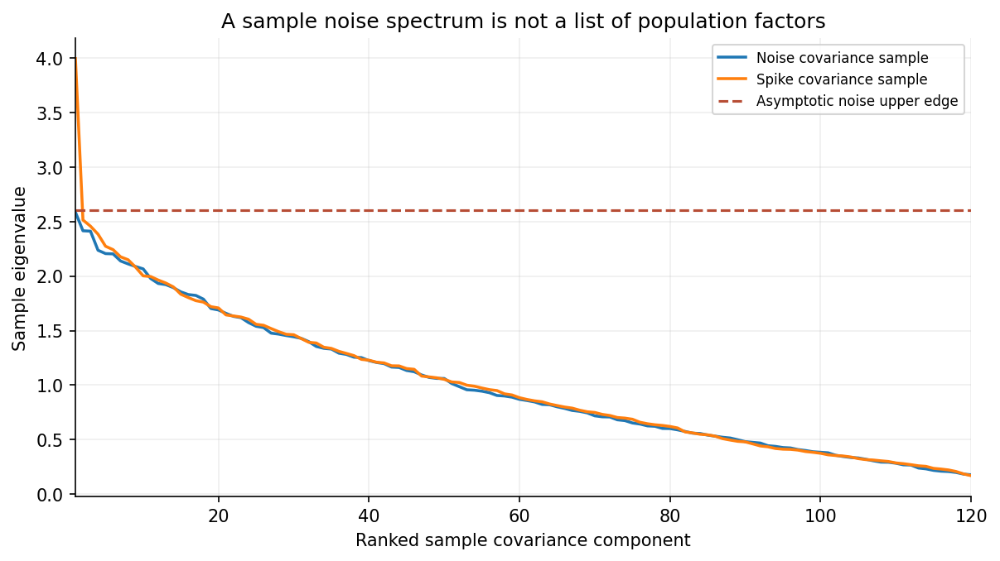
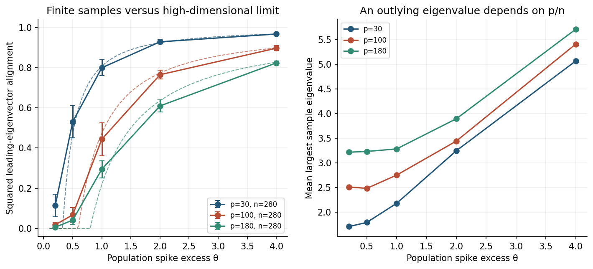
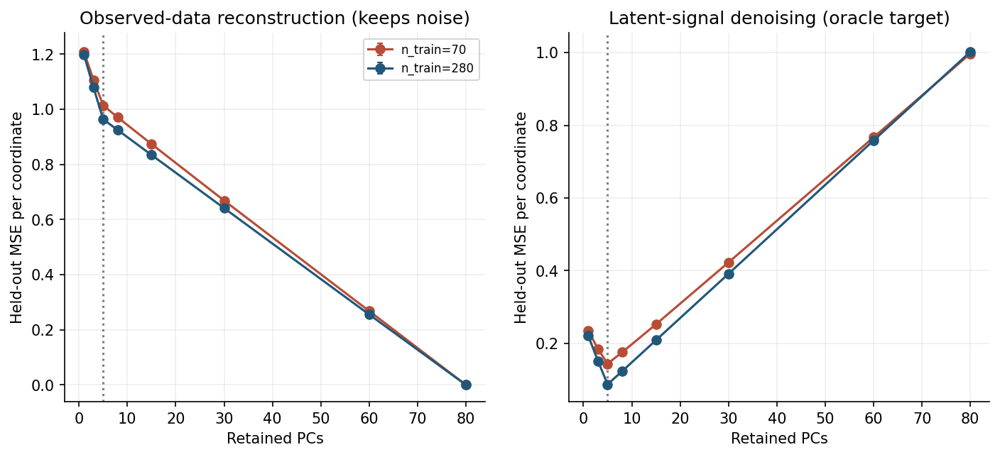
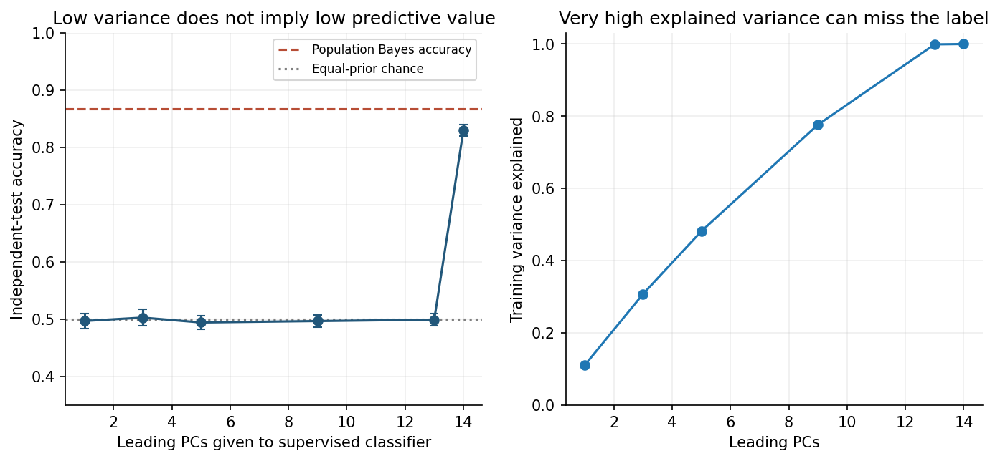
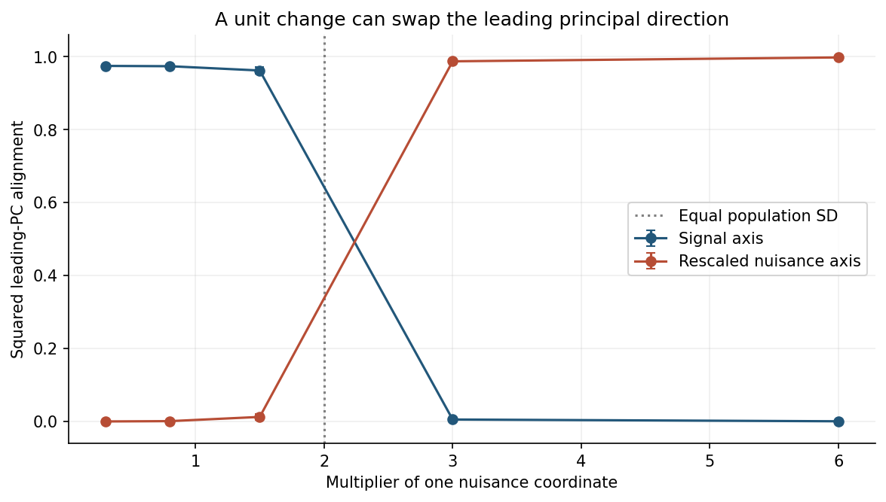
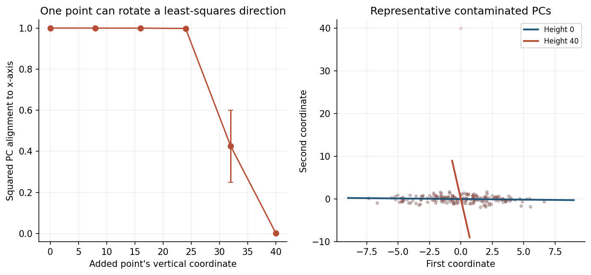
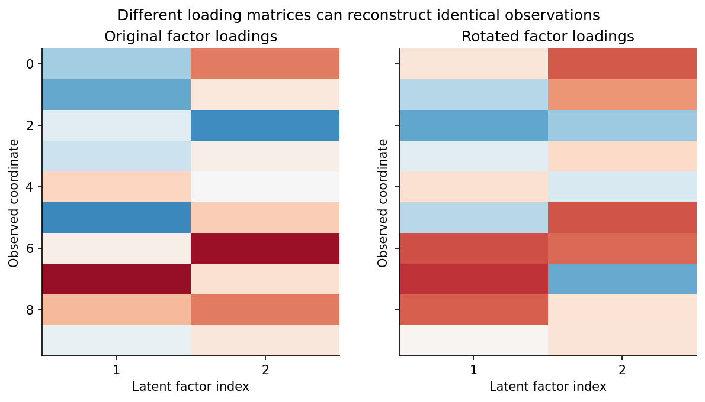
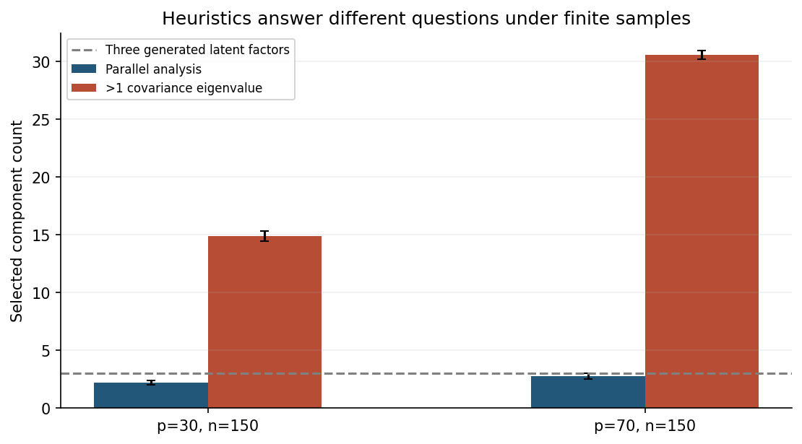
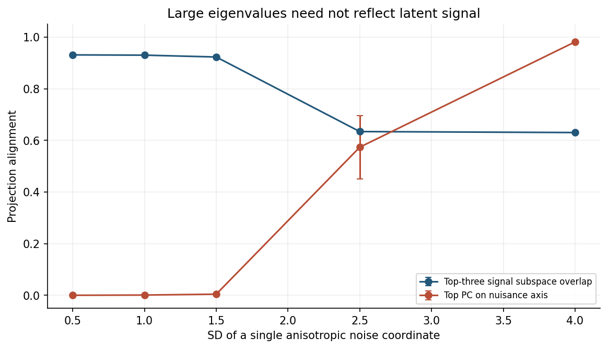

# A Principal Component Is Not a Latent Factor: Eigenvectors, Noise, and the Limits of PCA

*Article #25 · Mathematical derivations and reproducible synthetic experiments · 1 November 2026*

> **Abstract.** Principal component analysis is one of the most useful
> transformations in statistical computing, but its popularity has encouraged
> a series of conceptual substitutions: the largest sample eigenvectors are
> treated as the most important variables; explained variance is treated as
> retained information; a small number of components is treated as a count
> of underlying causes; and a visually compelling loading matrix is treated
> as an interpretable latent-factor model. None of those conclusions follows
> from PCA's optimization problem. We derive the covariance-eigenvector and
> low-rank reconstruction formulations, distinguish sample and population
> eigenspaces, examine Marchenko–Pastur noise spectra and the spiked-model
> eigenvector phase transition, and investigate why reconstruction,
> denoising, and prediction can favor different dimensions. Nine seeded
> synthetic experiments cover rare low-variance label information,
> feature-scale changes, a single influential observation, orthogonal
> factor rotations, parallel analysis, and anisotropic measurement noise.
> We report nine original figures and eighteen machine-readable evidence
> tables, with 61 numerical and integration checks and an executable
> notebook. Every quantitative claim is conditional on its stated
> distribution and design; neither an eigenvalue nor a visual pattern
> alone identifies a substantive factor or a causal mechanism.

## 1. The shortcut from variance to meaning

Imagine a dataset of household financial behavior. Its first principal
component explains half the recorded variation. An analyst labels that
component *economic status*, tells a policymaker that economic status
accounts for half of household behavior, and treats the loading magnitudes
as the importance of each measured feature. A mathematical fact has been
quietly converted into three much stronger claims. The mathematical fact
concerns variance within a representation, after specific centering,
scaling, and sampling choices. The labels *economic status*, *accounts for*,
and *importance* require additional evidence, and the interpretation can
change entirely when those choices change.

PCA works without an outcome variable. It does not ask whether a component
predicts health, whether it explains a process, whether a physical latent
variable exists, or whether the direction is stable under new observations.
The strongest guarantee of classical PCA is about a quadratic optimization
of the observed numerical matrix. The guarantee is useful, but it is
narrower than many conclusions drawn from component plots. Jolliffe and
Cadima [1] review the method and its extensions, and the roots of the
least-squares geometric idea reach back to Pearson [2] and Hotelling [3].
Those sources do not make a sample eigenvector a discovered cause.

One might object that factors and principal components often correspond
closely in applied work. Sometimes they do. If a few strong common factors
drive most covariance, measurement errors are modest and appropriately
structured, and the sample is large enough, principal component subspaces
can approximate the factor subspace. But *sometimes* is not an identification
argument. The factor structure, sampling regime, noise covariance, and
rotation conventions matter. We should test those conditions instead of
assuming them from a steep-looking scree plot.

This article develops a series of counterexamples and constructive
conditions. We distinguish four targets from the outset. **Variance
explained** is a ratio of observed sample sums of squares. **Reconstruction**
is the error of a low-rank approximation to measured observations.
**Denoising** is error relative to an unobserved signal; only a controlled
simulation gives that signal to us. **Prediction** is an out-of-sample
decision outcome, and may depend on low-variance directions. A latent-factor
interpretation is yet another target: it asks what generative variables
produce dependence and whether those variables are identifiable.

We use synthetic datasets exclusively. That decision has an advantage:
known population covariance, known latent subspace, known class mechanism,
and controlled outlier and scaling interventions make it possible to
separate mathematical identity from simulation variation. It also has a
strong limitation: we do not measure the frequency of these failure modes
in a particular real population or pretrained embedding. Our purpose is
to show what PCA does, what it may do under documented conditions, and
which validation steps are necessary before an analyst interprets a plot
as evidence of something beyond geometry.

## 2. PCA's optimization, derived from first principles

Let \(x_1,\ldots,x_n\in\mathbb R^p\) be recorded observations, and write
the centered data matrix as \(X_c\in\mathbb R^{n\times p}\). With
\(\bar x=n^{-1}\sum_i x_i\), the rows of \(X_c\) are
\(x_i-\bar x\). Define the usual unbiased sample covariance matrix

\[
 S=\frac{1}{n-1}X_c^\top X_c.
\]

For any direction \(v\in\mathbb R^p\) with \(\|v\|_2=1\), the projected
centered scores are \(X_cv\). Their sample variance is

\[
 \frac{\|X_cv\|_2^2}{n-1}
 =\frac{v^\top X_c^\top X_cv}{n-1}
 =v^\top Sv.
\]

The first principal direction solves
\(\max_{\|v\|_2=1}v^\top Sv\). Introduce a Lagrange multiplier:
\(L(v,\lambda)=v^\top Sv-\lambda(v^\top v-1)\).
The stationarity condition gives \(2Sv-2\lambda v=0\), hence
\(Sv=\lambda v\). Since \(S\) is symmetric positive semidefinite, its
largest eigenvalue supplies the maximum Rayleigh quotient. Subsequent
components maximize the same variance subject to orthogonality with
previously chosen directions. This yields ordered eigenpairs
\(\lambda_1\geq\cdots\geq\lambda_p\geq0\).

The customary fraction of sample variance explained by the first
\(k\) components is

\[
 \operatorname{PVE}(k)
 =\frac{\sum_{j=1}^{k}\lambda_j}
 {\sum_{j=1}^{p}\lambda_j}.
\]

Notice the denominator. It is total variation in the selected, scaled
feature representation. The ratio is silent about the label of an
observation and about what produced the variation. A single coordinate
expressed in a large unit can dominate the denominator. A systematic
error source can create a large eigenvalue. Conversely, a very small
predictive signal can occupy a component that explains almost none of
the marginal variance. The ratio remains mathematically valid in every
case; its *interpretation* changes.

The equivalent reconstruction formulation is important. If the columns
of \(V_k\in\mathbb R^{p\times k}\) are orthonormal leading eigenvectors,
the rank-\(k\) reconstruction of centered observations is
\(\widehat X_c=X_cV_kV_k^\top\). By the singular-value decomposition,
\(X_c=U\Sigma V^\top\), the Eckart–Young–Mirsky result identifies the
truncated SVD as a best rank-\(k\) approximation under squared Frobenius
error. In this setting,

\[
 \|X_c-\widehat X_c\|_F^2
 =(n-1)\sum_{j>k}\lambda_j.
\]

Thus maximizing retained sample variance is equivalent to minimizing
same-sample squared reconstruction error. This equality is exact for
the data matrix and its selected component subspace. It does not say
which \(k\) optimizes external prediction or recovery of a latent signal.
Those objectives are not present in the proof.

Two elementary properties are easily neglected. First,
\(\operatorname{rank}(S)\leq\min(p,n-1)\), because centering makes the rows
sum to zero. If \(p\) greatly exceeds \(n\), a large block of sample
eigenvalues is exactly or numerically zero even when population covariance
is full rank. Second, if \(v\) is an eigenvector, so is \(-v\).
The sign of a printed loading is therefore conventional, not a physical
orientation. When eigenvalues are equal, *any* orthonormal basis of their
eigenspace is valid, making individual component axes even less stable
than the subspace itself.

## 3. A principal component and a common factor answer different questions

Classical factor analysis begins with a stochastic generative model rather
than an approximation problem. A simple version is

\[
 X=\mu+\Lambda F+\varepsilon,\qquad
 \mathbb E[F]=0,\quad
 \operatorname{Cov}(F)=I_q,\quad
 \operatorname{Cov}(\varepsilon)=\Psi,
\]

with \(F\) and \(\varepsilon\) uncorrelated. It follows that

\[
 \Sigma_X=\Lambda\Lambda^\top+\Psi.
\]

Here \(\Lambda\in\mathbb R^{p\times q}\) is a loading matrix,
\(F\) contains \(q\) latent factors, and \(\Psi\) models unique
or measurement-error variation. The meaning of \(\Psi\) is central:
traditional factor models often restrict it to be diagonal; some modern
models permit richer structures. Under no restrictions, the covariance
decomposition is highly non-unique. Merely observing a covariance matrix
cannot identify an arbitrary low-rank causal mechanism.

PCA, by contrast, decomposes the observed covariance into eigenvectors and
eigenvalues. It does not explicitly separate common variation from unique
error. If measurement noise is isotropic and independent, a strong factor
subspace may coincide with a leading population covariance eigenspace.
Tipping and Bishop [4] show how PCA can be embedded in a probabilistic
latent-variable formulation under isotropic Gaussian noise. Their result
clarifies an important special case; it does not imply that every PCA
loading has a distinct substantive identity or that all factor models
reduce to PCA.

The words *component*, *factor*, and *cause* should therefore not be used
interchangeably. A component is a coordinate of a covariance-dependent
orthogonal transformation. A latent factor is an unobserved variable within
a specified generative model. A causal variable requires an additional
identification strategy, such as defensible interventions, temporal ordering,
or assumptions that link interventions to observed outcomes. Even a factor
whose model fits the covariance perfectly can be a predictive or
descriptive construct rather than an identified cause.

Rotational indeterminacy makes the distinction tangible. With
\(\operatorname{Cov}(F)=I_q\), any orthogonal
\(Q\in\mathbb R^{q\times q}\) satisfies

\[
 \Lambda F=(\Lambda Q)(Q^\top F),\qquad
 (\Lambda Q)(\Lambda Q)^\top=\Lambda\Lambda^\top.
\]

The loadings and latent coordinate labels change while the observed
distribution under a rotationally symmetric factor law can remain the
same. We demonstrate that numerically in Section 10. Factor rotation
criteria can make a solution easier to interpret, but the criterion
imposes a convention or identifying restriction; it does not uncover a
unique set of historical or biological causes from covariance alone.
Anderson and Rubin's foundational work [5] addresses statistical inference
in such models, underscoring how much more structure is needed than a
sample eigendecomposition.

One consequence is that declaring the number of nonzero PCs to be the
number of latent factors is generally wrong. Independent measurement noise
can make covariance full rank even with only two common factors. A small
sample can make covariance rank deficient even when hundreds of independent
population directions exist. We need to state whether we mean ambient rank,
numerical effective rank, a latent generative count, a dimension adequate
for prediction, or a rank chosen for compression. They may coincide under
special assumptions; they are not synonyms.

## 4. A noise-only covariance matrix has a nontrivial spectrum

Consider a sample with no latent factors at all:
\(X_{ij}\stackrel{\mathrm{iid}}{\sim}\mathcal N(0,1)\).
Its population covariance is \(I_p\). Every population direction has
variance one, and there is no preferred axis. Nevertheless, its sample
covariance eigenvalues are not all exactly one. Sampling produces a spread
of eigenvalues, including a largest and a smallest sample principal
component, even though the generator contains no interesting factor.

The Marchenko–Pastur theory [6] describes the limiting empirical spectrum
for large sample covariance matrices in regimes where
\(p/n\to\gamma\in(0,\infty)\), under suitable distributional conditions.
For unit-variance isotropic noise and the standard \(1/n\) normalization,
the continuous part has endpoints

\[
 a_\gamma=(1-\sqrt\gamma)^2,\qquad
 b_\gamma=(1+\sqrt\gamma)^2.
\]

When \(\gamma>1\), an atom at zero reflects sample rank deficiency.
This asymptotic statement concerns the distribution of *many* eigenvalues.
It does not say that each finite sample lies exactly within those
endpoints, nor that every empirical eigenvalue above an approximate
upper edge must be a substantive factor. Finite-sample extremal
fluctuations matter, as discussed in Johnstone's work [7].

Our first experiment uses \(n=320\), \(p=120\) and 18 independent
Gaussian samples per scenario. We compare pure unit-variance noise
against a rank-one spiked covariance model described below. We archive
every ranked eigenvalue for every replicate, as well as summary
statistics of leading eigenvalues and directional alignment. The aspect
ratio is approximately \(120/319\) if we match our sample covariance's
\(1/(n-1)\) normalization to a finite reference. The corresponding
asymptotic upper noise edge is about **2.603**. In other words, a sample
eigenvalue more than twice the population eigenvalue one can arise as a
normal feature of finite high-dimensional noise.

Figure 1 displays one representative sample spectrum from each scenario,
with the approximate noise edge. The highest eigenvalue of the spiked
samples has a mean near **4.538** across independent repetitions. The
figure does not identify a factor by appearance alone: the simulation
author knows that one scenario contains a rank-one spike, whereas an
analyst examining an unknown sample would need further validation.
The pure-noise spectrum also warns against reading every visible
elbow as a generative rank. A scree plot is a representation of sampled
variance, not an authenticated inventory of underlying mechanisms.

## 5. When does a sample eigenvector recover the population direction?

An eigenvalue is not the same as its eigenvector. Even if the spectrum
reveals a large direction of variation, the estimated direction can be
poorly aligned with the population direction when dimension is large
relative to sample size. To study this, take a population covariance

\[
 \Sigma=I_p+\theta uu^\top,\qquad
 \|u\|_2=1,\quad\theta>0,
\]

with one distinguished eigenvalue \(1+\theta\) and \(p-1\) unit
eigenvalues. The excess \(\theta\) is the *spike strength*. In our
generator \(u=e_1\); each observation is an independent isotropic Gaussian
vector plus a Gaussian scalar along that axis. We measure alignment by
\(|\widehat u^\top u|^2\), which lies between zero and one and does not
depend on arbitrary eigenvector sign.

In the high-dimensional limit \(p/n\to\gamma\), with the required
Gaussian rank-one model and other regularity conditions, spiked
eigenstructure theory gives a threshold at
\(\theta=\sqrt\gamma\). Below or at that threshold, the leading
sample direction has asymptotically zero squared alignment with the
population spike, and the largest eigenvalue stays at the noise edge.
Above it, the sample leading eigenvalue separates:

\[
 \lambda_{\mathrm{top}}^{(\infty)}
 =(1+\theta)\left(1+\frac{\gamma}{\theta}\right),
\]

while the limiting squared direction alignment is

\[
 A_\infty(\theta,\gamma)
 =\frac{1-\gamma/\theta^2}{1+\gamma/\theta},
 \qquad\theta>\sqrt\gamma.
\]

Below threshold we define the reference alignment as zero. This is the
real Gaussian spiked-covariance asymptotic perspective developed by Paul
[8], related to the influential phase-transition work of Baik, Ben Arous,
and Péché [9] on complex models. The exact model distinctions should not
be erased when transferring constants from one result to another.
Finite sample alignments remain random and generally nonzero below a
limit that predicts zero as \(n,p\to\infty\).

We fix \(n=280\), vary \(p\in\{30,100,180\}\), and vary the spike
excess across \(\{0.2,0.5,1,2,4\}\). Each configuration is independently
repeated 18 times. The first panel of Figure 2 compares empirical squared
alignment with the high-dimensional formula, rather than pretending the
formula is exact in the finite experiment. The second panel reports
observed top eigenvalues. At \(p=180\) and \(\theta=4\), the mean squared
alignment is approximately **0.823**; weaker spikes can be difficult
to recover even though their population eigenvectors are perfectly
well-defined.

This finding is relevant whenever an analyst gives substantive names to
sample components. A loading pattern can change with sample size and
dimension even when the underlying population covariance is unchanged.
Confidence in a component's *existence* is not confidence in the accuracy
of every displayed loading. Subspace stability, held-out performance,
plausible noise models, and domain constraints must be considered before
a particular direction is treated as a reproducible construct.

## 6. Reconstructing measurements is not recovering the signal

PCA's low-rank reconstruction theorem is exact for the observed matrix
and squared error. That is often the objective of compression: represent
many measured coordinates with a few scores, then reconstruct them with
minimal loss. But in an inference problem the measured vector may contain
the signal of interest plus noise. Recovering the hidden signal and
reconstructing every recorded fluctuation are different tasks. The
distinction is not semantic; it produces different mathematical risks.

Suppose \(X=S+\varepsilon\), where \(S\) is a rank-\(q\) latent signal
and \(\varepsilon\) is independent measurement noise. Let \(P_k\) be
the orthogonal projection onto the first \(k\) sample PCs, estimated
from a training set. Ignoring mean estimation for a moment, a projected
test vector is \(\widehat X_k=P_kX\). Its squared distance to the
*observed* test vector is

\[
 \|X-P_kX\|_2^2=\|(I-P_k)X\|_2^2.
\]

For a fixed nested sequence of subspaces, this quantity decreases as
\(k\) increases, becoming zero when \(P_k=I_p\). It rewards preservation
of every component of the observed measurement, whether that component
is useful structure or accidental noise. If the goal is to estimate
the hidden signal, however, the loss is

\[
 \|\widehat X_k-S\|_2^2
 =\|P_kS-S+P_k\varepsilon\|_2^2.
\]

Under independence of \(S\) and zero-mean isotropic noise, and for a
fixed \(P_k\) independent of the test noise, the conditional expected
cross term vanishes. We obtain a bias-variance decomposition:

\[
 \mathbb E_\varepsilon\|\widehat X_k-S\|_2^2
 =\|(I-P_k)S\|_2^2
 +\sigma^2\operatorname{tr}(P_k)
 =\|(I-P_k)S\|_2^2+k\sigma^2.
\]

The first term is signal excluded by the projection; it can decline
as more components are kept. The second is passed-through measurement
noise; it increases linearly with retained dimension. Hence a finite
denoising optimum may exist even though observed-data reconstruction
keeps improving. When \(P_k\) itself is learned from noisy training data,
subspace estimation error adds another difficulty. The simple decomposition
remains a useful reference, not an exact accounting of every finite
learned-subspace risk.

Our simulation makes this tradeoff visible with five latent Gaussian
factors embedded in \(p=80\) coordinates through a random orthonormal
basis. Latent scores have standard deviation two; independent measurement
noise has standard deviation one per coordinate. We fit PCA separately
on 70 or 280 training observations, then reconstruct 240 independent
test observations. For each of eighteen independent data-generating
replications, we retain \(k\in\{1,3,5,8,15,30,60,80\}\) PCs.
There is no selection of the best run and no fitting on test outcomes.

We evaluate two losses on the same test vectors: mean squared error to
the *observed noisy test vector*, and mean squared error to its exactly
known *noiseless latent signal*. The second target is an oracle that
exists only because we generated the data; in applied work one would
need repeated measurements, external validation, or a defensible
measurement model to estimate it. We normalize both losses by the total
number of recorded coordinates so they are directly comparable across
the reported \(k\) values.

Figure 3 separates the two outcomes rather than putting one label on
both. With 280 training observations, the mean latent-signal MSE at
\(k=5\) is about **0.0875**. At \(k=80\), reconstruction of the noisy
test vector is mathematically exact up to numerical precision, but
the latent-signal MSE is about **1.00**: the reconstructed vector contains
all its independent measurement noise. With 70 training observations,
the five-component denoising error is higher, about **0.144**, because
the estimated subspace is less stable. That result is compatible with
the exact reconstruction theorem. It answers a different question.

The broader inference is that choosing \(k\) from cumulative explained
variance assumes an implicit reconstruction objective. If the goal is
forecasting, classification, denoising, or a scientifically interpretable
latent model, the loss function and validation strategy must match that
goal. One can use PCA without making that substitution, but the
substitution has to be visible and defensible.

## 7. The label can hide in the last principal component

An especially consequential failure mode appears when a low-variance
direction contains nearly all predictive information. PCA ranks directions
by variation in the marginal feature distribution \(P(X)\); it does not
optimize a property of \(P(Y\mid X)\). A feature can vary only slightly
yet determine a label, while unrelated features exhibit large variation
because of physical scale, heterogeneity, or measurement procedure.
Jolliffe's early note on principal components in regression [10]
warned against eliminating low-variance components without examining
their predictive role.

To construct an exact counterexample, let \(Y\) be a balanced binary label.
Generate thirteen independent nuisance coordinates
\(X_j\sim\mathcal N(0,2.2^2)\) for \(j=1,\ldots,13\). The fourteenth
coordinate carries the label:

\[
 X_{14}\mid Y=y
 \sim\mathcal N((2y-1)\,0.19,\;0.17^2).
\]

The nuisance coordinates are independent of \(Y\) and of the signal
coordinate. The conditional likelihood ratio uses only \(X_{14}\).
For equal priors, the population Bayes rule predicts class one when
\(X_{14}>0\), with accuracy

\[
 \Phi(0.19/0.17)\approx0.868.
\]

Meanwhile, each nuisance coordinate has variance \(4.84\), whereas
the marginal variance of the signal coordinate is
\(0.17^2+0.19^2=0.065\). The signal has meaningful class separation
relative to *its own noise*, but it explains very little of the
total marginal variance of all fourteen coordinates. For large samples,
an unsupervised variance ranking will place it near the bottom.

We generate 240 training and 180 independent test observations in each
of 36 repetitions. PCA is fitted **only on the training features**.
For each \(k\in\{1,3,5,9,13,14\}\), a pooled-covariance linear
discriminant is then fitted on the first \(k\) training PC scores and
training labels. We use a declared small ridge regularizer for numerical
stability and evaluate predictions only on the independent test labels.
Every \(k\) comparison within one repetition shares the same train/test
observations. The classifier is supervised, but the component selection
is not.

Across the 36 runs, mean accuracy using the first thirteen PCs is about
**0.500**, essentially equal-prior guessing. Keeping all fourteen
coordinates raises mean accuracy to about **0.830**. The gap is not
caused by changing the label mechanism or by test-set tuning; it is caused
by withholding a low-variance predictive coordinate until the last
component enters. The retained sample variance appears reassuringly
high before the useful label information becomes available.

The example is intentionally favorable to a particular warning, not a
benchmark proving that PCA always harms prediction. In many settings
leading components do carry useful shared signal, and reducing noise or
collinearity can improve out-of-sample decisions. Our claim is narrower:
**no variance-explained threshold, by itself, guarantees preservation of
predictive information**. If PCA is part of a supervised pipeline, select
its dimension by training-only cross-validation on the actual downstream
loss, then report unbiased independent-test performance. Treat a high
explained-variance percentage as a compression statement, not a
classification guarantee.

## 8. The first component can change when a nuisance variable changes units

The meaning of a principal component also depends on the metric induced
by feature units. Let \(D=\operatorname{diag}(d_1,\ldots,d_p)\) be a
coordinate-wise rescaling. If the original covariance is \(\Sigma\),
the covariance after rescaling is \(D\Sigma D\). This matrix does not
generally share eigenvectors with \(\Sigma\). A change from meters to
centimeters or an arbitrary normalization of one feature may rotate
the leading principal direction, although the real-world phenomenon
being measured is unchanged.

Our fifth experiment generates \(p=18\) Gaussian coordinates for \(n=300\)
observations. The designated signal direction is the second coordinate
with standard deviation two; one independent nuisance coordinate has
standard deviation one before rescaling; all remaining coordinates have
standard deviation one. We multiply only that nuisance coordinate by
\(s\in\{0.3,0.8,1.5,3,6\}\). The population variance of the signal
coordinate remains four, while the rescaled nuisance variance is \(s^2\).
At \(s=2\), their population variances are equal; above that threshold
the nuisance has the largest population variance.

Across 24 paired repetitions, mean squared alignment of the sample
first PC with the original signal axis falls from approximately **0.975**
at \(s=0.3\) to **0.0005** at \(s=6\). Conversely, the rescaled nuisance
axis becomes dominant. This is not a failure of the eigensolver. It is
exactly what covariance PCA is supposed to do: maximize measured variance
under the numerical units supplied to it. The scientific error would be
to regard the resulting component as a unit-free quantity of inherent
importance.

Correlation-based PCA, which standardizes marginal feature scales, can
avoid domination by an arbitrary large-variance unit. But it imposes a
different assumption: all standardized coordinates are given equal
marginal variance before dimensional reduction. That can amplify noisy
low-variance measurements or discount physically important magnitudes.
Standardization must be estimated on training data only to avoid data
leakage. There is no universal guarantee that covariance PCA or
correlation PCA better reflects the scientific target. The choice
belongs to the model specification and should be justified by the
measurement process.

## 9. One outlier can determine a least-squares axis

PCA inherits the sensitivity of squared-error geometry. An observation
far from the sample center contributes a large outer product to the
sample covariance. Its influence grows approximately quadratically
with its distance, so a single extreme point can rotate the leading
direction more than many ordinary points. This is particularly important
when outliers reflect recording errors, instrument saturation, duplicate
accounting records, or legitimate but rare regimes that should be modeled
separately.

Consider a two-dimensional population whose ordinary observations vary
more horizontally than vertically:
\(X_1\sim\mathcal N(0,2.5^2)\) and
\(X_2\sim\mathcal N(0,0.7^2)\), independently.
For 180 ordinary observations, the first sample principal direction is
typically close to the horizontal axis. We then add **one observation**
at \((0,L)\), with \(L\) taking the values
\(0,8,16,24,32,40\). Within a repetition, the original 180 points do
not change across \(L\). We repeat the experiment 24 times.

An approximate variance calculation explains what to expect. Before
contamination, horizontal variance is roughly \(6.25\), vertical variance
roughly \(0.49\). A new vertical point with height \(L\) contributes on
the order of \(L^2/(n+1)\) to the vertical covariance, with smaller
centering corrections. When \(L=40\), that contribution is around
\(1600/181\approx8.84\), enough to exceed the original horizontal
variance by itself. The precise finite-sample switching height depends
on random sample covariance and the new mean; the calculation is a
diagnostic approximation, not a closed-form threshold for every draw.

Figure 6 reports squared alignment of the first PC with the known
horizontal population direction. The mean is nearly **1.000** with
\(L=0\) and roughly **0.0019** with \(L=40\). A second panel shows
representative point clouds and fitted axes. There is no claim that
the added observation is always an *error*. It may represent a genuine
rare mode of the data. The point is that the same least-squares
criterion can be disproportionately governed by that one observation,
and its identity must be investigated before giving the resulting
component a substantive label.

Robust alternatives include careful input validation, winsorization
under a justified rule, robust covariance or projection-pursuit methods,
and explicit mixture or contamination models. Hubert, Rousseeuw, and
Vanden Branden [11] develop a robust PCA method, but our experiment does
not implement or benchmark it. Trimming unusual observations simply
because they are influential can erase legitimate extremes, and fitting
the trimming threshold to the evaluation set can leak information.
The correct response depends on the target population, data provenance,
and relative costs of retaining or excluding atypical cases.

## 10. Rotating the factors changes their names, not the data

The factor-model rotation issue from Section 3 is more than a philosophical
qualification. It can be demonstrated with an identity that holds at
the level of individual reconstructed observations. Let \(B\) be an
orthonormal \(p\times q\) loading basis, and let \(Z\) be a matrix of
row-wise latent scores. The noiseless data are \(X=ZB^\top\).
For an orthogonal \(q\times q\) matrix \(Q\), define
\(B'=BQ\) and \(Z'=ZQ\). Then

\[
 Z'{B'}^\top
 =ZQQ^\top B^\top=ZB^\top=X,
\]

and

\[
 B'{B'}^\top=BQQ^\top B^\top=BB^\top.
\]

The two loading matrices are generally different, yet the reconstructed
observations and common covariance contribution are identical.
No statistical method observing only \(X\) can distinguish them
without further restrictions. If the latent score distribution is
rotationally symmetric, even the distribution of the scores is unchanged
by the rotation. This is the precise sense in which latent factor
coordinates are not automatically unique.

Our seventh experiment uses \(p=10\), \(q=2\), and 200 isotropic
Gaussian latent scores with random orthonormal loading bases. We
rotate the two-dimensional factor coordinates through six angles
between zero and ninety degrees and repeat the construction fifteen
times. The experiment archives the Frobenius difference between
original and rotated loadings, the difference between their implied
covariance contributions, and the maximum absolute reconstructed-data
difference. The latter two quantities remain at numerical rounding
error even as the loadings change substantially.

Figure 7 displays two visibly different loading heatmaps for one
forty-five-degree rotation. The underlying observations are identical.
It would be incorrect to name one column *social trust* and the other
*economic insecurity* on the basis of loading pattern alone and then
claim that those two constructs have been identified uniquely. A
rotation chosen to make loadings sparse or simple can be valuable
for communication, but the choice injects modeling preferences.
It also may move individual values dramatically while preserving
the full factor subspace and covariance fit.

PCA eigenvectors have their own identification limitations. With distinct
population eigenvalues, eigenvectors are determined up to sign; with
repeated eigenvalues, their basis is rotationally arbitrary. A numerical
eigensolver may return a stable-looking set of columns even though
small perturbations produce a different basis spanning almost the
same subspace. In that situation, subspace overlap or projection
distance is a more meaningful stability diagnostic than comparing
the signed entries of columns one by one.

## 11. How many components should we keep?

Asking for *the right number of components* assumes that there is a single
quantity to be discovered. There are several. We might seek the smallest
rank that reconstructs 95% of measured variance, the number of generative
factors, the dimensionality that minimizes out-of-sample prediction loss,
the number of eigenvalues distinguishable from a specified noise model,
or the number of interpretable components. Those targets can disagree
even for a single dataset. A proposed selection rule can be evaluated
only after its target and assumptions have been specified.

A common shortcut retains sample covariance eigenvalues greater than
one, sometimes called a Kaiser-style criterion. That rule is traditionally
associated with eigenvalues from a *correlation matrix*, where the average
eigenvalue is one. Applied mechanically to an unstandardized covariance
matrix, the threshold has no general unit-invariant meaning. Even when
the generating noise variance is exactly one, high-dimensional sampling
can produce many noise eigenvalues above one. The Marchenko–Pastur
spread in Section 4 explains why an isolated cutoff on a sample
eigenvalue is not equivalent to identifying a factor.

Another influential approach is Horn's **parallel analysis** [12].
The broad idea is to compare observed eigenvalues to eigenvalues of
synthetic reference data that remove the feature associations one
wants to detect. One version independently permutes each observed
feature column, preserving its empirical marginal values but breaking
row-wise cross-feature dependence. For each ordered eigenvalue rank
\(j\), one estimates a high quantile of the null eigenvalue at rank
\(j\), then counts observed eigenvalues exceeding those thresholds.
The chosen null generation, quantile, covariance-versus-correlation
choice, and treatment of ties are all modeling decisions.

Our example generates a three-factor model in dimension \(p=30\) or
\(p=70\), with \(n=150\) observations and independent unit-variance
measurement noise. The latent factor variances are \(5,3,1\),
with random orthonormal loadings. For each of eighteen independent
replications per dimension, we obtain twelve independently
column-permuted null datasets and compare the observed eigenvalues
to the **rank-wise 95th percentile** of the null eigenvalues. We also
report the crude count of sample covariance eigenvalues greater than
one. The random null comparison is estimated from relatively few
draws by design, so it has Monte Carlo uncertainty; a production
implementation should generally use more null draws and evaluate
the stability of selected rank.

In the \(p=70\) experiment, the mean component count from parallel
analysis is about **2.78**, close to the three generated factors in this
particular configuration. The greater-than-one covariance eigenvalue
rule selects about **30.56** components on average. This wide gap is
not evidence that parallel analysis always identifies the true latent
rank, nor a demonstration that every use of the Kaiser criterion fails.
It shows the importance of reference scale and noise calibration for
the stated model. The quick-run configuration uses fewer null draws
and can be noticeably less stable than the full canonical evidence.

There are more alternatives. Cattell's scree test [13] seeks a
change in the slope of the ordered eigenvalues; it can be visually
useful but ambiguous when the spectrum decays smoothly. A fixed
cumulative variance fraction optimizes a compression preference but
need not preserve a target label. Out-of-sample reconstruction error
can choose dimension for representation of new measurements, although
it may favor very large \(k\) when the target includes noise. Directly
validated prediction loss is more appropriate if the goal is a
supervised decision. A probabilistic factor model can compare
likelihoods or predictive distributions under distinct rank
assumptions, but its conclusions depend on the error model and priors
or penalties. There is no single criterion that answers all those
questions without conditions.

Selection also creates a multiple-comparison opportunity. If an analyst
tests many component counts, transformations, and downstream models,
then presents the winning validation score as if it were an unbiased
test estimate, the evaluation is optimistic. Dimension should be tuned
inside an honest validation procedure. For time-dependent data, a
chronological or blocked split may be essential. For repeated individuals,
grouped folds may be appropriate. The extra computation is part of
the cost of making an evidential claim rather than reporting a
post-hoc preference.

## 12. A large eigenvalue may be anisotropic measurement noise

The spiked model in Section 5 is constructive because its noise is
isotropic. Every non-signal direction has the same population noise
variance. But real measurements have different sensor errors, missingness
mechanisms, units, and systematic artifacts. A large sample eigenvalue
may come from an important common factor, a high-variance nuisance
coordinate, or a mixture of both. PCA alone cannot decide the cause.

Our final experiment makes this ambiguity controlled. We work in
\(p=50\) dimensions with three known signal directions, corresponding
to coordinates three through five, and factor variances \(5,3.5,2.5\).
Independent measurement noise has standard deviation one in most
coordinates. One *unrelated* first coordinate has noise standard
deviation \(s\), varied across
\(\{0.5,1,1.5,2.5,4\}\). Within each repetition we hold the signal
and standard noise draws fixed while rescaling only this nuisance
coordinate. There are 24 independent replications, each with
\(n=260\) observations.

We evaluate the estimated leading three-dimensional PCA subspace against
the known three-dimensional signal space. Let \(U\) and \(\widehat U\)
be orthonormal bases, each with three columns. We report

\[
 A_{\mathrm{subspace}}
 =\frac{1}{3}\|\widehat U^\top U\|_F^2
 =\frac{1}{3}\operatorname{tr}
   (\widehat U\widehat U^\top UU^\top).
\]

This overlap lies between zero and one and is invariant to sign or
rotation changes *within* either three-dimensional subspace. Unlike
individual loading comparisons, it measures whether we have found
approximately the same span. We also report squared alignment of
the very first sample PC with the nuisance axis.

At nuisance standard deviation \(0.5\), the mean signal-subspace
overlap is approximately **0.931**. At standard deviation \(4\), it
falls to about **0.630**. Some signal directions are displaced from
the first three slots by the dominant noise coordinate. A leading
eigenvalue can therefore become *larger* while the utility of the
leading subspace for recovering the known signal becomes *smaller*.
This is a deliberately simple anisotropic counterexample, not a
universal performance estimate for heteroscedastic PCA or
probabilistic factor analysis.

The result suggests a practical route: learn what the measurement
noise represents, consider repeated observations or sensor-level
error models, and evaluate whether whitening or noise-adjusted
factor models are appropriate. But transforming covariance by
estimated noise precision can itself amplify errors, especially
when variances are poorly estimated. A variance component must
be tied to a scientific model before it is declared a nuisance.
Automatically discarding high-variance observations or coordinates
can remove genuine regime differences. Noise modeling is a
substantive inference problem, not a mechanical afterthought.

## 13. What the simulation error bars actually quantify

The article uses Monte Carlo repetition because finite-sample PCA
varies even when population covariance is fixed. But uncertainty
has several levels. Variation of a first eigenvector across repeated
samples is one; variation in how well an assumed Gaussian covariance
model represents an application is another. The latter cannot be
measured by repeating the former model indefinitely. More simulated
draws make an estimate of a *model-defined quantity* precise;
they do not make the model's assumptions true.

For a statistic \(T_r\) computed on independent replication
\(r=1,\ldots,R\), we report

\[
 \bar T_R=\frac{1}{R}\sum_{r=1}^RT_r,\quad
 \widehat{\mathrm{MCSE}}(\bar T_R)
 =\frac{s_T}{\sqrt R},\quad
 s_T^2=\frac{1}{R-1}\sum_{r=1}^R(T_r-\bar T_R)^2.
\]

Where included, figure whiskers are
\(\bar T_R\pm1.96\widehat{\mathrm{MCSE}}\). These are descriptive
normal-approximation uncertainty summaries for the repeated simulation
mean, not exact coverage guarantees under every replicate distribution.
The archived replicate tables retain the random-stream repetition
identifier, making independent aggregation and more conservative
uncertainty calculations possible.

Paired interventions require special care. The scale experiments
modify the same underlying observations; the outlier heights reuse
the same 180 uncontaminated points; reconstruction dimensions reuse
the same train/test samples. The most precise inference about a
*difference* would compute the difference within each repetition,
then summarize those paired differences. Combining two marginal
standard errors as if they came from independent experimental
groups would ignore useful covariance. The figures display means
for clarity, while the underlying rows preserve pair identity.

Parallel analysis also has nested randomness. Each observed dataset
has multiple column-permuted null datasets, which contribute to a
rank-wise empirical null threshold. The independent outer unit is
the original dataset, not each eigenvalue from each null
permutation. We summarize selected rank across independent original
datasets, not by treating all null eigenvalues as independent
realizations of an applied population. The actual number of
permutations is part of the method and is archived in its code.

Several limits are non-statistical. A centered sample covariance
has rank at most \(n-1\) exactly; the factor rotation identities
are exact algebra; the asymptotic spike threshold refers to a
specified mathematical limit. They should not have Monte Carlo
confidence intervals attached to them. The simulations instead
show finite-sample behavior near those references. Keeping the
logical status of each statement explicit matters more than
decorating every number with a confidence band.

## 14. A defensible PCA workflow for applied data science

Before fitting PCA, articulate the **decision or scientific estimand**.
Is the goal to compress storage, visualize a population, denoise a
measurement, detect an outlier, estimate common factors, or improve
a supervised forecast? The loss function and validation design
should follow that answer. If the objective is merely two-dimensional
exploration, a visually compelling plot may be useful as a prompt
for inquiry but is not an identified causal map. If the objective
is classification, validation must examine predictive loss, not only
reconstructed feature variance.

Inspect the units and data provenance. Are features monetary amounts,
rates, counts, standardized scores, or embedding coordinates?
Are measurements comparable across instruments or years? Does a
large variance represent a meaningful range, a faulty sensor, or
a rare subpopulation? Decide between covariance PCA, correlation PCA,
and a domain-weighted transformation based on the data-generating
process. Estimate scalers within training folds, and retain the
actual transformation and software version as part of the model
artifact. Reproducibility requires the representation, not only
the component loadings.

Separate the fitting sample from evaluation. For forecasting, use
time-respecting splits to avoid peeking at future covariance changes.
For repeated patients or customers, group observations so that
highly correlated records do not leak across partitions. For
industrial sensors, record recalibrations and device identifiers,
because component drift may be a measurement change rather than
a new process factor. A global PCA fitted before the split
can leak test-distribution information even without using labels.
Whether that leakage is material depends on the deployment
procedure, but it should not be silently ignored.

Investigate stability at the correct mathematical level. Report
ordered eigenvalues and explained variance, but also evaluate
subspace overlap or principal angles across bootstrap or
time-respecting refits. Match signs before comparing individual
eigenvectors, and avoid comparing axes directly when eigenvalues
are nearly repeated. Repeat the analysis under plausible
preprocessing and missing-data choices. If one observation or
unit conversion dramatically rotates the first PC, that is
important evidence about the fragility of its interpretation.

Compare dimension-selection methods against their targets. If
compression matters, measure held-out reconstruction and storage
cost. If denoising matters, look for independent repeated
measurements or defensible signal models. If the component count
purports to estimate latent factors, compare a specified factor
model, error covariance assumptions, parallel analysis, and
out-of-sample behavior. If prediction matters, tune component
count jointly with the downstream model using nested or honestly
separated validation and report the final independent-test loss.
There is no reason to expect one choice of \(k\) to optimize all
these objectives at once.

Interpretability requires a second round of evidence. A factor
named *economic status* should be associated with predeclared
observable indicators, be reasonably stable across independent
populations or periods, and have a plausible measurement model.
A causal description needs still stronger assumptions or
intervention evidence. Rotation criteria and high loadings are
insufficient by themselves. We should distinguish labels that
help people discuss a descriptive component from identified
properties of the world.

Finally, monitor the entire workflow after deployment.
Feature distributions drift, definitions change, sensors age,
and population compositions move. Retraining may rotate
components or change their ordering even when downstream task
quality remains similar. Archive the old and new transformations
and assess projection stability, task loss, subgroup behavior,
and the cost of updating downstream dependencies. The right
operational question is whether the representation continues
to serve its declared purpose—not whether the latest scree plot
looks as tidy as the previous one.

## 15. Failure modes that a clean eigendecomposition cannot diagnose

The nine experiments isolate one phenomenon at a time. Production
datasets often combine them. A sensor may change units halfway
through a study, its error variance may increase with temperature,
and its most extreme observations may be precisely those associated
with the event we want to predict. A fitted covariance matrix collapses
these different stories into a symmetric numerical object. Its
eigendecomposition is valid regardless of how the matrix was made.
**The validity of the computation does not validate a proposed account
of the data-generating process.**

Consider missing measurements. Standard PCA expects a completed
numeric matrix. Replacing missing entries with column means before
PCA is more than a computational convenience: it puts imputed
observations at the marginal center, alters pairwise covariance,
and can create artificial geometric concentration. A complete-case
analysis can select a nonrepresentative population if the probability
of measurement depends on health, income, device type, or another
relevant variable. More elaborate imputation can be preferable, but
its assumptions become part of the analysis. If imputation models are
trained using held-out observations, even without labels, the
evaluation can contain information unavailable at deployment.

One tempting alternative is to compute each covariance entry on the
subset of records where that *pair* of features is present. When the
subsets differ, the resulting pairwise-complete covariance matrix
need not be positive semidefinite. It may have negative eigenvalues
even if every within-pair covariance calculation was individually
correct. Clipping those eigenvalues to zero changes the estimation
problem yet again. A defensible workflow needs a joint model of
missingness or an estimation procedure whose covariance validity
and evaluation properties are understood. None of our synthetic
experiments simulates missing values; this is a boundary of the
evidence, not an untested claim about an imputation algorithm.

Dependence is a second obstacle. PCA's algebra holds for any fixed
matrix, but classical sampling arguments that motivate uncertainty
intervals often assume independent rows. If one person supplies
twenty visits, or neighboring time windows share most observations,
then a matrix with one thousand rows may contain far less than one
thousand independent units of information. Repeated measurements can
increase the apparent precision of loadings while their variation
across genuinely independent people remains high. The effective
sampling unit should follow the scientific design. Group bootstrap,
blocked resampling, hierarchical models, and forward-time validation
address different versions of this issue; the correct choice depends
on the way dependence arises.

Nonstationarity produces a related ambiguity. Suppose two regimes
have the same within-regime covariance but different means. Pooling
them adds a between-regime covariance term. For a two-group mixture
with group probability \(\pi\), group means \(\mu_1,\mu_2\), and
within-group covariances \(\Sigma_1,\Sigma_2\), the population
covariance satisfies

\[
 \Sigma_{\mathrm{pooled}}
 =\pi\Sigma_1+(1-\pi)\Sigma_2
 +\pi(1-\pi)(\mu_1-\mu_2)(\mu_1-\mu_2)^\top.
\]

The last term is rank one. It can produce a dominant principal
component even when neither group has a corresponding dominant
within-group direction. That principal component may be useful
for separating regimes, but calling it a common factor acting
uniformly within each regime would misdescribe the mechanism.
Centering each group separately removes the between-group term
and changes the question. Pooling and stratification are choices
about the population being modeled, not neutral preprocessing.

Nonlinearity is another boundary. A cloud concentrated near a
curved one-dimensional manifold may require several linear PCs
for a close Euclidean reconstruction. A nonlinear embedding might
represent its geometry with one coordinate, but that coordinate
need not be globally identifiable or causally meaningful either.
Kernel PCA, manifold learning, and autoencoders make different
approximation assumptions and can introduce their own instability.
The absence of a short linear representation does not prove the
absence of low-dimensional structure; similarly, a short nonlinear
representation does not prove that the data have a unique set of
physical causes.

Finally, PCA is frequently applied to learned feature vectors rather
than raw measurements. A text embedding's coordinates may be
arbitrary up to transformations permitted by its training objective,
and the distribution of embeddings may reflect training-set frequency
or optimization artifacts. Large components can capture useful
global structure, but may also capture nuisance variation or batch
effects. The appropriate test is empirical: does removal, projection,
or reweighting improve the specified retrieval, classification, or
other task on genuinely independent examples, including relevant
subgroups? Our Gaussian counterexamples do not estimate how often
any particular embedding model behaves this way. They show why
eigenvalue rank alone cannot settle the applied question.

## 16. What would count as evidence for an interpretable factor?

It is easy to criticize a leap from component to cause without
offering a constructive alternative. Suppose a researcher genuinely
believes that a small number of unobserved mechanisms explain
correlation among a group of survey items. That is a plausible
starting hypothesis, not a conclusion. To investigate it, the
researcher should specify which items each proposed factor is
expected to influence, which measurement errors can covary, and
whether the factor structure is expected to persist across
populations, periods, or survey modes.

A measurement model can express these assumptions. For instance,
one may hypothesize that indicators \(X_1,X_2,X_3\) load on factor
\(F_1\), while \(X_4,X_5,X_6\) load on \(F_2\), and that remaining
item-specific errors are independent conditional on the factors.
This is far more restrictive than asking PCA for two eigenvectors.
The restrictions can be checked against observed cross-covariance
patterns and, where appropriate, compared with alternatives.
The model can be rejected, found fragile, or shown to predict an
independent sample inadequately. Those possibilities are virtues:
they make the interpretation vulnerable to evidence.

Even a model with good covariance fit may admit distinct parameter
sets. One needs enough identifying restrictions to distinguish
them, and those restrictions must be justified. Fixing a loading
sign or factor variance may establish a scale convention without
establishing a scientific identity. Requiring certain cross-loadings
to vanish can aid identification but might be false in the actual
population. Rotating an exploratory loading matrix to make it look
simple can be a useful descriptive tool; it is not independent
confirmation that the factors have the names subsequently assigned.
The exact rotational experiment in Figure 7 is a reminder that
the data alone can leave these coordinate choices unresolved.

Identification and estimation also differ. A population model
might be identifiable in principle yet be nearly impossible to
estimate accurately from the available sample. Weak factors,
closely spaced eigenvalues, correlated errors, and a large
number of indicators relative to observations can make estimated
loadings unstable. Figure 2 documents one instance of this
sample-size problem under unusually favorable Gaussian assumptions.
It would be overconfident to infer robust factor recovery from a
single fitted loading table without sensitivity analysis or
uncertainty estimates. Factor scores assigned to individuals
have additional estimation error and, in many classical factor
models, are not uniquely determined by the observed responses.

Replication provides a stronger line of evidence. A hypothesized
factor should have similar measurement relationships in an
independent sample drawn from the intended population. If groups
are to be compared, the analyst should examine whether the
measurement model has approximately comparable loadings,
thresholds or intercepts, and residual structure across those
groups. Otherwise a difference in factor scores can mean a
change in how items work rather than a difference in the latent
trait. External outcomes can support construct validity, but
using those same outcomes to repeatedly design and rename
factors creates a circular validation exercise.

Prediction can offer useful evidence while remaining logically
distinct from causal identification. If a factor predicts future
behavior after an honest temporal split, it is useful for that
specified prediction. It does not follow that intervening on the
factor score would change behavior. A factor score is a function
of measurements; an intervention on an unobserved construct may
not even be well-defined without a structural model of how the
construct is generated and changed. Observational covariance,
including its principal components, contains no intervention
operator. Claims about causal effects require further scientific
design and assumptions.

The practical hierarchy is therefore important: a stable
*descriptive component* may be justified by reproducible covariance
structure; an *interpretable common factor* additionally needs a
defensible measurement model and identifying restrictions; a
*causal mechanism* demands evidence about interventions or
structural relations. Each level can be useful. Confusion arises
when the evidence for the first is presented as if it had already
established the third.

## 17. Reproducing the analysis and auditing its claims

The repository companion contains the complete study in
<code>analysis.py</code>, a generated executable notebook
<code>pca_latent_factors.ipynb</code>, and a build script for
the notebook. The experiment seed is **20261101**. Independent
random streams are derived for each replication; interventions
within a replication deliberately share their underlying draws.
That pairing is essential to interpreting the scale, outlier,
and reconstruction contrasts. The implementation uses a symmetric
eigenvalue decomposition of centered sample covariance and
orders eigenvectors by decreasing eigenvalue. It fixes eigenvector
signs only when a visual convention requires it; all substantive
direction scores are sign-invariant.

Each experiment writes a replicate-level CSV where stochastic
comparisons are appropriate and a separate summary CSV.
The spectrum experiment also writes every ranked eigenvalue
for every cloud. The full run produces **eighteen CSV files**
and **nine PNG figures**. The article embeds the canonical
figures; quick-run outputs carry separate file suffixes and
do not silently replace the versioned evidence. The README
records the design parameters, test commands, and interpretation
limits. These details make it possible to inspect the exact
quantity behind a plotted line rather than trusting a caption.

To reproduce the figures under Python 3.12, install the pinned
major-version ranges in <code>requirements.txt</code> and run
<code>OPENBLAS_NUM_THREADS=1 python analysis.py</code>
from the article directory. The notebook uses the same experiment
functions in an isolated temporary output directory and can be
executed in a fresh kernel. The test suite checks matrix identities,
known covariance and spectral behavior, invalid input handling,
random-seed reproducibility, the content inventory, and notebook
execution. A path-scoped GitHub Actions workflow runs the tests
and a quick independent regeneration.

There is a distinction between reproducibility and generalizability.
The checks tell a reader that the code computes the declared
synthetic quantities and that the written evidence matches those
computations. They cannot tell the reader whether a survey,
financial panel, biological assay, or neural embedding has the
assumed latent distribution. A seeded simulation is a transparent
conditional argument, not a representative sample from every
possible application. The source, figures, and CSVs invite
readers to change assumptions and see which conclusions survive.

## 18. Conclusion: PCA is geometry first

PCA is not broken. It is an elegant solution to a well-defined
mathematical problem: find orthogonal directions retaining the
most sample variance and, equivalently, give the best low-rank
least-squares reconstruction of the centered observed matrix.
That guarantee is powerful for compression, visualization,
diagnostics, and the construction of useful representations.
Its strength is also the reason to be precise about its limits.

Our experiments show several ways the apparent meaning of a
component can come apart from its mathematical rank. Pure noise
has a structured sample spectrum. Weak population spikes can
have poorly recovered eigenvectors. Additional PCs can improve
noisy reconstruction while degrading signal denoising. A
predictive label can reside in a low-variance direction. A unit
change or a single extreme observation can reorder dominant
axes. Orthogonal factor rotations can leave the reconstructed
data exactly unchanged. Parallel analysis and simple eigenvalue
thresholds can disagree sharply, and anisotropic noise can
displace a known signal subspace.

The general lesson is not to avoid PCA or to demand a complicated
generative model for every exploratory plot. It is to match the
claim to the evidence. Use explained variance when discussing
observed variance; use held-out loss when discussing prediction;
use an explicit noise model when discussing denoising; and use
identified measurement or causal assumptions when discussing
latent structure. A principal component becomes a useful scientific
clue when its interpretation survives those checks—not simply
when its eigenvalue is large.

## References

1. Jolliffe, I. T., and Cadima, J. (2016). “Principal component analysis:
   a review and recent developments.” *Philosophical Transactions of
   the Royal Society A*, 374, 20150202.
   https://doi.org/10.1098/rsta.2015.0202
2. Pearson, K. (1901). “On lines and planes of closest fit to systems of
   points in space.” *Philosophical Magazine*, 2(11), 559–572.
   https://zenodo.org/records/1430636
3. Hotelling, H. (1933). “Analysis of a complex of statistical variables
   into principal components.” *Journal of Educational Psychology*,
   24(6), 417–441; 24(7), 498–520.
4. Tipping, M. E., and Bishop, C. M. (1999). “Probabilistic principal
   component analysis.” *Journal of the Royal Statistical Society,
   Series B*, 61(3), 611–622.
   https://doi.org/10.1111/1467-9868.00196
5. Anderson, T. W., and Rubin, H. (1956). “Statistical inference in
   factor analysis.” *Proceedings of the Third Berkeley Symposium
   on Mathematical Statistics and Probability*, Volume 5, 111–150.
   https://statistics.stanford.edu/technical-reports/statistical-inference-factor-analysis
6. Marchenko, V. A., and Pastur, L. A. (1967). “Distribution of eigenvalues
   for some sets of random matrices.” *Mathematics of the USSR–Sbornik*.
   https://doi.org/10.1070/SM1967v001n04ABEH001994
7. Johnstone, I. M. (2001). “On the distribution of the largest eigenvalue
   in principal components analysis.” *Annals of Statistics*, 29(2),
   295–327. https://doi.org/10.1214/aos/1009210544
8. Paul, D. (2007). “Asymptotics of sample eigenstructure for a large
   dimensional spiked covariance model.” *Statistica Sinica*,
   17, 1617–1642.
   https://www3.stat.sinica.edu.tw/statistica/j17n4/j17n418/j17n418.html
9. Baik, J., Ben Arous, G., and Péché, S. (2005). “Phase transition of
   the largest eigenvalue for nonnull complex sample covariance
   matrices.” *Annals of Probability*, 33(5), 1643–1697.
   https://arxiv.org/abs/math/0403022
10. Jolliffe, I. T. (1982). “A note on the use of principal components
    in regression.” *Applied Statistics*, 31(3), 300–303.
    https://doi.org/10.2307/2348005
11. Hubert, M., Rousseeuw, P. J., and Vanden Branden, K. (2005).
    “ROBPCA: a new approach to robust principal component analysis.”
    *Technometrics*, 47(1), 64–79.
    https://doi.org/10.1198/004017004000000563
12. Horn, J. L. (1965). “A rationale and test for the number of factors
    in factor analysis.” *Psychometrika*, 30, 179–185.
    https://doi.org/10.1007/BF02289447
13. Cattell, R. B. (1966). “The scree test for the number of factors.”
    *Multivariate Behavioral Research*, 1(2), 245–276.
    https://doi.org/10.1207/s15327906mbr0102_10

