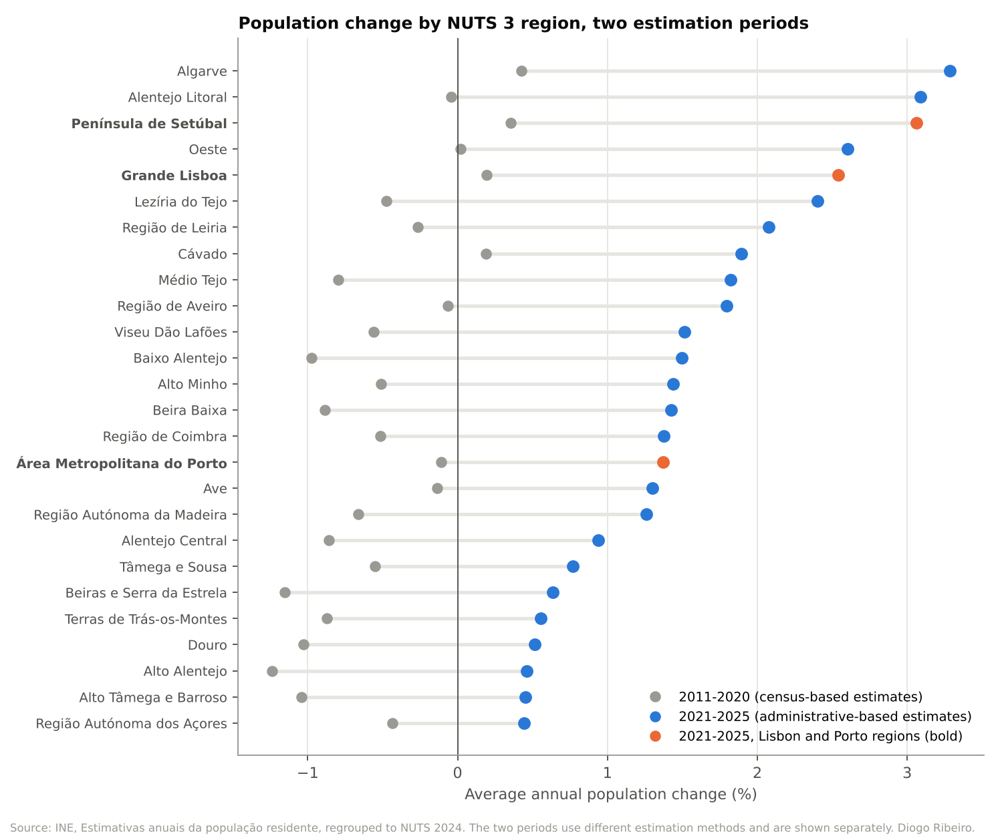
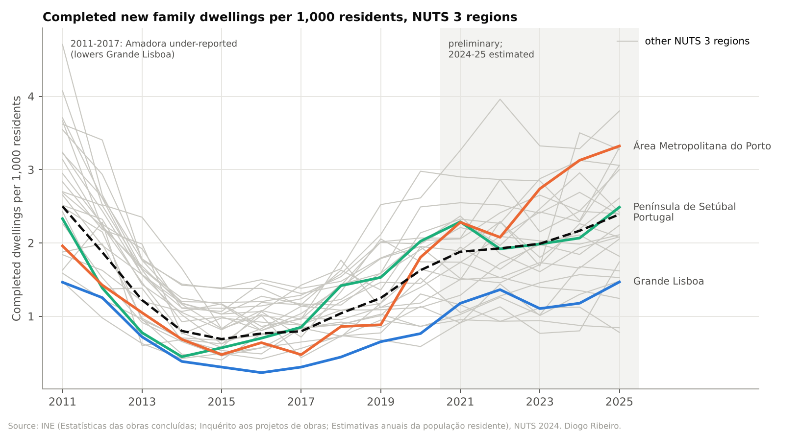
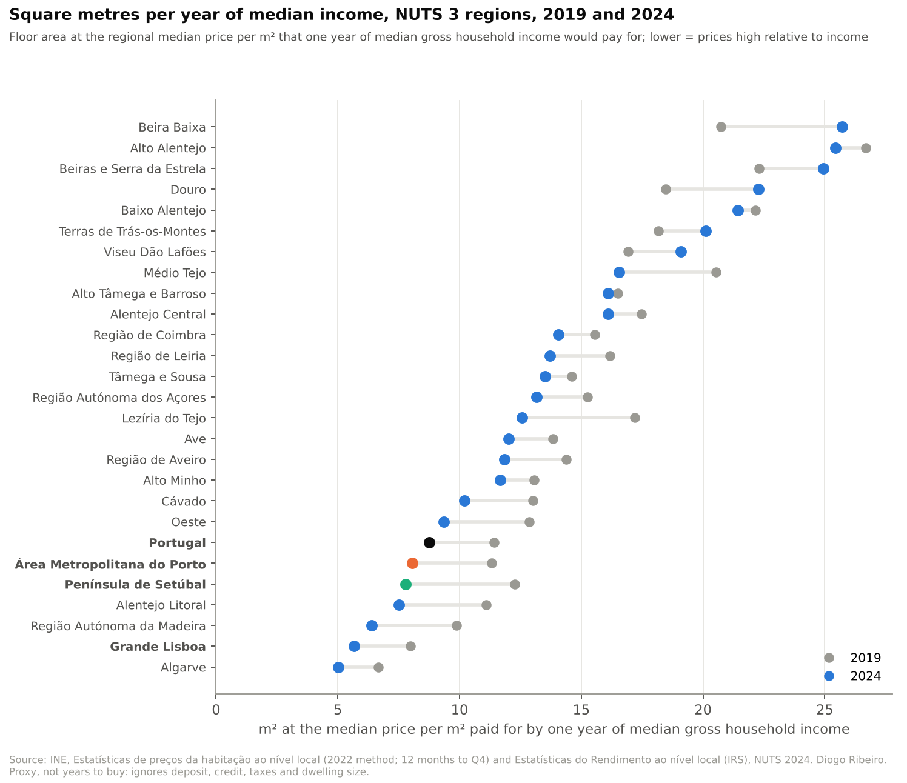
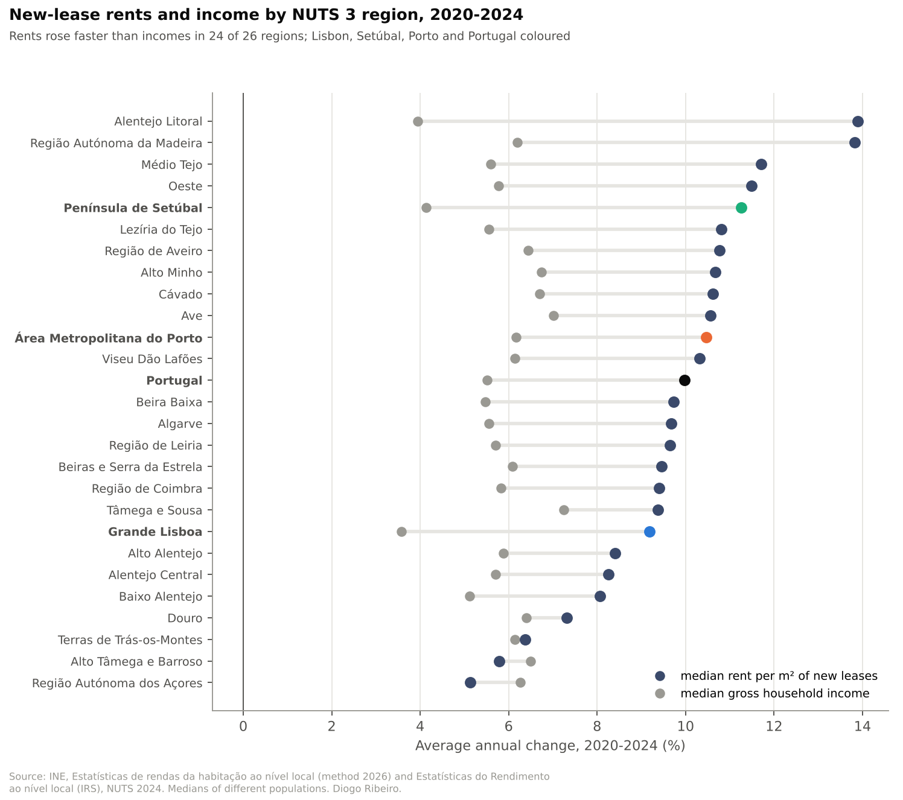
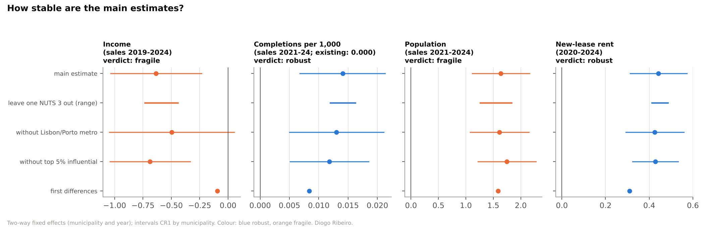
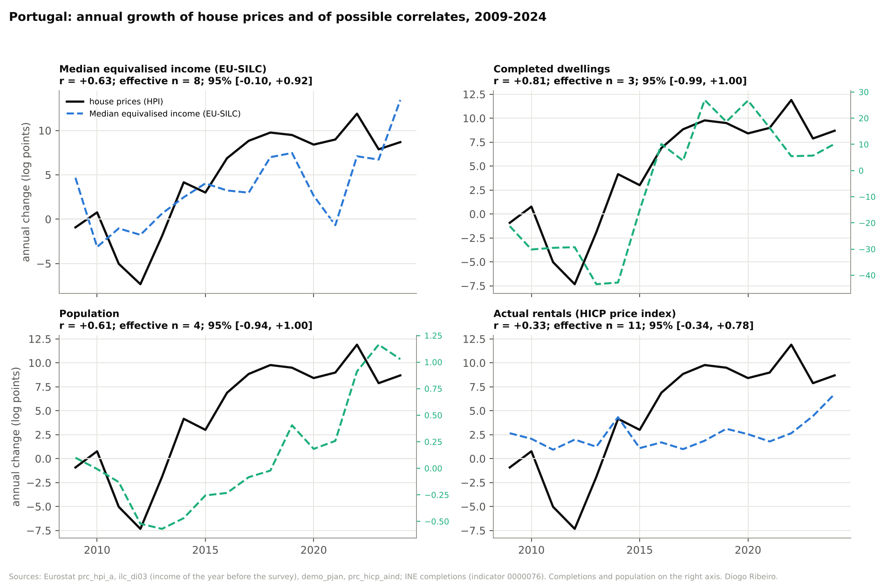

# Prices, incomes, construction and rents in Portugal's housing market, 2008–2025

**A reproducible descriptive assessment**

Diogo Ribeiro · ORCID [0009-0001-2022-7072](https://orcid.org/0009-0001-2022-7072) · dfr@esmad.ipp.pt

Research release **v1.0.0** · 30 October 2026 · data snapshot of 29 October 2026

How to cite: see [`CITATION.cff`](CITATION.cff). Code: Apache License 2.0 (repository licence). Third-party data remain
under their providers' terms (see [Citing and licences](README.md#citing-and-licences)).

---

## Abstract

This report assembles official Portuguese and European statistics into one audited, reproducible body of
evidence on the housing market.

**Data.** The evidence covers:
- house prices and bank appraisals;
- declared income and survey income;
- dwelling completions and permits;
- resident population;
- new-lease rents, the stock of tenancies, tenure and housing-cost burden.

It spans Portugal, the 9 NUTS 2 and 26 NUTS 3 regions of NUTS 2024 and the 308 municipalities. All 63 source
files are pinned with checksums. Every number in the report is recomputed from them by code that is tested in
continuous integration.

**Findings at the national level.** The Eurostat house price index rose 164% between 2015 and 2025, or 111%
after consumer-price inflation. Median equivalised income rose 65% between income years 2015 and 2024, so the
ratio of house prices to income rose by about half (index 153.9 in 2025, 2015 = 100). The first instalment on a
new 30-year mortgage, relative to income, reached its highest value of the series in 2023 (183.1). It remained
66% above 2015 in 2025.

**Findings by region.** Regional sale prices per m² outpaced declared household income in all nine NUTS 2
regions in 2019–2024. The widest gaps were in Península de Setúbal, Madeira and Grande Lisboa; among NUTS 3
regions, Alentejo Litoral and the Porto metropolitan area also had wide gaps. Rents of new leases rose about 10% a year in 2020–2024, faster than income in 24 of 26 NUTS 3 regions.
The rent index of sitting tenants rose more slowly than median income. The share of the population renting at
market prices rose from 13.2% (2019) to 16.3% (2025).

**Associations.** Across municipalities, prices and rents move together, and price growth was higher where
population grew. Price growth was not higher where income grew; the correlation is slightly negative.
Within-municipality panel models give the following picture:
- The association with income is not identified: it changes sign across 18 specifications.
- The positive association with completions disappears when only existing dwellings are priced, which shows it
  to be a change in the mix of dwellings sold.
- Price–rent co-movement is the only within-municipality association that survives every check.

**Limits.** None of these results is causal. The data do not support a credible causal design, and the report
sets out what additional evidence would be needed.

---

## 1. Introduction

Portugal's housing market has changed sharply since the 2008–2014 recession and adjustment programme. Nominal
house prices fell until 2013 and have more than doubled since 2015. Rents of new contracts have risen quickly,
and construction, after collapsing, is recovering from a very low base. Public debate attributes these changes
to many causes: tourism and short-term letting, foreign demand, immigration, interest rates, regulation and
insufficient construction. That debate is often conducted with indicators that measure different things and
are compared as if they did not.

This release began as a check of statistics quoted in a newspaper opinion piece (October 2026). It was then
extended into a systematic, reproducible assessment of the official data. Its purpose is decision support, not
advocacy. It establishes what the published statistics show, how far the main affordability indicators can be
compared, and which relationships between prices, income, construction, population and rents survive scrutiny.

The report is deliberately conservative about inference. Every result is assigned to one of three layers:
- **established findings**: arithmetic on official statistics that is robust to the definitions and periods
  tested;
- **descriptive associations**: correlations and conditional associations, with their uncertainty and
  stability;
- **unresolved causal hypotheses**: questions these data cannot answer, with the evidence that would be needed.

The analysis code, data snapshots, tests and the review log of this release are in the same folder (Appendix
A).

## 2. Research questions

- **RQ1.** How have house prices, consumer prices and incomes evolved since 2008? How has the cost of entering
  home ownership changed once financing costs are included?
- **RQ2.** How do purchase-affordability proxies differ across regions, especially Lisbon and Porto? Has
  regional price growth been accompanied by comparable income growth?
- **RQ3.** How have rents changed, measured by new contracts, by the stock of tenancies and by a price index?
  How have tenure and housing-cost burden changed, and could changes in composition explain the trends?
- **RQ4.** How have population and residential construction evolved by region?
- **RQ5.** Which associations between house prices and income, construction, population and rents are robust,
  which depend on the model, and which would require causal identification?

## 3. Literature and institutional context

### 3.1 The market since 2008

Portuguese house prices fell during the sovereign-debt crisis and the 2011–2014 economic adjustment programme,
then recovered from 2014 (Lourenço and Rodrigues, 2017). The Eurostat index used here falls from 107.5 (2008) to
93.1 (2013) and rises to 263.9 by 2025 (2015 = 100). Residential construction collapsed in the same period:
- completions fell from 125,708 dwellings in 2002 to 7,148 in 2015;
- dwellings in new-building permits fell from 73.9 thousand (2005) to 8.6 thousand (2015).

The cost of mortgage credit fell to historical lows in 2020–2021 and roughly quintupled by 2023. The Banco de
Portugal reports that the share of families who own their home, among those whose representative is aged 25–34,
was 61% for the cohorts born in 1977–1986 and 42% for those born in 1987–1996 (Banco de Portugal, 2023). This is
a fall in young-adult ownership across cohorts that this release cites but cannot recompute. The OECD reports
that, of the 2021 dwelling stock, 12% was vacant and 19% was used as secondary or holiday homes (OECD, 2026).
These categories do not measure supply that is immediately available to the market.

### 3.2 Institutions that bear on the indicators

Several policies change what the statistics measure or are candidate explanations for their movement. None is
evaluated here:
- **Rent law.**
  - Rent freezes and controlled rents shaped tenancies signed before the 1990s.
  - The *Novo Regime do Arrendamento Urbano* (Lei 6/2006) and its 2012 revision (Lei 31/2012) liberalised
    rent setting and contract duration, and opened transition paths for old contracts.
  - Rent updates for 2023 were capped at 2% (Lei 19/2022).
- **Short-term letting.** The local accommodation (*alojamento local*) regime of Decreto-Lei 128/2014 governed
  short-term letting. Municipal containment areas followed in Lisbon and Porto, and the *Mais Habitação*
  programme (Lei 56/2023) restricted new registrations in pressured areas.
- **Foreign demand.** The residence-permit-for-investment regime (*vistos gold*, from 2012) and the
  non-habitual-resident tax regime (Decreto-Lei 249/2009) are often cited. *Mais Habitação* ended new
  residence permits for real-estate investment, and the 2024 State Budget (Lei 82/2023) closed the
  non-habitual-resident regime to new entrants.
- **Credit.** A macroprudential recommendation has limited loan-to-value, debt-service-to-income and maturity
  for new credit since 2018. Its 2022 revision set maximum maturities of 40, 37 and 35 years by borrower age
  (Banco de Portugal, 2022).

### 3.3 Measuring affordability

Three families of indicators are common, and they are not interchangeable:
- **Price-to-income ratios.** They compare a house-price measure with an income measure. Unless both refer to
  the same households and dwellings, they are proxies of relative change, not the time a household needs to
  buy.
- **Housing-cost burden.** The EU-SILC overburden rate is the share of people whose housing costs exceed 40% of
  disposable income, both net of housing allowances (Eurostat). It is measured on households as they are,
  including young adults living with their parents. It can therefore fall while entry into the market becomes
  harder.
- **Rent measures.** There are three: medians of new contracts, averages over all tenancies, and quality-
  adjusted price indices for sitting tenants. They diverge whenever old contracts with low rents are replaced by
  new ones.

### 3.4 What causal studies identify, and what that implies here

Studies with credible identification exist for specific mechanisms:
- *Short-term rentals.* Instrumenting short-term-rental growth with platform-wide demand shocks interacted with
  pre-existing local exposure, studies find positive effects of short-term letting on rents and prices. This is
  the case in Barcelona (Garcia-López et al., 2020), in the United States (Barron, Kung and Proserpio, 2021) and
  in Portugal (Franco and Santos, 2021).
- *Supply.* Housing-supply elasticities depend on geography and regulation (Glaeser, Gyourko and Saks, 2005;
  Saiz, 2010). The same demand shock therefore raises prices more where supply is constrained.

These studies use parcel- or neighbourhood-level data, exogenous shifters and explicit counterfactuals. Annual
municipal medians do not provide these. This report therefore treats such mechanisms as hypotheses, and uses
the literature to say what data would be needed (Section 8.3).

Two further points of method apply throughout:
- *Ecological inference.* Correlations between areas do not describe individuals (Robinson, 1950).
- *Composition.* Changes in medians partly reflect changes in what is sold or let.

## 4. Data

### 4.1 Sources

All sources are official statistics, except the 1995–2025 national completions series. That series was
transcribed from PORDATA's republication of INE data because the INE endpoint was unavailable at the time; it
is identified as such.

| Domain | Statistic (source, code) | Unit | Geography | Years used |
|---|---|---|---|---|
| Prices | House price index (Eurostat `prc_hpi_a`) | index 2015 = 100 | Portugal | 2008–2025 |
| Prices | Median value per m² of dwellings sold, 2022 method (INE 0012234) | €/m² | NUTS 2024 to municipality | 2019–2025 |
| Prices | Same, 2018 method (INE 0009490) | €/m² | NUTS 2013 to municipality | 2016–2020 |
| Prices | Median bank appraisal per m² (INE 0012256) | €/m² | municipality | 2011–2025 |
| Income | Median equivalised disposable income (Eurostat `ilc_di03`, `ilc_di09`) | € | Portugal | 2004–2025 surveys |
| Income | Median declared gross income per tax household (INE 0012712, 0009763; net 0012741; per taxpayer 0012749) | €/year | NUTS 2024 to municipality | 2015–2024 |
| Financing | Cost of borrowing for house purchase, new business (ECB MIR) | % a year | Portugal | 2003–2025 |
| Construction | Dwellings completed / licensed in new construction (INE 0013248, 0013235) | dwellings | municipality | 2011–2025 |
| Construction | National completions (INE via PORDATA); permits (Eurostat `sts_cobp_a`) | dwellings | Portugal | 1995–2025 |
| Population | Resident population (INE 0008273, 0012917; Eurostat `demo_pjan`) | persons | municipality / Portugal | 2011–2025 |
| Households | Private households (censuses 2011, 2021: INE 0014406, 0014627; LFS: Eurostat `lfst_hhnhtych`) | households | municipality / Portugal | 2006–2025 |
| Rents | Median rent per m² of new leases, 2026 method (INE 0014698, 0014697, 0014711); 2021 method (0012600, 0012601, 0009631, 0009632); resident tenants (0014700, 0014699) | €/m²/month | NUTS 2024 to municipality | 2017–2025 |
| Rents | Census mean monthly rent and rented share (INE 0000777, 0000977, 0006993, 0006995, 0012521, 0012522); 2021 tenancies by contract date, support and duration (0012508, 0012529, 0011522, 0012528, 0011501) | € / % / count | municipality | 1991–2021 |
| Rents | HICP actual rentals for housing, COICOP 04.1 (Eurostat `prc_hicp_aind`) | index 2015 = 100 | Portugal, euro area | 1996–2025 |
| Tenure and burden | Tenure (`ilc_lvho02`), overburden by age, tenure, urbanisation and citizenship (`ilc_lvho07a`, `07c`, `07d`, `lvho25`), rent share (`ilc_mded02`); INE overburden by NUTS 2 (0006260, 0014472) | % | Portugal / NUTS 2 | 2003–2025 |
| Young adults | Living with parents (`ilc_lvps08`); estimated age of leaving home (`yth_demo_030`) | % / years | Portugal | 2000–2025 |

The provenance of every file is described in the [README](README.md), with its URL, retrieval time, provider
update date and definitions.

### 4.2 Geography

Results are reported on the NUTS 2024 classification as published by INE: 308 municipalities, 26 NUTS 3 and 9
NUTS 2 regions. Every older NUTS version is a grouping of the same municipalities, identified by their four-digit
DICO code, so series on other versions are linked through municipalities:
- **Sums** (population, dwellings, households) are regrouped. The regrouping reproduces each source's own
  published regional and national totals exactly.
- **Medians** (prices, incomes, rents) are never aggregated. Only values that INE published for the region
  itself are used.

Two NUTS 3 changes matter between NUTS 2013 and NUTS 2024:
1. The Área Metropolitana de Lisboa was split into Grande Lisboa and Península de Setúbal.
2. Two municipalities moved between Médio Tejo and Beira Baixa.

The censuses of 2001 and 2011 use NUTS 2002, in which Grande Lisboa and Península de Setúbal already existed
with the same municipalities. Lisbon is therefore reported as Grande Lisboa (`1A0`), Península de Setúbal
(`1B0`) and, where sums allow, their union. Porto is reported as the Área Metropolitana do Porto (`11A`) and,
for censuses, the municipality of Porto.

### 4.3 Time coverage and alignment

All series are annual or are reduced to annual values without interpolation:
- **Sale prices and rents of new leases** cover the 12 months ending in the fourth quarter, i.e. the calendar
  year.
- **Declared income** refers to the tax year.
- **Population** is measured on 31 December. Eurostat's 1 January value is assigned to 31 December of the year
  before.
- **EU-SILC income** refers to the calendar year before the survey. Both alignments are reported where it
  matters.
- **Censuses** refer to March 2011 and April 2021.

The longest windows in which each comparison uses one method and one geography are:
- sale prices with income, 2019–2024;
- new-lease rents with income, 2020–2024;
- sale prices (2018 method) with income and census-based population, 2016–2020;
- bank appraisals, 2015–2024;
- municipal population and construction, 2011–2025.

### 4.4 Breaks, gaps and inconsistencies found in the audit

The audit ([`data_audit.csv`](data_audit.csv); Figure 1) records coverage, unpublished cells, documented breaks,
geography, timing and units for every variable.

| Variable | Break or caveat | Treatment |
|---|---|---|
| Population | INE moved from census-based to administrative-based estimates in 2021, and its Portugal total rises 2.0% from 2020 to 2021. From 2021, INE's series exceeds Eurostat's by 1.7% (2021) to 5.9% (2024). | Growth never computed across 2020/2021; models use one basis; rates per 1,000 use a fixed base year |
| Sale prices | 2018 method (to 2021 Q3) and 2022 method (from 2019 Q4). In unchanged NUTS 3 regions they differ by a median 1.2% in the overlap; small municipalities differ by up to 75%. | Never spliced; reported as separate windows |
| New-lease rents | 2021 and 2026 methods. The 2026 method is 3.2–6.3% higher for Portugal in 2020–2024, and annual growth is 10.0% against 9.2%. | Only the 2026 method for 2020–2025 |
| Completions | Amadora under-reported 2011–2017; 2021+ preliminary; 2024–2025 estimated | Flagged in panels; affects Grande Lisboa |
| Bank appraisals | Published for 141–261 of 308 municipalities a year | Selected sample (larger municipalities) |
| Municipal medians | Unpublished where there are few sales or contracts: 3–26 municipalities a year for prices, 61–86 for rents | Left empty; balanced samples drop them |
| EU-SILC | 2004 break; pandemic-year surveys 2020–2021; administrative pension data from the 2024 survey; small samples for sub-groups | Flags kept; sub-groups reported with caution |
| Overburden, 2025 | `ilc_lvho07a` gives 6.3% and `ilc_lvho07c` gives 6.2% for the same total (rounding or revision between tables) | Each table used for its own breakdown |
| National completions | Manually transcribed from PORDATA (INE endpoint unavailable). For 2011–2025 it equals INE's municipal series summed to Portugal in every year. | Labelled; 2021–2025 preliminary |


*Figure 1. Share of the 308 municipalities with a published value, by variable and year. Rows are separate
methods; none is spliced.*

### 4.5 Integrity and provenance

Each INE response is stored with its URL, retrieval time, HTTP status, byte count and SHA-256. Readers recompute
the digest before use. Eurostat and ECB snapshots added since October 2026 carry the same records. The earlier
Eurostat snapshots (house prices, income, tenure, overburden by age, permits, households, population, parental
co-residence) were pinned with their dataset update timestamps but without per-request records. From this
release, every data file is listed with its SHA-256 in [`data/SHA256SUMS`](data/SHA256SUMS), which
`reproduce.py` and the test suite verify.

## 5. Methodology

### 5.1 Measures

- **Growth** is reported as compound annual percentage change, and as 100 × the natural-log change ("log
  points"). Differences of log points equal the log change of a ratio, which makes price–income gaps additive.
- **Relative price/income indices** are (P*t*/P*base*)/(Y*t*/Y*base*) × 100. They are relative changes, not
  levels. Base years 2015 (national) and 2019–2021 (regional) are varied in sensitivity analysis.
- **Initial-payment-to-income index.** This index multiplies the price/income index by the ratio of 30-year
  annuity factors at the average new-business mortgage rate, so it moves with the first instalment on a loan
  proportional to the price index. A three-way log decomposition separates the price, financing-cost and income
  terms. It is an accounting identity, not a counterfactual.
- **Floor-area proxies:**
  - m² per year of income = median gross household income ÷ median sale price per m²;
  - m² per month of income = monthly income ÷ median new-lease rent per m².

  They divide medians of two different populations, and are **not** the years needed to buy or the rent any
  household pays.
- **Gross rental yield** = 12 × new-lease rent per m² ÷ sale price per m², both regional medians.
- **Shift-share (Kitagawa, 1955) decomposition** of the national overburden rate into changes in tenure shares
  and changes in rates within each tenure, using mean weights.

### 5.2 Analytical samples

Only compatible observations enter a comparison. Each model sample uses one price or rent method, one
population basis and one geography, and is balanced: a municipality enters only if every variable is published
in every year.

| Sample | Years | Outcome | Regressors | Municipalities |
|---|---|---|---|---|
| A | 2019–2024 | sale price (2022 method) | income | 272 |
| A2 | 2021–2024 | sale price | income, completions per 1,000, population (administrative basis) | 289 |
| B | 2016–2020 | sale price (2018 method) | income, completions per 1,000, population (census basis) | 295 |
| C | 2015–2024 | bank appraisal | income, completions per 1,000 | 179 |
| D | 2020–2024 | sale price | new-lease rent | 215 |

### 5.3 Statistical methods

**Cross-sectional associations.** Pearson and Spearman correlations across municipalities, with 95% percentile
intervals from a bootstrap that resamples whole NUTS 3 regions (1,999 replications). This allows for spatial
dependence within regions. Correlations across the 26 NUTS 3 regions use Fisher intervals.

**Within-municipality models.** For municipality *i* and year *t*:

ln P*it* = α*i* + γ*t* + β′X*it* + ε*it*.

This is a two-way fixed-effects model; α*i* absorbs time-invariant differences between municipalities and γ*t*
absorbs shocks common to all. β is a conditional association of within-municipality deviations, not a causal
effect. Alternatives:
- first differences with year effects;
- municipality effects with NUTS 2 × year effects (regional shocks);
- long differences over the whole window with NUTS 2 effects;
- existing-dwelling prices or net income in place of the headline definitions;
- sub-periods.

**Inference.**
- Cluster-robust (CR1) standard errors by municipality.
- A wild cluster bootstrap by NUTS 3 region (26 clusters, Rademacher weights, 1,999 replications), with two
  outputs:
  - percentile-t intervals from the unrestricted bootstrap;
  - p-values from the restricted bootstrap, which imposes the null when resampling (Cameron, Gelbach and Miller,
    2008; MacKinnon and Webb, 2017).

**Diagnostics.**
- *Within variation:* the share of each regressor's variance left after the fixed effects.
- *Serial correlation:* Wooldridge's test on first-difference residuals (Wooldridge, 2010; Drukker, 2003). The
  slope is −0.5 when errors in levels are serially uncorrelated and 0 when they follow a random walk.
- *Fixed effects against first differences.*
- *Stability:*
  - leaving out each NUTS 3 region;
  - dropping the Lisbon and Porto metropolitan municipalities;
  - dropping the 5% most influential municipalities (one-step DFBETA on the coefficient of interest).

**National time series.** Correlations of annual growth rates, 2009–2024 and 2013–2024, with Fisher intervals on
an effective sample size that corrects for lag-1 autocorrelation (Bretherton et al., 1999).

### 5.4 Evidence layers and verdict rules

A within-municipality association is **robust** only if all of these hold:
1. the regressor keeps at least 1% of its variance after the fixed effects;
2. the bootstrap interval excludes zero and the restricted-bootstrap p-value is below 0.05;
3. the sign holds in first differences;
4. the sign holds without any single NUTS 3 region and without the metropolitan areas;
5. the sign is shared by at least 80% of all specifications of the same regressor.

It is **fragile** if criterion 2 holds and any other fails, and **not supported** otherwise. Cautions that do
not change the verdict are also recorded:
- under 5% of within variation, which means attenuation from measurement error is likely;
- serial correlation that favours first differences.

### 5.5 Software

Python, standard library only, for all estimators: least squares by Gaussian elimination, CR1, the wild cluster
bootstrap, quantile approximations (Hill, 1970) and the decompositions. Matplotlib 3.11.2 is used for figures.
All bootstrap seeds are fixed, and every output file is rebuilt and compared byte for byte in continuous
integration.

## 6. Results

### 6.1 National trends (RQ1)


*Figure 2. Left: house prices, rents of sitting tenants, median income and consumer prices (2015 = 100). Right:
house price/income and first-mortgage-payment/income indices, with the mortgage rate on new loans.*

**Prices and income.**
- Prices: the Eurostat house price index rose from 100 in 2015 to 263.9 in 2025 (+164%). Consumer prices rose
  25%, so the real increase is about 111%.
- Income: median equivalised income rose 65% between income years 2015 and 2024.
- Ratio: the price/income index (survey-year alignment, as published) was 153.9 in 2025. With income aligned to
  its reference year it was 136.3 in 2024. Under either alignment prices outpaced incomes by a wide margin after
  2015, having moved together in 2008–2015.

**Cost of entry.** The average rate on new mortgages fell from 2.38% (2015) to 0.83% (2021), rose to 4.13%
(2023) and was 2.99% in 2025.
- *2015–2021:* the first-payment-to-income index barely moved (103.7 in 2021), because falling rates offset 21.4
  of the 52.4 log points of price growth.
- *2021–2023:* it rose to 183.1, the highest value of the series and above 2008 (161.4). The financing-cost term
  (+43.5 log points) was larger than the price term (+19.8).
- *2025:* the index stood at 166.5, 66% above 2015.

**Tenure and burden.**
- *Tenure:* owners fell from 74.8% of the population (2015) to 71.2% (2025), and tenants at market rent rose
  from 12.7% to 16.3%.
- *Overburden:* the share of people spending over 40% of disposable income on housing peaked at 9.2% in 2014 and
  was 6.3% in 2025.
- *Young adults:* the share of 18–34-year-olds living with their parents rose from 62.9% (2015) to 72.3% (2021)
  and fell back to 61.0% (2025). It does not move with house prices, and none of these stock measures captures
  the difficulty of entering the market.

**Construction.** Completions per 1,000 residents went from 0.688 (2015) to 2.540 (2025, preliminary). Dwellings
in new-building permits rose from 8.6 thousand to 40.9 thousand. Both remain far below the early 2000s.

### 6.2 Regions: population and construction (RQ4)

**Population.**
- *2011–2020* (census-based estimates): Portugal's population fell 0.17% a year, and only five NUTS 3 regions
  grew.
- *2021–2025* (administrative-based estimates): every region grew. Portugal grew 1.89% a year. The fastest were
  Algarve (3.29%), Alentejo Litoral (3.09%) and Península de Setúbal (3.06%); Grande Lisboa grew 2.54% and the
  Porto metropolitan area 1.37%.

The two periods rest on different estimation methods. INE's administrative-based series for 2021–2024 also sits
1.7–5.9% above Eurostat's, so the size of recent growth is uncertain.

**Construction** (mean completions per 1,000 residents, 2021–2025): Portugal 2.07, Grande Lisboa 1.26,
Península de Setúbal 2.15, Área Metropolitana do Porto 2.71. The coefficient of variation across NUTS 3 regions
stayed between 0.28 and 0.38 from 2011 to 2025. Construction per resident is not a measure of housing need
(Figures 3–4).



*Figure 3. Average annual population change by NUTS 3 region, 2011–2020 and 2021–2025 (two estimation methods).*



*Figure 4. Completed new family dwellings per 1,000 residents, NUTS 3 regions, 2011–2025.*

### 6.3 Regional affordability of purchase (RQ2)

**Portugal, 2019–2024.** The median sale price per m² rose from €1,094 to €1,777 (10.2% a year). Median declared
gross household income rose 4.5% a year. Prices therefore outpaced income by 26.5 log points, and one year of
median income bought 11.4 m² at the median price in 2019 and 8.8 m² in 2024.

**Regions.** Prices outpaced income in all 9 NUTS 2 regions, 21 of 26 NUTS 3 regions and 220 of 283
municipalities. The five NUTS 3 exceptions are low-price interior regions.

| Area | Price €/m², 2019 → 2024 | Price growth / yr | Income growth / yr | Gap (log points) | m² per year of income, 2019 → 2024 |
|---|---|---|---|---|---|
| Grande Lisboa | 1,820 → 2,939 | 10.1% | 2.8% | 34.3 | 8.0 → 5.7 |
| Península de Setúbal | 1,142 → 2,117 | 13.1% | 3.3% | 45.5 | 12.3 → 7.8 |
| Área Metropolitana do Porto | 1,108 → 1,986 | 12.4% | 5.0% | 34.0 | 11.3 → 8.0 |
| Algarve | 1,696 → 2,752 | 10.2% | 4.1% | 28.2 | 6.7 → 5.0 |
| Região Autónoma da Madeira | 1,214 → 2,395 | 14.6% | 5.0% | 43.8 | 9.9 → 6.4 |
| Portugal | 1,094 → 1,777 | 10.2% | 4.5% | 26.5 | 11.4 → 8.8 |

**Divergence.** Disparities widened through prices, not incomes. Across NUTS 3 regions the coefficient of
variation rose from 0.39 to 0.50 for prices and fell from 0.088 to 0.068 for incomes.

**Sensitivity.** The result holds in each of the following:
- price definitions (all, existing or new dwellings) and income definitions (gross or net household income, or
  income per taxpayer): prices outpaced income in 19–21 of the 26 NUTS 3 regions under every combination, and
  the gaps for Grande Lisboa, Península de Setúbal and the Porto metropolitan area stay between 28 and 46 log
  points;
- base years 2019–2021 for the price/income index;
- bank appraisals in place of prices: appraisal growth correlates 0.82 with transaction growth across regions;
- the earlier 2016–2020 window under the 2018 method, where prices outpaced income in 24 of 25 NUTS 3 regions.


*Figure 5. Annual growth of the median sale price per m² against median gross household income, 2019–2024, NUTS
3 regions and municipalities.*



*Figure 6. Floor area at the regional median price per m² that one year of median gross household income would
pay for, 2019 and 2024 (a proxy, not years to buy).*

### 6.4 The rental market (RQ3)

**Three measures disagree in a predictable way** (Figure 7):
- *New leases:* rents of new contracts rose from €5.79 to €9.29 per m² between 2020 and 2025, about 10.0% a year
  to 2024 against 5.5% for income. That is 16.6 log points faster than income.
- *Sitting tenants:* the HICP rent index rose 2.1% a year in 2011–2021 and 4.9% in 2021–2025. Against EU-SILC
  median income it fell to 78.6 in 2024 (2015 = 100).
- *All tenancies:* the census mean rent rose from €235 (2011) to €334 (2021), 3.6% a year. That is faster than
  the index, because old low-rent contracts were replaced by new ones.

**The stock of tenancies in 2021.** 45% of tenancies had been signed in 2017–2021 and 16% before 1991.
Contracts from before 1987 had a median rent band of €100–150, and 49% paid under €100 a month. Contracts
from 2017–2021 had a median band of €300–400, and 30% paid €500 or more.

**Regions.** New-lease rents rose faster than income in 24 of 26 NUTS 3 regions and 190 of 217 municipalities.
The largest gaps were in Alentejo Litoral (36.5 log points), Madeira (27.7) and Península de Setúbal (26.5), and
the exceptions were the Açores and Alto Tâmega e Barroso (Figure 8).

**Tenure.** Tenants at market rent rose from 10.8% of the population (2004) to 13.2% (2019) and 16.3% (2025),
57% of all tenants. 93.1% of tenancies had no rental support in 2021. Absence of support is not the same as a
market rent, because many old contracts were signed under earlier rent laws.

**Overburden.**
- *By tenure:* overburden is concentrated among market-rent tenants (27.2% in 2025).
- *Regions:* it is highest in Grande Lisboa (10.0%) among NUTS 2 regions.
- *Composition:* the national rate rose 0.53 points in 2019–2025. The shift towards market-rent tenure accounts
  arithmetically for +0.72 points, and rates within each tenure for −0.19 (Figure 9).
- *Non-resident tenants* (3–5% of new contracts a year) change the new-lease medians little: by 0.28% for the
  median municipality in 2025 and by at most 1.24% (Lisboa).


*Figure 7. Left: HICP rents of sitting tenants against median income and consumer prices (2015 = 100). Right:
median rent per m² of new leases against median gross household income (2020 = 100).*



*Figure 8. Annual growth of new-lease rents and of income by NUTS 3 region, 2020–2024.*


*Figure 9. Housing-cost overburden by tenure, and a decomposition of its change into tenure composition and
within-tenure rates.*


*Figure 10. Census 2021 tenancies by date of contract, and rents by date of contract.*

## 7. Statistical analysis (RQ5)

### 7.1 Cross-sectional associations

Across municipalities (Spearman correlations, 95% intervals resampling NUTS 3 regions; Figure 11):

| Price growth against | 2019–2024 | 2016–2020 (2018 method) | 2015–2024 (appraisals) |
|---|---|---|---|
| income growth | −0.23 [−0.38, −0.07] | −0.10 [−0.28, 0.11] | −0.34 [−0.57, −0.04] |
| population growth | +0.37 [0.19, 0.55] (2021–24) | +0.15 [−0.01, 0.28] | +0.62 [0.42, 0.74] (2015–20) |
| completions per 1,000 | +0.19 [0.04, 0.33] | −0.03 [−0.15, 0.08] | +0.22 [−0.01, 0.42] |
| new-lease rent growth | +0.38 [0.21, 0.52] (2020–24) | +0.37 [0.11, 0.54] (2017–19) | |

**Levels in 2024.**
- *Rents:* log price correlates 0.92 [0.85, 0.95] with log new-lease rent.
- *Population:* 0.72 [0.57, 0.82] with population growth in 2021–2024.
- *Construction:* 0.46 [0.30, 0.57] with completions per 1,000.
- *Income:* 0.45 [0.18, 0.66] with log income.

**Rental yield.** The gross rental yield fell between 2020 and 2025 in 16 of 26 NUTS 3 regions: from 5.84% to
5.37% for Portugal and from 5.64% to 4.95% in Grande Lisboa. In those regions prices per m² rose faster than
rents of new leases.


*Figure 11. Municipal sale-price growth against income, construction, population and rents, with Spearman
correlations and NUTS 3-cluster bootstrap intervals.*

### 7.2 Within-municipality models

| Association | Range of estimates | Verdict | Main reason |
|---|---|---|---|
| Income (elasticity) | −0.74 to +0.79 across 18 specifications (13 negative) | not identified | Log income keeps 0.9–1.9% of its variance after fixed effects; the sign changes with window, transform and controls |
| Completions per 1,000 (semi-elasticity) | 0.0% to +1.9% per dwelling per 1,000; positive in all 9 specifications, 5 exclude zero | robust by the rule, but a sale-mix artefact | +1.4% for all sales against 0.0% [−0.7%, 0.8%] for existing dwellings only (A2, same years, 279 of the 289 municipalities) |
| Population (elasticity) | 0.9 to 1.6, positive in all 4 specifications | fragile | Log population keeps 0.01–0.02% of its variance; smooth official estimates |
| New-lease rent (elasticity) | 0.44 [0.29, 0.61] FE; 0.31 [0.15, 0.48] FD; 0.50 [0.26, 0.76] long difference | robust | Passes every check; caution: 1.8% within variation |

**Completions.** The completions result illustrates why the composition of the sale mix matters. The median
price of all sales rises where more new dwellings are completed, because new dwellings are dearer. The prices of
existing dwellings show no such association. The estimate says nothing about whether construction raises or
lowers the price of a given dwelling. Bank appraisals (sample C, +1.9%) also cover new dwellings, and no
appraisal series for existing dwellings alone is published, so the same caveat applies there.

**Rents.** The price–rent elasticity is a co-movement. Prices and rents are both likely to respond to the same
local conditions, and neither series is exogenous to the other.


*Figure 12. Within-municipality associations across samples, definitions and transforms, with wild cluster
bootstrap intervals (blue: excludes zero).*

### 7.3 Diagnostics and sensitivity

- *Serial correlation:* first-difference residuals in the sale-price samples have slopes of −0.42 to −0.46,
  consistent with fixed effects. In the appraisal sample the slope is −0.19: errors are persistent, so the
  first-difference estimates are preferred there (income −0.13 [−0.39, 0.13]).
- *Clustering:* cluster-robust standard errors are 1.0–2.3 times the conventional ones. Restricted and
  unrestricted wild-bootstrap p-values differ by at most 0.024 across the 32 tests, and none falls on the other
  side of 0.05.
- *Influence:* leaving out single NUTS 3 regions, the metropolitan areas or the 5% most influential
  municipalities changes no sign except for associations that already fail the cross-specification check
  (Figure 13).



*Figure 13. Main estimates against leave-one-region-out ranges, exclusion of the metropolitan areas and of the
most influential municipalities, and first differences.*

### 7.4 National time series

Annual house-price growth moved in the same direction as growth in completions (r = 0.81), median income (0.63)
and population (0.61) in 2009–2024. The series are strongly autocorrelated, so the effective samples are 3–12
years and no interval excludes zero except completions in 2013–2024 (0.83 [0.15, 0.98]). Sixteen annual
observations containing a crisis, a pandemic and survey breaks do not support dynamic or cointegration models,
and none is attempted (Figure 14).



*Figure 14. Portugal: annual growth of house prices and of income, completions, population and rents, 2009–2024.*

## 8. Discussion

### 8.1 Established findings

These are robust to the definitions, periods and geographies tested, and rest on arithmetic on official
statistics:

1. Since 2015, house prices have risen far faster than incomes and consumer prices, nationally and in almost
   every region and municipality. The gap was widest in Península de Setúbal, Madeira, Alentejo Litoral, Grande
   Lisboa and the Porto metropolitan area. Prices are highest relative to income in the Algarve and Grande
   Lisboa.
2. The cost of entering ownership with a mortgage rose most in 2021–2023, when financing costs and prices rose
   together. It remained well above 2015 in 2025.
3. Regional price levels diverged while regional incomes converged.
4. New-lease rents rose about twice as fast as incomes in 2020–2024. The rents of sitting tenants rose more
   slowly than incomes. The stock of tenancies mixes contract vintages with very different rents.
5. A larger share of the population rents at market prices than a decade ago. Market tenants carry most of the
   housing-cost overburden.

### 8.2 Descriptive associations

These are real in the data but say nothing about mechanisms:

- *Prices and rents.* They move together across places and over time; this is the only within-municipality
  association that passes every check. Yields have fallen.
- *Prices and population.* Prices rose more where population grew, most clearly after 2021 and in the appraisal
  series. The within-municipality version rests on almost no variation.
- *Prices and income.* Prices did not rise more where incomes rose more. Within municipalities the association
  cannot be pinned down.
- *Prices and construction.* The positive within-municipality association with completions is an artefact of
  the sale mix. In the cross-section the association is weak and depends on the window.
- *Overburden.* The recent rise in the national rate is accounted for, arithmetically, by more people renting at
  market prices.

### 8.3 Unresolved causal hypotheses and the evidence needed

The following hypotheses are consistent with the patterns above, but **not established** by them:
- demand from tourism and short-term letting, or from non-residents and new residents, raised prices and rents
  where housing supply responds slowly;
- the 2021–2023 rise in interest rates reduced access to ownership and pushed households into renting;
- regulation (rent law, licensing, taxation) changed the supply of rental housing.

The data in this release cannot test them, for six reasons:
- the panels are short;
- incomes and population barely vary within municipalities once common trends are removed;
- medians change with the composition of what is sold or let;
- prices, construction and migration are jointly determined;
- effects spill across municipal borders;
- no exogenous source of variation is available.

A credible design would need:

1. **Composition-free prices and rents.** Transaction- or contract-level data, to build hedonic or repeat-sales
   indices by municipality.
2. **Policy timing and geography**, for event-study or difference-in-differences designs with pre-trend tests:
   - local-accommodation containment areas;
   - the 2023 *Mais Habitação* licensing changes;
   - the end of real-estate residence permits and of the non-habitual-resident regime;
   - the 2023 rent-update cap.
3. **Demand shifters with pre-determined local exposure** for shift-share designs with balance tests, as in the
   short-term-rental literature: foreign buyers by municipality, tourist capacity, short-term-rental
   registrations and residence permits.
4. **Supply constraints:** land-use and zoning constraints, building costs and permit processing times.
5. **Household data:** incomes of actual buyers and tenants from linked tax and property records, rather than
   medians over all tax households.

### 8.4 Comparisons this release avoids, and why

Several comparisons that are common in public debate would mislead, and this release does not make them:
- *Years of income needed to buy a home.* The price/income indices and floor-area proxies are not this measure.
- *New-lease rents against the HICP rent index or census averages.* These are different populations of
  tenancies, and the comparison confuses market entry with the rents of sitting tenants.
- *Permits against completions as a "conversion rate", or completions against household growth as a "shortage".*
  They are different stages and different concepts.
- *Population growth across 2020/2021.* It mixes estimation methods.
- *Municipal correlations as household behaviour.* That is the ecological fallacy (Robinson, 1950).
- *A low overburden rate as evidence of easy access.* People who cannot leave their parents' home, or who are
  excluded from credit, are not counted as overburdened.

## 9. Limitations

- **Selection.**
  - Municipal medians are published only where enough transactions or contracts occur, and balanced samples
    drop municipalities with any gap. Results speak mainly for medium and large municipalities. The appraisal
    sample (179 municipalities) is particularly selected.
  - EU-SILC covers private households only.
  - IRS data cover only households that file.
- **Measurement.**
  - Medians move with composition.
  - Gross declared income is not disposable income.
  - Survey sub-groups (citizenship, regions) have wide margins of error.
  - National completions for 2021–2025 are preliminary, and the national series was transcribed.
- **Breaks.** Population (2021), price and rent methods, NUTS versions and EU-SILC changes are kept apart, which
  shortens every window.
- **Inference.**
  - With 26 NUTS 3 clusters, wild-bootstrap inference is approximate.
  - Spatial correlation between regions is not modelled.
  - National time series are too short for formal dynamic analysis.
- **External figures.** The Banco de Portugal cohort ownership shares and the OECD vacancy and secondary-home
  shares are cited from publications and cannot be recomputed from the pinned data.
- **Scope.** The release describes 2008–2025 and does not forecast. It evaluates no policy.

## 10. Conclusions

Official statistics establish that, since 2015, the cost of housing in Portugal has risen far faster than
incomes. This holds for purchase and for new rental contracts, nationally and in nearly every region. Prices
rose furthest ahead of incomes around Lisbon and Setúbal, in Madeira and in the Porto metropolitan area, and are
highest relative to incomes in the Algarve and Grande Lisboa. Financing costs made 2021–2023 the
sharpest deterioration in the cost of entering ownership.

The same statistics show that several popular explanations cannot be tested with municipal averages. Prices
did not rise most where incomes rose most. The apparent link between construction and prices is an artefact of
which dwellings are sold, and the population link rests on almost no independent variation. Only the co-movement
of prices and rents is robust.

Claims about the causes of the crisis, whether tourism, foreign demand, immigration, interest rates, regulation
or supply, require the transaction-level data, policy timing and exogenous variation set out in Section 8.3. The
pinned data, tested code and audit in this release are intended as the base on which such work can be built and
checked.

## References

Banco de Portugal (2022). *Recommendation within the scope of new credit agreements for consumers* (amended
version, applicable from 1 April 2022).
https://www.bportugal.pt/sites/default/files/documents/2024-01/31012022_Recomendacao_versao_alteradora_EN.pdf

Banco de Portugal (2023). *Boletim Económico*, outubro de 2023.
https://www.bportugal.pt/sites/default/files/anexos/pdf-boletim/be_out2023_p.pdf

Barron, K., Kung, E. and Proserpio, D. (2021). The effect of home-sharing on house prices and rents: Evidence
from Airbnb. *Marketing Science*, 40(1), 23–47.

Bretherton, C. S., Widmann, M., Dymnikov, V. P., Wallace, J. M. and Bladé, I. (1999). The effective number of
spatial degrees of freedom of a time-varying field. *Journal of Climate*, 12(7), 1990–2009.

Cameron, A. C., Gelbach, J. B. and Miller, D. L. (2008). Bootstrap-based improvements for inference with
clustered errors. *Review of Economics and Statistics*, 90(3), 414–427.

Drukker, D. M. (2003). Testing for serial correlation in linear panel-data models. *Stata Journal*, 3(2),
168–177.

European Central Bank. Bank interest rate statistics (MIR): methodology.
https://data.ecb.europa.eu/methodology/bank-interest-rates

Eurostat. Glossary: Housing cost overburden rate.
https://ec.europa.eu/eurostat/statistics-explained/index.php?title=Glossary:Housing_cost_overburden_rate

Eurostat. EU-SILC national quality report, Portugal (`ilc_simsilc_pt`).
https://ec.europa.eu/eurostat/cache/metadata/en/ilc_simsilc_pt.htm

Franco, S. F. and Santos, C. D. (2021). The impact of Airbnb on residential property values and rents: Evidence
from Portugal. *Regional Science and Urban Economics*, 88.
https://ideas.repec.org/a/eee/regeco/v88y2021ics0166046221000272.html

Garcia-López, M.-À., Jofre-Monseny, J., Martínez-Mazza, R. and Segú, M. (2020). Do short-term rental platforms
affect housing markets? Evidence from Airbnb in Barcelona. *Journal of Urban Economics*, 119, 103278.

Glaeser, E. L., Gyourko, J. and Saks, R. (2005). Why is Manhattan so expensive? Regulation and the rise in
housing prices. *Journal of Law and Economics*, 48(2), 331–369.

Hill, G. W. (1970). Algorithm 396: Student's t-quantiles. *Communications of the ACM*, 13(10), 619–620.

INE, Instituto Nacional de Estatística. Indicator metadata for each code in Section 4.1:
`https://www.ine.pt/bddXplorer/htdocs/minfo.jsp?var_cd=<code>&lingua=PT`.

Kitagawa, E. M. (1955). Components of a difference between two rates. *Journal of the American Statistical
Association*, 50(272), 1168–1194.

Lourenço, R. F. and Rodrigues, P. M. M. (2017). House prices in Portugal — what happened since the crisis?
*Banco de Portugal Economic Studies*. https://www.bportugal.pt/sites/default/files/anexos/papers/re201713_e.pdf

MacKinnon, J. G. and Webb, M. D. (2017). Wild bootstrap inference for wildly different cluster sizes. *Journal
of Applied Econometrics*, 32(2), 233–254.

OECD (2026). *OECD Economic Surveys: Portugal 2026*, chapter "Tackling Portugal's housing affordability
challenge".
https://www.oecd.org/en/publications/oecd-economic-surveys-portugal-2026_025b3445-en/full-report/tackling-portugal-s-housing-affordability-challenge-promoting-sustainable-and-inclusive-housing_c920df36.html

Portugal. Lei n.º 6/2006, de 27 de fevereiro (Novo Regime do Arrendamento Urbano); Lei n.º 31/2012, de 14 de
agosto; Decreto-Lei n.º 249/2009, de 23 de setembro (residentes não habituais); Decreto-Lei n.º 128/2014, de 29
de agosto (alojamento local); Lei n.º 19/2022, de 21 de outubro (atualização de rendas em 2023); Lei n.º
56/2023, de 6 de outubro (Mais Habitação); Lei n.º 82/2023, de 29 de dezembro (Orçamento do Estado para 2024).
Diário da República, https://diariodarepublica.pt.

Robinson, W. S. (1950). Ecological correlations and the behavior of individuals. *American Sociological
Review*, 15(3), 351–357.

Saiz, A. (2010). The geographic determinants of housing supply. *Quarterly Journal of Economics*, 125(3),
1253–1296.

Wooldridge, J. M. (2010). *Econometric Analysis of Cross Section and Panel Data* (2nd ed.). MIT Press.

## Appendix A. Reproducibility

Requirements: Python 3.10 or later (tested on 3.10 and 3.13). Only the standard library is needed for the
analysis. Figures need matplotlib 3.11.2 on Python 3.13.

```bash
cd portugal-housing-generations
python reproduce.py            # checks data/SHA256SUMS, runs the tests, rebuilds every output and compares bytes
pip install matplotlib==3.11.2 && python reproduce.py   # also redraws the 19 figures
```

`reproduce.py` prints `REPRODUCED` when every check passes. Individual steps:

| Step | Command | Output |
|---|---|---|
| National series | `python analysis.py` | `results.json` |
| Regional population and construction | `python regional.py` | `results_regional.json`, `regional_panel.csv` |
| Regional purchase affordability | `python affordability.py` | `results_affordability.json`, `affordability_panel.csv` |
| Rental market | `python rental.py` | `results_rental.json`, `rental_panel.csv` |
| Integrated assessment | `python integrated.py` | `results_integrated.json`, `integrated_panel.csv`, `data_audit.csv` |
| Figures | `python regional_figures.py`, `affordability_figures.py`, `rental_figures.py`, `integrated_figures.py`, `report_figures.py` | `figures/*.png` |
| Tests | `python -m unittest discover -p 'test_*.py'` | test report |

Every number in this report that is checked by `test_report.py` is recomputed from the result files. The data
can be refreshed only through the manual GitHub Actions jobs described in the README. Those jobs commit dated
snapshots for review, and the scripts never download data while computing.

## Appendix B. Review for v1.0.0

The scientific and technical review that preceded this release is recorded in [`REVIEW.md`](REVIEW.md). It
lists the checks performed, the issues found and how each was resolved.
